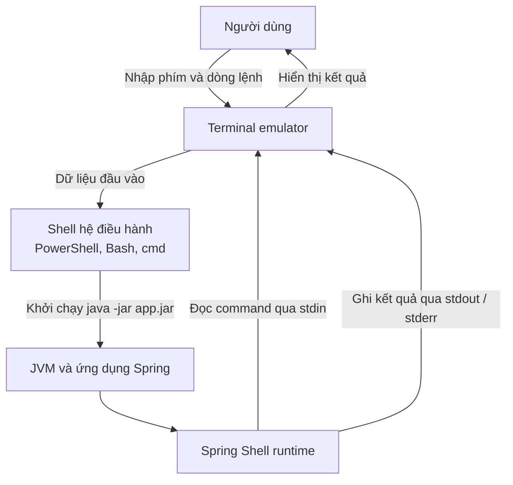

# CLI, terminal, shell của hệ điều hành và ứng dụng Spring Shell

Khi mở PowerShell hoặc Bash, gõ `java -jar support-cli.jar` rồi thấy một dấu nhắc như `support:>`, ta đang làm việc qua nhiều lớp khác nhau. Terminal nhận phím gõ và hiển thị kết quả. Shell của hệ điều hành phân tích lệnh khởi chạy chương trình. Sau khi chương trình Java bắt đầu, Spring Shell tiếp nhận các lệnh dành riêng cho ứng dụng.

Phân biệt được các lớp này giúp ta biết một lệnh được xử lý ở đâu, vì sao cú pháp thay đổi giữa các môi trường và Spring Shell thực sự đảm nhiệm phần việc nào.

## Mục tiêu học tập

Sau bài học, bạn có thể:

- Giải thích CLI là kiểu giao diện tương tác bằng lệnh và nhận biết các dạng CLI phổ biến.
- Phân biệt terminal, shell của hệ điều hành và shell được xây dựng bên trong một ứng dụng.
- Mô tả luồng từ lúc người dùng nhập lệnh khởi chạy Java đến lúc Spring Shell thực thi command.
- Nhận biết command, argument, option, input, output và exit code trong một chương trình CLI.
- Xác định phần nào chịu trách nhiệm cho prompt, phân tích cú pháp, trợ giúp và tự hoàn thành lệnh.

## 1. CLI là gì?

CLI là viết tắt của *Command-Line Interface*, nghĩa là giao diện dòng lệnh. Đây là cách người dùng tương tác với một chương trình bằng cách nhập các dòng văn bản chứa tên lệnh, đối số và tùy chọn, sau đó đọc kết quả được chương trình trả về.

Ví dụ quen thuộc:

```text
git status
java -version
docker ps
```

Trong các ví dụ này, người dùng mô tả hành động bằng văn bản. Chương trình phân tích phần đầu vào, thực hiện công việc và hiển thị kết quả. CLI thường phù hợp với công việc cần tốc độ, khả năng lặp lại, tự động hóa hoặc thao tác trên máy chủ không có giao diện đồ họa.

CLI mô tả **cách người dùng giao tiếp với chương trình**. Bản thân khái niệm này không quy định chương trình phải được viết bằng Java, phải chạy trong một terminal cụ thể hay phải có một vòng lặp tương tác liên tục.

### 1.1. CLI chạy một lệnh và CLI tương tác

Một CLI có thể hoạt động theo nhiều cách.

**Chạy một lệnh rồi kết thúc** (*one-shot command*) thường nhận toàn bộ yêu cầu ngay khi khởi chạy:

```text
tool report --input sales.csv --format json
```

Chương trình đọc các đối số, tạo báo cáo, trả kết quả và kết thúc. Cách này thuận tiện cho script của hệ điều hành, pipeline và hệ thống tự động hóa.

**Chạy theo phiên tương tác** (*REPL*) mở một dấu nhắc, chờ người dùng nhập lệnh, thực hiện lệnh rồi tiếp tục chờ:

```text
app:> help
app:> report list
app:> report show --id 42
app:> exit
```

REPL là mô hình *Read–Eval–Print Loop*: đọc đầu vào, phân tích và thực thi, hiển thị kết quả, rồi lặp lại. Spring Shell thường được dùng để xây dựng kiểu ứng dụng này. Một ứng dụng cũng có thể hỗ trợ chế độ chạy không tương tác hoặc nhận lệnh từ nguồn đầu vào khác nếu được cấu hình và triển khai phù hợp.

### 1.2. Thành phần của một dòng lệnh

Một dòng lệnh thường có các thành phần sau:

```text
customer find 42 --include-disabled --format json
```

| Thành phần | Ví dụ | Ý nghĩa |
|---|---|---|
| Tên command | `customer find` | Hành động mà ứng dụng cung cấp |
| Argument vị trí | `42` | Giá trị được nhận theo vị trí trong cú pháp command |
| Option | `--include-disabled` | Tùy chọn có tên, thường bật một hành vi hoặc cờ |
| Giá trị của option | `json` | Giá trị gắn với một option, ở đây là định dạng đầu ra |

Đây là cú pháp minh họa. Tên command, cách đặt option và quy tắc bắt buộc hay tùy chọn do từng ứng dụng định nghĩa. Một CLI tốt cần có cú pháp nhất quán, thông báo lỗi dễ hiểu và hướng dẫn sử dụng có thể tra cứu.

## 2. Terminal: nơi nhập và hiển thị văn bản

Terminal là môi trường giao tiếp văn bản giữa người dùng và tiến trình đang chạy. Trên máy tính hiện đại, ứng dụng terminal thường là *terminal emulator* — chương trình mô phỏng một thiết bị đầu cuối để các ứng dụng dòng lệnh có thể nhận dữ liệu đầu vào và gửi dữ liệu đầu ra.

Một terminal emulator thường cung cấp:

- Vùng hiển thị văn bản, màu sắc và con trỏ.
- Khả năng nhận phím gõ, phím điều khiển và gửi dữ liệu đến tiến trình đang nhận đầu vào.
- Cửa sổ, tab, cuộn lịch sử hiển thị, sao chép và dán.
- Cấu hình font chữ, kích thước cửa sổ và một số hành vi hiển thị.

Các ứng dụng như Windows Terminal, Terminal trên macOS và nhiều terminal emulator trên Linux đảm nhiệm vai trò này. Chúng không nhất thiết hiểu ý nghĩa nghiệp vụ của lệnh `customer find`; chúng chủ yếu chuyển dữ liệu đầu vào và hiển thị dữ liệu đầu ra.

### 2.1. Terminal không phải là shell

Terminal và shell thường xuất hiện cùng nhau nên dễ bị gọi lẫn. Có thể phân biệt bằng câu hỏi:

- **Terminal:** Tôi nhập và nhìn thấy dữ liệu ở đâu?
- **Shell:** Ai phân tích dòng lệnh tôi vừa nhập và quyết định phải làm gì?

Khi mở Windows Terminal và thấy dấu nhắc `PS C:\>` thì Windows Terminal là ứng dụng terminal, còn PowerShell là shell đang chạy bên trong cửa sổ đó. Nếu mở một tab khác chạy Ubuntu với Bash, terminal emulator vẫn có thể là Windows Terminal nhưng shell đã thay đổi.

Trong mô hình hệ điều hành, dữ liệu giữa terminal và tiến trình thường đi qua các luồng chuẩn như `stdin`, `stdout`, `stderr`. Trên các hệ Unix, một terminal giả lập thường được nối với tiến trình thông qua pseudo-terminal (PTY). Chi tiết cơ chế khác nhau giữa hệ điều hành, nhưng ý tưởng chung vẫn là terminal cung cấp kênh nhập và xuất cho tiến trình.

## 3. Shell của hệ điều hành

Shell của hệ điều hành là chương trình nhận dòng lệnh từ người dùng, phân tích cú pháp và thực hiện hành động tương ứng. Tùy lệnh, shell có thể tự xử lý một thao tác hoặc khởi chạy một chương trình khác.

Một số shell phổ biến:

| Hệ điều hành / môi trường | Shell thường gặp | Ví dụ dấu nhắc |
|---|---|---|
| Windows | PowerShell | `PS C:\work>` |
| Windows | Command Prompt (`cmd.exe`) | `C:\work>` |
| Linux | Bash, Zsh và các shell khác | `$` hoặc `user@host:~$` |
| macOS | Zsh, Bash và các shell khác | `%` hoặc `$` |

Shell của hệ điều hành thường đảm nhiệm các công việc như:

1. Đọc dòng lệnh người dùng nhập.
2. Phân tích tên chương trình, đối số và tùy chọn theo cú pháp của shell đó.
3. Xử lý biến môi trường, dấu nháy, ký tự đại diện, chuyển hướng và pipeline theo quy tắc của shell.
4. Tìm chương trình cần chạy, tạo tiến trình và truyền đối số cùng môi trường cho tiến trình.
5. Chờ tiến trình kết thúc khi cần, sau đó hiển thị kết quả và mã thoát.

Ví dụ, khi nhập:

```powershell
PS C:\tools> java -jar .\support-cli.jar
```

PowerShell phân tích lệnh khởi chạy `java`, truyền đối số `-jar` và đường dẫn JAR cho tiến trình Java. Sau đó JVM nạp ứng dụng. Nếu ứng dụng khởi tạo Spring Shell và mở prompt, các dòng lệnh tiếp theo sẽ được xử lý bởi ứng dụng đang chạy.

### 3.1. Built-in command và chương trình bên ngoài

Không phải mọi lệnh được gõ trong shell đều là một file thực thi độc lập. Một số lệnh được shell cung cấp trực tiếp, chẳng hạn `cd` trong nhiều shell. Những lệnh khác là chương trình bên ngoài, chẳng hạn `java`, `git` hoặc `docker` nếu chúng đã được cài đặt và có thể tìm thấy qua cấu hình đường dẫn thực thi.

Điều này giải thích vì sao cùng một mục tiêu có thể có cú pháp khác nhau giữa PowerShell, Bash và `cmd.exe`. Ví dụ, cách gán biến môi trường trước khi chạy chương trình khác nhau:

```powershell
# PowerShell
$env:APP_ENV = "dev"
java -jar .\app.jar
```

```bash
# Bash
APP_ENV=dev java -jar ./app.jar
```

Các dòng này thuộc cú pháp của shell hệ điều hành. Spring Shell không tự động biến cú pháp `$env:APP_ENV` hay `APP_ENV=dev` thành cú pháp command của ứng dụng.

### 3.2. Luồng chuẩn và mã thoát

Một tiến trình CLI thường làm việc với ba luồng chuẩn:

- `stdin` (*standard input*): nơi tiến trình nhận dữ liệu đầu vào.
- `stdout` (*standard output*): nơi tiến trình ghi kết quả thông thường.
- `stderr` (*standard error*): nơi tiến trình ghi thông báo lỗi hoặc chẩn đoán.

Shell có thể nối các luồng này với terminal, chuyển hướng chúng vào file hoặc kết nối đầu ra của tiến trình này với đầu vào của tiến trình khác qua pipeline. Vì vậy một chương trình CLI có thể chạy tương tác trong terminal hoặc chạy tự động mà không cần người dùng nhìn thấy prompt.

Khi kết thúc, tiến trình trả về một **exit code** cho hệ điều hành. Quy ước phổ biến là `0` biểu thị thành công và giá trị khác `0` biểu thị một dạng lỗi hoặc kết quả đặc biệt. Ý nghĩa cụ thể của từng mã phải do ứng dụng quy định và tài liệu hóa. Shell có thể dùng mã này để quyết định bước tiếp theo trong script.

## 4. Shell bên trong ứng dụng là gì?

Một ứng dụng có thể cung cấp một môi trường lệnh riêng bên trong chính tiến trình của nó. Môi trường này có prompt, bộ phân tích cú pháp, danh sách command và quy tắc xử lý đầu vào riêng. Người dùng vẫn nhập văn bản qua terminal, nhưng chương trình ứng dụng là thành phần hiểu các lệnh đó.

Ví dụ một công cụ quản trị có thể cung cấp các command:

```text
admin:> user list
admin:> user disable --id 42
admin:> backup create --target /data/archive
```

Các command trên mô tả nghiệp vụ của ứng dụng. Chúng không phải command mặc định của PowerShell, Bash hay `cmd.exe`. Chúng chỉ có ý nghĩa khi chương trình `admin` đã chạy và đăng ký các command tương ứng.

Đây là khác biệt quan trọng giữa shell của hệ điều hành và shell của ứng dụng:

- Shell hệ điều hành giúp người dùng khởi chạy, kết nối và điều phối các tiến trình.
- Shell của ứng dụng giúp người dùng gọi các thao tác mà riêng ứng dụng đó cung cấp.

Hai lớp có thể dùng các từ giống nhau như `help`, `exit` hoặc `status`, nhưng ý nghĩa phụ thuộc vào chương trình đang nhận dòng lệnh tại thời điểm đó.

## 5. Spring Shell là gì?

Spring Shell là framework trong hệ sinh thái Spring giúp xây dựng ứng dụng CLI bằng Java. Thay vì tự viết toàn bộ vòng lặp đọc dòng lệnh, bộ phân tích cú pháp, cơ chế đăng ký command và cách hiển thị trợ giúp, nhà phát triển có thể dùng các thành phần Spring Shell để định nghĩa những thao tác mà ứng dụng cung cấp.

Một ứng dụng Spring Shell thường có các thành phần sau:

- **Command:** một thao tác mà người dùng có thể gọi, chẳng hạn xem trạng thái, tìm bản ghi hoặc tạo báo cáo.
- **Command method:** phương thức Java thực hiện thao tác đó.
- **Argument và option:** dữ liệu người dùng truyền vào command.
- **Command registration:** cơ chế để Spring Shell nhận biết command và đưa nó vào danh sách có thể gọi.
- **Parsing và conversion:** phân tích dòng lệnh, tách giá trị và chuyển chúng sang kiểu Java phù hợp.
- **Help và completion:** hỗ trợ người dùng khám phá cú pháp và hoàn thành command khi đang nhập.
- **Result handling:** tiếp nhận kết quả từ command và trình bày cho người dùng.

Spring Shell tích hợp với mô hình ứng dụng Spring. Vì vậy command có thể được tổ chức thành bean, phối hợp với service, repository và các thành phần khác của ứng dụng. Phần nghiệp vụ vẫn nên nằm trong các lớp phù hợp; command method đóng vai trò lớp giao tiếp giữa người dùng CLI và nghiệp vụ.

### 5.1. Định nghĩa command bằng annotation

Một cách phổ biến để khai báo command là dùng `@ShellComponent` cho lớp chứa command và `@ShellMethod` cho phương thức có thể được gọi từ shell.

Ví dụ:

```java
import org.springframework.shell.standard.ShellComponent;
import org.springframework.shell.standard.ShellMethod;
import org.springframework.shell.standard.ShellOption;

@ShellComponent
public class GreetingCommands {

    @ShellMethod(key = "hello", value = "Gửi lời chào")
    public String hello(
            @ShellOption(value = "--name", defaultValue = "bạn") String name) {
        return "Xin chào, " + name + "!";
    }
}
```

Trong ví dụ:

- `@ShellComponent` đánh dấu lớp chứa các command để Spring quản lý và Spring Shell phát hiện.
- `@ShellMethod` đăng ký phương thức `hello` thành command có key là `hello`.
- `@ShellOption` khai báo option `--name` và giá trị mặc định nếu người dùng bỏ qua option.
- Giá trị trả về là chuỗi mà Spring Shell có thể hiển thị trong phiên làm việc.

Khi ứng dụng đã khởi động, người dùng có thể nhập:

```text
app:> hello
Xin chào, bạn!

app:> hello --name "Lan"
Xin chào, Lan!
```

Đây là ví dụ minh họa cho mô hình annotation. Tên package, thuộc tính annotation và cách cấu hình có thể thay đổi giữa các phiên bản Spring Shell; hãy dùng API tương ứng với phiên bản dependency của dự án.

### 5.2. Điều gì xảy ra khi một command được gọi?

Ở mức khái niệm, quá trình thực thi command thường diễn ra theo các bước:

1. Spring Shell nhận một dòng đầu vào từ phiên làm việc.
2. Bộ phân tích cú pháp xác định command và tách argument, option.
3. Các giá trị được chuyển đổi sang kiểu tham số Java cần thiết.
4. Các điều kiện đầu vào được kiểm tra; nếu thiếu hoặc sai kiểu, ứng dụng trả thông báo lỗi phù hợp.
5. Spring Shell gọi command method đã đăng ký.
6. Phương thức phối hợp với service nghiệp vụ và trả kết quả.
7. Spring Shell trình bày kết quả hoặc thông tin lỗi, rồi tiếp tục chờ lệnh kế tiếp nếu đang ở chế độ tương tác.

Ví dụ, với lệnh `hello --name "Lan"`, Spring Shell nhận diện command `hello`, lấy chuỗi `Lan` cho option `--name`, truyền giá trị đó vào tham số `name`, gọi phương thức Java và hiển thị chuỗi được trả về.

Nhờ cơ chế này, nhà phát triển tập trung vào hành vi của command và nghiệp vụ phía sau. Những phần dùng chung như khám phá command, trợ giúp, phân tích đối số và vòng lặp tương tác được framework hỗ trợ.

### 5.3. Spring Shell không thay thế shell của hệ điều hành

Spring Shell chạy bên trong một ứng dụng Java. Người dùng thường cần một shell hệ điều hành để khởi chạy ứng dụng đó trước:

```powershell
PS C:\tools> java -jar .\support-cli.jar
support:> help
support:> hello --name "Lan"
support:> exit
PS C:\tools>
```

Trong ví dụ này có hai giai đoạn:

1. `java -jar .\support-cli.jar` được PowerShell phân tích và dùng để khởi chạy tiến trình Java.
2. Khi prompt `support:>` xuất hiện, ứng dụng Spring Shell đang nhận và xử lý các command như `help` hoặc `hello`.

Khi ứng dụng kết thúc, quyền điều khiển quay lại PowerShell và dấu nhắc `PS C:\tools>` xuất hiện trở lại. Tên prompt có thể được cấu hình, nên không nên dựa riêng vào hình thức dấu nhắc để xác định framework; hãy xem ngữ cảnh chương trình đang chạy.

Một lệnh như `cd` thường thuộc shell hệ điều hành. Nó không tự động hoạt động trong prompt Spring Shell, trừ khi ứng dụng định nghĩa command có chức năng tương tự. Tương tự, command `user list` của ứng dụng Spring Shell không tự động có sẵn tại dấu nhắc PowerShell sau khi ứng dụng đã thoát.

## 6. Luồng hoạt động tổng thể

Sơ đồ sau mô tả các lớp tham gia khi khởi động và sử dụng một ứng dụng Spring Shell:



Sơ đồ thể hiện hai vai trò phân tích lệnh ở hai thời điểm khác nhau. Ban đầu, shell hệ điều hành phân tích lệnh dùng để khởi chạy chương trình. Khi ứng dụng Spring Shell đang chạy ở chế độ tương tác, runtime của ứng dụng nhận các dòng command tiếp theo qua đầu vào của tiến trình và xử lý theo command đã đăng ký.

Có thể mô tả luồng bằng một ví dụ cụ thể:

1. Người dùng mở terminal emulator.
2. Terminal chạy PowerShell, Bash hoặc shell hệ điều hành khác.
3. Người dùng nhập `java -jar app.jar`.
4. Shell hệ điều hành tìm Java và khởi chạy JVM với file JAR cùng các đối số.
5. Ứng dụng Spring khởi tạo, các command được đăng ký và Spring Shell mở phiên tương tác nếu cấu hình yêu cầu.
6. Người dùng nhập `hello --name "Lan"` tại prompt của ứng dụng.
7. Spring Shell phân tích dòng lệnh, gọi command method và gửi kết quả ra luồng đầu ra.
8. Khi người dùng thoát ứng dụng, tiến trình Java kết thúc và shell hệ điều hành tiếp tục nhận lệnh.

## 7. Chế độ tương tác và chạy script

Một CLI phục vụ cả người dùng trực tiếp lẫn tự động hóa cần xác định rõ hai kiểu sử dụng.

### 7.1. Phiên tương tác

Trong phiên tương tác, ứng dụng duy trì vòng lặp nhận lệnh. Người dùng có thể gọi nhiều command liên tiếp, xem trợ giúp, khám phá cú pháp và xử lý kết quả từng bước.

```text
app:> help
app:> customer find --id 42
app:> report generate --format csv
app:> exit
```

Phiên tương tác hữu ích khi người dùng cần khám phá dữ liệu, thực hiện một chuỗi thao tác có quyết định ở giữa hoặc cần phản hồi ngay sau mỗi lệnh. Prompt, help và tự hoàn thành giúp giảm nhu cầu ghi nhớ cú pháp.

### 7.2. Chạy lệnh theo script hoặc chế độ không tương tác

Trong chế độ script, một chuỗi lệnh được chuẩn bị trước để thực thi mà không cần người dùng nhập từng dòng. Ví dụ, nội dung một file lệnh giả định có thể là:

```text
customer find --id 42
report generate --format csv
```

File trên chỉ là ví dụ về nội dung lệnh. Để chạy được, ứng dụng phải hỗ trợ cách nạp lệnh từ file, `stdin`, tham số khởi chạy hoặc một cơ chế không tương tác khác. Không phải mọi ứng dụng Spring Shell đều tự động thực thi một file văn bản chỉ vì file đó chứa command hợp lệ.

Khi thiết kế chế độ script, cần quyết định và tài liệu hóa:

- Cách truyền lệnh vào chương trình.
- Có hiển thị prompt hay không.
- Khi một command thất bại, chương trình dừng ngay hay tiếp tục các command sau.
- Kết quả được ghi ra đâu và theo định dạng nào.
- Exit code phản ánh thành công toàn bộ script hay trạng thái của command cuối cùng.
- Cách xử lý input không hợp lệ, dữ liệu thiếu và thao tác có tác động lớn.

Chế độ tương tác và chế độ script có thể dùng chung command nghiệp vụ, nhưng cách nhận input, trình bày output và báo trạng thái kết thúc cần được thiết kế phù hợp với từng môi trường. Cách bật chế độ không tương tác cụ thể phụ thuộc phiên bản và cấu hình Spring Shell đang dùng.

## 8. Phân biệt các lớp qua tình huống thực tế

Giả sử nhóm phát triển xây dựng một công cụ quản trị tên `support-cli` bằng Spring Shell.

| Tình huống | Thành phần xử lý chính | Lý do |
|---|---|---|
| Mở cửa sổ Windows Terminal | Terminal emulator | Tạo môi trường nhập và hiển thị văn bản |
| Nhập `java -jar support-cli.jar` tại `PS C:\>` | PowerShell | Phân tích và khởi chạy tiến trình Java |
| Ứng dụng hiển thị `support:>` | Ứng dụng Spring Shell | Prompt của phiên command bên trong ứng dụng |
| Nhập `ticket list --status open` tại `support:>` | Spring Shell | Phân tích command và gọi thao tác đã đăng ký |
| Command gọi `TicketService` để lấy dữ liệu | Mã nghiệp vụ của ứng dụng | Thực hiện quy tắc và truy xuất dữ liệu |
| Kết quả được ghi ra màn hình | Ứng dụng và terminal | Ứng dụng ghi output; terminal hiển thị output |
| Nhập `exit` để kết thúc phiên ứng dụng | Spring Shell / ứng dụng | Xử lý yêu cầu kết thúc tiến trình theo cấu hình |
| Dấu nhắc `PS C:\>` xuất hiện lại | PowerShell | Tiến trình Java đã kết thúc, shell cha tiếp tục |

Nếu lệnh `ticket list` báo không tồn tại khi nhập tại PowerShell, điều đó không nhất thiết có nghĩa command bị lỗi. Có thể người dùng đang nhập command của ứng dụng tại sai lớp: command chỉ được đăng ký trong phiên Spring Shell.

## 9. Những nhầm lẫn thường gặp

### Nhầm terminal với shell

Terminal cung cấp nơi nhập và hiển thị. Shell phân tích dòng lệnh. Một terminal emulator có thể chạy nhiều loại shell khác nhau.

### Nhầm shell hệ điều hành với Spring Shell

PowerShell hoặc Bash quản lý lệnh ở cấp hệ điều hành. Spring Shell xử lý command do ứng dụng Java đăng ký. Việc cùng xuất hiện trong một cửa sổ không làm chúng trở thành một chương trình.

### Cho rằng mọi command đều dùng chung một cú pháp

PowerShell, Bash và bộ phân tích lệnh của ứng dụng có thể có quy tắc khác nhau về dấu nháy, biến, ký tự đặc biệt và option. Khi chuyển một lệnh từ terminal hệ điều hành vào prompt ứng dụng, cần kiểm tra cú pháp của lớp đang nhận lệnh.

### Cho rằng Spring Shell tự cung cấp nghiệp vụ

Spring Shell cung cấp hạ tầng xây dựng CLI. Các thao tác như tìm khách hàng, tạo báo cáo hay khóa tài khoản vẫn phải được ứng dụng triển khai và kết nối với service nghiệp vụ phù hợp.

### Cho rằng command trong ứng dụng luôn chạy được từ script hệ điều hành

Script PowerShell hoặc Bash được shell hệ điều hành diễn giải. Command Spring Shell thuộc ứng dụng. Muốn tự động hóa các command đó, ứng dụng cần có chế độ nhận lệnh phù hợp hoặc cung cấp một giao diện gọi command từ bên ngoài.

## 10. Khi nào nên dùng Spring Shell?

Spring Shell phù hợp khi một ứng dụng Java cần cung cấp tập command riêng, đặc biệt trong các trường hợp:

- Công cụ quản trị hệ thống hoặc vận hành nội bộ.
- Công cụ hỗ trợ phát triển, kiểm tra và xử lý sự cố.
- Công cụ nhập, xuất, chuyển đổi hoặc kiểm tra dữ liệu.
- Quy trình bảo trì cần nhiều thao tác có cấu trúc và có trợ giúp.
- Ứng dụng cần kết hợp phiên tương tác với khả năng tự động hóa qua script hoặc cơ chế không tương tác.

Nếu nhu cầu chỉ là chạy một tác vụ đơn giản với một vài tham số, một chương trình nhận đối số khi khởi chạy có thể đã đủ. Nếu người dùng cần một phiên làm việc có nhiều command, trợ giúp, tự hoàn thành và tích hợp với các bean Spring, Spring Shell cung cấp một nền tảng phù hợp hơn.

## 11. Checklist để xác định đúng nơi xử lý lệnh

Khi gặp một dòng lệnh, hãy tự hỏi:

1. Dòng lệnh đang được nhập tại dấu nhắc nào: PowerShell, Bash hay prompt của ứng dụng?
2. Ai đăng ký command đó: shell hệ điều hành hay ứng dụng Spring Shell?
3. Ai chịu trách nhiệm phân tích dấu nháy, biến môi trường và pipeline?
4. Dữ liệu được truyền qua argument, option hay `stdin`?
5. Kết quả đi qua `stdout` hay `stderr`?
6. Khi tiến trình kết thúc, exit code nào được trả về cho shell gọi nó?

Trả lời được các câu hỏi này sẽ giúp khoanh vùng lỗi nhanh hơn. Ví dụ, lỗi `command not found` có thể xuất hiện vì shell hiện tại không biết command, vì chương trình chưa được cài đặt, hoặc vì người dùng đang gọi command ứng dụng ở ngoài phiên ứng dụng.

## 12. Tự kiểm tra

**Câu 1.** Terminal emulator và shell của hệ điều hành khác nhau ở điểm nào?

**Gợi ý trả lời:** Terminal cung cấp kênh nhập và hiển thị; shell đọc và diễn giải dòng lệnh, sau đó thực hiện thao tác hoặc khởi chạy tiến trình.

**Câu 2.** Khi nhập `java -jar app.jar`, thành phần nào phân tích lệnh trước tiên?

**Gợi ý trả lời:** Shell hệ điều hành đang chạy trong terminal phân tích lệnh khởi chạy và tạo tiến trình Java.

**Câu 3.** Khi prompt `app:>` xuất hiện và người dùng nhập `customer list`, thành phần nào xử lý command?

**Gợi ý trả lời:** Runtime Spring Shell trong ứng dụng xử lý dòng command, tìm command đã đăng ký và gọi phương thức tương ứng.

**Câu 4.** Vì sao `cd` có thể hoạt động tại PowerShell nhưng không hoạt động tại prompt Spring Shell?

**Gợi ý trả lời:** `cd` là command của shell hệ điều hành trong môi trường đó. Spring Shell chỉ nhận các command mà ứng dụng cung cấp; nó không tự động kế thừa command của PowerShell.

**Câu 5.** Một file chứa các dòng command Spring Shell có chắc chắn chạy được bằng `bash file.sh` không?

**Gợi ý trả lời:** Không. Bash sẽ diễn giải nội dung file theo cú pháp Bash. Muốn chạy command của ứng dụng, cần khởi chạy ứng dụng và dùng cơ chế mà ứng dụng hỗ trợ để truyền các dòng lệnh vào Spring Shell.

## Kết luận

CLI là cách tương tác bằng lệnh. Terminal là nơi nhập và hiển thị dữ liệu. Shell của hệ điều hành diễn giải lệnh ở cấp hệ điều hành và khởi chạy tiến trình. Spring Shell là framework giúp ứng dụng Java xây dựng một shell riêng với các command phục vụ nghiệp vụ của ứng dụng.

Khi một ứng dụng Spring Shell chạy trong terminal, các lớp này phối hợp với nhau nhưng giữ vai trò riêng. Hiểu rõ ranh giới đó là nền tảng để xây dựng command, xử lý argument và option, hỗ trợ người dùng, chạy script, quản lý output và exit code trong các bài tiếp theo của module Spring Shell.
