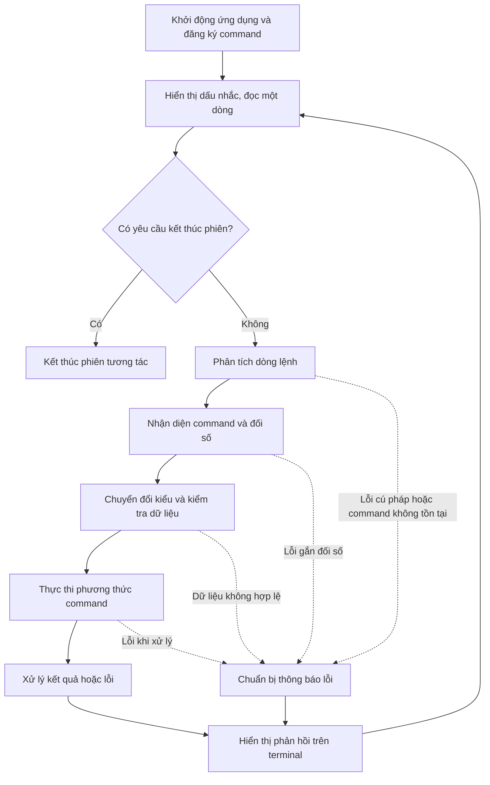

# Vòng lặp đọc–phân tích–thực thi–hiển thị trong một REPL

REPL là viết tắt của *Read–Eval–Print Loop*: đọc một dòng lệnh, phân tích và thực thi lệnh đó, hiển thị kết quả, rồi quay lại chờ dòng tiếp theo. Đây là cách một ứng dụng dòng lệnh tương tác hoạt động: người dùng nhập lệnh tại dấu nhắc, nhận phản hồi ngay trong terminal và tiếp tục làm việc mà không phải khởi động lại ứng dụng sau mỗi lệnh.

Spring Shell cung cấp nền tảng để xây dựng kiểu ứng dụng này bằng Spring. Nhà phát triển khai báo các command, mô tả đối số, bổ sung chuyển đổi và validation, rồi để Spring Shell kết nối đầu vào terminal với command tương ứng. Trong phạm vi module Spring Shell, REPL là nền tảng để hiểu cách command được tiếp nhận và chạy; các nội dung về trợ giúp, tự hoàn thành, định dạng output, chạy script, mã thoát, kiểm thử và đóng gói sẽ mở rộng từng phần của quy trình đó.

## REPL vận hành như thế nào?

Một phiên tương tác thường bắt đầu sau khi ứng dụng Spring khởi động và các command đã được đăng ký. Spring Shell hiển thị dấu nhắc, chờ người dùng nhập một dòng. Dòng đó đi qua các bước đọc, phân tích, chuyển đổi và kiểm tra đối số, thực thi command, rồi xử lý kết quả để hiển thị. Khi hoàn tất, shell lại hiển thị dấu nhắc và chờ lệnh tiếp theo.



Sơ đồ thể hiện luồng khái niệm. Chi tiết xử lý lỗi, cách hiển thị prompt và điều kiện kết thúc phụ thuộc vào cấu hình cũng như phiên bản Spring Shell của ứng dụng.

## 1. Read — đọc đầu vào

Ở bước *Read*, shell chờ người dùng nhập lệnh và gửi dòng văn bản vừa nhận vào bộ xử lý. Dấu nhắc (prompt) cho biết ứng dụng đang sẵn sàng nhận lệnh. Ví dụ, `app:>` có thể là prompt của một ứng dụng; người dùng nhập `greet --name Lan` sau dấu nhắc đó.

Đầu vào của REPL là dòng lệnh mà người dùng nhập trong phiên tương tác. Một dòng có thể chứa tên command, các tùy chọn và giá trị của chúng. Người dùng có thể cần đặt giá trị trong dấu nháy nếu giá trị có khoảng trắng, chẳng hạn `report --title "Doanh thu tháng 11"`. Cách phân tích dấu nháy cụ thể do bộ phân tích dòng lệnh của shell quyết định.

Read chỉ tiếp nhận văn bản. Ở thời điểm này, shell chưa biết command có tồn tại hay giá trị người dùng nhập có đúng kiểu hay không. Những việc đó thuộc các bước tiếp theo.

## 2. Parse — phân tích và phân giải command

Ở bước *Parse*, Spring Shell phân tích dòng vừa đọc thành những thành phần có ý nghĩa: tên command, tùy chọn, đối số và giá trị tương ứng. Sau đó, shell tìm command đã được đăng ký có khóa khớp với tên command người dùng nhập.

Ví dụ, dòng:

```text
greet --name Lan
```

có thể được hiểu thành:

| Thành phần | Giá trị |
|---|---|
| Tên command | `greet` |
| Tên tùy chọn | `--name` |
| Giá trị đối số | `Lan` |

Nếu người dùng nhập tên command không được đăng ký, shell không thể chọn phương thức xử lý tương ứng và cần trả về thông báo phù hợp. Nếu cú pháp không đúng, chẳng hạn thiếu giá trị cho một tùy chọn bắt buộc, lỗi được phát hiện trong quá trình phân tích hoặc gắn đối số.

Sau khi nhận diện command, Spring Shell liên kết các giá trị đầu vào với tham số của phương thức xử lý. Tùy cách khai báo command, đối số có thể được truyền qua tùy chọn có tên hoặc theo vị trí. Các giá trị mặc định giúp command tiếp tục hoạt động khi người dùng bỏ qua một tùy chọn không bắt buộc.

## 3. Convert và validate — chuyển đổi kiểu, kiểm tra đối số

Dòng lệnh được đọc dưới dạng văn bản, trong khi phương thức Java có thể yêu cầu `int`, `long`, `boolean`, ngày tháng hoặc một kiểu dữ liệu khác. Spring Shell phối hợp với cơ chế chuyển đổi để biến giá trị đầu vào thành kiểu tham số mà command khai báo.

Ví dụ, command nhận `--quantity 5` có thể chuyển chuỗi `5` thành số nguyên trước khi gọi phương thức. Nếu người dùng nhập `--quantity many`, quá trình chuyển đổi không thành công và command không nên nhận một giá trị số không hợp lệ.

Chuyển đổi kiểu và validation giải quyết hai câu hỏi khác nhau:

- **Chuyển đổi kiểu:** giá trị văn bản có thể biểu diễn thành kiểu dữ liệu mà tham số yêu cầu hay không?
- **Validation:** giá trị sau khi chuyển đổi có thỏa mãn quy tắc của ứng dụng hay không? Ví dụ, số lượng phải lớn hơn 0 hoặc mã sản phẩm không được để trống.

Validation có thể được thực hiện thông qua cơ chế kiểm tra được cấu hình trong ứng dụng hoặc trong chính logic xử lý. Không nên xem việc chuyển đổi thành công là bằng chứng rằng dữ liệu đã hợp lệ về nghiệp vụ. Một số `-2` vẫn chuyển đổi được thành `int`, nhưng có thể vi phạm quy tắc số lượng phải là số dương.

## 4. Eval — thực thi command

Khi command đã được xác định và các đối số cần thiết đã được gắn, chuyển đổi và kiểm tra, Spring Shell gọi phương thức Java tương ứng. Phương thức đó thường điều phối đến service để thực hiện nghiệp vụ, chẳng hạn tra cứu dữ liệu, tạo bản ghi hoặc tính toán.

Command nên đóng vai trò là điểm tiếp nhận tương tác: nhận tham số, gọi lớp nghiệp vụ và chuẩn bị kết quả phù hợp với người dùng CLI. Việc đặt nghiệp vụ trong service giúp logic có thể được tái sử dụng và kiểm thử mà không phụ thuộc vào cách người dùng nhập lệnh.

Ví dụ khai báo một command đơn giản bằng annotation:

```java
import org.springframework.shell.standard.ShellComponent;
import org.springframework.shell.standard.ShellMethod;
import org.springframework.shell.standard.ShellOption;

@ShellComponent
public class GreetingCommands {

    @ShellMethod(key = "greet", value = "Gửi lời chào")
    public String greet(
            @ShellOption(value = "--name", defaultValue = "bạn") String name) {
        return "Xin chào, " + name + "!";
    }
}
```

`@ShellComponent` đánh dấu bean chứa các command của Spring Shell. `@ShellMethod` đăng ký phương thức với khóa `greet`, còn `@ShellOption` mô tả tùy chọn `--name` và giá trị mặc định khi người dùng không truyền tùy chọn đó. Khi người dùng chạy command, Spring Shell liên kết đầu vào với tham số `name` rồi gọi phương thức.

Trong ứng dụng thực tế, phương thức command có thể nhận một service qua cơ chế dependency injection của Spring:

```java
@ShellComponent
public class ProductCommands {

    private final ProductService productService;

    public ProductCommands(ProductService productService) {
        this.productService = productService;
    }

    @ShellMethod(key = "product-find", value = "Tìm sản phẩm theo mã")
    public String find(@ShellOption("--code") String code) {
        Product product = productService.findByCode(code);
        return product == null
                ? "Không tìm thấy sản phẩm: " + code
                : product.toString();
    }
}
```

Đây là ví dụ minh họa cách tách command khỏi nghiệp vụ; `ProductService` và `Product` là các kiểu do ứng dụng định nghĩa. Cách xử lý khi không tìm thấy dữ liệu cần phù hợp với hợp đồng của service trong dự án thực tế.

## 5. Print — xử lý và hiển thị kết quả

Sau khi phương thức command chạy xong, giá trị trả về được chuyển đến cơ chế xử lý kết quả của shell để hiển thị trên terminal. Với ví dụ `greet`, phương thức trả về một chuỗi nên người dùng nhìn thấy chính nội dung lời chào. Với command trả về kiểu dữ liệu khác, ứng dụng có thể cần cách định dạng hoặc bộ xử lý kết quả phù hợp để thông tin dễ đọc.

Không phải command nào cũng cần trả về dữ liệu. Một command có thể thực hiện thao tác rồi thông báo kết quả, hoặc không tạo ra nội dung hiển thị. Điều quan trọng là thiết kế phản hồi rõ ràng: người dùng cần biết thao tác đã hoàn tất, dữ liệu nào được trả về hoặc vì sao thao tác không thể thực hiện.

Ví dụ một phiên tương tác:

```text
app:> greet --name Lan
Xin chào, Lan!
app:> greet
Xin chào, bạn!
app:>
```

Ở lần gọi đầu tiên, giá trị `Lan` được truyền vào tham số `name`. Ở lần gọi thứ hai, người dùng bỏ qua `--name`, vì vậy giá trị mặc định `bạn` được sử dụng. Sau khi kết quả được hiển thị, shell quay lại prompt để nhận lệnh mới.

## 6. Loop — quay lại chờ lệnh tiếp theo

Sau bước hiển thị, phần *Loop* đưa phiên tương tác trở lại trạng thái chờ đầu vào. Mỗi dòng lệnh mới đi qua quy trình tương tự. Nhờ vậy, người dùng có thể thực hiện nhiều thao tác trong cùng một phiên và quan sát phản hồi sau từng thao tác.

Vòng lặp thường kết thúc khi người dùng gọi command thoát, đầu vào kết thúc hoặc ứng dụng được yêu cầu dừng. Trong môi trường terminal, tín hiệu kết thúc đầu vào có thể khác nhau giữa các hệ điều hành và cách chạy ứng dụng. Vì vậy, tài liệu hướng dẫn sử dụng nên nêu rõ cách thoát mà ứng dụng hỗ trợ.

REPL không tự động giữ mọi biến cục bộ giữa các lần gọi command. Mỗi lần gọi phương thức là một lần thực thi mới. Nếu ứng dụng cần lưu trạng thái giữa các lệnh — ví dụ lựa chọn hiện tại, bộ lọc đang dùng hoặc một phiên làm việc — trạng thái đó phải được quản lý rõ ràng trong bean hay thành phần lưu trữ phù hợp. Cũng cần cân nhắc vòng đời bean và khả năng nhiều thao tác cùng truy cập trạng thái đó.

## Xử lý lỗi trong vòng lặp

Lỗi có thể xuất hiện ở nhiều giai đoạn. Xác định đúng giai đoạn giúp đưa ra thông báo có ích và quyết định liệu người dùng có thể sửa lệnh rồi thử lại hay không.

| Giai đoạn | Ví dụ | Phản hồi phù hợp |
|---|---|---|
| Phân tích | Tên command không tồn tại hoặc cú pháp sai | Cho biết command/cú pháp có vấn đề và gợi ý cách gọi đúng |
| Gắn và chuyển đổi đối số | `--quantity many` trong khi tham số yêu cầu số nguyên | Nêu rõ tùy chọn hoặc giá trị không chuyển đổi được |
| Validation | Số lượng bằng `0` trong khi nghiệp vụ yêu cầu số dương | Giải thích quy tắc dữ liệu cần thỏa mãn |
| Thực thi | Service không tìm thấy bản ghi hoặc không truy cập được hệ thống dữ liệu | Trả thông báo nghiệp vụ hoặc lỗi vận hành phù hợp |
| Xử lý kết quả | Không có bộ định dạng phù hợp cho kiểu dữ liệu trả về | Điều chỉnh cách biểu diễn kết quả hoặc cấu hình xử lý kết quả |

Trong một phiên tương tác được cấu hình để phục hồi sau lỗi, shell có thể hiển thị thông báo rồi quay lại prompt để người dùng nhập lệnh khác. Tuy nhiên, không nên giả định mọi lỗi đều có thể phục hồi: lỗi nghiêm trọng, lỗi khởi tạo hoặc ngoại lệ không được xử lý có thể làm ứng dụng dừng. Cần thiết kế và kiểm tra chính sách xử lý lỗi của ứng dụng thay vì dựa vào một giả định chung.

Thông báo lỗi nên giúp người dùng sửa hành động tiếp theo. Tránh chỉ in stack trace dài cho lỗi nhập liệu thông thường; đồng thời, log kỹ thuật cần giữ đủ thông tin để người vận hành điều tra lỗi hệ thống. Thông tin nhạy cảm như mật khẩu, token hoặc dữ liệu cá nhân không nên xuất hiện trong output hay log.

## REPL tương tác và chạy script

REPL thường gắn với chế độ tương tác: ứng dụng hiển thị prompt và chờ người dùng nhập từng dòng. Spring Shell cũng có thể được dùng trong tình huống chạy lệnh tự động hoặc xử lý đầu vào theo script. Trong trường hợp đó, dữ liệu đầu vào được cung cấp theo một luồng đã chuẩn bị sẵn và người dùng không nhất thiết nhìn thấy prompt sau mỗi lệnh.

Hai cách chạy có thể sử dụng cùng command và logic nghiệp vụ, nhưng yêu cầu vận hành khác nhau:

| Khía cạnh | Phiên tương tác | Chạy script hoặc không tương tác |
|---|---|---|
| Nguồn đầu vào | Người dùng nhập tại terminal | Tệp, pipeline hoặc tham số khởi chạy tùy cách tích hợp |
| Phản hồi | Hiển thị ngay để người dùng đọc | Cần định dạng ổn định để công cụ khác xử lý nếu có |
| Khi gặp lỗi | Người dùng có thể sửa và nhập lại | Cần quy định rõ dừng, tiếp tục hay ghi nhận lỗi |
| Kết thúc | Người dùng gọi lệnh thoát hoặc đóng đầu vào | Tiến trình hoàn tất theo luồng thực thi và chính sách mã thoát |

Không nên phụ thuộc vào việc người dùng sẽ đọc prompt hoặc trả lời câu hỏi tương tác khi command được chạy tự động. Một command dùng trong script cần có đối số tường minh, output có thể dự đoán và quy tắc lỗi/mã thoát được xác định rõ. Đây là cơ sở để xây dựng CLI vừa thuận tiện cho con người vừa có thể tích hợp vào quy trình tự động.

## Cách kiểm tra một command qua các bước REPL

Khi phát triển command mới, hãy kiểm tra lần lượt các ranh giới của vòng lặp:

1. **Đầu vào:** nhập command hợp lệ, command không tồn tại và giá trị có khoảng trắng để xác minh cách shell đọc dòng.
2. **Phân tích và gắn tham số:** thử tùy chọn có tên, đối số theo vị trí nếu command hỗ trợ, giá trị mặc định và trường hợp thiếu đối số.
3. **Chuyển đổi và validation:** thử cả giá trị đúng kiểu lẫn giá trị sai kiểu; kiểm tra thêm các quy tắc nghiệp vụ như giới hạn số lượng.
4. **Thực thi:** xác minh command gọi đúng service và truyền đúng dữ liệu.
5. **Hiển thị:** kiểm tra kết quả thành công, kết quả rỗng và lỗi có thông báo dễ hiểu.
6. **Lặp lại và kết thúc:** chạy nhiều command liên tiếp để phát hiện trạng thái bị rò rỉ giữa các lần gọi, sau đó xác minh cách thoát phiên.

Có thể kiểm thử logic nghiệp vụ của service độc lập, kiểm thử phương thức command với service giả lập, rồi thực hiện kiểm thử tích hợp với shell để xác minh việc phân tích dòng lệnh và hiển thị kết quả. Mỗi loại kiểm thử trả lời một câu hỏi khác nhau: nghiệp vụ có đúng không, command có điều phối đúng không, và toàn bộ đường đi từ terminal đến output có hoạt động như mong đợi không?

Khi nắm được vòng lặp đọc–phân tích–thực thi–hiển thị, ta có thể lần theo một lệnh từ lúc người dùng nhập đến khi nhận phản hồi. Cách nhìn này cũng giúp xác định đúng nơi cần bổ sung validation, trợ giúp, tự hoàn thành, xử lý lỗi hoặc định dạng output trong một ứng dụng Spring Shell.
