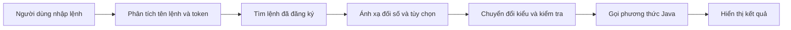

# Lệnh, lệnh con, tùy chọn, đối số và ngữ cảnh phiên

Một ứng dụng Spring Shell thường có nhiều thao tác mà người dùng gọi từ dấu nhắc lệnh: tạo dữ liệu, tìm kiếm, xem chi tiết, thay đổi cấu hình hoặc thực hiện một quy trình. Để giao diện dễ học và dễ tự động hóa, mỗi thao tác cần có tên ổn định, tham số rõ nghĩa và quy tắc xác định khi nào lệnh được phép chạy.

Spring Shell biến các phương thức Spring thành lệnh có thể gọi từ terminal. Framework phân tích dòng lệnh, ghép giá trị vào tham số phương thức, chuyển đổi kiểu dữ liệu rồi gọi phương thức tương ứng. Trong phiên tương tác, ứng dụng tiếp tục nhận lệnh cho đến khi người dùng thoát; trạng thái của ứng dụng có thể được dùng để quyết định lệnh nào đang khả dụng.

Sau bài này, bạn có thể:

- Khai báo lệnh bằng `@ShellComponent` và `@ShellMethod`.
- Tổ chức một nhóm thao tác thành họ lệnh có tiền tố như `project create` và `project list`.
- Phân biệt đối số vị trí với tùy chọn có tên, đặt bí danh, giá trị mặc định và cờ boolean.
- Hiểu cách Spring Shell ánh xạ đầu vào terminal vào tham số Java.
- Giữ trạng thái trong thời gian ứng dụng shell chạy và kiểm soát tính khả dụng của lệnh theo trạng thái đó.

> Các ví dụ Java trong bài dùng API annotation `org.springframework.shell.standard` (`@ShellComponent`, `@ShellMethod`, `@ShellOption`) thường gặp trong Spring Shell 2.x và 3.x. Các phiên bản mới cũng cung cấp mô hình annotation `@Command`, `@Argument`, `@Option`; hãy dùng nhất quán API phù hợp với phiên bản dependency của dự án.

## 1. Từ một dòng lệnh đến một phương thức Java

Một dòng nhập vào shell có thể chứa tên lệnh, đối số vị trí và các tùy chọn. Quy trình tổng quát như sau:



Ví dụ, với dòng lệnh:

```text
project create --name "Nền tảng học tập" --code learn
```

Spring Shell tìm lệnh `project create`, nhận `Nền tảng học tập` cho tùy chọn `name`, nhận `learn` cho tùy chọn `code`, chuyển chúng thành kiểu tham số tương ứng rồi gọi phương thức xử lý. Phương thức không cần tự tách chuỗi terminal hay tự tìm vị trí của `--name`.

## 2. Khai báo và đặt tên lệnh

Đánh dấu một lớp bằng `@ShellComponent` để Spring Shell phát hiện các phương thức lệnh trong lớp đó. Mỗi phương thức được đánh dấu bằng `@ShellMethod`:

```java
import org.springframework.shell.standard.ShellComponent;
import org.springframework.shell.standard.ShellMethod;

@ShellComponent
public class GreetingCommands {

    @ShellMethod(key = "hello", value = "Chào người dùng.")
    public String hello() {
        return "Xin chào!";
    }
}
```

- `@ShellComponent` đăng ký lớp làm nơi chứa các phương thức lệnh.
- `key` là tên người dùng gõ để gọi lệnh. Nếu bỏ qua, Spring Shell suy ra tên từ tên phương thức, thường chuyển camelCase thành kebab-case.
- `value` mô tả ngắn gọn chức năng và được dùng trong phần trợ giúp.
- Giá trị trả về của phương thức được Spring Shell chuyển tới cơ chế hiển thị kết quả.

Tên lệnh nên ngắn, nhất quán và thể hiện hành động. Các thao tác cùng một tài nguyên thường dùng chung một tiền tố, chẳng hạn `project create`, `project list`, `project show` và `project delete`.

### Nhóm lệnh và lệnh con

Spring Shell hỗ trợ tên lệnh gồm nhiều từ. Vì vậy, có thể dùng một tiền tố chung để tạo cảm giác phân cấp cho người dùng:

```java
@ShellMethod(key = "project create", value = "Tạo dự án mới.")
public String createProject(String name) {
    return "Đã nhận yêu cầu tạo dự án: " + name;
}

@ShellMethod(key = "project list", value = "Liệt kê dự án.")
public String listProjects() {
    return "Danh sách dự án.";
}

@ShellMethod(key = "project show", value = "Xem thông tin dự án.")
public String showProject(long id) {
    return "Thông tin dự án #" + id;
}
```

Người dùng gọi từng thao tác bằng tên đầy đủ, ví dụ `project create`. Đây là các lệnh riêng biệt cùng chia sẻ tiền tố `project`; tiền tố không tự tạo ra một phương thức cha để điều phối các lệnh con.

Có thể nhóm các lệnh liên quan trong màn hình trợ giúp bằng `@ShellCommandGroup`:

```java
import org.springframework.shell.standard.ShellCommandGroup;

@ShellComponent
@ShellCommandGroup("Quản lý dự án")
public class ProjectCommands {
    // Các phương thức @ShellMethod thuộc nhóm Quản lý dự án.
}
```

`@ShellCommandGroup` thay đổi cách các lệnh được phân nhóm khi hiển thị trợ giúp. Nó không đổi tên lệnh và cũng không tạo cấu trúc cha-con trong bộ phân tích lệnh. Có thể đặt nhóm ở cấp phương thức bằng thuộc tính `group` của `@ShellMethod` khi một lệnh cần thuộc nhóm khác.

### Bí danh cho lệnh

Một phương thức có thể được gọi bằng nhiều tên. Khai báo nhiều phần tử trong `key`:

```java
@ShellMethod(
    key = {"project create", "prj new"},
    value = "Tạo dự án mới."
)
public String createProject(String name) {
    return "Đã tạo dự án: " + name;
}
```

Hai tên gọi cùng chạy một phương thức. Bí danh hữu ích khi cần duy trì cách gọi cũ hoặc cung cấp tên ngắn cho thao tác thường dùng. Nên giới hạn số bí danh để người dùng vẫn dễ nhớ cú pháp chính.

## 3. Đối số vị trí và tùy chọn có tên

Đối số và tùy chọn đều truyền dữ liệu vào lệnh, nhưng cách người dùng chỉ định chúng khác nhau.

| Kiểu đầu vào | Cách viết | Đặc điểm |
|---|---|---|
| Đối số vị trí | `project show 42` | Giá trị được ánh xạ theo thứ tự tham số đã khai báo. |
| Tùy chọn có tên | `project show --id 42` | Giá trị được ánh xạ theo tên tùy chọn; dễ đọc khi lệnh có nhiều tham số. |
| Tùy chọn viết tắt | `project list -l 10` | Dùng bí danh ngắn, thường là một ký tự. |

Trong mô hình `@ShellMethod`, tham số phương thức có thể được cung cấp theo vị trí hoặc theo tên. Nếu không khai báo tên riêng bằng `@ShellOption`, tên tham số Java được dùng làm tên tùy chọn mặc định. Ví dụ:

```java
@ShellMethod(key = "greet", value = "Chào một người.")
public String greet(String name, int repeat) {
    return "Xin chào " + name + "! Số lần lặp: " + repeat;
}
```

Các cách gọi minh họa:

```text
greet Lan 2
greet --name Lan --repeat 2
```

Đối số vị trí ngắn gọn khi chỉ có một hoặc hai giá trị và thứ tự đã rõ. Tùy chọn có tên dễ đọc hơn khi có nhiều tham số, khi lệnh được dùng trong script hoặc khi một tham số có giá trị mặc định. Có thể kết hợp hai cách, nhưng nên chọn một kiểu nhất quán cho mỗi lệnh để giảm nhầm lẫn.

### Đặt tên và bí danh cho tùy chọn

`@ShellOption` cho phép chỉ định một hoặc nhiều tên cho tham số:

```java
@ShellMethod(key = "project list", value = "Liệt kê dự án.")
public String listProjects(
        @ShellOption(value = {"-s", "--status"}) String status,
        @ShellOption(value = {"-l", "--limit"}) int limit) {
    return "status=" + status + ", limit=" + limit;
}
```

Ví dụ gọi lệnh:

```text
project list --status ACTIVE --limit 20
project list -s ACTIVE -l 20
```

Tên dài như `--status` diễn đạt ý nghĩa rõ ràng; tên ngắn như `-s` giúp nhập nhanh. Các tên trong cùng một mảng `value` là bí danh của cùng một tham số, không phải những tham số độc lập.

### Giá trị mặc định và tham số tùy chọn

Nếu tham số thường được dùng với một giá trị phổ biến, đặt `defaultValue` để người dùng có thể bỏ qua:

```java
@ShellMethod(key = "project list", value = "Liệt kê dự án.")
public String listProjects(
        @ShellOption(value = {"-l", "--limit"}, defaultValue = "20") int limit) {
    return "Giới hạn kết quả: " + limit;
}
```

Khi người dùng chạy `project list`, giá trị `limit` là `20`. Khi chạy `project list --limit 5`, giá trị là `5`. Spring Shell chuyển giá trị mặc định từ chuỗi sang kiểu Java của tham số.

Với API `@ShellOption`, có thể dùng `ShellOption.NULL` để biểu thị tham số không bắt buộc và không có giá trị mặc định:

```java
@ShellMethod(key = "project search", value = "Tìm dự án theo từ khóa.")
public String search(
        @ShellOption(defaultValue = ShellOption.NULL) String keyword) {
    if (keyword == null || keyword.trim().isEmpty()) {
        return "Hãy cung cấp từ khóa để tìm kiếm.";
    }
    return "Đang tìm dự án theo: " + keyword;
}
```

Trong trường hợp này, phương thức phải xử lý `null`. Nếu có một giá trị thay thế hợp lý, `defaultValue` thường giúp mã đơn giản hơn.

### Cờ boolean

Tham số boolean thường biểu diễn một lựa chọn bật/tắt như `--verbose` hoặc `--force`:

```java
@ShellMethod(key = "project export", value = "Xuất dữ liệu dự án.")
public String export(
        @ShellOption(value = {"-v", "--verbose"}) boolean verbose) {
    return verbose ? "Xuất dữ liệu kèm thông tin chi tiết." : "Đã bắt đầu xuất dữ liệu.";
}
```

Với tham số boolean nguyên thủy, giá trị mặc định khi không truyền cờ là `false`; khi người dùng cung cấp `--verbose`, giá trị trở thành `true`. Nếu cần điều khiển rõ hơn, có thể truyền giá trị boolean tường minh theo cú pháp được parser của phiên bản đang dùng hỗ trợ.

### Tham số nhận nhiều giá trị

Một tham số có thể nhận nhiều token, chẳng hạn danh sách mã cần xử lý. Dùng mảng hoặc collection và cấu hình `arity`:

```java
@ShellMethod(key = "project compare", value = "So sánh ba dự án.")
public String compare(
        @ShellOption(value = "--ids", arity = 3) long[] ids) {
    return "Đang so sánh các dự án: " + java.util.Arrays.toString(ids);
}
```

Lệnh có thể được gọi như sau:

```text
project compare --ids 10 12 18
```

`arity` mô tả số token mà tùy chọn nhận. Với danh sách có độ dài thay đổi, hãy kiểm tra khả năng cấu hình arity của API và phiên bản Spring Shell đang dùng; mô hình annotation cũ không cung cấp đầy đủ mọi cách biểu diễn khoảng số lượng như mô hình đăng ký lệnh mới.

### Chuỗi có dấu cách và quy tắc nhập

Một giá trị chứa dấu cách cần được đặt trong dấu nháy để parser xem đó là một giá trị:

```text
project create --name "Nền tảng học tập" --code learn
```

Nếu bỏ dấu nháy, parser có thể tách tên thành nhiều token và ánh xạ sai tham số. Với dữ liệu có dấu nháy hoặc ký tự đặc biệt, hãy thử cú pháp quoting trên terminal thực tế mà ứng dụng hỗ trợ.

## 4. Ví dụ: xây dựng một họ lệnh quản lý dự án

Ví dụ sau ghép tên lệnh nhiều từ, bí danh, tùy chọn có tên, giá trị mặc định và trạng thái được giữ giữa các lần gọi. Dữ liệu được lưu trong bộ nhớ để minh họa vòng đời của một phiên shell; khi ứng dụng dừng, dữ liệu mẫu này mất đi.

```java
import java.util.LinkedHashMap;
import java.util.Map;
import java.util.stream.Collectors;

import org.springframework.shell.Availability;
import org.springframework.shell.standard.ShellCommandGroup;
import org.springframework.shell.standard.ShellComponent;
import org.springframework.shell.standard.ShellMethod;
import org.springframework.shell.standard.ShellMethodAvailability;
import org.springframework.shell.standard.ShellOption;

@ShellComponent
@ShellCommandGroup("Quản lý dự án")
public class ProjectCommands {

    private final Map<Long, Project> projects = new LinkedHashMap<>();
    private long nextId = 1L;
    private Long selectedProjectId;

    @ShellMethod(
            key = {"project create", "prj new"},
            value = "Tạo dự án mới.")
    public String create(
            @ShellOption(value = {"-n", "--name"}) String name,
            @ShellOption(value = {"-c", "--code"}) String code) {
        Project project = new Project(nextId++, code, name);
        projects.put(project.id(), project);
        selectedProjectId = project.id();
        return "Đã tạo dự án #" + project.id() + " (" + project.code()
                + ") và chọn làm dự án hiện hành.";
    }

    @ShellMethod(key = "project list", value = "Liệt kê dự án đã tạo.")
    public String list(
            @ShellOption(value = {"-l", "--limit"}, defaultValue = "20") int limit) {
        if (limit < 1) {
            return "limit phải lớn hơn hoặc bằng 1.";
        }
        if (projects.isEmpty()) {
            return "Chưa có dự án nào.";
        }
        return projects.values().stream()
                .limit(limit)
                .map(project -> "#" + project.id() + " | " + project.code()
                        + " | " + project.name())
                .collect(Collectors.joining(System.lineSeparator()));
    }

    @ShellMethod(key = "project select", value = "Chọn dự án hiện hành theo mã ID.")
    public String select(@ShellOption(value = {"-i", "--id"}) long id) {
        Project project = projects.get(id);
        if (project == null) {
            return "Không tìm thấy dự án #" + id + ".";
        }
        selectedProjectId = id;
        return "Dự án hiện hành: " + project.name();
    }

    @ShellMethod(key = "project current", value = "Hiển thị dự án hiện hành.")
    public String current() {
        if (selectedProjectId == null) {
            return "Chưa chọn dự án nào.";
        }
        Project project = projects.get(selectedProjectId);
        return "Dự án hiện hành: #" + project.id() + " - " + project.name();
    }

    @ShellMethod(key = "project deploy", value = "Triển khai dự án hiện hành.")
    @ShellMethodAvailability("deployAvailability")
    public String deploy() {
        Project project = projects.get(selectedProjectId);
        return "Bắt đầu triển khai dự án " + project.code() + ".";
    }

    public Availability deployAvailability() {
        return selectedProjectId == null
                ? Availability.unavailable("chưa có dự án được chọn")
                : Availability.available();
    }

    private static class Project {
        private final long id;
        private final String code;
        private final String name;

        private Project(long id, String code, String name) {
            this.id = id;
            this.code = code;
            this.name = name;
        }

        private long id() {
            return id;
        }

        private String code() {
            return code;
        }

        private String name() {
            return name;
        }
    }
}
```

Thử theo thứ tự:

```text
project list
project deploy
project create --name "Nền tảng học tập" --code learn
prj new -n "Cổng quản trị" -c admin
project list --limit 5
project select --id 1
project current
project deploy
```

Lệnh `project deploy` tồn tại ngay từ đầu nhưng chưa khả dụng vì chưa có dự án được chọn. Sau khi tạo hoặc chọn một dự án, `deployAvailability()` trả về `Availability.available()` và lệnh có thể chạy. Khi lệnh không khả dụng, Spring Shell có thể thông báo lý do cho người dùng và thể hiện trạng thái đó trong phần trợ giúp.

Ví dụ giữ trạng thái trong field của `ProjectCommands` vì lớp Spring component mặc định là singleton trong một application context. Các lần gọi lệnh trong cùng tiến trình dùng chung instance này. Trong ứng dụng thật, nên chuyển nghiệp vụ và trạng thái sang service riêng để dễ kiểm thử, đồng thời lưu dữ liệu cần tồn tại sau khi thoát shell vào database hoặc kho lưu trữ phù hợp.

## 5. Ngữ cảnh của phiên shell

Một phiên shell tương tác là vòng lặp nhận nhiều dòng lệnh trong cùng tiến trình ứng dụng. Vì Spring context còn sống giữa các lần gọi, các bean singleton cũng còn sống; trạng thái trong những bean đó có thể được dùng bởi lệnh kế tiếp. Khi người dùng thoát và ứng dụng kết thúc, trạng thái chỉ nằm trong bộ nhớ sẽ mất.

Spring Shell cung cấp `ShellContext` để các thành phần truy cập một số thông tin chung của shell, đặc biệt là chế độ tương tác. Có thể inject `ShellContext` như một dependency Spring:

```java
import org.springframework.shell.context.ShellContext;
import org.springframework.shell.standard.ShellComponent;
import org.springframework.shell.standard.ShellMethod;

@ShellComponent
public class ShellModeCommands {

    private final ShellContext shellContext;

    public ShellModeCommands(ShellContext shellContext) {
        this.shellContext = shellContext;
    }

    @ShellMethod(key = "shell mode", value = "Hiển thị chế độ chạy của shell.")
    public String mode() {
        return "Chế độ hiện tại: " + shellContext.getInteractionMode();
    }
}
```

`ShellContext` là ngữ cảnh ở cấp shell, không phải một map tùy ý để lưu mọi biến nghiệp vụ. Hãy phân biệt ba loại dữ liệu:

| Loại dữ liệu | Ví dụ | Nơi quản lý phù hợp |
|---|---|---|
| Đầu vào của một lần gọi | `--id 42`, `--limit 20` | Tham số phương thức lệnh. |
| Trạng thái trong thời gian shell chạy | Dự án đang chọn, trạng thái đã kết nối | Service hoặc bean quản lý phiên. |
| Dữ liệu cần tồn tại sau khi thoát | Dự án, tài khoản, cấu hình đã lưu | Database, file hoặc dịch vụ lưu trữ. |

Nếu ứng dụng chỉ chạy một shell tương tác cho một người dùng, một bean quản lý trạng thái có thể đáp ứng nhu cầu đơn giản. Nếu một tiến trình phục vụ nhiều terminal hoặc nhiều người dùng đồng thời, không đặt trạng thái riêng của từng người dùng trong field của singleton dùng chung; hãy tách trạng thái theo phiên hoặc theo danh tính người dùng.

### Chế độ tương tác và chế độ không tương tác

Spring Shell có thể chạy theo chế độ tương tác hoặc không tương tác. Ở chế độ tương tác, người dùng nhập nhiều lệnh trong một phiên. Ở chế độ không tương tác, ứng dụng thường nhận lệnh từ đối số khởi chạy hoặc một luồng tự động hóa rồi kết thúc sau khi xử lý. Một lệnh chỉ có ý nghĩa khi có terminal tương tác, chẳng hạn lệnh hiển thị menu hoặc yêu cầu nhập tiếp, nên được cân nhắc kỹ khi ứng dụng hỗ trợ cả hai chế độ.

Thuộc tính `interactionMode` của `@ShellMethod` có thể giới hạn chế độ mà lệnh được thiết kế để chạy. Nếu lệnh phụ thuộc vào thao tác bàn phím hoặc trạng thái terminal, hãy kiểm tra chế độ chạy trước khi thiết kế hành vi và cung cấp thông báo phù hợp cho trường hợp không hỗ trợ.

### Tính khả dụng của lệnh theo trạng thái

Không phải lệnh nào đã đăng ký cũng có thể chạy ở mọi thời điểm. Ví dụ, `download` chỉ có ý nghĩa sau khi kết nối tới máy chủ. `@ShellMethodAvailability` liên kết một phương thức trả về `Availability` với lệnh:

```java
private boolean connected;

@ShellMethod(key = "server connect", value = "Kết nối tới máy chủ.")
public String connect() {
    // Thực hiện kết nối và chỉ đặt connected = true khi thành công.
    connected = true;
    return "Đã kết nối máy chủ.";
}

@ShellMethod(key = "server download", value = "Tải dữ liệu từ máy chủ.")
@ShellMethodAvailability("downloadAvailability")
public String download() {
    return "Đang tải dữ liệu.";
}

public Availability downloadAvailability() {
    return connected
            ? Availability.available()
            : Availability.unavailable("chưa kết nối tới máy chủ");
}
```

Phương thức kiểm tra khả dụng phải phản ánh trạng thái thật của ứng dụng. Không đánh dấu đã kết nối trước khi thao tác kết nối thành công. Với các lệnh dùng chung một điều kiện, có thể áp dụng `@ShellMethodAvailability` cho phương thức kiểm tra và liệt kê các tên lệnh mà nó điều khiển.

## 6. Thiết kế cú pháp lệnh dễ dùng

Một bộ lệnh tốt nên tuân theo vài quy tắc nhất quán:

1. **Dùng động từ cho thao tác.** `project create`, `project list`, `project delete` dễ đoán hơn những tên mơ hồ như `project action1`.
2. **Giữ tiền tố ổn định.** Các lệnh thao tác cùng tài nguyên nên chia sẻ tiền tố để người dùng dễ khám phá.
3. **Đặt tên tùy chọn theo ý nghĩa.** Ưu tiên `--output`, `--status`, `--limit`; thêm bí danh ngắn khi có lợi.
4. **Đặt mặc định an toàn và dễ hiểu.** Giá trị mặc định nên phù hợp với trường hợp phổ biến; tránh mặc định gây thay đổi dữ liệu hoặc tác động lớn.
5. **Giới hạn số tham số bắt buộc.** Nếu lệnh có quá nhiều giá trị, cân nhắc cấu trúc đầu vào hoặc tách thao tác thành các lệnh rõ ràng hơn.
6. **Trả thông báo có thể hành động.** Khi thiếu tham số hoặc lệnh chưa khả dụng, nói rõ người dùng cần cung cấp gì hoặc thực hiện bước nào trước.
7. **Giữ tương thích bí danh có chủ đích.** Khi đổi tên lệnh, có thể giữ tên cũ như bí danh trong một giai đoạn chuyển tiếp.

## 7. Lỗi thường gặp và cách xử lý

| Hiện tượng | Nguyên nhân thường gặp | Cách kiểm tra |
|---|---|---|
| Shell báo không tìm thấy lệnh | `key` sai, lớp chưa được Spring quét hoặc tên nhiều từ bị nhập thiếu | Kiểm tra `@ShellComponent`, `@ShellMethod` và tên lệnh đầy đủ trong `help`. |
| Thiếu tham số bắt buộc | Người dùng bỏ qua tùy chọn không có mặc định | Kiểm tra chữ ký phương thức và gọi với `--option value` hoặc đối số vị trí. |
| Giá trị bị tách thành nhiều phần | Chuỗi có dấu cách chưa được quote | Đặt toàn bộ giá trị trong dấu nháy. |
| Giá trị không chuyển được sang kiểu Java | Token không hợp lệ với kiểu đích, ví dụ `abc` cho `int` | Kiểm tra kiểu tham số và nội dung đầu vào; bổ sung thông báo dễ hiểu nếu cần. |
| Lệnh có trong danh sách nhưng chưa chạy được | Availability provider trả về `unavailable` | Kiểm tra điều kiện và lý do trả về từ phương thức availability. |
| Trạng thái biến mất sau khi khởi động lại | Trạng thái chỉ được giữ trong bộ nhớ của tiến trình | Lưu dữ liệu cần bảo toàn vào kho lưu trữ bền vững. |
| Hai phiên nhìn thấy cùng trạng thái | Trạng thái riêng của phiên được đặt trong singleton dùng chung | Tách trạng thái theo phiên hoặc người dùng. |

## 8. Bài tập thực hành

Xây dựng một nhóm lệnh `task` để quản lý công việc. Yêu cầu:

1. Có các lệnh `task add`, `task list`, `task select` và `task current`.
2. `task add` nhận `--title` bắt buộc và `--priority` có giá trị mặc định `NORMAL`.
3. `task list` nhận `--limit` mặc định là `10` và có bí danh ngắn `-l`.
4. `task select` lưu công việc hiện hành trong một bean quản lý trạng thái.
5. `task current` thông báo rõ khi chưa có công việc nào được chọn.
6. Thêm `task complete` và chỉ cho phép chạy khi đã chọn một công việc.
7. Thử các lệnh ở cả chế độ tương tác và qua script nếu ứng dụng hỗ trợ.

Khi hoàn thành, hãy tự kiểm tra: tên lệnh có nhất quán không, người dùng có thể hiểu cú pháp chỉ từ `help` không, giá trị mặc định có hợp lý không, trạng thái có đúng vòng đời không và thông báo lỗi có chỉ ra cách khắc phục không.

## Tài liệu tham khảo

- [Spring Shell 3.3 – Getting Started](https://docs.spring.io/spring-shell/reference/3.3/getting-started.html): khai báo `@ShellComponent`, `@ShellMethod` và lệnh đầu tiên.
- [Organizing Commands](https://docs.spring.io/spring-shell/reference/commands/organize.html): nhóm và tổ chức các lệnh liên quan.
- [Command Availability](https://docs.spring.io/spring-shell/reference/commands/availability.html): điều khiển khả dụng theo trạng thái.
- [Command Syntax](https://docs.spring.io/spring-shell/reference/commands/syntax.html): cú pháp đối số và tùy chọn trong mô hình annotation mới.
- [ShellContext API](https://docs.spring.io/spring-shell/docs/3.1.x/api/org/springframework/shell/context/ShellContext.html): ngữ cảnh chung và chế độ tương tác của shell.
