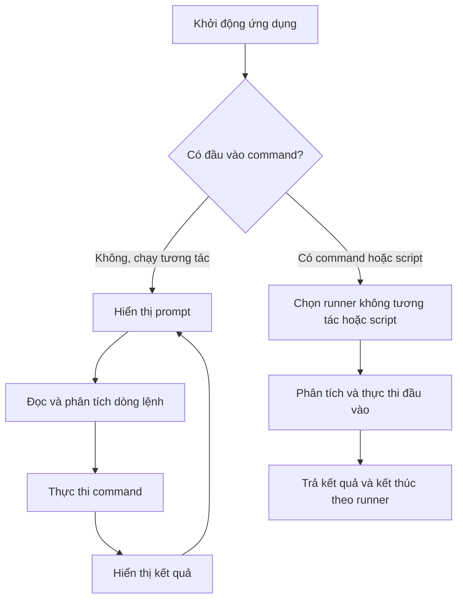

# Dấu nhắc (prompt), phiên tương tác và chương trình chạy một lệnh

Spring Shell cho phép một ứng dụng dòng lệnh hoạt động theo hai cách phổ biến: mở một phiên để người dùng nhập nhiều lệnh, hoặc nhận một lệnh ngay khi khởi động rồi thực thi và kết thúc. Cả hai cách đều sử dụng những command đã được đăng ký trong ứng dụng Spring Shell. Điểm khác nhau nằm ở nơi nhận đầu vào và thời gian sống của tiến trình.

Trong module `SPRING_SHELL`, chủ đề này thuộc chương Tổng quan và tạo nền tảng cho việc khai báo command, xử lý đối số, validation, trợ giúp và tự hoàn thành. Các khái niệm này cũng cần thiết khi thực hành CLI tương tác hoặc chạy script, quản lý mã thoát, định dạng output, kiểm thử và đóng gói ứng dụng để phân phối.

Hiểu rõ prompt, vòng lặp tương tác và chế độ chạy một lệnh giúp bạn thiết kế CLI dùng thuận tiện trong terminal, đồng thời có thể gọi từ script, lịch chạy định kỳ hoặc pipeline CI/CD.

## 1. Hai cách vận hành của ứng dụng Spring Shell

### Phiên tương tác

Ở chế độ tương tác, ứng dụng khởi động, hiển thị prompt rồi chờ người dùng nhập lệnh. Sau khi một lệnh chạy xong, shell hiển thị kết quả và prompt xuất hiện trở lại. Người dùng có thể tiếp tục nhập lệnh khác trong cùng tiến trình.

Ví dụ một phiên làm việc:

```text
shell:> help
Available commands:
  greet  Chào một người

shell:> greet --name Lan
Xin chào, Lan!

shell:> greet
Xin chào, bạn!

shell:>
```

Prompt `shell:>` cho biết shell đang sẵn sàng nhận lệnh. Các dòng `help` và `greet` là đầu vào của người dùng; prompt không phải một phần của câu lệnh.

### Chương trình chạy một lệnh

Ở chế độ không tương tác, người gọi truyền tên command cùng các đối số khi khởi động ứng dụng. Spring Shell phân tích đầu vào, gọi command tương ứng, ghi kết quả ra đầu ra chuẩn rồi kết thúc tiến trình. Không có vòng lặp chờ người dùng nhập lệnh tiếp theo.

Ví dụ:

```bash
java -jar target/cli.jar greet --name Lan
```

Ứng dụng thực thi `greet` với giá trị `Lan`, in kết quả rồi thoát. Cách chạy này phù hợp khi một tác vụ cần được gọi từ script, cron, pipeline CI/CD hoặc một chương trình khác.

### Chạy một chuỗi lệnh bằng script

Script là lựa chọn khi cần thực thi nhiều command theo thứ tự mà không cần người dùng nhập từng dòng. Mỗi dòng trong script biểu diễn một lệnh; ứng dụng xử lý chúng theo cơ chế script được cấu hình cho phiên bản Spring Shell đang dùng. Đây là trường hợp trung gian giữa một lệnh đơn và phiên tương tác: đầu vào được chuẩn bị trước, nhưng có thể gồm nhiều lệnh.

| Cách chạy | Nguồn đầu vào | Vòng đời thường gặp | Trường hợp sử dụng |
| --- | --- | --- | --- |
| Tương tác | Người dùng nhập sau mỗi prompt | Giữ tiến trình mở cho đến khi người dùng thoát | Quản trị, khám phá command, thao tác thủ công |
| Một lệnh | Đối số lúc khởi động | Chạy command rồi kết thúc | Tự động hóa một tác vụ, CI/CD, lịch chạy |
| Script | Tệp chứa nhiều command | Chạy lần lượt các command trong tệp | Quy trình có nhiều bước lặp lại |

Sơ đồ dưới đây mô tả luồng tổng quát. Runner thực tế được Spring Shell cấu hình theo phiên bản và thuộc tính của ứng dụng.



## 2. Prompt là gì và được dùng như thế nào?

Prompt là dấu nhắc do shell hiển thị khi đang chờ lệnh. Nó giúp người dùng nhận biết ứng dụng nào đang nhận đầu vào, hoặc đang thao tác trong ngữ cảnh nào. Prompt thường ngắn, dễ nhận diện và kết thúc bằng ký tự như `>` hoặc `$`.

Prompt không phải là command, cũng không phải đối số được gửi đến command. Khi tài liệu hướng dẫn ghi:

```text
orders:> order list
```

người dùng chỉ nhập `order list`; phần `orders:>` là dấu nhắc được shell hiển thị.

Spring Shell cung cấp điểm mở rộng `PromptProvider` để thay đổi prompt. Ví dụ sau đặt prompt thành `inventory>`:

```java
import org.jline.utils.AttributedString;
import org.springframework.context.annotation.Bean;
import org.springframework.context.annotation.Configuration;
import org.springframework.shell.jline.PromptProvider;

@Configuration
class ShellPromptConfiguration {

    @Bean
    PromptProvider promptProvider() {
        return () -> new AttributedString("inventory> ");
    }
}
```

`PromptProvider` trả về nội dung prompt dưới dạng `AttributedString`, kiểu dữ liệu của JLine mà Spring Shell sử dụng cho terminal. Tùy phiên bản Spring Shell, vị trí package hoặc API có thể thay đổi; hãy dùng API tương ứng với phiên bản được khai báo trong dự án.

Prompt cũng có thể phản ánh ngữ cảnh hiện tại, chẳng hạn tên môi trường hoặc workspace đang chọn:

```text
inventory[development]>
inventory[staging]>
```

Nếu tạo prompt động, chỉ nên lấy dữ liệu sẵn có trong ứng dụng. Không nên gọi dịch vụ mạng hoặc truy vấn dữ liệu tốn thời gian mỗi lần prompt được hiển thị, vì thao tác đó làm người dùng phải chờ trước mỗi command. Tránh đưa mật khẩu, token hoặc thông tin nhạy cảm vào prompt vì nội dung này có thể xuất hiện trên màn hình và trong ảnh chụp terminal.

## 3. Vòng đời của một phiên tương tác

Một phiên tương tác thường diễn ra theo trình tự sau:

1. **Khởi động ứng dụng:** Spring tạo application context, khởi tạo các bean và đăng ký những command được phát hiện.
2. **Chuẩn bị terminal:** shell thiết lập phần đọc đầu vào, hiển thị banner nếu được bật và yêu cầu prompt hiện tại.
3. **Nhận dòng lệnh:** người dùng nhập command cùng các đối số, sau đó nhấn Enter.
4. **Phân tích và chuyển đổi:** Spring Shell nhận diện command, phân tích option và chuyển giá trị văn bản sang kiểu tham số tương ứng.
5. **Thực thi:** command được gọi; các quy tắc validation và logic nghiệp vụ của ứng dụng được áp dụng.
6. **Hiển thị kết quả:** shell ghi kết quả hoặc thông báo lỗi, rồi quay lại bước hiển thị prompt.
7. **Kết thúc phiên:** người dùng gọi lệnh thoát được cung cấp hoặc đóng luồng đầu vào. Khi tiến trình kết thúc, application context cũng được đóng.

Vì các command chạy trong cùng một tiến trình và cùng application context, những bean singleton vẫn tồn tại giữa các lần gọi command. Điều này hữu ích khi CLI có trạng thái làm việc, ví dụ workspace đang chọn hoặc cấu hình kết nối hiện tại. Tuy nhiên, trạng thái cần được biểu diễn rõ ràng trong một bean hoặc dịch vụ quản lý trạng thái; không nên dựa vào biến cục bộ của một lần gọi command để lưu dữ liệu cho lần gọi tiếp theo.

Spring Shell tích hợp các khả năng terminal như lịch sử lệnh và tự hoàn thành thông qua hệ sinh thái JLine. Khả năng cụ thể phụ thuộc cấu hình và các thành phần đã bật. Lịch sử giúp gọi lại lệnh đã nhập; tự hoàn thành giúp khám phá command, option hoặc giá trị có thể nhập mà không cần nhớ toàn bộ cú pháp.

Trong terminal thông thường, `Ctrl+C` thường được dùng để ngắt thao tác hiện tại; `Ctrl+D` gửi EOF để đóng đầu vào. Cách xử lý cuối cùng còn phụ thuộc terminal, hệ điều hành và command đang chạy. Khi hướng dẫn người dùng thoát shell, nên nêu rõ lệnh thoát mà ứng dụng cung cấp và cách xử lý khi command đang thực thi.

## 4. Khai báo một command dùng được ở cả hai chế độ

Command không cần viết hai phiên bản riêng cho chế độ tương tác và không tương tác. Hãy khai báo command một lần, sau đó để Spring Shell gọi command đó từ đầu vào phù hợp.

Ví dụ một command chào người dùng:

```java
import org.springframework.shell.standard.ShellComponent;
import org.springframework.shell.standard.ShellMethod;
import org.springframework.shell.standard.ShellOption;

@ShellComponent
public class GreetingCommands {

    @ShellMethod(key = "greet", value = "Chào một người")
    public String greet(
            @ShellOption(value = "--name", defaultValue = "bạn") String name) {
        return "Xin chào, " + name + "!";
    }
}
```

`@ShellComponent` đánh dấu bean chứa command. `@ShellMethod` đăng ký phương thức với khóa `greet`; `@ShellOption` khai báo option `--name` và giá trị mặc định khi người dùng bỏ qua option này.

Trong phiên tương tác, người dùng nhập:

```text
shell:> greet --name Lan
Xin chào, Lan!
shell:> greet
Xin chào, bạn!
```

Khi chạy một lệnh, người gọi truyền cùng command và option lúc khởi động:

```bash
java -jar target/cli.jar greet --name Lan
```

Hai cách gọi đi đến cùng phương thức `greet`. Vì vậy, logic nghiệp vụ nên nằm trong command handler hoặc, với ứng dụng lớn hơn, trong một service được command gọi đến. Không nên đặt logic quan trọng trong phần hiển thị prompt hoặc chỉ thực hiện logic đó khi người dùng đang nhập thủ công.

## 5. Cấu hình và lựa chọn chế độ chạy

Spring Shell có các cấu hình bật hoặc tắt runner tương tác và không tương tác. Trong những phiên bản hỗ trợ các thuộc tính này, cấu hình YAML có dạng:

```yaml
spring:
  shell:
    interactive:
      enabled: true
    noninteractive:
      enabled: true
```

Giữ cả hai runner được bật cho phép ứng dụng hỗ trợ cả terminal lẫn gọi command trực tiếp. Nếu ứng dụng chỉ phục vụ tự động hóa, có thể tắt runner tương tác theo cấu hình của phiên bản đang sử dụng. Tên thuộc tính và cách lựa chọn runner cần được kiểm tra với tài liệu của đúng phiên bản Spring Shell trong dự án; không nên sao chép cấu hình từ một phiên bản khác mà chưa xác minh.

Khi quyết định chế độ chạy, hãy dựa vào người hoặc hệ thống gọi ứng dụng:

- **Người vận hành cần khám phá và gọi nhiều command:** dùng phiên tương tác. Prompt, trợ giúp, lịch sử và tự hoàn thành giúp thao tác thuận tiện.
- **Một hệ thống cần thực hiện một tác vụ xác định:** dùng chế độ một lệnh. Truyền đầy đủ tham số ngay từ đầu để tiến trình không cần chờ nhập liệu.
- **Quy trình cần nhiều command đã biết trước:** cân nhắc script. Đặt các bước theo thứ tự, quy định rõ cách xử lý khi một bước thất bại và tránh yêu cầu xác nhận thủ công.

Đối với lệnh chạy trong CI/CD hoặc lịch định kỳ, hãy thiết kế command theo hướng có thể tự vận hành: cung cấp đủ option bắt buộc, đặt giá trị mặc định hợp lý, ghi thông tin tiến trình ra đầu ra chuẩn và không phụ thuộc vào việc người dùng trả lời câu hỏi trên terminal. Nếu command có thể thay đổi dữ liệu, cần cân nhắc tính lặp an toàn để việc chạy lại không tạo ra kết quả ngoài dự kiến.

Không truyền mật khẩu hoặc token trực tiếp dưới dạng đối số dòng lệnh. Đối số có thể xuất hiện trong lịch sử shell, nhật ký hoặc danh sách tiến trình của hệ điều hành. Hãy dùng cơ chế cấu hình và quản lý bí mật phù hợp với môi trường triển khai.

## 6. Những lỗi thường gặp

| Hiện tượng | Nguyên nhân có thể có | Cách kiểm tra |
| --- | --- | --- |
| Chạy ứng dụng nhưng không thấy prompt | Runner tương tác bị tắt, ứng dụng đã nhận command đầu vào hoặc môi trường không có terminal tương tác | Kiểm tra đối số khởi động, cấu hình runner và khả năng cấp đầu vào terminal |
| Truyền command nhưng ứng dụng vẫn chờ nhập | Runner không tương tác chưa được bật hoặc runner tương tác đang được chọn theo cấu hình hiện tại | Kiểm tra cấu hình của phiên bản Spring Shell và cách ứng dụng chọn runner |
| Shell báo không tìm thấy command | Bean command chưa được đăng ký, package không được quét hoặc khóa command khác với tên đã nhập | Kiểm tra `@ShellComponent`, component scan và `key` trong `@ShellMethod` |
| Giá trị có dấu cách bị tách thành nhiều đối số | Chuỗi đầu vào chưa được đặt trong dấu nháy phù hợp với shell của hệ điều hành | Đặt giá trị thành một chuỗi được trích dẫn, ví dụ `--keyword "spring shell"` |
| Script dừng giữa chừng hoặc tiếp tục sau lỗi ngoài dự kiến | Quy tắc xử lý lỗi và điều kiện dừng chưa được xác định rõ | Kiểm tra cách runner script xử lý lỗi và quy định hành vi mong muốn cho từng bước |

Khi tích hợp command vào pipeline, hãy kiểm tra cả kết quả hiển thị lẫn mã thoát của tiến trình. Ứng dụng cần ánh xạ lỗi nghiệp vụ hoặc lỗi thực thi sang mã thoát phù hợp nếu hệ thống gọi dựa vào mã đó để quyết định thành công hay thất bại. Không nên giả định rằng mọi thông báo lỗi được in ra đều tự động làm tiến trình trả về mã thoát khác `0`.

## 7. Checklist khi xây dựng CLI

- Command có thể được gọi bằng cùng cú pháp trong phiên tương tác và chế độ một lệnh.
- Prompt ngắn gọn, dễ nhận diện và không chứa dữ liệu bí mật.
- Các tham số bắt buộc, giá trị mặc định và thông báo validation được xác định rõ.
- Command chạy tự động không phụ thuộc vào thao tác nhập liệu hoặc xác nhận thủ công.
- Trạng thái dùng chung giữa các lần gọi command được quản lý rõ ràng trong application context.
- Quy tắc kết thúc phiên, xử lý ngắt và mã thoát được kiểm tra trong môi trường triển khai thực tế.

Khi hoàn thành các điểm trên, ứng dụng Spring Shell có thể phục vụ tốt cả người vận hành trực tiếp trong terminal lẫn hệ thống tự động gọi command theo nhu cầu.
