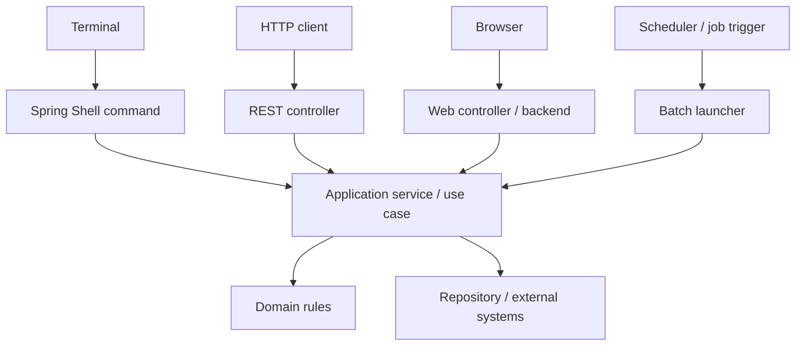

# Đối chiếu CLI với REST API, tác vụ batch và giao diện web

Khi xây dựng một ứng dụng, ta cần chọn cách người dùng hoặc hệ thống khác gửi yêu cầu đến ứng dụng. Một công cụ quản trị có thể nhận lệnh từ terminal; một dịch vụ có thể cung cấp endpoint HTTP; một quy trình xử lý dữ liệu có thể chạy theo lô; còn nhân viên nghiệp vụ thường thao tác qua trình duyệt. Những cách này có thể cùng sử dụng một phần nghiệp vụ, nhưng khác nhau về người sử dụng, cách tương tác và cách vận hành.

Spring Shell hỗ trợ xây dựng ứng dụng dòng lệnh (Command Line Interface, viết tắt là CLI) trong hệ sinh thái Spring. Framework cung cấp cơ chế khai báo command, nhận và chuyển đổi đối số, validation, trợ giúp, tự hoàn thành lệnh, chạy tương tác hoặc chạy script, quản lý mã thoát, định dạng output, kiểm thử và đóng gói ứng dụng. Để chọn đúng phạm vi cho một ứng dụng Spring Shell, trước hết cần phân biệt CLI với REST API, xử lý batch và giao diện web.

## 1. Phân biệt bốn cách tương tác và xử lý

### CLI: người dùng đưa lệnh qua terminal

CLI cho phép người dùng nhập một lệnh cùng các đối số và tùy chọn. Ứng dụng phân tích đầu vào, thực hiện thao tác rồi trả kết quả bằng văn bản hoặc dữ liệu có cấu trúc. Người dùng có thể nhập từng lệnh trong phiên tương tác, hoặc gọi chương trình từ script để tự động hóa một chuỗi thao tác.

CLI phù hợp với các công việc có thao tác rõ ràng, thường do kỹ thuật viên, quản trị viên hoặc nhà phát triển thực hiện: kiểm tra trạng thái, tra cứu dữ liệu, cấu hình môi trường, chạy tác vụ bảo trì hay hỗ trợ xử lý sự cố. Trợ giúp và tự hoàn thành lệnh giúp người dùng khám phá cách sử dụng ngay trong terminal.

CLI có thể chạy trên máy cá nhân, máy chủ hoặc trong container. Việc có CLI không có nghĩa là ứng dụng chỉ xử lý dữ liệu cục bộ; command vẫn có thể gọi dịch vụ từ xa hoặc truy cập cơ sở dữ liệu theo cấu hình.

### REST API: hệ thống gửi yêu cầu qua HTTP

REST API cung cấp các endpoint để chương trình khác giao tiếp với ứng dụng qua HTTP. Client có thể là một ứng dụng web, ứng dụng di động, dịch vụ nội bộ hoặc hệ thống của đối tác. Request thường mang dữ liệu ở dạng JSON; response trả về dữ liệu cùng mã trạng thái HTTP.

REST API phù hợp khi cần tích hợp giữa các hệ thống, cung cấp chức năng cho nhiều loại client hoặc cho phép một ứng dụng khác gọi nghiệp vụ từ xa. API cần được thiết kế rõ về tài nguyên, phương thức HTTP, cấu trúc dữ liệu, xác thực, phân quyền, phiên bản và cách biểu diễn lỗi.

Một request REST có thể xử lý ngay và trả kết quả, hoặc chỉ tiếp nhận yêu cầu rồi khởi chạy công việc dài hạn. Vì vậy, REST API không đồng nghĩa với xử lý thời gian thực; endpoint cũng có thể là điểm khởi đầu cho một quy trình batch.

### Tác vụ batch: xử lý một tập dữ liệu theo đợt

Batch mô tả cách tổ chức công việc xử lý: ứng dụng đọc một tập đầu vào, thực hiện trên nhiều bản ghi rồi tổng hợp kết quả. Công việc có thể chạy theo lịch, được kích hoạt bởi hệ thống khác hoặc được người vận hành khởi chạy thủ công. Đầu vào thường đến từ file, cơ sở dữ liệu hoặc một vùng lưu trữ; đầu ra có thể là báo cáo, file kết quả hoặc trạng thái xử lý.

Batch phù hợp với việc nhập dữ liệu, đối soát, tính toán định kỳ, đồng bộ số lượng lớn bản ghi và các công việc không cần người dùng theo dõi từng thao tác. Khi thiết kế batch, cần quan tâm đến khả năng chạy lại an toàn, xử lý bản ghi lỗi, ghi nhận tiến độ, tổng hợp kết quả và phục hồi sau gián đoạn.

Batch không phải một loại giao diện tương đương CLI hay REST API. Một tác vụ batch có thể được khởi chạy từ command CLI, từ endpoint REST, từ giao diện web hoặc từ bộ lập lịch. CLI có thể là cách người vận hành yêu cầu chạy batch, trong khi phần xử lý theo lô nằm ở tầng nghiệp vụ hoặc tầng điều phối riêng.

### Giao diện web: người dùng thao tác qua trình duyệt

Giao diện web cung cấp trang, biểu mẫu, bảng dữ liệu, bộ lọc, nút thao tác và phản hồi trực quan. Người dùng không cần nhớ cú pháp lệnh; họ có thể khám phá chức năng qua điều hướng và các thành phần giao diện.

Web UI phù hợp với quy trình nghiệp vụ có nhiều người dùng, cần xem và chỉnh sửa dữ liệu trực quan, cần hướng dẫn thao tác hoặc cần trải nghiệm nhất quán trên nhiều thiết bị. Đổi lại, ứng dụng phải đầu tư vào thiết kế giao diện, khả năng truy cập, trạng thái phiên, bảo mật trình duyệt và trải nghiệm người dùng.

Giao diện web thường gọi backend qua REST API hoặc một giao thức phù hợp khác. Vì thế, web UI và REST API thường bổ trợ nhau: một bên phục vụ tương tác của con người, bên còn lại cung cấp hợp đồng giao tiếp cho client.

## 2. So sánh theo nhu cầu sử dụng

| Tiêu chí | CLI | REST API | Batch | Giao diện web |
|---|---|---|---|---|
| Người sử dụng chính | Kỹ thuật viên, quản trị viên, nhà phát triển | Ứng dụng và dịch vụ khác | Bộ lập lịch, hệ thống điều phối hoặc người vận hành | Người dùng nghiệp vụ và khách hàng |
| Cách gửi yêu cầu | Nhập command và đối số | Gửi HTTP request đến endpoint | Cung cấp tập đầu vào và khởi chạy một lượt xử lý | Thao tác trên trang, biểu mẫu và bảng |
| Đơn vị tương tác | Một command hoặc một chuỗi command | Một request/response hoặc yêu cầu xử lý bất đồng bộ | Một đợt xử lý gồm nhiều bản ghi | Một tác vụ hoặc luồng thao tác của người dùng |
| Phản hồi thường gặp | Văn bản, bảng, mã thoát | JSON hoặc nội dung HTTP khác, kèm status code | Báo cáo tổng hợp, file kết quả, trạng thái job | Thông báo, biểu đồ, bảng và trạng thái trực quan |
| Tự động hóa | Tốt qua script và pipeline | Tốt qua tích hợp chương trình | Tốt qua lịch chạy và hệ thống điều phối | Có thể tự động hóa nhưng thường cần công cụ trình duyệt |
| Khả năng khám phá | Trợ giúp, ví dụ và tự hoàn thành lệnh | Tài liệu API, schema và công cụ kiểm thử | Tài liệu job, cấu hình và báo cáo vận hành | Điều hướng, nhãn, hướng dẫn và thông báo |
| Điểm cần chú ý | Cú pháp, thông báo lỗi, mã thoát, lịch sử lệnh | Hợp đồng API, xác thực, phân quyền, giới hạn truy cập | Tính lặp an toàn, tiến độ, retry và lỗi từng bản ghi | Khả năng sử dụng, truy cập, phiên và bảo mật trình duyệt |

Không có lựa chọn nào luôn tốt hơn các lựa chọn còn lại. Một CLI có thể xử lý một yêu cầu nhanh hoặc kích hoạt công việc dài hạn; REST API có thể trả kết quả ngay hoặc trả mã định danh job; batch có thể xử lý hàng nghìn bản ghi hoặc chỉ một file nhỏ. Quyết định nên dựa trên người gọi, quy mô công việc, cách vận hành và yêu cầu tích hợp.

## 3. Chọn cách tiếp cận theo tình huống

Hãy bắt đầu bằng câu hỏi ai hoặc thành phần nào sẽ khởi tạo công việc:

- Nếu một người vận hành cần ra lệnh trực tiếp, kiểm tra nhanh và lặp lại thao tác qua terminal, CLI thường là lựa chọn gọn. Spring Shell phù hợp khi ứng dụng cần command có tên rõ ràng, đối số, validation, trợ giúp và tự hoàn thành.
- Nếu một hệ thống khác cần gọi chức năng qua mạng, cần hợp đồng giao tiếp ổn định hoặc cần phục vụ nhiều loại client, hãy cân nhắc REST API.
- Nếu công việc cần xử lý một tập dữ liệu, chạy định kỳ, tiếp tục sau lỗi hoặc tổng hợp kết quả của nhiều bản ghi, hãy thiết kế tác vụ batch. Chọn CLI, REST API, bộ lập lịch hay web UI làm điểm kích hoạt tùy người hoặc hệ thống khởi chạy.
- Nếu người dùng cần thao tác trực quan, xem nhiều thông tin cùng lúc, đi qua các bước nghiệp vụ có hướng dẫn hoặc sử dụng trên nhiều thiết bị, giao diện web thường phù hợp hơn.

Các nhu cầu này thường xuất hiện đồng thời. Ví dụ, đội vận hành có thể dùng CLI để kiểm tra và chạy lại một job; hệ thống bán hàng gọi REST API để gửi yêu cầu đồng bộ; bộ lập lịch chạy batch vào ban đêm; nhân viên theo dõi kết quả qua web UI. Mỗi kênh giải quyết một kiểu tương tác, còn quy tắc nghiệp vụ nên được dùng chung.

## 4. Vị trí của Spring Shell trong kiến trúc ứng dụng

Spring Shell tập trung vào lớp tương tác dòng lệnh. Command nhận dữ liệu người dùng nhập, chuyển dữ liệu đó thành lời gọi phù hợp, sau đó trình bày kết quả. Command nên đóng vai trò lớp điều hợp (adapter), giữ phần xử lý nghiệp vụ ở các service hoặc use case của ứng dụng.



Trong kiến trúc này, các kênh đầu vào có thể khác nhau nhưng cùng gọi một use case. Ví dụ, command `stock adjust` và endpoint cập nhật tồn kho đều chuyển yêu cầu về cùng một service. Service kiểm tra quy tắc tồn kho và lưu thay đổi; command định dạng kết quả cho terminal, còn REST controller chuyển kết quả thành response HTTP.

Thiết kế như vậy đem lại một số lợi ích:

- Quy tắc nghiệp vụ được thực thi nhất quán dù yêu cầu đến từ CLI, REST, web hay batch.
- Có thể kiểm thử use case độc lập với cách người dùng nhập lệnh hoặc gửi HTTP request.
- Có thể bổ sung kênh tương tác mới mà không phải sao chép logic nghiệp vụ.
- Lớp Spring Shell tập trung vào cú pháp command, chuyển đổi đối số, validation đầu vào và thông báo dành cho người vận hành.

Không nên đặt toàn bộ quy tắc nghiệp vụ trong phương thức command. Nếu command vừa phân tích đầu vào, vừa tự truy vấn nhiều kho dữ liệu, vừa áp dụng quy tắc và cập nhật trạng thái, chức năng đó sẽ khó tái sử dụng từ REST API hoặc batch và khó kiểm thử riêng.

## 5. Ví dụ: quản lý tồn kho

Giả sử hệ thống có nghiệp vụ tra cứu và điều chỉnh tồn kho cho một mã sản phẩm. Cùng một nghiệp vụ có thể được tiếp cận qua các kênh khác nhau.

**Vận hành qua CLI**

```text
shell> stock show SKU-123
SKU-123 | Tồn kho hiện tại: 42

shell> stock adjust SKU-123 --quantity 10 --reason "Nhập hàng"
Đã ghi nhận điều chỉnh. Tồn kho mới: 52
```

Đây là ví dụ minh họa cú pháp command. Trong ứng dụng Spring Shell, command tương ứng có thể được khai báo bằng annotation hoặc cơ chế khai báo command mà phiên bản framework đang sử dụng hỗ trợ. Command nhận mã sản phẩm, số lượng và lý do; sau khi validation, nó gọi use case điều chỉnh tồn kho rồi in kết quả dễ đọc.

**Tích hợp qua REST API**

```http
GET /api/products/SKU-123/stock
```

```http
POST /api/products/SKU-123/stock-adjustments
Content-Type: application/json

{
  "quantity": 10,
  "reason": "Nhập hàng"
}
```

REST API cho phép một hệ thống quản lý kho khác gửi yêu cầu mà không cần mở terminal hay biết cú pháp của Spring Shell. Backend vẫn có thể gọi cùng use case điều chỉnh tồn kho.

**Xử lý theo batch**

Một file `stock-adjustments.csv` có thể chứa hàng nghìn dòng điều chỉnh. Batch đọc từng dòng, kiểm tra mã sản phẩm và số lượng, áp dụng các dòng hợp lệ, ghi nhận dòng lỗi và tạo báo cáo tổng kết. Thiết kế cần xác định rõ cách xử lý khi chỉ một phần dữ liệu hợp lệ, cách nhận diện dòng đã xử lý và cách chạy lại mà không tạo điều chỉnh trùng lặp.

Người vận hành có thể dùng một command Spring Shell như `stock import --file ./stock-adjustments.csv` để yêu cầu chạy job. Command chỉ nên kiểm tra tùy chọn và khởi chạy use case nhập dữ liệu; quy trình đọc file và xử lý hàng loạt thuộc thành phần batch chuyên trách.

**Thao tác qua web UI**

Nhân viên kho có thể mở trang tồn kho, tìm `SKU-123`, xem số lượng hiện tại, nhập số lượng điều chỉnh và lý do, rồi xác nhận. Giao diện hiển thị kết quả và lịch sử thay đổi. Web UI thường gọi endpoint backend để đọc và cập nhật dữ liệu.

Bốn cách tiếp cận có thể cùng tồn tại. Chúng khác nhau ở cách khởi tạo và trình bày kết quả, còn quy tắc như không cho phép tồn kho âm, yêu cầu lý do điều chỉnh và ghi lịch sử cần được bảo vệ ở tầng nghiệp vụ.

## 6. Những điểm cần thiết kế khi chọn CLI

Khi chọn Spring Shell làm kênh tương tác, cần thiết kế command như một giao diện công khai mà người dùng có thể học, ghi nhớ và tự động hóa:

1. **Đặt tên command theo hành động và đối tượng.** Tên như `stock show` hoặc `stock adjust` giúp người dùng hiểu mục đích. Tránh tên quá ngắn hoặc phụ thuộc vào ngữ cảnh chỉ người viết mới biết.
2. **Phân biệt đối số và tùy chọn.** Đối số thường là dữ liệu chính để xác định đối tượng; tùy chọn bổ sung cách thực hiện như định dạng, giới hạn hoặc chế độ kiểm tra. Cung cấp giá trị mặc định hợp lý khi có thể.
3. **Validation trước khi thay đổi dữ liệu.** Kiểm tra định dạng, miền giá trị và các điều kiện nghiệp vụ. Thông báo lỗi nên nêu trường nào không hợp lệ và cách sửa.
4. **Cung cấp trợ giúp và tự hoàn thành.** Mô tả command, đối số và tùy chọn để người dùng có thể khám phá chức năng mà không phải tra mã nguồn.
5. **Hỗ trợ cả tương tác và script.** Không yêu cầu nhập câu trả lời thủ công khi command được chạy tự động. Với thao tác quan trọng, cân nhắc tùy chọn xác nhận rõ ràng hoặc chế độ kiểm tra trước khi thực thi.
6. **Quy định output và mã thoát.** Người dùng cần đọc được kết quả; script cần phân biệt thành công và thất bại qua mã thoát. Tránh chỉ in lỗi ra màn hình nhưng vẫn trả mã thành công.
7. **Bảo vệ thông tin nhạy cảm.** Không khuyến khích truyền mật khẩu, token hoặc bí mật trực tiếp trong đối số command vì chúng có thể xuất hiện trong lịch sử shell hoặc danh sách tiến trình. Dùng cơ chế cấu hình và lưu trữ bí mật phù hợp.

CLI đặc biệt hữu ích khi người vận hành cần quyền kiểm soát trực tiếp và kết quả rõ ràng. Nếu command trở thành giao diện cho nhiều nhóm người dùng phổ thông, có nhiều bước nhập liệu hoặc cần trình bày dữ liệu phức tạp, cần đánh giá xem web UI có mang lại trải nghiệm phù hợp hơn không.

## 7. Kết luận

CLI, REST API, batch và web UI giải quyết các nhu cầu khác nhau. CLI phục vụ thao tác trực tiếp và tự động hóa qua terminal; REST API phục vụ tích hợp qua HTTP; batch tổ chức xử lý dữ liệu theo đợt; web UI phục vụ tương tác trực quan của con người. Một ứng dụng có thể kết hợp cả bốn nếu mỗi kênh có vai trò rõ ràng và cùng sử dụng các use case nghiệp vụ phù hợp.

Spring Shell là lựa chọn thích hợp khi cần xây dựng lớp CLI trong ứng dụng Spring với command, đối số, validation, trợ giúp, tự hoàn thành và khả năng chạy tương tác hoặc bằng script. Giá trị của nó nằm ở việc tạo một giao diện dòng lệnh dễ sử dụng và vận hành, trong khi nghiệp vụ cốt lõi vẫn được tổ chức để có thể phục vụ những kênh khác khi cần.
