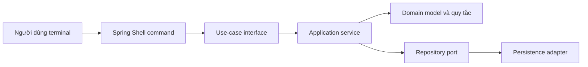

# Phân tách giao diện lệnh khỏi nghiệp vụ được thực thi

Trong một ứng dụng Spring Shell, phương thức khai báo lệnh là điểm tiếp nhận yêu cầu từ người dùng. Phương thức đó đọc đối số, chuyển dữ liệu đầu vào thành lời gọi nghiệp vụ và trình bày kết quả trên terminal. Khi đặt toàn bộ quy tắc nghiệp vụ vào chính phương thức lệnh, ứng dụng sẽ khó kiểm thử, khó tái sử dụng và dễ phát sinh hành vi khác nhau giữa CLI với các kênh gọi khác.

Hãy xem Spring Shell như một **lớp giao tiếp ở bên ngoài** ứng dụng. Lớp này chịu trách nhiệm hiểu cú pháp dòng lệnh; một lớp ứng dụng riêng chịu trách nhiệm thực hiện ca sử dụng; mô hình miền giữ các quy tắc và trạng thái nghiệp vụ. Spring Dependency Injection kết nối các lớp đó mà không buộc nghiệp vụ phải phụ thuộc vào API của Spring Shell.

## Ranh giới trách nhiệm

Một lệnh thường đi qua các trách nhiệm sau:

| Thành phần | Trách nhiệm | Ví dụ |
| --- | --- | --- |
| Giao diện lệnh (CLI adapter) | Khai báo tên lệnh, option, argument, giá trị mặc định; chuyển đổi đầu vào; hiển thị kết quả và thông báo phù hợp với terminal | `reservation reserve --route HN-DN --seats 2` |
| Lớp ứng dụng (application service) | Thực hiện một ca sử dụng, phối hợp các thành phần, xác định ranh giới giao dịch và trả về kết quả có cấu trúc | Đặt chỗ trên một tuyến |
| Miền nghiệp vụ (domain) | Bảo vệ bất biến, kiểm tra quy tắc nghiệp vụ và thay đổi trạng thái hợp lệ | Không cho đặt số chỗ nhỏ hơn một hoặc vượt sức chứa còn lại |
| Hạ tầng (infrastructure) | Cung cấp cách truy cập cơ sở dữ liệu, dịch vụ ngoài hoặc hệ thống lưu trữ | Lưu lượt đặt chỗ qua repository |

Luồng gọi đi từ giao diện lệnh vào ca sử dụng. Ca sử dụng điều phối miền nghiệp vụ và các cổng truy cập hạ tầng:



Sơ đồ thể hiện luồng thực thi. Về phụ thuộc mã nguồn, lớp ứng dụng nên làm việc với các interface cần thiết; adapter lưu trữ triển khai các interface đó. Lớp ứng dụng không cần biết lệnh được gọi từ terminal, REST API hay một tiến trình nền.

### Giao diện lệnh chỉ xử lý giao tiếp

Trong giao diện lệnh, các việc phù hợp gồm:

- Đặt tên lệnh và mô tả để trợ giúp của Spring Shell có thể giới thiệu cách sử dụng.
- Khai báo option, argument, giá trị mặc định và kiểu dữ liệu đầu vào.
- Chuyển dữ liệu đã phân tích thành request của ca sử dụng.
- Chuyển kết quả có cấu trúc thành nội dung dễ đọc trên terminal.
- Chuyển lỗi nghiệp vụ đã biết thành thông báo ngắn gọn và mã thoát phù hợp.

Các việc như tính giá, xác định quyền được thực hiện thao tác, kiểm tra sức chứa, cập nhật trạng thái hoặc ghi dữ liệu thuộc lớp ứng dụng và miền nghiệp vụ. Không nên đặt các quy tắc này trong phương thức có `@ShellMethod`.

## Ví dụ: tách lệnh đặt chỗ thành một ca sử dụng

Giả sử CLI cung cấp lệnh đặt số chỗ trên một tuyến. Người dùng gọi:

```text
reservation reserve --route HN-DN --seats 2
```

Lệnh nhận mã tuyến và số chỗ. Quy tắc kiểm tra tuyến có tồn tại hay không, còn đủ chỗ hay không và cập nhật lượt đặt phải được thực hiện ở lớp nghiệp vụ. Ta có thể định nghĩa hợp đồng của ca sử dụng bằng các kiểu dữ liệu độc lập với Spring Shell:

```java
public record ReserveSeatsRequest(String routeCode, int seats) {}

public record ReservationResult(
        String reservationCode,
        String routeCode,
        int reservedSeats,
        int remainingSeats) {}

public interface ReserveSeatsUseCase {
    ReservationResult reserve(ReserveSeatsRequest request);
}
```

`ReserveSeatsRequest` mô tả dữ liệu mà ca sử dụng cần. `ReservationResult` mô tả kết quả để adapter gọi nó có thể quyết định cách trình bày. Interface `ReserveSeatsUseCase` là ranh giới giữa bên gọi và phần thực thi. Các kiểu này không cần import annotation hoặc lớp nào của Spring Shell.

Lớp ứng dụng triển khai hợp đồng và phối hợp các đối tượng nghiệp vụ cùng repository:

```java
@Service
public class ReserveSeatsService implements ReserveSeatsUseCase {

    private final RouteRepository routes;
    private final ReservationRepository reservations;

    public ReserveSeatsService(
            RouteRepository routes,
            ReservationRepository reservations) {
        this.routes = routes;
        this.reservations = reservations;
    }

    @Override
    @Transactional
    public ReservationResult reserve(ReserveSeatsRequest request) {
        Route route = routes.findByCode(request.routeCode())
                .orElseThrow(() -> new RouteNotFoundException(request.routeCode()));

        // Domain model kiểm tra số chỗ và sức chứa trước khi thay đổi trạng thái.
        route.reserve(request.seats());

        Reservation reservation = Reservation.create(
                route.getCode(), request.seats());
        reservations.save(reservation);

        return new ReservationResult(
                reservation.getCode(),
                route.getCode(),
                request.seats(),
                route.getAvailableSeats());
    }
}
```

Trong ví dụ, `RouteRepository` và `ReservationRepository` là các interface mà lớp ứng dụng sử dụng; adapter hạ tầng cung cấp implementation để đọc và ghi dữ liệu. `Route.reserve(...)` là nơi bảo vệ bất biến của tuyến, chẳng hạn từ chối số chỗ không hợp lệ hoặc số chỗ vượt quá sức chứa. `RouteNotFoundException` và các lỗi miền tương tự biểu diễn tình huống nghiệp vụ mà lớp gọi có thể xử lý. `@Transactional` đặt ranh giới giao dịch quanh việc thay đổi tuyến và lưu lượt đặt; nếu một bước thất bại, cơ chế giao dịch có thể hoàn tác các thay đổi thuộc cùng giao dịch.

Phần giao diện Spring Shell lúc này chỉ chuyển đối số thành request, gọi use case và định dạng kết quả:

```java
@ShellComponent
public class ReservationCommands {

    private final ReserveSeatsUseCase reserveSeats;

    public ReservationCommands(ReserveSeatsUseCase reserveSeats) {
        this.reserveSeats = reserveSeats;
    }

    @ShellMethod(
            key = "reservation reserve",
            value = "Đặt số chỗ trên một tuyến")
    public String reserve(
            @ShellOption(value = "--route", help = "Mã tuyến") String routeCode,
            @ShellOption(value = "--seats", help = "Số chỗ cần đặt") int seats) {

        ReserveSeatsRequest request = new ReserveSeatsRequest(routeCode, seats);
        ReservationResult result = reserveSeats.reserve(request);

        return "Đã đặt " + result.reservedSeats()
                + " chỗ trên tuyến " + result.routeCode()
                + ". Mã đặt chỗ: " + result.reservationCode()
                + ". Số chỗ còn lại: " + result.remainingSeats();
    }
}
```

Ví dụ dùng mô hình annotation quen thuộc của Spring Shell với `@ShellComponent`, `@ShellMethod` và `@ShellOption`. Tên package hoặc một số chi tiết khai báo có thể thay đổi theo phiên bản Spring Shell đang dùng; ranh giới kiến trúc vẫn giữ nguyên: command adapter gọi một hợp đồng ứng dụng bằng constructor injection.

### Điều gì xảy ra khi có lỗi?

Giả sử tuyến không tồn tại hoặc không còn đủ chỗ. Lớp nghiệp vụ ném một exception có ý nghĩa, ví dụ `RouteNotFoundException` hoặc `SeatsUnavailableException`. Adapter CLI có thể bắt những loại lỗi đã biết tại ranh giới lệnh để hiển thị thông báo dễ hiểu. Với các lỗi không mong đợi, ứng dụng nên ghi log và để cơ chế xử lý lỗi chung quyết định nội dung phản hồi.

Thông báo lỗi và mã thoát là hai việc liên quan nhưng khác nhau. Một chuỗi như `Không còn đủ chỗ` giúp người dùng hiểu sự cố; mã thoát khác không giúp script hoặc tiến trình gọi CLI nhận biết lệnh thất bại. Hãy cấu hình cơ chế xử lý exception và ánh xạ mã thoát của phiên bản Spring Shell đang sử dụng để lỗi nghiệp vụ dự kiến trả về mã phù hợp. Tránh bắt `Exception` hoặc `Throwable` rồi trả về một chuỗi thông báo như thể lệnh đã thành công, vì cách đó có thể che giấu lỗi và làm script hiểu sai kết quả.

Không nên yêu cầu lớp ứng dụng in trực tiếp ra terminal hoặc tự đặt mã thoát của tiến trình. Lớp ứng dụng trả về kết quả hoặc phát sinh lỗi có ý nghĩa; adapter quyết định cách biểu diễn chúng trong môi trường CLI.

## Vì sao cách phân tách này hữu ích?

**Có thể tái sử dụng nghiệp vụ.** Cùng một `ReserveSeatsUseCase` có thể được gọi từ một lệnh Spring Shell khác, REST controller, lịch chạy nền hoặc một quy trình tự động. Mỗi adapter có cách nhận đầu vào và trả kết quả riêng, nhưng đều dùng chung quy tắc đặt chỗ.

**Kiểm thử tập trung.** Có thể kiểm thử `ReserveSeatsService` bằng unit test và repository giả mà không khởi tạo terminal hay phân tích cú pháp dòng lệnh. Những ca như tuyến không tồn tại, số chỗ không hợp lệ, hết chỗ và đặt thành công được kiểm tra trực tiếp. Một nhóm kiểm thử khác xác minh tên lệnh, option, chuyển đổi đầu vào và nội dung hiển thị thông qua cơ chế kiểm thử Spring Shell của phiên bản dự án.

**Thay đổi giao diện ít ảnh hưởng nghiệp vụ.** Có thể đổi tên lệnh, thêm alias, điều chỉnh cách trình bày hoặc bổ sung một chế độ chạy script mà không phải sửa quy tắc đặt chỗ. Ngược lại, khi quy tắc nghiệp vụ thay đổi, mọi adapter đều nhận được hành vi mới thông qua cùng use case.

**Giảm trùng lặp và sai lệch.** Nếu mỗi command tự kiểm tra sức chứa và cập nhật dữ liệu, hai lệnh có thể triển khai cùng một quy tắc theo hai cách khác nhau. Đặt quy tắc ở một nơi giúp giữ hành vi nhất quán.

## Những dấu hiệu cho thấy ranh giới đang bị phá vỡ

| Dấu hiệu | Vấn đề | Hướng điều chỉnh |
| --- | --- | --- |
| Phương thức `@ShellMethod` tự truy vấn repository, tính toán và cập nhật nhiều đối tượng | Giao diện lệnh đang kiêm nhiệm ca sử dụng | Chuyển phần điều phối vào application service |
| Service import `ShellContext`, `ShellOption` hoặc gọi API terminal | Nghiệp vụ phụ thuộc vào cách tương tác CLI | Truyền request thuần và trả kết quả có cấu trúc |
| Nhiều command lặp lại cùng một kiểm tra nghiệp vụ | Quy tắc dễ lệch nhau khi sửa | Đưa quy tắc vào miền hoặc ca sử dụng dùng chung |
| Service gọi `System.out.println` để báo kết quả | Không thể chọn cách trình bày theo adapter | Trả dữ liệu hoặc phát sinh exception có ý nghĩa |
| Command bắt mọi exception rồi trả thông báo thành công | Script có thể nhận mã thoát sai và lỗi bị che khuất | Phân loại lỗi dự kiến, ánh xạ thông báo và mã thoát rõ ràng |

Không cần tạo nhiều lớp chỉ để chuyển tiếp một lời gọi đơn giản. Với một command thuần trình bày, không chứa quy tắc nghiệp vụ và không có nhu cầu tái sử dụng, phương thức lệnh có thể giữ ngắn gọn. Nên tạo use case riêng khi thao tác có quy tắc, phối hợp nhiều thành phần, thay đổi trạng thái, cần giao dịch hoặc được gọi từ nhiều nơi.

## Cách áp dụng khi phát triển command mới

1. Mô tả thao tác người dùng muốn hoàn thành, độc lập với cú pháp terminal.
2. Xác định request, kết quả và các lỗi nghiệp vụ mà thao tác có thể phát sinh.
3. Đặt quy tắc và bất biến vào miền nghiệp vụ; đặt việc điều phối vào application service.
4. Khai báo command Spring Shell để nhận đối số, tạo request, gọi use case và trình bày kết quả.
5. Kiểm thử ca sử dụng độc lập, sau đó kiểm thử tích hợp command để xác nhận cú pháp và trải nghiệm terminal.
6. Kiểm tra cả thông báo lỗi lẫn mã thoát khi chạy tương tác và khi gọi từ script.

Khi một thao tác được tách theo cách này, Spring Shell tập trung vào vai trò giao tiếp dòng lệnh, còn phần nghiệp vụ có thể phát triển và kiểm thử độc lập. Đây là nền tảng để ứng dụng CLI mở rộng thêm command, chế độ chạy tự động hoặc adapter khác mà không nhân bản quy tắc nghiệp vụ.
