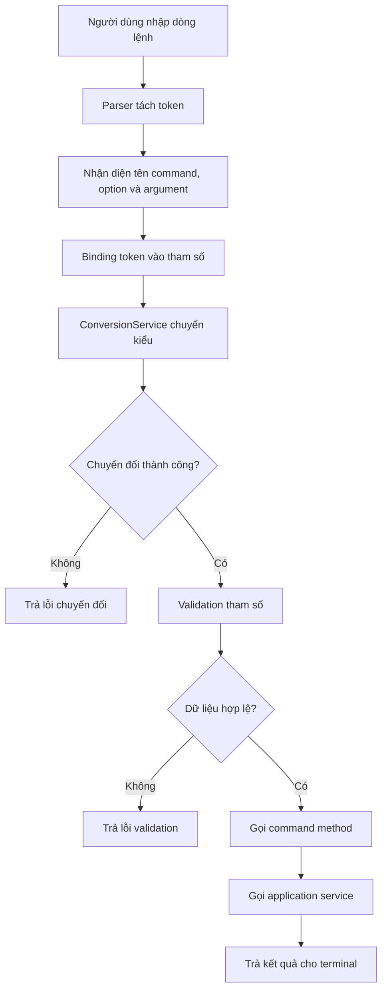

# Từ token chuỗi đến kiểu tham số của lệnh

Người dùng nhập command trong terminal dưới dạng văn bản. Ví dụ, khi chạy `order show 2026-11-26 --id 1042`, parser nhận được các token chuỗi như `order`, `show`, `2026-11-26`, `--id` và `1042`. Trong khi đó, phương thức Java có thể khai báo tham số kiểu `LocalDate`, `Long`, enum hoặc một kiểu dữ liệu riêng của ứng dụng.

Spring Shell kết nối hai phía bằng cơ chế chuyển đổi kiểu của Spring. Sau khi xác định command và gắn token vào argument hoặc option, framework chuyển giá trị văn bản sang kiểu mà tham số Java yêu cầu. Nhờ vậy, command có thể nhận dữ liệu có cấu trúc và tập trung vào việc gọi nghiệp vụ thay vì tự phân tích chuỗi ở mọi phương thức.

## Luồng từ dòng lệnh đến phương thức Java

Một command method thường đi qua các bước sau:



Các bước này giải quyết những vấn đề khác nhau:

1. **Parsing** xác định từ nào là tên command, option hay argument.
2. **Binding** gắn giá trị đã phân tích với tham số tương ứng của command.
3. **Type conversion** chuyển biểu diễn văn bản thành kiểu Java, chẳng hạn `"1042"` thành `Long`.
4. **Validation** kiểm tra giá trị đã chuyển đổi có thỏa constraint hay không.
5. **Execution** gọi phương thức command và phần nghiệp vụ phía sau.

Nếu người dùng nhập `--id abc` trong khi tham số yêu cầu `Long`, lỗi xuất hiện ở bước chuyển đổi. Nếu nhập `--id -1`, việc chuyển thành số có thể thành công nhưng validation hoặc quy tắc nghiệp vụ có thể từ chối giá trị âm. Phân biệt các bước giúp xác định đúng nơi xử lý lỗi.

## Khai báo kiểu tham số trong command

Trong Spring Shell 4.x, command có thể được khai báo trên phương thức Spring bean bằng `@Command`. `@Argument` mô tả dữ liệu vị trí, còn `@Option` mô tả dữ liệu có tên. Kiểu Java của tham số chính là kiểu đích mà cơ chế chuyển đổi cần tạo ra.

```java
import java.math.BigDecimal;
import java.time.LocalDate;

import org.springframework.shell.core.command.annotation.Argument;
import org.springframework.shell.core.command.annotation.Command;
import org.springframework.shell.core.command.annotation.Option;
import org.springframework.stereotype.Component;

@Component
public class OrderCommands {

    private final OrderService orderService;

    public OrderCommands(OrderService orderService) {
        this.orderService = orderService;
    }

    @Command(name = "order search", description = "Tìm kiếm đơn hàng")
    public String search(
            @Argument(index = 0, description = "Mã khách hàng") String customerCode,
            @Option(longName = "from", description = "Ngày bắt đầu") LocalDate from,
            @Option(longName = "min-total", description = "Giá trị đơn hàng tối thiểu") BigDecimal minTotal) {

        return orderService.search(customerCode, from, minTotal);
    }
}
```

Khi gọi command:

```text
order search CUS-123456 --from 2026-11-01 --min-total 250000.50
```

`customerCode` nhận chuỗi `CUS-123456`; `from` cần một `LocalDate`; `minTotal` cần một `BigDecimal`. Cú pháp command chỉ mô tả cách nhập dữ liệu, còn tham số Java cho biết kiểu mà phần xử lý sẽ nhận.

Ví dụ trên minh họa hợp đồng kiểu. Để `LocalDate` và các kiểu đặc thù được chuyển đổi theo đúng định dạng mong muốn, ứng dụng phải có converter/formatter tương ứng trong `ConversionService` mà Spring Shell sử dụng. Không nên giả định mọi kiểu Java đều tự động có converter chỉ vì tham số đã khai báo kiểu đó.

## Những kiểu thường gặp

Spring Shell sử dụng cơ chế chuyển đổi của Spring để hỗ trợ các kiểu dữ liệu phổ biến. Khả năng cụ thể phụ thuộc `ConversionService` và các converter đã đăng ký.

| Kiểu tham số | Ví dụ đầu vào | Ý nghĩa |
| --- | --- | --- |
| `String` | `CUS-123456` | Giữ nguyên nội dung văn bản sau khi parser xử lý quote |
| `int`, `Integer` | `42` | Chuyển chuỗi số nguyên thành số nguyên |
| `long`, `Long` | `1042` | Chuyển chuỗi thành số nguyên dài |
| `double`, `Double` | `12.75` | Chuyển chuỗi thành số thực dấu phẩy động |
| `BigDecimal` | `250000.50` | Biểu diễn số thập phân chính xác hơn cho tiền và phép tính tài chính |
| `boolean`, `Boolean` | `true`, `false` | Chuyển giá trị văn bản thành boolean |
| Enum | `PAID` | Chuyển tên hằng enum thành phần tử enum |
| Mảng hoặc collection | Nhiều giá trị theo cú pháp command | Chuyển đổi phần tử theo kiểu đích nếu conversion service và parser hỗ trợ |

### Chuỗi

`String` là kiểu trực tiếp nhất vì token từ terminal vốn là văn bản. Nếu tham số là `String`, thường không cần chuyển đổi thêm.

```java
@Command(name = "customer find", description = "Tìm khách hàng theo tên")
public String find(@Argument(index = 0) String name) {
    return customerService.findSummary(name);
}
```

Giá trị có khoảng trắng cần được quote để parser giữ thành một argument:

```text
customer find "Nguyen Van An"
```

Command nhận một chuỗi `Nguyen Van An`, không phải ba argument riêng.

### Số nguyên và số thập phân

Các kiểu số cho phép command nhận dữ liệu đã được phân tích thay vì tự gọi `Integer.parseInt` hoặc `Double.parseDouble`:

```java
@Command(name = "inventory restock", description = "Nhập thêm hàng vào kho")
public String restock(
        @Argument(index = 0, description = "Mã sản phẩm") String productCode,
        @Option(longName = "quantity", description = "Số lượng nhập") int quantity) {
    inventoryService.restock(productCode, quantity);
    return "Đã nhập thêm " + quantity + " sản phẩm " + productCode;
}
```

Lệnh gọi:

```text
inventory restock SKU-100 --quantity 25
```

Nếu `quantity` nhận chuỗi không phải số, quá trình chuyển đổi thất bại trước khi phương thức command được gọi. Với số tiền hoặc giá trị thập phân cần giữ độ chính xác, nên cân nhắc `BigDecimal` thay vì `float` hoặc `double`.

Định dạng số có thể phụ thuộc converter/formatter và cấu hình locale. Với command thường chạy trong script, chọn một định dạng ổn định, ví dụ dấu chấm làm dấu thập phân và không phân cách hàng nghìn, rồi ghi rõ trong trợ giúp.

### Boolean

Boolean có hai dạng Java:

- `boolean` là kiểu nguyên thủy, không thể nhận `null`.
- `Boolean` là kiểu tham chiếu, có thể biểu diễn `true`, `false` hoặc `null` khi không có giá trị và không có mặc định.

Với parser mặc định của Spring Shell 4, khi một option được truyền, option luôn cần giá trị, kể cả option boolean. Vì vậy, hãy viết:

```text
customer show CUS-123456 --include-history true
customer show CUS-123456 --include-history false
```

Không dùng dạng chỉ có tên option `--include-history` như một flag boolean không giá trị. Nếu không truyền option, `defaultValue` hoặc kiểu tham số sẽ quyết định giá trị nhận được theo cấu hình. Hãy khai báo mặc định rõ ràng nếu command cần hành vi ổn định.

```java
@Command(name = "customer show", description = "Xem khách hàng")
public String show(
        @Argument(index = 0) String code,
        @Option(longName = "include-history", defaultValue = "false") boolean includeHistory) {
    return customerService.describe(code, includeHistory);
}
```

### Enum

Enum hữu ích khi option chỉ nhận một tập giá trị hữu hạn, chẳng hạn trạng thái đơn hàng hoặc định dạng báo cáo:

```java
public enum OrderStatus {
    NEW,
    PAID,
    SHIPPED,
    CANCELLED
}
```

Command nhận enum trực tiếp:

```java
@Command(name = "order list", description = "Liệt kê đơn hàng theo trạng thái")
public String list(@Option(longName = "status") OrderStatus status) {
    return orderService.listByStatus(status);
}
```

Ví dụ gọi:

```text
order list --status PAID
```

Chuyển đổi enum thường dựa trên tên hằng. Quy tắc chữ hoa/chữ thường phụ thuộc converter được dùng và phiên bản Spring Shell; nếu muốn chấp nhận nhiều cách viết như `paid`, `PAID` hoặc `Paid`, hãy định nghĩa converter rõ ràng và kiểm thử các trường hợp đó. Không nên dựa vào hành vi ngầm nếu cú pháp đã trở thành hợp đồng cho script.

### Mảng và collection

Mảng hoặc collection có thể dùng khi một option hoặc nhóm argument nhận nhiều giá trị. Có hai vấn đề cần tách riêng:

- Parser quyết định có bao nhiêu token thuộc về tham số.
- ConversionService chuyển từng giá trị sang kiểu phần tử phù hợp.

Ví dụ với `CommandRegistration`, có thể khai báo kiểu mảng và arity cho option nhận nhiều giá trị. Trong mô hình annotation, dùng `@Arguments` khi cần thu thập nhiều positional token hoặc cấu hình option theo API của phiên bản đang dùng. Không giả định dấu phẩy trong một chuỗi luôn tự động tách thành nhiều phần tử; hãy xác định rõ cú pháp token và arity.

## Spring `ConversionService`

Spring cung cấp một hệ thống chuyển đổi kiểu trong package `org.springframework.core.convert`. API chính là `ConversionService`; các converter được đăng ký trong service này để chuyển dữ liệu từ kiểu nguồn sang kiểu đích.

Một số phương thức thường dùng:

```java
public interface ConversionService {
    boolean canConvert(Class<?> sourceType, Class<?> targetType);

    <T> T convert(Object source, Class<T> targetType);
}
```

`canConvert(...)` cho biết service có khả năng chuyển đổi giữa hai kiểu hay không. `convert(...)` thực hiện chuyển đổi và trả về đối tượng kiểu đích. Với collection generic hoặc kiểu cần thêm metadata, Spring có `TypeDescriptor` để mô tả kiểu nguồn và đích chi tiết hơn.

Trong Spring Shell 4, adapter gọi phương thức command nhận một `ConversionService` để chuyển tham số. Điều đó có nghĩa converter phải nằm trong đúng service mà Spring Shell dùng. Việc tạo một converter bean trong ApplicationContext và việc bảo đảm converter đã được đăng ký vào service của Shell là hai điều cần xác minh trong cấu hình ứng dụng. Khi thay thế hoặc tùy chỉnh `ConversionService`, hãy kiểm tra qualifier/bean được Spring Shell sử dụng và giữ lại các converter mặc định cần thiết.

## Viết converter tùy chỉnh

Khi đầu vào có định dạng riêng, hãy tạo một kiểu Java đại diện cho dữ liệu đó và viết converter từ `String` sang kiểu này. Ví dụ, mã khách hàng có định dạng `CUS-123456`.

Kiểu dữ liệu:

```java
public record CustomerCode(String value) {
}
```

Converter:

```java
import java.util.Locale;

import org.springframework.core.convert.converter.Converter;
import org.springframework.stereotype.Component;

@Component
public class StringToCustomerCodeConverter
        implements Converter<String, CustomerCode> {

    @Override
    public CustomerCode convert(String source) {
        String normalized = source.trim().toUpperCase(Locale.ROOT);

        if (!normalized.matches("CUS-[0-9]{6}")) {
            throw new IllegalArgumentException(
                    "Mã khách hàng phải có dạng CUS-123456");
        }

        return new CustomerCode(normalized);
    }
}
```

Command có thể nhận kiểu miền trực tiếp:

```java
@Command(name = "customer show", description = "Xem thông tin khách hàng")
public String show(@Argument(index = 0) CustomerCode code) {
    return customerService.describe(code);
}
```

Khi người dùng gọi `customer show cus-123456`, converter chuẩn hóa thành `CustomerCode("CUS-123456")`. Application service nhận một kiểu đã có cấu trúc và không cần lặp lại quy tắc phân tích mã ở nhiều nơi.

Converter ở trên là một Spring component, nhưng ứng dụng vẫn cần bảo đảm nó được đăng ký vào `ConversionService` mà Spring Shell dùng. Cách auto-discover hoặc cấu hình conversion service có thể khác theo phiên bản và cấu hình Boot. Sau khi thêm converter, hãy kiểm thử bằng cách thực thi command thật để xác nhận method invoker sử dụng converter đó. Nếu dự án tự tạo conversion service riêng, hãy thêm converter vào service đó hoặc cấu hình cơ chế tích hợp tương ứng.

### Chọn đúng loại SPI

Spring cung cấp một số hợp đồng converter:

| SPI | Khi nên dùng | Đặc điểm |
| --- | --- | --- |
| `Converter<S, T>` | Một kiểu nguồn và một kiểu đích cụ thể | Đơn giản, có kiểu rõ ràng, phù hợp phần lớn trường hợp |
| `ConverterFactory<S, R>` | Một kiểu nguồn chuyển sang nhiều kiểu đích cùng họ | Tạo converter theo kiểu đích, ví dụ một họ enum |
| `GenericConverter` | Cần hỗ trợ nhiều cặp kiểu hoặc cần metadata kiểu | Linh hoạt hơn nhưng phức tạp hơn |
| `ConditionalGenericConverter` | Chỉ chuyển đổi khi điều kiện trên `TypeDescriptor` thỏa mãn | Kết hợp chuyển đổi tổng quát với điều kiện áp dụng |

Ưu tiên `Converter` cho chuyển đổi thông thường. Chỉ dùng `GenericConverter` khi thực sự cần xem metadata của kiểu nguồn/đích hoặc hỗ trợ nhiều cặp kiểu.

### Quy tắc khi viết converter

- Chỉ chuyển đổi biểu diễn dữ liệu, không thực hiện nghiệp vụ.
- Giữ converter an toàn khi được gọi đồng thời; tránh lưu trạng thái thay đổi theo từng lần chuyển đổi.
- Không truy vấn database hoặc gọi dịch vụ mạng chỉ để phân tích token.
- Báo đầu vào sai bằng exception phù hợp, thường là `IllegalArgumentException`.
- Đưa thông báo lỗi đủ rõ để người dùng biết định dạng mong đợi.
- Không làm mất thông tin hoặc âm thầm thay đổi giá trị theo quy tắc không được công bố.

Ví dụ, converter `CustomerCode` nên kiểm tra cấu trúc mã. Việc khách hàng có tồn tại hay người dùng có quyền xem khách hàng hay không thuộc application service và lớp bảo mật. Giữ ranh giới này giúp converter dùng được ở nhiều command và tránh phụ thuộc hạ tầng.

## Chuyển đổi ngày tháng và định dạng riêng

Ngày tháng là trường hợp cần quy ước định dạng rõ ràng. Một chuỗi `03/04/2026` có thể được hiểu là ngày 3 tháng 4 hoặc ngày 4 tháng 3 tùy quy ước. Với CLI được dùng trong script, nên chọn một định dạng không mơ hồ, ví dụ ISO `yyyy-MM-dd`.

Nếu muốn chấp nhận định dạng riêng, có thể viết converter:

```java
import java.time.LocalDate;
import java.time.format.DateTimeFormatter;
import java.time.format.DateTimeParseException;

import org.springframework.core.convert.converter.Converter;
import org.springframework.stereotype.Component;

@Component
public class StringToReportDateConverter implements Converter<String, LocalDate> {

    private static final DateTimeFormatter FORMATTER =
            DateTimeFormatter.ofPattern("dd-MM-yyyy");

    @Override
    public LocalDate convert(String source) {
        try {
            return LocalDate.parse(source.trim(), FORMATTER);
        }
        catch (DateTimeParseException ex) {
            throw new IllegalArgumentException(
                    "Ngày phải có định dạng dd-MM-yyyy", ex);
        }
    }
}
```

Sau khi converter được đăng ký trong conversion service của Shell, command có thể nhận `LocalDate`:

```java
@Command(name = "report by-date", description = "Xem báo cáo theo ngày")
public String byDate(@Option(longName = "date") LocalDate date) {
    return reportService.summary(date);
}
```

Lệnh gọi:

```text
report by-date --date 26-11-2026
```

Nếu dự án đã có formatter/converter ngày tháng phù hợp, hãy tái sử dụng cấu hình đó thay vì tạo thêm converter trùng lặp. Nếu cùng một kiểu `LocalDate` cần nhiều định dạng ở các command khác nhau, cân nhắc kiểu wrapper riêng hoặc một quy ước đầu vào chung để tránh xung đột converter.

## Giá trị mặc định, kiểu primitive và kiểu wrapper

Giá trị mặc định được khai báo trên option thường ở dạng chuỗi. ConversionService chuyển chuỗi mặc định đó sang kiểu tham số giống như dữ liệu người dùng nhập.

```java
@Command(name = "report list", description = "Liệt kê báo cáo")
public String list(
        @Option(longName = "limit", defaultValue = "20") int limit,
        @Option(longName = "include-archived", defaultValue = "false") Boolean includeArchived) {
    return reportService.list(limit, includeArchived);
}
```

Khi không truyền option, `limit` nhận `20` và `includeArchived` nhận `false`. Nếu dùng `Integer` hoặc `Boolean` mà không có giá trị mặc định, cần xác định rõ việc không truyền option có thể tạo ra `null` hay không trong cấu hình cụ thể. Kiểu primitive không biểu diễn được `null`; kiểu wrapper có thể biểu diễn trạng thái chưa cung cấp.

Đừng dùng `null` như một giá trị ngầm định mà không định nghĩa ý nghĩa của nó. Nếu option có thể bỏ qua, hãy quyết định một trong các cách: dùng giá trị mặc định, dùng wrapper để phân biệt vắng mặt với `false`/`0`, hoặc yêu cầu option bằng `required`.

## Chẩn đoán lỗi chuyển đổi

Khi chuyển đổi thất bại, hãy kiểm tra theo thứ tự:

1. Token có được parser nhận diện đúng là giá trị của option hoặc argument không?
2. Kiểu tham số Java có đúng với dữ liệu dự kiến không?
3. `ConversionService` có hỗ trợ cặp kiểu nguồn và đích đó không?
4. Converter tùy chỉnh đã được đăng ký vào đúng service mà Spring Shell sử dụng chưa?
5. Định dạng đầu vào có đúng quy ước, locale và dấu phân cách không?

Ví dụ các lỗi thường gặp:

| Đầu vào | Kiểu đích | Nguyên nhân có thể xảy ra | Cách xử lý |
| --- | --- | --- | --- |
| `abc` | `Integer` | Chuỗi không phải số nguyên | Báo định dạng số hợp lệ |
| `12,5` | `BigDecimal` | Dấu thập phân không khớp converter đang dùng | Công bố rõ dùng dấu chấm hay dấu phẩy |
| `paid` | `OrderStatus` | Tên enum không được converter nhận diện | Ghi các giá trị hợp lệ hoặc thêm converter không phân biệt hoa thường |
| `CUS-12` | `CustomerCode` | Sai cấu trúc mã | Nêu định dạng mã mong đợi |
| `31-02-2026` | `LocalDate` | Ngày không tồn tại | Báo ngày không hợp lệ và định dạng yêu cầu |
| `--limit` không có giá trị | `int` | Parser không nhận được token giá trị | Truyền giá trị sau option |

Không nên bắt mọi exception rồi thay bằng một giá trị mặc định. Cách đó che giấu đầu vào sai và có thể khiến command chạy với dữ liệu không đúng. Chỉ đặt mặc định khi đó là hành vi có chủ ý của command.

## Kiểm thử chuyển đổi

Converter nên được kiểm thử độc lập, sau đó kiểm thử tích hợp với command.

### Unit test converter

Với `StringToCustomerCodeConverter`, các trường hợp cần kiểm tra gồm:

| Đầu vào | Kết quả mong đợi |
| --- | --- |
| `CUS-123456` | Tạo `CustomerCode` hợp lệ |
| `cus-123456` | Chuẩn hóa thành `CUS-123456` |
| `CUS-12345` | Ném lỗi định dạng |
| `CUS-1234567` | Ném lỗi định dạng |
| `CUSTOMER-123456` | Ném lỗi định dạng |
| Chuỗi rỗng hoặc chỉ có khoảng trắng | Ném lỗi định dạng |

Ví dụ kiểm thử:

```java
class StringToCustomerCodeConverterTests {

    private final StringToCustomerCodeConverter converter =
            new StringToCustomerCodeConverter();

    @Test
    void convertsAndNormalizesCode() {
        CustomerCode result = converter.convert("cus-123456");

        assertEquals("CUS-123456", result.value());
    }

    @Test
    void rejectsInvalidCode() {
        assertThrows(IllegalArgumentException.class,
                () -> converter.convert("CUS-12"));
    }
}
```

### Kiểm thử với `ConversionService`

Ngoài unit test, có thể kiểm tra service có converter:

```java
assertTrue(conversionService.canConvert(String.class, CustomerCode.class));

CustomerCode code = conversionService.convert("CUS-123456", CustomerCode.class);
assertEquals("CUS-123456", code.value());
```

Trong ứng dụng có nhiều `ConversionService`, hãy inject đúng bean mà Spring Shell sử dụng. Kiểm thử một conversion service khác trong context không chứng minh command adapter dùng cùng service đó.

### Kiểm thử tích hợp command

Thực thi command qua cơ chế kiểm thử Spring Shell để xác minh toàn bộ đường đi: parser nhận token, converter được gọi, method nhận đúng kiểu và application service nhận đúng tham số. Nên có trường hợp thành công, sai định dạng, thiếu option, giá trị mặc định và đầu vào có khoảng trắng.

## Những lỗi thiết kế thường gặp

| Cách làm | Vấn đề | Hướng xử lý |
| --- | --- | --- |
| Nhận tất cả tham số dưới dạng `String` rồi parse thủ công | Logic chuyển đổi bị lặp và thông báo lỗi không nhất quán | Khai báo kiểu Java phù hợp hoặc converter |
| Viết converter nhưng không đăng ký vào service của Shell | Method invoker không tìm thấy converter | Xác minh bean và đúng `ConversionService` được sử dụng |
| Thay toàn bộ conversion service nhưng quên converter mặc định | Các kiểu số, enum hoặc collection cũ có thể ngừng hoạt động | Kế thừa hoặc đăng ký lại converter cần thiết |
| Truy vấn database trong converter | Chuyển đổi phụ thuộc hạ tầng và khó kiểm thử | Chỉ phân tích định dạng; tra cứu trong use case |
| Dùng `double` cho tiền tệ | Có thể gặp sai số dấu phẩy động | Dùng `BigDecimal` với quy tắc scale/rounding rõ ràng |
| Dựa vào locale mặc định | Script có thể chạy khác giữa các máy | Chọn định dạng ổn định hoặc cấu hình locale rõ ràng |
| Bắt mọi exception rồi trả giá trị giả | Lỗi đầu vào bị che giấu | Trả lỗi chuyển đổi rõ ràng và không thực thi command |
| Không kiểm thử parser thật | Converter có thể đúng nhưng command không bind đúng tham số | Thêm kiểm thử tích hợp Spring Shell |

## Quy trình áp dụng cho command mới

1. Xác định kiểu Java phù hợp cho từng argument và option.
2. Chọn kiểu có sẵn nếu Spring ConversionService hỗ trợ trực tiếp.
3. Định nghĩa converter khi đầu vào có định dạng riêng hoặc cần tạo value object.
4. Đăng ký converter trong đúng `ConversionService` mà Spring Shell sử dụng.
5. Khai báo default value, required và nullability phù hợp với hợp đồng command.
6. Tách lỗi chuyển đổi khỏi validation và quy tắc nghiệp vụ.
7. Kiểm thử converter độc lập, conversion service và command qua parser thật.

Khi tham số command khai báo kiểu Java rõ ràng, Spring Shell có thể chuyển token văn bản thành dữ liệu có cấu trúc trước khi gọi phương thức. Dùng `ConversionService` và converter đúng cách giúp command ngắn gọn, lỗi đầu vào nhất quán và các kiểu miền có thể được tái sử dụng ở nhiều lệnh khác nhau.

## Tài liệu tham khảo

- [Spring Shell 3.4.1 – Types](https://docs.spring.io/spring-shell/reference/options/types.html)
- [Spring Shell 4.x – MethodInvokerCommandAdapter API](https://docs.spring.io/spring-shell/reference/api/org/springframework/shell/core/command/adapter/MethodInvokerCommandAdapter.html)
- [Spring Framework 7 – Spring Type Conversion](https://docs.spring.io/spring-framework/reference/core/validation/convert.html)
