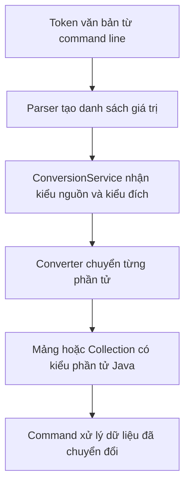

# Chuyển đổi phần tử của mảng hoặc Collection

Một command có thể nhận nhiều giá trị cùng loại, chẳng hạn danh sách nhãn triển khai, mã người dùng hoặc đường dẫn file. Người dùng nhập các giá trị dưới dạng văn bản, nhưng phần xử lý thường cần một mảng hoặc `Collection` chứa các đối tượng Java đã được chuyển đổi. Spring Shell phối hợp với hệ thống chuyển đổi kiểu của Spring để thực hiện công việc này.

Điểm quan trọng là converter cho một phần tử có thể được tái sử dụng khi Spring chuyển đổi cả mảng hoặc collection. Ví dụ, nếu ứng dụng có `Converter<String, Tag>`, Spring `DefaultConversionService` có thể dùng converter đó cho từng phần tử khi chuyển `String[]` thành `Tag[]` hoặc `List<String>` thành `List<Tag>`. Bài học này đi từ command nhận mảng trong Spring Shell 3.4 đến cách chuyển đổi collection có kiểu phần tử rõ ràng bằng `TypeDescriptor`.

## 1. Tách việc phân tích dòng lệnh khỏi chuyển đổi kiểu

Khi người dùng chạy command:

```text
deploy --tag stable candidate release-2026
```

có hai công việc khác nhau:

1. **Phân tích cú pháp:** nhận diện command, option `--tag` và ba token `stable`, `candidate`, `release-2026`.
2. **Chuyển đổi kiểu:** chuyển từng token văn bản thành kiểu Java mà tham số command yêu cầu.

Nếu command nhận `String[]`, các giá trị vẫn là chuỗi. Nếu command nhận `Tag[]`, hệ thống cần chuyển mỗi chuỗi thành một đối tượng `Tag`. Arity hoặc cách parser thu thập token quyết định có bao nhiêu phần tử; `ConversionService` quyết định cách biến từng phần tử thành kiểu đích.

Luồng chuyển đổi khái quát:



Không nên gộp hai trách nhiệm này vào một hàm xử lý chuỗi trong command. Khi tách riêng, converter có thể được tái sử dụng trong command khác và được kiểm thử độc lập.

## 2. Spring Shell nhận mảng như thế nào?

Trong tài liệu Spring Shell 3.4, kiểu mảng được hỗ trợ cho option. Ví dụ đơn giản nhất là `String[]`:

```java
@ShellComponent
public class FileCommands {

    @ShellMethod(key = "inspect-files", value = "Hiển thị các file được truyền vào")
    public String inspectFiles(
            @ShellOption(value = "--file", arity = 3) String[] files) {
        return Arrays.toString(files);
    }
}
```

Với cấu hình này, người dùng có thể truyền tối đa ba giá trị theo arity đã khai báo. Spring Shell cũng hỗ trợ khai báo kiểu mảng trong `CommandRegistration` bằng `.type(String[].class)`. Với các kiểu phần tử nguyên thủy, tài liệu Spring Shell mô tả cách dùng tương tự, ví dụ `int[]` hoặc `boolean[]`.

Ví dụ trên dùng legacy `@ShellOption` để minh họa cách khai báo array trong model 3.x. Nếu dự án dùng annotation model mới của Spring Shell 3.x, có thể khai báo option bằng `@Option` và đặt arity phù hợp. Cú pháp annotation phụ thuộc model đang dùng; không trộn `@ShellOption` với `@Option` trong cùng một ví dụ.

Lưu ý: tài liệu Spring Shell 3.4 mô tả rõ kiểu mảng cho option. Khả năng bind trực tiếp tham số `Collection<T>` trong một command cần được xác minh với đúng API và phiên bản dự án. Phần tiếp theo trình bày cách Spring Framework chuyển đổi collection khi `ConversionService` có đủ thông tin về kiểu phần tử.

## 3. Tạo converter cho một phần tử

Giả sử ứng dụng quản lý nhãn triển khai. Mỗi nhãn cần được chuẩn hóa thành chữ thường và chỉ chứa chữ cái, chữ số, dấu chấm, gạch dưới hoặc gạch ngang.

Tạo kiểu miền:

```java
public record Tag(String value) {

    @Override
    public String toString() {
        return value;
    }
}
```

Tạo converter chuyển một chuỗi thành một `Tag`:

```java
import java.util.Locale;
import org.springframework.core.convert.converter.Converter;
import org.springframework.stereotype.Component;

@Component
public class TagConverter implements Converter<String, Tag> {

    @Override
    public Tag convert(String source) {
        String value = source.trim().toLowerCase(Locale.ROOT);

        if (!value.matches("[a-z0-9][a-z0-9._-]{0,39}")) {
            throw new IllegalArgumentException(
                    "Nhãn chỉ được chứa chữ thường, chữ số, dấu chấm, gạch dưới hoặc gạch ngang");
        }

        return new Tag(value);
    }
}
```

`Converter<S, T>` mô tả phép chuyển từ kiểu nguồn `S` sang kiểu đích `T`. Ở đây, `S` là `String` và `T` là `Tag`. Converter nên có hành vi xác định, an toàn khi được dùng đồng thời và ném `IllegalArgumentException` khi dữ liệu nguồn không hợp lệ.

Việc chuẩn hóa và kiểm tra cú pháp nhãn nằm trong converter vì đây là quy tắc chuyển đổi một giá trị văn bản thành một đối tượng `Tag`. Các quy tắc phụ thuộc ngữ cảnh, chẳng hạn nhãn đã tồn tại trong hệ thống hay người dùng có quyền sử dụng nhãn đó, vẫn thuộc về service hoặc validation nghiệp vụ.

## 4. Dùng converter cho từng phần tử của mảng

Khi `DefaultConversionService` chuyển một mảng từ kiểu phần tử này sang mảng có kiểu phần tử khác, converter mảng sẽ ủy quyền việc chuyển đổi từng phần tử cho converter tương ứng. Vì vậy, không cần viết một converter riêng cho `String[]` sang `Tag[]` nếu `Converter<String, Tag>` đã được đăng ký và cơ chế chuyển đổi mảng mặc định đang hoạt động.

Ví dụ dùng `DefaultConversionService` trực tiếp:

```java
import org.springframework.core.convert.support.DefaultConversionService;

DefaultConversionService conversionService = new DefaultConversionService();
conversionService.addConverter(new TagConverter());

String[] source = {" Stable ", "Candidate", "release-2026"};
Tag[] tags = conversionService.convert(source, Tag[].class);
```

Kết quả là mảng `Tag` có ba phần tử:

```text
Tag("stable")
Tag("candidate")
Tag("release-2026")
```

Mỗi phần tử được chuyển đổi riêng bằng `TagConverter`. Thứ tự phần tử trong mảng được giữ nguyên. Nếu một phần tử không hợp lệ, phép chuyển đổi thất bại và `ConversionService` ném exception thay vì trả về mảng có kiểu đích nhưng chứa phần tử sai.

Trong ứng dụng Spring Shell 3.x, có thể khai báo converter tùy chỉnh thành bean để hệ thống chuyển đổi của shell sử dụng. Ví dụ command nhận mảng `Tag[]`:

```java
import java.util.Arrays;
import org.springframework.shell.command.annotation.Command;
import org.springframework.shell.command.annotation.Option;
import org.springframework.stereotype.Component;

@Component
public class DeployCommands {

    @Command(command = "deploy")
    public String deploy(
            @Option(
                    longNames = "tag",
                    required = true,
                    arityMin = 1,
                    arityMax = 3)
            Tag[] tags) {

        return "Các nhãn: " + Arrays.stream(tags)
                .map(Tag::value)
                .toList();
    }
}
```

Người dùng nhập:

```text
deploy --tag Stable Candidate release-2026
```

Command nhận `Tag[]` thay vì `String[]`. Converter cho phần tử được Spring Shell sử dụng thông qua cơ chế chuyển đổi của Spring; với cấu hình cụ thể của ứng dụng, hãy kiểm thử tích hợp để xác nhận converter bean được nhận diện và từng token được chuyển đổi đúng.

## 5. Chuyển đổi từng phần tử của Collection

Với collection có generic type, chẳng hạn `List<String>` sang `List<Tag>`, Java type erasure khiến `List.class` không chứa thông tin `Tag` ở runtime. `ConversionService` cần `TypeDescriptor` để biết kiểu phần tử của collection nguồn và đích.

Ví dụ:

```java
import java.util.List;
import org.springframework.core.convert.TypeDescriptor;
import org.springframework.core.convert.support.DefaultConversionService;

DefaultConversionService conversionService = new DefaultConversionService();
conversionService.addConverter(new TagConverter());

List<String> source = List.of("Stable", "Candidate", "release-2026");

TypeDescriptor sourceType = TypeDescriptor.collection(
        List.class, TypeDescriptor.valueOf(String.class));
TypeDescriptor targetType = TypeDescriptor.collection(
        List.class, TypeDescriptor.valueOf(Tag.class));

@SuppressWarnings("unchecked")
List<Tag> tags = (List<Tag>) conversionService.convert(
        source, sourceType, targetType);
```

`sourceType` mô tả `List<String>`; `targetType` mô tả `List<Tag>`. Spring dùng converter phần tử `String -> Tag` để chuyển từng giá trị trong collection. `TypeDescriptor.collection(...)` giúp giữ thông tin generic mà `List.class` đơn lẻ không thể biểu diễn.

Khi cần chuyển đổi collection trong code ứng dụng, hãy truyền `TypeDescriptor` nguồn và đích thay vì gọi `convert(source, List.class)`. Dạng gọi chỉ truyền `List.class` không nói được phần tử đích phải là `Tag`, `Integer` hay một kiểu khác.

## 6. Một converter phần tử có thể dùng cho nhiều container

Nếu quy tắc chuyển đổi của phần tử giống nhau, converter không cần biết phần tử đang nằm trong array hay collection. Cùng `TagConverter` có thể được dùng cho:

| Kiểu nguồn | Kiểu đích | Cách dùng |
| --- | --- | --- |
| `String[]` | `Tag[]` | `conversionService.convert(source, Tag[].class)` |
| `List<String>` | `List<Tag>` | Dùng `TypeDescriptor.collection` cho hai phía |
| `Set<String>` | `Set<Tag>` | Dùng `TypeDescriptor.collection(Set.class, ...)` |
| Collection phần tử chuỗi | Array phần tử `Tag` | Mô tả đúng source và target bằng `TypeDescriptor` |

Ví dụ với `Set`:

```java
import java.util.LinkedHashSet;
import java.util.List;
import java.util.Set;
import org.springframework.core.convert.TypeDescriptor;
import org.springframework.core.convert.support.DefaultConversionService;

DefaultConversionService conversionService = new DefaultConversionService();
conversionService.addConverter(new TagConverter());

Set<String> source = new LinkedHashSet<>(
        List.of("stable", "candidate", "release-2026"));

TypeDescriptor sourceType = TypeDescriptor.collection(
        Set.class, TypeDescriptor.valueOf(String.class));
TypeDescriptor targetType = TypeDescriptor.collection(
        Set.class, TypeDescriptor.valueOf(Tag.class));

@SuppressWarnings("unchecked")
Set<Tag> tags = (Set<Tag>) conversionService.convert(
        source, sourceType, targetType);
```

Chọn container theo yêu cầu nghiệp vụ. `List` giữ thứ tự và cho phép phần tử trùng; `Set` loại phần tử trùng theo `equals`/`hashCode` của kiểu phần tử. Nếu thứ tự nhập là quan trọng, dùng `List` hoặc mảng. Nếu cần loại trùng, bảo đảm kiểu miền định nghĩa equality đúng với ý nghĩa nghiệp vụ.

## 7. Khi nào dùng `Converter`, `ConverterFactory` hoặc `GenericConverter`?

Spring cung cấp một số SPI để mở rộng chuyển đổi:

| SPI | Dùng khi | Ví dụ |
| --- | --- | --- |
| `Converter<S, T>` | Một kiểu nguồn và một kiểu đích cụ thể | `String -> Tag` |
| `ConverterFactory<S, R>` | Một kiểu nguồn có thể chuyển sang nhiều kiểu đích thuộc cùng hệ phân cấp | `String -> các kiểu Enum` |
| `GenericConverter` | Cần xử lý nhiều cặp kiểu hoặc cần thông tin `TypeDescriptor` của nguồn/đích | Chuyển đổi phụ thuộc generic type hoặc metadata |
| `ConditionalGenericConverter` | Converter chỉ áp dụng khi điều kiện kiểu hoặc metadata thỏa mãn | Chỉ chuyển một kiểu ID sang entity khi target hỗ trợ finder |

Ưu tiên `Converter` cho quy tắc phần tử đơn giản. Nếu có một họ kiểu đích dùng chung cách phân tích, `ConverterFactory` tránh phải viết nhiều converter tương tự. Chỉ dùng `GenericConverter` khi cần đọc `TypeDescriptor`, xử lý nhiều cặp kiểu hoặc phụ thuộc metadata của tham số.

Không nên viết `GenericConverter` chỉ để chuyển từng phần tử của `List<String>` sang `List<Tag>` nếu converter phần tử và converter container mặc định đã giải quyết được. Cách đơn giản ít mã hơn và tận dụng được các converter chuẩn của Spring.

## 8. Đăng ký converter trong ứng dụng Spring Shell

Trong Spring Shell 3.x, chuyển đổi đối số dựa trên cơ chế chuyển đổi kiểu của Spring. Hướng dẫn tùy biến conversion của Spring Shell mô tả việc đăng ký các bean `Converter`, `ConverterFactory` và `GenericConverter` trong application context để shell sử dụng.

Đặt `@Component` trên `TagConverter` đã tạo ở mục 3 để Spring quản lý và đưa converter vào application context. Converter có thể được tái sử dụng cho nhiều lần gọi command. Nó không nên giữ trạng thái thay đổi theo từng command. Nếu chuyển đổi cần tra cứu dữ liệu, hãy cân nhắc tách phần phân tích cú pháp thuần khỏi service nghiệp vụ; tránh để converter gọi mạng hoặc thực hiện giao dịch dài trong lúc parser đang bind tham số.

Nếu ứng dụng thay thế hoàn toàn `ConversionService`, cần bảo đảm đã đăng ký các converter mặc định mà ứng dụng vẫn cần, cùng converter tùy chỉnh. Một conversion service tự tạo nhưng thiếu converter chuẩn có thể làm mất chuyển đổi số, enum hoặc mảng đang hoạt động trước đó. Với hầu hết trường hợp, đăng ký thêm converter vào cấu hình hiện có là lựa chọn phù hợp hơn.

## 9. Chuyển đổi collection từ một token có dấu phân cách

Có hai kiểu đầu vào khác nhau:

```text
deploy --tag stable candidate release-2026
deploy --tags=stable,candidate,release-2026
```

Ở cách thứ nhất, parser thu thập nhiều token cho một option có arity phù hợp; converter phần tử nhận từng chuỗi riêng. Ở cách thứ hai, parser nhận một token duy nhất là `stable,candidate,release-2026`. Nếu muốn hỗ trợ cú pháp dấu phẩy, ứng dụng phải định nghĩa thêm quy tắc tách chuỗi.

Không dùng `Converter<String, Tag>` để tự hiểu chuỗi có dấu phẩy nếu `Tag` vốn chỉ đại diện một nhãn. Có thể tạo một converter riêng từ chuỗi phân tách sang collection, nhưng cần mô tả rõ dấu phân cách, cách escape dấu phẩy, xử lý khoảng trắng và phần tử rỗng. Ví dụ:

```java
import java.util.Arrays;
import java.util.List;
import org.springframework.core.convert.ConversionService;

public List<Tag> parseTagList(String input, ConversionService conversionService) {
    String[] values = input.split(",", -1);
    return Arrays.stream(values)
            .map(String::trim)
            .map(value -> conversionService.convert(value, Tag.class))
            .toList();
}
```

Ví dụ này cố ý giữ phần tử rỗng nhờ `split(",", -1)` để có thể phát hiện và báo lỗi, thay vì âm thầm bỏ qua. Trong code thực tế, cần xử lý `null` và thông báo lỗi có vị trí phần tử để người dùng biết giá trị nào sai.

## 10. Lỗi chuyển đổi và validation

Khi một phần tử không thể chuyển đổi, toàn bộ phép chuyển đổi container có thể thất bại. Ví dụ `release?` không hợp lệ theo quy tắc của `TagConverter`; Spring không thể tạo `Tag` tương ứng cho phần tử đó.

Phân biệt hai loại kiểm tra:

- **Conversion:** văn bản có thể biểu diễn thành đối tượng đích hay không? Ví dụ `release-2026` có tạo được `Tag` hợp lệ không?
- **Validation nghiệp vụ:** đối tượng đã chuyển đổi có được phép dùng trong tình huống hiện tại không? Ví dụ tag đã tồn tại, không được phép triển khai ở môi trường production hoặc vượt giới hạn số lượng.

Một converter nên ném `IllegalArgumentException` khi đầu vào không thể chuyển đổi. Spring có thể bọc lỗi này trong exception chuyển đổi như `ConversionFailedException`. Ở ranh giới command, chuyển lỗi thành thông báo dễ hiểu và không in stack trace cho lỗi nhập liệu thông thường.

Với mảng hoặc collection, thông báo lỗi nên nêu được phần tử gây lỗi nếu có thể. Nếu tự duyệt danh sách để chuyển đổi, có thể thêm chỉ số phần tử vào thông báo, ví dụ `--tag phần tử thứ 2 không hợp lệ`. Không nên bỏ qua phần tử lỗi rồi tiếp tục với phần còn lại nếu điều đó làm thay đổi ý nghĩa thao tác.

## 11. Kiểm thử chuyển đổi phần tử

Kiểm thử converter đơn lẻ trước, sau đó kiểm thử cơ chế chuyển đổi container và cuối cùng kiểm thử command qua Spring Shell.

**Unit test cho converter** kiểm tra chuẩn hóa, giá trị hợp lệ và giá trị bị từ chối:

```java
import org.junit.jupiter.api.Test;

import static org.junit.jupiter.api.Assertions.assertEquals;
import static org.junit.jupiter.api.Assertions.assertThrows;

class TagConverterTest {

    private final TagConverter converter = new TagConverter();

    @Test
    void normalizesTag() {
        assertEquals(new Tag("release-2026"), converter.convert(" Release-2026 "));
    }

    @Test
    void rejectsInvalidTag() {
        assertThrows(IllegalArgumentException.class,
                () -> converter.convert("release?2026"));
    }
}
```

**Unit test cho `ConversionService`** xác nhận converter phần tử được áp dụng cho mọi phần tử của mảng và collection. Kiểm tra thêm thứ tự, phần tử trùng và trường hợp một phần tử lỗi.

**Integration test cho Spring Shell** khởi động application context, gọi command nhận `Tag[]` với nhiều token và xác nhận phương thức nhận đúng đối tượng. Gọi lại với một token không hợp lệ để kiểm tra lỗi binding được báo trước khi nghiệp vụ thực hiện.

Ma trận kiểm thử đề xuất:

| Trường hợp | Điều cần xác nhận |
| --- | --- |
| Mảng rỗng | Hành vi phù hợp với arity và required |
| Một phần tử | Chuyển đổi thành một đối tượng đúng |
| Nhiều phần tử | Mỗi phần tử được chuyển đổi và giữ thứ tự |
| Phần tử có khoảng trắng | Converter chuẩn hóa đúng theo hợp đồng |
| Một phần tử sai định dạng | Toàn bộ binding thất bại với thông báo có ích |
| Collection có generic type | `TypeDescriptor` chỉ đúng kiểu phần tử đích |
| Set có phần tử trùng | Equality của kiểu phần tử quyết định kết quả |
| Converter được gọi đồng thời | Không có trạng thái chia sẻ gây lỗi |

## 12. Lỗi thường gặp

| Triệu chứng | Nguyên nhân | Cách xử lý |
| --- | --- | --- |
| Mảng nhận chuỗi thô thay vì object | Chưa có converter cho kiểu phần tử hoặc converter chưa được đăng ký | Đăng ký `Converter<String, T>` và kiểm thử conversion service |
| Chuyển được phần tử đơn nhưng mảng lỗi | Không có converter container phù hợp hoặc target type khai báo sai | Dùng `DefaultConversionService` với converter mảng/collection mặc định; kiểm tra kiểu đích |
| `List<Tag>` không chuyển đúng kiểu phần tử | Chỉ truyền `List.class`, làm mất generic element type | Dùng `TypeDescriptor.collection(...)` cho nguồn và đích |
| Converter không được Spring Shell gọi | Bean chưa nằm trong application context hoặc conversion service của shell đã bị thay thế | Kiểm tra component scan và cấu hình conversion service của phiên bản đang dùng |
| Một giá trị sai làm hỏng toàn bộ danh sách | Một phần tử không thể chuyển đổi | Báo lỗi rõ phần tử; quyết định rõ thao tác có được phép tiếp tục hay không |
| Phần tử trùng biến mất | Dùng `Set` thay cho `List` hoặc kiểu miền có equality trùng nhau | Chọn container theo yêu cầu và định nghĩa `equals`/`hashCode` phù hợp |
| Danh sách dấu phẩy không được tách | Parser nhận toàn bộ chuỗi là một token | Viết quy tắc tách riêng hoặc dùng nhiều token với arity |

## 13. Bài thực hành tổng hợp

Xây dựng command `deploy` nhận nhiều nhãn và chuyển từng nhãn thành đối tượng miền:

1. Tạo `Tag` bất biến với thuộc tính `value`.
2. Viết `TagConverter implements Converter<String, Tag>` để chuẩn hóa và kiểm tra định dạng nhãn.
3. Đăng ký converter thành bean trong application context.
4. Tạo command Spring Shell 3.4 nhận `Tag[]` qua option `--tag` với arity từ một đến ba.
5. Chạy command với một, hai và ba nhãn; xác nhận từng phần tử đã được chuyển đổi.
6. Tạo một `List<String>` và dùng `ConversionService` cùng `TypeDescriptor` để chuyển thành `List<Tag>`.
7. Thử một nhãn sai định dạng ở giữa danh sách và kiểm tra thông báo lỗi.
8. Viết unit test cho converter, test chuyển đổi array/collection và integration test cho command.

Khi hoàn thành, bạn cần giải thích được vì sao converter phần tử có thể tái sử dụng cho mảng và collection, vì sao collection generic cần `TypeDescriptor`, và vì sao chuyển đổi kiểu không thay thế validation nghiệp vụ.

## 14. Tiêu chí hoàn thành

| Năng lực | Tiêu chí |
| --- | --- |
| Phân biệt luồng | Phân biệt parser thu thập token với ConversionService chuyển đổi kiểu |
| Converter | Viết được `Converter<String, T>` cho một phần tử |
| Mảng | Chuyển được `String[]` thành mảng đối tượng miền |
| Collection | Chuyển được collection có generic element type bằng `TypeDescriptor` |
| Converter nâng cao | Biết khi nào cần `ConverterFactory` hoặc `GenericConverter` |
| Đăng ký | Đưa converter vào application context và xác nhận Spring Shell nhận diện |
| Lỗi | Xử lý phần tử sai định dạng và thông báo rõ ràng |
| Kiểm thử | Có unit test converter, test container và integration test command |

## Tài liệu tham khảo

- [Spring Shell 3.4.3 — Types](https://docs.spring.io/spring-shell/reference/3.4/options/types.html)
- [Spring Shell 3.x — Customizing Arguments Conversion](https://docs.spring.io/spring-shell/docs/3.0.0-M1/site/reference/htmlsingle/)
- [Spring Framework 6.2 — Spring Type Conversion](https://docs.spring.io/spring-framework/reference/6.2/core/validation/convert.html)
- [Spring Framework — `ConversionService` API](https://docs.spring.io/spring-framework/docs/current/javadoc-api/org/springframework/core/convert/ConversionService.html)
