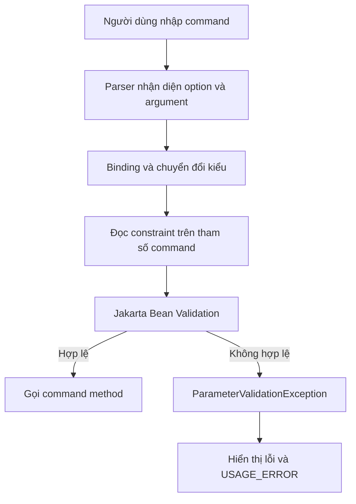

# Bean Validation và điều kiện kích hoạt kiểm tra tham số

Spring Shell tích hợp Jakarta Bean Validation để kiểm tra giá trị của tham số command trước khi gọi method xử lý. Bạn có thể đặt các constraint như `@NotBlank`, `@Email`, `@Size`, `@Min` hoặc `@Pattern` trực tiếp lên tham số được khai báo bằng `@Option` hay `@Argument`. Khi giá trị không thỏa constraint, Spring Shell báo lỗi sử dụng và không thực thi phần thân command.

Bài học thuộc chương **Kiểm tra đầu vào** của Spring Shell. Nội dung giải thích điều kiện để kiểm tra tham số được kích hoạt, cách khai báo constraint, sự khác nhau giữa Bean Validation với kiểm tra cú pháp/chuyển đổi kiểu, và cách kiểm thử hành vi khi dữ liệu không hợp lệ.

Sau bài học, bạn có thể:

- Giải thích vai trò của Bean Validation trong luồng thực thi command.
- Xác định các điều kiện cần có để Spring Shell tự kiểm tra tham số.
- Sử dụng constraint chuẩn của Jakarta Validation trên option và argument.
- Phân biệt `required` của option với `@NotNull` và các constraint khác.
- Nhận biết khi nào cần `@Validated` và `MethodValidationPostProcessor` cho service.
- Kiểm thử trường hợp hợp lệ, vi phạm constraint và lỗi chuyển đổi kiểu.

## Bean Validation kiểm tra điều gì?

Người dùng có thể nhập một giá trị đúng cú pháp nhưng không hợp lệ theo quy tắc dữ liệu của ứng dụng. Ví dụ, `--age=12` là một giá trị số hợp lệ và parser có thể chuyển thành `int`, nhưng ứng dụng có thể chỉ cho phép người dùng từ 18 tuổi. Bean Validation giúp mô tả các điều kiện này ngay trên tham số method bằng annotation.

Spring Shell 4.x tích hợp Bean Validation trong bước thực thi command method. Các annotation constraint trên tham số được kiểm tra trước khi method được gọi. Nếu có vi phạm, Spring Shell tạo lỗi validation và đưa lỗi đó qua cơ chế xử lý kết quả của shell.



Bean Validation không thay thế parser hoặc conversion service. Parser xác định token nào là option hay argument; conversion service chuyển giá trị sang kiểu Java; Bean Validation kiểm tra giá trị sau khi đã được ánh xạ và chuyển đổi.

## Điều kiện để Spring Shell tự động kiểm tra tham số

Để các constraint được áp dụng trong luồng command method, cần có các điều kiện sau:

1. **Command được Spring Shell nhận diện.** Method xử lý phải được khai báo là command bằng `@Command` trong một Spring-managed bean, ví dụ lớp có `@Component`.
2. **Tham số được Spring Shell ánh xạ.** Tham số phải là option, argument hoặc kiểu tham số được command adapter hỗ trợ. Constraint cần đặt trực tiếp trên tham số cần kiểm tra.
3. **Có Jakarta Bean Validation provider.** API `jakarta.validation` định nghĩa annotation và hợp đồng validation; một provider như Hibernate Validator thực hiện việc đánh giá constraint lúc chạy.
4. **Constraint phù hợp với kiểu dữ liệu.** Ví dụ `@NotBlank` và `@Email` dùng cho chuỗi; `@Min` và `@Max` dùng cho giá trị số; `@Size` dùng cho chuỗi, collection, map hoặc array.

Với cấu hình Spring Shell 4.x thông thường, `spring-shell-core` đã đưa Hibernate Validator vào dependency graph. Nếu dự án loại trừ dependency bắc cầu hoặc tự lắp classpath tối giản, cần bảo đảm có một provider tương thích Jakarta Validation. Có annotation trong mã nguồn nhưng thiếu provider lúc chạy sẽ không tạo ra một cơ chế validation hoạt động.

**Không cần đặt `@Validated` trên lớp command chỉ để kích hoạt validation tham số của Spring Shell.** Spring Shell sử dụng validator trong command method adapter của nó để kiểm tra tham số trước khi gọi method. `@Validated` thuộc cơ chế method validation qua Spring AOP; phần sau sẽ phân biệt trường hợp này.

## Ví dụ: kiểm tra email và tuổi khi tạo người dùng

Ví dụ sau khai báo hai option bắt buộc: email phải có định dạng email và tuổi phải nằm trong khoảng 18 đến 120.

```java
import jakarta.validation.constraints.Email;
import jakarta.validation.constraints.Max;
import jakarta.validation.constraints.Min;
import jakarta.validation.constraints.NotBlank;

import org.springframework.shell.core.command.annotation.Command;
import org.springframework.shell.core.command.annotation.Option;
import org.springframework.stereotype.Component;

@Component
class UserCommands {

    @Command(name = "user create", description = "Tạo người dùng")
    public String create(
            @Option(longName = "email", required = true)
            @NotBlank
            @Email
            String email,
            @Option(longName = "age", required = true)
            @Min(18)
            @Max(120)
            int age) {

        // Chỉ chạy khi cả hai tham số đã vượt qua validation.
        return "Đã tạo người dùng với tuổi " + age;
    }
}
```

Lệnh hợp lệ:

```text
user create --email=lan@example.com --age=25
```

Lệnh vi phạm constraint:

```text
user create --email=not-an-email --age=16
```

Spring Shell hiển thị các constraint không thỏa mãn, ví dụ lỗi định dạng email và giới hạn tuổi. Method `create()` không được gọi, do đó phần tạo người dùng không chạy khi dữ liệu đầu vào không hợp lệ.

Với dữ liệu nhạy cảm như mật khẩu, không in giá trị tham số ra terminal hoặc log trong method xử lý. Hãy chỉ hiển thị thông báo thành công chung và để thông báo validation nêu quy tắc bị vi phạm mà không tiết lộ dữ liệu người dùng đã nhập.

## Các constraint thường dùng

Jakarta Bean Validation cung cấp nhiều constraint chuẩn. Hãy chọn constraint theo đúng kiểu dữ liệu và quy tắc nghiệp vụ:

| Constraint | Kiểu dữ liệu thường dùng | Điều kiện |
| --- | --- | --- |
| `@NotNull` | Mọi kiểu tham chiếu | Giá trị không được là `null`. |
| `@NotBlank` | `CharSequence` | Chuỗi không được `null`, rỗng hoặc chỉ gồm khoảng trắng. |
| `@NotEmpty` | Chuỗi, collection, map, array | Giá trị không được `null` và không được rỗng. |
| `@Size(min, max)` | Chuỗi, collection, map, array | Kích thước nằm trong khoảng cho phép. |
| `@Min(value)` / `@Max(value)` | Kiểu số | Giá trị không nhỏ hơn hoặc không lớn hơn ngưỡng chỉ định. |
| `@Positive` / `@PositiveOrZero` | Kiểu số | Giá trị phải dương hoặc không âm. |
| `@Email` | `CharSequence` | Giá trị phải phù hợp quy tắc địa chỉ email của provider. |
| `@Pattern(regexp)` | `CharSequence` | Chuỗi phải khớp biểu thức chính quy. |
| `@Past` / `@Future` | Kiểu ngày giờ được hỗ trợ | Thời điểm phải nằm trước hoặc sau hiện tại. |

Ví dụ kiểm tra mã dự án có dạng chữ hoa, dấu gạch ngang và chữ số:

```java
@Option(longName = "project-code", required = true)
@NotBlank
@Pattern(regexp = "[A-Z]{2,5}-[0-9]{3,6}")
String projectCode
```

Một số lưu ý:

- `@NotBlank` không thay thế `@Email`, `@Pattern` hoặc các constraint về định dạng. Có thể kết hợp nhiều constraint trên cùng một tham số.
- `@Size` kiểm tra số ký tự hoặc số phần tử, không kiểm tra giá trị số lớn hay nhỏ. Với số tuổi, dùng `@Min` và `@Max`.
- `@Email` kiểm tra định dạng cơ bản; không xác nhận hộp thư thực sự tồn tại hoặc người dùng sở hữu địa chỉ đó.
- `@NotNull` không tự thay thế việc khai báo option bắt buộc trong cú pháp CLI.

## Phân biệt required, default value và constraint

Ba cơ chế này kiểm tra những điều kiện khác nhau:

| Cơ chế | Thời điểm/ý nghĩa | Ví dụ |
| --- | --- | --- |
| `required = true` trên `@Option` | Kiểm tra người dùng có cung cấp option theo hợp đồng CLI hay không. | Thiếu `--email` thì command không được phân tích thành công. |
| `defaultValue` trên option/argument | Cung cấp giá trị thay thế khi người dùng không truyền dữ liệu. | `--limit` mặc định là `10`. |
| Bean Validation constraint | Kiểm tra giá trị sau khi đã được ánh xạ và chuyển đổi. | `@Min(1)` từ chối `--limit=0`. |

Ví dụ, option `--limit` có thể không bắt buộc và mặc định là `10`, nhưng vẫn cần constraint `@Min(1)` để cấm giá trị âm hoặc bằng không. Khi giá trị mặc định cũng được áp dụng, constraint sẽ kiểm tra giá trị cuối cùng được truyền vào method.

Nếu muốn bắt buộc người dùng cung cấp một giá trị, hãy dùng `required = true`. Nếu muốn cho phép vắng mặt nhưng cấm `null` ở một object được binding, dùng constraint phù hợp. Với kiểu primitive như `int`, Java luôn có giá trị mặc định `0`, nên `@NotNull` không có ý nghĩa trên tham số primitive; hãy dùng kiểu wrapper `Integer` nếu cần biểu diễn trạng thái `null`.

## Validation lồng nhau với @Valid

Khi một tham số command nhận một object có các thuộc tính riêng, `@Valid` có thể yêu cầu Bean Validation đi tiếp vào object đó để kiểm tra các constraint trên thuộc tính. Điều này hữu ích khi command adapter hoặc resolver của ứng dụng đã có khả năng tạo object đầu vào từ dữ liệu CLI.

Ví dụ model:

```java
import jakarta.validation.constraints.Email;
import jakarta.validation.constraints.NotBlank;

public record UserInput(
        @NotBlank String name,
        @Email String email) {
}
```

Khi tham số method nhận được một `UserInput` đã được binding:

```java
import jakarta.validation.Valid;

public String create(@Valid UserInput input) {
    return "Đã nhận yêu cầu tạo người dùng";
}
```

`@Valid` kích hoạt cascade validation cho thuộc tính `name` và `email`. Bản thân `@Valid` không định nghĩa quy tắc dữ liệu; các constraint như `@NotBlank` và `@Email` mới mô tả điều kiện cụ thể. Việc tạo/binding object vẫn phải được hỗ trợ bởi command parameter resolver hoặc conversion được cấu hình.

## Điều gì xảy ra khi validation thất bại?

Khi một hay nhiều constraint bị vi phạm, Spring Shell phát sinh `ParameterValidationException`, chứa tập hợp `ConstraintViolation`. Luồng thực thi dừng trước khi gọi method command. Cơ chế xử lý lỗi hiển thị thông báo constraint và báo trạng thái `USAGE_ERROR`.

Ví dụ dạng thông báo:

```text
The following constraints were not met:
    --password: size must be between 8 and 40
Error while executing command change-password: USAGE_ERROR
```

Thông báo cụ thể phụ thuộc constraint, message bundle và cách ứng dụng tùy biến result handler. Khi viết thông báo, nên nêu tên option/argument và quy tắc cần thỏa mãn để người dùng biết cách sửa input.

## Phân biệt validation của command với validation của service

Một ứng dụng thường có hai nơi cần kiểm tra dữ liệu:

1. **Tham số command:** kiểm tra input trực tiếp từ CLI trước khi chạy command method. Spring Shell tự gọi Bean Validation cho các constraint trên tham số method command.
2. **Method của service:** kiểm tra mọi nơi gọi service, kể cả CLI, REST API hoặc batch job. Trường hợp này dùng method validation của Spring Framework.

Để kích hoạt method validation trên service, cần có Bean Validation provider, khai báo `MethodValidationPostProcessor` và đánh dấu lớp service bằng `@Validated`:

```java
import jakarta.validation.constraints.Min;

import org.springframework.stereotype.Service;
import org.springframework.validation.annotation.Validated;

@Service
@Validated
class UserService {

    public void changeAge(@Min(18) int age) {
        // Quy tắc được áp dụng khi lời gọi đi qua Spring proxy.
    }
}
```

Với Spring Framework thuần, đăng ký post processor:

```java
import org.springframework.context.annotation.Bean;
import org.springframework.context.annotation.Configuration;
import org.springframework.validation.beanvalidation.MethodValidationPostProcessor;

@Configuration
class ValidationConfiguration {

    @Bean
    static MethodValidationPostProcessor methodValidationPostProcessor() {
        return new MethodValidationPostProcessor();
    }
}
```

Spring Boot có thể tự cấu hình method validation khi có implementation Bean Validation trên classpath. Trong trường hợp đó, vẫn cần `@Validated` trên bean có method cần được proxy để kiểm tra.

Method validation dựa trên Spring AOP proxy. Lời gọi nội bộ từ một method sang method khác trong cùng instance có thể bỏ qua proxy; vì vậy không nên giả định mọi lời gọi nội bộ đều tự động chạy validation. Hãy tổ chức service và kiểm thử qua bean được Spring quản lý.

Điểm khác biệt quan trọng: `@Validated` và `MethodValidationPostProcessor` dùng để kiểm tra method của service qua proxy. Chúng không phải điều kiện để Spring Shell kiểm tra trực tiếp tham số của command method.

## Tách validation khỏi parsing và chuyển đổi kiểu

Không phải mọi lỗi input đều là lỗi Bean Validation:

| Input | Bước phát hiện | Kết quả |
| --- | --- | --- |
| `--age=abc` trong khi tham số là `int` | Chuyển đổi kiểu | Không thể chuyển chuỗi `abc` thành số nguyên. |
| Thiếu option `--email` có `required = true` | Parsing/binding | Thiếu option bắt buộc. |
| `--age=16` với `@Min(18)` | Bean Validation | Giá trị số hợp lệ về kiểu nhưng không thỏa quy tắc tuổi. |
| `--email=abc` với `@Email` | Bean Validation | Chuỗi được chuyển đổi thành công nhưng không đúng định dạng email. |
| `--name="   "` với `@NotBlank` | Bean Validation | Chuỗi chỉ có khoảng trắng. |

Hãy xử lý mỗi loại lỗi ở đúng tầng. Parser không nên kiểm tra tuổi tối thiểu; conversion service không nên chứa quy tắc email; command method không nên tự viết lại các constraint phổ biến nếu Bean Validation đã mô tả được chúng.

## Tùy chỉnh constraint và thông báo lỗi

Khi constraint chuẩn chưa đáp ứng quy tắc miền nghiệp vụ, có thể tạo annotation riêng bằng `@Constraint` và một lớp triển khai `ConstraintValidator`. Ví dụ, mã khách hàng phải tuân theo quy ước riêng của hệ thống:

```java
import jakarta.validation.Constraint;
import jakarta.validation.Payload;
import java.lang.annotation.Documented;
import java.lang.annotation.Retention;
import java.lang.annotation.Target;

import static java.lang.annotation.ElementType.PARAMETER;
import static java.lang.annotation.RetentionPolicy.RUNTIME;

@Documented
@Target(PARAMETER)
@Retention(RUNTIME)
@Constraint(validatedBy = CustomerCodeValidator.class)
public @interface ValidCustomerCode {
    String message() default "Mã khách hàng không hợp lệ";
    Class<?>[] groups() default {};
    Class<? extends Payload>[] payload() default {};
}
```

Validator thực thi quy tắc:

```java
import jakarta.validation.ConstraintValidator;
import jakarta.validation.ConstraintValidatorContext;

public class CustomerCodeValidator
        implements ConstraintValidator<ValidCustomerCode, String> {

    @Override
    public boolean isValid(String value, ConstraintValidatorContext context) {
        if (value == null || value.isBlank()) {
            return true; // Dùng @NotBlank riêng nếu giá trị bắt buộc.
        }
        return value.matches("CUS-[0-9]{6}");
    }
}
```

Có thể kết hợp `@ValidCustomerCode` với `@NotBlank` trên tham số command. Nếu validator cần dependency Spring, hãy cấu hình provider/validator factory tương thích với Spring để validator tùy chỉnh có thể được tạo và inject dependency.

Thông báo constraint có thể dùng message mặc định hoặc message key trong `ValidationMessages.properties`. Ví dụ:

```properties
jakarta.validation.constraints.NotBlank.message=Giá trị không được để trống
jakarta.validation.constraints.Email.message=Hãy nhập địa chỉ email hợp lệ
ValidCustomerCode.message=Mã khách hàng phải có dạng CUS-123456
```

Không đưa dữ liệu nhạy cảm vào message hoặc log. Chỉ mô tả điều kiện cần sửa.

## Kiểm thử validation

Hãy kiểm thử ở cả mức constraint và mức command:

1. **Constraint hợp lệ:** truyền giá trị nằm trong giới hạn và xác nhận command được gọi.
2. **Constraint không hợp lệ:** truyền một giá trị vi phạm và xác nhận method command không chạy.
3. **Thiếu dữ liệu:** bỏ option bắt buộc để kiểm tra parser/binding.
4. **Sai kiểu:** truyền chuỗi không thể chuyển đổi sang kiểu Java để kiểm tra conversion.
5. **Nhiều vi phạm:** truyền input vi phạm nhiều constraint để xác nhận thông báo được hiển thị đầy đủ.
6. **Cascade validation:** nếu dùng `@Valid`, kiểm tra cả constraint trên object lồng nhau.
7. **Service method validation:** nếu service dùng `@Validated`, gọi service qua Spring bean proxy và xác nhận vi phạm được chặn.

Ví dụ với Spring Shell Test Client:

```java
import org.junit.jupiter.api.Test;
import org.springframework.beans.factory.annotation.Autowired;
import org.springframework.boot.autoconfigure.SpringBootApplication;
import org.springframework.context.annotation.ContextConfiguration;
import org.springframework.shell.test.ShellAssertions;
import org.springframework.shell.test.ShellScreen;
import org.springframework.shell.test.ShellTestClient;
import org.springframework.shell.test.autoconfigure.ShellTest;

@SpringBootApplication
class UserShellApplication {
}

@ShellTest
@ContextConfiguration(classes = UserShellApplication.class)
class UserCommandValidationTests {

    @Test
    void rejectsAgeBelowMinimum(@Autowired ShellTestClient client) throws Exception {
        ShellScreen screen = client.sendCommand(
            "user create --email=lan@example.com --age=16");

        ShellAssertions.assertThat(screen)
            .containsText("must be greater than or equal to 18");
    }
}
```

Tên thông báo chính xác phụ thuộc message bundle và provider. Trong test của dự án, có thể kiểm tra một phần thông báo ổn định hoặc kiểm tra exit status tương ứng với `USAGE_ERROR`.

## Lỗi thường gặp và cách xử lý

| Hiện tượng | Nguyên nhân | Cách xử lý |
| --- | --- | --- |
| Constraint không được áp dụng | Annotation đặt sai vị trí hoặc method không được Spring Shell nhận diện là command method. | Đặt constraint trực tiếp trên tham số và kiểm tra khai báo `@Command`. |
| Không có provider khi chạy | Dependency provider bị loại khỏi runtime classpath. | Kiểm tra dependency tree và thêm Hibernate Validator tương thích nếu cần. |
| `@NotBlank` không hoạt động với tham số số | Constraint không phù hợp kiểu dữ liệu. | Dùng `@Min`, `@Max`, `@Positive` hoặc constraint số thích hợp. |
| `@NotNull` không bắt được option bị bỏ qua | Option có default value hoặc dùng kiểu primitive. | Kiểm tra `required`, default value và kiểu tham số. |
| Validation service không chạy | Thiếu `@Validated`, post processor hoặc lời gọi bỏ qua proxy. | Kiểm tra cấu hình method validation và cách inject service. |
| Chỉ kiểm tra được object ngoài, không kiểm tra thuộc tính con | Thiếu `@Valid` ở tham số object hoặc object chưa được binding đúng. | Đánh dấu `@Valid` và kiểm tra parameter resolver/conversion. |
| Thông báo lỗi khó hiểu | Constraint dùng message mặc định không phù hợp với người dùng CLI. | Cấu hình message bundle hoặc message riêng cho constraint. |
| Command vẫn ghi dữ liệu dù input sai | Logic ghi dữ liệu chạy trước bước validation hoặc validation được thực hiện thủ công quá muộn. | Đặt constraint trên tham số và chỉ thực hiện nghiệp vụ sau khi command method được gọi. |

## Checklist trước khi hoàn tất command

- [ ] Mỗi tham số có kiểu Java phù hợp với dữ liệu CLI.
- [ ] Option bắt buộc đã được đánh dấu `required` khi cần.
- [ ] Constraint được đặt trực tiếp trên tham số cần kiểm tra.
- [ ] Constraint phù hợp với kiểu dữ liệu và không thay thế nhầm parser/conversion.
- [ ] Runtime classpath có Jakarta Bean Validation provider.
- [ ] Dữ liệu lồng nhau cần kiểm tra cascade đã có `@Valid`.
- [ ] Service method validation đã được cấu hình riêng nếu nghiệp vụ cần kiểm tra ở mọi điểm gọi.
- [ ] Test có cả trường hợp hợp lệ, vi phạm constraint, thiếu option và sai kiểu.
- [ ] Thông báo lỗi rõ ràng và không tiết lộ dữ liệu nhạy cảm.

## Ghi nhớ

Spring Shell tự động kiểm tra constraint Bean Validation đặt trên tham số command method trước khi thực thi method. Để tính năng hoạt động, command phải được đăng ký và ánh xạ tham số đúng cách, constraint phải phù hợp kiểu dữ liệu và runtime phải có Jakarta Validation provider. `required` xử lý sự hiện diện của option; Bean Validation kiểm tra chất lượng giá trị đã được binding. `@Validated` cùng `MethodValidationPostProcessor` là cơ chế riêng cho method validation của service qua Spring AOP, không phải công tắc bật validation tham số command của Spring Shell.

## Tài liệu tham khảo

- [Spring Shell 4.0.4 — Option Validation](https://docs.spring.io/spring-shell/reference/commands/validation.html): constraint trên tham số command và hành vi trước khi thực thi.
- [Spring Shell 4.0.4 — Command Syntax](https://docs.spring.io/spring-shell/reference/commands/syntax.html): khai báo option/argument bằng tham số method và chuyển đổi kiểu.
- [Spring Shell 4.0.3 API — ParameterValidationException](https://docs.spring.io/spring-shell/reference/api/org/springframework/shell/core/ParameterValidationException.html): exception chứa các constraint violation của tham số.
- [Spring Shell 4.0.4 Release Notes](https://github.com/spring-projects/spring-shell/releases): cập nhật dependency, gồm Hibernate Validator.
- [Spring Framework 7 — Java Bean Validation](https://docs.spring.io/spring-framework/reference/core/validation/beanvalidation.html): cấu hình provider, `LocalValidatorFactoryBean`, custom constraint và method validation.
- [Spring Boot — Validation](https://docs.spring.io/spring-boot/reference/io/validation.html): tự động kích hoạt method validation khi có provider và yêu cầu `@Validated` trên target class.
