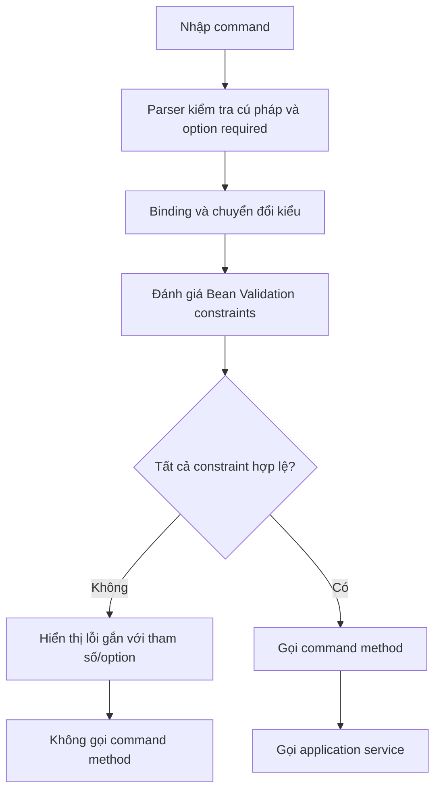

# `@NotNull`, `@NotBlank`, `@Size` và dữ liệu bắt buộc

Một command cần xác định rõ dữ liệu nào người dùng bắt buộc phải cung cấp và dữ liệu nào có thể bỏ qua. Ví dụ, khi đăng ký khách hàng, mã khách hàng và tên hiển thị phải có giá trị; ghi chú có thể để trống nhưng không được vượt quá giới hạn độ dài. Spring Shell tích hợp Jakarta Bean Validation để kiểm tra các constraint đặt trên tham số command trước khi gọi phương thức xử lý.

Ba annotation thường dùng là `@NotNull`, `@NotBlank` và `@Size`. Chúng kiểm tra những điều kiện khác nhau: một giá trị có tồn tại hay không, một chuỗi có nội dung thực hay không, và độ dài hoặc kích thước có nằm trong giới hạn hay không. Kết hợp đúng các constraint giúp command từ chối dữ liệu không hợp lệ ngay tại giao diện dòng lệnh và hiển thị lỗi gắn với option tương ứng.

Các ví dụ chính trong bài dùng annotation command của Spring Shell 4.x và package `jakarta.validation.constraints`. Spring Shell 3.4.x cũng tích hợp Bean Validation nhưng dùng mô hình khai báo command legacy như `@ShellMethod` và `@ShellOption`.

## Chuẩn bị Bean Validation

Spring Shell cần Bean Validation API cùng một implementation để thực thi constraint. Trong ứng dụng Spring Boot, cách thông dụng là thêm `spring-boot-starter-validation`; starter này đưa Hibernate Validator và các thành phần cần thiết vào classpath.

Maven:

```xml
<dependency>
    <groupId>org.springframework.boot</groupId>
    <artifactId>spring-boot-starter-validation</artifactId>
</dependency>
```

Gradle:

```groovy
implementation("org.springframework.boot:spring-boot-starter-validation")
```

Để Spring Boot quản lý phiên bản dependency thông qua BOM hoặc dependency management của dự án. Nếu ứng dụng không dùng Spring Boot, cần khai báo Jakarta Validation API và một provider tương thích, chẳng hạn Hibernate Validator, đồng thời cấu hình tích hợp theo môi trường Spring đang dùng.

Các annotation trong Jakarta Validation 3.x nằm trong package:

```java
import jakarta.validation.constraints.NotNull;
import jakarta.validation.constraints.NotBlank;
import jakarta.validation.constraints.Size;
```

Không trộn `javax.validation.constraints.*` của Bean Validation cũ với `jakarta.validation.constraints.*` trong ứng dụng Spring hiện đại. Hai package thuộc hai thế hệ API khác nhau và không thay thế trực tiếp cho nhau.

## Spring Shell kiểm tra constraint trên tham số command

Trong Spring Shell 4.x, constraint đặt trên tham số phương thức `@Command` được nhận diện và kiểm tra trước khi phương thức command thực thi. Nếu dữ liệu vi phạm, Spring Shell báo constraint không thỏa mãn và không gọi phần xử lý nghiệp vụ.

Ví dụ tối giản:

```java
import jakarta.validation.constraints.Size;

import org.springframework.shell.core.command.annotation.Command;
import org.springframework.shell.core.command.annotation.Option;
import org.springframework.stereotype.Component;

@Component
public class AccountCommands {

    private final AccountService accountService;

    public AccountCommands(AccountService accountService) {
        this.accountService = accountService;
    }

    @Command(name = "account change-password", description = "Đổi mật khẩu")
    public String changePassword(
            @Option(longName = "password", required = true)
            @Size(min = 8, max = 40) String password) {

        accountService.changePassword(password);
        return "Đã cập nhật mật khẩu.";
    }
}
```

Nếu người dùng nhập mật khẩu ngắn hơn 8 ký tự hoặc dài hơn 40 ký tự, Spring Shell hiển thị lỗi validation trước khi gọi `changePassword(...)`. Khi viết command xử lý mật khẩu hoặc dữ liệu nhạy cảm, không đưa giá trị đầu vào vào thông báo thành công, log hay output terminal.

Spring Shell 4.x tự kích hoạt việc kiểm tra constraint trên tham số command theo tích hợp của nó. Không cần thêm `@Validated` vào lớp command chỉ để kích hoạt chức năng này. `@Validated` thuộc cơ chế method validation AOP chung của Spring, thường dùng cho các service method; đây là một cơ chế riêng và cần cấu hình/proxy tương ứng.

## Phân biệt `required` của option và constraint validation

Một option có thể được khai báo bắt buộc bằng `required = true`:

```java
@Option(longName = "code", required = true) String code
```

Đây là quy tắc của cú pháp command. Parser yêu cầu người dùng cung cấp option `--code`; nếu bỏ qua, command không có đủ đầu vào để tiếp tục. Constraint Bean Validation kiểm tra giá trị sau khi parser đã phân tích và chuyển đổi dữ liệu.

| Cơ chế | Kiểm tra điều gì? | Ví dụ lỗi |
| --- | --- | --- |
| `@Option(required = true)` | Người dùng có truyền option bắt buộc hay không | Bỏ `--code` |
| `@NotNull` | Giá trị Java sau binding có khác `null` hay không | Tham số tham chiếu nhận `null` |
| `@NotBlank` | Chuỗi có ít nhất một ký tự không phải khoảng trắng hay không | `--name "   "` |
| `@Size` | Độ dài hoặc kích thước có nằm trong khoảng cho phép hay không | Tên dài hơn giới hạn |

Với dữ liệu bắt buộc trên giao diện CLI, nên dùng `required = true` để trợ giúp và parser thể hiện đúng hợp đồng nhập liệu. Dùng Bean Validation để kiểm tra nội dung thực tế. Có thể kết hợp hai cơ chế, ví dụ option bắt buộc đồng thời phải là chuỗi không trắng và có độ dài hợp lệ.

Nếu dùng `@NotNull` trên một option không đánh dấu `required`, giá trị vắng mặt có thể được binding thành `null` và bị từ chối ở bước validation. Cách này vẫn kiểm tra được tính bắt buộc ở mức giá trị Java, nhưng metadata của option không thể hiện rõ rằng người dùng phải nhập nó. Với command cần thông báo thiếu option ngay từ cú pháp, hãy khai báo `required = true`.

## `@NotNull`: giá trị không được là `null`

`@NotNull` áp dụng cho mọi kiểu dữ liệu. Constraint chỉ kiểm tra giá trị có phải `null` hay không; nó không kiểm tra chuỗi rỗng, khoảng trắng, số 0 hoặc collection rỗng.

```java
@Command(name = "report show", description = "Hiển thị báo cáo")
public String show(
        @Option(longName = "report-id") @NotNull Long reportId) {
    return reportService.describe(reportId);
}
```

Nếu option không được cung cấp và tham số `Long` nhận `null`, validation từ chối lời gọi. Nhưng `@NotNull` không thay thế việc kiểm tra dữ liệu có hợp lệ về mặt nghiệp vụ hay không. Giá trị `0` vẫn khác `null` và vượt qua `@NotNull`; nếu mã định danh phải là số dương, cần thêm constraint số hoặc quy tắc nghiệp vụ thích hợp.

### `@NotNull` không đồng nghĩa với chuỗi có nội dung

Với tham số kiểu `String`, các giá trị sau đều thỏa `@NotNull`:

| Giá trị | Kết quả `@NotNull` | Lý do |
| --- | --- | --- |
| `"Spring Shell"` | Hợp lệ | Khác `null` |
| `""` | Hợp lệ | Chuỗi rỗng vẫn là một đối tượng |
| `"   "` | Hợp lệ | Chuỗi chỉ có khoảng trắng vẫn khác `null` |
| `null` | Không hợp lệ | Giá trị là `null` |

Vì vậy, khi kiểm tra tên, email hoặc nội dung người dùng nhập, `@NotNull` thường chưa đủ. Hãy dùng `@NotBlank` hoặc kết hợp constraint phù hợp với quy tắc của trường dữ liệu.

### Dùng wrapper type khi cần kiểm tra null

Kiểu primitive như `long`, `int` và `boolean` không thể chứa `null`. Đặt `@NotNull` trên primitive không giúp phát hiện option vắng mặt vì Java đã có một giá trị primitive sau binding. Khi cần phân biệt giá trị chưa được cung cấp với `0` hoặc `false`, hãy dùng wrapper như `Long`, `Integer` hoặc `Boolean`, hoặc đánh dấu option là bắt buộc.

```java
@Option(longName = "limit") @NotNull Integer limit
```

Nếu `limit` bắt buộc theo cú pháp CLI, cách rõ ràng hơn là:

```java
@Option(longName = "limit", required = true) @NotNull Integer limit
```

Trong ví dụ thứ hai, `required` kiểm tra việc người dùng có cung cấp option, còn `@NotNull` ghi nhận hợp đồng rằng giá trị Java không được null. Với một option đơn giản, hai kiểm tra có thể chồng lấp ở tình huống thiếu đầu vào; chọn cách khai báo theo mức rõ ràng mà API cần.

## `@NotBlank`: chuỗi phải có nội dung thực

`@NotBlank` chỉ áp dụng cho `CharSequence`, bao gồm `String`. Giá trị phải khác `null` và chứa ít nhất một ký tự không phải khoảng trắng. Do đó, constraint từ chối cả chuỗi rỗng lẫn chuỗi chỉ gồm dấu cách, tab hoặc ký tự whitespace được validator nhận diện.

```java
@Command(name = "customer rename", description = "Đổi tên khách hàng")
public String rename(
        @Option(longName = "code", required = true) @NotBlank String code,
        @Option(longName = "name", required = true) @NotBlank String name) {

    customerService.rename(code, name);
    return "Đã cập nhật tên khách hàng.";
}
```

Các giá trị của `name` được xử lý như sau:

| Đầu vào | Kết quả `@NotBlank` | Giải thích |
| --- | --- | --- |
| `"Nguyen Van An"` | Hợp lệ | Có ký tự chữ |
| `" A "` | Hợp lệ | Có ký tự không phải whitespace |
| `""` | Không hợp lệ | Không có ký tự |
| `"     "` | Không hợp lệ | Chỉ có khoảng trắng |
| `null` | Không hợp lệ | Không có giá trị |

`@NotBlank` không tự động trim hoặc chuẩn hóa chuỗi. Nếu người dùng nhập `"  An  "`, phương thức vẫn nhận chuỗi có khoảng trắng ở hai đầu nếu parser không loại bỏ chúng. Hãy quyết định việc trim/normalize ở converter hoặc application service theo quy tắc dữ liệu của ứng dụng.

### Khi nào chọn `@NotBlank` thay cho `@NotNull`?

Với trường văn bản bắt buộc, `@NotBlank` thường phù hợp hơn vì nó bao gồm cả điều kiện không null và có nội dung. Không cần đặt cả `@NotNull` lẫn `@NotBlank` trên cùng một chuỗi chỉ để cấm null; hai constraint có phần kiểm tra trùng nhau.

Với dữ liệu không phải chuỗi, chẳng hạn `Long`, `LocalDate` hoặc một value object, `@NotNull` là lựa chọn thích hợp hơn. `@NotBlank` không hỗ trợ các kiểu đó.

## `@Size`: giới hạn độ dài hoặc kích thước

`@Size` kiểm tra kích thước nằm trong khoảng bao gồm cả hai đầu mút `min` và `max`. Constraint hỗ trợ:

- `CharSequence`: độ dài chuỗi.
- `Collection`: số phần tử.
- `Map`: số cặp khóa/giá trị.
- Mảng: số phần tử.

Giá trị `null` được xem là hợp lệ đối với `@Size`. Vì vậy, nếu trường bắt buộc phải có giá trị và phải nằm trong giới hạn kích thước, cần kết hợp `@Size` với `@NotNull` hoặc `@NotBlank` tùy kiểu dữ liệu.

Ví dụ giới hạn tên hiển thị từ 2 đến 80 ký tự:

```java
@Option(longName = "display-name", required = true)
@NotBlank
@Size(min = 2, max = 80)
String displayName
```

Với trường ghi chú không bắt buộc, chỉ dùng giới hạn tối đa:

```java
@Option(longName = "note")
@Size(max = 250)
String note
```

Nếu người dùng bỏ qua `--note` và tham số nhận `null`, `@Size` không báo lỗi. Nếu người dùng truyền một ghi chú dài hơn 250 ký tự, validation từ chối. Chuỗi rỗng có kích thước 0 và vẫn hợp lệ vì `min` mặc định là 0.

### `@Size` không kiểm tra định dạng

`@Size(min = 8, max = 40)` chỉ kiểm tra số lượng ký tự của chuỗi. Nó không bảo đảm chuỗi có chữ hoa, chữ thường, chữ số, ký tự đặc biệt hoặc đúng cấu trúc email. Nếu cần các điều kiện đó, hãy kết hợp constraint phù hợp như `@Pattern`, `@Email` hoặc một custom constraint.

Tương tự, `@Size` trên collection chỉ đếm phần tử; nó không kiểm tra từng phần tử có null hoặc có nội dung hợp lệ. Có thể kết hợp constraint phần tử với type-use annotation khi cần, ví dụ `List<@NotBlank String>` trong một DTO được validation.

## Kết hợp ba constraint cho dữ liệu bắt buộc

Hãy chọn constraint dựa trên ý nghĩa dữ liệu thay vì gắn cả ba annotation lên mọi tham số.

| Yêu cầu | Cách khai báo phù hợp | Ghi chú |
| --- | --- | --- |
| Một đối tượng tham chiếu không được null | `@NotNull Long id` | Áp dụng cho mọi kiểu, không kiểm tra giá trị 0 |
| Chuỗi bắt buộc có nội dung | `@NotBlank String name` | Cấm null, rỗng và chỉ whitespace |
| Chuỗi bắt buộc có nội dung và giới hạn độ dài | `@NotBlank @Size(min = 2, max = 80) String name` | Cấm trắng và giới hạn kích thước |
| Chuỗi tùy chọn, nếu có thì không quá 250 ký tự | `@Size(max = 250) String note` | Null hợp lệ |
| Collection bắt buộc có từ 1 đến 5 phần tử | `@NotNull @Size(min = 1, max = 5) List<?> values` | Cần kiểm tra thêm từng phần tử nếu cần |
| Option phải được người dùng nhập | `@Option(required = true)` | Kiểm tra sự hiện diện ở parser |

### Ví dụ hoàn chỉnh: đăng ký khách hàng

Command sau yêu cầu mã và tên, đồng thời cho phép ghi chú tùy chọn:

```java
import jakarta.validation.constraints.NotBlank;
import jakarta.validation.constraints.Size;

import org.springframework.shell.core.command.annotation.Command;
import org.springframework.shell.core.command.annotation.Option;
import org.springframework.stereotype.Component;

@Component
public class CustomerCommands {

    private final CustomerService customerService;

    public CustomerCommands(CustomerService customerService) {
        this.customerService = customerService;
    }

    @Command(name = "customer register", description = "Đăng ký khách hàng")
    public String register(
            @Option(longName = "code", required = true,
                    description = "Mã khách hàng")
            @NotBlank(message = "Mã khách hàng không được để trống")
            @Size(min = 6, max = 20,
                    message = "Mã khách hàng phải dài từ 6 đến 20 ký tự")
            String code,

            @Option(longName = "name", required = true,
                    description = "Tên hiển thị")
            @NotBlank(message = "Tên khách hàng không được để trống")
            @Size(min = 2, max = 80,
                    message = "Tên khách hàng phải dài từ 2 đến 80 ký tự")
            String name,

            @Option(longName = "note", description = "Ghi chú tùy chọn")
            @Size(max = 250,
                    message = "Ghi chú không được vượt quá 250 ký tự")
            String note) {

        customerService.register(code, name, note);
        return "Đã đăng ký khách hàng " + code;
    }
}
```

Các cách gọi:

```text
customer register --code CUS-123456 --name "Nguyen Van An"
customer register --code CUS-123456 --name "Nguyen Van An" --note "Khách hàng doanh nghiệp"
```

Các trường hợp bị từ chối:

```text
# Thiếu option bắt buộc
customer register --name "Nguyen Van An"

# Tên chỉ có khoảng trắng
customer register --code CUS-123456 --name "   "

# Mã quá ngắn
customer register --code C1 --name "An"

# Ghi chú vượt quá giới hạn
customer register --code CUS-123456 --name "Nguyen Van An" --note "<nội dung dài hơn 250 ký tự>"
```

Khi thiếu `--code`, parser báo option bắt buộc chưa được cung cấp. Khi option có mặt nhưng giá trị là chuỗi trắng hoặc sai kích thước, Bean Validation báo constraint tương ứng. Trong cả hai trường hợp, `customerService.register(...)` không được gọi.

## Thứ tự kiểm tra và cách đọc lỗi

Đối với command có annotation validation, luồng xử lý có thể hiểu như sau:



Ví dụ, nếu `--name` là option bắt buộc:

- Không truyền `--name`: lỗi cú pháp/required của parser.
- Truyền `--name ""`: option có mặt, nhưng `@NotBlank` từ chối giá trị.
- Truyền `--name "A"`: `@NotBlank` hợp lệ, nhưng `@Size(min = 2)` từ chối.
- Truyền `--name "An"`: cả hai constraint hợp lệ.

Spring Shell hiển thị các constraint không thỏa mãn trước khi command thực thi. Tài liệu Spring Shell 4.0.4 minh họa lỗi validation theo tên option, thông điệp constraint và trạng thái `USAGE_ERROR`. Khi gọi từ script, hãy kiểm tra mã thoát của tiến trình thay vì chỉ tìm chuỗi lỗi trong output.

## Tùy chỉnh thông báo validation

Constraint hỗ trợ thuộc tính `message` để thay thông điệp mặc định:

```java
@NotBlank(message = "Vui lòng nhập tên khách hàng")
@Size(max = 80, message = "Tên khách hàng không được dài quá 80 ký tự")
String name
```

Thông báo nên nói rõ trường nào sai và người dùng cần điều chỉnh ra sao. Không đưa giá trị nhạy cảm vào thông báo. Với ứng dụng có nhiều ngôn ngữ, có thể dùng message key:

```java
@NotBlank(message = "{customer.name.required}")
@Size(max = 80, message = "{customer.name.max-size}")
String name
```

Đặt nội dung tương ứng trong `ValidationMessages.properties` hoặc resource bundle được cấu hình cho Bean Validation:

```properties
customer.name.required=Vui lòng nhập tên khách hàng.
customer.name.max-size=Tên khách hàng không được dài quá 80 ký tự.
```

Spring Boot có thể phối hợp `MessageSource` của ứng dụng khi phân giải thông điệp có tham số. Hãy kiểm thử message bundle với locale thực tế để bảo đảm thông báo mà người dùng CLI nhìn thấy đúng ngôn ngữ và định dạng.

## Validation trên command và validation trong nghiệp vụ

Constraint trên tham số command bảo vệ ranh giới đầu vào của CLI. Nó giúp người dùng sửa lỗi sớm, nhưng không thay thế quy tắc mà mọi kênh gọi đều phải tuân theo.

Ví dụ, `@Size(max = 80)` trên tên hiển thị là kiểm tra phù hợp ở giao diện. Nếu REST API hoặc một tiến trình nền cũng có thể tạo khách hàng, giới hạn tên vẫn cần được bảo vệ trong application/domain layer hoặc trên request dùng chung. Tương tự, `@NotNull` không chứng minh mã khách hàng tồn tại, và `@NotBlank` không chứng minh người gọi có quyền đăng ký khách hàng.

Hãy phân chia trách nhiệm:

- Parser và `required = true`: kiểm tra người dùng đã cung cấp option bắt buộc theo cú pháp chưa.
- Bean Validation trên command parameter: kiểm tra null, chuỗi trắng và giới hạn kích thước trước khi gọi command method.
- Application service/domain: kiểm tra quy tắc nghiệp vụ như mã đã tồn tại, quyền thực hiện, trạng thái tài khoản hoặc giới hạn theo dữ liệu hiện có.

Với thao tác quan trọng, không dựa duy nhất vào validation ở command vì nghiệp vụ có thể được gọi từ adapter khác. Giữ các bất biến quan trọng trong lớp dùng chung của ứng dụng.

## Kiểm thử các constraint

Kiểm thử nên xác minh cả giá trị biên và việc command không gọi nghiệp vụ khi dữ liệu không hợp lệ.

| Constraint | Giá trị hợp lệ | Giá trị không hợp lệ |
| --- | --- | --- |
| `@NotNull` | Một đối tượng khác null | `null` |
| `@NotBlank` | `"An"`, `" Nguyen "` | `null`, `""`, `"   "` |
| `@Size(min = 2, max = 5)` trên String | Độ dài 2, 3, 4 hoặc 5 | Độ dài 0, 1 hoặc lớn hơn 5 |
| `@Size(max = 3)` trên Collection | 0 đến 3 phần tử | 4 phần tử trở lên |
| `@Size(max = 3)` với giá trị null | Hợp lệ | Không có trường hợp null bị từ chối bởi riêng `@Size` |

Nên có unit test cho logic nghiệp vụ và kiểm thử tích hợp Spring Shell cho parser/validation. Một số trường hợp quan trọng:

1. Bỏ option được đánh dấu `required = true` và xác minh parser từ chối.
2. Truyền chuỗi rỗng và chuỗi chỉ có khoảng trắng cho tham số `@NotBlank`.
3. Truyền chuỗi có độ dài đúng `min`, đúng `max`, ngắn hơn `min` và dài hơn `max`.
4. Bỏ option tùy chọn có `@Size` và xác minh null được chấp nhận.
5. Truyền giá trị null cho tham số `@NotNull` và xác minh validation thất bại.
6. Dùng mock/spy để xác minh application service không được gọi khi parser hoặc validation từ chối đầu vào.

Ví dụ unit test trực tiếp với `Validator`:

```java
@Test
void rejectsBlankCustomerName() {
    Set<ConstraintViolation<CustomerInput>> violations =
            validator.validate(new CustomerInput("   ", "CUS-123456"));

    assertTrue(violations.stream()
            .anyMatch(v -> v.getPropertyPath().toString().equals("name")));
}
```

Ví dụ này giả định `CustomerInput` có constraint trên thuộc tính `name`. Với command method, cần thêm kiểm thử tích hợp thực thi command qua Spring Shell để xác minh annotation trên tham số thực sự được framework áp dụng.

## Những lỗi thường gặp

| Lỗi | Vì sao sai | Cách sửa |
| --- | --- | --- |
| Dùng `@NotNull` để cấm chuỗi rỗng | Chuỗi rỗng khác null | Dùng `@NotBlank` |
| Dùng `@Size` để bắt buộc có giá trị | `@Size` chấp nhận null | Kết hợp `@NotNull` hoặc `@NotBlank` |
| Nghĩ `@NotBlank` tự trim chuỗi | Constraint chỉ kiểm tra, không chuẩn hóa giá trị | Trim/normalize ở converter hoặc application service |
| Dùng `@NotBlank` trên `Long` | Constraint chỉ hỗ trợ `CharSequence` | Dùng `@NotNull` cho kiểu tham chiếu |
| Dùng `@NotNull` trên primitive để phát hiện option thiếu | Primitive không thể null | Dùng wrapper hoặc `required = true` |
| Chỉ dùng `@NotNull` mà không đánh dấu option bắt buộc | Trợ giúp không thể hiện rõ yêu cầu nhập | Dùng `@Option(required = true)` cho dữ liệu bắt buộc ở CLI |
| Cho rằng constraint tự chạy khi thiếu provider | Annotation có thể chỉ còn là metadata nếu không có implementation | Thêm Bean Validation provider và kiểm thử tích hợp |
| Chỉ kiểm tra ở command, bỏ qua nghiệp vụ | Adapter khác có thể bỏ qua quy tắc | Giữ bất biến trong application/domain layer |

## Quy trình khai báo dữ liệu bắt buộc

1. Xác định option nào người dùng phải nhập; đặt `required = true` để parser và trợ giúp thể hiện điều đó.
2. Chọn kiểu Java phù hợp; dùng wrapper khi cần biểu diễn trạng thái null.
3. Với chuỗi bắt buộc, dùng `@NotBlank`; với giá trị tham chiếu bắt buộc, dùng `@NotNull` khi cần kiểm tra null.
4. Dùng `@Size` để giới hạn độ dài chuỗi, số phần tử collection, số cặp map hoặc độ dài mảng.
5. Kết hợp constraint khi cần, ví dụ `@NotBlank @Size(min = 2, max = 80)`.
6. Viết thông báo dễ hiểu, không làm lộ dữ liệu nhạy cảm.
7. Kiểm thử trường hợp thiếu option, null, chuỗi trắng, giá trị biên và xác nhận nghiệp vụ không chạy khi validation thất bại.

Khi hiểu rõ sự khác nhau giữa `required`, `@NotNull`, `@NotBlank` và `@Size`, command có thể mô tả chính xác dữ liệu đầu vào cần nhận. Parser đảm bảo cú pháp được cung cấp đầy đủ; Bean Validation kiểm tra giá trị đã bind; application service tiếp tục bảo vệ quy tắc nghiệp vụ của ứng dụng.

## Tài liệu tham khảo

- [Option Validation – Spring Shell 4.0.4](https://docs.spring.io/spring-shell/reference/commands/validation.html)
- [Validation – Spring Boot 4.x](https://docs.spring.io/spring-boot/reference/io/validation.html)
- [Java Bean Validation – Spring Framework 7](https://docs.spring.io/spring-framework/reference/core/validation/beanvalidation.html)
- [Jakarta Validation 3.1 Specification](https://jakarta.ee/specifications/bean-validation/3.1/jakarta-validation-spec-3.1.html)
- [Jakarta `@NotNull` API](https://jakarta.ee/specifications/bean-validation/3.1/apidocs/jakarta/validation/constraints/NotNull.html)
- [Jakarta `@NotBlank` API](https://jakarta.ee/specifications/bean-validation/3.1/apidocs/jakarta/validation/constraints/NotBlank.html)
- [Jakarta `@Size` API](https://jakarta.ee/specifications/bean-validation/3.1/apidocs/jakarta/validation/constraints/Size.html)
