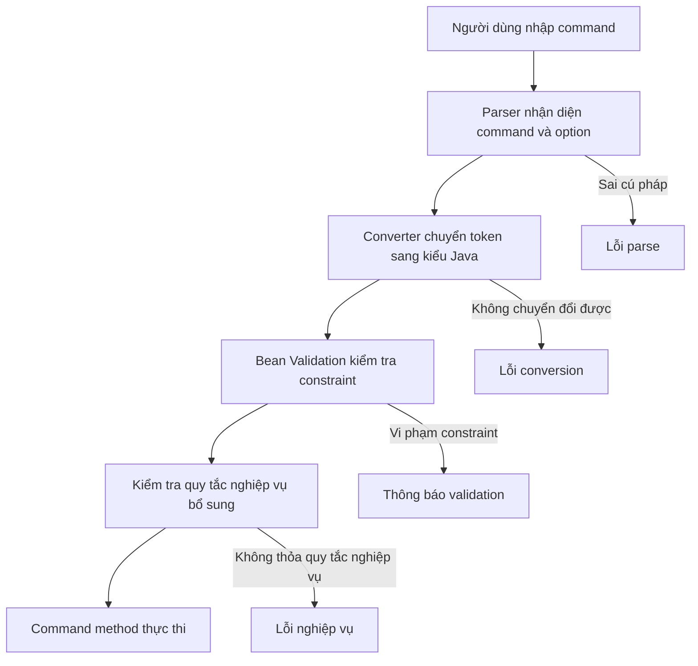

# `@Min`, `@Max`, `@Pattern` và giới hạn miền giá trị

Một command Spring Shell có thể nhận được dữ liệu đúng cú pháp nhưng vẫn không hợp lệ với nghiệp vụ. Ví dụ, parser chuyển chuỗi `0` thành số nguyên thành công, nhưng một lệnh phân trang yêu cầu số lượng bản ghi phải lớn hơn 0. Tương tự, chuỗi `abc-123` có thể được nhận như một `String`, nhưng không đúng định dạng mã vùng mà ứng dụng quy định.

Spring Shell tích hợp Bean Validation để kiểm tra các ràng buộc trên tham số command trước khi gọi phương thức xử lý. Các annotation như `@Min`, `@Max` và `@Pattern` giúp mô tả giới hạn số và định dạng chuỗi ngay tại nơi khai báo input. Khi quy tắc thuộc miền nghiệp vụ phức tạp hơn, ta có thể bổ sung constraint riêng hoặc kiểm tra trong service.

## Mục tiêu học tập

Sau bài học, bạn có thể:

- Phân biệt lỗi cú pháp, lỗi chuyển đổi kiểu và lỗi validation.
- Dùng `@Min` và `@Max` để giới hạn giá trị số theo biên bao gồm.
- Dùng `@Pattern` để kiểm tra định dạng chuỗi bằng biểu thức chính quy.
- Kết hợp `@NotNull`, `@NotBlank` với các constraint khác khi input bắt buộc.
- Chọn `@DecimalMin` và `@DecimalMax` cho miền giá trị thập phân.
- Thiết kế ràng buộc miền nghiệp vụ bằng custom constraint hoặc service validation.
- Kiểm thử constraint độc lập và xác nhận Spring Shell từ chối input trước khi chạy command.

## 1. Validation nằm ở đâu trong quá trình xử lý command?

Một dòng lệnh đi qua nhiều bước trước khi phương thức command được gọi:



Ví dụ command nhận `--limit` là `Integer`:

```text
report list --limit abc
```

Parser có thể nhận diện `--limit` và giá trị `abc`, nhưng converter không thể chuyển `abc` thành `Integer`. Đây là lỗi chuyển đổi kiểu; `@Min` chưa có cơ hội kiểm tra.

Trong trường hợp:

```text
report list --limit 0
```

Giá trị `0` chuyển thành số nguyên thành công. Nếu tham số có `@Min(1)`, Bean Validation phát hiện vi phạm và ngăn command method chạy.

Với:

```text
report list --limit 20
```

Giá trị vượt qua chuyển đổi và constraint số, nên command có thể tiếp tục thực thi, miễn là các điều kiện khác cũng hợp lệ.

Spring Shell 3.x tích hợp Bean Validation và kiểm tra constraint trên tham số command trước khi thực thi phương thức. Vì vậy, constraint có thể vừa bảo vệ input vừa đóng vai trò tài liệu cho hợp đồng command. [Tài liệu Spring Shell 3.4 về validation](https://docs.spring.io/spring-shell/reference/3.4/options/validation.html).

## 2. Chuẩn bị Bean Validation provider

Các annotation thuộc API Bean Validation chỉ mô tả ràng buộc. Để thực thi chúng, ứng dụng cần có một implementation như Hibernate Validator trên classpath.

Với ứng dụng Spring Boot 3.x, dependency thường dùng là `spring-boot-starter-validation`:

```xml
<dependency>
    <groupId>org.springframework.boot</groupId>
    <artifactId>spring-boot-starter-validation</artifactId>
</dependency>
```

Khi dùng Gradle:

```groovy
implementation 'org.springframework.boot:spring-boot-starter-validation'
```

Spring Boot quản lý phiên bản tương thích thông qua dependency management. Không cần tự ghim phiên bản riêng nếu dự án đã dùng Spring Boot dependency management phù hợp. Starter này cung cấp API cùng Hibernate Validator làm provider. [Spring Boot 3.4 — Validation](https://docs.spring.io/spring-boot/3.4/reference/io/validation.html).

Spring Shell cần có Bean Validation provider để thực hiện các constraint. Nếu chỉ thêm import `jakarta.validation.constraints.*` mà không có provider, annotation vẫn có thể biên dịch nhưng không có implementation để xác thực dữ liệu khi chạy.

Spring Boot 3 và Spring Shell 3.x sử dụng namespace `jakarta.validation`. Với ứng dụng cũ dựa trên Spring Boot 2 hoặc Spring Shell phiên bản cũ hơn, namespace có thể là `javax.validation`; không trộn hai hệ package trong cùng ứng dụng.

## 3. Dùng `@Min` và `@Max` cho giá trị số

`@Min` quy định giá trị nhỏ nhất được chấp nhận, còn `@Max` quy định giá trị lớn nhất. Cả hai đều bao gồm biên:

- `@Min(1)` chấp nhận 1 và mọi giá trị lớn hơn.
- `@Max(100)` chấp nhận 100 và mọi giá trị nhỏ hơn.
- Kết hợp `@Min(1)` và `@Max(100)` tạo miền giá trị từ 1 đến 100.

Ví dụ giới hạn số lượng bản ghi trong command:

```java
import jakarta.validation.constraints.Max;
import jakarta.validation.constraints.Min;

import org.springframework.shell.command.annotation.Command;
import org.springframework.shell.command.annotation.Option;
import org.springframework.stereotype.Component;

@Component
public class ReportCommands {

    @Command(command = "report list", description = "Liệt kê báo cáo")
    public String list(
            @Option(longNames = "limit", defaultValue = "50",
                    description = "Số bản ghi tối đa")
            @Min(value = 1, message = "limit phải lớn hơn hoặc bằng {value}")
            @Max(value = 500, message = "limit không được vượt quá {value}")
            Integer limit) {
        return "Hiển thị tối đa " + limit + " báo cáo.";
    }
}
```

Ví dụ giả định ứng dụng chạy với Spring Boot và Spring Shell starter, để command bean được đăng ký theo cấu hình Boot. Nếu tự quản lý Spring context, cần đăng ký target command theo mô hình annotation của Spring Shell, chẳng hạn qua `@EnableCommand` hoặc `@CommandScan`.

Các lệnh sau minh họa kết quả:

```text
shell:> report list --limit 20
Hiển thị tối đa 20 báo cáo.

shell:> report list --limit 0
The following constraints were not met:
--limit : limit phải lớn hơn hoặc bằng 1

shell:> report list --limit 700
The following constraints were not met:
--limit : limit không được vượt quá 500
```

Thông báo chính xác có thể khác theo result handler, phiên bản và message bundle. Điểm quan trọng là command method không được gọi khi tham số vi phạm constraint.

### 3.1. Kiểu dữ liệu phù hợp

`@Min` và `@Max` hỗ trợ các kiểu số như `byte`, `short`, `int`, `long`, các wrapper tương ứng, `BigInteger` và `BigDecimal`. Chúng không hỗ trợ `float` hoặc `double` vì sai số biểu diễn nhị phân có thể làm phép so sánh giới hạn thiếu ổn định.

Với số thập phân hoặc miền tiền tệ cần biểu diễn biên theo chuỗi thập phân chính xác, dùng `@DecimalMin` và `@DecimalMax`. Kết hợp với `BigDecimal` và tránh `float` hoặc `double` cho số tiền nếu nghiệp vụ cần so sánh chính xác.

### 3.2. Giới hạn có bao gồm biên hay không?

`@Min` và `@Max` luôn kiểm tra biên theo kiểu bao gồm. Ví dụ `@Min(10)` chấp nhận 10. Nếu nghiệp vụ cần điều kiện lớn hơn 10, có thể đặt `@Min(11)` cho kiểu số nguyên hoặc dùng constraint phù hợp cho miền thập phân.

Với `@DecimalMin` và `@DecimalMax`, thuộc tính `inclusive` cho phép lựa chọn có tính cả giá trị biên hay không:

```java
@DecimalMin(value = "0.00", inclusive = false)
@DecimalMax(value = "100.00", inclusive = true)
BigDecimal percentage
```

Ví dụ này chấp nhận giá trị lớn hơn 0 và nhỏ hơn hoặc bằng 100.

## 4. Dùng `@Pattern` để kiểm tra định dạng chuỗi

`@Pattern` kiểm tra một giá trị kiểu `CharSequence` có khớp biểu thức chính quy hay không. Constraint phù hợp với mã định danh, mã vùng, mã sản phẩm, tên môi trường hoặc các chuỗi có định dạng ổn định.

Ví dụ, mã đơn hàng có cấu trúc hai chữ cái in hoa, dấu gạch ngang và bốn chữ số:

```java
import jakarta.validation.constraints.Pattern;

@Command(command = "order show")
public String show(
        @Option(longNames = "code", required = true,
                description = "Mã đơn hàng, ví dụ AB-1234")
        @Pattern(
                regexp = "^[A-Z]{2}-\\d{4}$",
                message = "code phải có dạng AA-1234")
        String code) {
    return "Đang xem đơn hàng " + code;
}
```

Các giá trị được kiểm tra:

| Giá trị | Kết quả | Lý do |
|---|---|---|
| `AB-1234` | Hợp lệ | Hai chữ in hoa và bốn chữ số |
| `VN-0007` | Hợp lệ | Đúng cấu trúc |
| `ab-1234` | Không hợp lệ | Chữ thường không được cho phép |
| `ABC-1234` | Không hợp lệ | Có ba chữ cái |
| `AB1234` | Không hợp lệ | Thiếu dấu gạch ngang |
| `AB-12` | Không hợp lệ | Không đủ bốn chữ số |

Trong kiểm thử, nên thêm các trường hợp biên như `AB-0000`, `AB-9999`, chuỗi rỗng và `null` để xác nhận cả quy tắc định dạng lẫn tính bắt buộc. Với ví dụ trên, `AB-0000` và `AB-9999` đúng về cấu trúc; nếu số thứ tự phải nằm trong miền riêng, cần thêm constraint số hoặc kiểm tra nghiệp vụ sau khi parse.

Biểu thức chính quy trong Java cần escape dấu gạch chéo ngược. Vì vậy `\d` trong regex được viết thành `\\d` trong chuỗi Java. Hai dấu `^` và `$` neo biểu thức vào đầu và cuối chuỗi, giúp thể hiện chính xác toàn bộ định dạng mong đợi.

### 4.1. `@Pattern` không thay thế kiểm tra bắt buộc

Theo đặc tả Bean Validation, các constraint như `@Pattern`, `@Min` và `@Max` xem `null` là hợp lệ. Chúng kiểm tra định dạng hoặc giới hạn khi giá trị có mặt; chúng không tự khẳng định giá trị phải được cung cấp.

Nếu chuỗi bắt buộc phải có nội dung, hãy kết hợp `@NotBlank`:

```java
@NotBlank(message = "code không được để trống")
@Pattern(regexp = "^[A-Z]{2}-\\d{4}$",
         message = "code phải có dạng AA-1234")
String code
```

`@NotBlank` từ chối `null`, chuỗi rỗng và chuỗi chỉ chứa khoảng trắng. `@NotNull` chỉ từ chối `null`; nó vẫn chấp nhận chuỗi rỗng. Chọn constraint theo đúng ý nghĩa nghiệp vụ.

### 4.2. Regex nên mô tả cấu trúc, không chứa toàn bộ nghiệp vụ

Regex hữu ích cho định dạng có cấu trúc ổn định. Không nên cố viết một biểu thức quá phức tạp để kiểm tra mọi quy tắc nghiệp vụ.

Ví dụ, regex có thể xác nhận mã sản phẩm có dạng `PRD-` theo sau là sáu chữ số. Nhưng việc mã đó có tồn tại trong cơ sở dữ liệu, có thuộc kho hiện tại hoặc người dùng có quyền truy cập hay không là quy tắc cần kiểm tra ở tầng nghiệp vụ.

## 5. Kết hợp nhiều constraint trên một tham số

Một tham số có thể cần đồng thời nhiều điều kiện. Ví dụ, mã môi trường phải:

- Được cung cấp.
- Chỉ gồm chữ thường, số và dấu gạch ngang.
- Có độ dài từ 3 đến 20 ký tự.
- Bắt đầu bằng một chữ cái.

Có thể kết hợp `@NotBlank`, `@Size` và `@Pattern`:

```java
@NotBlank(message = "environment không được để trống")
@Size(min = 3, max = 20,
      message = "environment phải dài từ 3 đến 20 ký tự")
@Pattern(regexp = "^[a-z][a-z0-9-]*$",
         message = "environment phải bắt đầu bằng chữ thường và chỉ chứa chữ thường, số hoặc dấu -")
String environment
```

Mỗi constraint kiểm tra một khía cạnh. Cách kết hợp này dễ đọc và dễ bảo trì hơn một regex khổng lồ cố gắng diễn đạt cả độ dài, nội dung và điều kiện bắt buộc.

Ví dụ command hoàn chỉnh:

```java
@Component
public class EnvironmentCommands {

    @Command(command = "environment select")
    public String select(
            @Option(longNames = "name", required = true)
            @NotBlank
            @Size(min = 3, max = 20)
            @Pattern(regexp = "^[a-z][a-z0-9-]*$")
            String name) {
        return "Đã chọn môi trường " + name;
    }
}
```

`required = true` kiểm soát việc option có được truyền theo cú pháp command hay không. `@NotBlank` kiểm tra nội dung sau khi binding. Hai lớp kiểm tra bổ sung cho nhau: option có thể hiện diện nhưng giá trị vẫn chỉ là khoảng trắng.

## 6. Phân biệt giới hạn cú pháp với miền giá trị nghiệp vụ

Không phải mọi miền giá trị đều chỉ là một khoảng số hoặc một mẫu chuỗi.

| Yêu cầu | Cách biểu diễn phù hợp |
|---|---|
| Số trang từ 1 đến 500 | `@Min(1)` và `@Max(500)` |
| Tỷ lệ lớn hơn 0 và không vượt quá 100 | `@DecimalMin` và `@DecimalMax` |
| Mã đơn hàng theo mẫu `AB-1234` | `@Pattern` |
| Tên môi trường không rỗng và tối đa 20 ký tự | `@NotBlank` và `@Size(max = 20)` |
| Trạng thái chỉ thuộc `NEW`, `ACTIVE`, `CLOSED` | Enum, custom constraint hoặc kiểm tra tập giá trị |
| Ngày kết thúc phải sau ngày bắt đầu | Kiểm tra liên trường hoặc constraint cấp đối tượng |
| Người dùng chỉ được thao tác trên kho được cấp quyền | Kiểm tra nghiệp vụ và authorization trong service |
| Số lượng đặt không vượt tồn kho hiện tại | Kiểm tra nghiệp vụ dựa trên dữ liệu hiện thời |

`@Min`, `@Max` và `@Pattern` là những constraint tĩnh. Chúng phù hợp với quy tắc không phụ thuộc dữ liệu thay đổi trong hệ thống. Các điều kiện như tồn kho, quyền truy cập, hạn mức tài khoản hoặc trạng thái đơn hàng cần được kiểm tra ở tầng nghiệp vụ vì dữ liệu có thể thay đổi giữa thời điểm nhập command và thời điểm thực thi.

## 7. Tạo custom constraint cho quy tắc riêng

Khi một quy tắc có thể tái sử dụng và phù hợp với Bean Validation, có thể tạo annotation riêng cùng `ConstraintValidator`.

Ví dụ, ứng dụng chỉ cho phép chọn kích thước trang thuộc tập `10`, `25`, `50` hoặc `100`:

```java
import jakarta.validation.Constraint;
import jakarta.validation.Payload;

import java.lang.annotation.Documented;
import java.lang.annotation.Retention;
import java.lang.annotation.Target;

import static java.lang.annotation.ElementType.FIELD;
import static java.lang.annotation.ElementType.PARAMETER;
import static java.lang.annotation.RetentionPolicy.RUNTIME;

@Documented
@Constraint(validatedBy = AllowedPageSizeValidator.class)
@Target({ FIELD, PARAMETER })
@Retention(RUNTIME)
public @interface AllowedPageSize {

    String message() default "page size phải là 10, 25, 50 hoặc 100";

    Class<?>[] groups() default {};

    Class<? extends Payload>[] payload() default {};
}
```

Validator tương ứng:

```java
import jakarta.validation.ConstraintValidator;
import jakarta.validation.ConstraintValidatorContext;

import java.util.Set;

public class AllowedPageSizeValidator
        implements ConstraintValidator<AllowedPageSize, Integer> {

    private static final Set<Integer> ALLOWED = Set.of(10, 25, 50, 100);

    @Override
    public boolean isValid(Integer value, ConstraintValidatorContext context) {
        return value == null || ALLOWED.contains(value);
    }
}
```

Có thể dùng constraint mới trong command:

```java
@Command(command = "customer list")
public String list(
        @Option(longNames = "page-size", defaultValue = "25")
        @AllowedPageSize Integer pageSize) {
    return "Page size: " + pageSize;
}
```

Validator trả `true` cho `null` để tuân theo nguyên tắc constraint không tự xử lý tính bắt buộc. Nếu tham số không được phép null, kết hợp thêm `@NotNull`. Khi sử dụng default value, hãy bảo đảm giá trị mặc định cũng thuộc tập hợp hợp lệ.

Custom constraint phù hợp khi quy tắc có thể dùng lại ở nhiều command hoặc nhiều lớp. Nếu quy tắc chỉ áp dụng cho một thao tác và phụ thuộc vào dữ liệu hiện tại, một lời gọi service validation thường dễ hiểu và đúng trách nhiệm hơn.

## 8. Validation ở command và validation trong service

Spring Shell kiểm tra Bean Validation trên tham số command trước khi gọi phương thức. Điều này giúp input sai bị từ chối sớm và thông báo lỗi gắn với tên option.

Tuy nhiên, service nghiệp vụ có thể được gọi từ nhiều nơi: command, scheduler, REST API hoặc một thành phần khác. Không nên chỉ bảo vệ quy tắc cốt lõi ở command vì các caller khác có thể bỏ qua lớp CLI.

Có thể tổ chức theo hai lớp:

```java
@Component
public class OrderCommands {

    private final OrderService orderService;

    public OrderCommands(OrderService orderService) {
        this.orderService = orderService;
    }

    @Command(command = "order reserve")
    public String reserve(
            @Option(longNames = "quantity", required = true)
            @Min(1) @Max(100) Integer quantity,
            @Option(longNames = "warehouse", required = true)
            @NotBlank String warehouse) {
        orderService.reserve(quantity, warehouse);
        return "Đã tiếp nhận yêu cầu đặt hàng.";
    }
}
```

Service tiếp tục kiểm tra các quy tắc phụ thuộc trạng thái hệ thống:

```java
import org.springframework.stereotype.Service;

@Service
public class OrderService {

    public void reserve(Integer quantity, String warehouse) {
        if (!warehouseExists(warehouse)) {
            throw new IllegalArgumentException("Kho hàng không tồn tại.");
        }
        if (quantity > availableStock(warehouse)) {
            throw new IllegalStateException("Số lượng vượt tồn kho hiện tại.");
        }

        // Thực hiện giữ hàng trong transaction phù hợp.
    }

    private boolean warehouseExists(String warehouse) {
        return true;
    }

    private int availableStock(String warehouse) {
        return 50;
    }
}
```

Các phương thức `warehouseExists` và `availableStock` trong ví dụ chỉ là phần minh họa cho truy vấn dữ liệu. Trong ứng dụng thật, service sẽ dùng repository hoặc client phù hợp và thực hiện cập nhật trong transaction.

Ở đây, command kiểm tra miền input ổn định: số lượng từ 1 đến 100 và tên kho không rỗng. Service kiểm tra dữ liệu thay đổi theo thời gian: kho có tồn tại và còn đủ hàng hay không.

Nếu muốn dùng Bean Validation để bảo vệ method của service, Spring Boot hỗ trợ method validation với provider trên classpath và lớp đích được đánh dấu `@Validated`. Đây là cơ chế AOP của Spring cho bean method; nó khác với việc Spring Shell tự kiểm tra tham số command trước khi thực thi. [Spring Boot — Method Validation](https://docs.spring.io/spring-boot/3.4/reference/io/validation.html).

## 9. Thông báo lỗi và trải nghiệm người dùng

Khi validation thất bại, Spring Shell có thể hiển thị danh sách constraint không thỏa mãn và không gọi command. Ví dụ trong tài liệu Spring Shell:

```text
shell:> change-password hello
The following constraints were not met:
    --password : size must be between 8 and 40
Error while executing command change-password: USAGE_ERROR
```

Thông báo hữu ích nên chỉ ra:

- Option hoặc tham số nào không hợp lệ.
- Điều kiện được yêu cầu.
- Giá trị hợp lệ hoặc miền giá trị nếu có thể diễn đạt ngắn gọn.
- Cách sửa input.

Có thể tùy chỉnh message trực tiếp trong annotation:

```java
@Min(value = 1, message = "page phải bắt đầu từ 1")
@Max(value = 500, message = "page không được vượt quá 500")
Integer page
```

Với thông báo dùng lại, có thể đưa message vào resource bundle và dùng message template theo Bean Validation. Ví dụ `message = "{report.limit.min}"` cho phép quản lý nội dung trong file thông điệp thay vì viết trực tiếp trong code.

Không đưa giá trị bí mật vào thông báo lỗi. Với password, token hoặc thông tin xác thực, tránh echo input không hợp lệ ra terminal hoặc log. Thông báo nên giải thích constraint mà không tiết lộ dữ liệu nhạy cảm.

## 10. Kiểm thử constraint

Nên kiểm thử ở hai mức: constraint riêng lẻ và command chạy qua Spring Shell.

### 10.1. Kiểm thử Bean Validation trực tiếp

Có thể dùng `Validator` để xác minh ràng buộc trên tham số phương thức thông qua `ExecutableValidator`:

```java
import static org.junit.jupiter.api.Assertions.assertFalse;
import static org.junit.jupiter.api.Assertions.assertTrue;

import jakarta.validation.Validation;
import jakarta.validation.Validator;
import jakarta.validation.executable.ExecutableValidator;

import java.lang.reflect.Method;

import org.junit.jupiter.api.Test;

class ReportCommandsValidationTests {

    private final Validator validator =
            Validation.buildDefaultValidatorFactory().getValidator();

    @Test
    void acceptsLimitInsideRange() throws Exception {
        ReportCommands commands = new ReportCommands();
        Method method = ReportCommands.class.getMethod("list", Integer.class);
        ExecutableValidator executable = validator.forExecutables();

        var violations = executable.validateParameters(
                commands, method, new Object[] { 20 });

        assertTrue(violations.isEmpty());
    }

    @Test
    void rejectsLimitBelowMinimum() throws Exception {
        ReportCommands commands = new ReportCommands();
        Method method = ReportCommands.class.getMethod("list", Integer.class);
        ExecutableValidator executable = validator.forExecutables();

        var violations = executable.validateParameters(
                commands, method, new Object[] { 0 });

        assertFalse(violations.isEmpty());
    }
}
```

Đây là ví dụ kiểm tra constraint bằng Bean Validation API. Trong test thực tế, cần khởi tạo `ReportCommands` đúng với constructor và dependency của dự án. Có thể tái sử dụng `ValidatorFactory` trong test suite và đóng factory sau khi hoàn tất.

### 10.2. Kiểm thử qua Spring Shell runtime

Kiểm thử `Validator` không chứng minh command đã được đăng ký hoặc Spring Shell hiển thị lỗi đúng. Nên có kiểm thử tích hợp gửi command qua runtime để xác nhận:

1. Input hợp lệ gọi command method.
2. Input vi phạm `@Min` hoặc `@Max` không gọi service.
3. Chuỗi sai định dạng bị từ chối bởi `@Pattern`.
4. Option bắt buộc bị bỏ qua được xử lý đúng.
5. Thông báo lỗi chỉ ra option và constraint phù hợp.
6. Default value được kiểm tra và luôn nằm trong miền hợp lệ.

Ví dụ ma trận kiểm thử cho command phân trang:

| Input | Kết quả mong đợi |
|---|---|
| `--limit 1` | Hợp lệ tại biên dưới |
| `--limit 500` | Hợp lệ tại biên trên |
| `--limit 0` | Vi phạm `@Min(1)` |
| `--limit 501` | Vi phạm `@Max(500)` |
| `--limit abc` | Lỗi conversion trước validation |
| Không truyền `--limit`, default là 50 | Hợp lệ nếu default thỏa constraint |

## 11. Những lỗi thường gặp

### Chỉ dùng `@Min` mà không kiểm tra giá trị bắt buộc

`@Min` chấp nhận `null`. Nếu tham số bắt buộc, kết hợp `@NotNull` hoặc dùng quy tắc required của option cùng constraint phù hợp.

### Nghĩ `@Pattern` sẽ từ chối chuỗi rỗng trong mọi trường hợp

`@Pattern` chấp nhận `null`; regex có thể không khớp chuỗi rỗng nhưng không thay thế `@NotBlank`. Dùng `@NotBlank` nếu chuỗi bắt buộc có nội dung.

### Đặt `@Min` trên chuỗi số

`@Min` áp dụng cho kiểu số được hỗ trợ, không tự parse chuỗi. Khai báo tham số là `Integer`, `Long`, `BigDecimal` phù hợp hoặc dùng converter để chuyển đổi trước validation.

### Dùng `@Min` và `@Max` cho số thập phân mà không xem xét độ chính xác

Với tiền tệ hoặc phần trăm, dùng `BigDecimal` cùng `@DecimalMin` và `@DecimalMax` để thể hiện miền thập phân chính xác.

### Cố dùng regex cho dữ liệu phụ thuộc hệ thống

Regex không thể xác nhận mã có tồn tại trong cơ sở dữ liệu hoặc người dùng có quyền truy cập. Đặt kiểm tra đó trong service hoặc repository phù hợp.

### Chỉ kiểm tra ở command

Service có thể được gọi từ nhiều nơi. Quy tắc nghiệp vụ cốt lõi cần được bảo vệ ở service hoặc domain layer, không chỉ ở giao diện CLI.

### Annotation có nhưng validation không chạy

Kiểm tra Bean Validation provider có trên classpath chưa, import dùng đúng `jakarta.validation` hay không và command đang đi qua runtime Spring Shell có tích hợp validation.

### Thông báo lỗi quá kỹ thuật

Thông báo như “must match regular expression” ít hữu ích với người dùng. Dùng message mô tả định dạng mong đợi, ví dụ “code phải có dạng AA-1234”.

## 12. Checklist thiết kế miền giá trị

- [ ] Đã phân biệt lỗi parse, conversion, Bean Validation và lỗi nghiệp vụ.
- [ ] Đã thêm Bean Validation provider phù hợp.
- [ ] Dùng `@Min` và `@Max` cho miền số nguyên có biên bao gồm.
- [ ] Dùng `@DecimalMin` và `@DecimalMax` cho miền thập phân.
- [ ] Dùng `@Pattern` cho định dạng chuỗi ổn định.
- [ ] Kết hợp `@NotNull` hoặc `@NotBlank` nếu giá trị bắt buộc.
- [ ] Default value cũng thỏa mọi constraint.
- [ ] Regex có test cho giá trị hợp lệ, không hợp lệ và biên.
- [ ] Quy tắc phụ thuộc dữ liệu hiện tại được kiểm tra trong service.
- [ ] Thông báo lỗi chỉ rõ cách sửa và không tiết lộ bí mật.
- [ ] Có unit test cho constraint và integration test cho command runtime.

## 13. Tự kiểm tra

**Câu 1.** `@Min(1)` có chấp nhận giá trị `null` không?

**Gợi ý trả lời:** Có. Các constraint như `@Min`, `@Max` và `@Pattern` không tự yêu cầu giá trị phải khác null. Dùng `@NotNull` nếu tham số bắt buộc.

**Câu 2.** Vì sao `--limit abc` không phải lỗi `@Min`?

**Gợi ý trả lời:** Vì `abc` không chuyển đổi được sang kiểu số. Lỗi xảy ra ở bước conversion trước khi Bean Validation kiểm tra giới hạn.

**Câu 3.** `@Min(10)` có chấp nhận 10 không?

**Gợi ý trả lời:** Có. `@Min` và `@Max` bao gồm giá trị biên.

**Câu 4.** Vì sao cần `@NotBlank` cùng `@Pattern` cho mã bắt buộc?

**Gợi ý trả lời:** `@Pattern` không từ chối null. `@NotBlank` bảo đảm chuỗi được cung cấp và có ít nhất một ký tự không phải khoảng trắng.

**Câu 5.** Quy tắc “số lượng đặt không vượt tồn kho hiện tại” nên đặt ở đâu?

**Gợi ý trả lời:** Trong service hoặc domain layer vì điều kiện phụ thuộc dữ liệu hiện thời và phải được bảo vệ với mọi caller, không chỉ CLI.

## Kết luận

`@Min` và `@Max` giới hạn miền số với hai biên bao gồm; `@Pattern` kiểm tra chuỗi theo biểu thức chính quy. Khi input bắt buộc, hãy kết hợp `@NotNull` hoặc `@NotBlank`. Với giá trị thập phân, dùng `@DecimalMin` và `@DecimalMax` để biểu diễn biên chính xác.

Spring Shell tích hợp Bean Validation để kiểm tra tham số command trước khi gọi phương thức. Tuy nhiên, validation input chỉ giải quyết các quy tắc tĩnh. Những điều kiện phụ thuộc dữ liệu, quyền hoặc trạng thái hệ thống cần được kiểm tra ở service/domain layer. Phân biệt đúng các bước parse, conversion, constraint và nghiệp vụ giúp thông báo lỗi rõ ràng, kiểm thử chính xác và giữ quy tắc cốt lõi nhất quán giữa CLI với các caller khác.

## Tài liệu tham khảo

- [Spring Shell 3.4 — Validation](https://docs.spring.io/spring-shell/reference/3.4/options/validation.html)
- [Spring Shell 4.0.4 — Option Validation](https://docs.spring.io/spring-shell/reference/commands/validation.html)
- [Spring Boot 3.4 — Validation](https://docs.spring.io/spring-boot/3.4/reference/io/validation.html)
- [Jakarta Bean Validation — Specification](https://jakarta.ee/specifications/bean-validation/3.0/)
