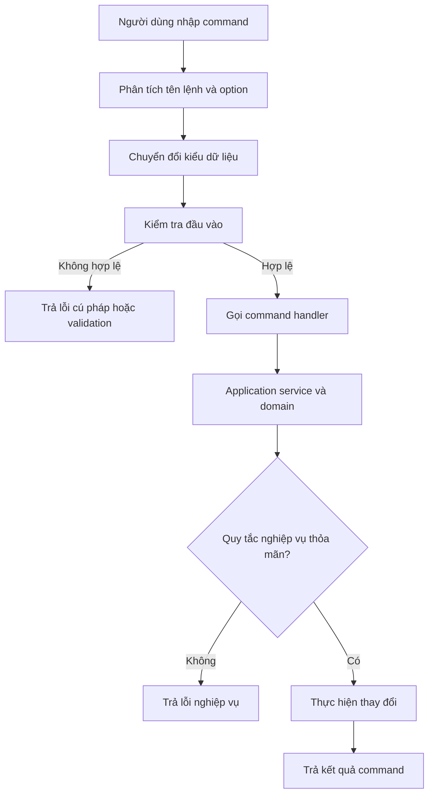

# Phân biệt validation đầu vào với kiểm tra nghiệp vụ

Một command Spring Shell có thể nhận đủ tham số, chuyển đổi được kiểu dữ liệu và vẫn không thể thực hiện yêu cầu. Ví dụ, người dùng nhập mã khách hàng đúng định dạng và số lượng hàng là số nguyên dương, nhưng khách hàng đã bị khóa hoặc kho không còn đủ hàng. Hai nhóm kiểm tra này giải quyết hai câu hỏi khác nhau: **đầu vào có đúng hình thức và cấu trúc mà command yêu cầu không**, và **yêu cầu có được phép thực hiện trong nghiệp vụ hiện tại không**.

Trong module `SPRING_SHELL`, nội dung này liên quan trực tiếp đến khai báo command, xử lý đối số, validation, trợ giúp và tự hoàn thành. Cần phân biệt hai nhóm kiểm tra để đặt logic đúng tầng, hiển thị lỗi phù hợp và bảo đảm command hoạt động nhất quán khi được gọi từ terminal, script hoặc một thành phần khác của ứng dụng.

## 1. Hai loại kiểm tra trả lời hai câu hỏi khác nhau

**Validation đầu vào (input validation)** kiểm tra dữ liệu người dùng cung cấp có đáp ứng hợp đồng của command hay không. Các điều kiện thường độc lập với trạng thái đang lưu trong hệ thống:

- Option bắt buộc có được truyền hay không.
- Giá trị có chuyển đổi được sang kiểu tham số hay không.
- Chuỗi có rỗng, quá dài hoặc sai mẫu hay không.
- Số có nằm trong miền giá trị cho phép hay không.
- Enum có thuộc tập lựa chọn được công bố hay không.
- Các trường có quan hệ hình thức hợp lệ hay không, ví dụ ngày kết thúc không đứng trước ngày bắt đầu.

**Kiểm tra nghiệp vụ (business validation/business rules)** xác định yêu cầu có hợp lệ theo quy tắc của miền nghiệp vụ và trạng thái hiện tại hay không:

- Khách hàng có tồn tại và đang hoạt động không.
- Tồn kho hiện có đủ để đáp ứng số lượng đặt không.
- Người dùng có quyền thực hiện thao tác trên tài nguyên này không.
- Đơn hàng có đang ở trạng thái cho phép hủy không.
- Tài khoản đã đạt hạn mức hoặc quota trong kỳ hiện tại chưa.
- Một tài nguyên có bị đặt trùng hoặc đang được một giao dịch khác sử dụng không.

| Tiêu chí | Validation đầu vào | Kiểm tra nghiệp vụ |
| --- | --- | --- |
| Câu hỏi | Dữ liệu nhập có đúng hợp đồng command? | Yêu cầu có được phép thực hiện theo nghiệp vụ? |
| Dữ liệu phụ thuộc | Giá trị được truyền vào command | Đầu vào cùng trạng thái domain, dữ liệu lưu trữ và chính sách |
| Ví dụ | `quantity` phải là số nguyên dương | Kho còn đủ số lượng để xuất |
| Thời điểm | Khi phân tích, chuyển đổi và kiểm tra tham số | Trong application service/domain trước khi thay đổi trạng thái |
| Tính dùng chung | Gắn với giao diện và hợp đồng đầu vào của command | Phải áp dụng cho mọi kênh gọi cùng nghiệp vụ |
| Cách sửa lỗi | Người dùng sửa cú pháp hoặc giá trị nhập | Người dùng thay đổi yêu cầu, trạng thái hoặc cần người có thẩm quyền xử lý |

Ranh giới không chỉ phụ thuộc vào tên điều kiện. Một điều kiện có thể được kiểm tra sớm để giúp người dùng nhận lỗi nhanh, nhưng nếu đó là invariant của domain thì vẫn phải được bảo vệ tại tầng nghiệp vụ. Ví dụ, CLI có thể kiểm tra số lượng dương bằng annotation, còn service vẫn phải bảo đảm không có đường gọi nào tạo đơn hàng với số lượng không hợp lệ.

## 2. Luồng xử lý từ dòng lệnh đến nghiệp vụ

Một command thường đi qua nhiều bước trước khi tạo ra tác động:



Spring Shell đảm nhiệm việc nhận dòng lệnh, phân giải command, liên kết option/argument và chuyển đổi giá trị. Các ràng buộc Bean Validation có thể được áp dụng ở tham số command hoặc trên request object. Sau đó, command handler gọi application service để thực hiện use case. Service và domain kiểm tra các quy tắc cần đúng bất kể yêu cầu đến từ CLI, REST API, message consumer hay batch job.

Không nên để command handler tự quyết định mọi quy tắc nghiệp vụ. Nếu kiểm tra tồn kho chỉ nằm trong lớp command, một REST endpoint khác có thể bỏ qua kiểm tra đó và tạo ra đơn hàng sai. Tương tự, không nên yêu cầu domain biết về tên option `--quantity` hay cách người dùng nhập ngày tháng; đó là chi tiết của giao diện CLI.

## 3. Validation ở bước phân tích và chuyển đổi tham số

Trước khi chạy logic command, Spring Shell cần nhận diện tên command, tìm option và chuyển giá trị văn bản sang kiểu tham số. Những lỗi xảy ra ở bước này thuộc hợp đồng cú pháp và kiểu dữ liệu:

| Cú pháp | Vấn đề được phát hiện |
| --- | --- |
| `order create` nhưng thiếu `--customer` bắt buộc | Thiếu option |
| `order create --quantity many` với tham số số nguyên | Không chuyển đổi được kiểu |
| `order create --quantity 0` với tham số phải dương | Vi phạm giới hạn giá trị |
| `order create --email abc` với ràng buộc email | Sai định dạng dữ liệu |
| `order create --status UNKNOWN` với kiểu enum | Giá trị không thuộc tập lựa chọn |

Ví dụ, nếu tham số khai báo kiểu `Integer`, parser/converter phải chuyển chuỗi nhập thành số nguyên. Nếu người dùng nhập chữ, command không nên phải tự xử lý chuỗi đó như một số. Với option bắt buộc, hãy khai báo rõ tính bắt buộc trong annotation hoặc cấu hình command để shell có thể báo thiếu option trước khi gọi phương thức.

Không phải mọi lỗi đều do Bean Validation. Thiếu option, sai tên option hoặc chuyển đổi thất bại có thể bị phát hiện trước khi method validation chạy. Vì vậy, khi phân loại lỗi, hãy xác định bước nào đã từ chối đầu vào thay vì gom tất cả thành một lỗi nghiệp vụ.

## 4. Dùng Bean Validation cho dữ liệu đầu vào

Bean Validation cung cấp các constraint tiêu chuẩn để mô tả hợp đồng dữ liệu. Trong ứng dụng Spring Boot 3.x, các constraint Jakarta Validation thường được cung cấp qua dependency `spring-boot-starter-validation`. Spring có thể thực hiện method validation cho bean được đánh dấu `@Validated` khi cơ chế method validation đã được cấu hình.

Các constraint thường dùng:

| Constraint | Kiểu dữ liệu phù hợp | Ý nghĩa |
| --- | --- | --- |
| `@NotNull` | Kiểu tham chiếu | Giá trị không được là `null` |
| `@NotBlank` | `String` | Chuỗi phải có ít nhất một ký tự không phải khoảng trắng |
| `@NotEmpty` | Chuỗi, collection, map, array | Không được rỗng |
| `@Size(min, max)` | Chuỗi, collection, map, array | Giới hạn độ dài hoặc số phần tử |
| `@Min`, `@Max` | Số | Giới hạn dưới/trên |
| `@Positive`, `@PositiveOrZero` | Số | Yêu cầu số dương hoặc không âm |
| `@Email` | `String` | Kiểm tra hình thức địa chỉ email |
| `@Pattern` | `String` | Kiểm tra chuỗi theo biểu thức chính quy |
| `@Past`, `@Future` | Kiểu ngày giờ được hỗ trợ | Kiểm tra thời điểm ở quá khứ hoặc tương lai |

Ví dụ dưới đây dùng mô hình annotation mới của Spring Shell 3.x:

```java
import jakarta.validation.constraints.Max;
import jakarta.validation.constraints.Min;
import jakarta.validation.constraints.NotBlank;
import jakarta.validation.constraints.NotNull;
import jakarta.validation.constraints.Pattern;

import org.springframework.shell.command.annotation.Command;
import org.springframework.shell.command.annotation.Option;
import org.springframework.stereotype.Component;
import org.springframework.validation.annotation.Validated;

@Component
@Validated
public class OrderCommands {

    private final OrderService orderService;

    public OrderCommands(OrderService orderService) {
        this.orderService = orderService;
    }

    @Command(
        command = "order create",
        description = "Tạo đơn hàng mới."
    )
    public String create(
            @Option(longNames = "customer", required = true)
            @NotBlank
            @Pattern(regexp = "CUS-[0-9]{6}")
            String customerCode,
            @Option(longNames = "quantity", required = true)
            @NotNull
            @Min(1)
            @Max(100)
            Integer quantity) {

        Order order = orderService.create(customerCode, quantity);
        return "Đã tạo đơn hàng " + order.id();
    }
}
```

Trong ví dụ:

- `required = true` yêu cầu người dùng truyền option.
- `@NotBlank` từ chối chuỗi rỗng hoặc chỉ chứa khoảng trắng.
- `@Pattern` kiểm tra mã khách hàng theo cấu trúc `CUS-` cộng sáu chữ số.
- `@NotNull`, `@Min(1)` và `@Max(100)` kiểm tra số lượng có giá trị và nằm trong khoảng 1 đến 100.

`@Validated` cho phép Spring áp dụng method validation lên bean. Hãy bảo đảm implementation Bean Validation có trên classpath và method validation được bật trong ứng dụng. Nếu command method không đi qua Spring proxy hoặc ứng dụng không cấu hình method validation, constraint đặt trên tham số có thể không được thực thi như mong đợi. Với request object, có thể dùng `Validator` trực tiếp hoặc cơ chế cascade validation qua `@Valid`.

Ở Spring Shell 3.x, ví dụ trên dùng package `org.springframework.shell.command.annotation` và thuộc tính `command`/`longNames`. Với Spring Shell 4.x, mô hình annotation mới chuyển sang package `org.springframework.shell.core.command.annotation`, `@Command` dùng `name` và `@Option` dùng `longName`. Quy tắc Bean Validation thuộc Jakarta Validation và vẫn có thể dùng với command method sau khi cập nhật import/API tương ứng.

## 5. Đặt kiểm tra nghiệp vụ trong application service và domain

Validation đầu vào trong ví dụ trên chỉ cho biết mã khách hàng có đúng hình thức và số lượng có nằm trong khoảng cho phép hay không. Nó chưa chứng minh khách hàng tồn tại, đang hoạt động hoặc kho còn đủ hàng.

Các điều kiện phụ thuộc trạng thái cần được kiểm tra trong use case/service hoặc domain model:

```java
import org.springframework.stereotype.Service;
import org.springframework.transaction.annotation.Transactional;

@Service
public class OrderService {

    private final CustomerRepository customerRepository;
    private final InventoryRepository inventoryRepository;
    private final OrderRepository orderRepository;

    public OrderService(
            CustomerRepository customerRepository,
            InventoryRepository inventoryRepository,
            OrderRepository orderRepository) {
        this.customerRepository = customerRepository;
        this.inventoryRepository = inventoryRepository;
        this.orderRepository = orderRepository;
    }

    @Transactional
    public Order create(String customerCode, int quantity) {
        Customer customer = customerRepository.findByCode(customerCode)
                .orElseThrow(() ->
                        new BusinessRuleException("Khách hàng không tồn tại"));

        if (!customer.isActive()) {
            throw new BusinessRuleException("Khách hàng đang bị khóa");
        }

        if (!inventoryRepository.hasAvailableQuantity(quantity)) {
            throw new BusinessRuleException("Kho không đủ số lượng yêu cầu");
        }

        inventoryRepository.reserve(quantity);
        Order order = Order.create(customer, quantity);
        return orderRepository.save(order);
    }
}
```

Đây là ví dụ minh họa luồng nghiệp vụ; trong ứng dụng thực tế, việc kiểm tra và giữ chỗ tồn kho cần được thực hiện nguyên tử hoặc có cơ chế đồng bộ thích hợp để tránh hai yêu cầu cùng nhìn thấy một lượng hàng còn đủ rồi cùng đặt vượt tồn kho.

Service không nên tin rằng command đã kiểm tra dữ liệu trước đó. Service cần bảo vệ use case vì nó có thể được gọi từ nhiều adapter. Những invariant cốt lõi có thể được bảo vệ thêm trong constructor hoặc phương thức của entity/value object để không thể tạo trạng thái sai qua một đường gọi khác.

## 6. Phân loại các quy tắc nằm ở ranh giới

Có những điều kiện không thể phân loại chỉ bằng tên gọi. Hãy xem điều kiện phụ thuộc vào đâu và nó cần được bảo vệ ở phạm vi nào.

| Điều kiện | Kiểm tra sớm ở đầu vào | Kiểm tra bắt buộc ở nghiệp vụ |
| --- | --- | --- |
| Mã khách hàng đúng mẫu `CUS-123456` | Có, bằng `@Pattern` | Domain có thể áp dụng cùng invariant nếu mã là định danh được tạo trong hệ thống |
| Số lượng lớn hơn 0 | Có, bằng `@Positive` hoặc `@Min(1)` | Có, nếu mọi đường tạo đơn hàng đều phải tuân thủ |
| Ngày kết thúc không trước ngày bắt đầu | Có, bằng class-level validator hoặc kiểm tra cặp tham số | Có thể cần lặp lại trong use case nếu đây là invariant của lịch đặt |
| Khách hàng tồn tại | Có thể tra cứu sớm để cải thiện trải nghiệm | Có, tại use case trước khi tạo đơn |
| Khách hàng đang hoạt động | Có thể báo trước trong CLI | Có, tại thời điểm thực thi vì trạng thái có thể thay đổi |
| Kho còn đủ hàng | Có thể hiển thị số lượng tham khảo | Có, trong thao tác giữ chỗ/đặt hàng có kiểm soát đồng thời |
| Người gọi có quyền xóa tài khoản | Không coi là kiểm tra định dạng đầu vào | Có, tại tầng bảo mật hoặc use case mỗi lần thực thi |

Một kiểm tra sớm dựa trên dữ liệu lưu trữ chỉ là thông tin hỗ trợ người dùng. Giữa lúc kiểm tra và lúc thực hiện, trạng thái có thể thay đổi. Ví dụ CLI hiển thị còn 5 sản phẩm, nhưng một đơn hàng khác có thể giữ chỗ 4 sản phẩm trước khi lệnh hiện tại được xử lý. Service phải kiểm tra lại và thực hiện giữ chỗ trong cùng ranh giới giao dịch thích hợp.

## 7. Xử lý lỗi để người dùng biết cách sửa

Thông báo lỗi nên giúp người dùng xác định lỗi thuộc nhóm nào và hành động tiếp theo là gì.

| Nhóm lỗi | Ví dụ | Cách thông báo phù hợp |
| --- | --- | --- |
| Cú pháp/thiếu tham số | Thiếu `--customer` | Nêu option bắt buộc và cú pháp command |
| Chuyển đổi kiểu | `--quantity abc` | Nêu kiểu dữ liệu mong đợi, ví dụ số nguyên |
| Validation đầu vào | `--quantity 0` | Nêu miền hợp lệ, ví dụ từ 1 đến 100 |
| Quy tắc nghiệp vụ | Khách hàng bị khóa | Nêu lý do nghiệp vụ và hướng xử lý phù hợp |
| Xung đột trạng thái | Sản phẩm vừa hết hàng | Thông báo trạng thái hiện tại và cho phép người dùng thử lại hoặc chọn số lượng khác |
| Phân quyền | Người gọi không được phép xóa tài khoản | Thông báo thao tác không được phép theo chính sách truy cập |

Không nên trả stack trace hoặc tên class nội bộ cho người dùng CLI thông thường. Hãy ánh xạ exception kỹ thuật và nghiệp vụ sang thông báo ngắn, có ngữ cảnh; log chi tiết ở phía ứng dụng với mã tương quan nếu cần điều tra.

Một lỗi validation có thể chứa nhiều constraint violation. Khi định dạng thông báo, hãy giữ tên trường/option và thông điệp có thể hành động được, nhưng tránh in lặp toàn bộ dữ liệu đầu vào nếu nó có thể chứa thông tin nhạy cảm. Email, token, mật khẩu hoặc dữ liệu cá nhân không nên xuất hiện nguyên văn trong log lỗi.

## 8. Tránh các cách triển khai dễ gây lỗi

### Chỉ kiểm tra trong command handler

Nếu command kiểm tra tồn kho rồi gọi repository để tạo đơn, các kênh khác có thể bỏ qua kiểm tra. Hãy chuyển quy tắc vào service/domain và để command chịu trách nhiệm nhận dữ liệu, xác thực hợp đồng đầu vào, rồi gọi use case.

### Dùng validation để thay thế phân quyền

`@NotBlank`, `@Pattern` hay `@Positive` không chứng minh người gọi được phép thực hiện thao tác. Kiểm tra quyền cần dựa trên danh tính và quyền hạn tại thời điểm thực thi. Ẩn command hoặc không đưa nó vào trợ giúp cũng không phải cơ chế bảo mật.

### Trả lỗi chung cho mọi trường hợp

Nếu mọi lỗi đều biến thành “Dữ liệu không hợp lệ”, người dùng không biết phải sửa cú pháp, thay đổi giá trị hay giải quyết trạng thái nghiệp vụ. Hãy giữ loại lỗi và ngữ cảnh phù hợp trong quá trình ánh xạ.

### Tin vào kiểm tra trạng thái đã thực hiện trước đó

Một lần kiểm tra tồn kho, hạn mức hoặc trạng thái tài khoản không bảo đảm điều kiện vẫn đúng khi thao tác được ghi. Những quy tắc phụ thuộc trạng thái cần được bảo vệ trong giao dịch hoặc bằng cơ chế đồng bộ tương ứng.

### Lặp lại quy tắc ở nhiều nơi mà không có nguồn chuẩn

Có thể kiểm tra sớm ở CLI để cải thiện thông báo, nhưng quy tắc domain phải có một nơi chịu trách nhiệm cuối cùng. Nếu giới hạn số lượng thay đổi từ 100 thành 200, tránh để command, REST API và service dùng ba con số khác nhau.

## 9. Kiểm thử hai nhóm kiểm tra riêng biệt

Tách kiểm thử giúp xác định lỗi đến từ parser/validation hay từ quy tắc nghiệp vụ.

**Kiểm thử command và validation đầu vào:**

- Không truyền option bắt buộc.
- Truyền chuỗi rỗng hoặc chỉ có khoảng trắng cho trường `@NotBlank`.
- Truyền mã khách hàng sai mẫu.
- Truyền chữ vào option số.
- Truyền số ở dưới hoặc trên giới hạn.
- Truyền các trường hợp hợp lệ ở biên, ví dụ `quantity = 1` và `quantity = 100`.
- Xác nhận command handler không được gọi khi đầu vào vi phạm constraint.

**Kiểm thử service/domain:**

- Mã khách hàng không tồn tại.
- Khách hàng bị khóa.
- Kho đủ hàng và kho thiếu hàng.
- Hai yêu cầu đồng thời cùng đặt số lượng gần bằng tồn kho.
- Người gọi không có quyền thực hiện thao tác.
- Trạng thái đơn hàng không cho phép chuyển sang trạng thái đích.

Ví dụ bảng ca kiểm thử cho lệnh tạo đơn:

| Đầu vào | Trạng thái nghiệp vụ | Kết quả mong đợi |
| --- | --- | --- |
| `--quantity abc` | Bất kỳ | Lỗi chuyển đổi kiểu; service không được gọi |
| `--quantity 0` | Bất kỳ | Lỗi validation đầu vào |
| `--quantity 5 --customer CUS-123456` | Khách hàng không tồn tại | Lỗi nghiệp vụ |
| `--quantity 5 --customer CUS-123456` | Khách hàng bị khóa | Lỗi nghiệp vụ |
| `--quantity 5 --customer CUS-123456` | Khách hàng hoạt động, kho đủ hàng | Tạo đơn thành công |
| `--quantity 5 --customer CUS-123456` | Kho không đủ hàng | Từ chối tạo đơn, không giữ chỗ vượt tồn kho |

Trong test command, có thể mock `OrderService` để xác nhận nó không được gọi khi đầu vào không hợp lệ. Trong test service, dùng repository giả hoặc fixture có trạng thái cụ thể để xác nhận các quy tắc nghiệp vụ được áp dụng độc lập với Spring Shell.

## 10. Checklist đặt đúng kiểm tra vào đúng tầng

- Kiểm tra parser/converter cho cú pháp, option bắt buộc và kiểu dữ liệu.
- Dùng Bean Validation cho hình thức, độ dài, miền giá trị và các ràng buộc đầu vào phù hợp.
- Bảo đảm method validation thực sự được cấu hình nếu constraint đặt trên tham số command.
- Dùng `@Valid` hoặc `Validator` khi cần kiểm tra request object lồng nhau.
- Đặt quy tắc phụ thuộc database, trạng thái domain, hạn mức và chuyển trạng thái trong service/domain.
- Kiểm tra quyền tại tầng bảo mật/use case; không dựa vào hidden command hay trợ giúp.
- Bảo vệ invariant ngay cả khi service được gọi ngoài CLI.
- Xử lý xung đột và điều kiện thay đổi đồng thời trong giao dịch hoặc cơ chế đồng bộ phù hợp.
- Phân biệt thông báo lỗi cú pháp, validation, nghiệp vụ và phân quyền.
- Kiểm thử riêng command adapter và application service/domain.

Khi tách rõ hai nhóm kiểm tra, Spring Shell có thể đưa ra phản hồi sớm và dễ hiểu cho người dùng, trong khi nghiệp vụ vẫn được bảo vệ nhất quán ở mọi kênh truy cập.

## Tài liệu tham khảo

- [Spring Shell 3.4 — Command Registration](https://docs.spring.io/spring-shell/reference/3.4/commands/registration.html)
- [Spring Shell 3.4 — Option Types](https://docs.spring.io/spring-shell/reference/3.4/options/types.html)
- [Spring Framework — Validation](https://docs.spring.io/spring-framework/reference/core/validation/beanvalidation.html)
- [Spring Framework — Method Validation](https://docs.spring.io/spring-framework/reference/core/validation/beanvalidation.html#validation-beanvalidation-spring-method)
- [Jakarta Bean Validation — Specification](https://jakarta.ee/specifications/bean-validation/)
