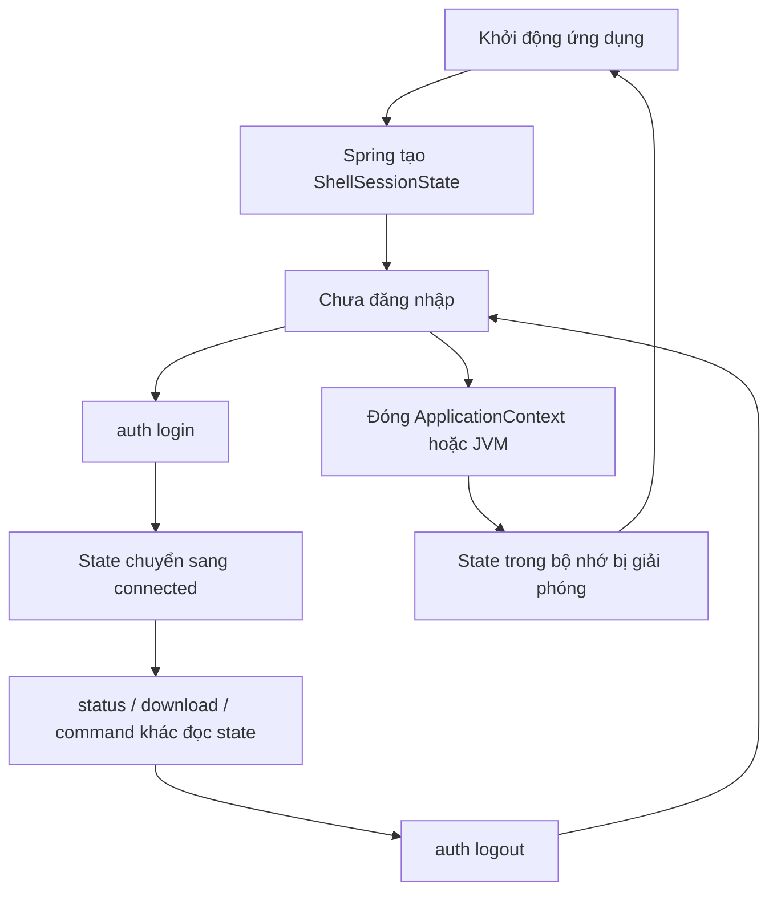

# Trạng thái phiên dùng chung giữa các lệnh

Trong một ứng dụng Spring Shell, nhiều command thường cần dùng chung một số thông tin trong suốt phiên chạy. Ví dụ, sau khi người dùng đăng nhập, command `download` cần biết trạng thái kết nối; command `status` cần hiển thị tài khoản hiện tại; command `logout` cần xóa thông tin đăng nhập. Spring Shell 4.x có thể chia sẻ trạng thái này thông qua các Spring bean được quản lý trong cùng application context.

Bài học thuộc chương **Trạng thái và khả dụng** của Spring Shell. Nội dung tập trung vào cách tổ chức command để chia sẻ state, dùng bean quản lý trạng thái chung giữa nhiều lớp, kiểm soát khả dụng theo state và hiểu vòng đời của dữ liệu trong một tiến trình shell.

Sau bài học, bạn có thể:

- Giải thích vì sao các command trong cùng Spring bean có thể chia sẻ field state.
- Dùng một bean trạng thái dùng chung khi command nằm ở nhiều lớp.
- Phân biệt state của ứng dụng với `CommandContext` của một lần gọi.
- Dùng `AvailabilityProvider` để bật hoặc tắt command dựa trên state.
- Xác định dữ liệu nào chỉ tồn tại trong bộ nhớ và khi nào cần lưu trữ bền vững.
- Tránh lỗi do singleton mutable state, trạng thái cũ và dữ liệu nhạy cảm.

## Trạng thái dùng chung là gì?

Trạng thái dùng chung là dữ liệu được một command cập nhật và command khác đọc lại trong cùng một lần chạy ứng dụng. Ví dụ:

| Command | Thao tác với state |
| --- | --- |
| `auth login` | Xác thực người dùng và ghi nhận tài khoản hiện tại. |
| `auth status` | Đọc trạng thái đăng nhập và tên tài khoản. |
| `download` | Kiểm tra đã kết nối trước khi tải dữ liệu. |
| `auth logout` | Xóa trạng thái đăng nhập hiện tại. |

Trong Spring Shell 4.x, các method được đánh dấu `@Command` nằm trong Spring-managed bean. Theo mặc định, Spring bean có scope singleton: một instance được dùng trong application context. Vì vậy, nếu nhiều command method nằm trong cùng một bean, chúng có thể đọc và cập nhật các field của cùng instance.

Tài liệu Spring Shell khuyến nghị đặt các command liên quan trong cùng lớp khi chúng cần chia sẻ state. Nếu command được chia thành nhiều lớp, hãy đưa state vào một bean riêng và inject bean đó vào các lớp command.

## Chia sẻ state giữa các command trong cùng một bean

Ví dụ đơn giản nhất là nhóm các command xác thực vào cùng một lớp. Field `connected` được thay đổi bởi `login` và `logout`, sau đó được đọc bởi `status`:

```java
import org.springframework.shell.core.command.annotation.Command;
import org.springframework.shell.core.command.annotation.CommandGroup;
import org.springframework.shell.core.command.annotation.Argument;
import org.springframework.stereotype.Component;

@Component
@CommandGroup(name = "Authentication Commands", prefix = "auth")
class SimpleAuthenticationCommands {

    private boolean connected;
    private String username;

    @Command(name = "login", description = "Đăng nhập")
    public String login(@Argument(index = 0) String username) {
        // Ví dụ minh họa: ứng dụng thực tế cần xác thực qua service.
        this.username = username;
        this.connected = true;
        return "Đã đăng nhập: " + username;
    }

    @Command(name = "status", description = "Xem trạng thái đăng nhập")
    public String status() {
        if (connected) {
            return "Đang đăng nhập bằng tài khoản " + username;
        }
        return "Chưa đăng nhập";
    }

    @Command(name = "logout", description = "Đăng xuất")
    public String logout() {
        connected = false;
        username = null;
        return "Đã đăng xuất";
    }
}
```

`@CommandGroup` đặt prefix `auth` cho các command trong lớp. Người dùng có thể gọi:

```text
auth login lan
auth status
auth logout
```

`@CommandGroup` chỉ tổ chức nhóm và prefix command; nó không tự tạo hoặc quản lý state. Các method chia sẻ field vì chúng chạy trên cùng Spring bean instance.

Sau khi `auth login lan` cập nhật field, lần gọi `auth status` tiếp theo đọc được cùng state. `auth logout` đặt lại state để những lần gọi sau nhận biết người dùng đã đăng xuất.

Ví dụ trên chỉ minh họa vòng đời state. Trong ứng dụng thực tế, không nên đánh dấu đăng nhập thành công chỉ vì người dùng đã nhập tên. Hãy gọi service xác thực trước, rồi cập nhật state sau khi xác thực thành công.

## Chia sẻ state giữa nhiều lớp command

Khi ứng dụng lớn hơn, các command có thể được chia theo chức năng: lớp xác thực, lớp tải file, lớp quản lý tài khoản. Nếu mỗi lớp tự có field `connected` riêng, các giá trị có thể không đồng bộ. Hãy tạo một bean quản lý trạng thái duy nhất và inject nó vào các lớp cần sử dụng.

### Tạo bean quản lý trạng thái

```java
import java.util.Optional;

import org.springframework.stereotype.Component;

@Component
class ShellSessionState {

    private String username;
    private boolean connected;

    public synchronized void markConnected(String username) {
        this.username = username;
        this.connected = true;
    }

    public synchronized void clear() {
        this.username = null;
        this.connected = false;
    }

    public synchronized boolean isConnected() {
        return connected;
    }

    public synchronized Optional<String> username() {
        return Optional.ofNullable(username);
    }
}
```

Bean `ShellSessionState` lưu thông tin cần thiết cho phiên shell. Các method được đồng bộ để những lần đọc và cập nhật state không quan sát một phần thay đổi khi ứng dụng có nhiều luồng truy cập.

### Cập nhật state sau khi đăng nhập

```java
import java.util.Arrays;

import org.springframework.shell.core.command.CommandContext;
import org.springframework.shell.core.command.annotation.Command;
import org.springframework.shell.core.command.annotation.CommandGroup;
import org.springframework.shell.core.command.annotation.Option;
import org.springframework.stereotype.Component;

@Component
@CommandGroup(name = "Authentication Commands", prefix = "auth")
class AuthenticationCommands {

    private final ShellSessionState sessionState;
    private final AuthenticationService authenticationService;

    AuthenticationCommands(
            ShellSessionState sessionState,
            AuthenticationService authenticationService) {
        this.sessionState = sessionState;
        this.authenticationService = authenticationService;
    }

    @Command(name = "login", description = "Đăng nhập")
    public String login(
            @Option(longName = "username", required = true) String username,
            CommandContext context) throws Exception {

        char[] password = context.inputReader().readPassword("Mật khẩu: ");
        try {
            authenticationService.authenticate(username, password);
            sessionState.markConnected(username);
            return "Đã đăng nhập bằng tài khoản " + username;
        }
        finally {
            Arrays.fill(password, '\0');
        }
    }

    @Command(name = "logout", description = "Đăng xuất")
    public String logout() {
        sessionState.clear();
        return "Đã đăng xuất";
    }

    @Command(name = "status", description = "Xem trạng thái đăng nhập")
    public String status() {
        return sessionState.username()
            .map(name -> "Đang đăng nhập bằng tài khoản " + name)
            .orElse("Chưa đăng nhập");
    }
}
```

`AuthenticationService` đại diện cho service xác thực của ứng dụng. Method `authenticate` phải hoàn tất thành công trước khi `markConnected` được gọi. Mật khẩu chỉ được dùng trong bước xác thực và không được lưu vào `ShellSessionState`.

### Đọc state từ command khác

Lớp command tải file có thể nhận cùng bean `ShellSessionState` qua constructor:

```java
import org.springframework.shell.core.command.annotation.Command;
import org.springframework.stereotype.Component;

@Component
class DownloadCommandsWithGuard {

    private final ShellSessionState sessionState;
    private final DownloadService downloadService;

    DownloadCommandsWithGuard(
            ShellSessionState sessionState,
            DownloadService downloadService) {
        this.sessionState = sessionState;
        this.downloadService = downloadService;
    }

    @Command(name = "download")
    public String download() {
        if (!sessionState.isConnected()) {
            return "Bạn cần đăng nhập trước khi tải dữ liệu";
        }

        downloadService.download();
        return "Đã tải dữ liệu";
    }
}
```

Hai lớp command nhận cùng một bean singleton do Spring quản lý. Khi command đăng nhập gọi `markConnected`, command tải file đọc được giá trị đã cập nhật từ bean đó.

Kiểm tra state trong method vẫn hữu ích để bảo vệ nghiệp vụ. Nếu muốn Spring Shell ngăn người dùng gọi command trước khi đủ điều kiện, hãy kết hợp với cơ chế command availability.

Ví dụ `DownloadCommandsWithGuard` minh họa cách kiểm tra state trực tiếp trong method. Phần tiếp theo trình bày cách dùng `AvailabilityProvider` để Spring Shell thông báo command chưa khả dụng trước khi gọi method.

## Command availability phụ thuộc state

Một command có thể đã được đăng ký nhưng chỉ hợp lệ trong một trạng thái nhất định. Ví dụ, `download` chỉ có ý nghĩa sau khi người dùng đăng nhập. Spring Shell 4.x hỗ trợ `AvailabilityProvider` để mô tả điều kiện đó.

Với annotation, thuộc tính `availabilityProvider` của `@Command` nhận tên bean cung cấp trạng thái khả dụng:

```java
import org.springframework.shell.core.command.annotation.Command;
import org.springframework.stereotype.Component;

@Component
class DownloadCommands {

    private final DownloadService downloadService;

    DownloadCommands(DownloadService downloadService) {
        this.downloadService = downloadService;
    }

    @Command(
        name = "download",
        description = "Tải dữ liệu từ máy chủ",
        availabilityProvider = "downloadAvailability")
    public String download() {
        downloadService.download();
        return "Đã tải dữ liệu";
    }
}
```

Khai báo bean `AvailabilityProvider` đọc cùng state holder:

```java
import org.springframework.context.annotation.Bean;
import org.springframework.context.annotation.Configuration;
import org.springframework.shell.core.command.availability.Availability;
import org.springframework.shell.core.command.availability.AvailabilityProvider;

@Configuration
class ShellAvailabilityConfiguration {

    @Bean
    AvailabilityProvider downloadAvailability(ShellSessionState sessionState) {
        return () -> sessionState.isConnected()
            ? Availability.available()
            : Availability.unavailable("bạn chưa đăng nhập");
    }
}
```

Tên bean `downloadAvailability` phải khớp với giá trị `availabilityProvider` trong `@Command`. Khi chưa đăng nhập, Spring Shell cho biết command tồn tại nhưng hiện chưa khả dụng và hiển thị lý do. Sau khi `auth login` cập nhật state, provider trả về `Availability.available()` và command có thể được gọi.

Một chuỗi thao tác minh họa:

```text
shell:>download
Command 'download' exists but is not currently available because bạn chưa đăng nhập

shell:>auth login --username lan
Mật khẩu:
Đã đăng nhập bằng tài khoản lan

shell:>download
Đã tải dữ liệu

shell:>auth logout
Đã đăng xuất

shell:>download
Command 'download' exists but is not currently available because bạn chưa đăng nhập
```

`AvailabilityProvider` là lớp kiểm tra điều kiện để shell trình bày trạng thái command. Logic nghiệp vụ nhạy cảm vẫn nên xác thực quyền trong service trước khi thực hiện thao tác, vì việc ẩn hoặc vô hiệu hóa command không thay thế kiểm tra quyền ở tầng nghiệp vụ.

## State của ứng dụng và CommandContext

`CommandContext` cung cấp thông tin của một lần gọi command: input đã parse, registry, output writer và input reader. Đây là context phục vụ lần thực thi hiện tại, không phải kho dữ liệu để giữ trạng thái qua nhiều command.

| Thành phần | Phạm vi tồn tại | Mục đích |
| --- | --- | --- |
| `CommandContext` | Một lần gọi command | Đọc option/argument, đọc input và ghi output. |
| Field trong command bean singleton | Trong vòng đời bean/application context | Chia sẻ state giữa các method trong cùng bean. |
| Bean `ShellSessionState` singleton | Trong vòng đời application context | Chia sẻ state giữa nhiều lớp command và service. |
| Database hoặc secret store | Qua nhiều lần chạy ứng dụng | Lưu dữ liệu cần tồn tại sau khi tiến trình kết thúc. |

Không nên giữ `CommandContext` trong field để dùng ở lần gọi sau. Khi method kết thúc, lần gọi tiếp theo có context mới và dữ liệu của lần trước không được lưu trong context đó.

Trong Spring Shell 3.x từng có `ShellContext` gắn với `CommandContext`; API này mô tả thông tin môi trường shell như interaction mode và khả năng PTY. Không nên nhầm nó với một session store tùy ý cho dữ liệu nghiệp vụ. Với Spring Shell 4.x, hãy quản lý state nghiệp vụ bằng bean ứng dụng.

## Vòng đời của trạng thái trong phiên shell

State lưu trong field hoặc bean singleton chỉ tồn tại trong application context hiện tại:



Điều này có một số hệ quả:

- Khi chạy nhiều command trong cùng một tiến trình shell, chúng có thể dùng chung state.
- Khi khởi động lại ứng dụng, field và bean trong bộ nhớ được tạo lại; trạng thái cũ mất đi.
- Nếu mỗi lệnh không tương tác được chạy bằng một tiến trình JVM riêng, state trong bộ nhớ không được chia sẻ giữa các tiến trình.
- Khi dùng lệnh script chạy trong cùng shell process, các command trong script có thể quan sát state đã cập nhật bởi command trước đó.

Nếu cần giữ đăng nhập qua lần khởi động tiếp theo, hãy dùng cơ chế lưu trữ phù hợp như token/refresh token trong secret store, cấu hình xác thực hoặc một kho dữ liệu an toàn. Không ghi mật khẩu thô vào file cấu hình hay log.

## Singleton state và phạm vi người dùng

Spring bean mặc định là singleton trong application context. Vì vậy, một bean `ShellSessionState` thường đại diện cho trạng thái dùng chung của tiến trình CLI hiện tại. Đây là mô hình phù hợp với một shell cục bộ do một người dùng điều khiển.

Nếu cùng application context phục vụ nhiều người dùng hoặc nhiều terminal đồng thời, một field `connected` toàn cục không còn đại diện đúng cho từng người dùng. Người dùng A đăng nhập có thể làm command của người dùng B nhìn thấy state đã đăng nhập. Trong trường hợp đó, cần thiết kế state có khóa theo danh tính phiên/người dùng và truyền định danh đó trong mọi lần gọi; có thể dùng một registry phiên có quản lý vòng đời hoặc một kho lưu trữ bên ngoài. Không nên giả định Spring Shell tự tạo một web session riêng cho mỗi terminal.

Nếu command có thể được gọi từ nhiều luồng, bảo vệ thao tác đọc/ghi state bằng cơ chế đồng bộ phù hợp. Ví dụ `synchronized` ở `ShellSessionState` giúp các thao tác đơn lẻ trong ví dụ không bị xen kẽ. Với nhiều trường phải thay đổi như một giao dịch, nên cập nhật chúng trong một method nguyên tử để không tạo trạng thái nửa cũ nửa mới.

## Thiết kế state an toàn và dễ kiểm thử

Một state holder nên lưu thông tin tối thiểu cần thiết cho các command:

- Trạng thái đã kết nối hay chưa.
- Danh tính tài khoản hiện tại nếu cần hiển thị hoặc kiểm tra quyền.
- Thời điểm hết hạn hoặc thông tin phiên không nhạy cảm nếu nghiệp vụ cần.

Tránh lưu mật khẩu thô. Nếu phải giữ access token trong bộ nhớ, giới hạn nơi truy cập, không ghi token vào output hoặc log và xóa token khi logout. Các command không nên tự thay đổi từng field tùy ý; hãy cung cấp method có ý nghĩa nghiệp vụ như `markConnected`, `clear` hoặc `currentUser`.

Nên giữ logic xác thực, tải dữ liệu và xử lý nghiệp vụ trong service. Command chỉ điều phối: gọi service, cập nhật state sau khi thao tác thành công và hiển thị kết quả. Cách tổ chức này cho phép kiểm thử state holder độc lập với shell.

## Kiểm thử trạng thái dùng chung

Có thể kiểm tra theo nhiều lớp:

1. **Unit test state holder:** xác nhận state ban đầu chưa kết nối, `markConnected` cập nhật danh tính và `clear` xóa state.
2. **Kiểm thử command:** gọi `auth login`, sau đó `auth status`; xác nhận command thứ hai nhìn thấy state từ command thứ nhất.
3. **Kiểm thử availability:** gọi `download` trước đăng nhập và xác nhận command chưa khả dụng; đăng nhập rồi gọi lại và xác nhận command chạy.
4. **Kiểm thử logout:** sau `auth logout`, gọi lại `download` và xác nhận command trở về trạng thái chưa khả dụng.
5. **Kiểm thử vòng đời:** tạo application context mới và xác nhận state trong bộ nhớ bắt đầu lại theo giá trị mặc định.
6. **Kiểm thử lỗi xác thực:** nếu `AuthenticationService` từ chối thông tin đăng nhập, xác nhận `markConnected` không được gọi.

Ví dụ unit test cho state holder:

```java
import static org.assertj.core.api.Assertions.assertThat;

import org.junit.jupiter.api.Test;

class ShellSessionStateTests {

    private final ShellSessionState state = new ShellSessionState();

    @Test
    void stateChangesAcrossCommands() {
        assertThat(state.isConnected()).isFalse();

        state.markConnected("lan");

        assertThat(state.isConnected()).isTrue();
        assertThat(state.username()).contains("lan");

        state.clear();

        assertThat(state.isConnected()).isFalse();
        assertThat(state.username()).isEmpty();
    }
}
```

Trong integration test, dùng `ShellTestClient` để gửi nhiều command liên tiếp trong cùng test context. Điều quan trọng là các command phải chạy trong cùng application context để kiểm tra đúng cơ chế chia sẻ state.

## Lỗi thường gặp

| Hiện tượng | Nguyên nhân | Cách xử lý |
| --- | --- | --- |
| `status` không thấy trạng thái do `login` cập nhật | Mỗi command class giữ một field riêng. | Đưa state vào cùng bean hoặc bean dùng chung được inject. |
| State biến mất sau khi khởi động lại | Dữ liệu chỉ lưu trong bộ nhớ. | Dùng persistent store hoặc cơ chế credential storage nếu cần giữ qua lần chạy. |
| `download` vẫn khả dụng khi chưa đăng nhập | Chưa cấu hình availability provider hoặc provider đọc nhầm state. | Kiểm tra tên bean trong `availabilityProvider` và bean state được inject. |
| Command không tìm thấy availability provider | Tên trong annotation không khớp tên bean. | Đồng bộ `availabilityProvider = "downloadAvailability"` với tên method `@Bean`. |
| Đăng nhập thất bại nhưng state vẫn là connected | State được cập nhật trước khi service xác thực hoàn tất. | Chỉ cập nhật state sau khi xác thực thành công. |
| Người dùng khác thấy trạng thái đã đăng nhập | Singleton state bị dùng chung giữa nhiều người dùng/terminal. | Phân tách state theo session hoặc user identity. |
| State có giá trị không nhất quán | Nhiều field được cập nhật rời rạc hoặc truy cập đồng thời. | Đóng gói thay đổi vào method nguyên tử và đồng bộ phù hợp. |
| Token hoặc mật khẩu xuất hiện trong log | Command in toàn bộ input hoặc state. | Không log secret; chỉ hiển thị thông tin tài khoản không nhạy cảm. |

## Checklist triển khai

- [ ] Các command cần chia sẻ state đã được xác định rõ.
- [ ] State được đặt trong cùng command bean hoặc một bean quản lý state dùng chung.
- [ ] Bean state được inject qua constructor thay vì tự tạo bằng `new` ở từng command.
- [ ] State chỉ được cập nhật sau khi thao tác nghiệp vụ thành công.
- [ ] Command phụ thuộc state có `AvailabilityProvider` khi cần ngăn gọi sớm.
- [ ] Logic nghiệp vụ vẫn kiểm tra quyền trong service.
- [ ] Dữ liệu nhạy cảm không được lưu hoặc in ra ngoài nhu cầu cần thiết.
- [ ] Đã xác định state cần tồn tại trong một tiến trình hay phải lưu qua lần chạy.
- [ ] Nếu có nhiều người dùng hoặc nhiều luồng, phạm vi và đồng bộ state đã được thiết kế phù hợp.
- [ ] Unit test và integration test bao gồm login, status, command phụ thuộc state và logout.

## Ghi nhớ

Trong Spring Shell 4.x, các command method trong cùng Spring bean có thể chia sẻ field state vì chúng thuộc cùng một instance bean. Khi command nằm ở nhiều lớp, hãy inject một bean trạng thái dùng chung. `CommandContext` chỉ chứa thông tin của lần gọi hiện tại; state nghiệp vụ cần tồn tại giữa các lệnh nên được quản lý bởi bean ứng dụng. Dùng `AvailabilityProvider` để phản ánh điều kiện hiện tại của command, nhưng vẫn kiểm tra quyền trong service. State trong bộ nhớ chỉ tồn tại trong application context, vì vậy cần một kho lưu trữ an toàn nếu dữ liệu phải tồn tại qua lần khởi động lại.

## Tài liệu tham khảo

- [Spring Shell 4.0.2 — Organizing Commands](https://docs.spring.io/spring-shell/reference/commands/organize.html): nhóm command trong cùng lớp để chia sẻ state và dùng `@CommandGroup`.
- [Spring Shell 4.0.3 — Command Availability](https://docs.spring.io/spring-shell/reference/commands/availability.html): `AvailabilityProvider`, `Availability` và điều kiện khả dụng theo state.
- [Spring Shell 4.0.3 — Command Context](https://docs.spring.io/spring-shell/reference/commands/context.html): dữ liệu của lần gọi command và cách đọc/ghi input/output.
- [Spring Shell 4.0.3 — Reading Input](https://docs.spring.io/spring-shell/reference/commands/reading.html): đọc dữ liệu và mật khẩu bằng `CommandContext.inputReader()`.
- [Spring Shell 4.0.3 API — `CommandContext`](https://docs.spring.io/spring-shell/reference/api/org/springframework/shell/core/command/CommandContext.html): các thành phần `ParsedInput`, `CommandRegistry`, `InputReader` và `PrintWriter`.
- [Spring Shell 4.0.3 API — `@Command`](https://docs.spring.io/spring-shell/reference/api/org/springframework/shell/core/command/annotation/Command.html): thuộc tính `availabilityProvider` của command annotation.
- [Spring Shell 4.0.3 API — `AvailabilityProvider`](https://docs.spring.io/spring-shell/reference/api/org/springframework/shell/core/command/availability/AvailabilityProvider.html): hợp đồng cung cấp trạng thái khả dụng.
- [Spring Shell v4 Migration Guide](https://github.com/spring-projects/spring-shell/wiki/v4-migration-guide): mô hình command bean và ví dụ state được chia sẻ giữa các command.
