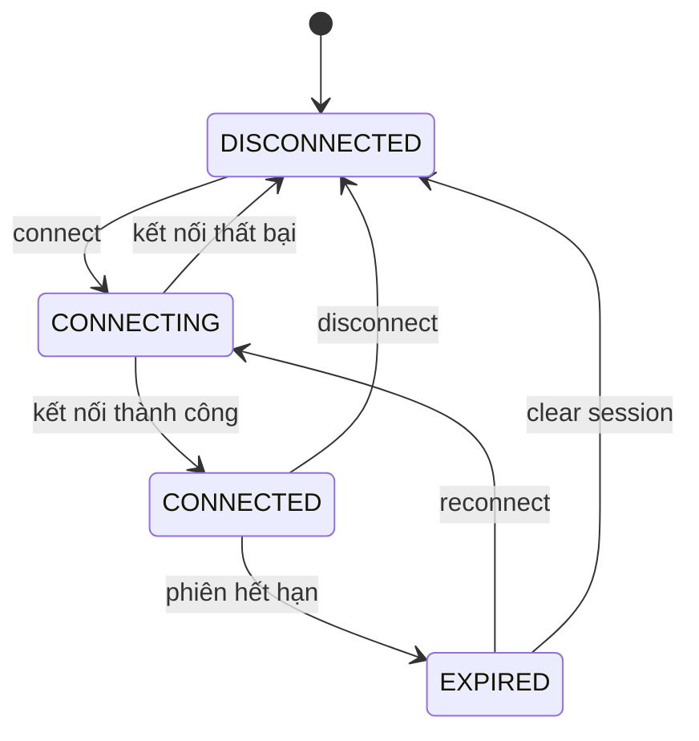

# Availability như điều kiện một lệnh có ý nghĩa ở thời điểm hiện tại

Một command có thể được đăng ký hợp lệ nhưng chưa thể thực hiện ở thời điểm người dùng gọi. Ví dụ, `download` chỉ có ý nghĩa sau khi ứng dụng đã kết nối tới máy chủ; `deploy` chỉ nên chạy khi đã chọn dự án và môi trường; `close-job` chỉ dùng được khi công việc đang mở. Đây là **availability**: trạng thái cho biết các điều kiện hiện tại để một command có thể được thực hiện đã thỏa mãn hay chưa.

Spring Shell cho phép command trả về trạng thái khả dụng cùng lý do khi chưa khả dụng. Nhờ vậy, người dùng vẫn nhìn thấy command trong shell và biết cần làm gì trước khi gọi lại. Availability được tính từ trạng thái ứng dụng tại thời điểm kiểm tra, vì thế nó có thể thay đổi sau các lệnh như connect, disconnect, select-project hoặc khi một phiên làm việc hết hạn.

## 1. Availability giải quyết vấn đề gì?

Giả sử CLI quản lý một máy chủ từ xa có các command:

```text
connect <endpoint>
disconnect
download <remote-path>
upload <local-path> <remote-path>
```

Khi ứng dụng chưa kết nối, `connect` vẫn có thể chạy nhưng `download` và `upload` chưa có ý nghĩa. Nếu người dùng gọi `download`, một lỗi chung như “thực thi thất bại” không giúp họ hiểu bước tiếp theo.

Availability cho phép shell phản hồi rõ ràng:

```text
shell:>download report.csv
Command 'download' exists but is not currently available because you are not connected to a remote server
```

Command vẫn tồn tại và có thể được tìm thấy trong trợ giúp. Shell cho biết điều kiện nào đang thiếu để người dùng thực hiện bước cần thiết. Spring Shell cũng dùng thông tin availability trong phần trợ giúp tích hợp. Lý do được nối sau từ “because”, do đó nên viết thành một cụm giải thích ngắn, bắt đầu bằng chữ thường và không có dấu chấm cuối. <Link url="https://docs.spring.io/spring-shell/reference/commands/availability.html" title="Spring Shell 4.0.3 — Command Availability"/>.

Availability đặc biệt hữu ích khi trạng thái thay đổi trong vòng đời một phiên CLI:

- Chưa kết nối → đã kết nối → ngắt kết nối.
- Chưa chọn dự án → đã chọn dự án → chuyển sang dự án khác.
- Công việc đang mở → đang xử lý → đã hoàn tất.
- Phiên đăng nhập còn hiệu lực → hết hạn → đăng nhập lại.
- Chưa khởi tạo cấu hình → cấu hình hợp lệ → cấu hình bị thu hồi.

## 2. Phân biệt command tồn tại và command khả dụng

Hai câu hỏi khác nhau cần được trả lời:

| Câu hỏi | Ý nghĩa | Cơ chế liên quan |
| --- | --- | --- |
| Command có được đăng ký không? | Shell có biết tên và cú pháp command không? | Command registration |
| Command có khả dụng lúc này không? | Trạng thái ứng dụng hiện tại có cho phép bắt đầu thao tác không? | Availability |

Không khả dụng không có nghĩa command bị xóa hoặc ẩn. Ví dụ `download` vẫn xuất hiện trong help khi chưa kết nối; trạng thái unavailable giúp người dùng khám phá lệnh và hiểu điều kiện cần có.

Một command thường luôn khả dụng nếu không cấu hình availability provider. Khi có provider, Spring Shell kiểm tra kết quả provider để quyết định command có thể được gọi ở thời điểm đó hay không.

## 3. Availability được biểu diễn bằng `Availability`

Spring Shell cung cấp hai kết quả cơ bản:

```java
Availability.available()
Availability.unavailable("you are not connected to a remote server")
```

`available()` cho biết command có thể bắt đầu thực hiện. `unavailable(reason)` cho biết command hiện chưa thể chạy và cung cấp lý do cho người dùng.

Lý do nên mô tả điều kiện đang thiếu và gợi ý bước kế tiếp. Ví dụ:

| Lý do nên dùng | Lý do kém hữu ích |
| --- | --- |
| `you are not connected to a remote server` | `invalid state` |
| `no project has been selected` | `project error` |
| `the current job is already complete` | `cannot execute` |
| `your session has expired; sign in again` | `unauthorized` |

Với ứng dụng tiếng Việt, có thể dùng câu ngắn tương ứng, chẳng hạn `bạn chưa kết nối tới máy chủ` hoặc `hãy chọn dự án trước khi triển khai`. Tránh đưa stack trace, thông tin bí mật hoặc dữ liệu nội bộ vào reason.

## 4. Availability phải được tính từ trạng thái hiện tại

Availability không phải một giá trị cố định được quyết định lúc ứng dụng khởi động. Nó cần phản ánh trạng thái hiện tại của ứng dụng. Khi người dùng kết nối thành công, command phụ thuộc kết nối trở nên khả dụng; khi ngắt kết nối hoặc phiên hết hạn, các command đó lại chuyển sang unavailable.

Ví dụ một state machine đơn giản:



Từ state machine này, quy tắc có thể được diễn đạt như sau:

| Trạng thái | `connect` | `download` | `disconnect` |
| --- | --- | --- | --- |
| `DISCONNECTED` | Available | Unavailable | Unavailable |
| `CONNECTING` | Unavailable hoặc đang xử lý | Unavailable | Unavailable |
| `CONNECTED` | Unavailable nếu không hỗ trợ reconnect | Available | Available |
| `EXPIRED` | Available để kết nối lại | Unavailable | Unavailable hoặc chỉ dọn trạng thái cục bộ |

Bảng trên là chính sách ví dụ. Ứng dụng cần xác định rõ từng trạng thái và điều kiện của từng command, thay vì dùng một biến boolean duy nhất cho mọi trường hợp nếu quy trình thực tế có nhiều trạng thái trung gian.

## 5. Đặt trạng thái trong một thành phần có trách nhiệm rõ ràng

Không nên để mỗi command tự duy trì một bản sao trạng thái riêng. `connect` đặt `connected = true`, nhưng `download` lại đọc một biến khác hoặc `disconnect` quên cập nhật biến sẽ khiến availability sai.

Hãy tạo một service làm nguồn trạng thái chung. Ví dụ hợp đồng cho phiên kết nối từ xa:

```java
public interface RemoteSession {

    boolean isConnected();

    void connect(String endpoint);

    void disconnect();

    void download(String remotePath);

    void upload(String localPath, String remotePath);
}
```

Service triển khai hợp đồng này chịu trách nhiệm quản lý kết nối thật, cập nhật trạng thái sau khi thao tác thành công và xác nhận trạng thái trước khi sử dụng tài nguyên. Availability provider và command cùng đọc trạng thái từ một nguồn.

Khi trạng thái phức tạp hơn, biểu diễn bằng enum hoặc state object thay vì nhiều boolean có thể mâu thuẫn:

```java
public enum SessionStatus {
    DISCONNECTED,
    CONNECTING,
    CONNECTED,
    DISCONNECTING,
    EXPIRED
}
```

Ví dụ, `connecting = true` và `connected = true` có thể tạo ra tổ hợp khó hiểu. Một enum làm rõ ứng dụng đang ở đúng một trạng thái nào tại một thời điểm.

## 6. Khai báo availability trong Spring Shell 4.x

Trong Spring Shell 4, `AvailabilityProvider` là thành phần cung cấp `Availability`. Có thể gắn provider vào command bằng thuộc tính `availabilityProvider` của `@Command`, hoặc bằng `availabilityProvider(...)` khi tạo command bằng `Command.Builder`.

Ví dụ với annotation model mới:

```java
import org.springframework.shell.core.command.annotation.Argument;
import org.springframework.shell.core.command.annotation.Command;
import org.springframework.stereotype.Component;

@Component
public class RemoteCommands {

    private final RemoteSession session;

    public RemoteCommands(RemoteSession session) {
        this.session = session;
    }

    @Command(name = "connect")
    public String connect(
            @Argument(index = 0, description = "Địa chỉ máy chủ") String endpoint) {
        session.connect(endpoint);
        return "Đã kết nối tới " + endpoint;
    }

    @Command(name = "download", availabilityProvider = "downloadAvailability")
    public String download(
            @Argument(index = 0, description = "Đường dẫn file từ xa") String remotePath) {
        session.download(remotePath);
        return "Đã tải " + remotePath;
    }
}
```

Khai báo provider bean:

```java
import org.springframework.context.annotation.Bean;
import org.springframework.context.annotation.Configuration;
import org.springframework.shell.core.command.availability.Availability;
import org.springframework.shell.core.command.availability.AvailabilityProvider;

@Configuration
public class CommandAvailabilityConfiguration {

    @Bean
    AvailabilityProvider downloadAvailability(RemoteSession session) {
        return () -> session.isConnected()
                ? Availability.available()
                : Availability.unavailable("bạn chưa kết nối tới máy chủ từ xa");
    }
}
```

Tên bean `downloadAvailability` được tham chiếu từ `@Command`. Provider đọc trạng thái từ `RemoteSession` mỗi lần được hỏi, vì vậy kết quả thay đổi sau khi command `connect` hoặc `disconnect` cập nhật phiên.

Nếu dùng programmatic registration trong 4.x, truyền provider trực tiếp vào builder:

```java
import org.springframework.context.annotation.Bean;
import org.springframework.shell.core.command.Command;
import org.springframework.shell.core.command.CommandArgument;
import org.springframework.shell.core.command.availability.Availability;

@Bean
Command downloadCommand(RemoteSession session) {
CommandArgument remotePathArgument = new CommandArgument.Builder()
        .index(0)
        .description("Đường dẫn file từ xa")
        .type(String.class)
        .build();

return Command.builder()
        .name("download")
        .arguments(remotePathArgument)
        .availabilityProvider(() -> session.isConnected()
                ? Availability.available()
                : Availability.unavailable("bạn chưa kết nối tới máy chủ từ xa"))
        .execute(context -> {
            String remotePath = context.getArgumentByIndex(0).value();
            session.download(remotePath);
            return "Đã tải " + remotePath;
        });
}
```

Đoạn code khai báo cả positional argument và provider, nên command có cú pháp `download <remotePath>` và chỉ chạy khi session đang kết nối.

## 7. Khai báo availability trong Spring Shell 3.x

Spring Shell 3.x có programmatic registration, annotation model mới và legacy annotation model. Cùng một ý tưởng availability được biểu diễn bằng API khác nhau.

**Programmatic registration:** dùng `availability(...)` với `Supplier<Availability>` trên `CommandRegistration.Builder`:

```java
import org.springframework.context.annotation.Bean;
import org.springframework.shell.Availability;
import org.springframework.shell.command.CommandRegistration;

@Bean
CommandRegistration downloadCommand(
        CommandRegistration.BuilderSupplier builder,
        RemoteSession session) {

    return builder.get()
            .command("download")
            .availability(() -> session.isConnected()
                    ? Availability.available()
                    : Availability.unavailable("bạn chưa kết nối tới máy chủ từ xa"))
            .withOption()
                .longNames("remote-path")
                .required()
                .type(String.class)
                .and()
            .withTarget()
                .consumer(context -> session.download(
                        context.getOptionValue("remote-path")))
                .and()
            .build();
}
```

Ví dụ dùng option `--remote-path` để giữ phần minh họa gọn. Điểm khác biệt của API 3.x là phương thức `.availability(...)` nhận supplier trả về `Availability`.

**Annotation model mới:** dùng `@CommandAvailability` để trỏ tới bean `AvailabilityProvider`:

```java
import org.springframework.context.annotation.Bean;
import org.springframework.shell.Availability;
import org.springframework.shell.AvailabilityProvider;
import org.springframework.shell.command.annotation.Command;
import org.springframework.shell.command.annotation.CommandAvailability;

@Command(command = "download")
@CommandAvailability(provider = "downloadAvailability")
public void download() {
    // Gọi service để tải dữ liệu.
}

@Bean
AvailabilityProvider downloadAvailability(RemoteSession session) {
    return () -> session.isConnected()
            ? Availability.available()
            : Availability.unavailable("bạn chưa kết nối tới máy chủ từ xa");
}
```

**Legacy annotation model:** Spring Shell có thể tự tìm phương thức không tham số có tên `<tênCommand>Availability`, trả về `Availability`:

```java
import org.springframework.shell.Availability;
import org.springframework.shell.standard.ShellComponent;
import org.springframework.shell.standard.ShellMethod;

@ShellComponent
public class LegacyRemoteCommands {

    private final RemoteSession session;

    public LegacyRemoteCommands(RemoteSession session) {
        this.session = session;
    }

    @ShellMethod("Tải file từ máy chủ")
    public void download(String remotePath) {
        session.download(remotePath);
    }

    public Availability downloadAvailability() {
        return session.isConnected()
                ? Availability.available()
                : Availability.unavailable("bạn chưa kết nối tới máy chủ từ xa");
    }
}
```

Nếu muốn đặt tên phương thức kiểm tra khác, dùng `@ShellMethodAvailability` trên command method để trỏ đến method trả về `Availability`. Annotation này cũng có thể đặt trên method kiểm tra để áp dụng chung cho nhiều command; giá trị mặc định `*` áp dụng cho tất cả command trong lớp đó. <Link url="https://docs.spring.io/spring-shell/reference/3.3/commands/availability.html" title="Spring Shell 3.3.4 — Command Availability"/>.

Ví dụ một phương thức kiểm tra dùng chung cho hai command:

```java
@ShellMethod("Tải file từ máy chủ")
public void download(String remotePath) {
    session.download(remotePath);
}

@ShellMethod("Tải file lên máy chủ")
public void upload(String localPath, String remotePath) {
    session.upload(localPath, remotePath);
}

@ShellMethodAvailability({"download", "upload"})
public Availability remoteCommandsAvailability() {
    return session.isConnected()
            ? Availability.available()
            : Availability.unavailable("bạn chưa kết nối tới máy chủ từ xa");
}
```

Khi đặt annotation trên method trả về `Availability`, danh sách tên phải khớp với command hoặc alias mà phương thức đó quản lý. Giá trị `*` áp dụng cho mọi command trong lớp, vì vậy chỉ dùng wildcard nếu mọi command trong lớp thực sự có cùng điều kiện.

## 8. Dùng chung một điều kiện cho nhiều command

Một số command phụ thuộc cùng trạng thái. Ví dụ `download`, `upload` và `list-remote` đều yêu cầu phiên kết nối. Có thể dùng cùng một provider thay vì sao chép logic kiểm tra vào từng command.

```java
import org.springframework.context.annotation.Bean;
import org.springframework.shell.core.command.availability.Availability;
import org.springframework.shell.core.command.availability.AvailabilityProvider;

@Bean
AvailabilityProvider connectedAvailability(RemoteSession session) {
    return () -> session.isConnected()
            ? Availability.available()
            : Availability.unavailable("bạn chưa kết nối tới máy chủ từ xa");
}
```

Trong Spring Shell 4, các command có thể cùng tham chiếu bean `connectedAvailability`:

```java
@Command(name = "download", availabilityProvider = "connectedAvailability")
public String download(...) { ... }

@Command(name = "upload", availabilityProvider = "connectedAvailability")
public String upload(...) { ... }

@Command(name = "list-remote", availabilityProvider = "connectedAvailability")
public String listRemote(...) { ... }
```

Nếu các command có điều kiện khác nhau, hãy tạo provider riêng hoặc kết hợp các điều kiện một cách tường minh. Ví dụ `delete-remote` có thể cần vừa kết nối vừa bật chế độ quản trị; `download` chỉ cần kết nối.

## 9. Viết điều kiện availability dễ hiểu

Một điều kiện availability tốt có ba đặc điểm:

1. **Có nguồn trạng thái rõ ràng:** lấy từ session, service hoặc state object chịu trách nhiệm quản lý trạng thái.
2. **Được tính nhanh và không gây tác dụng phụ:** kiểm tra trạng thái hiện có, không thực hiện thao tác thay đổi dữ liệu.
3. **Có lý do có thể hành động:** người dùng hiểu điều kiện thiếu và bước tiếp theo.

Ví dụ command yêu cầu đã kết nối và đã chọn dự án:

```java
@Bean
AvailabilityProvider deployAvailability(
        RemoteSession session,
        ProjectSelection selection) {

    return () -> {
        if (!session.isConnected()) {
            return Availability.unavailable("bạn cần kết nối tới máy chủ trước");
        }
        if (!selection.hasProject()) {
            return Availability.unavailable("bạn cần chọn dự án trước");
        }
        return Availability.available();
    };
}
```

Kiểm tra điều kiện theo thứ tự giúp đưa ra lý do đầu tiên cần xử lý. Nếu muốn hiển thị nhiều điều kiện còn thiếu cùng lúc, có thể tổng hợp chúng thành một thông báo ngắn, nhưng không nên tạo một đoạn trợ giúp dài hoặc khó hiểu.

## 10. Availability không thay thế validation và authorization

Availability trả lời câu hỏi “command có nên bắt đầu chạy trong trạng thái hiện tại không?”. Nó không đảm nhiệm mọi loại kiểm tra.

| Cơ chế | Câu hỏi | Ví dụ |
| --- | --- | --- |
| Availability | Trạng thái ứng dụng hiện tại đã sẵn sàng chưa? | Đã kết nối tới máy chủ chưa? |
| Validation | Đầu vào của command có đúng định dạng và quy tắc không? | Đường dẫn file có hợp lệ không? |
| Authorization | Người dùng có quyền thực hiện hành động này không? | Tài khoản có quyền xóa file đó không? |
| Business rule | Hành động có hợp lệ với dữ liệu hiện tại không? | Công việc đã hoàn tất có được đóng lần nữa không? |

Không dùng availability để bảo vệ tài nguyên. Ẩn command hoặc đánh dấu unavailable không thay thế kiểm tra quyền ở service hay tầng bảo mật. Người dùng có thể gọi service qua một đường khác; trạng thái có thể thay đổi sau khi provider kiểm tra; và quyền có thể khác nhau theo tài nguyên cụ thể. Service vẫn phải kiểm tra authorization và quy tắc nghiệp vụ ngay trước thao tác.

## 11. Availability check và race condition

Availability thường được kiểm tra trước khi command chạy, nhưng trạng thái có thể thay đổi ngay sau lần kiểm tra đó. Ví dụ:

1. Provider kiểm tra và thấy phiên đang kết nối.
2. Command được đánh dấu available.
3. Kết nối bị máy chủ đóng hoặc hết hạn.
4. Command bắt đầu tải file và gặp lỗi mất kết nối.

Đây là dạng race condition giữa lúc kiểm tra và lúc thực hiện. Vì vậy, availability là chỉ báo trạng thái và cải thiện trải nghiệm, không phải bảo đảm thao tác chắc chắn thành công.

Để xử lý:

- Service thực hiện thao tác phải kiểm tra trạng thái lại trước khi dùng tài nguyên.
- Nếu thao tác cần tính nguyên tử, dùng cơ chế đồng bộ, transaction hoặc khóa phù hợp với loại tài nguyên.
- Bắt lỗi mất kết nối phát sinh trong lúc thực hiện và chuyển thành thông báo rõ ràng.
- Khi session hết hạn hoặc bị đóng từ xa, cập nhật state service để các lần availability tiếp theo phản ánh trạng thái mới.
- Không giữ một giá trị `connected` cũ sau khi tài nguyên kết nối thật đã mất.

## 12. Giữ availability provider nhanh và không có tác dụng phụ

Spring Shell có thể hỏi availability khi người dùng gọi command và khi tạo phần trợ giúp. Vì vậy, provider có thể được gọi nhiều lần trong một phiên. Hãy thiết kế nó như một phép đọc trạng thái ngắn:

- Đọc cờ trạng thái hoặc state object đã được cập nhật bởi session manager.
- Không đăng nhập, kết nối, ngắt kết nối hay thay đổi dữ liệu trong provider.
- Tránh gọi mạng đồng bộ mỗi lần shell cần hiển thị help.
- Không thực hiện truy vấn nặng hoặc chờ một tác vụ dài.
- Không log lặp lại ở mọi lần kiểm tra; chỉ log khi trạng thái thay đổi nếu cần quan sát.

Nếu trạng thái từ xa cần được làm mới, hãy để thành phần quản lý session cập nhật trạng thái theo sự kiện, heartbeat hoặc tác vụ riêng. Provider chỉ đọc snapshot hiện có và đưa ra kết quả nhanh.

## 13. Phạm vi trạng thái và vòng đời phiên

Một CLI tương tác thông thường chạy trong một tiến trình và phục vụ một người dùng tại một thời điểm. Khi đó, một session service trong application context có thể quản lý trạng thái của phiên shell.

Nếu ứng dụng hỗ trợ nhiều phiên hoặc nhiều người dùng trong cùng process, không đặt trạng thái kết nối của từng người dùng trong một biến singleton dùng chung. Mỗi phiên cần có state riêng, và provider phải đọc đúng session hiện tại. Nếu không, người dùng A kết nối có thể vô tình làm command của người dùng B được đánh dấu available.

Hãy xác định vòng đời trạng thái:

- Khi khởi động: trạng thái ban đầu là disconnected hoặc chưa khởi tạo.
- Khi kết nối: chỉ chuyển sang connected sau khi xác nhận kết nối thành công.
- Khi kết nối thất bại: giữ trạng thái không kết nối và lưu lý do phù hợp.
- Khi ngắt kết nối: đóng tài nguyên và cập nhật trạng thái.
- Khi phiên hết hạn: đánh dấu expired và yêu cầu kết nối lại.
- Khi ứng dụng đóng: giải phóng tài nguyên và xóa trạng thái phiên.

Việc cập nhật trạng thái sau thao tác thành công giúp availability phản ánh thực tế thay vì ý định của người dùng.

## 14. Kiểm thử availability

Kiểm thử cần xác nhận provider phản ánh đúng từng trạng thái và shell thực sự chặn command khi chưa đủ điều kiện.

**Unit test cho provider** kiểm tra kết quả theo trạng thái session:

```java
import org.junit.jupiter.api.Test;
import org.springframework.shell.core.command.availability.Availability;
import org.springframework.shell.core.command.availability.AvailabilityProvider;

import static org.junit.jupiter.api.Assertions.assertFalse;
import static org.junit.jupiter.api.Assertions.assertTrue;
import static org.mockito.Mockito.mock;
import static org.mockito.Mockito.when;

class DownloadAvailabilityTest {

    @Test
    void isUnavailableWhenSessionIsDisconnected() {
        RemoteSession session = mock(RemoteSession.class);
        when(session.isConnected()).thenReturn(false);

        AvailabilityProvider provider = () -> session.isConnected()
                ? Availability.available()
                : Availability.unavailable("bạn chưa kết nối tới máy chủ từ xa");

        assertFalse(provider.get().isAvailable());
    }

    @Test
    void isAvailableWhenSessionIsConnected() {
        RemoteSession session = mock(RemoteSession.class);
        when(session.isConnected()).thenReturn(true);

        AvailabilityProvider provider = () -> session.isConnected()
                ? Availability.available()
                : Availability.unavailable("bạn chưa kết nối tới máy chủ từ xa");

        assertTrue(provider.get().isAvailable());
    }
}
```

Trong Spring Shell 4.0.3, `Availability` có phương thức `isAvailable()` và `reason()`. Nếu dự án dùng nhánh phiên bản khác, hãy kiểm tra API tương ứng khi viết assertion.

**Integration test với Spring Shell** nên xác nhận:

- Command unavailable không gọi logic thực thi.
- Thông báo hiển thị đúng reason.
- Sau command `connect` thành công, command phụ thuộc chuyển sang available.
- Sau `disconnect` hoặc session expiry, command trở lại unavailable.
- Help phản ánh trạng thái hiện tại.
- Nhiều command dùng chung provider được cập nhật đồng bộ.

**End-to-end test** chạy shell thực hoặc JAR để xác minh trạng thái thay đổi theo trình tự lệnh. Kiểm tra thêm hành vi khi kết nối mất ngay sau availability check và xác nhận service trả lỗi phù hợp.

## 15. Lỗi thường gặp

| Triệu chứng | Nguyên nhân | Cách xử lý |
| --- | --- | --- |
| Command luôn unavailable sau khi kết nối | Provider đọc một biến khác hoặc trạng thái chưa được cập nhật | Dùng chung session service và cập nhật sau khi kết nối thành công |
| Command luôn available dù đã disconnect | Provider giữ kết quả cũ hoặc không đọc trạng thái mới | Tính availability từ state hiện tại mỗi lần được gọi |
| Reason khó hiểu | Thông báo chung hoặc mô tả trạng thái nội bộ | Nêu điều kiện thiếu và bước tiếp theo |
| Help chậm | Provider gọi mạng hoặc truy vấn nặng | Đọc snapshot trạng thái nhanh; cập nhật từ session manager |
| Command chạy dù availability vừa đổi | Trạng thái thay đổi giữa check và execute | Kiểm tra lại trong service và xử lý lỗi cạnh tranh |
| Một người dùng ảnh hưởng trạng thái người khác | Dùng state singleton cho nhiều session | Tách state theo session hoặc người dùng |
| Dùng availability như kiểm soát quyền | Chỉ đánh dấu unavailable mà không kiểm tra quyền trong service | Thực hiện authorization ở tầng nghiệp vụ/bảo mật |
| Không biên dịch sau nâng cấp lên 4.x | Còn dùng annotation availability của mô hình cũ | Chuyển sang thuộc tính `availabilityProvider` trên `@Command` |

## 16. Bài thực hành tổng hợp

Xây dựng CLI quản lý phiên kết nối từ xa:

1. Tạo `RemoteSession` quản lý trạng thái `DISCONNECTED`, `CONNECTING`, `CONNECTED` và `EXPIRED`.
2. Tạo command `connect` để mở phiên và `disconnect` để đóng phiên.
3. Tạo command `download` và `upload`, chỉ khả dụng khi phiên đang kết nối.
4. Tạo một `AvailabilityProvider` dùng chung cho hai command phụ thuộc kết nối.
5. Khi phiên hết hạn, cập nhật trạng thái và xác nhận hai command chuyển sang unavailable.
6. Viết reason ngắn gọn, chỉ rõ cần kết nối lại.
7. Kiểm tra service vẫn xác nhận trạng thái và quyền ngay trước khi tải hoặc tải lên.
8. Viết unit test cho provider, integration test cho trạng thái thay đổi sau từng command và end-to-end test cho chuỗi connect/download/disconnect.

Sau bài thực hành, bạn cần giải thích được vì sao command vẫn được đăng ký khi unavailable, provider phải đọc trạng thái hiện tại, vì sao không được xem availability là authorization và cách xử lý khi trạng thái đổi giữa lúc kiểm tra và thực thi.

## 17. Tiêu chí hoàn thành

| Năng lực | Tiêu chí |
| --- | --- |
| Khái niệm | Phân biệt command registration với availability theo trạng thái hiện tại |
| Trạng thái | Mô hình hóa được vòng đời kết nối hoặc tài nguyên |
| Provider | Trả `Availability.available()` hoặc `Availability.unavailable(reason)` phù hợp |
| Tích hợp | Cấu hình được availability cho command theo API của phiên bản |
| Reason | Giải thích rõ điều kiện thiếu và bước tiếp theo |
| Phạm vi | Phân biệt availability với validation, authorization và business rules |
| Độ tin cậy | Kiểm tra lại điều kiện trong service và xử lý race condition |
| Kiểm thử | Bao phủ trạng thái trước/sau connect, disconnect, expiry và help |

## Tài liệu tham khảo

- [Spring Shell 3.3.4 — Command Availability](https://docs.spring.io/spring-shell/reference/3.3/commands/availability.html)
- [Spring Shell 4.0.3 — Command Availability](https://docs.spring.io/spring-shell/reference/commands/availability.html)
- [Spring Shell 4.0.3 — `AvailabilityProvider` API](https://docs.spring.io/spring-shell/reference/api/org/springframework/shell/core/command/availability/AvailabilityProvider.html)
- [Spring Shell 4.0.3 — `Command` API](https://docs.spring.io/spring-shell/reference/api/org/springframework/shell/core/command/Command.html)
- [Spring Shell v4 Migration Guide](https://github.com/spring-projects/spring-shell/wiki/v4-migration-guide)
