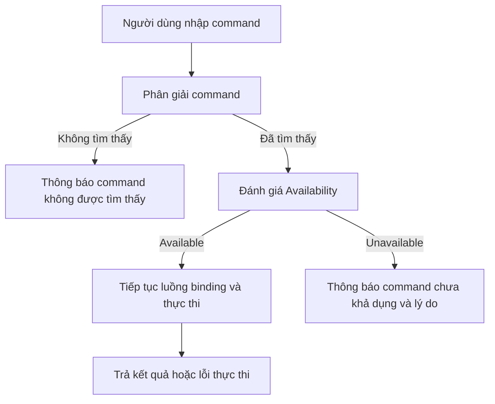

# Thông báo lý do khi lệnh chưa khả dụng

Trong một CLI, có những command luôn tồn tại nhưng chỉ thực hiện được khi ứng dụng đang ở trạng thái phù hợp. Ví dụ, `download` chỉ có ý nghĩa sau khi người dùng kết nối tới máy chủ; `deploy` chỉ được phép chạy khi môi trường đã được chọn; `report export` có thể tạm thời bị khóa trong lúc một tác vụ xuất khác đang chạy.

Nếu chỉ từ chối command mà không giải thích, người dùng khó biết cần làm gì tiếp theo. Spring Shell cung cấp `Availability` để mô tả command hiện có khả dụng hay không và kèm lý do khi bị khóa. Lý do này được dùng khi người dùng gọi command chưa khả dụng và có thể được đưa vào thông tin trợ giúp.

## Mục tiêu học tập

Sau bài học, bạn có thể:

- Phân biệt command chưa được đăng ký với command đã đăng ký nhưng chưa khả dụng.
- Dùng `Availability.available()` và `Availability.unavailable(reason)` để mô tả trạng thái command.
- Khai báo availability provider trong annotation model và programmatic model của Spring Shell 3.x.
- Sử dụng `@ShellMethodAvailability` trong mô hình annotation legacy.
- Viết lý do ngắn gọn, dễ hiểu và chỉ ra bước tiếp theo.
- Thiết kế kiểm tra availability nhanh, không gây tác dụng phụ và cập nhật theo trạng thái ứng dụng.
- Kiểm thử thông báo khi command bị khóa và khi điều kiện được đáp ứng.

## 1. Availability giải quyết vấn đề gì?

Một command có thể được đăng ký đúng, có tên và mô tả đầy đủ, nhưng chưa thể thực thi trong trạng thái hiện tại. Đây là tình huống khác với việc command không tồn tại.

Ví dụ ứng dụng quản lý máy chủ từ xa có hai command:

```text
connect
download
```

`connect` thiết lập phiên kết nối. `download` cần phiên kết nối đang hoạt động. Khi ứng dụng chưa kết nối, command `download` vẫn là một phần của CLI, nhưng chưa thể chạy.

Spring Shell biểu diễn kết quả kiểm tra bằng `Availability`:

```java
Availability.available()
```

cho biết command có thể thực thi tại thời điểm kiểm tra, còn:

```java
Availability.unavailable("you are not connected")
```

cho biết command đang bị khóa và cung cấp lý do giải thích.

Một kiểm tra availability tốt trả lời hai câu hỏi: command có thể chạy ngay bây giờ không, và nếu chưa thể thì người dùng cần biết điều gì để khắc phục?

## 2. Availability nằm ở đâu trong luồng thực thi?

Khi người dùng nhập command, Spring Shell tìm command đã đăng ký và đánh giá điều kiện khả dụng trước khi gọi phần xử lý nghiệp vụ.



Ví dụ khi chưa kết nối:

```text
shell:> download
Command 'download' exists but is not currently available because you are not connected.
```

Người dùng biết `download` là command có thật và vấn đề nằm ở trạng thái kết nối. Sau khi chạy `connect`, command có thể trở nên khả dụng.

Availability không thay thế parser, validation hoặc xử lý lỗi. Nó kiểm tra điều kiện trạng thái trước khi thực thi; parser vẫn chịu trách nhiệm nhận diện cú pháp, validation kiểm tra input và service vẫn chịu trách nhiệm bảo vệ quy tắc nghiệp vụ.

## 3. `Availability` và hai trạng thái cơ bản

Trong Spring Shell 3.x, `org.springframework.shell.Availability` cung cấp hai factory method:

| Factory method | Ý nghĩa | Ví dụ |
|---|---|---|
| `Availability.available()` | Command đang khả dụng | Người dùng đã kết nối |
| `Availability.unavailable(reason)` | Command chưa khả dụng, kèm lý do | Chưa có phiên kết nối |

`Availability` cung cấp `isAvailable()` để kiểm tra trạng thái và `getReason()` để đọc lý do khi không khả dụng.

Ví dụ:

```java
Availability availability = session.isConnected()
        ? Availability.available()
        : Availability.unavailable("you are not connected");

if (availability.isAvailable()) {
    // Có thể tiếp tục quy trình thực thi command.
}
else {
    String reason = availability.getReason();
    // Hiển thị hoặc ghi nhận lý do command đang bị khóa.
}
```

Trong thực tế, Spring Shell gọi availability provider theo cấu hình của command. Phần lớn ứng dụng chỉ cần trả về một trong hai kết quả trên, không cần tự xây dựng một hệ thống trạng thái riêng.

## 4. Viết lý do để người dùng hiểu và hành động được

Lý do không khả dụng là một phần giao diện của CLI. Nó nên giải thích điều kiện còn thiếu bằng ngôn ngữ mà người dùng hiểu được.

Spring Shell ghép lý do vào thông báo mặc định theo cách đọc như một cụm đứng sau từ “because”. Vì vậy, tài liệu khuyến nghị lý do nên bắt đầu bằng chữ thường và không kết thúc bằng dấu chấm.

Ví dụ phù hợp:

```java
Availability.unavailable("you are not connected")
Availability.unavailable("the selected workspace is read-only")
Availability.unavailable("an export job is already running")
Availability.unavailable("you must select an environment first")
```

Ví dụ thông báo đầy đủ:

```text
Command 'deploy' exists but is not currently available because you must select an environment first.
```

Một lý do tốt thường có ba đặc điểm:

- Nêu điều kiện cụ thể đang thiếu hoặc đang ngăn command chạy.
- Ngắn gọn, tránh thuật ngữ nội bộ và stack trace.
- Chỉ ra hành động tiếp theo nếu người dùng có thể tự khắc phục.

So sánh:

| Lý do yếu | Lý do hữu ích hơn |
|---|---|
| `not available` | `you are not connected; run connect first` |
| `invalid state` | `the selected workspace is read-only` |
| `error` | `an export job is already running` |
| `failed` | `you must select an environment first` |

Tránh trả về một thông báo quá chung chung như `operation cannot be performed`. Nó không giúp người dùng biết phải thay đổi trạng thái nào.

### 4.1. Lý do cần phù hợp với câu bao quanh

Không viết lý do như một câu độc lập bắt đầu bằng chữ hoa hoặc kết thúc bằng dấu chấm nếu ứng dụng dùng thông báo mặc định của Spring Shell. Ví dụ:

```java
// Nên dùng
Availability.unavailable("you are not connected")

// Không nên dùng với thông báo mặc định
Availability.unavailable("You are not connected.")
```

Thông báo mặc định bằng tiếng Anh sẽ ghép thành câu tự nhiên. Nếu sản phẩm cần giao diện hoàn toàn bằng tiếng Việt, hãy tùy chỉnh lớp trình bày thông báo để cả phần mở đầu và lý do cùng ngôn ngữ. Không nên chỉ dịch phần reason rồi để nguyên cụm “because” nếu điều đó làm câu hiển thị thiếu tự nhiên.

### 4.2. Không đưa dữ liệu nhạy cảm vào reason

Lý do có thể xuất hiện trong màn hình trợ giúp hoặc thông báo lỗi. Không đưa password, access token, session ID, chuỗi kết nối hay chi tiết hạ tầng nội bộ vào đó.

Ví dụ, thay vì:

```text
authentication failed for user admin with token eyJhbGci...
```

hãy dùng một lý do an toàn hơn:

```text
the current session is not authenticated; run login first
```

Thông tin kỹ thuật chi tiết, nếu cần cho chẩn đoán, nên được ghi trong log có kiểm soát và không hiển thị cho người dùng CLI.

## 5. Khai báo availability bằng annotation model trong Spring Shell 3.x

Trong annotation model mới của Spring Shell 3.x, dùng `@CommandAvailability` trên phương thức command để chỉ định bean cung cấp `Availability`. Annotation nhận tên bean qua thuộc tính `provider`.

Ví dụ ứng dụng quản lý kết nối:

```java
import java.util.concurrent.atomic.AtomicBoolean;

import org.springframework.stereotype.Component;

@Component
public class RemoteSession {

    private final AtomicBoolean connected = new AtomicBoolean(false);

    public boolean isConnected() {
        return connected.get();
    }

    public void markConnected() {
        connected.set(true);
    }

    public void markDisconnected() {
        connected.set(false);
    }
}
```

Lớp command:

```java
import org.springframework.shell.command.annotation.Command;
import org.springframework.shell.command.annotation.CommandAvailability;

@Command
public class RemoteCommands {

    private final RemoteSession session;

    public RemoteCommands(RemoteSession session) {
        this.session = session;
    }

    @Command(command = "connect", description = "Kết nối tới máy chủ")
    public String connect() {
        // Ứng dụng thật sẽ thực hiện handshake với máy chủ ở đây.
        session.markConnected();
        return "Đã kết nối tới máy chủ.";
    }

    @Command(command = "download", description = "Tải dữ liệu từ máy chủ")
    @CommandAvailability(provider = "downloadAvailability")
    public String download() {
        return "Đang tải dữ liệu...";
    }
}
```

Bean availability provider:

```java
import org.springframework.context.annotation.Bean;
import org.springframework.context.annotation.Configuration;
import org.springframework.shell.Availability;
import org.springframework.shell.AvailabilityProvider;

@Configuration
public class RemoteAvailabilityConfiguration {

    @Bean
    AvailabilityProvider downloadAvailability(RemoteSession session) {
        return () -> session.isConnected()
                ? Availability.available()
                : Availability.unavailable("you are not connected; run connect first");
    }
}
```

`@CommandAvailability(provider = "downloadAvailability")` tham chiếu tới bean có tên `downloadAvailability`. Spring Shell gọi provider để đánh giá trạng thái trước khi thực thi `download`.

Trong ứng dụng tự cấu hình Spring context, cần đăng ký target command theo mô hình annotation, chẳng hạn qua `@EnableCommand(RemoteCommands.class)` hoặc `@CommandScan`. Với ứng dụng Spring Boot sử dụng auto-configuration của Spring Shell, quá trình đăng ký có thể được cấu hình tự động theo cách khởi tạo của ứng dụng.

Ví dụ cấu hình đăng ký tường minh:

```java
import org.springframework.context.annotation.Configuration;
import org.springframework.shell.command.annotation.EnableCommand;

@Configuration
@EnableCommand(RemoteCommands.class)
public class ShellCommandConfiguration {
}
```

Trong ví dụ, `AtomicBoolean` giúp trạng thái kết nối an toàn hơn khi có nhiều thread đọc hoặc cập nhật. Đây chỉ là state minh họa; ứng dụng thực tế nên lấy trạng thái từ thành phần quản lý phiên kết nối và cập nhật nó sau khi kết nối hoặc ngắt kết nối thành công.

## 6. Khai báo availability bằng programmatic model trong Spring Shell 3.x

Nếu command được xây dựng bằng `CommandRegistration`, dùng phương thức `availability(...)` để cung cấp `Supplier<Availability>`.

```java
import org.springframework.context.annotation.Bean;
import org.springframework.context.annotation.Configuration;
import org.springframework.shell.Availability;
import org.springframework.shell.command.CommandRegistration;

@Configuration
public class DownloadCommandConfiguration {

    @Bean
    CommandRegistration downloadCommand(
            CommandRegistration.BuilderSupplier builders,
            RemoteSession session) {
        return builders.get()
                .command("download")
                .availability(() -> session.isConnected()
                        ? Availability.available()
                        : Availability.unavailable(
                                "you are not connected; run connect first"))
                .withTarget()
                    .consumer(context -> {
                        // Gọi service tải dữ liệu ở đây.
                    })
                    .and()
                .build();
    }
}
```

Điểm khác biệt chủ yếu nằm ở nơi khai báo:

- Annotation model dùng `@CommandAvailability` để trỏ tới provider bean.
- Programmatic model gắn trực tiếp `Supplier<Availability>` vào builder qua `.availability(...)`.

Trong cả hai cách, provider phải phản ánh trạng thái hiện tại của ứng dụng và trả về lý do đủ rõ khi command bị khóa.

## 7. Mô hình annotation legacy: `@ShellMethodAvailability`

Một số ứng dụng Spring Shell 3.x vẫn sử dụng mô hình annotation cũ với `@ShellComponent` và `@ShellMethod`. Trong mô hình này, phương thức kiểm tra availability thường có tên theo quy ước `<tênCommand>Availability` và trả về `Availability`.

Ví dụ:

```java
import org.springframework.shell.Availability;
import org.springframework.shell.standard.ShellComponent;
import org.springframework.shell.standard.ShellMethod;

@ShellComponent
public class LegacyRemoteCommands {

    private boolean connected;

    @ShellMethod("Connect to the remote server")
    public void connect() {
        connected = true;
    }

    @ShellMethod("Download data from the remote server")
    public void download() {
        // Thực hiện tải dữ liệu.
    }

    public Availability downloadAvailability() {
        return connected
                ? Availability.available()
                : Availability.unavailable("you are not connected; run connect first");
    }
}
```

Spring Shell nhận ra phương thức `downloadAvailability()` là bộ kiểm tra cho command `download`. Khi phương thức command có tên khác với tên quy ước, dùng `@ShellMethodAvailability` để chỉ định rõ phương thức kiểm tra:

```java
@ShellMethod("Download data from the remote server")
@ShellMethodAvailability("checkRemoteSession")
public void download() {
    // Thực hiện tải dữ liệu.
}

public Availability checkRemoteSession() {
    return connected
            ? Availability.available()
            : Availability.unavailable("you are not connected; run connect first");
}
```

`@ShellMethodAvailability` cũng có thể đặt trên một phương thức availability để áp dụng cho nhiều command trong cùng class:

```java
@ShellMethod("Download data")
public void download() {
}

@ShellMethod("Disconnect from the server")
public void disconnect() {
}

@ShellMethodAvailability({"download", "disconnect"})
public Availability remoteSessionAvailability() {
    return connected
            ? Availability.available()
            : Availability.unavailable("you are not connected; run connect first");
}
```

Giá trị mặc định `*` của `@ShellMethodAvailability` có thể áp dụng một availability method cho tất cả command trong class. Chỉ dùng cách này khi các command thực sự chia sẻ cùng điều kiện; nếu không, hãy gắn provider riêng để người đọc hiểu rõ quy tắc.

Không trộn `@CommandAvailability` của annotation model mới với `@ShellMethodAvailability` của legacy model trong cùng một ví dụ. Chúng thuộc hai cách khai báo command khác nhau.

## 8. Availability thay đổi theo trạng thái ứng dụng

Availability thường là điều kiện động. Một command có thể bị khóa lúc đầu, trở nên khả dụng sau một command khác, rồi lại bị khóa khi trạng thái thay đổi.

Ví dụ vòng đời phiên kết nối:

| Trạng thái ứng dụng | `connect` | `download` | `disconnect` |
|---|---|---|---|
| Chưa kết nối | Available | Unavailable | Unavailable |
| Đang kết nối | Theo chính sách ứng dụng | Unavailable | Unavailable |
| Đã kết nối | Có thể vẫn available hoặc chuyển unavailable | Available | Available |
| Đã ngắt kết nối | Available | Unavailable | Unavailable |

Provider nên đọc trạng thái hiện tại thay vì lưu một kết quả availability cố định từ lúc khởi động. Nếu provider trả `unavailable` một lần rồi giữ nguyên object đó mãi mãi, command sẽ không tự mở lại sau khi người dùng kết nối.

Với trạng thái có nhiều thành phần, có thể đưa quy tắc vào một service riêng:

```java
@Component
public class DeploymentState {

    private volatile boolean environmentSelected;
    private volatile boolean deploymentRunning;

    public Availability deployAvailability() {
        if (!environmentSelected) {
            return Availability.unavailable("you must select an environment first");
        }
        if (deploymentRunning) {
            return Availability.unavailable("another deployment is already running");
        }
        return Availability.available();
    }
}
```

Provider có thể ủy quyền cho service:

```java
@Bean
AvailabilityProvider deployAvailability(DeploymentState state) {
    return state::deployAvailability;
}
```

Việc tách state khỏi command giúp nhiều command cùng dùng một quy tắc, dễ kiểm thử và tránh để lớp command chứa quá nhiều logic quản lý trạng thái.

## 9. Một availability check nên nhanh và không có tác dụng phụ

Spring Shell có thể cần đánh giá availability khi người dùng gọi command hoặc khi hệ thống dựng thông tin trợ giúp. Vì vậy, provider có thể được gọi nhiều lần và ở những thời điểm người dùng không trực tiếp thực thi command.

Một provider nên:

- Đọc state hiện có từ service hoặc session manager.
- Trả kết quả nhanh, có thời gian thực thi dự đoán được.
- Không thay đổi state ứng dụng.
- Không tạo kết nối mới hoặc thực hiện thao tác nghiệp vụ.
- Không yêu cầu người dùng nhập thêm dữ liệu.
- Không gọi dịch vụ từ xa không giới hạn thời gian.

Không nên dùng availability check để tự kết nối máy chủ, bắt đầu export hoặc cập nhật database. Những thao tác đó thuộc command method hoặc service. Provider chỉ trả lời command có thể chạy ngay lúc này hay không.

Nếu điều kiện phụ thuộc một hệ thống từ xa, hãy ưu tiên state đã được theo dõi trong session manager hoặc cache có thời hạn. Nếu buộc phải truy vấn từ xa, cần timeout ngắn, xử lý lỗi rõ ràng và tránh để việc gọi command hoặc dựng help bị treo vì một availability provider chậm.

Khi provider không thể xác định trạng thái, hãy chọn chính sách rõ ràng. Với thao tác rủi ro cao, có thể trả unavailable cùng lý do an toàn như `the remote service status is temporarily unknown`; với thao tác ít rủi ro, chính sách khác có thể phù hợp. Không để exception kỹ thuật bất ngờ trở thành thông báo mơ hồ cho người dùng.

## 10. Availability không phải là hàng rào bảo mật

Availability giúp người dùng hiểu command hiện có thể chạy hay không. Nó không thay thế authorization hoặc kiểm tra điều kiện trong service.

Có thể xảy ra tình huống:

1. Provider đánh giá command là available.
2. Trạng thái hệ thống thay đổi ngay sau đó.
3. Người dùng gọi command.
4. Service phát hiện phiên đã hết hạn hoặc quyền vừa bị thu hồi.

Đây là khoảng thời gian giữa lúc kiểm tra và lúc thực thi. Vì vậy, service vẫn phải xác minh quyền, trạng thái và dữ liệu cần thiết ngay trước thao tác quan trọng, tốt nhất trong transaction hoặc cơ chế đồng bộ phù hợp.

Không dựa vào việc ẩn command hoặc trả unavailable để bảo vệ dữ liệu. Người dùng vẫn có thể gọi API nghiệp vụ từ một đường khác, hoặc trạng thái có thể thay đổi giữa lần kiểm tra và thực thi.

Ví dụ, provider có thể kiểm tra người dùng đã đăng nhập, nhưng service tải báo cáo vẫn phải kiểm tra quyền truy cập báo cáo cụ thể. Availability cải thiện trải nghiệm CLI; service/domain layer bảo vệ tính đúng đắn và an toàn của thao tác.

## 11. Phân biệt unavailable với các loại lỗi khác

| Tình huống | Ý nghĩa | Cách xử lý |
|---|---|---|
| Command không được tìm thấy | Command chưa được đăng ký hoặc tên nhập sai | Kiểm tra tên, alias và cấu hình đăng ký |
| Command unavailable | Command tồn tại nhưng trạng thái hiện tại không cho phép chạy | Trả `Availability.unavailable(reason)` |
| Input không hợp lệ | Giá trị option hoặc argument sai định dạng/miền | Dùng parser, converter và Bean Validation |
| Người dùng không có quyền | Không được phép thực hiện hành động theo chính sách bảo mật | Kiểm tra authorization trong service và trả lỗi an toàn |
| Command đã chạy nhưng thất bại | Lỗi xảy ra trong quá trình thực thi | Xử lý exception và thông báo lỗi tương ứng |

Ví dụ, `report export --format xyz` là lỗi input nếu chỉ chấp nhận `csv` hoặc `json`. Nó không phải lỗi availability. Ngược lại, `report export` có thể có input hoàn toàn hợp lệ nhưng chưa khả dụng vì một tác vụ export khác đang chạy.

Phân loại đúng giúp người dùng nhận được hướng dẫn phù hợp và giúp log vận hành không gom mọi sự cố vào cùng một loại lỗi.

## 12. Tích hợp với lệnh `help`

Trợ giúp tích hợp của Spring Shell có thể liệt kê các command đã biết, bao gồm command hiện không khả dụng. Nhờ đó, người dùng có thể khám phá command trước khi thỏa điều kiện để chạy nó.

Thông tin availability cũng có thể được đưa vào help model, gồm trạng thái `available` và `reason`. Với Spring Shell 3.4, có thể tùy chỉnh template qua các thuộc tính:

| Property | Nội dung template |
|---|---|
| `spring.shell.command.help.commands-template` | Danh sách nhóm và command |
| `spring.shell.command.help.command-template` | Chi tiết của một command |

Help model có trường availability với trạng thái `available` và `reason`. Vì vậy, template tùy chỉnh có thể trình bày command bị khóa cùng lý do hoặc hướng dẫn bước tiếp theo.

Ví dụ danh sách trợ giúp minh họa:

```text
AVAILABLE COMMANDS

Connection
  connect       Kết nối tới máy chủ
  disconnect    Ngắt kết nối

Remote data
  download      Tải dữ liệu từ máy chủ
                unavailable: you are not connected; run connect first
```

Đây là cách trình bày minh họa, không phải output cố định của template mặc định. Cách nhóm, căn lề và hiển thị lý do phụ thuộc cấu hình help của ứng dụng.

Điểm quan trọng là command chưa khả dụng vẫn có thể được người dùng khám phá. Nếu loại command khỏi help hoàn toàn, người dùng có thể không biết command tồn tại hoặc không biết cần thực hiện bước nào trước.

## 13. Kiểm thử availability provider

Nên kiểm thử provider như một hàm phụ thuộc state. Với `AvailabilityProvider` trong Spring Shell 3.x, có thể gọi `get()` vì interface kế thừa `Supplier<Availability>`.

```java
import static org.junit.jupiter.api.Assertions.assertEquals;
import static org.junit.jupiter.api.Assertions.assertFalse;
import static org.junit.jupiter.api.Assertions.assertTrue;

import org.junit.jupiter.api.Test;
import org.springframework.shell.Availability;
import org.springframework.shell.AvailabilityProvider;

class DownloadAvailabilityTests {

    @Test
    void explainsWhyDownloadIsUnavailable() {
        RemoteSession session = new RemoteSession();
        AvailabilityProvider provider = () -> session.isConnected()
                ? Availability.available()
                : Availability.unavailable("you are not connected; run connect first");

        Availability result = provider.get();

        assertFalse(result.isAvailable());
        assertEquals(
                "you are not connected; run connect first",
                result.getReason());
    }

    @Test
    void becomesAvailableAfterConnection() {
        RemoteSession session = new RemoteSession();
        AvailabilityProvider provider = () -> session.isConnected()
                ? Availability.available()
                : Availability.unavailable("you are not connected; run connect first");

        session.markConnected();

        assertTrue(provider.get().isAvailable());
    }
}
```

Hai kiểm thử này xác nhận reason và sự thay đổi trạng thái. Trong dự án thật, có thể đưa logic tạo provider vào bean hoặc service rồi kiểm thử thành phần đó trực tiếp.

## 14. Kiểm thử command qua Spring Shell runtime

Unit test provider chưa chứng minh Spring Shell đã gắn đúng provider với command. Cần kiểm thử tích hợp để xác nhận toàn bộ luồng:

1. Khởi động context với command và availability provider.
2. Khi chưa kết nối, gọi `download` và xác nhận thông báo có lý do.
3. Xác nhận phương thức download hoặc service tải dữ liệu chưa được gọi.
4. Gọi `connect` để cập nhật state.
5. Gọi lại `download` và xác nhận command được thực thi.
6. Ngắt kết nối rồi xác nhận `download` lại bị khóa.
7. Mở `help` và xác nhận command cùng trạng thái được trình bày đúng theo template.

Ma trận kiểm thử gợi ý:

| Trạng thái | Lệnh | Kết quả mong đợi |
|---|---|---|
| Chưa kết nối | `download` | Từ chối và nêu lý do chưa kết nối |
| Chưa kết nối | `help` | Vẫn khám phá được command theo cấu hình help |
| Chưa kết nối | `connect` | Thực hiện kết nối |
| Đã kết nối | `download` | Gọi service tải dữ liệu |
| Đã ngắt kết nối | `download` | Từ chối với lý do tương ứng |
| Trạng thái từ xa không xác định | `download` | Áp dụng chính sách an toàn đã định nghĩa |

Nếu dùng `@CommandAvailability`, kiểm tra tên bean provider có khớp chính xác. Nếu dùng programmatic model, kiểm tra builder đã gắn `.availability(...)` cho đúng registration. Nếu dùng legacy annotation, kiểm tra quy ước tên hoặc giá trị `@ShellMethodAvailability` khớp với command.

## 15. Những lỗi thường gặp

### Command luôn unavailable dù đã kết nối

Kiểm tra provider có đọc đúng state hay không, state có được cập nhật sau khi kết nối thành công không và provider có đang giữ một giá trị cũ hay không. Tránh tạo một `Availability` cố định từ thời điểm khởi động.

### Command luôn available dù điều kiện chưa thỏa mãn

Kiểm tra `@CommandAvailability` có tham chiếu đúng bean không, provider có thực sự được gắn vào command và điều kiện có phản ánh đúng state không. Với programmatic registration, xác nhận `.availability(...)` đã được gọi trên registration cần thiết.

### Reason hiển thị lặp từ “because”

Không đưa từ `because` vào reason vì Spring Shell đã thêm phần nối trong thông báo mặc định. Chỉ trả về cụm lý do.

### Reason có chữ hoa hoặc dấu chấm khiến câu không tự nhiên

Viết reason như một cụm nối tiếp sau “because”: bắt đầu bằng chữ thường và không có dấu chấm cuối.

### Provider làm shell chậm

Kiểm tra provider có gọi mạng, truy vấn database hoặc chờ lock dài hay không. Chuyển sang state được theo dõi/cached phù hợp, đặt timeout và giữ việc đánh giá availability nhẹ.

### Dùng availability để thay authorization

Service vẫn phải kiểm tra quyền và trạng thái khi thực thi. Availability chỉ là thông tin và cổng trải nghiệm ở lớp command.

### Lẫn lộn annotation model mới với legacy model

`@CommandAvailability` thuộc annotation model mới; `@ShellMethodAvailability` thuộc mô hình `@ShellMethod`. Dùng đúng annotation và import theo cách đăng ký command của dự án.

### Lý do tiết lộ thông tin nội bộ

Không đưa token, password, ID phiên hoặc chi tiết kết nối riêng tư vào reason. Hiển thị nguyên nhân an toàn và hướng dẫn hành động ở mức người dùng cần biết.

## 16. Checklist thiết kế thông báo availability

- [ ] Command được đăng ký và availability được dùng cho điều kiện trạng thái động.
- [ ] Provider trả `Availability.available()` khi mọi điều kiện cần thiết đã thỏa mãn.
- [ ] Provider trả `Availability.unavailable(reason)` khi command chưa thể chạy.
- [ ] Reason ngắn, cụ thể, có thể gợi ý bước khắc phục.
- [ ] Reason không lặp từ “because”, bắt đầu bằng chữ thường và không có dấu chấm cuối khi dùng thông báo mặc định.
- [ ] Reason không chứa bí mật hoặc chi tiết hạ tầng nhạy cảm.
- [ ] Provider nhanh, không có tác dụng phụ và không thực hiện nghiệp vụ.
- [ ] State được cập nhật sau khi kết nối, ngắt kết nối hoặc thay đổi điều kiện.
- [ ] Service vẫn kiểm tra authorization và điều kiện nghiệp vụ lúc thực thi.
- [ ] Có unit test cho trạng thái available/unavailable và reason.
- [ ] Có integration test cho lời gọi command, help và thay đổi state.
- [ ] Annotation hoặc programmatic registration tham chiếu đúng provider.

## 17. Lưu ý khi dùng Spring Shell 4.x

Spring Shell 4.x tổ chức lại package và tên thuộc tính. `Availability` và `AvailabilityProvider` chuyển sang package `org.springframework.shell.core.command.availability`. Với annotation model, provider được chỉ định trực tiếp bằng thuộc tính `availabilityProvider` của `@Command`; với programmatic model, builder của `Command` cung cấp `.availabilityProvider(...)`.

Ví dụ annotation model 4.x:

```java
import org.springframework.shell.core.command.annotation.Command;
import org.springframework.stereotype.Component;

@Component
public class RemoteCommandsV4 {

    @Command(name = "download", availabilityProvider = "downloadAvailability")
    public String download() {
        return "Đang tải dữ liệu...";
    }
}
```

Bean provider tương ứng:

```java
import org.springframework.context.annotation.Bean;
import org.springframework.context.annotation.Configuration;
import org.springframework.shell.core.command.availability.Availability;
import org.springframework.shell.core.command.availability.AvailabilityProvider;

@Configuration
public class RemoteAvailabilityConfigurationV4 {

    @Bean
    AvailabilityProvider downloadAvailability(RemoteSession session) {
        return () -> session.isConnected()
                ? Availability.available()
                : Availability.unavailable("you are not connected; run connect first");
    }
}
```

Không sao chép import `org.springframework.shell.Availability` hoặc `@CommandAvailability` của mô hình 3.x sang ứng dụng 4.x. Hãy dùng API và migration guide đúng minor version.

## 18. Tự kiểm tra

**Câu 1.** Command unavailable khác command not found như thế nào?

**Gợi ý trả lời:** Unavailable nghĩa là command đã được đăng ký nhưng trạng thái hiện tại chưa cho phép chạy. Not found nghĩa là runtime không tìm thấy command tương ứng.

**Câu 2.** Hai factory method cơ bản của `Availability` là gì?

**Gợi ý trả lời:** `Availability.available()` và `Availability.unavailable(reason)`.

**Câu 3.** Trong annotation model mới của Spring Shell 3.x, dùng annotation nào để gắn provider?

**Gợi ý trả lời:** Dùng `@CommandAvailability(provider = "beanName")` trên phương thức command và cung cấp bean `AvailabilityProvider` có tên tương ứng.

**Câu 4.** Vì sao availability provider nên nhanh và không có tác dụng phụ?

**Gợi ý trả lời:** Provider có thể được gọi nhiều lần khi shell kiểm tra command hoặc dựng help. Một provider chậm hoặc làm thay đổi state có thể khiến giao diện bị treo hoặc gây tác dụng ngoài dự kiến.

**Câu 5.** Availability có thay thế kiểm tra quyền trong service không?

**Gợi ý trả lời:** Không. Trạng thái có thể thay đổi sau lần kiểm tra và service có thể được gọi từ nhiều nơi. Authorization và quy tắc nghiệp vụ vẫn phải được bảo vệ tại service/domain layer.

## Kết luận

`Availability` giúp Spring Shell giải thích vì sao một command đã đăng ký nhưng chưa thể thực thi trong trạng thái hiện tại. `Availability.available()` cho phép command chạy; `Availability.unavailable(reason)` trả về trạng thái bị khóa cùng lý do để người dùng biết điều kiện còn thiếu.

Trong Spring Shell 3.x, annotation model mới dùng `@CommandAvailability` cùng bean `AvailabilityProvider`; programmatic model dùng `.availability(...)`; mô hình legacy dùng `@ShellMethodAvailability` hoặc phương thức `<command>Availability`. Hãy viết reason ngắn gọn và dễ hành động, giữ provider nhanh và không có tác dụng phụ, đồng thời luôn kiểm tra quyền và điều kiện nghiệp vụ ở service khi thực thi.

## Tài liệu tham khảo

- [Spring Shell 3.4 — Command Availability](https://docs.spring.io/spring-shell/reference/3.4-SNAPSHOT/commands/availability.html)
- [Spring Shell 3.4 — `Availability` API](https://docs.spring.io/spring-shell/reference/3.4/api/java/org/springframework/shell/Availability.html)
- [Spring Shell 3.4 — `CommandAvailability` API](https://docs.spring.io/spring-shell/reference/3.4/api/java/org/springframework/shell/command/annotation/CommandAvailability.html)
- [Spring Shell 3.4 — Help](https://docs.spring.io/spring-shell/reference/3.4-SNAPSHOT/commands/builtin/help.html)
- [Spring Shell 4.x — Command Availability](https://docs.spring.io/spring-shell/reference/commands/availability.html)
- [Spring Shell 4.x — `@Command` API](https://docs.spring.io/spring-shell/reference/api/org/springframework/shell/core/command/annotation/Command.html)
