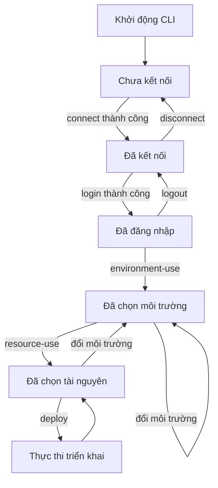

# Các trạng thái kết nối, đăng nhập, chọn môi trường hoặc chọn tài nguyên

Một ứng dụng CLI thường có nhiều command chỉ hợp lệ sau khi người dùng hoàn thành một số bước trước đó. Ví dụ, người dùng phải kết nối đến máy chủ, đăng nhập, chọn môi trường và chọn tài nguyên trước khi chạy lệnh triển khai. Nếu command được gọi quá sớm, ứng dụng nên giải thích trạng thái còn thiếu để người dùng biết cần làm gì tiếp theo.

Spring Shell cung cấp cơ chế **command availability** để biểu diễn điều kiện này. Mỗi command có thể gắn với một bộ cung cấp trạng thái (`AvailabilityProvider`). Bộ cung cấp trả về `Availability.available()` khi command được phép chạy hoặc `Availability.unavailable(reason)` khi chưa đủ điều kiện. Spring Shell có thể từ chối lời gọi command chưa khả dụng và đưa lý do vào thông báo.

Trong bài này, các trạng thái kết nối, đăng nhập, môi trường và tài nguyên được lưu trong một thành phần trạng thái của ứng dụng. Các command cập nhật trạng thái sau khi thao tác tương ứng thành công; availability provider đọc trạng thái đó để quyết định command nào có thể chạy.

## Phân biệt trạng thái ứng dụng và khả dụng của command

Trạng thái ứng dụng mô tả hệ thống đang ở tình huống nào. Availability là kết quả đánh giá xem một command cụ thể có thể chạy trong tình huống đó hay không.

Ví dụ, `connected = true` chỉ nói rằng CLI đã kết nối đến máy chủ. Nó không có nghĩa người dùng đã đăng nhập hoặc đã chọn môi trường. Command `deploy` có thể yêu cầu đồng thời cả bốn điều kiện:

1. Đã kết nối đến máy chủ.
2. Đã đăng nhập thành công.
3. Đã chọn môi trường đích.
4. Đã chọn tài nguyên cần triển khai.

Một command khác có thể chỉ yêu cầu kết nối. Vì vậy, availability phải được tính theo yêu cầu của từng command, dựa trên trạng thái hiện tại.

| Trạng thái | Ý nghĩa | Command có thể phụ thuộc |
|---|---|---|
| Kết nối (`connected`) | Phiên CLI đã thiết lập kết nối đến dịch vụ từ xa | `login`, `server-status`, `environment-list` |
| Đăng nhập (`authenticated`) | Thông tin xác thực đã được chấp nhận | `environment-use`, `resource-list`, `deploy` |
| Môi trường được chọn (`environment`) | Đã xác định môi trường làm việc, ví dụ `staging` hoặc `production` | `resource-use`, `deploy`, `environment-info` |
| Tài nguyên được chọn (`resource`) | Đã xác định tài nguyên đích trong môi trường hiện tại | `resource-info`, `deploy`, `resource-delete` |

Trạng thái cần được cập nhật theo kết quả thao tác thật. Không đặt `connected = true` trước khi kết nối thành công hoặc đánh dấu đã đăng nhập trước khi dịch vụ xác nhận thông tin xác thực.

## Luồng trạng thái theo thứ tự thao tác

Một luồng làm việc có thể được tổ chức như sau:



Mỗi bước mở ra những command phù hợp với trạng thái mới. Khi logout hoặc disconnect, các lựa chọn phụ thuộc cần được xóa. Khi đổi môi trường, tài nguyên đã chọn ở môi trường cũ cần được bỏ vì có thể không tồn tại trong môi trường mới.

## Availability và lớp dữ liệu Availability

Trong Spring Shell 4.x, hai kiểu chính nằm trong package `org.springframework.shell.core.command.availability`:

- `Availability`: record mô tả command có khả dụng hay không và chứa lý do khi không khả dụng.
- `AvailabilityProvider`: functional interface mở rộng `Supplier<Availability>`, dùng để cung cấp trạng thái tại thời điểm shell kiểm tra command.

Hai factory method thường dùng:

```java
Availability.available();
Availability.unavailable("you are not connected");
```

`Availability.available()` cho biết command có thể chạy. `Availability.unavailable(reason)` tạo trạng thái không khả dụng kèm lý do. Trong 4.x, có thể kiểm tra bằng `isAvailable()` và đọc lý do bằng `reason()`.

Lý do nên là một cụm từ ngắn, viết thường và không có dấu chấm cuối, vì Spring Shell ghép nó vào thông báo dạng “Command ... is not currently available because ...”. Ví dụ:

- `you are not connected`
- `you are not logged in`
- `you have not selected an environment`
- `you have not selected a resource`

Không trả `unavailable` mà không có lý do. Người dùng cần biết điều kiện nào đang chặn command.

## Quản lý trạng thái trong một service

Không nên để mỗi command giữ một bản sao boolean riêng. Hãy tập trung trạng thái dùng chung trong một bean để các command và availability provider cùng đọc, cùng cập nhật một nguồn dữ liệu.

Ví dụ sau mô tả trạng thái của một phiên CLI:

```java
import org.springframework.shell.core.command.availability.Availability;
import org.springframework.stereotype.Component;

@Component
public class CliSessionState {

    private boolean connected;
    private boolean authenticated;
    private String environment;
    private String resource;

    public synchronized void markConnected() {
        connected = true;
    }

    public synchronized void markAuthenticated() {
        authenticated = true;
    }

    public synchronized void selectEnvironment(String name) {
        environment = name;
        resource = null;
    }

    public synchronized void selectResource(String name) {
        resource = name;
    }

    public synchronized void logout() {
        authenticated = false;
        environment = null;
        resource = null;
    }

    public synchronized void disconnect() {
        connected = false;
        authenticated = false;
        environment = null;
        resource = null;
    }

    public synchronized String selectedEnvironment() {
        return environment;
    }

    public synchronized String selectedResource() {
        return resource;
    }

    public synchronized Availability loginAvailability() {
        return connected
                ? Availability.available()
                : Availability.unavailable("you are not connected");
    }

    public synchronized Availability environmentAvailability() {
        if (!connected) {
            return Availability.unavailable("you are not connected");
        }
        if (!authenticated) {
            return Availability.unavailable("you are not logged in");
        }
        return Availability.available();
    }

    public synchronized Availability resourceAvailability() {
        Availability environmentStatus = environmentAvailability();
        if (!environmentStatus.isAvailable()) {
            return environmentStatus;
        }
        if (environment == null) {
            return Availability.unavailable("you have not selected an environment");
        }
        return Availability.available();
    }

    public synchronized Availability deployAvailability() {
        Availability resourceStatus = resourceAvailability();
        if (!resourceStatus.isAvailable()) {
            return resourceStatus;
        }
        if (resource == null) {
            return Availability.unavailable("you have not selected a resource");
        }
        return Availability.available();
    }
}
```

Các phương thức `markConnected()` và `markAuthenticated()` chỉ nên được gọi sau khi dịch vụ từ xa xác nhận thao tác thành công. Trong ứng dụng thực tế, có thể thay các boolean bằng đối tượng phiên, principal, connection handle hoặc kiểu trạng thái giàu thông tin hơn.

`selectEnvironment()` xóa lựa chọn tài nguyên cũ vì tài nguyên đó thuộc môi trường trước. `logout()` và `disconnect()` xóa các lựa chọn phụ thuộc. Việc dọn trạng thái giúp tránh tình huống command triển khai dùng một tài nguyên đã chọn từ phiên đăng nhập hoặc môi trường cũ.

Các phương thức được đồng bộ trong ví dụ để thao tác đọc/ghi trạng thái không xen kẽ tùy tiện. Nếu ứng dụng hỗ trợ nhiều phiên hoặc xử lý song song, cần lưu trạng thái theo đúng phiên người dùng thay vì dùng một singleton chia sẻ cho tất cả người dùng.

## Gắn availability provider vào command trong Spring Shell 4.x

Với annotation model 4.x, thuộc tính `availabilityProvider` của `@Command` nhận tên bean `AvailabilityProvider`. Spring Shell gọi provider để xác định command có thể được thực thi hay không.

Trước hết, khai báo các provider bean. Mỗi provider tham chiếu đến phương thức đánh giá trạng thái trong `CliSessionState`:

```java
import org.springframework.context.annotation.Bean;
import org.springframework.context.annotation.Configuration;
import org.springframework.shell.core.command.availability.AvailabilityProvider;

@Configuration
class CommandAvailabilityConfiguration {

    @Bean("loginAvailability")
    AvailabilityProvider loginAvailability(CliSessionState state) {
        return state::loginAvailability;
    }

    @Bean("environmentAvailability")
    AvailabilityProvider environmentAvailability(CliSessionState state) {
        return state::environmentAvailability;
    }

    @Bean("resourceAvailability")
    AvailabilityProvider resourceAvailability(CliSessionState state) {
        return state::resourceAvailability;
    }

    @Bean("deployAvailability")
    AvailabilityProvider deployAvailability(CliSessionState state) {
        return state::deployAvailability;
    }
}
```

Sau đó, gắn đúng tên provider vào từng command:

```java
import org.springframework.shell.core.command.annotation.Argument;
import org.springframework.shell.core.command.annotation.Command;
import org.springframework.stereotype.Component;

@Component
class EnvironmentCommands {

    private final CliSessionState state;
    private final RemoteSessionService remoteSession;
    private final DeploymentService deploymentService;

    EnvironmentCommands(
            CliSessionState state,
            RemoteSessionService remoteSession,
            DeploymentService deploymentService) {
        this.state = state;
        this.remoteSession = remoteSession;
        this.deploymentService = deploymentService;
    }

    @Command(name = "connect", description = "Kết nối đến máy chủ")
    public void connect() {
        remoteSession.connect();
        state.markConnected();
    }

    @Command(name = "login", availabilityProvider = "loginAvailability")
    public void login() {
        remoteSession.login();
        state.markAuthenticated();
    }

    @Command(name = "environment-use",
            availabilityProvider = "environmentAvailability")
    public void useEnvironment(@Argument(index = 0) String name) {
        remoteSession.verifyEnvironment(name);
        state.selectEnvironment(name);
    }

    @Command(name = "resource-use",
            availabilityProvider = "resourceAvailability")
    public void useResource(@Argument(index = 0) String name) {
        remoteSession.verifyResource(state.selectedEnvironment(), name);
        state.selectResource(name);
    }

    @Command(name = "deploy", availabilityProvider = "deployAvailability")
    public void deploy() {
        deploymentService.deploy(
                state.selectedEnvironment(),
                state.selectedResource());
    }
}
```

`RemoteSessionService` và `DeploymentService` là service nghiệp vụ do ứng dụng định nghĩa. Các lệnh `connect`, `login`, `environment-use` và `resource-use` cập nhật trạng thái sau khi thao tác tương ứng thành công. `deploy` chỉ được gọi khi provider xác nhận đủ điều kiện.

Khi chưa kết nối, người dùng gọi `login` sẽ nhận thông báo tương tự:

```text
shell:>login
Command 'login' exists but is not currently available because you are not connected.
```

Sau khi kết nối và đăng nhập, nhưng chưa chọn môi trường, `resource-use` sẽ báo lý do chưa khả dụng. Khi chưa chọn tài nguyên, `deploy` sẽ báo cần chọn tài nguyên trước.

## Dùng availability với đăng ký command bằng code trong 4.x

Nếu command được tạo programmatic thay vì annotation, có thể truyền provider trực tiếp vào `Command.Builder.availabilityProvider(...)`:

```java
import org.springframework.context.annotation.Bean;
import org.springframework.shell.core.command.Command;

@Bean
Command deployCommand(
        CliSessionState state,
        DeploymentService deploymentService) {

    return Command.builder()
            .name("deploy")
            .description("Triển khai tài nguyên đang chọn")
            .availabilityProvider(state::deployAvailability)
            .execute(context -> {
                deploymentService.deploy(
                        state.selectedEnvironment(),
                        state.selectedResource());
            });
}
```

`state::deployAvailability` là method reference tương thích với `AvailabilityProvider`, vì method trả về một `Availability`. Cách này hữu ích khi command cần được tạo hoàn toàn bằng Java hoặc được cấu hình theo tính năng.

## Khác biệt giữa Spring Shell 3.x và 4.x

Ý tưởng availability giống nhau qua các phiên bản, nhưng package và cách gắn provider thay đổi:

| Mô hình | Spring Shell 3.4.x | Spring Shell 4.x |
|---|---|---|
| Kiểu trạng thái | `org.springframework.shell.Availability` | `org.springframework.shell.core.command.availability.Availability` |
| Provider | `org.springframework.shell.AvailabilityProvider` | `org.springframework.shell.core.command.availability.AvailabilityProvider` |
| Annotation model mới | `@Command` kết hợp `@CommandAvailability(provider = "...")` | `@Command(availabilityProvider = "...")` |
| Đăng ký programmatic | `CommandRegistration.Builder.availability(Supplier<Availability>)` | `Command.Builder.availabilityProvider(AvailabilityProvider)` |
| Annotation legacy | `@ShellMethodAvailability` và method `...Availability()` | Annotation legacy đã bị loại bỏ |

Ví dụ annotation model mới trong Spring Shell 3.4.x:

```java
import org.springframework.shell.Availability;
import org.springframework.shell.AvailabilityProvider;
import org.springframework.shell.command.annotation.Command;
import org.springframework.shell.command.annotation.CommandAvailability;
import org.springframework.context.annotation.Bean;
import org.springframework.stereotype.Component;

@Component
class DownloadCommands {

    private boolean connected;

    @Command(command = "connect")
    public void connect() {
        // Đặt true sau khi kết nối từ xa thành công.
        connected = true;
    }

    @Command(command = "download")
    @CommandAvailability(provider = "downloadAvailability")
    public void download() {
        // Thực hiện tải dữ liệu.
    }

    @Bean
    AvailabilityProvider downloadAvailability() {
        return () -> connected
                ? Availability.available()
                : Availability.unavailable("you are not connected");
    }
}
```

Trong mô hình legacy 3.x, Spring Shell có thể tìm method availability theo quy ước tên. Với command tên `download`, method `downloadAvailability()` không nhận tham số và trả về `Availability`. Có thể dùng `@ShellMethodAvailability` để chỉ rõ method hoặc gắn một provider cho nhiều command. Khi nâng lên 4.x, chuyển sang `@Command(availabilityProvider = "...")`; không tiếp tục dùng annotation legacy.

## Availability khác với authorization và việc đăng ký command

Availability trả lời câu hỏi: **command có phù hợp với trạng thái hiện tại để chạy hay không?** Nó không trả lời người dùng có quyền thực hiện nghiệp vụ hay không.

| Cơ chế | Câu hỏi | Ví dụ |
|---|---|---|
| Availability | Trạng thái hiện tại đã đủ điều kiện để chạy chưa? | Đã kết nối, đăng nhập và chọn tài nguyên chưa? |
| Authorization | Người dùng có quyền thực hiện hành động này không? | Tài khoản có quyền triển khai lên production không? |
| Registration | Command có tồn tại trong shell không? | Tính năng triển khai có được cấu hình và đăng ký không? |

Một command có thể khả dụng nhưng người dùng vẫn không có quyền triển khai lên môi trường production. Hãy kiểm tra authorization trong service hoặc lớp bảo mật ở mỗi lần thực hiện hành động. Không dùng availability như ranh giới bảo mật, vì trạng thái có thể thay đổi sau lần kiểm tra hoặc command có thể được gọi qua một đường khác.

Availability cũng khác với việc gỡ command khỏi registry. Khi command chưa khả dụng, command vẫn tồn tại và Spring Shell có thể giải thích lý do. Khi command chưa được đăng ký hoặc đã bị gỡ, shell không có command để phân giải.

## Thiết kế provider đáng tin cậy

Một availability provider nên đọc trạng thái đã được quản lý trong ứng dụng và trả về kết quả nhanh, ổn định. Một số nguyên tắc hữu ích:

1. **Không thực hiện thao tác thay đổi trạng thái trong provider.** Provider chỉ đánh giá điều kiện; command thực hiện kết nối, đăng nhập hoặc chọn tài nguyên.
2. **Tránh gọi mạng chậm mỗi lần kiểm tra.** Lưu trạng thái kết nối/phiên sau khi thao tác thành công và cập nhật khi phiên hết hạn hoặc kết nối bị mất. Khi cần xác minh trạng thái từ xa, hãy có cơ chế làm mới rõ ràng.
3. **Kiểm tra điều kiện theo thứ tự phụ thuộc.** Chưa kết nối thì báo kết nối trước; sau đó mới xét đăng nhập, môi trường và tài nguyên.
4. **Xóa trạng thái phụ thuộc khi trạng thái gốc thay đổi.** Disconnect phải xóa đăng nhập, môi trường và tài nguyên; đổi môi trường phải xóa tài nguyên cũ.
5. **Dùng thông báo có thể hành động.** Lý do nên nói rõ bước tiếp theo, ví dụ `please select an environment first`.
6. **Kiểm tra lại điều kiện quan trọng khi thực thi.** Đặc biệt với thao tác thay đổi dữ liệu, service cần xác minh môi trường và quyền ngay trước khi gọi hệ thống đích.

Nếu trạng thái kết nối có thể thay đổi ngoài CLI, chẳng hạn token hết hạn hoặc máy chủ đóng kết nối, cần có cách cập nhật `CliSessionState` khi phát hiện sự kiện đó. Nếu không, provider có thể trả về kết quả dựa trên trạng thái cũ.

## Kiểm thử chuỗi trạng thái

Nên kiểm thử từng chuyển trạng thái và command phụ thuộc, không chỉ kiểm thử provider trả về một giá trị:

| Trạng thái phiên | Command | Kết quả mong đợi |
|---|---|---|
| Chưa kết nối | `login` | Không khả dụng: chưa kết nối |
| Đã kết nối, chưa đăng nhập | `environment-use` | Không khả dụng: chưa đăng nhập |
| Đã đăng nhập, chưa chọn môi trường | `resource-use` | Không khả dụng: chưa chọn môi trường |
| Đã chọn môi trường, chưa chọn tài nguyên | `deploy` | Không khả dụng: chưa chọn tài nguyên |
| Đã chọn đủ môi trường và tài nguyên | `deploy` | Khả dụng; service được gọi |
| Đổi môi trường sau khi đã chọn tài nguyên | `deploy` | Không khả dụng cho đến khi chọn lại tài nguyên |
| Logout | `deploy` | Không khả dụng; môi trường và tài nguyên đã bị xóa |
| Disconnect | `login`, `deploy` | Không khả dụng vì chưa kết nối |

Các nhóm kiểm thử nên có:

1. Unit test cho `CliSessionState` với từng tổ hợp connected/authenticated/environment/resource.
2. Unit test cho từng provider, xác nhận lý do trả về đúng điều kiện đầu tiên chưa đạt.
3. Integration test cho command: command unavailable không gọi target nghiệp vụ.
4. Integration test cho luồng connect → login → select environment → select resource → deploy.
5. Kiểm tra logout/disconnect và đổi môi trường xóa trạng thái phụ thuộc.
6. Kiểm tra authorization độc lập: command khả dụng nhưng người dùng không đủ quyền vẫn bị từ chối bởi service/security layer.
7. Kiểm tra trường hợp kết nối bị mất hoặc phiên đăng nhập hết hạn trong lúc shell đang chạy.

Khi kiểm thử tích hợp, xác nhận cả thông báo người dùng nhìn thấy và số lần service được gọi. Điều này giúp phát hiện lỗi provider chỉ trả trạng thái đúng nhưng shell vẫn gọi nhầm target.

## Lỗi thường gặp

| Biểu hiện | Nguyên nhân có thể | Cách xử lý |
|---|---|---|
| Command luôn unavailable | Provider đọc một biến trạng thái không được cập nhật | Cập nhật state sau khi thao tác connect/login thành công và kiểm tra đúng bean state |
| Command vẫn available sau disconnect | Chưa xóa trạng thái đăng nhập, môi trường hoặc tài nguyên | Xóa toàn bộ trạng thái phụ thuộc trong thao tác disconnect |
| Chọn môi trường mới nhưng deploy dùng tài nguyên cũ | Không reset resource khi đổi environment | Xóa resource trong `selectEnvironment()` và yêu cầu chọn lại |
| Lý do lỗi không rõ ràng | Provider trả về reason chung chung hoặc rỗng | Trả cụm từ ngắn mô tả điều kiện còn thiếu |
| Không tìm thấy provider bean | Tên trong `availabilityProvider` không khớp tên bean | Đặt tên bean tường minh bằng `@Bean("...")` và đối chiếu chính xác |
| Không biên dịch `Availability` sau nâng cấp | Dùng package 3.x trong dự án 4.x | Chuyển sang `org.springframework.shell.core.command.availability` |
| Dùng `@CommandAvailability` trong 4.x | Giữ annotation riêng của mô hình 3.x | Chuyển provider vào thuộc tính `availabilityProvider` của `@Command` |
| Người dùng không có quyền nhưng command vẫn khả dụng | Nhầm availability với authorization | Kiểm tra quyền trong service/security layer khi thực thi |

## Quy trình triển khai

Khi bổ sung một command phụ thuộc trạng thái, hãy thực hiện theo thứ tự:

1. Liệt kê điều kiện trước khi chạy command, chẳng hạn kết nối, đăng nhập, môi trường và tài nguyên.
2. Xác định trạng thái nào được lưu và thành phần nào chịu trách nhiệm cập nhật.
3. Xác định các chuyển trạng thái làm mất hiệu lực lựa chọn cũ, như logout, disconnect hoặc đổi môi trường.
4. Viết availability provider chỉ đọc trạng thái và trả về `available()` hoặc `unavailable(reason)`.
5. Gắn provider vào command bằng API đúng phiên bản Spring Shell.
6. Giữ kiểm tra authorization và kiểm tra nghiệp vụ trong service.
7. Kiểm thử cả chuỗi chuyển trạng thái và từng command khi chưa đủ điều kiện.

Khi trạng thái được quản lý tập trung và availability được tính theo từng command, người dùng sẽ hiểu cần hoàn thành bước nào trước khi tiếp tục. Command cũng ít phải tự lặp lại những kiểm tra tiền điều kiện giống nhau, trong khi lớp nghiệp vụ vẫn giữ quyền kiểm soát các thao tác quan trọng.

## Tài liệu tham khảo

- [Spring Shell 4.0.4 — Command Availability](https://docs.spring.io/spring-shell/reference/commands/availability.html): cấu hình availability bằng annotation và programmatic registration trong 4.x.
- [Spring Shell 4.0.4 API — Availability](https://docs.spring.io/spring-shell/reference/api/org/springframework/shell/core/command/availability/Availability.html): trạng thái khả dụng và lý do.
- [Spring Shell 4.0.4 API — AvailabilityProvider](https://docs.spring.io/spring-shell/reference/api/org/springframework/shell/core/command/availability/AvailabilityProvider.html): functional interface cung cấp Availability.
- [Spring Shell 4.0.3 API — Command](https://docs.spring.io/spring-shell/reference/api/org/springframework/shell/core/command/annotation/Command.html): thuộc tính `availabilityProvider` trong annotation 4.x.
- [Spring Shell 3.4.3 — Command Availability](https://docs.spring.io/spring-shell/reference/3.4/commands/availability.html): annotation model mới, programmatic registration và legacy annotation trong 3.x.
- [Spring Shell 3.4.3 API — CommandAvailability](https://docs.spring.io/spring-shell/reference/3.4/api/java/org/springframework/shell/command/annotation/CommandAvailability.html): annotation provider trong 3.4.x.
- [Spring Shell 3.4.3 API — Availability](https://docs.spring.io/spring-shell/reference/3.4/api/java/org/springframework/shell/Availability.html): lớp Availability trong package 3.x.
- [Spring Shell v4 Migration Guide](https://github.com/spring-projects/spring-shell/wiki/v4-migration-guide): chuyển `@CommandAvailability` sang thuộc tính `availabilityProvider` của `@Command`.
