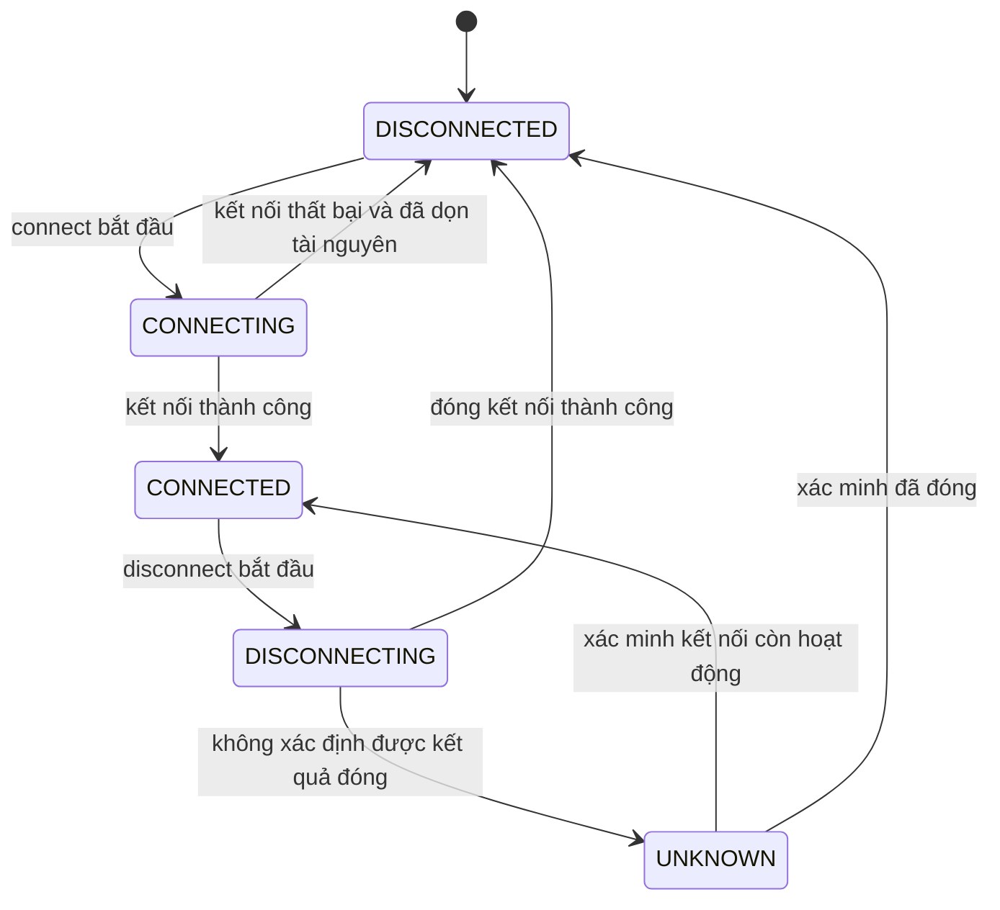

# Cập nhật và xóa trạng thái sau khi lệnh thành công hoặc thất bại

Trong một phiên Spring Shell, một command có thể thay đổi trạng thái mà những command tiếp theo cần đọc. Ví dụ, lệnh connect thiết lập kết nối để lệnh download có thể chạy; lệnh disconnect đóng kết nối để những thao tác phụ thuộc vào máy chủ không còn khả dụng. Một command khác có thể bắt đầu import dữ liệu, ghi nhận kết quả khi hoàn tất và xóa dấu hiệu đang chạy dù import thành công hay thất bại.

Để trạng thái luôn phản ánh đúng tình hình, hãy xác định rõ khi nào cập nhật trạng thái ổn định, khi nào ghi nhận kết quả và khi nào xóa dữ liệu tạm. Chỉ cập nhật trạng thái thành công sau khi thao tác thực sự hoàn tất; dùng finally để dọn phần tạm trong cả hai nhánh thành công và lỗi. Availability của Spring Shell đọc trạng thái hiện tại để quyết định command nào có thể được gọi.

## 1. Phân biệt trạng thái ổn định và trạng thái tạm

Không phải mọi dữ liệu trong phiên shell đều có cùng vòng đời. Hãy chia chúng thành ba nhóm:

| Nhóm trạng thái | Ví dụ | Vòng đời |
| --- | --- | --- |
| Trạng thái phiên ổn định | Đã kết nối máy chủ, endpoint hiện tại, workspace đang chọn | Được cập nhật khi một chuyển đổi trạng thái hoàn tất; giữ nguyên cho đến khi có thao tác thay đổi tiếp theo |
| Trạng thái thao tác tạm thời | Đang import, file tạm, mã tác vụ đang chạy, cờ khóa thao tác | Được tạo khi bắt đầu command và phải được dọn sau khi command kết thúc |
| Kết quả gần nhất | ID bản import thành công, mã lỗi gần nhất, thời điểm hoàn tất | Được ghi nhận sau khi có kết quả; có thể giữ lại để xem trạng thái hoặc chẩn đoán |

Ví dụ, sau khi lệnh data import thành công, ứng dụng có thể giữ lastImportId để command data report sử dụng. Cờ importInProgress phải được xóa vì thao tác đã kết thúc. Nếu import thất bại, ứng dụng ghi nhận mã lỗi nhưng vẫn phải xóa cờ đang chạy. Không nên xóa toàn bộ trạng thái phiên chỉ vì một command bất kỳ thất bại.

Một nguyên tắc hữu ích là:

- **Trạng thái ổn định:** chỉ chuyển sang trạng thái mới sau khi hành động tương ứng hoàn tất thành công.
- **Trạng thái tạm:** luôn được giải phóng trong finally.
- **Kết quả:** ghi riêng thành công hoặc thất bại để phục vụ command tiếp theo và chẩn đoán.

## 2. Vòng đời trạng thái trong phiên Spring Shell

Trong chế độ tương tác, shell giữ application context hoạt động qua nhiều lần nhập lệnh. Các Spring bean mặc định có scope singleton, vì vậy một state holder singleton có thể được nhiều command trong cùng tiến trình sử dụng. Trạng thái đó chỉ tồn tại trong bộ nhớ của tiến trình; nó không tự được lưu qua lần khởi động ứng dụng tiếp theo.

Trong chế độ không tương tác, ứng dụng thường khởi động, thực thi command được truyền vào rồi kết thúc. Nếu người dùng chạy hai lần java -jar app.jar connect ... và java -jar app.jar download, đó là hai tiến trình khác nhau; state holder trong bộ nhớ của tiến trình đầu không tự xuất hiện trong tiến trình thứ hai. Muốn duy trì trạng thái giữa các lần chạy, cần lưu nó vào cấu hình, file, database hoặc dịch vụ bên ngoài.

Với một ứng dụng chỉ có một phiên terminal tương tác, state holder singleton thường là đủ. Nếu cùng một application context phục vụ nhiều phiên hoặc nhiều người dùng đồng thời, state singleton sẽ bị chia sẻ giữa họ. Khi đó phải cô lập state theo session/user bằng một cơ chế scope hoặc kho trạng thái có khóa định danh riêng; không được coi field của một bean singleton là trạng thái riêng của từng người dùng.

## 3. Thiết kế chuyển trạng thái rõ ràng

Trước khi viết command, hãy mô tả những trạng thái hợp lệ và các chuyển đổi được phép. Ví dụ một kết nối từ xa có thể đi qua các trạng thái:



Không nên chỉ dùng một boolean connected nếu ứng dụng cần phân biệt đang kết nối, đang ngắt kết nối và trạng thái không xác định. Một boolean chỉ biểu diễn hai giá trị; nếu command thất bại giữa lúc đóng kết nối, gán false có thể khiến ứng dụng tin rằng kết nối đã đóng dù máy chủ vẫn còn giữ phiên.

| Trạng thái | Ý nghĩa | Command phụ thuộc kết nối |
| --- | --- | --- |
| DISCONNECTED | Chưa có kết nối hoạt động | Không khả dụng |
| CONNECTING | Đang thiết lập kết nối | Không khả dụng |
| CONNECTED | Kết nối đã được xác nhận | Có thể khả dụng |
| DISCONNECTING | Đang đóng kết nối | Không khả dụng |
| UNKNOWN | Lệnh đóng hoặc kiểm tra thất bại, chưa biết trạng thái thật | Không khả dụng cho đến khi xác minh |

Khi command thất bại, hãy chọn trạng thái phản ánh điều đã biết. Nếu kết nối chưa được tạo và tài nguyên tạm đã được dọn, quay về DISCONNECTED. Nếu yêu cầu ngắt kết nối đã gửi nhưng kết quả phản hồi bị mất, dùng UNKNOWN và yêu cầu xác minh hoặc kết nối lại thay vì giả định thành công.

## 4. Đặt state holder dùng chung cho các command

Tách state khỏi command class giúp mọi command đọc và cập nhật cùng một nguồn dữ liệu. Ví dụ dưới đây dùng Spring Shell 4.x và một snapshot bất biến được lưu trong AtomicReference:

```java
import java.util.concurrent.atomic.AtomicReference;

import org.springframework.stereotype.Component;
import org.springframework.shell.core.command.availability.Availability;

@Component
public class ShellSessionState {

    public enum ConnectionPhase {
        DISCONNECTED,
        CONNECTING,
        CONNECTED,
        DISCONNECTING,
        UNKNOWN
    }

    public record ConnectionSnapshot(
            ConnectionPhase phase,
            String endpoint,
            String lastError) {
    }

    private final AtomicReference<ConnectionSnapshot> connection =
            new AtomicReference<>(
                    new ConnectionSnapshot(ConnectionPhase.DISCONNECTED, null, null)
            );

    public ConnectionSnapshot connection() {
        return connection.get();
    }

    public void connecting(String endpoint) {
        connection.set(new ConnectionSnapshot(
                ConnectionPhase.CONNECTING, endpoint, null));
    }

    public void connected(String endpoint) {
        connection.set(new ConnectionSnapshot(
                ConnectionPhase.CONNECTED, endpoint, null));
    }

    public void connectFailed() {
        connection.set(new ConnectionSnapshot(
                ConnectionPhase.DISCONNECTED, null, "connection failed"));
    }

    public void disconnecting() {
        ConnectionSnapshot current = connection.get();
        connection.set(new ConnectionSnapshot(
                ConnectionPhase.DISCONNECTING, current.endpoint(), null));
    }

    public void disconnected() {
        connection.set(new ConnectionSnapshot(
                ConnectionPhase.DISCONNECTED, null, null));
    }

    public void disconnectFailed() {
        ConnectionSnapshot current = connection.get();
        connection.set(new ConnectionSnapshot(
                ConnectionPhase.UNKNOWN, current.endpoint(), "disconnect failed"));
    }

    public Availability downloadAvailability() {
        ConnectionSnapshot current = connection.get();
        if (current.phase() == ConnectionPhase.CONNECTED) {
            return Availability.available();
        }

        String reason = switch (current.phase()) {
            case CONNECTING -> "a connection attempt is in progress";
            case DISCONNECTING -> "the connection is being closed";
            case UNKNOWN -> "the connection state is unknown; check the connection status";
            default -> "you are not connected";
        };
        return Availability.unavailable(reason);
    }
}
```

AtomicReference cho phép đọc và thay snapshot một cách nguyên tử. Với state phức tạp hơn, có thể dùng một service có phương thức đồng bộ hóa hoặc một state machine chuyên biệt. Dù chọn cách nào, không nên để nhiều command tự sửa những field liên quan theo các quy ước khác nhau.

Trong ví dụ, lastError chỉ lưu mã mô tả ngắn, không lưu password, token hoặc toàn bộ exception message có thể chứa thông tin nhạy cảm. Nếu cần log chi tiết, hãy ghi ở logger với dữ liệu đã được lọc.

## 5. Chỉ cập nhật trạng thái thành công sau khi hành động hoàn tất

Một lỗi thường gặp là gán connected = true trước khi client xác nhận kết nối. Nếu thao tác kết nối thất bại, availability của command tải dữ liệu có thể mở sai.

Với Spring Shell 4.x, command connect nên cập nhật state sau khi client kết nối thành công:

```java
import org.springframework.shell.core.command.annotation.Command;
import org.springframework.shell.core.command.annotation.Option;
import org.springframework.stereotype.Component;

@Component
public class RemoteCommands {

    private final RemoteClient remoteClient;
    private final ShellSessionState state;

    public RemoteCommands(RemoteClient remoteClient, ShellSessionState state) {
        this.remoteClient = remoteClient;
        this.state = state;
    }

    @Command(name = "connect", description = "Kết nối tới máy chủ.")
    public String connect(@Option(longName = "endpoint", required = true) String endpoint) {
        state.connecting(endpoint);
        try {
            remoteClient.connect(endpoint);
            state.connected(endpoint);
            return "Đã kết nối tới " + endpoint;
        }
        catch (RuntimeException ex) {
            state.connectFailed();
            throw ex;
        }
    }

    @Command(
        name = "download",
        description = "Tải dữ liệu từ máy chủ.",
        availabilityProvider = "downloadAvailability"
    )
    public String download() {
        remoteClient.download();
        return "Đã tải dữ liệu";
    }
}
```

Provider được khai báo thành bean để Spring Shell kiểm tra trạng thái trước khi cho phép gọi command:

```java
import org.springframework.context.annotation.Bean;
import org.springframework.context.annotation.Configuration;
import org.springframework.shell.core.command.availability.AvailabilityProvider;

@Configuration
public class ShellAvailabilityConfiguration {

    @Bean
    AvailabilityProvider downloadAvailability(ShellSessionState state) {
        return state::downloadAvailability;
    }
}
```

Khi remoteClient.connect trả về bình thường, state chuyển sang CONNECTED và download khả dụng. Nếu kết nối ném exception, state quay về DISCONNECTED, command tải dữ liệu vẫn bị chặn và lỗi được chuyển tiếp để Spring Shell hiển thị hoặc ánh xạ theo cấu hình lỗi của ứng dụng.

Ví dụ giả định remoteClient.connect tự dọn socket hoặc phiên tạm nếu kết nối thất bại. Nếu client không bảo đảm điều đó, command phải đóng hoặc xác minh tài nguyên trước khi đặt state thành DISCONNECTED; khi chưa xác định được kết quả, hãy dùng UNKNOWN.

AvailabilityProvider chỉ đọc state để trả về Availability.available() hoặc Availability.unavailable(reason). Nó không nên tự thay đổi state, gọi kết nối mạng hay thực hiện tác vụ có side effect. Việc cập nhật thuộc về command hoặc application service đã thực hiện hành động.

## 6. Dùng finally để xóa trạng thái tạm trong cả hai nhánh

Không phải trạng thái nào cũng cần giữ lại sau command. Ví dụ, cờ importInProgress, file tạm hoặc khóa ngăn hai lần import chạy đồng thời phải được dọn khi command kết thúc dù thành công hay thất bại.

Mẫu xử lý phổ biến:

```java
@Command(name = "data import", description = "Nhập dữ liệu từ tệp.")
public String importData(@Option(longName = "file", required = true) Path file) {
    operationState.begin("import");
    try {
        ImportResult result = importService.importFile(file);
        operationState.recordSuccess(result.importId());
        return "Đã nhập dữ liệu, mã tác vụ " + result.importId();
    }
    catch (RuntimeException ex) {
        operationState.recordFailure("IMPORT_FAILED");
        throw ex;
    }
    finally {
        operationState.clearActiveOperation();
    }
}
```

Ba thao tác có vai trò khác nhau:

1. begin đánh dấu command đang thực thi và có thể từ chối một thao tác trùng.
2. recordSuccess hoặc recordFailure lưu kết quả phù hợp với nhánh đã xảy ra.
3. clearActiveOperation luôn chạy khi rời khỏi khối try, kể cả khi service ném exception.

Không đặt lệnh return trong finally, vì nó có thể che mất kết quả hoặc exception từ khối try/catch. Cũng không nên bắt exception rồi bỏ qua chỉ để shell tiếp tục chạy; hãy xử lý phần state cần thiết rồi ném lại exception hoặc chuyển nó thành lỗi có ý nghĩa.

### Tách trạng thái đang chạy khỏi kết quả cuối cùng

Nếu chỉ có một biến lastStatus, command có thể xóa mất kết quả vừa ghi khi finally chạy. Hãy giữ hai phần riêng:

| Trường | Khi bắt đầu | Khi thành công | Khi thất bại | Trong finally |
| --- | --- | --- | --- | --- |
| activeOperation | Tên tác vụ đang chạy | Vẫn còn cho đến khi kết thúc command | Vẫn còn cho đến khi kết thúc command | Xóa về null |
| lastSuccessId | Giữ kết quả thành công trước đó | Cập nhật ID mới | Giữ kết quả thành công trước đó | Không xóa |
| lastFailureCode | Có thể giữ lỗi trước đó hoặc reset theo quy ước | Xóa lỗi cũ hoặc ghi trạng thái thành công | Ghi mã lỗi mới | Không xóa |

Ví dụ, data report có thể dùng lastSuccessId sau import thành công. Nếu lần import tiếp theo thất bại, ứng dụng có thể giữ bản import thành công trước đó để báo cáo vẫn chạy trên dữ liệu đã xác nhận. Nếu nghiệp vụ yêu cầu hủy kết quả cũ khi lần import mới thất bại, hãy thể hiện đó là một quy tắc rõ ràng trong state service, thay vì xóa mọi field trong finally.

## 7. Dọn tài nguyên và xử lý lỗi một phần

finally bảo đảm đoạn dọn dẹp được gọi khi luồng điều khiển rời khỏi khối try, nhưng nó không tự hoàn tác side effect đã xảy ra ở hệ thống bên ngoài. Hãy phân biệt ba loại công việc:

- **Tài nguyên cục bộ:** stream, file tạm, lock và handle. Dùng try-with-resources hoặc finally để đóng/giải phóng.
- **Thay đổi trong database:** dùng transaction; cấu hình rollback phù hợp với loại exception. Mặc định, Spring transaction thường rollback với unchecked exception và Error, còn checked exception cần cấu hình rollbackFor nếu muốn rollback.
- **Side effect bên ngoài:** gọi API từ xa, gửi email, tải tệp hoặc gửi thông điệp. Database transaction không tự hoàn tác các thao tác này; cần cơ chế bù trừ, retry an toàn, idempotency key hoặc bước đối soát.

Ví dụ:

```java
@Transactional
public ImportResult importData(Path file) {
    ImportJob job = jobRepository.createPending(file);
    try {
        ImportResult result = externalImporter.importFile(file, job.id());
        job.markCompleted(result.importId());
        return result;
    }
    catch (ExternalImportException ex) {
        job.markFailed("EXTERNAL_IMPORT_FAILED");
        throw ex;
    }
}
```

Đây chỉ là khung minh họa. Nếu externalImporter đã ghi dữ liệu từ xa rồi nhưng phản hồi bị mất, transaction database có thể rollback trong khi hệ thống bên ngoài vẫn hoàn tất. Khi đó cần dùng mã tác vụ/idempotency để truy vấn trạng thái thực tế trước khi retry. Không được đánh dấu chắc chắn FAILED nếu kết quả bên ngoài chưa thể xác minh; có thể cần trạng thái UNKNOWN hoặc PENDING_RECONCILIATION.

Với tài nguyên Java cục bộ, ưu tiên try-with-resources:

```java
try (InputStream input = Files.newInputStream(file)) {
    importService.importFrom(input);
}
```

Stream sẽ được đóng cả khi import thành công lẫn khi có exception. Nếu phải cập nhật cờ trạng thái tạm, vẫn dùng finally cho state holder.

## 8. Cập nhật trạng thái khi command ngắt kết nối hoặc thất bại

Không nên luôn đặt state thành DISCONNECTED khi disconnect ném exception. Có thể client đã đóng kết nối nhưng phản hồi bị mất, hoặc việc đóng chưa được thực hiện. Nếu không biết kết quả, hãy chuyển sang UNKNOWN:

```java
@Command(
    name = "disconnect",
    description = "Ngắt kết nối máy chủ."
)
public String disconnect() {
    state.disconnecting();
    try {
        remoteClient.disconnect();
        state.disconnected();
        return "Đã ngắt kết nối";
    }
    catch (RuntimeException ex) {
        state.disconnectFailed();
        throw ex;
    }
}
```

Khi state là UNKNOWN, các command phụ thuộc kết nối nên không khả dụng. Cung cấp command connection status hoặc reconnect để xác minh trạng thái từ phía máy chủ. Sau khi xác minh:

- Nếu máy chủ xác nhận phiên vẫn hoạt động, cập nhật CONNECTED.
- Nếu máy chủ xác nhận phiên đã đóng, cập nhật DISCONNECTED.
- Nếu vẫn không thể xác minh, giữ UNKNOWN và yêu cầu thao tác khôi phục phù hợp.

Điều này ngăn ứng dụng tiếp tục chạy command dựa trên một giả định sai về trạng thái kết nối.

## 9. Availability phản ánh trạng thái mới nhất

Spring Shell đánh giá availability của command từ AvailabilityProvider. Nếu một command chỉ chạy sau khi kết nối, provider đọc state hiện tại và trả lý do khi chưa đủ điều kiện:

```java
@Bean
AvailabilityProvider downloadAvailability(ShellSessionState state) {
    return () -> state.connection().phase() == ShellSessionState.ConnectionPhase.CONNECTED
            ? Availability.available()
            : Availability.unavailable("you are not connected");
}
```

Reason nên là cụm từ ngắn, viết thường và không có dấu chấm cuối để ghép tự nhiên vào thông báo của Spring Shell, ví dụ: Command 'download' exists but is not currently available because you are not connected. Provider chỉ nên đọc snapshot nhất quán; không dùng nó để tự kết nối hoặc tự xóa state.

Ở các thế hệ API:

| Phiên bản/mô hình | Cách gắn availability |
| --- | --- |
| Spring Shell 3.x legacy | Phương thức tenCommandAvailability() trả Availability, hoặc dùng @ShellMethodAvailability để chỉ định method kiểm tra |
| Spring Shell 3.4 annotation mới | Dùng @CommandAvailability(provider = "...") cùng AvailabilityProvider |
| Spring Shell 4.x annotation mới | Dùng @Command(availabilityProvider = "...") trên method command |

Trong 3.x legacy model, nếu method command tên download, Spring Shell có thể tìm method downloadAvailability() theo quy ước. Khi nhiều command dùng chung state, @ShellMethodAvailability có thể gắn một availability method cho nhiều command. Trong 4.x, API annotation mới đưa tên bean provider trực tiếp vào @Command.

Availability chỉ cho biết command có thể chạy trong trạng thái hiện tại hay không. Command vẫn phải kiểm tra điều kiện nghiệp vụ quan trọng tại service vì state có thể thay đổi giữa lúc provider được đánh giá và lúc command bắt đầu thực thi.

## 10. Tránh trạng thái cũ và cập nhật sai thời điểm

Một số lỗi thường gặp khi nhiều command dùng chung state:

| Hiện tượng | Nguyên nhân | Cách xử lý |
| --- | --- | --- |
| download khả dụng dù kết nối thất bại | Đặt connected = true trước khi client xác nhận | Chỉ cập nhật CONNECTED sau khi thao tác thành công |
| Command khác vẫn nghĩ import đang chạy sau khi có lỗi | Chỉ xóa cờ ở cuối nhánh thành công | Đặt dọn dẹp trong finally |
| Kết quả import trước bị mất khi lần import mới lỗi | Dùng chung một field cho trạng thái tạm và kết quả cuối | Tách activeOperation khỏi lastSuccess/lastFailure |
| State báo đã ngắt dù máy chủ vẫn còn phiên | Luôn đặt DISCONNECTED trong catch | Dùng UNKNOWN nếu kết quả đóng kết nối chưa xác minh |
| Lệnh script thứ hai không thấy state của lệnh đầu | Mỗi lệnh được chạy trong tiến trình mới | Lưu state vào nơi bền vững nếu cần qua lần khởi động |
| Hai người dùng ảnh hưởng state của nhau | Bean singleton đang chia sẻ state giữa các phiên | Cô lập state theo session/user |
| Provider báo khả dụng nhưng service từ chối | State đổi sau lúc provider kiểm tra | Kiểm tra lại invariant tại service và xử lý race condition |
| State lưu dữ liệu nhạy cảm | Ghi password/token hoặc exception thô vào snapshot | Chỉ lưu mã trạng thái và metadata đã lọc |

Đặc biệt, không nên xóa trạng thái kết nối chỉ vì command download thất bại. Lỗi tải tệp có thể do quyền truy cập, hết dung lượng hoặc máy chủ trả lỗi; kết nối vẫn có thể hoạt động. Mỗi command chỉ nên thay đổi những phần state mà nó sở hữu và có bằng chứng để cập nhật.

## 11. Kiểm thử vòng đời trạng thái

Hãy kiểm thử cả command lẫn state holder để xác nhận mọi đường đi đều để lại state đúng.

**Kiểm thử chuyển trạng thái kết nối:**

- Ban đầu DISCONNECTED, download không khả dụng.
- connect thành công, state chuyển sang CONNECTED và download khả dụng.
- connect thất bại, state trở về DISCONNECTED; download vẫn không khả dụng.
- disconnect thành công, state chuyển sang DISCONNECTED.
- disconnect thất bại và không xác minh được kết quả, state là UNKNOWN; command tải dữ liệu bị chặn.

**Kiểm thử dọn trạng thái thao tác:**

- Khi import thành công, lastSuccessId được cập nhật và activeOperation được xóa.
- Khi import thất bại, lastFailureCode được cập nhật và activeOperation vẫn được xóa.
- Khi có exception, exception vẫn được chuyển tiếp sau khi dọn state.
- Khi tác vụ đang chạy, command không tương thích với trạng thái đó phải trả unavailable hoặc từ chối theo quy tắc ứng dụng.

Spring Shell cung cấp @ShellTest và ShellTestClient để kiểm thử cả phiên tương tác lẫn command không tương tác. Một bài kiểm thử tương tác có thể chạy connect, sau đó gọi download trong cùng phiên để xác nhận state được giữ giữa các command. Test state holder và application service riêng giúp phân biệt lỗi quản lý state với lỗi thực thi nghiệp vụ.

## 12. Checklist cập nhật và xóa trạng thái

- Phân loại state thành trạng thái phiên ổn định, trạng thái thao tác tạm và kết quả gần nhất.
- Mô tả các trạng thái hợp lệ và chuyển đổi trước khi triển khai command.
- Chỉ cập nhật trạng thái thành công sau khi service xác nhận thao tác hoàn tất.
- Ghi nhận lỗi theo mã hoặc thông tin đã lọc; không lưu bí mật trong state.
- Dùng finally để xóa cờ đang chạy, lock và dữ liệu tạm ở mọi nhánh.
- Dùng try-with-resources cho stream và tài nguyên hỗ trợ AutoCloseable.
- Không coi finally là rollback; dùng transaction hoặc cơ chế bù trừ cho side effect.
- Dùng UNKNOWN khi không thể xác minh kết quả của thao tác từ xa.
- Để AvailabilityProvider đọc state; cập nhật state ở command/service.
- Kiểm tra lại quy tắc nghiệp vụ khi thực thi để xử lý trạng thái thay đổi đồng thời.
- Xác định state có sống qua tiến trình hay cần lưu bền vững.
- Cô lập state theo session/user nếu application context phục vụ nhiều phiên đồng thời.
- Kiểm thử thành công, thất bại, exception, dọn dẹp và availability sau mỗi chuyển trạng thái.

Khi state có vòng đời rõ ràng, command tiếp theo có thể dựa vào trạng thái đáng tin cậy; thao tác thất bại không để lại cờ đang chạy hoặc thông tin thành công giả, còn những kết quả cần tra cứu vẫn được giữ lại có chủ đích.

## Tài liệu tham khảo

- [Spring Shell 4.0.3 — Command Availability](https://docs.spring.io/spring-shell/reference/commands/availability.html)
- [Spring Shell 4.0.3 — Command API](https://docs.spring.io/spring-shell/reference/api/org/springframework/shell/core/command/annotation/Command.html)
- [Spring Shell 3.4 — Command Availability](https://docs.spring.io/spring-shell/reference/3.4/commands/availability.html)
- [Spring Shell 3.4 — ShellMethodAvailability API](https://docs.spring.io/spring-shell/reference/3.4/api/java/org/springframework/shell/standard/ShellMethodAvailability.html)
- [Spring Shell 3.4 — Testing Basics](https://docs.spring.io/spring-shell/reference/3.4/testing/basics.html)
- [Spring Framework — Declarative Transaction Management](https://docs.spring.io/spring-framework/reference/data-access/transaction/declarative.html)
