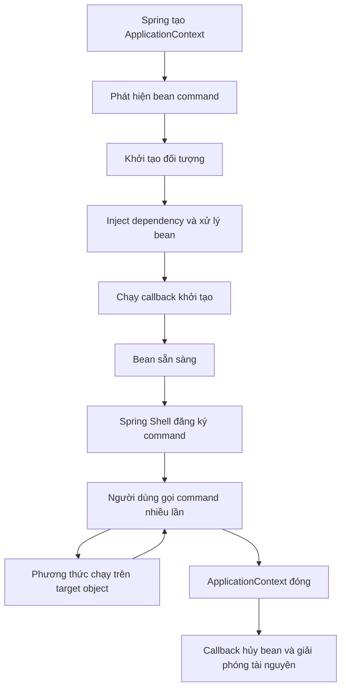

# Vòng đời bean và giới hạn của việc lưu trạng thái trong đối tượng lệnh

Trong Spring Shell, các phương thức command được khai báo trong những lớp do Spring quản lý. Điều này cho phép nhiều command dùng chung dependency và trạng thái của cùng một đối tượng. Ví dụ, command `connect` có thể cập nhật trạng thái kết nối, còn command `download` đọc trạng thái đó để quyết định có thể chạy hay chưa.

Khả năng chia sẻ này phụ thuộc vào vòng đời bean. Mặc định, Spring tạo bean theo scope `singleton`: một instance cho mỗi bean definition trong một `ApplicationContext`. Vì thế, field trong lớp command có thể giữ giá trị giữa nhiều lần gọi command trong cùng tiến trình. Trạng thái đó có giới hạn: nó thuộc về instance và application context hiện tại, không tự tồn tại sau khi ứng dụng khởi động lại, cũng không tự được tách riêng cho từng người dùng hoặc từng lần gọi.

## 1. Lớp command là Spring bean

Trong mô hình annotation của Spring Shell 4, `@Command` đánh dấu một phương thức là command. Lớp chứa phương thức phải là Spring bean, thường được đăng ký qua component scanning. Với Spring Boot, command scanning được auto-configuration bật; khi không dùng Spring Boot, cần cấu hình `@EnableCommand` để đăng ký các lớp command.

Ví dụ:

```java
import org.springframework.shell.core.command.annotation.Command;
import org.springframework.stereotype.Component;

@Component
class GreetingCommands {

    @Command(name = "hello", description = "Chào người dùng")
    public String hello() {
        return "Xin chào!";
    }
}
```

Spring Shell đăng ký command dựa trên các phương thức và bean chứa chúng. Khi command được gọi, Spring Shell thực thi phương thức trên target object đã đăng ký. Việc người dùng gọi một command không đồng nghĩa Spring tạo một đối tượng command mới cho lần gọi đó.

Với Spring Shell 4, các command liên quan thường được đặt trong cùng một lớp. `@CommandGroup` giúp gom chúng theo chức năng và thêm prefix chung. Cách tổ chức này cũng cho phép các phương thức dùng chung state trong bean.

## 2. Vòng đời bean trong ứng dụng CLI

Một bean command thường đi qua các giai đoạn sau:



Các mốc chính:

1. **Phát hiện bean:** Spring tìm lớp command qua component scanning hoặc cấu hình bean.
2. **Tạo instance:** container khởi tạo đối tượng theo bean definition và scope.
3. **Inject dependency:** các service, repository hoặc cấu hình được đưa vào bean.
4. **Khởi tạo:** `@PostConstruct`, `afterPropertiesSet()` hoặc init method được gọi theo cơ chế lifecycle đã cấu hình.
5. **Sử dụng:** Spring Shell đăng ký command; các lần gọi command tiếp theo sử dụng target object tương ứng.
6. **Hủy:** khi `ApplicationContext` đóng, singleton bean được hủy và các callback như `@PreDestroy` được gọi để giải phóng tài nguyên.

Trong một ứng dụng CLI thông thường, `ApplicationContext` được tạo khi tiến trình khởi động và đóng khi ứng dụng kết thúc. Do đó, trạng thái đặt trong singleton command thường sống qua nhiều lệnh trong cùng một lần chạy chương trình.

## 3. Scope `singleton`: trạng thái dùng chung giữa các command

`singleton` là scope mặc định của Spring. Một bean definition có một instance dùng chung trong một Spring container. Đây là singleton theo container và bean definition, không phải một instance toàn cục cho mọi JVM hay mọi application context.

Spring Shell minh họa cách dùng này với một lớp nhóm command có field `authenticated`: command `login` đặt field thành `true`, command `logout` đặt thành `false`, và command khác có thể đọc giá trị đó. Cả các phương thức đều thao tác trên cùng bean command.

Ví dụ:

```java
import org.springframework.shell.core.command.annotation.Command;
import org.springframework.shell.core.command.annotation.CommandGroup;
import org.springframework.stereotype.Component;

@Component
@CommandGroup(name = "Remote Session", prefix = "remote")
class RemoteCommands {

    private boolean connected;

    @Command(name = "connect", description = "Kết nối máy chủ")
    public String connect() {
        connected = true;
        return "Đã kết nối";
    }

    @Command(name = "status", description = "Xem trạng thái kết nối")
    public String status() {
        return connected ? "CONNECTED" : "DISCONNECTED";
    }

    @Command(name = "disconnect", description = "Ngắt kết nối")
    public String disconnect() {
        connected = false;
        return "Đã ngắt kết nối";
    }
}
```

Một phiên sử dụng:

```text
shell:>remote status
DISCONNECTED

shell:>remote connect
Đã kết nối

shell:>remote status
CONNECTED

shell:>remote disconnect
Đã ngắt kết nối
```

Field `connected` không được tạo lại sau mỗi command. Vì vậy, thay đổi do `remote connect` thực hiện được `remote status` nhìn thấy. Khi bean bị tạo lại trong một application context mới, field trở về giá trị khởi tạo ban đầu.

## 4. Dùng trạng thái để điều khiển command availability

Spring Shell có `AvailabilityProvider` để mô tả command có thể chạy trong trạng thái hiện tại hay không. Đây là cách phù hợp để báo cho người dùng rằng một command chỉ dùng được sau khi kết nối hoặc đăng nhập.

```java
import org.springframework.context.annotation.Bean;
import org.springframework.shell.core.command.availability.Availability;
import org.springframework.shell.core.command.availability.AvailabilityProvider;
import org.springframework.shell.core.command.annotation.Command;
import org.springframework.shell.core.command.annotation.CommandGroup;
import org.springframework.stereotype.Component;

@Component
@CommandGroup(name = "Remote Session", prefix = "remote")
class RemoteCommands {

    private boolean connected;

    @Command(name = "connect", description = "Kết nối máy chủ")
    public void connect() {
        // Thực hiện kết nối thực tế tại đây.
        connected = true;
    }

    @Command(name = "download", availabilityProvider = "downloadAvailability")
    public void download() {
        // Tải dữ liệu sau khi kết nối.
    }

    @Bean
    AvailabilityProvider downloadAvailability() {
        return () -> connected
                ? Availability.available()
                : Availability.unavailable("you are not connected");
    }
}
```

Khi `connected` là `false`, Spring Shell vẫn biết command `remote download` tồn tại nhưng thông báo command hiện chưa khả dụng. Sau khi `remote connect` cập nhật state, provider có thể trả về `Availability.available()`.

Availability là hướng dẫn sử dụng và kiểm soát luồng tương tác. Nó không thay thế kiểm tra quyền hoặc điều kiện nghiệp vụ trong service. Nếu service tải dữ liệu cũng có thể được gọi từ API, batch hoặc command khác, service vẫn phải tự kiểm tra kết nối và quyền cần thiết.

## 5. Phân biệt trạng thái của bean với biến cục bộ của lần gọi

Biến instance và biến cục bộ có vòng đời khác nhau:

```java
import org.springframework.shell.core.command.annotation.Command;
import org.springframework.stereotype.Component;

@Component
class CounterCommands {

    private int totalCalls;

    @Command(name = "counter next")
    public String next() {
        int currentCallNumber = 1;
        totalCalls++;
        return "Local=" + currentCallNumber + ", total=" + totalCalls;
    }
}
```

- `totalCalls` là field của bean. Giá trị được giữ sau khi phương thức kết thúc và có thể được command khác trong bean đọc.
- `currentCallNumber` là biến cục bộ. Mỗi lần gọi `counter next`, method tạo một biến mới với giá trị ban đầu `1`.

Nếu chạy command nhiều lần, `totalCalls` tăng dần còn `currentCallNumber` luôn bắt đầu từ `1`. Hãy dùng biến cục bộ cho dữ liệu chỉ cần trong một lần thực thi; chỉ dùng field khi thực sự muốn giữ state giữa các lần gọi.

## 6. State trong command object có những giới hạn nào?

### Chỉ tồn tại trong application context hiện tại

Field của singleton tồn tại cùng instance bean. Khi ứng dụng kết thúc hoặc context bị đóng, state trong bộ nhớ mất đi. Chạy một tiến trình CLI mới sẽ tạo application context mới và bean mới.

Nếu cần nhớ dữ liệu qua nhiều lần chạy, hãy lưu vào file cấu hình, database hoặc kho lưu trữ phù hợp. Đừng dùng field của command làm nơi lưu lịch sử lâu dài, trạng thái công việc hoặc dữ liệu cần khôi phục sau sự cố.

### Các command cùng bean nhìn thấy cùng state

Đây là lợi ích khi các command thuộc một nhóm nghiệp vụ, nhưng cũng có thể gây tác dụng phụ ngoài dự kiến. Nếu một command thay đổi field, các command khác trong cùng bean có thể nhìn thấy giá trị mới. Một command chạy lại sau đó cũng nhận state đã được cập nhật từ lần trước.

Hãy đặt tên field rõ nghĩa, cung cấp thao tác reset/logout và tránh thay đổi state ở những command chỉ có mục đích đọc.

### State không tự được tách theo người dùng hoặc phiên đăng nhập

Singleton là một instance dùng chung trong container. Nếu nhiều người dùng hoặc nhiều luồng cùng truy cập một application context, field trong command sẽ được chia sẻ. Một người đặt `connected = true` có thể làm command availability của người khác thay đổi theo.

Một CLI cục bộ thường phục vụ một người dùng tương tác tại một thời điểm, nhưng không nên giả định mô hình đó nếu ứng dụng được nhúng trong service, mở command cho nhiều client hoặc thực thi command song song. Khi cần tách state, hãy tạo mô hình session có định danh riêng và lưu state theo session thay vì một boolean toàn cục.

### Mutable state có thể gặp race condition

Nếu nhiều thread gọi command hoặc service cùng lúc, các thao tác đọc/ghi field có thể xen kẽ. Ví dụ, một luồng đang tải dữ liệu trong khi luồng khác gọi `disconnect`. Kết quả phụ thuộc thứ tự thực thi nếu ứng dụng không thiết kế đồng bộ.

Với state dùng chung:

- Ưu tiên state bất biến hoặc thao tác cập nhật nguyên tử khi có thể.
- Dùng `synchronized`, lock hoặc cấu trúc dữ liệu concurrent nếu nhiều thread thực sự cùng truy cập.
- Giữ thao tác trên state trong một service chuyên trách thay vì rải field mutable qua nhiều command.
- Xác định rõ command nào có thể chạy song song và command nào cần tuần tự.

Không nên cho rằng `singleton` tự làm cho object thread-safe. Scope chỉ quyết định số lượng instance, không tự đồng bộ các method hoặc field.

### State có thể làm test phụ thuộc lẫn nhau

Nếu test dùng chung một `ApplicationContext`, các singleton bean cũng có thể được tái sử dụng giữa các test. Một test gọi `connect` có thể để lại `connected = true` cho test tiếp theo.

Hãy reset state trong setup/teardown, tạo fixture độc lập hoặc thiết kế state service có phương thức reset dành cho test. Mỗi test cần xác định rõ trạng thái ban đầu thay vì phụ thuộc thứ tự chạy.

## 7. Tách state khỏi lớp command khi ứng dụng lớn dần

Với một ví dụ nhỏ, field trong lớp command là cách đơn giản để chia sẻ trạng thái. Khi có nhiều command, nhiều service hoặc nhiều quy tắc vòng đời, hãy chuyển state vào một bean riêng.

```java
import org.springframework.stereotype.Component;

@Component
class RemoteSessionState {

    private boolean connected;
    private String account;

    public synchronized void markConnected(String account) {
        this.account = account;
        this.connected = true;
    }

    public synchronized void clear() {
        this.account = null;
        this.connected = false;
    }

    public synchronized boolean isConnected() {
        return connected;
    }

    public synchronized String account() {
        return account;
    }

    public synchronized String status() {
        return connected ? "Connected as " + account : "Disconnected";
    }
}
```

Command sử dụng state service qua constructor injection:

```java
import org.springframework.shell.core.command.annotation.Command;
import org.springframework.shell.core.command.annotation.CommandGroup;
import org.springframework.stereotype.Component;

@Component
@CommandGroup(name = "Remote Session", prefix = "remote")
class RemoteCommands {

    private final RemoteSessionState state;

    RemoteCommands(RemoteSessionState state) {
        this.state = state;
    }

    @Command(name = "connect")
    public String connect(String account) {
        state.markConnected(account);
        return "Connected as " + account;
    }

    @Command(name = "status")
    public String status() {
        return state.status();
    }

    @Command(name = "disconnect")
    public String disconnect() {
        state.clear();
        return "Disconnected";
    }
}
```

State service giúp các command dùng chung một nguồn sự thật. Có thể kiểm thử nó độc lập, dùng nó từ availability provider và đặt quy tắc đồng bộ ở một nơi. Ví dụ trên minh họa chia sẻ state trong một process; nó vẫn không tự lưu state qua lần khởi động mới.

## 8. Khi nào nên dùng scope `prototype`?

Spring có scope `prototype`: mỗi lần container được yêu cầu lấy bean theo bean definition đó, container tạo một instance mới. Scope này có thể hữu ích cho object mang dữ liệu tạm thời hoặc một tác vụ cần instance riêng.

Tuy nhiên, không nên suy luận rằng gắn `@Scope("prototype")` lên lớp command sẽ tự tạo một command object mới cho mỗi lần người dùng nhập lệnh. Trong mô hình annotation, Spring Shell chuyển phương thức thành command adapter; API `MethodInvokerCommandAdapter` nhận một `targetObject` cụ thể để gọi phương thức. Vì vậy, vòng đời object command gắn với cách Spring Shell đăng ký target. Hãy xác minh hành vi trên phiên bản đang dùng trước khi dựa vào prototype để cách ly từng lần gọi.

Nếu thật sự cần một object prototype mới cho từng lần thực thi, hãy yêu cầu nó một cách tường minh bên trong method bằng `ObjectProvider`:

```java
import org.springframework.beans.factory.ObjectProvider;
import org.springframework.shell.core.command.annotation.Command;
import org.springframework.stereotype.Component;

@Component
class ReportCommands {

    private final ObjectProvider<ReportInvocation> invocations;

    ReportCommands(ObjectProvider<ReportInvocation> invocations) {
        this.invocations = invocations;
    }

    @Command(name = "report generate")
    public String generate(String name) {
        ReportInvocation invocation = invocations.getObject();
        return invocation.generate(name);
    }
}
```

Khai báo object xử lý theo prototype:

```java
import org.springframework.beans.factory.config.ConfigurableBeanFactory;
import org.springframework.context.annotation.Scope;
import org.springframework.stereotype.Component;

@Component
@Scope(ConfigurableBeanFactory.SCOPE_PROTOTYPE)
class ReportInvocation {

    public String generate(String name) {
        // Dữ liệu tạm thời chỉ thuộc lần generate này.
        return "Đã tạo báo cáo " + name;
    }
}
```

Mỗi lần `getObject()` được gọi, Spring cung cấp một prototype instance mới. Nếu prototype giữ tài nguyên như stream, socket hoặc file handle, phía yêu cầu instance phải tự giải phóng tài nguyên; Spring không tự gọi destroy callback cho prototype khi object bị bỏ tham chiếu. Không dùng prototype chỉ để che giấu một thiết kế state chưa rõ ràng.

## 9. CLI không có sẵn web request/session scope

Các scope `request`, `session`, `application` và `websocket` của Spring Framework cần một web-aware `ApplicationContext`. Một ứng dụng Spring Shell CLI thông thường dùng context chuẩn, không có HTTP request hoặc HTTP session để làm ranh giới state.

Vì vậy, `@SessionScope` không tự tạo một phiên đăng nhập riêng cho người dùng đang dùng terminal. Nếu cần session logic trong CLI, hãy tự định nghĩa đối tượng session hoặc state manager, xác định lúc tạo, reset và hủy nó. Nếu ứng dụng có nhiều session cùng lúc, hãy dùng khóa session rõ ràng thay vì một singleton boolean.

`ThreadLocal` cũng không phải session scope. Nó gắn dữ liệu với thread hiện tại; tác vụ chạy qua executor có thể chuyển thread và thread pool có thể tái sử dụng thread cho công việc khác. Nếu dùng `ThreadLocal`, cần có cơ chế dọn dữ liệu trong `finally` và không dùng nó thay thế mô hình session.

## 10. Quản lý khởi tạo và giải phóng tài nguyên

Bean singleton có thể dùng `@PostConstruct` để kiểm tra cấu hình hoặc chuẩn bị cấu trúc dữ liệu sau khi dependency đã được inject. Dùng `@PreDestroy` để đóng tài nguyên do bean quản lý khi application context kết thúc.

```java
import jakarta.annotation.PostConstruct;
import jakarta.annotation.PreDestroy;
import org.springframework.stereotype.Component;

@Component
class RemoteConnectionManager {

    private AutoCloseable connection;

    @PostConstruct
    void initialize() {
        // Kiểm tra cấu hình cần thiết; chưa cần kết nối mạng ở đây.
    }

    public synchronized void rememberConnection(AutoCloseable connection) {
        this.connection = connection;
    }

    @PreDestroy
    synchronized void close() throws Exception {
        if (connection != null) {
            connection.close();
            connection = null;
        }
    }
}
```

`@PostConstruct` chạy trong giai đoạn khởi tạo bean; không nên dùng nó để tự động đăng nhập hoặc mở kết nối từ xa nếu hành động đó phải do người dùng chủ động. `@PreDestroy` là nơi thích hợp để đóng kết nối, stream hoặc executor khi context đóng.

Với singleton, Spring quản lý cả callback hủy khi context đóng. Với prototype, Spring tạo và cấu hình instance nhưng không quản lý đầy đủ giai đoạn hủy; phía lấy prototype phải chịu trách nhiệm giải phóng tài nguyên. Đây là khác biệt quan trọng nếu object tạm thời giữ tài nguyên hệ điều hành.

## 11. Chọn nơi lưu state theo thời gian tồn tại cần thiết

| Nhu cầu | Nơi lưu phù hợp | Giới hạn |
|---|---|---|
| Chỉ trong một lần gọi command | Biến cục bộ hoặc object invocation | Mất khi method kết thúc |
| Chia sẻ giữa các command trong cùng CLI process | Field của command singleton hoặc state service singleton | Dùng chung trong context; mất khi context đóng |
| Dữ liệu tạm riêng cho mỗi lần thực thi | Object mới tạo bằng factory hoặc `ObjectProvider` prototype | Caller chịu trách nhiệm dọn tài nguyên prototype |
| Dữ liệu phải tồn tại qua lần chạy | File, database hoặc kho lưu trữ bền vững | Cần định dạng, xử lý lỗi và chính sách đồng bộ |
| Nhiều session logic trong cùng process | Session manager lưu state theo session ID | Cần tạo, hủy, timeout và cô lập session rõ ràng |
| Thông tin bí mật | Secret manager hoặc credential store phù hợp | Tránh in ra shell, log hoặc lưu thô trong field lâu dài |

Không nên giữ mật khẩu hoặc token lâu hơn mức cần thiết. Availability provider có thể cần biết đã xác thực hay chưa, nhưng thường chỉ cần giữ một trạng thái xác thực hoặc tham chiếu phiên; không cần lưu lại mật khẩu thô trong command object.

## 12. Kiểm thử vòng đời và state

Kiểm thử state nên bao gồm cả thứ tự command và ranh giới vòng đời:

1. Khởi tạo application context mới và xác nhận trạng thái ban đầu là `DISCONNECTED`.
2. Gọi `connect`, sau đó gọi `status` và xác nhận state được chia sẻ.
3. Gọi `download` trước khi kết nối và xác nhận availability trả lý do phù hợp.
4. Gọi `connect`, sau đó kiểm tra `download` trở nên khả dụng.
5. Gọi `disconnect` và xác nhận availability trở lại trạng thái không khả dụng.
6. Tạo application context mới và xác nhận state singleton được khởi tạo lại.
7. Nếu dùng prototype invocation object, xác nhận hai lần `ObjectProvider.getObject()` trả về hai instance khác nhau.
8. Nếu bean giữ kết nối hoặc tài nguyên, đóng context và xác nhận callback giải phóng tài nguyên được gọi.
9. Chạy test theo nhiều thứ tự để phát hiện test phụ thuộc state còn sót lại.

Với state dùng chung, nên có test cho các lần gọi lặp lại và trường hợp lỗi giữa chừng. Ví dụ, nếu `connect` thất bại thì state không được đặt thành `connected = true`. Cập nhật state chỉ sau khi thao tác nền tảng đã thành công.

## 13. Bài tập thực hành

Xây dựng CLI quản lý một kết nối tới máy chủ từ xa với các command:

- `remote connect --endpoint <url>`: thiết lập kết nối.
- `remote status`: hiển thị trạng thái và tài khoản hiện tại.
- `remote download --file <path>`: chỉ khả dụng khi đã kết nối.
- `remote disconnect`: ngắt kết nối và xóa state phiên.

Hãy thực hiện:

1. Đăng ký các command trong một lớp Spring bean và gom bằng `@CommandGroup`.
2. Lưu trạng thái kết nối trong một state service singleton.
3. Cấu hình `AvailabilityProvider` cho command `download`.
4. Bảo đảm service tải file vẫn kiểm tra kết nối trước khi thực hiện thao tác.
5. Thêm `@PreDestroy` để đóng kết nối khi application context kết thúc.
6. Kiểm tra state được chia sẻ giữa các command trong cùng tiến trình.
7. Khởi động tiến trình mới và xác nhận state trong bộ nhớ không còn.
8. Viết test cho kết nối thành công, kết nối thất bại, ngắt kết nối và đóng context.
9. Giải thích vì sao field `connected` trong command không phù hợp để lưu lịch sử kết nối qua nhiều lần chạy.

**Kết quả cần nộp:** các lớp command và state service, cấu hình availability, kiểm thử vòng đời, sơ đồ state transition và mô tả ranh giới tồn tại của state.

## 14. Checklist thiết kế state cho command

- [ ] Lớp command được đăng ký như một Spring bean.
- [ ] Đã xác định scope thực tế của bean và hiểu `singleton` là mặc định.
- [ ] Field chỉ chứa state cần chia sẻ giữa các lần gọi command.
- [ ] Dữ liệu chỉ dùng trong một lần thực thi được đặt ở biến cục bộ hoặc invocation object.
- [ ] Đã xác định state mất đi khi nào và có cần lưu bền vững hay không.
- [ ] Đã xác định command nào đọc hoặc thay đổi cùng state.
- [ ] Đã xử lý đồng bộ nếu nhiều thread có thể truy cập state.
- [ ] Availability provider phản ánh state nhưng service vẫn kiểm tra điều kiện nghiệp vụ.
- [ ] Đã có thao tác reset/logout/disconnect khi state cần được xóa.
- [ ] Không giả định prototype command bean tạo instance mới cho mỗi lần gọi nếu chưa xác minh cách đăng ký target.
- [ ] Prototype object được yêu cầu tường minh nếu cần instance mới mỗi lần; tài nguyên của prototype được caller giải phóng.
- [ ] Không dùng web session scope trong CLI context chuẩn.
- [ ] `@PreDestroy` đóng tài nguyên khi context kết thúc.
- [ ] Test không phụ thuộc thứ tự và không để state rò rỉ giữa các test.

## Tài liệu tham khảo

- [Spring Shell Reference — Command Registration](https://docs.spring.io/spring-shell/reference/commands/registration.html)
- [Spring Shell Reference — Organizing Commands](https://docs.spring.io/spring-shell/reference/commands/organize.html)
- [Spring Shell Reference — Command Availability](https://docs.spring.io/spring-shell/reference/commands/availability.html)
- [Spring Shell API — `MethodInvokerCommandAdapter`](https://docs.spring.io/spring-shell/reference/api/org/springframework/shell/core/command/adapter/MethodInvokerCommandAdapter.html)
- [Spring Shell v4 Migration Guide](https://github.com/spring-projects/spring-shell/wiki/v4-migration-guide)
- [Spring Framework Reference — Bean Scopes](https://docs.spring.io/spring-framework/reference/core/beans/factory-scopes.html)
- [Spring Framework Reference — Lifecycle Callbacks](https://docs.spring.io/spring-framework/reference/core/beans/factory-nature.html)
- [Spring Framework Reference — `@PostConstruct` and `@PreDestroy`](https://docs.spring.io/spring/reference/7.0/core/beans/annotation-config/postconstruct-and-predestroy-annotations.html)
