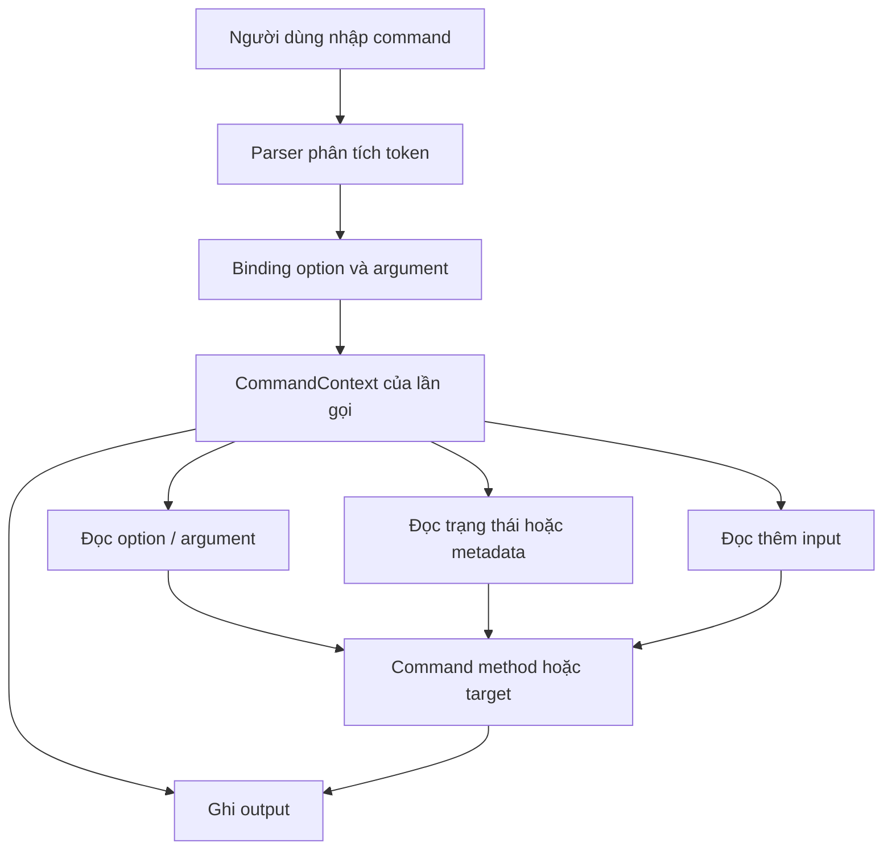

# Đọc tùy chọn đã phân tích và dữ liệu ngữ cảnh đúng phiên bản

Khi một command được thực thi, Spring Shell không chỉ gọi phương thức xử lý. Framework còn cung cấp thông tin về lần gọi hiện tại: option nào đã được phân tích, argument nào được truyền, command nào đang chạy và cách đọc/ghi dữ liệu với terminal. Những thông tin này được tập hợp trong `CommandContext`.

`CommandContext` hữu ích khi command cần xử lý đầu vào linh hoạt, kiểm tra một option có được truyền hay không, xem dữ liệu parser đã tạo hoặc tương tác trực tiếp với shell. API của nó thay đổi đáng kể giữa Spring Shell 3.x và 4.x. Trong 3.x, context là interface với các phương thức `get...()` và có `ShellContext`; trong 4.x, context là một record chứa `ParsedInput`, `CommandRegistry`, `PrintWriter` và `InputReader`.

Vì vậy, khi đọc code mẫu hoặc nâng cấp ứng dụng, cần xác định đúng major version trước khi chọn package và phương thức. Không thể thay `getOptionValue(...)` bằng một tên gọi gần giống trong 4.x: mô hình dữ liệu đã được tổ chức lại.

## `CommandContext` chứa thông tin của lần gọi hiện tại

Hãy phân biệt ba phạm vi thông tin:

- **Dữ liệu command:** tên command, option và argument mà người dùng vừa truyền.
- **Ngữ cảnh thực thi:** thông tin liên quan đến shell hoặc registry command, tùy phiên bản.
- **Kênh nhập/xuất:** cách command đọc thêm dữ liệu và ghi kết quả ra terminal.

Sơ đồ dưới đây thể hiện vị trí của context trong luồng xử lý:



Với command có hợp đồng đầu vào cố định, nên khai báo `@Option` và `@Argument` trực tiếp trên tham số phương thức. Dùng `CommandContext` khi cần truy cập dữ liệu parser tổng quát, kiểm tra option có xuất hiện hay không, đọc nhiều giá trị động hoặc tương tác với input/output của shell.

## Spring Shell 3.x: interface và các phương thức `get...()`

Trong Spring Shell 3.x, `CommandContext` thuộc package `org.springframework.shell.command` và là một interface. Khi dùng target `Function` hoặc `Consumer` với `CommandRegistration`, Spring Shell truyền context vào lambda.

Các phương thức quan trọng:

| Phương thức | Dữ liệu nhận được | Khi nên dùng |
| --- | --- | --- |
| `getOptionValue(name)` | Giá trị option đã được ánh xạ | Lấy giá trị theo tên option |
| `hasMappedOption(name)` | `true` nếu option đã được ánh xạ | Phân biệt option đã có giá trị được parser ánh xạ |
| `getRawArgs()` | Mảng chuỗi argument thô của command | Chẩn đoán hoặc xử lý trường hợp cần xem token gốc |
| `getParserResults()` | Kết quả phân tích option và positional token | Kiểm tra chi tiết parser, lỗi và token chưa ánh xạ |
| `getCommandRegistration()` | Registration của command đang chạy | Đọc metadata và cấu hình command |
| `getTerminal()` | Terminal của JLine | Đọc/ghi trực tiếp qua terminal |
| `getShellContext()` | Ngữ cảnh shell dùng chung giữa các lần gọi | Xem chế độ tương tác và trạng thái PTY |

### Đọc giá trị option bằng `getOptionValue`

Với command được đăng ký bằng builder, `getOptionValue("...")` lấy giá trị theo tên option đã khai báo. Ví dụ:

```java
import org.springframework.context.annotation.Bean;
import org.springframework.context.annotation.Configuration;
import org.springframework.shell.command.CommandRegistration;

@Configuration
public class OrderCommandConfiguration {

    @Bean
    CommandRegistration orderShowCommand(OrderService orderService) {
        return CommandRegistration.builder()
                .command("order show")
                .withOption()
                    .longNames("code")
                    .type(String.class)
                    .required()
                    .and()
                .withOption()
                    .longNames("include-items")
                    .type(Boolean.class)
                    .defaultValue("false")
                    .and()
                .withTarget()
                    .function(context -> {
                        String code = context.getOptionValue("code");
                        Boolean includeItems =
                                context.getOptionValue("include-items");

                        return orderService.describe(
                                code, Boolean.TRUE.equals(includeItems));
                    })
                    .and()
                .build();
    }
}
```

Người dùng gọi:

```text
order show --code ORD-2026-001
order show --code ORD-2026-001 --include-items true
```

Target đọc option theo tên logic `code` và `include-items`, không cần tự tìm vị trí token trong dòng lệnh. Kiểu đích được khai báo bằng `.type(...)`; giá trị trả về từ `getOptionValue(...)` được ánh xạ theo cấu hình option và conversion service của Spring Shell.

`getOptionValue(...)` không thay thế việc khai báo `required`, `defaultValue`, kiểu dữ liệu hoặc validation. Những quy tắc đó nên được mô tả ở registration để parser và trợ giúp hiểu đúng hợp đồng đầu vào.

### Kiểm tra option có được ánh xạ hay không

Một số command cần phân biệt trường hợp người dùng bỏ qua option với trường hợp đã truyền option. Dùng `hasMappedOption(name)` để hỏi parser có ánh xạ option đó hay không:

```java
.function(context -> {
    boolean includeItemsWasMapped =
            context.hasMappedOption("include-items");

    Boolean includeItems = context.getOptionValue("include-items");

    if (!includeItemsWasMapped) {
        return "Người dùng không cung cấp --include-items";
    }

    return "Giá trị include-items: " + includeItems;
})
```

Phương thức này hữu ích khi cần kiểm tra trạng thái ánh xạ, nhưng đừng suy ra mọi chi tiết về nguồn giá trị chỉ từ một boolean. Khi option có `defaultValue`, hãy kiểm thử hành vi của đúng phiên bản để biết parser đánh dấu giá trị mặc định như thế nào. Nếu nghiệp vụ chỉ cần giá trị cuối cùng, đọc `getOptionValue(...)` là đủ.

### Đọc kết quả parser và positional token

`getParserResults()` trả về `CommandParser.CommandParserResults`. Kết quả này cung cấp:

- `registration()`: registration được dùng để phân tích command.
- `results()`: danh sách kết quả ánh xạ option và giá trị tương ứng.
- `positional()`: các positional token chưa được ánh xạ vào option.
- `errors()`: lỗi phân tích cú pháp được ghi nhận.

Ví dụ kiểm tra token còn dư:

```java
.function(context -> {
    var parserResults = context.getParserResults();

    if (!parserResults.positional().isEmpty()) {
        return "Có đối số chưa được xử lý: "
                + String.join(", ", parserResults.positional());
    }

    return "Các option đã được phân tích thành công.";
})
```

Thông thường, parser và cấu hình option đã xử lý các lỗi thiếu giá trị hoặc sai cú pháp trước khi target chạy. `getParserResults()` hữu ích hơn khi command cần quan sát chi tiết kết quả parser hoặc khi ứng dụng có parser tùy chỉnh. Không nên tự viết lại parser bằng cách duyệt `getRawArgs()` nếu dữ liệu đã có trong kết quả phân tích.

### Đọc argument thô và registration

`getRawArgs()` trả về các chuỗi argument thô được truyền vào command. Đây là dữ liệu hữu ích cho chẩn đoán, nhưng không nên coi nó là API chính để lấy option đã có tên. Cách viết cú pháp, thứ tự option và quy tắc quote có thể thay đổi; dùng `getOptionValue(...)` và `getParserResults()` để làm việc với dữ liệu đã được parser hiểu.

`getCommandRegistration()` trả về registration hiện tại. Có thể dùng nó khi cần kiểm tra metadata như tên command hoặc cấu hình option. Nếu chỉ cần giá trị người dùng nhập, hãy đọc trực tiếp option thay vì duyệt registration.

### Đọc ngữ cảnh shell bằng `getShellContext`

Trong 3.x, `getShellContext()` trả về `ShellContext`, một ngữ cảnh cấp shell có thể được dùng để chia sẻ một số thông tin giữa các thành phần và giữa các lần gọi command. Hai thông tin thường cần kiểm tra là:

```java
import org.springframework.shell.context.InteractionMode;
import org.springframework.shell.context.ShellContext;

ShellContext shellContext = context.getShellContext();
InteractionMode mode = shellContext.getInteractionMode();
boolean hasPty = shellContext.hasPty();
```

`InteractionMode` có các giá trị `INTERACTIVE`, `NONINTERACTIVE` và `ALL`. `hasPty()` cho biết terminal có pseudo-terminal hay không; giá trị này có thể là `false` khi output được pipe vào file hoặc command chạy trong CI không có terminal thực.

Đừng nhầm `ShellContext` với `CommandContext`: `CommandContext` mô tả lần gọi hiện tại; `ShellContext` mô tả trạng thái shell có thể tồn tại xuyên qua nhiều lần gọi. Không lưu dữ liệu nghiệp vụ quan trọng hoặc bí mật vào shell context chỉ vì nó tồn tại lâu hơn một command.

### Đọc và ghi qua Terminal trong 3.x

`getTerminal()` trả về `org.jline.terminal.Terminal`. Với target `Consumer`, có thể ghi qua writer của terminal:

```java
.consumer(context -> {
    String code = context.getOptionValue("code");
    context.getTerminal().writer()
            .println("Đang xử lý đơn hàng " + code);
    context.getTerminal().writer().flush();
})
```

Đọc và ghi qua terminal của context giúp command làm việc với I/O của shell hiện tại. Tránh dùng `System.out` hoặc `System.in` cho mọi tình huống nếu ứng dụng cần kiểm thử terminal, chuyển hướng output hoặc chạy trong môi trường có cấu hình I/O riêng.

## Spring Shell 4.x: record và dữ liệu đã phân tích

Trong Spring Shell 4.x, `CommandContext` chuyển sang package `org.springframework.shell.core.command` và được định nghĩa dưới dạng record:

```java
public record CommandContext(
        ParsedInput parsedInput,
        CommandRegistry commandRegistry,
        PrintWriter outputWriter,
        InputReader inputReader) {
}
```

Record này cung cấp bốn thành phần:

| Thành phần | Kiểu | Ý nghĩa |
| --- | --- | --- |
| `parsedInput()` | `ParsedInput` | Kết quả parser đã tách tên command, subcommand, option và argument |
| `commandRegistry()` | `CommandRegistry` | Registry chứa các command đang được ứng dụng đăng ký |
| `outputWriter()` | `PrintWriter` | Writer dành cho output của command |
| `inputReader()` | `InputReader` | API đọc input bổ sung từ người dùng |

Ngoài các accessor của record, context cung cấp các phương thức tiện ích:

- `getOptionByName(String)`: tìm option theo tên ngắn hoặc tên dài.
- `getOptionByLongName(String)`: tìm option theo tên dài.
- `getOptionByShortName(char)`: tìm option theo tên ngắn.
- `getArgumentByIndex(int)`: tìm argument theo chỉ số.

Các phương thức tìm option và argument trả về `null` nếu không tìm thấy, vì vậy cần kiểm tra null trước khi đọc dữ liệu.

### Đọc option và argument trong 4.x

Ví dụ command nhận `CommandContext` trực tiếp:

```java
import org.springframework.shell.core.command.CommandArgument;
import org.springframework.shell.core.command.CommandContext;
import org.springframework.shell.core.command.CommandOption;
import org.springframework.shell.core.command.annotation.Command;

@Command(name = "order inspect", description = "Kiểm tra dữ liệu đầu vào của đơn hàng")
public void inspect(CommandContext context) {
    CommandOption statusOption = context.getOptionByLongName("status");
    CommandArgument codeArgument = context.getArgumentByIndex(0);

    String status = statusOption == null ? null : statusOption.value();
    String orderCode = codeArgument == null ? null : codeArgument.value();

    context.outputWriter().println("Mã đơn hàng: " + orderCode);
    context.outputWriter().println("Trạng thái: " + status);
    context.outputWriter().flush();
}
```

Trong 4.x, `CommandOption` và `CommandArgument` là record mô tả cả metadata lẫn giá trị runtime. Một số accessor thường dùng:

| Record | Accessor | Ý nghĩa |
| --- | --- | --- |
| `CommandOption` | `longName()`, `shortName()` | Tên dài và tên ngắn của option |
| `CommandOption` | `value()` | Giá trị option được parser ghi nhận |
| `CommandOption` | `defaultValue()`, `required()`, `type()` | Metadata của option |
| `CommandArgument` | `index()` | Vị trí argument |
| `CommandArgument` | `value()` | Giá trị argument được parser ghi nhận |
| `CommandArgument` | `defaultValue()`, `type()`, `variadic()` | Metadata của argument |

Trong API 4.x, `value()` trên các record này có kiểu `String`. Nếu command cần một giá trị đã chuyển đổi sang `Long`, `LocalDate`, enum hoặc kiểu miền, hãy khai báo kiểu trực tiếp trên tham số `@Option`/`@Argument` để Spring Shell thực hiện binding và conversion. Chỉ đọc `value()` khi cần xem dữ liệu parser đã ghi nhận hoặc khi chủ động chuyển đổi theo quy tắc riêng.

Ví dụ với tham số kiểu tường minh:

```java
@Command(name = "order show", description = "Hiển thị đơn hàng")
public String show(
        @Argument(index = 0) Long orderId,
        @Option(longName = "status") OrderStatus status) {

    return orderService.describe(orderId, status);
}
```

Ở đây, `orderId` và `status` được nhận qua method binding. Không cần truy cập `CommandContext` chỉ để chuyển một chuỗi thành kiểu Java.

### Đọc toàn bộ cấu trúc qua `ParsedInput`

`context.parsedInput()` trả về record `ParsedInput`, gồm:

- `commandName()`: tên command chính.
- `subCommands()`: danh sách các từ tạo thành phần command con.
- `options()`: danh sách `CommandOption` đã phân tích.
- `arguments()`: danh sách `CommandArgument` đã phân tích.

Ví dụ:

```java
@Command(name = "command inspect", description = "Hiển thị cấu trúc command đã phân tích")
public void inspect(CommandContext context) {
    var parsed = context.parsedInput();

    context.outputWriter().println("Command: " + parsed.commandName());
    context.outputWriter().println("Subcommands: " + parsed.subCommands());

    parsed.options().forEach(option ->
            context.outputWriter().println(
                    "Option --" + option.longName() + " = " + option.value()));

    parsed.arguments().forEach(argument ->
            context.outputWriter().println(
                    "Argument[" + argument.index() + "] = " + argument.value()));

    context.outputWriter().flush();
}
```

`ParsedInput` phù hợp khi command cần duyệt một tập option hoặc argument thay đổi theo cấu hình. Với command thông thường, dùng `getOptionByLongName(...)` hoặc `getArgumentByIndex(...)` sẽ trực tiếp hơn.

### Tra cứu command trong `CommandRegistry`

`commandRegistry()` cung cấp registry command của ứng dụng. Có thể dùng nó để tra cứu một command đã đăng ký:

```java
var command = context.commandRegistry().getCommandByName("order show");

if (command != null) {
    context.outputWriter().println(command.getDescription());
}
```

`CommandRegistry` là registry của command, không phải shell-wide state như `ShellContext` trong 3.x. Nếu ứng dụng cần lưu trạng thái nghiệp vụ dùng chung giữa nhiều command, hãy đặt trạng thái đó trong một Spring bean/service có vòng đời phù hợp thay vì xem registry là nơi lưu dữ liệu phiên.

## Đọc thêm input và ghi output trong 4.x

Spring Shell 4.x tách I/O thành hai API trong context: `InputReader` và `PrintWriter`.

### Đọc một dòng input

`InputReader.readInput(...)` đọc một dòng từ người dùng và có thể hiển thị prompt:

```java
@Command(name = "customer note", description = "Nhập ghi chú cho khách hàng")
public String addNote(CommandContext context) throws Exception {
    String note = context.inputReader().readInput("Ghi chú: ");
    customerService.addNote(note);
    return "Đã lưu ghi chú.";
}
```

Chỉ yêu cầu input bổ sung khi luồng chạy có thể tương tác với người dùng. Với command được gọi từ script hoặc pipeline, hãy xác định trước hành vi khi không có input tương tác và kiểm thử trường hợp EOF hoặc stdin được chuyển hướng.

### Đọc mật khẩu

`InputReader.readPassword(...)` trả về `char[]`, phù hợp hơn `String` khi đọc bí mật vì ứng dụng có thể xóa nội dung mảng sau khi sử dụng:

```java
import java.util.Arrays;

@Command(name = "account authenticate", description = "Xác thực tài khoản")
public String authenticate(CommandContext context) throws Exception {
    char[] password = context.inputReader().readPassword("Mật khẩu: ");

    try {
        accountService.authenticate(password);
        return "Xác thực thành công.";
    }
    finally {
        Arrays.fill(password, '\0');
    }
}
```

Không chuyển mật khẩu sang `String` nếu không cần thiết, không in nó ra terminal và không ghi vào log. Việc xóa mảng giúp giảm thời gian dữ liệu bí mật còn trong bộ nhớ của ứng dụng.

### Ghi output

Dùng `outputWriter()` để ghi kết quả vào luồng output của shell hiện tại:

```java
@Command(name = "system status", description = "Hiển thị trạng thái hệ thống")
public void status(CommandContext context) {
    context.outputWriter().println("Customer service: available");
    context.outputWriter().println("Order service: available");
    context.outputWriter().flush();
}
```

`PrintWriter` là kênh output do Spring Shell cung cấp cho command. Dùng nó thay vì gọi `System.out` trực tiếp giúp output đi qua cấu hình shell và dễ kiểm thử hơn.

## Bảng đối chiếu API 3.x và 4.x

| Nhu cầu | Spring Shell 3.x | Spring Shell 4.x |
| --- | --- | --- |
| Package `CommandContext` | `org.springframework.shell.command.CommandContext` | `org.springframework.shell.core.command.CommandContext` |
| Kiểu context | Interface | Record |
| Đọc option theo tên | `getOptionValue("name")` | `getOptionByName("name").value()` hoặc khai báo tham số method |
| Kiểm tra option được ánh xạ | `hasMappedOption("name")` | Kiểm tra `getOptionByName(...)` có `null` hay không và xem `ParsedInput` |
| Đọc argument | Qua target method, parser results hoặc raw args | `getArgumentByIndex(index)` hoặc `parsedInput().arguments()` |
| Kết quả parser | `getParserResults()` | `parsedInput()` |
| Registration/registry | `getCommandRegistration()` | `commandRegistry()` |
| Terminal/output | `getTerminal()` rồi lấy writer | `outputWriter()` |
| Đọc input bổ sung | Thường qua terminal/LineReader tùy cấu hình | `inputReader().readInput(...)` |
| Đọc password | Tùy cách tích hợp terminal/LineReader | `inputReader().readPassword(...)` trả `char[]` |
| Shell-wide context | `getShellContext()` | Không có thành phần tương đương trong `CommandContext` record |

Các thay đổi này là thay đổi API, không chỉ đổi tên phương thức. Khi chuyển code 3.x sang 4.x, cần cập nhật package import, cách truy cập dữ liệu parser và cách đọc/ghi terminal.

## Chuyển code 3.x sang 4.x

Giả sử code 3.x đọc option như sau:

```java
String code = context.getOptionValue("code");
boolean mapped = context.hasMappedOption("details");
String[] rawArgs = context.getRawArgs();
Terminal terminal = context.getTerminal();
```

Trong 4.x, nếu muốn đọc dữ liệu parser tương ứng:

```java
CommandOption codeOption = context.getOptionByLongName("code");
CommandOption detailsOption = context.getOptionByLongName("details");
String code = codeOption == null ? null : codeOption.value();
boolean detailsWasParsed = detailsOption != null;

ParsedInput parsed = context.parsedInput();
List<CommandArgument> arguments = parsed.arguments();
PrintWriter writer = context.outputWriter();
```

Nếu chỉ cần giá trị kiểu Java, cách chuyển đổi đơn giản nhất thường là khai báo `@Option` hoặc `@Argument` trên tham số phương thức và để Spring Shell binding dữ liệu. Không nên cố tái tạo `getRawArgs()` bằng cách ghép lại `ParsedInput`, vì cấu trúc parsed data không nhất thiết giữ nguyên cách người dùng gõ, khoảng trắng hoặc dấu quote ban đầu.

Không có phương thức `getShellContext()` trong record 4.x. Nếu code cũ dùng `ShellContext` để giữ trạng thái ứng dụng giữa các command, hãy xác định chính xác dữ liệu cần chia sẻ và chuyển nó sang Spring bean/service có phạm vi vòng đời phù hợp. Nếu chỉ cần biết một command đang chạy ở môi trường nào, hãy thiết kế cấu hình hoặc đầu vào rõ ràng cho ứng dụng; đừng giả định `CommandRegistry` thay thế `ShellContext`.

## Những lỗi thường gặp

| Lỗi | Hệ quả | Cách xử lý |
| --- | --- | --- |
| Dùng import `org.springframework.shell.command.CommandContext` trong 4.x | Không tìm thấy class ở package mới | Dùng `org.springframework.shell.core.command.CommandContext` |
| Gọi `getOptionValue(...)` trong 4.x | Phương thức không tồn tại | Dùng `getOptionByName(...)` hoặc khai báo tham số method |
| Gọi `getTerminal()` trong 4.x | API context mới không cung cấp terminal | Dùng `outputWriter()` và `inputReader()` |
| Giả định `CommandOption.value()` là kiểu đã convert | Có thể nhận chuỗi thay vì kiểu nghiệp vụ | Dùng method parameter binding hoặc conversion rõ ràng |
| Không kiểm tra `null` khi tìm option/argument trong 4.x | Có thể phát sinh `NullPointerException` | Kiểm tra kết quả `getOption...()` và `getArgumentByIndex()` |
| Dùng `getRawArgs()` để parse lại option | Tạo parser thứ hai, dễ lệch quy tắc framework | Dùng `getOptionValue()` và `getParserResults()` trong 3.x |
| Nhầm `ShellContext` với `CommandContext` | Trộn trạng thái shell với dữ liệu của một lần gọi | Phân biệt shell-wide state và command invocation context |
| Ghi output trực tiếp qua `System.out` trong mọi command | Khó kiểm thử và có thể bỏ qua output writer của shell | Dùng terminal writer ở 3.x hoặc `outputWriter()` ở 4.x |
| Đọc password thành `String` và giữ lâu | Bí mật tồn tại lâu hơn trong bộ nhớ | Dùng `readPassword()` trả `char[]` ở 4.x và xóa mảng sau khi dùng |

## Quy trình chọn API context

1. Xác nhận major/minor version Spring Shell trong dependency đã resolve.
2. Chọn đúng package và API `CommandContext` của phiên bản đó.
3. Nếu đầu vào cố định, ưu tiên khai báo `@Option` và `@Argument` trên tham số method.
4. Nếu cần truy cập dữ liệu parser, dùng các phương thức context tương ứng với phiên bản.
5. Nếu cần đọc thêm input hoặc ghi output, dùng Terminal ở 3.x và `InputReader`/`PrintWriter` ở 4.x.
6. Nếu cần trạng thái dùng chung giữa command, xác định rõ đó là shell context hay application state.
7. Kiểm thử command ở cả terminal tương tác và chế độ script/non-interactive nếu ứng dụng hỗ trợ cả hai.

`CommandContext` giúp command làm việc với dữ liệu đã phân tích và các tài nguyên I/O của shell. Dùng đúng API theo phiên bản giúp tránh lỗi biên dịch khi nâng cấp, giữ cách đọc option nhất quán và tách rõ dữ liệu của một lần gọi khỏi trạng thái dùng chung của ứng dụng.

## Tài liệu tham khảo

- [Command Context – Spring Shell 4.0.3](https://docs.spring.io/spring-shell/reference/commands/context.html)
- [CommandContext API – Spring Shell 4.0.3](https://docs.spring.io/spring-shell/reference/api/org/springframework/shell/core/command/CommandContext.html)
- [ParsedInput API – Spring Shell 4.0.3](https://docs.spring.io/spring-shell/reference/api/org/springframework/shell/core/command/ParsedInput.html)
- [CommandOption API – Spring Shell 4.0.3](https://docs.spring.io/spring-shell/reference/api/org/springframework/shell/core/command/CommandOption.html)
- [CommandArgument API – Spring Shell 4.0.3](https://docs.spring.io/spring-shell/reference/api/org/springframework/shell/core/command/CommandArgument.html)
- [InputReader API – Spring Shell 4.0.3](https://docs.spring.io/spring-shell/reference/api/org/springframework/shell/core/InputReader.html)
- [Reading Input – Spring Shell 4.0.2](https://docs.spring.io/spring-shell/reference/commands/reading.html)
- [Writing Output – Spring Shell 4.0.2](https://docs.spring.io/spring-shell/reference/commands/writing.html)
- [Command Registration – Spring Shell 3.4.2](https://docs.spring.io/spring-shell/reference/3.4/appendices/techintro/registration.html)
- [CommandContext API – Spring Shell 3.4.x](https://docs.spring.io/spring-shell/reference/3.4/api/java/org/springframework/shell/command/CommandContext.html)
- [ShellContext API – Spring Shell 3.4.x](https://docs.spring.io/spring-shell/reference/3.4/api/java/org/springframework/shell/context/ShellContext.html)
