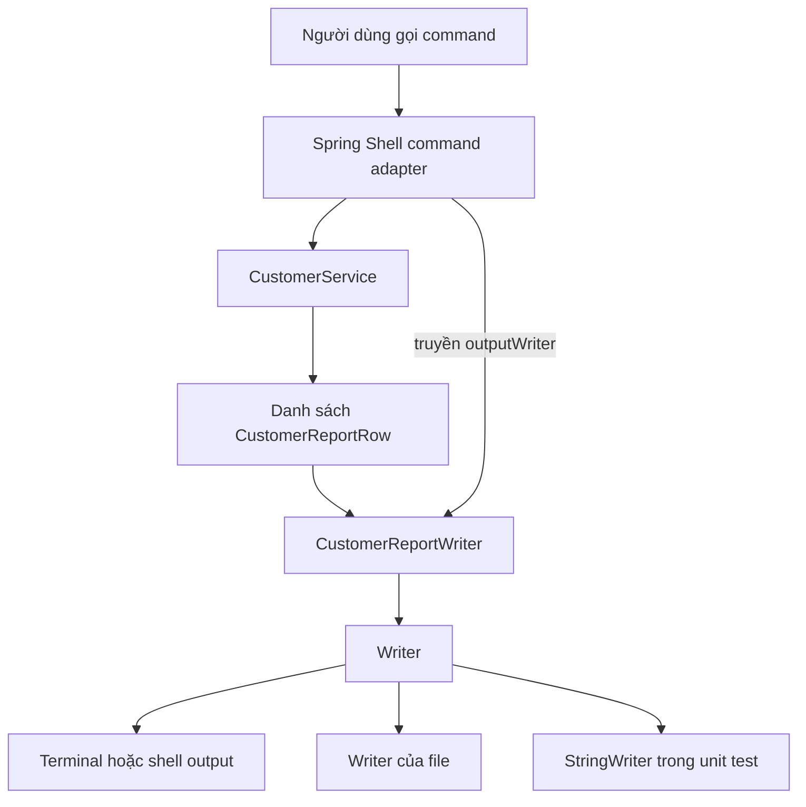

# Thiết kế lớp xuất dữ liệu để có thể kiểm thử độc lập với terminal

Một command Spring Shell thường phải hiển thị dữ liệu cho người dùng: danh sách bản ghi, báo cáo, trạng thái hoặc kết quả thao tác. Nếu lớp định dạng dữ liệu tự gọi `System.out`, lấy `Terminal` hoặc phụ thuộc trực tiếp vào `CommandContext`, việc kiểm thử sẽ cần dựng môi trường shell hoặc can thiệp vào luồng output toàn cục.

Thiết kế dễ kiểm thử hơn là tách phần tạo nội dung khỏi phần kết nối với terminal. Lớp xuất dữ liệu nhận một đích ghi trừu tượng của Java như `Writer`; command Spring Shell truyền writer lấy từ context. Khi kiểm thử đơn vị, có thể truyền `StringWriter` để thu nội dung vào bộ nhớ và so sánh kết quả mà không cần khởi động terminal.

## Vấn đề khi gắn lớp xuất dữ liệu với terminal

Một lớp có trách nhiệm định dạng báo cáo không cần biết báo cáo đang được gửi đến đâu. Nếu lớp đó trực tiếp dùng `System.out` hoặc JLine `Terminal`, nó bị gắn với môi trường chạy cụ thể:

```java
public class CustomerReportPrinter {

    public void print(List<Customer> customers) {
        System.out.println("ID | NAME | STATUS");
        for (Customer customer : customers) {
            System.out.println(customer.id() + " | "
                    + customer.name() + " | "
                    + customer.status());
        }
    }
}
```

Đoạn mã trên có thể chạy trong terminal, nhưng bài kiểm thử khó kiểm tra output nếu không redirect `System.out`. Redirect một luồng toàn cục còn có thể ảnh hưởng các test chạy song song hoặc các thành phần khác đang ghi log. Nếu lớp gọi `Terminal` hoặc `CommandContext` trực tiếp, test đơn vị còn phải tạo những đối tượng thuộc hạ tầng Spring Shell/JLine dù mục tiêu chỉ là xác minh định dạng.

Những dấu hiệu cho thấy lớp output đang phụ thuộc quá chặt vào terminal:

- Lớp tự lấy `System.out` hoặc `System.err`.
- Lớp tự tạo hoặc inject JLine `Terminal` chỉ để ghi văn bản.
- Lớp nghiệp vụ nhận `CommandContext` dù chỉ cần in một báo cáo.
- Test phải khởi động shell chỉ để xác nhận tiêu đề, cột hoặc nội dung một dòng.
- Lớp output giữ writer của một lần chạy trong field để dùng ở những lần gọi sau.

Mục tiêu là để lớp xuất dữ liệu chỉ quan tâm nội dung cần ghi và hợp đồng của đích ghi; command chịu trách nhiệm nối hợp đồng đó với Spring Shell.

## Tách thành phần nghiệp vụ, định dạng và adapter terminal

Một luồng xuất dữ liệu có thể chia thành ba phần:

1. **Service nghiệp vụ** truy vấn hoặc chuẩn bị dữ liệu, ví dụ danh sách khách hàng.
2. **Lớp định dạng/xuất dữ liệu** biến các đối tượng thành văn bản theo một định dạng ổn định và ghi vào một `Writer` được truyền vào.
3. **Command adapter** lấy writer từ `CommandContext`, gọi lớp xuất dữ liệu rồi flush output theo vòng đời của shell.



`CustomerReportWriter` không cần biết đích ghi là terminal, file hay bộ nhớ. Các môi trường này đều có thể được biểu diễn bằng `java.io.Writer`. Nhờ vậy, cùng một logic định dạng có thể được tái sử dụng trong command, tác vụ xuất file hoặc kiểm thử.

## Spring Shell cung cấp writer ở đâu?

Trong Spring Shell 4.x, `CommandContext` là record chứa dữ liệu runtime của lần gọi command. Một thành phần của record là `PrintWriter outputWriter`, truy cập qua `context.outputWriter()`.

```java
@Command(name = "hello")
public void hello(CommandContext context) {
    context.outputWriter().println("Xin chào!");
    context.outputWriter().flush();
}
```

Tài liệu Spring Shell khuyến nghị dùng `PrintWriter` lấy từ `CommandContext` để ghi output của command. Cách này cho phép shell quản lý luồng xuất; ghi trực tiếp `System.out` đi qua stream toàn cục của JDK và có thể bỏ qua output writer mà shell cung cấp.

Trong Spring Shell 3.4.x, cách truy cập khác: `CommandContext` cung cấp JLine `Terminal`, và có thể lấy writer bằng `context.getTerminal().writer()`. Với target kiểu `Consumer`, context được truyền vào target cũng cung cấp terminal để ghi output. Khi nâng lên 4.x, dùng `context.outputWriter()`; không sao chép nguyên cách truy cập terminal của 3.x vào API 4.x.

| Phiên bản | Cách lấy writer từ command context |
|---|---|
| Spring Shell 3.4.x | `context.getTerminal().writer()` |
| Spring Shell 4.x | `context.outputWriter()` |

`PrintWriter` kế thừa `Writer`, vì vậy có thể truyền `context.outputWriter()` vào một lớp chỉ nhận `Writer`. Đây là ranh giới đơn giản giúp lớp xuất dữ liệu không cần import bất kỳ kiểu nào của Spring Shell hoặc JLine.

## Thiết kế CustomerReportWriter nhận Writer

Giả sử service trả về một danh sách dòng báo cáo:

```java
public record CustomerReportRow(
        String id,
        String name,
        String status) {
}
```

Lớp xuất dữ liệu nhận danh sách và một `Writer`. Ví dụ dưới đây tạo output dạng các cột phân cách bằng tab. Để một ô không làm vỡ cấu trúc dòng/cột, dấu gạch chéo ngược, tab và ký tự xuống dòng trong dữ liệu được escape theo quy ước của báo cáo.

```java
import java.io.IOException;
import java.io.Writer;
import java.util.List;

import org.springframework.stereotype.Component;

@Component
public class CustomerReportWriter {

    public void write(List<CustomerReportRow> rows, Writer destination)
            throws IOException {

        destination.write("ID\tNAME\tSTATUS");
        destination.write(System.lineSeparator());

        for (CustomerReportRow row : rows) {
            writeCell(destination, row.id());
            destination.write('\t');
            writeCell(destination, row.name());
            destination.write('\t');
            writeCell(destination, row.status());
            destination.write(System.lineSeparator());
        }
    }

    private void writeCell(Writer destination, String value)
            throws IOException {
        String escaped = value == null ? "" : value
                .replace("\\", "\\\\")
                .replace("\t", "\\t")
                .replace("\r", "\\r")
                .replace("\n", "\\n");
        destination.write(escaped);
    }
}
```

Lớp này có một trách nhiệm: chuyển dữ liệu báo cáo thành các ký tự theo định dạng đã chọn. Nó không tạo terminal, không đọc `System.out`, không lấy bean `CommandContext` và không giữ `Writer` trong field. Mỗi lần gọi, caller cung cấp đích ghi của lần đó.

`write()` không đóng hoặc flush `destination`. Vòng đời của writer thuộc về nơi tạo ra nó:

- Command dùng writer do Spring Shell cung cấp và flush khi hoàn tất output.
- Test dùng `StringWriter` và đọc nội dung sau khi gọi.
- Tác vụ ghi file mở writer bằng try-with-resources và đóng nó ở nơi quản lý file.

Ví dụ dùng writer để tạo file UTF-8:

```java
try (Writer fileWriter = Files.newBufferedWriter(
        outputPath, StandardCharsets.UTF_8)) {
    customerReportWriter.write(rows, fileWriter);
}
```

Ở ví dụ này, `CustomerReportWriter` không cần biết file được mở bằng `Files.newBufferedWriter`. Nó chỉ ghi vào hợp đồng `Writer`; đoạn code mở file chịu trách nhiệm chọn charset và đóng tài nguyên.

## Command adapter kết nối writer với Spring Shell

Command adapter là nơi duy nhất cần biết `CommandContext`. Nó lấy dữ liệu từ service, chuyển writer của shell cho lớp xuất dữ liệu và flush sau khi ghi:

```java
import java.io.IOException;

import org.springframework.shell.core.command.CommandContext;
import org.springframework.shell.core.command.annotation.Command;
import org.springframework.stereotype.Component;

@Component
public class CustomerReportCommands {

    private final CustomerService customerService;
    private final CustomerReportWriter reportWriter;

    public CustomerReportCommands(
            CustomerService customerService,
            CustomerReportWriter reportWriter) {
        this.customerService = customerService;
        this.reportWriter = reportWriter;
    }

    @Command(name = "customer-report", description = "Hiển thị báo cáo khách hàng")
    public void report(CommandContext context) throws IOException {
        var rows = customerService.findReportRows();
        reportWriter.write(rows, context.outputWriter());
        context.outputWriter().flush();
    }
}
```

`CustomerService` là service nghiệp vụ của ứng dụng và `findReportRows()` trả về `List<CustomerReportRow>`. Phương thức command đóng vai trò adapter: nó biết Spring Shell cung cấp writer ở đâu, nhưng không tự định dạng từng cột.

`PrintWriter` có đặc điểm là không ném lại `IOException` từ một số thao tác ghi; nó ghi nhận lỗi nội bộ. Với ứng dụng cần phát hiện lỗi output, có thể kiểm tra `checkError()` sau khi flush và chuyển lỗi thành phản hồi phù hợp. Không nên để lớp định dạng tự đóng writer của shell.

## Kiểm thử đơn vị bằng StringWriter

`StringWriter` là một `Writer` ghi dữ liệu vào chuỗi trong bộ nhớ. Test có thể khởi tạo `CustomerReportWriter` trực tiếp, truyền danh sách giả và `StringWriter`, sau đó so sánh nội dung. Test này không cần Spring context, command registry, JLine hay terminal.

```java
import static org.assertj.core.api.Assertions.assertThat;

import java.io.StringWriter;
import java.util.List;

import org.junit.jupiter.api.Test;

class CustomerReportWriterTests {

    private final CustomerReportWriter reportWriter = new CustomerReportWriter();

    @Test
    void writesHeaderAndRows() throws Exception {
        var rows = List.of(
                new CustomerReportRow("C001", "Lan Nguyen", "ACTIVE"),
                new CustomerReportRow("C002", "Minh Tran", "INACTIVE")
        );
        var destination = new StringWriter();

        reportWriter.write(rows, destination);

        String expected = String.join(System.lineSeparator(),
                "ID\tNAME\tSTATUS",
                "C001\tLan Nguyen\tACTIVE",
                "C002\tMinh Tran\tINACTIVE",
                "");
        assertThat(destination.toString()).isEqualTo(expected);
    }
}
```

Test xác minh trực tiếp hợp đồng output: thứ tự cột, tiêu đề, dữ liệu và ký tự xuống dòng. Khi test thất bại, có thể nhìn thấy chính xác chuỗi được tạo mà không phải phân tích ảnh terminal.

### Kiểm tra danh sách rỗng

Danh sách không có bản ghi vẫn cần có hành vi xác định. Với thiết kế hiện tại, writer xuất tiêu đề và không xuất dòng dữ liệu:

```java
@Test
void writesOnlyHeaderWhenThereAreNoRows() throws Exception {
    var destination = new StringWriter();

    reportWriter.write(List.of(), destination);

    assertThat(destination.toString()).isEqualTo(
            "ID\tNAME\tSTATUS" + System.lineSeparator());
}
```

Nếu yêu cầu sản phẩm muốn hiển thị `Không có dữ liệu`, hãy đưa quy tắc đó vào formatter/writer và thêm test tương ứng. Điều quan trọng là output rỗng phải có hành vi được định nghĩa, không phụ thuộc terminal.

### Kiểm tra ký tự đặc biệt

Giá trị có tab hoặc xuống dòng có thể làm sai cấu trúc bảng nếu không được xử lý. Test có thể xác nhận quy tắc escape:

```java
@Test
void escapesTabsAndNewLinesInsideCells() throws Exception {
    var rows = List.of(
            new CustomerReportRow("C003", "Lan\tNguyen", "ACTIVE\nREVIEW")
    );
    var destination = new StringWriter();

    reportWriter.write(rows, destination);

    assertThat(destination.toString()).contains("Lan\\tNguyen");
    assertThat(destination.toString()).contains("ACTIVE\\nREVIEW");
}
```

Các quy tắc escape trong ví dụ là định dạng text riêng của ứng dụng. Nếu output cần tuân thủ CSV, JSON hoặc một chuẩn trao đổi dữ liệu khác, hãy dùng thư viện chuyên dụng cho định dạng đó thay vì tự tạo bộ escape gần giống chuẩn.

## Kiểm thử command adapter bằng ShellTestClient

Unit test của writer chứng minh phần định dạng độc lập với terminal. Tuy nhiên, nó không kiểm tra Spring Shell đã đăng ký command, gọi đúng service và nối `CommandContext.outputWriter()` vào writer hay chưa. Đó là trách nhiệm của kiểm thử tích hợp.

Spring Shell 4.x cung cấp `@ShellTest`, `ShellTestClient`, `ShellScreen` và `ShellAssertions` để chạy command như người dùng nhập và kiểm tra nội dung hiển thị.

```java
import static org.springframework.shell.test.ShellAssertions.assertThat;

import org.junit.jupiter.api.Test;
import org.springframework.beans.factory.annotation.Autowired;
import org.springframework.context.annotation.ContextConfiguration;
import org.springframework.shell.test.ShellScreen;
import org.springframework.shell.test.ShellTestClient;
import org.springframework.shell.test.autoconfigure.ShellTest;

@ShellTest
@ContextConfiguration(classes = CustomerCliTestConfiguration.class)
class CustomerReportCommandTests {

    @Autowired
    ShellTestClient client;

    @Test
    void commandWritesReportToShellOutput() throws Exception {
        ShellScreen screen = client.sendCommand("customer-report");

        assertThat(screen).containsText("C001");
        assertThat(screen).containsText("Lan Nguyen");
        assertThat(screen).containsText("ACTIVE");
    }
}
```

`CustomerCliTestConfiguration` là cấu hình test đăng ký command, writer và một `CustomerService` giả trả về dữ liệu cố định. Test này kiểm tra đường đi từ câu lệnh đến output của shell. Nó không cần mở terminal thật.

Nên chia kiểm thử thành hai tầng:

| Tầng test | Thành phần kiểm tra | Công cụ/đích ghi |
|---|---|---|
| Unit test | Quy tắc định dạng và ghi nội dung | `StringWriter` |
| Integration test | Đăng ký command, service injection và kết nối output context | `@ShellTest`, `ShellTestClient` |
| End-to-end test | Hành vi tiến trình và môi trường terminal thực tế | Chạy ứng dụng như tiến trình và capture output |

Không cần chạy end-to-end cho mọi thay đổi định dạng. Chỉ thêm test đầu cuối khi yêu cầu phụ thuộc vào đặc tính thực của terminal, ví dụ màu ANSI, căn chỉnh theo chiều rộng cửa sổ, di chuyển con trỏ hoặc hành vi tương tác.

## Khi nào nên trả về String thay vì nhận Writer?

Không phải mọi command đều cần một lớp ghi trực tiếp vào writer. Nếu output nhỏ và có thể tạo hoàn chỉnh trong bộ nhớ, một formatter thuần trả về `String` còn đơn giản hơn:

```java
public class CustomerReportFormatter {

    public String format(List<CustomerReportRow> rows) {
        StringBuilder result = new StringBuilder();
        result.append("ID\tNAME\tSTATUS");

        for (CustomerReportRow row : rows) {
            result.append(System.lineSeparator())
                    .append(row.id()).append('\t')
                    .append(row.name()).append('\t')
                    .append(row.status());
        }
        return result.toString();
    }
}
```

Command chỉ cần ghi kết quả:

```java
@Command(name = "customer-report")
public void report(CommandContext context) {
    String text = formatter.format(customerService.findReportRows());
    context.outputWriter().println(text);
    context.outputWriter().flush();
}
```

Test formatter có thể gọi `format()` và so sánh chuỗi trả về. Cách này dễ đọc và phù hợp với báo cáo nhỏ hoặc output có kích thước vừa phải.

| Thiết kế | Ưu điểm | Phù hợp khi |
|---|---|---|
| `format(...) -> String` | Đơn giản, thuần logic, test rất dễ | Output nhỏ, cần tạo toàn bộ nội dung trước khi ghi |
| `write(..., Writer)` | Ghi tuần tự, không cần giữ toàn bộ output trong một String | Báo cáo lớn, xuất file hoặc output có thể dài |
| Inject `PrintWriter`/`Terminal` vào formatter | Dễ gọi trực tiếp trong một command nhưng gắn với môi trường shell | Chỉ phù hợp với adapter hoặc lớp trình bày thật sự cần API terminal |

Nếu formatter trả về `String`, tránh để formatter tự gọi `System.out`. Nếu writer class nhận `Writer`, tránh để nó tự tạo `StringWriter` nội bộ rồi mới ghi lại; caller đã chọn đích ghi và nên kiểm soát nó.

## Không lưu writer của command trong bean singleton

Các bean Spring mặc định thường có scope singleton. Một writer lấy từ `CommandContext` thuộc về lần thực thi command cụ thể. Không lưu writer đó vào field của một bean singleton để tái sử dụng:

```java
// Không nên: writer thuộc một lần gọi command nhưng bị giữ lại trong bean.
private Writer currentWriter;
```

Thiết kế đúng là nhận writer như một tham số của phương thức `write()` ở mỗi lần gọi. Nhờ đó, hai lần thực thi độc lập có thể dùng hai writer khác nhau và test không bị chia sẻ trạng thái output.

Tương tự, không đóng `context.outputWriter()` trong lớp xuất dữ liệu. Spring Shell quản lý writer của phiên shell. Đóng writer ở giữa phiên có thể khiến các command tiếp theo không ghi được output.

## Phân biệt output nội dung và hiệu ứng terminal

Một số output chỉ là dữ liệu văn bản; một số khác điều khiển cách terminal hiển thị:

| Loại output | Ví dụ | Nơi nên xử lý |
|---|---|---|
| Nội dung thuần | Tiêu đề, dòng dữ liệu, thông báo | Formatter/writer độc lập terminal |
| Định dạng dữ liệu | TSV, CSV, JSON, bảng văn bản | Formatter chuyên biệt hoặc thư viện định dạng |
| Màu sắc, con trỏ, màn hình động | ANSI color, progress bar, terminal UI | Adapter trình bày phụ thuộc terminal/JLine |
| Output file | Báo cáo UTF-8, file export | Adapter mở file và truyền `Writer` vào formatter |

Nếu lớp định dạng phải quyết định màu sắc, chiều rộng terminal hoặc vị trí con trỏ, nó đang nhận trách nhiệm của lớp giao diện. Có thể tách một `TerminalPresenter` riêng để áp dụng màu/hiệu ứng sau khi formatter tạo nội dung cơ bản. Unit test formatter không cần kiểm tra ANSI; test presenter có thể dùng writer giả hoặc kiểm thử tích hợp theo nhu cầu.

## Xử lý lỗi khi ghi output

Khi lớp xuất dữ liệu nhận `Writer`, các thao tác ghi có thể phát sinh `IOException`. Lớp này nên khai báo lỗi cho caller quyết định cách xử lý, thay vì tự in stack trace hoặc tự thoát tiến trình.

Với `StringWriter`, test thường không gặp lỗi I/O. Với file writer, lỗi có thể xảy ra do quyền truy cập, ổ đĩa hoặc thiết bị. Với `PrintWriter` do Spring Shell cung cấp, lỗi I/O được ghi nhận trong writer; có thể dùng `checkError()` sau khi flush nếu ứng dụng cần xác minh việc ghi.

Trách nhiệm nên được phân chia như sau:

- Writer/formatter phát sinh hoặc chuyển tiếp lỗi ghi.
- Command adapter quyết định cách biến lỗi thành phản hồi của shell.
- Service nghiệp vụ không cần biết terminal hoặc writer cụ thể.
- Test xác minh output đúng và kiểm tra cách xử lý lỗi ở tầng phù hợp.

Không ghi thông báo lỗi vào cùng một luồng output dữ liệu máy đọc nếu command đang xuất CSV/JSON cho pipeline. Trong trường hợp đó, dùng một kênh lỗi riêng hoặc trả mã trạng thái phù hợp để tránh làm hỏng định dạng đầu ra.

## Lỗi thường gặp

| Biểu hiện | Nguyên nhân có thể | Cách xử lý |
|---|---|---|
| Test phải redirect `System.out` | Lớp xuất dữ liệu tự ghi vào stream toàn cục | Truyền `Writer` hoặc trả về `String` |
| Unit test cần khởi tạo Spring Shell | Formatter phụ thuộc `CommandContext` hoặc `Terminal` | Chuyển phụ thuộc shell vào command adapter |
| Output chỉ xuất hiện sau khi command khác chạy | Writer chưa được flush trong adapter | Flush `context.outputWriter()` sau khi ghi |
| Command sau không in được dữ liệu | Lớp writer đã đóng writer do shell quản lý | Không đóng writer được truyền vào; chỉ caller sở hữu tài nguyên mới đóng |
| Hai lệnh ghi lẫn nội dung | Bean singleton giữ writer của lần gọi trước hoặc dùng biến static | Truyền writer theo từng lần gọi, không giữ trong field |
| Dữ liệu có tab/xuống dòng làm vỡ cột | Chưa xác định quy tắc escape | Escape theo định dạng hoặc dùng thư viện CSV/JSON chuẩn |
| Test định dạng qua ShellTestClient quá phức tạp | Dùng integration test để kiểm tra chi tiết chuỗi | Kiểm tra định dạng bằng `StringWriter`; dùng ShellTestClient chỉ kiểm tra adapter |
| Dùng `getTerminal()` trong code 4.x | Sao chép API truy cập output của 3.x | Dùng `CommandContext.outputWriter()` trong 4.x |

## Quy trình thiết kế và kiểm thử

Khi xây dựng command có output phức tạp, có thể đi theo trình tự sau:

1. Xác định dữ liệu cần hiển thị và định dạng mà người dùng hoặc script mong đợi.
2. Tách dữ liệu nghiệp vụ khỏi cách trình bày; service trả model thay vì ghi ra terminal.
3. Chọn formatter trả `String` nếu output nhỏ hoặc writer nhận `Writer` nếu cần ghi tuần tự.
4. Giữ `CommandContext` trong command adapter và truyền `context.outputWriter()` vào lớp xuất dữ liệu.
5. Để command adapter flush writer; không để lớp xuất dữ liệu đóng writer do caller sở hữu.
6. Viết unit test với `StringWriter` cho header, dữ liệu, danh sách rỗng, ký tự đặc biệt và lỗi định dạng.
7. Viết integration test với `@ShellTest` và `ShellTestClient` để xác minh command thực sự gửi output vào shell.
8. Chỉ kiểm thử end-to-end với terminal thật khi output phụ thuộc màu, con trỏ, kích thước cửa sổ hoặc hành vi JLine.

Khi định dạng được tách khỏi terminal, test có thể kiểm tra nội dung một cách nhanh và ổn định. Command adapter vẫn tận dụng output writer do Spring Shell quản lý, còn cùng một lớp xuất dữ liệu có thể được dùng cho file hoặc một đích ghi khác mà không phải thay đổi logic định dạng.

## Tài liệu tham khảo

- [Spring Shell 4.0.4 — Writing Output](https://docs.spring.io/spring-shell/reference/commands/writing.html): khuyến nghị dùng `PrintWriter` lấy từ `CommandContext` và flush sau khi ghi.
- [Spring Shell 4.0.3 API — CommandContext](https://docs.spring.io/spring-shell/reference/api/org/springframework/shell/core/command/CommandContext.html): record context với `PrintWriter outputWriter()`.
- [Spring Shell 4.0.3 — Testing](https://docs.spring.io/spring-shell/reference/testing.html): `@ShellTest`, `ShellTestClient`, `ShellScreen` và `ShellAssertions`.
- [Spring Shell 4.0.3 API — ShellTestClient](https://docs.spring.io/spring-shell/reference/api/org/springframework/shell/test/ShellTestClient.html): gửi command và nhận screen output trong test.
- [Spring Shell 3.4.3 — Writing](https://docs.spring.io/spring-shell/reference/3.4/commands/writing.html): truy cập writer qua JLine `Terminal` trong mô hình 3.x.
