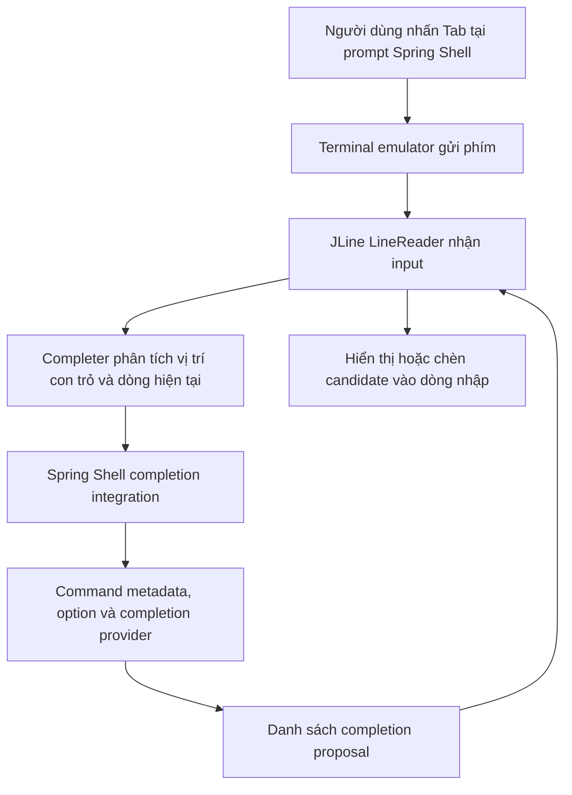

# Phân biệt hoàn thành trong JLine với hoàn thành của shell hệ điều hành

Khi nhấn `Tab` trong lúc nhập lệnh, người dùng có thể thấy tên command, option, giá trị enum hoặc đường dẫn được gợi ý. Tuy nhiên, phím `Tab` không tự quyết định cơ chế nào tạo ra các gợi ý đó. Thành phần đang nhận dữ liệu bàn phím mới là yếu tố quyết định.

Trong một ứng dụng Spring Shell chạy tương tác, JLine có thể đọc dòng nhập và yêu cầu Spring Shell cung cấp các completion proposal. Khi người dùng đang đứng ở dấu nhắc PowerShell, Bash hoặc Zsh để chuẩn bị khởi chạy chương trình, shell hệ điều hành lại xử lý việc hoàn thành. Hai cơ chế có thể cùng hỗ trợ một ứng dụng CLI, nhưng hoạt động ở hai thời điểm và hai phạm vi khác nhau.

## Mục tiêu học tập

Sau bài học, bạn có thể:

- Phân biệt terminal emulator, shell hệ điều hành, Spring Shell runtime và JLine.
- Xác định thành phần nào nhận phím `Tab` trong từng giai đoạn sử dụng CLI.
- Giải thích cách JLine hoàn thành command, option và giá trị bên trong phiên Spring Shell.
- Giải thích cách Bash, PowerShell hoặc Zsh hoàn thành tên executable và đối số trước khi chạy chương trình.
- Phân biệt completion provider của ứng dụng với script completion được cài trong shell hệ điều hành.
- Nhận biết sự khác nhau giữa completion tương tác và completion khi chạy CLI theo kiểu command-line.
- Thiết kế, cài đặt và kiểm thử completion cho đúng môi trường sử dụng.

## 1. Vì sao cần phân biệt hai cơ chế?

Giả sử nhóm phát triển có công cụ `support-cli`. Công cụ có một phiên tương tác với các command như `customer list`, `report export` và `server connect`.

Người dùng có thể nhấn `Tab` ở hai vị trí khác nhau:

**Trước khi ứng dụng khởi chạy**, tại dấu nhắc của shell hệ điều hành:

```text
PS C:\tools> support-cli --<TAB>
```

hoặc:

```text
$ support-cli --<TAB>
```

Ở đây, PowerShell hoặc Bash đang phân tích dòng lệnh. Nếu shell có completion definition cho `support-cli`, nó có thể gợi ý các option khởi chạy, đường dẫn hoặc đối số mà chương trình hỗ trợ.

**Sau khi ứng dụng đã chạy**, tại prompt của Spring Shell:

```text
support:> customer <TAB>
```

Ở đây, tiến trình Java đang nhận input. Nếu ứng dụng dùng JLine, JLine xử lý phím `Tab` và yêu cầu Spring Shell tìm các command hoặc value phù hợp với ngữ cảnh hiện tại.

Hai tình huống có cùng thao tác bàn phím nhưng khác thành phần xử lý, nguồn dữ liệu gợi ý, quy tắc quote và cách triển khai.

## 2. Các thành phần tham gia

| Thành phần | Vai trò | Có tạo completion không? |
|---|---|---|
| Terminal emulator | Hiển thị văn bản, gửi phím bấm và dữ liệu terminal | Thường không quyết định nội dung gợi ý |
| Shell hệ điều hành | Phân tích lệnh ở dấu nhắc hệ điều hành và khởi chạy process | Có, thông qua completion function/script hoặc cơ chế tích hợp riêng |
| JVM và Spring Shell runtime | Quản lý command của ứng dụng và thực thi nghiệp vụ | Cung cấp metadata và nguồn gợi ý cho completion của ứng dụng |
| JLine | Đọc dòng tương tác, chỉnh sửa input và gọi cơ chế completion trong process | Có, khi ứng dụng dùng JLine-based shell |
| Completion provider | Tạo danh sách giá trị gợi ý theo ngữ cảnh command | Có, nhưng chỉ khi được cơ chế completion tương ứng gọi |

Terminal emulator như Windows Terminal hoặc một terminal trên Linux chủ yếu chuyển phím bấm đến tiến trình đang chạy ở foreground và hiển thị kết quả. Nó không tự biết `customer list` là command Spring Shell hay `--profile` là option của ứng dụng.

Shell hệ điều hành như PowerShell, Bash hoặc Zsh quản lý dòng lệnh dùng để khởi chạy chương trình. Khi tiến trình Java đang chạy tương tác và đọc input từ terminal, shell cha thường đang chờ tiến trình đó kết thúc. Lúc này, shell cha không phân tích từng ký tự mà người dùng nhập vào prompt `support:>`.

JLine hoạt động bên trong tiến trình ứng dụng. Nó đọc dòng nhập, quản lý con trỏ và lịch sử, rồi kết nối phím `Tab` với completer. Spring Shell cung cấp thông tin command và các completion proposal để JLine trình bày.

## 3. Hoàn thành trong JLine diễn ra như thế nào?

Trong phiên tương tác dùng JLine, luồng cơ bản như sau:



Ví dụ người dùng đang nhập:

```text
support:> customer <TAB>
```

Spring Shell có thể gợi ý các command bắt đầu bằng `customer`, chẳng hạn:

```text
customer list
customer find
customer disable
```

Khi người dùng nhập tên command và chuyển sang option:

```text
support:> customer find --<TAB>
```

completion có thể gợi ý các option đã khai báo cho command `customer find`.

Khi con trỏ đang ở vị trí value:

```text
support:> customer find --status <TAB>
```

ứng dụng có thể gợi ý các trạng thái như `active`, `disabled` hoặc `pending` nếu đã cấu hình nguồn completion tương ứng.

JLine chịu trách nhiệm tương tác với dòng nhập và hiển thị candidate. Spring Shell hiểu cấu trúc command, option và cung cấp thông tin phù hợp. Completion provider của ứng dụng có thể bổ sung dữ liệu nghiệp vụ như tên môi trường, mã khách hàng hoặc profile triển khai.

## 4. Nguồn gợi ý trong Spring Shell

Completion trong ứng dụng có thể lấy dữ liệu từ nhiều nguồn:

- **Command metadata:** tên command, alias và option được đăng ký.
- **Kiểu dữ liệu:** các giá trị enum hoặc kiểu có tập lựa chọn xác định.
- **Hệ thống file:** file và thư mục tại vị trí hiện tại.
- **Dữ liệu nghiệp vụ:** môi trường, tenant, tên cluster hoặc mã tài nguyên.
- **Trạng thái phiên:** giá trị phụ thuộc người dùng đã kết nối, đã chọn workspace hoặc đã đăng nhập.

Ví dụ, command `deploy` có option `--environment`. Khi người dùng nhấn `Tab` tại value của option, ứng dụng có thể đề xuất `dev`, `staging` và `production`.

Trong Spring Shell 3.x, completion có thể được xây dựng qua `CompletionContext` và `CompletionProposal`. Với programmatic command registration, có thể khai báo completion cho option; với annotation model legacy, `ValueProvider` cung cấp giá trị cho option. API cụ thể tùy mô hình command và minor version.

Trong Spring Shell 4.x, completion được tổ chức ở cấp command bằng `CompletionProvider`. Tài liệu 4.x có các provider dựng sẵn như `EnumCompletionProvider`, `FileNameCompletionProvider` và `CompositeCompletionProvider`; provider tùy chỉnh có thể được đăng ký thành bean và tham chiếu từ `@Command`. Xem [tài liệu completion của Spring Shell 4.0.4](https://docs.spring.io/spring-shell/reference/commands/completion.html).

Ví dụ rút gọn theo annotation model 4.x:

```java
import java.util.List;

import org.springframework.context.annotation.Bean;
import org.springframework.shell.core.command.annotation.Command;
import org.springframework.shell.core.command.annotation.Option;
import org.springframework.shell.core.command.completion.CompletionProposal;
import org.springframework.shell.core.command.completion.CompletionProvider;
import org.springframework.stereotype.Component;

@Component
public class DeploymentCommands {

    @Command(
            name = "deploy",
            description = "Triển khai ứng dụng",
            completionProvider = "environmentCompletionProvider")
    public String deploy(
            @Option(longName = "environment") String environment) {
        return "Deploying to " + environment;
    }
}

@Component
class DeploymentCompletionConfiguration {

    @Bean
    CompletionProvider environmentCompletionProvider() {
        return context -> List.of(
                new CompletionProposal("dev"),
                new CompletionProposal("staging"),
                new CompletionProposal("production"));
    }
}
```

Đây là ví dụ provider tĩnh để minh họa hợp đồng. Trong ứng dụng thực tế, danh sách môi trường có thể được đọc từ cấu hình hoặc một service. Provider chỉ tạo gợi ý; command vẫn phải kiểm tra môi trường có tồn tại và người dùng có quyền triển khai hay không khi thực thi.

## 5. Hoàn thành của shell hệ điều hành hoạt động như thế nào?

Shell hệ điều hành hoàn thành dòng lệnh trước khi process được khởi chạy. Mỗi shell có cơ chế đăng ký riêng:

| Shell hệ điều hành | Cơ chế phổ biến |
|---|---|
| Bash | Completion function và `complete`, thường được nạp từ completion script |
| Zsh | Completion function và completion definition được nạp vào hệ thống completion |
| PowerShell | `Register-ArgumentCompleter` hoặc module cung cấp argument completer |
| Fish | Completion definition theo cú pháp Fish |

Ví dụ, Bash có thể đăng ký một hàm để gợi ý option của executable `support-cli`:

```bash
_support_cli_complete() {
    local current="${COMP_WORDS[COMP_CWORD]}"
    COMPREPLY=( $(compgen -W "--help --version --config" -- "$current") )
}

complete -F _support_cli_complete support-cli
```

Đây là completion function của Bash. Người dùng nạp script vào Bash; khi gõ `support-cli --` rồi nhấn `Tab`, Bash gọi hàm `_support_cli_complete` và hiển thị các option được định nghĩa.

Hàm trên chỉ minh họa completion tĩnh cho các option cấp executable. Nó không gọi JLine, không truy cập prompt `support:>` và không tự biết danh sách command nội bộ của Spring Shell.

Với PowerShell, có thể đăng ký completer bằng `Register-ArgumentCompleter`. Với Zsh hoặc Fish, cần dùng định dạng completion tương ứng. Một script Bash không tự hoạt động trong PowerShell hoặc Zsh.

## 6. Spring Shell có thể hỗ trợ completion cho shell hệ điều hành

Spring Shell 3.x phân biệt completion của phiên tương tác với completion của command-line. Trong tài liệu 3.4.1, phần interactive sử dụng completion context và proposal trong shell đang chạy; phần command-line cần tích hợp với shell hệ điều hành như Bash. Tài liệu cũng nêu hỗ trợ command-line completion hiện tại cho Bash.

Spring Shell 3.x cung cấp command tích hợp `completion` để tạo script có thể dùng với shell hệ điều hành. Tài liệu built-in command mô tả implementation Bash và cách dùng tiểu lệnh `bash`. Điều này hữu ích khi người dùng muốn được gợi ý ngay tại dấu nhắc hệ điều hành hoặc khi ứng dụng được sử dụng như một command-line tool không mở REPL.

Quy trình khái quát:

1. Khởi chạy ứng dụng với command tích hợp tạo completion script.
2. Lưu script được tạo vào vị trí phù hợp với cấu hình người dùng hoặc hệ thống.
3. Nạp script trong cấu hình Bash hoặc cài đặt theo cơ chế completion của môi trường.
4. Mở shell mới hoặc nạp lại cấu hình.
5. Gõ tên executable và nhấn `Tab` để kiểm tra candidate.

Việc tạo script không đồng nghĩa script đã được cài vào mọi shell của máy. Người dùng vẫn cần nạp hoặc cài script theo cơ chế của shell tương ứng. Với PowerShell, Zsh hoặc Fish, hãy xác nhận phiên bản Spring Shell có hỗ trợ trực tiếp hay cần tự viết completion definition.

Tham khảo [Completion trong Spring Shell 3.4.1](https://docs.spring.io/spring-shell/reference/completion.html) và [built-in completion command](https://docs.spring.io/spring-shell/reference/commands/builtin/completion.html).

## 7. So sánh JLine completion và OS shell completion

| Tiêu chí | JLine completion | OS shell completion |
|---|---|---|
| Thời điểm | Sau khi ứng dụng Spring Shell đã chạy và đang nhận input | Trước khi executable hoặc command được khởi chạy |
| Thành phần nhận `Tab` | JLine trong tiến trình Java | Bash, Zsh, PowerShell, Fish... |
| Phạm vi hiểu cú pháp | Command và option bên trong phiên Spring Shell | Cú pháp executable và đối số mà shell bên ngoài biết |
| Nguồn candidate | Spring Shell metadata, completion provider, trạng thái ứng dụng | Completion script, function, module hoặc chương trình hỗ trợ completion |
| Ngữ cảnh | Prompt như `support:>` | Prompt như `$` hoặc `PS C:\>` |
| Quy tắc quote/escape | Parser và terminal integration của ứng dụng | Quy tắc quote/escape của shell hệ điều hành |
| Cài đặt | Dependency và cấu hình JLine/Spring Shell | Script hoặc module được nạp/cài trong shell người dùng |
| Phạm vi nền tảng | Theo JLine và terminal được hỗ trợ | Phụ thuộc từng shell; script thường không dùng chung giữa Bash, PowerShell, Zsh và Fish |
| Khi chạy script không tương tác | Không có thao tác nhấn `Tab` trong phiên REPL | Có thể hoàn thành khi người dùng soạn script hoặc command ở shell trước khi chạy |

Điểm khác biệt cốt lõi là nơi diễn ra việc phân tích dòng lệnh. JLine hoạt động trong ứng dụng; OS shell hoạt động ở bên ngoài ứng dụng.

## 8. Hai cơ chế có thể cùng tồn tại

Một CLI được thiết kế tốt có thể cung cấp cả hai lớp completion.

**Ở shell hệ điều hành:** người dùng được gợi ý tên executable, option khởi chạy, đường dẫn cấu hình hoặc tham số dùng để chọn chế độ chạy.

**Ở prompt Spring Shell:** người dùng được gợi ý command nghiệp vụ, option của command, giá trị enum, tên tài nguyên hoặc dữ liệu phụ thuộc trạng thái ứng dụng.

Ví dụ:

```text
# Bash hoàn thành executable và option khởi chạy
$ support-cli --config ./<TAB>

# Sau khi ứng dụng chạy, JLine hoàn thành command nội bộ
support:> customer <TAB>

# JLine tiếp tục hoàn thành giá trị option
support:> deploy --environment <TAB>
```

Các dòng trên minh họa hai lớp giao tiếp. Completion script của Bash không tự động gọi completion provider bên trong REPL. Nếu muốn dùng chung danh sách candidate, nhóm phát triển cần có nguồn dữ liệu hoặc giao thức dùng chung, rồi kết nối riêng với từng cơ chế.

Ví dụ, danh sách môi trường có thể nằm trong một service hoặc file cấu hình chung. Completion provider của JLine đọc danh sách đó trong process. Bash completion function có thể gọi một chế độ completion riêng của executable để lấy candidate. Hai adapter dùng chung dữ liệu nhưng vẫn phải xuất kết quả theo định dạng mà mỗi shell yêu cầu.

## 9. Phân biệt completion với parser và validation

Completion chỉ đề xuất giá trị có thể dùng. Nó không bảo đảm giá trị đó vẫn hợp lệ khi command được thực thi.

Ví dụ, provider gợi ý môi trường `production`. Sau đó môi trường bị vô hiệu hóa hoặc người dùng mất quyền truy cập. Người dùng vẫn có thể nhập thủ công `production`, hoặc candidate cũ vẫn còn trong dòng lệnh. Command phải kiểm tra lại trạng thái và quyền khi chạy.

| Cơ chế | Trả lời câu hỏi |
|---|---|
| Completion | Người dùng có thể nhập giá trị nào tiếp theo? |
| Parser | Dòng lệnh được tách thành command, option và argument như thế nào? |
| Conversion | Token được chuyển sang kiểu Java nào? |
| Validation | Giá trị có thỏa constraint đầu vào không? |
| Authorization/nghiệp vụ | Người dùng có được phép thực hiện hành động với dữ liệu hiện tại không? |

Không dùng completion làm hàng rào bảo mật. Việc một giá trị không xuất hiện trong danh sách gợi ý không ngăn người dùng nhập trực tiếp nó. Kiểm tra quyền và quy tắc nghiệp vụ phải diễn ra trong service hoặc tầng domain tương ứng.

## 10. Quote và escaping khác nhau giữa hai lớp

Khi candidate chứa khoảng trắng hoặc ký tự đặc biệt, cơ chế completion phải chèn văn bản theo đúng parser của nơi nhận dòng lệnh.

Ví dụ tên file:

```text
monthly sales report.csv
```

Trong prompt Spring Shell, JLine completion cần phối hợp với parser của Spring Shell để chèn candidate sao cho khi người dùng nhấn Enter, parser hiểu đó là một value duy nhất.

Ở dấu nhắc Bash, completion function phải tạo candidate theo quy tắc quoting và escaping của Bash. Cùng một chuỗi có thể cần cách escape khác trong Bash, PowerShell và JLine.

Không sao chép chuỗi đã escape cho Bash rồi dùng trực tiếp trong JLine, hoặc ngược lại. Candidate nên biểu diễn giá trị logic; adapter của từng môi trường chịu trách nhiệm chuyển nó thành phần văn bản hợp lệ.

## 11. Thiết kế completion provider hiệu quả

Completion thường được gọi nhiều lần khi người dùng nhấn `Tab` hoặc tiếp tục gõ. Provider cần trả kết quả nhanh và ổn định.

Một provider tốt nên:

- Dùng `CompletionContext` để hiểu command, option và phần văn bản hiện tại.
- Chỉ truy vấn dữ liệu cần thiết cho vị trí con trỏ.
- Giới hạn số candidate khi tập dữ liệu quá lớn.
- Sắp xếp kết quả theo quy tắc dễ đoán.
- Tránh gọi API từ xa chậm ở mỗi lần nhấn `Tab`.
- Dùng cache có thời hạn khi dữ liệu thay đổi không thường xuyên.
- Không thực hiện tác động nghiệp vụ hoặc thay đổi trạng thái.
- Trả candidate phù hợp với parser và quy tắc escaping của môi trường.

Nếu có hàng chục nghìn khách hàng, không nên tải toàn bộ danh sách mỗi lần completion. Có thể lọc theo prefix hiện tại, dùng truy vấn giới hạn kết quả hoặc yêu cầu người dùng nhập thêm ký tự trước khi truy vấn.

Nếu provider gọi dịch vụ từ xa, hãy đặt timeout ngắn và xử lý lỗi. Khi nguồn dữ liệu không sẵn sàng, có thể trả danh sách rỗng hoặc tập candidate gần nhất theo chính sách đã chọn; không để một thao tác gợi ý làm treo toàn bộ phiên shell.

## 12. Completion trong chế độ tương tác và không tương tác

JLine completion thuộc trải nghiệm nhập liệu tương tác. Khi ứng dụng chạy một command rồi thoát, hoặc đọc lệnh từ script, không có phiên nhập dòng để người dùng nhấn `Tab`.

Ví dụ một script có thể chạy:

```bash
support-cli report export --format csv --output ./reports/daily.csv
```

Trong lúc script thực thi, ứng dụng nhận input đã được cung cấp và xử lý command. Không có completion tương tác ở thời điểm đó.

OS shell completion vẫn hữu ích trước khi chạy script: người dùng có thể nhấn `Tab` khi soạn command trong terminal. Nhưng một khi script đã chạy, các dòng lệnh phải đầy đủ và xác định. Nếu muốn IDE hoặc công cụ tự động sinh command, nên cung cấp help, command specification hoặc chế độ xuất metadata thay vì phụ thuộc vào JLine.

## 13. Lưu ý phiên bản Spring Shell

### Spring Shell 3.x

Tài liệu Spring Shell 3.4.1 mô tả hai loại completion:

- Interactive completion trong shell đang chạy, sử dụng completion context và proposal. Command registration programmatic có thể gắn completion theo option; annotation model legacy sử dụng `ValueProvider` cho option value.
- Command-line completion tích hợp với shell hệ điều hành. Tài liệu nêu hỗ trợ Bash và có built-in `completion` command để tạo script.

Khi dùng 3.x, cần phân biệt completion trong REPL với script được tạo để nạp vào Bash. Chúng không phải một cơ chế cài đặt.

### Spring Shell 4.x

Trong 4.x, completion của command được tổ chức lại theo `CompletionProvider` ở cấp command. JLine-based shell hỗ trợ completion bằng phím `Tab`; provider mặc định xử lý command và option, còn provider tùy chỉnh có thể trả candidate theo ngữ cảnh.

Một thay đổi quan trọng về dependency: `spring-shell-core` không còn phụ thuộc JLine. Mặc định core sử dụng `java.io.Console`; nếu muốn trải nghiệm JLine, bao gồm completion trong JLine-based shell, cần thêm module `spring-shell-jline`. Vì vậy, chỉ nâng version core không đồng nghĩa ứng dụng vẫn có cùng trải nghiệm JLine như trước. Xem [migration guide Spring Shell 4.x](https://github.com/spring-projects/spring-shell/wiki/v4-migration-guide).

API completion và package cũng thay đổi giữa 3.x và 4.x. Hãy dùng tài liệu đúng minor version thay vì sao chép `ValueProvider` hoặc `CompletionProvider` từ một mô hình cũ vào dự án mới.

## 14. Kiểm thử JLine completion

Kiểm thử completion trong ứng dụng cần xác nhận cả provider lẫn cách tích hợp với dòng nhập.

**Unit test provider:** gọi provider với completion context phù hợp và xác nhận danh sách candidate, thứ tự hoặc giới hạn số lượng.

**Integration test command:** khởi tạo Spring context, đăng ký command và provider, rồi xác nhận completion được gắn đúng command hoặc option.

**Interactive test:** dùng terminal giả lập hoặc test support phù hợp với phiên bản để gửi input có phím `Tab`, sau đó xác nhận candidate được chèn hoặc hiển thị như mong đợi.

Các trường hợp nên kiểm tra:

- Prefix không khớp candidate nào.
- Chỉ có một candidate.
- Có nhiều candidate cùng prefix.
- Candidate có khoảng trắng hoặc ký tự cần escape.
- Provider không có dữ liệu hoặc gặp lỗi.
- Candidate phụ thuộc trạng thái ứng dụng.
- Candidate đã lỗi thời nhưng người dùng vẫn nhập giá trị thủ công.

## 15. Kiểm thử OS shell completion

Completion script phải được kiểm tra trong shell mà nó hỗ trợ. Với Bash, cần xác nhận script được nạp, hàm được đăng ký cho đúng executable và candidate được trả về theo nội dung hiện tại của dòng lệnh.

Các trường hợp kiểm tra:

- Gõ một phần tên executable.
- Gõ prefix của option cấp executable.
- Gõ option cần giá trị và kiểm tra candidate value nếu script hỗ trợ.
- Kiểm tra đường dẫn có khoảng trắng.
- Kiểm tra khi executable chưa nằm trong `PATH`.
- Kiểm tra sau khi cài hoặc nâng cấp completion script.
- Kiểm tra trong shell mới sau khi nạp cấu hình.

Với PowerShell, kiểm tra argument completer đã được đăng ký trong phiên hoặc profile. Với Zsh và Fish, kiểm tra completion definition được nạp theo cơ chế riêng của shell đó.

Không dùng test JLine để kết luận Bash completion hoạt động. Ngược lại, việc Bash gợi ý đúng option cũng không chứng minh JLine đã được cấu hình trong phiên Spring Shell.

## 16. Các lỗi thường gặp

### Nhấn `Tab` tại prompt Spring Shell nhưng không có gợi ý

Kiểm tra ứng dụng có đang chạy JLine-based shell không, dependency JLine có mặt không, phím `Tab` có bị key binding khác chiếm không và command/provider có được đăng ký đúng không. Với Spring Shell 4.x, kiểm tra đã thêm module `spring-shell-jline` nếu muốn dùng JLine.

### Nhấn `Tab` tại PowerShell hoặc Bash nhưng chỉ thấy file và thư mục

Shell hệ điều hành chưa có completion definition cho executable. Cần cài hoặc nạp script completion tương ứng. Completion provider trong Spring Shell không tự động đăng ký hàm vào Bash hoặc PowerShell.

### JLine hoạt động nhưng Bash không gợi ý command nội bộ

JLine completion chạy bên trong process. Bash cần completion script hoặc tích hợp OS shell riêng. Kiểm tra built-in `completion` command của Spring Shell 3.x nếu phiên bản và môi trường hỗ trợ.

### Bash hoạt động nhưng PowerShell không hoạt động

Script Bash không phải PowerShell argument completer. Cần viết hoặc cài module completion dành riêng cho PowerShell nếu muốn hỗ trợ shell đó.

### Candidate xuất hiện nhưng chèn sai dấu nháy

Kiểm tra parser và quy tắc escaping của môi trường hiện tại. Candidate được tạo cho JLine không nên tái sử dụng nguyên văn cho Bash hoặc PowerShell.

### Completion chậm hoặc làm treo prompt

Kiểm tra provider có gọi API từ xa, truy vấn không giới hạn hoặc tải toàn bộ dữ liệu không. Lọc theo prefix, giới hạn kết quả, cache phù hợp và đặt timeout.

### Candidate không còn hợp lệ khi thực thi

Completion chỉ là gợi ý tại một thời điểm. Thực hiện lại validation, availability và authorization khi command được gọi.

## 17. Checklist lựa chọn và triển khai

- [ ] Đã xác định người dùng cần completion tại prompt Spring Shell hay dấu nhắc hệ điều hành.
- [ ] Đã xác định thành phần đang nhận phím `Tab`.
- [ ] Nếu dùng JLine, đã thêm và cấu hình tích hợp JLine phù hợp với phiên bản.
- [ ] Nếu dùng OS shell, đã chọn đúng shell đích và completion definition tương ứng.
- [ ] Provider chỉ tạo gợi ý, không thực hiện nghiệp vụ.
- [ ] Candidate được lọc theo command, option và prefix hiện tại.
- [ ] Dữ liệu động có timeout, cache hoặc giới hạn kết quả phù hợp.
- [ ] Quy tắc quote/escape đúng với parser nhận candidate.
- [ ] Validation và authorization vẫn được thực hiện khi command chạy.
- [ ] Có test riêng cho JLine và OS shell completion.
- [ ] Tài liệu cài đặt completion script nêu rõ cách nạp hoặc đăng ký.
- [ ] Đã đối chiếu API với đúng minor version Spring Shell.

## 18. Tự kiểm tra

**Câu 1.** Khi đang ở prompt `support:>` và nhấn `Tab`, thành phần nào xử lý completion trong ứng dụng dùng JLine?

**Gợi ý trả lời:** JLine nhận phím và gọi completer; Spring Shell cung cấp metadata command và completion proposal theo ngữ cảnh.

**Câu 2.** Khi đang ở `PS C:\>` và nhập `support-cli --`, thành phần nào xử lý completion?

**Gợi ý trả lời:** PowerShell xử lý completion thông qua argument completer hoặc module đã đăng ký cho executable.

**Câu 3.** Completion provider của Spring Shell có tự động cài completion vào Bash không?

**Gợi ý trả lời:** Không. Provider phục vụ completion của ứng dụng. OS shell cần completion script hoặc tích hợp riêng; Spring Shell 3.x có built-in completion command cho Bash theo tài liệu phiên bản.

**Câu 4.** Vì sao completion trong JLine không hoạt động khi ứng dụng chỉ chạy một command rồi thoát?

**Gợi ý trả lời:** Vì không có phiên nhập dòng tương tác để nhận phím `Tab`. Ứng dụng đang xử lý input đã được truyền vào và kết thúc.

**Câu 5.** Spring Shell 4.x cần lưu ý gì nếu muốn dùng JLine completion?

**Gợi ý trả lời:** Core không còn kéo JLine theo dependency mặc định. Cần thêm module `spring-shell-jline` để dùng JLine-based shell và completion tương ứng.

## Kết luận

JLine completion và OS shell completion phục vụ hai giai đoạn khác nhau. JLine hoàn thành command, option và value bên trong phiên Spring Shell đang chạy. Bash, PowerShell, Zsh hoặc Fish hoàn thành executable và đối số ở dấu nhắc hệ điều hành trước khi process được khởi chạy.

Spring Shell có thể cung cấp metadata và provider để tạo gợi ý trong ứng dụng, đồng thời hỗ trợ tích hợp OS shell theo phiên bản và nền tảng. Hãy xác định rõ nơi nhận phím `Tab`, chọn adapter phù hợp, kiểm thử riêng từng lớp và giữ validation ở thời điểm thực thi. Khi đó, completion giúp người dùng nhập lệnh nhanh hơn mà không làm mờ ranh giới giữa ứng dụng và shell hệ điều hành.

## Tài liệu tham khảo

- [Spring Shell 3.4.1 — Completion](https://docs.spring.io/spring-shell/reference/completion.html)
- [Spring Shell 3.3.4 — Built-in completion command](https://docs.spring.io/spring-shell/reference/commands/builtin/completion.html)
- [Spring Shell 4.0.4 — Command Completion](https://docs.spring.io/spring-shell/reference/commands/completion.html)
- [Spring Shell 4.x — Migration guide](https://github.com/spring-projects/spring-shell/wiki/v4-migration-guide)
