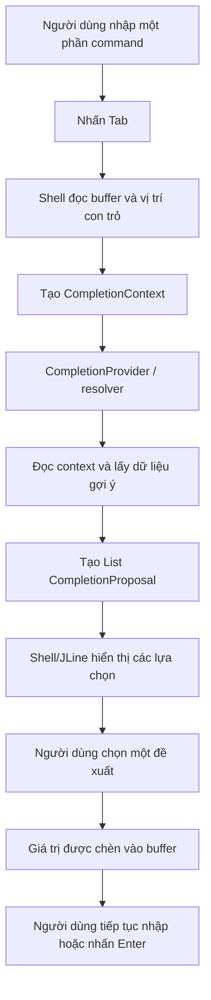

# CompletionContext và CompletionProposal theo API phiên bản

Khi người dùng nhấn Tab trong một phiên Spring Shell tương tác, shell cần biết con trỏ đang ở đâu trong dòng lệnh và command đang được nhập là gì. Từ ngữ cảnh đó, bộ cung cấp completion tạo ra các đề xuất để người dùng chọn. Hai kiểu dữ liệu trung tâm của quá trình này là `CompletionContext` và `CompletionProposal`.

`CompletionContext` mô tả dòng lệnh chưa hoàn chỉnh tại vị trí con trỏ. `CompletionProposal` mô tả một lựa chọn có thể được chèn vào dòng lệnh, kèm thông tin trình bày như nhãn, mô tả hoặc nhóm. Cả hai kiểu tồn tại trong Spring Shell 3.x và 4.x, nhưng package, một số accessor và cách gắn provider đã thay đổi đáng kể.

## Luồng xử lý completion

Completion không thực thi command. Nó chỉ giúp người dùng hoàn thành tên command, tên option hoặc giá trị của một tham số trước khi nhấn Enter.



Ví dụ, người dùng đang nhập:

```text
shell:>deploy --environment st
```

Provider có thể nhận ra con trỏ đang ở giá trị của option `--environment`, rồi trả về các lựa chọn `staging` và `staging-eu`. Khi người dùng chọn `staging`, shell chèn giá trị đó vào buffer. Command `deploy` chỉ được thực thi khi người dùng nhấn Enter.

## CompletionContext chứa thông tin gì?

`CompletionContext` đại diện cho buffer tại thời điểm completion được yêu cầu. Nó không chỉ chứa chuỗi đã gõ mà còn mô tả vị trí con trỏ. Nhờ đó, provider có thể phân biệt người dùng đang hoàn thành tên option, giá trị option hay một đối số vị trí.

Các thông tin quan trọng gồm:

| Thành phần | Ý nghĩa |
|---|---|
| `words` | Các từ trong buffer, không bao gồm tên command |
| `wordIndex` | Chỉ số của từ mà con trỏ đang đứng |
| `position` | Vị trí con trỏ bên trong từ hiện tại |
| Command hiện tại | Command đã được phân giải, nếu có |
| Option hiện tại | Option mà người dùng đang nhập giá trị, nếu có |
| `currentWord()` | Toàn bộ từ đang chứa con trỏ; có thể trả `null` nếu con trỏ nằm sau từ cuối |
| `currentWordUpToCursor()` | Phần từ từ đầu từ đến vị trí con trỏ |
| `upToCursor()` | Phần buffer từ đầu dòng đến vị trí con trỏ |
| `drop(n)` | Tạo một context mới như thể đã bỏ qua `n` từ đầu danh sách words |

`words` không chứa tên command. Điều này hữu ích khi provider xử lý các token sau command mà không cần tự loại bỏ phần tên lệnh. Các trường command và option có thể không có giá trị khi người dùng đang hoàn thành ở đầu dòng hoặc ở vị trí chưa được parser phân giải; hãy kiểm tra `null` trước khi truy cập.

Trong API 4.x, cả `currentWord()` và `currentWordUpToCursor()` đều có thể trả `null` khi con trỏ nằm sau từ cuối. Provider nên xử lý trường hợp này như một prefix rỗng hoặc trả danh sách rỗng, tùy mục tiêu gợi ý.

## API Spring Shell 3.4.x

Trong Spring Shell 3.4.3, `CompletionContext` và `CompletionProposal` nằm trong package `org.springframework.shell`:

```java
import org.springframework.shell.CompletionContext;
import org.springframework.shell.CompletionProposal;
```

Các accessor chính của `CompletionContext` là:

```java
List<String> words = context.getWords();
int wordIndex = context.getWordIndex();
int position = context.getPosition();
CommandRegistration registration = context.getCommandRegistration();
CommandOption option = context.getCommandOption();

String currentWord = context.currentWord();
String typedPrefix = context.currentWordUpToCursor();
String bufferPrefix = context.upToCursor();
CompletionContext remaining = context.drop(1);
```

`getCommandRegistration()` cung cấp registration đang được xử lý; `getCommandOption()` cung cấp option liên quan đến vị trí completion. `CommandOption` của 3.x là interface và có các accessor dạng JavaBean như `getLongNames()`, `getShortNames()`, `getCompletion()` và `getType()`.

Ví dụ kiểm tra option hiện tại:

```java
CommandOption option = context.getCommandOption();
if (option != null) {
    String[] longNames = option.getLongNames();
    // Dùng tên option để chọn tập giá trị cần gợi ý.
}
```

Trong 3.x, `CompletionContext` có constructor nhận `words`, `wordIndex`, `position`, `CommandRegistration` và `CommandOption`. Constructor này hữu ích khi viết unit test cho provider mà không cần khởi chạy terminal.

## API Spring Shell 4.0.x

Trong Spring Shell 4.0.4, hai lớp chuyển sang package `org.springframework.shell.core.command.completion`:

```java
import org.springframework.shell.core.command.completion.CompletionContext;
import org.springframework.shell.core.command.completion.CompletionProposal;
```

Các thông tin về buffer và con trỏ vẫn giữ cách dùng tương tự, nhưng accessor của command thay đổi:

```java
List<String> words = context.getWords();
int wordIndex = context.getWordIndex();
int position = context.getPosition();
Command command = context.getCommand();
CommandOption option = context.getCommandOption();

String currentWord = context.currentWord();
String typedPrefix = context.currentWordUpToCursor();
String bufferPrefix = context.upToCursor();
CompletionContext remaining = context.drop(1);
```

Khác biệt quan trọng là `getCommand()` thay cho `getCommandRegistration()`. `Command` và `CommandOption` có thể là `null`, nên provider cần kiểm tra trước khi đọc metadata.

Trong 4.x, `CommandOption` là record, các accessor dùng tên thành phần như `longName()`, `shortName()`, `description()`, `value()` và `type()`:

```java
CommandOption option = context.getCommandOption();
if (option != null && "environment".equals(option.longName())) {
    String currentValue = option.value();
}
```

`value()` là giá trị runtime gắn với option trong context; nó có thể chưa có khi người dùng mới bắt đầu nhập option. Không giả định mọi lần gọi completion đều có command hoặc option đã được phân giải đầy đủ.

## So sánh CompletionContext giữa 3.x và 4.x

| Nội dung | Spring Shell 3.4.x | Spring Shell 4.0.x |
|---|---|---|
| Package | `org.springframework.shell` | `org.springframework.shell.core.command.completion` |
| Lớp command | `CommandRegistration` | `Command` |
| Lấy command | `getCommandRegistration()` | `getCommand()` |
| Lấy option | `getCommandOption()` | `getCommandOption()` |
| Lấy danh sách từ | `getWords()` | `getWords()` |
| Chỉ số từ | `getWordIndex()` | `getWordIndex()` |
| Vị trí con trỏ trong từ | `getPosition()` | `getPosition()` |
| Từ hiện tại | `currentWord()` | `currentWord()` |
| Phần từ đã nhập đến con trỏ | `currentWordUpToCursor()` | `currentWordUpToCursor()` |
| Buffer đến con trỏ | `upToCursor()` | `upToCursor()` |
| Bỏ qua các từ đầu | `drop(int)` | `drop(int)` |

Khi nâng cấp, cần đổi cả import lẫn accessor command. Chỉ đổi package mà giữ `getCommandRegistration()` sẽ không biên dịch trong 4.x.

## CompletionProposal biểu diễn một đề xuất

`CompletionProposal` chứa giá trị sẽ được chèn vào buffer và metadata giúp shell trình bày đề xuất. Constructor cơ bản nhận một chuỗi:

```java
CompletionProposal proposal = new CompletionProposal("staging");
```

Các thuộc tính chính:

| Thuộc tính | Vai trò |
|---|---|
| `value` | Chuỗi completion đưa vào dòng lệnh |
| `displayText` | Nhãn hiển thị cho người dùng; có thể khác `value` |
| `description` | Mô tả ngắn về lựa chọn |
| `category` | Nhóm hoặc loại của lựa chọn |
| `complete` | Cờ trạng thái hoàn tất của đề xuất |
| `dontQuote` | Cờ yêu cầu không tự thêm dấu nháy cho giá trị |

Ví dụ tạo đề xuất có phần hiển thị dễ đọc:

```java
CompletionProposal proposal = new CompletionProposal("--environment=staging")
        .displayText("staging")
        .description("Môi trường kiểm thử trước khi phát hành")
        .category("Environment");
```

Người dùng nhìn thấy `staging` và mô tả, trong khi chuỗi được chèn vào buffer là `--environment=staging`. Đây là cách tách nội dung giao diện khỏi cú pháp thực tế.

`dontQuote` hữu ích khi giá trị cần giữ nguyên mà không được shell tự bọc dấu nháy. Chỉ bật cờ này khi đã hiểu quy tắc quoting của parser và giá trị thực sự không cần quote. Với đường dẫn hoặc tên chứa khoảng trắng, cần kiểm tra hành vi chèn để tránh tạo dòng lệnh không hợp lệ.

API cũng có `complete()` và `complete(boolean)` để đọc/đặt cờ hoàn tất của đề xuất. Javadoc liệt kê cờ này nhưng không mô tả đầy đủ mọi hiệu ứng giao diện của từng line reader. Nếu không có yêu cầu đặc biệt, hãy giữ mặc định; khi thay đổi cờ, kiểm thử hành vi Tab với đúng cấu hình shell/JLine của ứng dụng.

## CompletionProposal trong 3.x và 4.x

Các thuộc tính của `CompletionProposal` gần như giữ nguyên giữa hai dòng phiên bản, nhưng package thay đổi:

| Nội dung | Spring Shell 3.4.x | Spring Shell 4.0.x |
|---|---|---|
| Package | `org.springframework.shell.CompletionProposal` | `org.springframework.shell.core.command.completion.CompletionProposal` |
| Tạo đề xuất | `new CompletionProposal(value)` | `new CompletionProposal(value)` |
| Giá trị chèn | `value()` / `value(String)` | `value()` / `value(String)` |
| Nhãn hiển thị | `displayText()` / `displayText(String)` | `displayText()` / `displayText(String)` |
| Mô tả | `description()` / `description(String)` | `description()` / `description(String)` |
| Nhóm | `category()` / `category(String)` | `category()` / `category(String)` |
| Cờ hoàn tất | `complete()` / `complete(boolean)` | `complete()` / `complete(boolean)` |
| Không tự quote | `dontQuote()` / `dontQuote(boolean)` | `dontQuote()` / `dontQuote(boolean)` |

Khi chuyển code, thường chỉ cần đổi import của `CompletionProposal`. Tuy nhiên, vẫn phải kiểm tra nơi tạo proposal để bảo đảm chuỗi `value` phù hợp với cơ chế provider mới và cú pháp parser 4.x.

## Spring Shell 3.x: các cách cung cấp đề xuất

Trong 3.x, completion được tổ chức theo nhiều mức. Tài liệu mô tả ba cách chính: resolver dùng chung, completion theo từng option trong đăng ký programmatic và `ValueProvider` cho annotation legacy.

### CompletionResolver dùng chung

`CompletionResolver` là một interface mở rộng `CompletionProvider`, được dùng cho các resolver tổng quát có thể áp dụng trên nhiều command. Resolver nhận `CompletionContext` và trả về `List<CompletionProposal>`.

```java
import java.util.List;

import org.springframework.shell.CompletionContext;
import org.springframework.shell.CompletionProposal;
import org.springframework.shell.completion.CompletionResolver;
import org.springframework.stereotype.Component;

@Component
class EnvironmentCompletionResolver implements CompletionResolver {

    @Override
    public List<CompletionProposal> apply(CompletionContext context) {
        return List.of("dev", "staging", "production").stream()
                .map(value -> new CompletionProposal(value)
                        .category("Environment"))
                .toList();
    }
}
```

Resolver dạng bean phù hợp khi một chính sách gợi ý có thể dùng ở nhiều nơi. Nếu resolver chỉ nên tác động đến một option hoặc một command, hãy kiểm tra metadata trong context trước khi trả đề xuất để không làm lộ lựa chọn sang command khác.

### Completion riêng cho option trong CommandRegistration

Với command đăng ký bằng builder, có thể cấu hình completion ngay trên option:

```java
CommandRegistration registration = CommandRegistration.builder()
        .command("deploy")
        .withOption()
            .longNames("environment")
            .completion(context -> List.of("dev", "staging", "production").stream()
                    .map(CompletionProposal::new)
                    .toList())
            .and()
        .build();
```

Ở mô hình này, hàm completion được gắn trực tiếp với option. Đây là lựa chọn đơn giản khi danh sách gợi ý chỉ phụ thuộc vào option đang hoàn thành.

### ValueProvider với annotation legacy

Trong mô hình annotation legacy, `ValueProvider` cung cấp giá trị cho `@ShellOption(valueProvider = ...)`. Provider phải được đăng ký thành bean:

```java
import java.util.List;

import org.springframework.shell.CompletionContext;
import org.springframework.shell.CompletionProposal;
import org.springframework.shell.standard.ValueProvider;
import org.springframework.stereotype.Component;

@Component
class EnvironmentValueProvider implements ValueProvider {

    @Override
    public List<CompletionProposal> complete(CompletionContext context) {
        return List.of("dev", "staging", "production").stream()
                .map(CompletionProposal::new)
                .toList();
    }
}
```

Sau đó, gắn provider vào option legacy:

```java
@ShellMethod(value = "Triển khai ứng dụng", key = "deploy")
public String deploy(
        @ShellOption(valueProvider = EnvironmentValueProvider.class)
        String environment) {
    return "Triển khai lên " + environment;
}
```

`ValueProvider` là cơ chế của annotation legacy. Annotation model mới `@Command`/`@Option` trong 3.4.x không có thuộc tính `valueProvider` tương ứng. Nếu command dùng model mới và cần completion tùy chỉnh, hãy dùng `CommandRegistration` hoặc resolver phù hợp thay vì đưa thuộc tính legacy vào `@Option`.

## Spring Shell 4.x: CompletionProvider ở cấp command

Spring Shell 4.x tập trung completion ở cấp command. `CompletionProvider` là functional interface tương đương `Function<CompletionContext, List<CompletionProposal>>`; có thể triển khai bằng class hoặc lambda.

Đăng ký provider thành bean rồi tham chiếu tên bean từ `@Command(completionProvider = "...")`:

```java
import java.util.List;

import org.springframework.context.annotation.Bean;
import org.springframework.context.annotation.Configuration;
import org.springframework.shell.core.command.completion.CompletionProvider;
import org.springframework.shell.core.command.completion.CompletionProposal;

@Configuration
class CompletionConfiguration {

    @Bean("environmentCompletionProvider")
    CompletionProvider environmentCompletionProvider() {
        return context -> List.of("dev", "staging", "production").stream()
                .map(value -> new CompletionProposal("--environment=" + value)
                        .displayText(value)
                        .description("Môi trường " + value)
                        .category("Environment"))
                .toList();
    }
}
```

Command tham chiếu provider:

```java
import org.springframework.shell.core.command.annotation.Command;
import org.springframework.shell.core.command.annotation.Option;
import org.springframework.stereotype.Component;

@Component
class DeploymentCommands {

    @Command(
            name = "deploy",
            description = "Triển khai ứng dụng",
            completionProvider = "environmentCompletionProvider"
    )
    public String deploy(
            @Option(longName = "environment") String environment) {
        return "Triển khai lên " + environment;
    }
}
```

Với cách này, provider chịu trách nhiệm trả về các đề xuất phù hợp cho command. Trong mô hình programmatic, có thể gắn provider trực tiếp qua `Command.Builder.completionProvider(...)`:

```java
import org.springframework.context.annotation.Bean;
import org.springframework.shell.core.command.Command;
import org.springframework.shell.core.command.completion.CompletionProvider;

@Bean
Command deployCommand(CompletionProvider environmentCompletionProvider) {
    return Command.builder()
            .name("deploy")
            .completionProvider(environmentCompletionProvider)
            .execute(context -> "Đã nhận yêu cầu triển khai")
            .build();
}
```

## Completion liên thuộc tính trong 4.x

Một lợi ích của provider cấp command là có thể xét nhiều option cùng lúc. Ví dụ, danh sách tên người nhận có thể phụ thuộc vào giới tính đã chọn:

- Nếu `--gender FEMALE`, gợi ý `Alice` và `Eve`.
- Nếu `--gender MALE`, gợi ý `Bob` và `Charlie`.

Provider có thể kiểm tra option đang được hoàn thành qua `getCommandOption()` và đọc các từ đã nhập trước con trỏ qua `getWords()`:

```java
import java.util.List;

import org.springframework.shell.core.command.CommandOption;
import org.springframework.shell.core.command.completion.CompletionContext;
import org.springframework.shell.core.command.completion.CompletionProposal;
import org.springframework.shell.core.command.completion.CompletionProvider;

class HelloCompletionProvider implements CompletionProvider {

    @Override
    public List<CompletionProposal> apply(CompletionContext context) {
        CommandOption option = context.getCommandOption();
        if (option == null || option.longName() == null) {
            return List.of();
        }

        if ("gender".equals(option.longName())) {
            return List.of("MALE", "FEMALE").stream()
                    .map(value -> new CompletionProposal("--gender=" + value)
                            .displayText(value)
                            .category("Gender"))
                    .toList();
        }

        if ("name".equals(option.longName())) {
            String gender = previousOptionValue(context, "gender");
            List<String> names = "FEMALE".equalsIgnoreCase(gender)
                    ? List.of("Alice", "Eve")
                    : List.of("Bob", "Charlie");

            return names.stream()
                    .map(value -> new CompletionProposal("--name=" + value)
                            .displayText(value)
                            .description("Tên gợi ý")
                            .category("Name"))
                    .toList();
        }

        return List.of();
    }

    private String previousOptionValue(CompletionContext context, String optionName) {
        List<String> words = context.getWords();
        int end = Math.min(context.getWordIndex(), words.size());
        String option = "--" + optionName;

        for (int i = 0; i < end; i++) {
            String word = words.get(i);
            if (word.startsWith(option + "=")) {
                return word.substring((option + "=").length());
            }
            if (word.equals(option) && i + 1 < end) {
                return words.get(i + 1);
            }
        }
        return null;
    }
}
```

Hàm `previousOptionValue()` chỉ minh họa cách đọc một option đã nhập trước vị trí con trỏ từ các token trong context. Nếu ứng dụng hỗ trợ alias, tên option ngắn, nhiều cách quoting hoặc cú pháp đặc biệt, hãy mở rộng hàm theo parser thực tế hoặc dùng metadata của `CommandOption` khi có sẵn.

Provider trả về token đầy đủ như `--name=Alice`, trong khi `displayText` chỉ hiển thị `Alice`. Điều này giúp người dùng chọn giá trị ngắn gọn mà shell vẫn chèn được cú pháp option chính xác.

## Các provider dựng sẵn trong 4.x

Spring Shell 4.x cung cấp một số provider có thể tái sử dụng:

| Provider | Mục đích |
|---|---|
| `DefaultCompletionProvider` | Gợi ý enum option và tên option theo prefix trong context |
| `EnumCompletionProvider` | Gợi ý các hằng số của một enum; có thể thêm prefix cho dạng `key=value` |
| `FileNameCompletionProvider` | Gợi ý tên file và thư mục từ working directory |
| `CompositeCompletionProvider` | Kết hợp nhiều provider thành một provider |

Ví dụ ghép provider enum và provider tùy chỉnh:

```java
import org.springframework.shell.core.command.completion.CompositeCompletionProvider;
import org.springframework.shell.core.command.completion.CompletionProposal;
import org.springframework.shell.core.command.completion.CompletionProvider;
import org.springframework.shell.core.command.completion.EnumCompletionProvider;

@Bean("helloCompletionProvider")
CompletionProvider helloCompletionProvider() {
    CompletionProvider genderProvider =
            new EnumCompletionProvider(Gender.class, "--gender");

    CompletionProvider nameProvider = context -> List.of(
            new CompletionProposal("--name=Bob"),
            new CompletionProposal("--name=Alice")
    );

    return new CompositeCompletionProvider(nameProvider, genderProvider);
}
```

`EnumCompletionProvider` hữu ích khi option nhận enum và không cần tự viết danh sách giá trị. `FileNameCompletionProvider` phù hợp với option đường dẫn file. `CompositeCompletionProvider` cho phép kết hợp các nguồn gợi ý độc lập.

## So sánh mô hình completion 3.x và 4.x

| Nội dung | Spring Shell 3.4.x | Spring Shell 4.0.x |
|---|---|---|
| Context/Proposal package | `org.springframework.shell` | `org.springframework.shell.core.command.completion` |
| Provider package | `org.springframework.shell.completion` | `org.springframework.shell.core.command.completion` |
| Provider chính | `CompletionProvider`, `CompletionResolver` | `CompletionProvider` |
| Completion theo option programmatic | `CommandRegistration.OptionSpec.completion(...)` | Provider cấp command |
| Annotation legacy | `@ShellOption(valueProvider = ...)` với `ValueProvider` | Đã loại bỏ |
| Annotation model mới | `@Command`/`@Option`; không có thuộc tính completion provider riêng trên `@Option` | `@Command(completionProvider = "beanName")` |
| Programmatic command | `CommandRegistration` | `Command.Builder.completionProvider(...)` |
| Completion xuyên option | Hạn chế vì completion được gắn riêng theo option | Provider cấp command có thể xét các option khác đã nhập |
| Provider enum/file | `EnumValueProvider`, `FileValueProvider` | `EnumCompletionProvider`, `FileNameCompletionProvider` |

Migration guide v4 nêu rõ completion 3.x tách riêng theo từng option, gây khó khăn khi một đề xuất phụ thuộc vào option khác. Trong 4.x, completion được tập trung ở cấp command để provider có thể xem toàn bộ context và tạo đề xuất liên thuộc tính.

## Interactive completion và completion của shell hệ điều hành

Không nên nhầm completion khi đang ở phiên Spring Shell với completion của shell hệ điều hành:

- **Interactive completion:** người dùng đang ở prompt Spring Shell và nhấn Tab. Spring Shell/JLine tạo `CompletionContext`, gọi provider và hiển thị `CompletionProposal`.
- **Command-line completion:** người dùng đang ở Bash hoặc shell hệ điều hành và muốn shell đó gợi ý tên chương trình/đối số trước khi ứng dụng được khởi chạy. Cơ chế này cần script tích hợp với shell hệ điều hành.

Tài liệu Spring Shell 3.4.1 ghi nhận completion dòng lệnh hỗ trợ Bash thông qua command `completion` tích hợp. Trong migration guide v4, command `completion` đã bị loại bỏ; việc cấu hình completion cho Bash, Zsh hoặc shell khác do người dùng dự án thực hiện theo shell mục tiêu. `CompletionContext` và `CompletionProposal` chủ yếu phục vụ luồng gợi ý tương tác trong ứng dụng.

## Thiết kế provider nhanh và an toàn

Provider có thể được gọi nhiều lần khi người dùng di chuyển con trỏ hoặc nhấn Tab liên tiếp. Vì vậy, cần thiết kế nó như một hàm nhẹ và có thể gọi lặp:

1. **Đọc context, không thay đổi context.** Dùng `getWords()`, `currentWordUpToCursor()` và metadata option để quyết định đề xuất.
2. **Lọc theo prefix.** Chỉ trả các giá trị bắt đầu bằng phần người dùng đã nhập, tránh danh sách quá dài.
3. **Giới hạn số lượng.** Nếu có hàng nghìn tài nguyên, trả một số kết quả đầu phù hợp thay vì nạp toàn bộ.
4. **Tránh truy vấn chậm theo từng lần Tab.** Không gọi nhiều API mạng hoặc truy vấn database nặng trong provider; dùng cache hoặc service có giới hạn thời gian.
5. **Không làm thay đổi nghiệp vụ.** Provider chỉ gợi ý, không kết nối, không đăng nhập, không tạo tài nguyên và không thực thi command.
6. **Không tiết lộ dữ liệu nhạy cảm.** Chỉ đề xuất những giá trị mà người dùng hiện tại được phép nhìn thấy.
7. **Trả danh sách rỗng khi chưa đủ ngữ cảnh.** Nếu chưa biết môi trường hoặc command/option hiện tại, không nên đoán dữ liệu.
8. **Giữ `value` hợp lệ.** Giá trị được chèn phải là cú pháp mà parser có thể nhận, kể cả khi `displayText` ngắn hơn.

Completion không thay thế validation hoặc authorization. Một giá trị có thể xuất hiện trong gợi ý nhưng vẫn cần được xác thực lại khi command thực thi, vì dữ liệu có thể thay đổi giữa thời điểm gợi ý và thời điểm người dùng nhấn Enter.

## Kiểm thử CompletionContext và CompletionProposal

Nên kiểm thử provider độc lập với terminal trước, sau đó kiểm thử tích hợp với shell:

| Trường hợp | Điều cần xác nhận |
|---|---|
| Buffer rỗng | Provider không ném lỗi và trả danh sách hợp lý hoặc rỗng |
| Người dùng nhập prefix một phần | Chỉ các đề xuất phù hợp được trả về |
| Con trỏ nằm giữa từ | Provider dùng `currentWordUpToCursor()` thay vì giả định con trỏ luôn ở cuối |
| Con trỏ sau từ cuối | Xử lý `currentWord() == null` |
| Đang hoàn thành option | `getCommandOption()` được kiểm tra null và nhận diện đúng option |
| Đã nhập option phụ thuộc | Provider sử dụng các giá trị trước con trỏ để lọc đề xuất |
| Giá trị có khoảng trắng | Proposal được quote/escape đúng với parser |
| Giá trị có dấu `=` hoặc dấu gạch ngang | Chuỗi `value` được chèn đúng và không bị nhầm thành option khác |
| Không có dữ liệu phù hợp | Trả danh sách rỗng, không ném exception |
| Dữ liệu thay đổi hoặc quyền thay đổi | Provider không hiển thị dữ liệu người dùng không được phép xem |

### Unit test provider

Unit test có thể tạo `CompletionContext` trực tiếp. Constructor của 3.x nhận `CommandRegistration`; constructor 4.x nhận `Command`. Hãy dùng constructor và kiểu option của đúng version đang kiểm thử.

Với Spring Shell 4.x, có thể kiểm tra trực tiếp kết quả provider:

```java
import static org.assertj.core.api.Assertions.assertThat;

import java.util.List;

import org.junit.jupiter.api.Test;
import org.springframework.shell.core.command.CommandOption;
import org.springframework.shell.core.command.completion.CompletionContext;
import org.springframework.shell.core.command.completion.CompletionProposal;
import org.springframework.shell.core.command.completion.CompletionProvider;

@Test
void suggestsEnvironmentValues() {
    CompletionProvider provider = context -> List.of(
            new CompletionProposal("--environment=staging"));

    CommandOption option = CommandOption.with()
            .longName("environment")
            .type(String.class)
            .build();

    CompletionContext context = new CompletionContext(
            List.of("--environment=st"),
            0,
            16,
            null,
            option);

    List<CompletionProposal> proposals = provider.apply(context);

    assertThat(proposals)
            .extracting(CompletionProposal::value)
            .contains("--environment=staging");
}
```

Ví dụ trên minh họa cách kiểm tra dữ liệu đề xuất mà không tạo terminal. Trong test thực tế, cần căn `wordIndex` và `position` theo buffer đang mô phỏng; nếu provider dùng command metadata, truyền thêm `Command` tương ứng.

### Integration test trong shell

Unit test không kiểm tra JLine có hiển thị và chèn candidate đúng hay không. Hãy có kiểm thử tích hợp cho những luồng quan trọng:

1. Nhập command và nhấn Tab ở vị trí tên command.
2. Nhập `--environment=` và nhấn Tab để xem giá trị môi trường.
3. Chọn một môi trường, sau đó hoàn thành `--resource=` và xác nhận chỉ tài nguyên thuộc môi trường đó xuất hiện.
4. Chọn đề xuất có dấu cách hoặc ký tự đặc biệt và xác nhận parser nhận đúng giá trị sau khi chèn.
5. Kiểm tra completion không gọi command target và không tạo thay đổi nghiệp vụ.

## Lỗi thường gặp

| Biểu hiện | Nguyên nhân có thể | Cách xử lý |
|---|---|---|
| Không biên dịch `getCommandRegistration()` trong 4.x | API đã đổi sang `getCommand()` | Đổi accessor và import đúng package 4.x |
| Không tìm thấy `CompletionContext` hoặc `CompletionProposal` | Dùng package 3.x trong dự án 4.x hoặc ngược lại | Kiểm tra version và namespace |
| Provider không được gọi | Chưa đăng ký bean hoặc chưa gắn vào command/option | Kiểm tra `completionProvider` bean name hoặc cấu hình registration |
| `getCommandOption()` trả null | Con trỏ chưa nằm ở giá trị option hoặc parser chưa phân giải option | Kiểm tra null và xử lý cả completion ở cấp command |
| Gợi ý không thay thế đúng token | `value` không khớp cú pháp parser mong đợi | Trả token đầy đủ cần chèn; kiểm tra `displayText` riêng |
| Giá trị có khoảng trắng bị chèn sai | Quoting/escaping không phù hợp | Kiểm tra `dontQuote` và parser; không tắt quote nếu không cần |
| Completion phụ thuộc option khác nhưng không hoạt động ở 3.x | Mô hình 3.x gắn provider riêng theo option | Dùng resolver hoặc chuyển sang provider cấp command trong 4.x |
| Provider làm terminal chậm | Truy vấn dữ liệu nặng mỗi lần Tab | Cache, giới hạn kết quả và tối ưu truy vấn |
| Annotation `@ShellOption(valueProvider=...)` không còn biên dịch | Đang dùng Spring Shell 4.x | Chuyển sang `@Command(completionProvider=...)` và `CompletionProvider` |
| `EnumValueProvider` không tồn tại | Provider dựng sẵn đã đổi tên trong 4.x | Dùng `EnumCompletionProvider` |

## Quy trình triển khai completion

Khi thêm completion cho một command, hãy thực hiện theo trình tự:

1. Xác định phiên bản Spring Shell và mô hình command đang dùng.
2. Xác định completion ở cấp command hay chỉ ở một option.
3. Đọc `CompletionContext` để xác định từ hiện tại, vị trí con trỏ, command và option.
4. Tạo `CompletionProposal` với `value` đúng cú pháp; thêm display text và description nếu cần.
5. Gắn provider theo API của phiên bản: resolver/option completion/ValueProvider trong 3.x hoặc CompletionProvider cấp command trong 4.x.
6. Giữ provider nhanh, không có side effect và chỉ trả dữ liệu người dùng được phép xem.
7. Viết unit test cho prefix, vị trí con trỏ, option phụ thuộc và trường hợp không có kết quả.
8. Kiểm thử Tab trong shell để xác nhận nội dung được hiển thị và chèn đúng.

Khi tách rõ context, provider và proposal, logic gợi ý có thể được kiểm thử độc lập với terminal. Đồng thời, việc nắm đúng API theo version giúp tránh lỗi do package, getter hoặc mô hình đăng ký đã thay đổi giữa Spring Shell 3.x và 4.x.

## Tài liệu tham khảo

- [Spring Shell 3.4.1 — Completion](https://docs.spring.io/spring-shell/reference/completion.html): luồng interactive completion, resolver toàn cục, completion theo option và Bash completion.
- [Spring Shell 3.4.3 API — CompletionContext](https://docs.spring.io/spring-shell/reference/3.4/api/java/org/springframework/shell/CompletionContext.html): words, vị trí con trỏ, registration và option.
- [Spring Shell 3.4.3 API — CompletionProposal](https://docs.spring.io/spring-shell/reference/3.4/api/java/org/springframework/shell/CompletionProposal.html): value và metadata của đề xuất.
- [Spring Shell 3.4.3 API — CompletionProvider](https://docs.spring.io/spring-shell/reference/3.4/api/java/org/springframework/shell/completion/CompletionProvider.html): hợp đồng provider 3.x.
- [Spring Shell 3.4.3 API — CompletionResolver](https://docs.spring.io/spring-shell/reference/3.4/api/java/org/springframework/shell/completion/CompletionResolver.html): resolver dùng chung.
- [Spring Shell 3.4.3 API — ValueProvider](https://docs.spring.io/spring-shell/reference/3.4/api/java/org/springframework/shell/standard/ValueProvider.html): provider cho annotation legacy.
- [Spring Shell 4.0.4 — Command Completion](https://docs.spring.io/spring-shell/reference/commands/completion.html): provider cấp command, annotation và programmatic configuration.
- [Spring Shell 4.0.4 API — CompletionContext](https://docs.spring.io/spring-shell/reference/api/org/springframework/shell/core/command/completion/CompletionContext.html): context của buffer và command hiện tại.
- [Spring Shell 4.0.4 API — CompletionProposal](https://docs.spring.io/spring-shell/reference/api/org/springframework/shell/core/command/completion/CompletionProposal.html): value, display text, description, category và các cờ completion.
- [Spring Shell 4.0.4 API — CompletionProvider](https://docs.spring.io/spring-shell/reference/api/org/springframework/shell/core/command/completion/CompletionProvider.html): functional interface nhận context và trả danh sách proposal.
- [Spring Shell 4.0.4 API — Command annotation](https://docs.spring.io/spring-shell/reference/api/org/springframework/shell/core/command/annotation/Command.html): thuộc tính `completionProvider`.
- [Spring Shell v4 Migration Guide](https://github.com/spring-projects/spring-shell/wiki/v4-migration-guide): thay đổi từ completion theo option trong 3.x sang provider cấp command trong 4.x; loại bỏ `ValueProvider` và command tạo Bash completion cũ.
