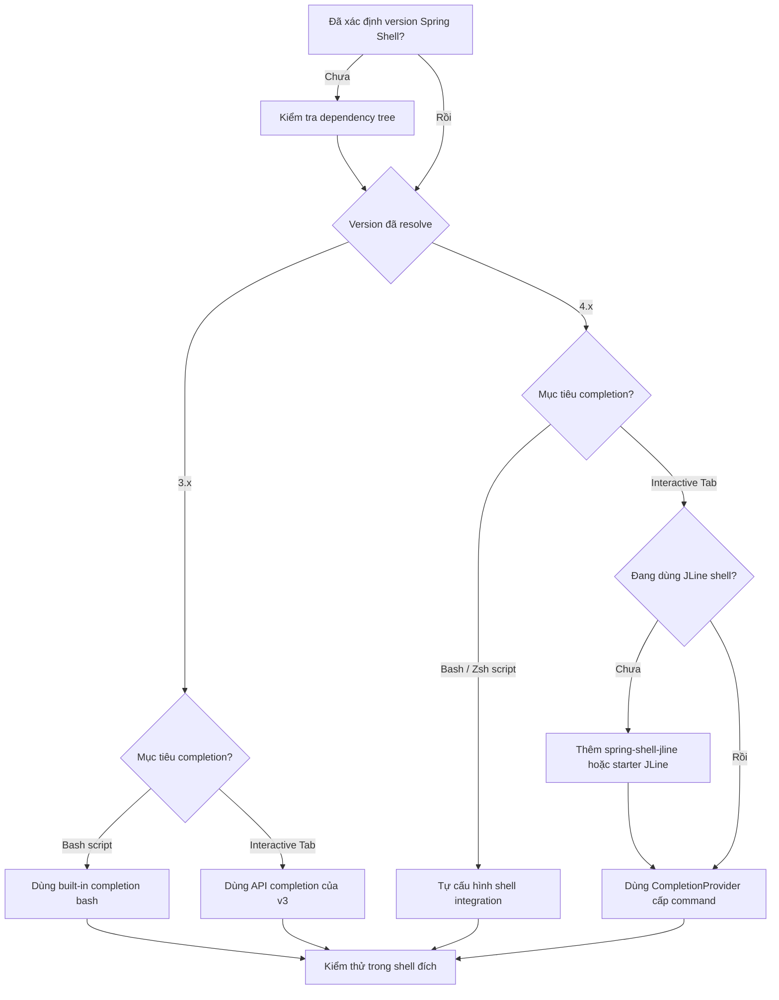

# Kiểm tra hỗ trợ của lệnh sinh completion theo phiên bản

Spring Shell có nhiều cơ chế tự hoàn thành, nhưng không phải cơ chế nào cũng tồn tại ở mọi phiên bản. Đặc biệt, command tích hợp `completion bash` từng dùng để sinh script hoàn thành cho Bash trong Spring Shell 3 đã bị loại bỏ ở Spring Shell 4. Nếu dùng hướng dẫn cũ với dependency 4.x, lệnh đó sẽ không còn được framework cung cấp.

Trước khi cấu hình completion, hãy xác định chính xác phiên bản Spring Shell mà Maven hoặc Gradle đã resolve. Sau đó phân biệt hai mục tiêu: gợi ý khi người dùng nhấn Tab bên trong shell tương tác và sinh script để shell của hệ điều hành như Bash tự hoàn thành ở command line. Hai mục tiêu này có vòng đời và API khác nhau.

## 1. Hai loại completion cần kiểm tra riêng

Spring Shell hỗ trợ completion trong hai bối cảnh:

| Loại | Người dùng thao tác ở đâu? | Cơ chế |
|---|---|---|
| Interactive completion | Trong phiên Spring Shell đang chạy; người dùng nhập lệnh rồi nhấn Tab | Shell đang hoạt động yêu cầu provider tạo các đề xuất cho command, option hoặc giá trị option |
| OS shell completion | Tại Bash hoặc shell hệ điều hành trước khi chương trình Spring Shell chạy | Script tích hợp với shell hệ điều hành tra cứu các command và đề xuất token khi người dùng nhấn Tab |

Ví dụ, khi đang ở prompt Spring Shell:

```text
shell:>deploy --environment <Tab>
```

Đây là interactive completion. Spring Shell đang chạy và có thể gọi provider Java để đề xuất `dev`, `staging` hoặc `prod`.

Trong Bash, người dùng có thể gõ tên executable trước khi chương trình khởi chạy:

```bash
./admin-cli <Tab>
```

Đây là OS shell completion. Bash cần một function hoặc script completion được nạp vào shell. Command `completion bash` trong Spring Shell 3 hỗ trợ sinh script cho trường hợp này.

Không dùng sự tồn tại của một loại completion để kết luận loại còn lại cũng được hỗ trợ. Một ứng dụng có thể có Tab completion trong phiên JLine nhưng không có command sinh script Bash.

## 2. Xác định phiên bản Spring Shell đã resolve

Đọc version trong `pom.xml`, `build.gradle` hoặc một property chỉ là bước đầu. Parent POM, BOM, dependency management và dependency bắc cầu có thể quyết định phiên bản cuối cùng. Hãy kiểm tra dependency graph của đúng module chạy CLI.

### Maven

Tại thư mục chứa `pom.xml`, chạy:

```bash
# Linux hoặc macOS
./mvnw dependency:tree -Dincludes=org.springframework.shell

# Windows
mvnw.cmd dependency:tree -Dincludes=org.springframework.shell
```

Tìm các artifact `org.springframework.shell`, chẳng hạn `spring-shell-core`, `spring-shell-jline` hoặc starter mà ứng dụng sử dụng. Ghi lại version đã resolve và kiểm tra các artifact Spring Shell có cùng dòng phiên bản hay không.

### Gradle

Với runtime classpath:

```bash
# Linux hoặc macOS
./gradlew dependencyInsight \
    --dependency spring-shell-core \
    --configuration runtimeClasspath

# Windows
gradlew.bat dependencyInsight --dependency spring-shell-core --configuration runtimeClasspath
```

Nếu dự án không có `spring-shell-core` trực tiếp vì dùng starter, `dependencyInsight` vẫn có thể hiển thị core như dependency bắc cầu. Có thể xem toàn bộ runtime graph bằng:

```bash
./gradlew dependencies --configuration runtimeClasspath
```

### Ghi lại phiên bản trước khi tra cứu

| Thông tin | Cần ghi lại |
|---|---|
| Spring Shell | Version thực tế của `spring-shell-core` và starter |
| Shell runtime | Có `spring-shell-jline` hoặc JLine provider hay không |
| Build | Maven hay Gradle, BOM hoặc dependency management nào quản lý version |
| Mục tiêu completion | Tab trong phiên Spring Shell hay completion tại Bash/Zsh |

Đừng lấy version từ trang tài liệu mặc định nếu nó không khớp dependency graph. Trang mặc định có thể chuyển sang nhánh stable mới trong khi ứng dụng của bạn vẫn chạy một nhánh cũ.

## 3. Ma trận hỗ trợ theo phiên bản

Các tài liệu Spring Shell 3.3.4 và 3.4.x mô tả command tích hợp để sinh script Bash. Migration Guide của Spring Shell 4 xác nhận command `completion` đã bị loại bỏ trong v4.

| Phiên bản | Interactive completion | Command sinh script hệ điều hành |
|---|---|---|
| Spring Shell 3.3.x | `CompletionResolver`, `ValueProvider`, `@ShellOption(valueProvider = ...)` và completion trên từng option | Có command tích hợp `completion bash`; tài liệu 3.3.4 chỉ hỗ trợ Bash |
| Spring Shell 3.4.x | Vẫn dùng mô hình completion của v3 | Vẫn có command tích hợp `completion bash` theo tài liệu 3.4.x |
| Spring Shell 4.0.0+ | Dùng `CompletionProvider` ở cấp command; provider có thể xem ngữ cảnh nhiều option | Command `completion` đã bị loại bỏ; ứng dụng tự cấu hình tích hợp với Bash, Zsh hoặc shell khác |
| Spring Shell 4.0.1+ | Có thêm `DefaultCompletionProvider` | Không khôi phục command `completion bash` |
| Spring Shell 4.0.4 | Dùng mô hình completion của v4 | Không có command sinh script tích hợp |

Spring Shell 4.0.4 là bản stable được dùng làm mốc trong các ví dụ của bài. Hãy kiểm tra release và tài liệu tương ứng nếu dependency của dự án ở một bản khác.

## 4. Kiểm tra command `completion bash` trong Spring Shell 3

Trong nhánh 3.3, command `completion` có subcommand `bash` để tạo script dùng với Bash. Tài liệu chính thức mô tả đây là cơ chế completion ở cấp hệ điều hành và hiện chỉ có implementation cho Bash.

Khi chạy ứng dụng Spring Shell 3.3.x hoặc 3.4.x, có thể kiểm tra danh sách built-in command bằng:

```text
shell:>help
```

Danh sách có thể chứa mục:

```text
completion bash    Generate bash completion script
```

Thử gọi:

```text
shell:>completion bash
```

Command này tạo nội dung script Bash. Hãy lưu và tích hợp script theo cách triển khai shell của nhóm, sau đó mở một phiên Bash mới hoặc nạp lại cấu hình để kiểm tra completion tại prompt hệ điều hành.

Nếu không thấy command trong `help`, hãy kiểm tra version đã resolve trước khi kết luận tính năng không tồn tại. Có thể ứng dụng đang chạy v4, built-in command bị tắt theo cấu hình, hoặc một cấu hình đóng gói khác đang được sử dụng. `help` là phép kiểm tra runtime hữu ích, nhưng dependency graph mới là căn cứ xác định phiên bản.

## 5. Vì sao không gọi `completion bash` trong Spring Shell 4?

Spring Shell 4 đã loại bỏ built-in command `completion`. Migration Guide nêu rõ việc cấu hình completion được giao cho người dùng dựa trên shell ưa thích như Bash hoặc Zsh.

Vì vậy, khi chạy Spring Shell 4:

```text
shell:>help
```

không nên kỳ vọng danh sách built-in command có `completion bash`. Lệnh:

```text
shell:>completion bash
```

sẽ không được Spring Shell 4 nhận diện, trừ khi chính ứng dụng của bạn tự đăng ký một command cùng tên.

Việc command bị loại bỏ không có nghĩa framework bỏ toàn bộ interactive completion. Spring Shell 4 vẫn có completion trong JLine-based shell, nhưng API và cách cấu hình provider đã thay đổi. Phần sinh script cho Bash/Zsh là trách nhiệm riêng của ứng dụng hoặc công cụ shell integration mà bạn chọn.

## 6. Interactive completion trong Spring Shell 3

Trong Spring Shell 3, completion có thể được cung cấp ở cấp option. Với annotation model, `ValueProvider` được gắn vào `@ShellOption`:

```java
import java.util.List;

import org.springframework.shell.CompletionContext;
import org.springframework.shell.CompletionProposal;
import org.springframework.shell.standard.ShellMethod;
import org.springframework.shell.standard.ShellComponent;
import org.springframework.shell.standard.ShellOption;
import org.springframework.shell.standard.ValueProvider;
import org.springframework.stereotype.Component;

@Component
class EnvironmentValues implements ValueProvider {

    @Override
    public List<CompletionProposal> complete(CompletionContext context) {
        return List.of(
                new CompletionProposal("dev"),
                new CompletionProposal("staging"),
                new CompletionProposal("prod"));
    }
}

@ShellComponent
class DeploymentCommands {

    @ShellMethod("Triển khai ứng dụng")
    public String deploy(
            @ShellOption(valueProvider = EnvironmentValues.class) String environment) {
        return "Deploy to " + environment;
    }
}
```

Trong v3, provider nhận `CompletionContext` và trả về danh sách `CompletionProposal`. Với annotation-based command, `ValueProvider` cần được đăng ký như bean. Programmatic `CommandRegistration` cũng có thể khai báo completion trực tiếp trên option bằng builder API.

Ngoài provider gắn theo option, v3 còn có `CompletionResolver` để xử lý các gợi ý chung. Mô hình này hữu ích cho những trường hợp mỗi option có tập giá trị riêng, nhưng khó đưa ra gợi ý phụ thuộc đồng thời vào nhiều option của cùng command.

Các API `ShellMethod`, `ShellOption` và `ValueProvider` trong ví dụ trên thuộc mô hình v3. Không sao chép nguyên import hoặc annotation đó sang Spring Shell 4.

## 7. Interactive completion trong Spring Shell 4

Spring Shell 4 chuyển sang provider ở cấp command. Interface mới là:

```java
org.springframework.shell.core.command.completion.CompletionProvider
```

`CompletionProvider` là functional interface nhận `CompletionContext` và trả về `List<CompletionProposal>`. Provider được đăng ký thành Spring bean, sau đó gắn với method command bằng thuộc tính `completionProvider` của `@Command`.

Ví dụ:

```java
import java.util.List;

import org.springframework.shell.core.command.completion.CompletionProposal;
import org.springframework.shell.core.command.completion.CompletionProvider;
import org.springframework.shell.core.command.completion.EnumCompletionProvider;
import org.springframework.shell.core.command.completion.CompositeCompletionProvider;
import org.springframework.context.annotation.Bean;
import org.springframework.context.annotation.Configuration;

enum Environment {
    DEV, STAGING, PROD
}

@Configuration
class DeploymentCompletionConfiguration {

    @Bean
    CompletionProvider deploymentCompletionProvider() {
        CompletionProvider environmentProvider =
                new EnumCompletionProvider(Environment.class, "--environment");

        CompletionProvider projectProvider = context -> {
            var option = context.getCommandOption();
            if (option != null && option.isOptionEqual("project")) {
                return List.of(
                        new CompletionProposal("--project=alpha"),
                        new CompletionProposal("--project=beta"));
            }
            return List.of();
        };

        return new CompositeCompletionProvider(environmentProvider, projectProvider);
    }
}
```

Gắn provider vào command:

```java
import org.springframework.shell.core.command.annotation.Command;
import org.springframework.shell.core.command.annotation.Option;
import org.springframework.stereotype.Component;

@Component
class DeploymentCommands {

    @Command(
            name = "deploy",
            description = "Triển khai ứng dụng",
            completionProvider = "deploymentCompletionProvider")
    public String deploy(
            @Option(longName = "environment") Environment environment,
            @Option(longName = "project") String project) {
        return "Deploy " + project + " to " + environment;
    }
}
```

Trong ví dụ, `EnumCompletionProvider` đề xuất các giá trị enum cho option `--environment`. Provider `projectProvider` kiểm tra option hiện tại trong `CompletionContext` rồi đề xuất tên project. `CompositeCompletionProvider` kết hợp nhiều provider cho cùng command.

Với mô hình programmatic, có thể gắn provider bằng `Command.Builder.completionProvider(...)`. Cách này thay thế cách cấu hình completion riêng trên từng option của v3.

## 8. Khác biệt API cần kiểm tra khi nâng cấp

| Spring Shell 3 | Spring Shell 4 | Ghi chú |
|---|---|---|
| `ValueProvider` | `CompletionProvider` | Chuyển từ provider giá trị theo option sang provider cấp command |
| `@ShellOption(valueProvider = ...)` | `@Command(completionProvider = "beanName")` | Gắn provider vào command method |
| `EnumValueProvider` | `EnumCompletionProvider` | Đổi tên class built-in |
| `FileValueProvider` | `FileNameCompletionProvider` | Đổi tên class built-in |
| `@OptionValues` (nếu có trong code cũ) | Đã bị loại bỏ | Không dùng annotation này trong v4 |
| `CommandRegistration` completion trên option | `Command.Builder.completionProvider(...)` | Chuyển cấu hình sang command-level provider |
| Built-in `completion bash` | Không còn | Tự tích hợp completion cho shell hệ điều hành |

`CompletionProvider` cho phép xem `CompletionContext` của toàn command, bao gồm option hiện tại và các từ người dùng đã nhập. Điều này giúp gợi ý phụ thuộc chéo giữa các option, chẳng hạn danh sách project thay đổi theo `--environment`.

Một số provider built-in của v4 có mốc phiên bản riêng:

- `EnumCompletionProvider` có từ `4.0.0`.
- `CompositeCompletionProvider` có từ `4.0.0`.
- `DefaultCompletionProvider` có từ `4.0.1`; provider này hỗ trợ gợi ý cho enum option và tạo prefix cho option theo ngữ cảnh hiện tại.

Khi code không biên dịch vì không tìm thấy class, hãy kiểm tra package và version Javadoc. Đừng chỉ đổi tên class mà giữ nguyên cách gắn provider v3 vào `@ShellOption`.

## 9. Tab completion trong v4 cần JLine-based shell

Spring Shell 4 tách core khỏi JLine. Core mặc định có thể dùng `SystemShellRunner` dựa trên `java.io.Console`; runner này cung cấp chức năng console cơ bản nhưng không có các tính năng nâng cao như history, Tab completion và rich text.

Để dùng interactive completion bằng Tab, ứng dụng cần JLine-based shell. Trong v4, có thể thêm `spring-shell-jline` hoặc dùng starter Spring Shell có tích hợp JLine provider phù hợp.

Kiểm tra dependency:

```bash
./mvnw dependency:tree -Dincludes=org.springframework.shell,org.jline
```

Với Gradle:

```bash
./gradlew dependencyInsight --dependency spring-shell-jline --configuration runtimeClasspath
```

Sau khi xác nhận JLine runner được sử dụng, chạy ứng dụng trong terminal thật và thử nhấn Tab ở các vị trí:

```text
shell:>dep<Tab>
shell:>deploy --environment <Tab>
shell:>deploy --project=<Tab>
```

Nếu `CompletionProvider` đã được khai báo nhưng Tab không hoạt động, kiểm tra shell runner và dependency JLine trước khi sửa logic provider. Một provider Java không tự biến `SystemShellRunner` thành JLine shell.

## 10. Kiểm tra hỗ trợ theo quy trình

Hãy thực hiện các bước theo thứ tự để tránh nhầm lỗi version với lỗi cấu hình:

1. **Resolve version:** dùng Maven hoặc Gradle xác định version `spring-shell-core` thực tế.
2. **Chọn đúng tài liệu:** mở Reference Documentation và Javadoc đúng nhánh version đó.
3. **Kiểm tra built-in command:** chạy `help` và xem có `completion bash` hay không.
4. **Kiểm tra mục tiêu:** xác định cần interactive Tab hay script completion cho Bash/Zsh.
5. **Kiểm tra runtime:** nếu cần Tab, xác nhận JLine-based shell đang chạy.
6. **Kiểm tra API:** v3 dùng `ValueProvider`/`@ShellOption`; v4 dùng `CompletionProvider`/`@Command`.
7. **Kiểm tra kết quả:** thử completion bằng input thật, bao gồm prefix lệnh, option và giá trị option.

Sơ đồ quyết định:



## 11. Kiểm thử command và provider

Kiểm thử completion nên tách thành ba lớp:

**Kiểm tra API theo version:** build project để xác nhận class, package và annotation có trong dependency. Ví dụ, nếu code v4 còn import `org.springframework.shell.standard.ValueProvider`, compiler sẽ báo lỗi vì API đó thuộc mô hình v3.

**Kiểm tra logic provider:** gọi provider với các `CompletionContext` đại diện cho từng vị trí nhập và xác nhận danh sách `CompletionProposal` trả về. Kiểm tra cả option hiện tại, prefix người dùng đã gõ và trường hợp không có đề xuất.

**Kiểm thử tích hợp shell:** chạy ứng dụng bằng runner thật. Với interactive completion, dùng JLine và nhấn Tab. Với Bash completion của v3, chạy `completion bash`, lưu script và nạp vào Bash để thử hoàn thành tên executable cùng các command/option.

Ma trận kiểm thử gợi ý:

| Trường hợp | Cách kiểm tra | Kết quả mong đợi |
|---|---|---|
| Spring Shell 3.3.x, Bash | Gọi `completion bash` | Sinh nội dung script Bash |
| Spring Shell 3.3.x, interactive | Nhấn Tab ở giá trị option có `ValueProvider` | Hiển thị giá trị do provider trả về |
| Spring Shell 4.x, built-in command | Chạy `help` và tìm `completion bash` | Không có built-in command này |
| Spring Shell 4.x, API v4 | Build command dùng `CompletionProvider` | Biên dịch thành công với đúng package |
| Spring Shell 4.x, SystemShellRunner | Nhấn Tab | Không có tính năng Tab completion nâng cao |
| Spring Shell 4.x, JLine runner | Nhấn Tab trong command và option | Hiển thị proposal phù hợp |
| Spring Shell 4.x, Bash integration | Kiểm tra script shell tự cấu hình | Bash completion hoạt động theo script của ứng dụng |

Nếu dùng test tự động, không nên chỉ assert rằng provider trả về một danh sách không rỗng. Hãy xác nhận đúng giá trị, đúng option và không trả gợi ý thuộc ngữ cảnh khác.

## 12. Các lỗi thường gặp

| Hiện tượng | Nguyên nhân có thể | Cách xử lý |
|---|---|---|
| `completion bash` báo command không tồn tại | Ứng dụng đang dùng Spring Shell 4 | Không gọi built-in generator; kiểm tra migration guide và tự cấu hình OS shell integration |
| Code v4 không tìm thấy `ValueProvider` | Dùng API completion của v3 | Chuyển sang `CompletionProvider` và `@Command.completionProvider` |
| `@ShellOption(valueProvider = ...)` không biên dịch | Annotation legacy không còn trong v4 | Dùng `@Option` và provider cấp command |
| Không tìm thấy `EnumValueProvider` | Class được đổi tên trong v4 | Dùng `EnumCompletionProvider` |
| Không tìm thấy `FileValueProvider` | Class được đổi tên trong v4 | Dùng `FileNameCompletionProvider` |
| Provider đúng nhưng Tab không phản hồi | Đang dùng `SystemShellRunner` hoặc thiếu JLine | Kiểm tra `spring-shell-jline` và runner đang chạy |
| Gợi ý chỉ đúng với một option, không xét option khác | Thiết kế provider theo mô hình v3 hoặc chỉ xét một option | Dùng `CompletionContext` trong provider cấp command của v4 |
| Trang Javadoc không có class cần tìm | Đang mở sai nhánh hoặc sai version | Đối chiếu version dependency tree và URL Javadoc theo nhánh |
| `help` không hiển thị command mong đợi | Command bị tắt, bị ẩn hoặc không được đăng ký | Kiểm tra cấu hình và command registry; không kết luận version chỉ từ `help` |

## 13. Bài tập thực hành

Bạn được giao bảo trì một CLI đã nâng từ Spring Shell 3.3.4 lên 4.0.4. Người dùng báo rằng command `completion bash` không còn chạy và gợi ý giá trị option `--environment` cũng không hoạt động.

Hãy thực hiện:

1. Kiểm tra Maven hoặc Gradle để xác nhận version thực tế của `spring-shell-core`.
2. Chạy `help` trên ứng dụng 3.3.4 (hoặc dùng tài liệu 3.3.4) và xác nhận vai trò của `completion bash`.
3. Đối chiếu Migration Guide v4 và ghi lại lý do built-in command bị loại bỏ.
4. Tìm các `ValueProvider`, `@ShellOption(valueProvider = ...)` và `@OptionValues` trong code cũ.
5. Chuyển logic cần thiết sang một `CompletionProvider` ở cấp command.
6. Dùng `EnumCompletionProvider` cho option `--environment` và kiểm tra mốc phiên bản của provider này.
7. Xác nhận runtime dùng JLine-based shell trước khi kiểm tra Tab completion.
8. Đề xuất cách cung cấp completion cho Bash sau nâng cấp, có ghi rõ phần script hoặc tích hợp nào ứng dụng phải tự quản lý.
9. Viết test cho provider và một kiểm thử tích hợp trong JLine shell.

**Kết quả cần nộp:** bảng so sánh API v3/v4, kết quả dependency tree, code provider mới, kết quả thử Tab và kế hoạch thay thế script Bash.

## 14. Checklist trước khi kết luận completion được hỗ trợ

- [ ] Đã kiểm tra version `spring-shell-core` đã resolve.
- [ ] Tài liệu và Javadoc đang mở đúng nhánh version.
- [ ] Đã xác định cần interactive Tab hay OS shell completion.
- [ ] Với Spring Shell 3.x, đã kiểm tra command `completion bash` và giới hạn Bash.
- [ ] Với Spring Shell 4.x, không giả định built-in command `completion` còn tồn tại.
- [ ] Với v4, đã chuyển provider từ `ValueProvider` sang `CompletionProvider`.
- [ ] Đã chuyển cấu hình từ `@ShellOption(valueProvider = ...)` sang `@Command(completionProvider = ...)`.
- [ ] Đã thay class cũ `EnumValueProvider`/`FileValueProvider` bằng class tương ứng của v4.
- [ ] Nếu cần Tab, đã xác nhận ứng dụng chạy JLine-based shell.
- [ ] Nếu cần Bash/Zsh completion trong v4, đã có kế hoạch shell integration do ứng dụng quản lý.
- [ ] Đã kiểm thử provider với nhiều ngữ cảnh nhập và kiểm thử trong runtime thực tế.

## Tài liệu tham khảo

- [Spring Shell 3.3.4 — Completion](https://docs.spring.io/spring-shell/reference/3.3/completion.html)
- [Spring Shell 3.3.4 — Built-in `completion` command](https://docs.spring.io/spring-shell/reference/3.3/commands/builtin/completion.html)
- [Spring Shell 3.4.3 — Completion](https://docs.spring.io/spring-shell/reference/3.4/completion.html)
- [Spring Shell 4 — Command Completion](https://docs.spring.io/spring-shell/reference/commands/completion.html)
- [Spring Shell v4 Migration Guide — Command Completion and removal of `completion`](https://github.com/spring-projects/spring-shell/wiki/v4-migration-guide)
- [Spring Shell API — `CompletionProvider`](https://docs.spring.io/spring-shell/reference/api/org/springframework/shell/core/command/completion/CompletionProvider.html)
- [Spring Shell API — `DefaultCompletionProvider`](https://docs.spring.io/spring-shell/reference/api/org/springframework/shell/core/command/completion/DefaultCompletionProvider.html)
- [Spring Shell API — `Command`](https://docs.spring.io/spring-shell/reference/api/org/springframework/shell/core/command/annotation/Command.html)
