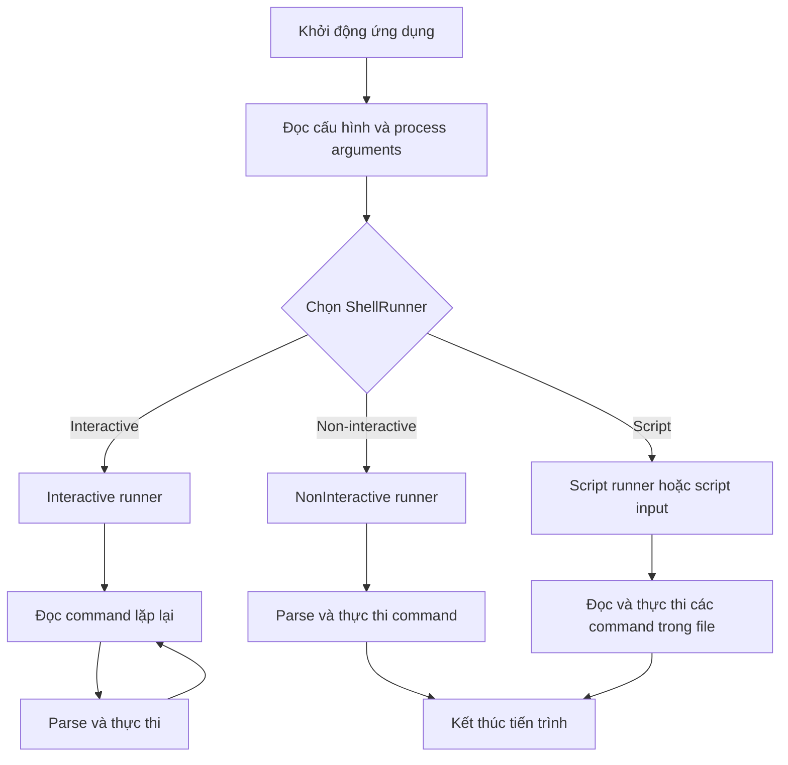

# Tương tác trong REPL và thực thi một lần rồi kết thúc

Spring Shell hỗ trợ hai cách chạy ứng dụng CLI. Ở chế độ tương tác, ứng dụng mở một REPL (Read-Eval-Print Loop), hiển thị dấu nhắc và tiếp tục nhận nhiều command trong cùng một tiến trình. Ở chế độ không tương tác, ứng dụng nhận command từ đối số lúc khởi chạy, thực thi rồi kết thúc. Cách chọn chế độ mặc định đã thay đổi giữa Spring Shell 3.x và 4.x, vì vậy cần cấu hình theo đúng phiên bản đang dùng.

Bài học thuộc chương **Chế độ thực thi**. Nội dung giải thích REPL và one-shot execution, các `ShellRunner`, cấu hình theo phiên bản, cách chạy command hoặc script từ terminal và cách kiểm tra ứng dụng trong môi trường tự động.

Sau bài học, bạn có thể:

- Phân biệt interactive mode và non-interactive mode.
- Mô tả vai trò của `ShellRunner` và các implementation theo phiên bản.
- Bật REPL trong Spring Shell 3.3.x và 4.x.
- Chạy một command từ đối số tiến trình rồi thoát.
- Chạy script từ file bằng runner phù hợp.
- Nhận biết khác biệt về `InteractionMode` giữa Spring Shell 3.x và 4.x.
- Chọn chế độ phù hợp cho terminal, CI/CD, container và tác vụ tự động.

## REPL và one-shot execution

REPL là vòng lặp đọc input, phân tích và thực thi command, sau đó hiển thị kết quả rồi chờ input tiếp theo. Tiến trình shell vẫn hoạt động sau mỗi command cho đến khi người dùng thoát.

Ví dụ một phiên tương tác:

```text
$ java -jar target/report-cli.jar

shell:>help
AVAILABLE COMMANDS
...

shell:>report list
Đã tìm thấy 12 báo cáo

shell:>report export --format csv
Đã xuất báo cáo

shell:>exit
```

One-shot execution nhận một command ngay từ đối số tiến trình, chạy command đó và kết thúc ứng dụng:

```text
$ java -jar target/report-cli.jar report export --format csv
Đã xuất báo cáo
$
```

Hai chế độ dùng chung command registry và command handler. Khác biệt nằm ở cách runner nhận input và quản lý vòng đời shell:

| Đặc điểm | Interactive / REPL | Non-interactive / one-shot |
| --- | --- | --- |
| Nguồn input | Bàn phím hoặc terminal input provider. | Đối số tiến trình hoặc file script. |
| Số command | Nhiều command trong cùng phiên. | Một command hoặc một chuỗi command từ script. |
| Vòng đời | Tiếp tục chạy cho đến khi người dùng thoát. | Kết thúc sau khi xử lý input được giao. |
| Thành phần terminal | Có prompt, lịch sử và khả năng nhập lệnh liên tục. | Không cần prompt tương tác. |
| Trường hợp dùng | Quản trị thủ công, khám phá command, thao tác nhiều bước. | CI/CD, cron, shell script, container job và automation. |

## ShellRunner điều phối cách chạy

`ShellRunner` là giao diện thực thi shell. Mỗi phiên bản có các implementation và quy tắc chọn runner riêng. Trong ứng dụng Spring Boot, một application runner của Spring Shell thường gọi runner phù hợp khi application context khởi động.

Luồng khái quát:



Không nên suy luận chế độ chỉ từ việc có hay không có đối số command. Quy tắc chọn runner thay đổi theo phiên bản và thuộc tính cấu hình. Đặc biệt, Spring Shell 4.x mặc định vẫn mở chế độ tương tác ngay cả khi process arguments có chứa tên command.

## Spring Shell 3.3.x: non-interactive mặc định

Trong Spring Shell 3.3.x, có ba implementation:

| Runner | Vai trò | Thuộc tính bật/tắt |
| --- | --- | --- |
| `InteractiveShellRunner` | Mở REPL để nhận nhiều command. | `spring.shell.interactive.enabled` |
| `NonInteractiveShellRunner` | Chạy command được truyền từ process arguments rồi kết thúc. | `spring.shell.noninteractive.enabled` |
| `ScriptShellRunner` | Nhận đối số bắt đầu bằng `@` để đọc và chạy file script. | `spring.shell.script.enabled` |

Từ Spring Shell 3.3.x, chỉ `NonInteractiveShellRunner` được bật mặc định. Các phiên bản đến 3.2.x bật cả ba runner theo mặc định. Vì vậy, khi nâng từ 3.2 lên 3.3, ứng dụng trước đây tự mở REPL có thể không còn làm vậy nếu chưa bật interactive runner.

### Bật REPL

Thêm cấu hình vào `application.yml`:

```yaml
spring:
  shell:
    interactive:
      enabled: true
```

Sau khi build, chạy ứng dụng mà không truyền command:

```bash
java -jar target/report-cli.jar
```

Ứng dụng mở prompt. Người dùng có thể chạy `help`, các command nghiệp vụ và `exit` trong cùng một phiên.

Nếu muốn cấu hình tường minh cả runner tương tác và runner không tương tác, có thể khai báo:

```yaml
spring:
  shell:
    interactive:
      enabled: true
    noninteractive:
      enabled: true
```

Spring Shell 3.x sử dụng `ShellApplicationRunner` để chọn runner phù hợp với process arguments và trạng thái các runner đã bật.

### Chạy một command rồi kết thúc

Với cấu hình mặc định của 3.3.x, `NonInteractiveShellRunner` đã được bật. Truyền tên command và các option sau tên JAR:

```bash
java -jar target/report-cli.jar report export --format csv
```

Ứng dụng phân tích command, thực thi target và kết thúc. Không cần bật interactive runner cho tác vụ one-shot.

Nếu ứng dụng đã bật nhiều runner, hãy kiểm tra cấu hình và thứ tự chọn runner để bảo đảm đối số được xử lý theo mục đích mong muốn. Đối với ứng dụng triển khai tự động, nên kiểm thử đúng lệnh khởi chạy trên môi trường thực tế.

### Chạy script bằng ScriptShellRunner

Trong 3.3.x, `ScriptShellRunner` có thể nhận một process argument bắt đầu bằng `@`. Phần sau `@` là đường dẫn file script. Runner có ưu tiên cao để nhận dạng script trước các runner khác.

Bật script runner:

```yaml
spring:
  shell:
    script:
      enabled: true
```

Ví dụ file `commands.txt`:

```text
report list
report export --format csv
report status
```

Chạy file:

```bash
java -jar target/report-cli.jar @commands.txt
```

Script runner đọc và thực thi các command trong file rồi kết thúc. Đường dẫn tương đối được tính từ working directory của tiến trình; khi chạy trong CI/CD, hãy đặt working directory hoặc dùng đường dẫn phù hợp.

## Spring Shell 4.x: interactive mặc định

Spring Shell 4.x thay đổi quy tắc khởi chạy. Interactive mode được bật mặc định, kể cả khi process arguments đã có command. Muốn chạy command từ arguments rồi thoát, cần tắt interactive mode bằng thuộc tính:

```yaml
spring:
  shell:
    interactive:
      enabled: false
```

Khi `spring.shell.interactive.enabled=false`, Spring Shell chuyển sang `NonInteractiveShellRunner`. Runner này có thể xử lý một command hoặc một file script được chỉ định bằng tiền tố `@`.

### Mở REPL theo mặc định

Với cấu hình mặc định của Spring Shell 4.x, chạy:

```bash
java -jar target/report-cli.jar
```

Nếu dùng Spring Shell starter có JLine, interactive mode sử dụng `JLineShellRunner`. Nếu classpath không có JLine, Spring Shell dùng `SystemShellRunner` dựa trên `java.io.Console` của JDK.

JLine cung cấp trải nghiệm terminal phong phú hơn, chẳng hạn lịch sử và xử lý dòng nhập. Nếu cần JLine trong ứng dụng chỉ dùng core, thêm module `spring-shell-jline`. Việc có hay không có JLine thay đổi implementation interactive runner, không thay đổi ý nghĩa của one-shot mode.

### Chạy một command rồi kết thúc

Có thể tắt interactive mode bằng system property ngay khi chạy:

```bash
java -Dspring.shell.interactive.enabled=false \
     -jar target/report-cli.jar \
     report export --format csv
```

Hoặc đặt biến môi trường:

```bash
SPRING_SHELL_INTERACTIVE_ENABLED=false \
java -jar target/report-cli.jar report export --format csv
```

Trên PowerShell:

```powershell
$env:SPRING_SHELL_INTERACTIVE_ENABLED = "false"
java -jar target/report-cli.jar report export --format csv
```

Lệnh trên chạy command `report export`, truyền option `--format csv`, rồi kết thúc tiến trình. Khi dùng system property, đặt `-D...` trước `-jar`. Khi dùng biến môi trường, giá trị phải tồn tại trong môi trường của tiến trình Java.

Có thể đặt thuộc tính trong `application.yml` hoặc profile triển khai nếu ứng dụng luôn được dùng như công cụ one-shot. Nếu cùng một artifact cần chạy cả hai cách, hãy chọn cấu hình lúc khởi động bằng system property, biến môi trường hoặc profile.

### Chạy script bằng NonInteractiveShellRunner

Spring Shell 4.x hỗ trợ truyền file script bằng cách đặt `@` trước đường dẫn:

```text
commands.txt
```

Nội dung file:

```text
report list
report export --format csv
report status
```

Chạy script ở chế độ không tương tác:

```bash
java -Dspring.shell.interactive.enabled=false \
     -jar target/report-cli.jar @commands.txt
```

`NonInteractiveShellRunner` đọc và thực thi command trong file, không mở prompt REPL. Đây là cách phù hợp để tái sử dụng một chuỗi thao tác CLI trong pipeline hoặc tác vụ định kỳ.

## Khác biệt quan trọng giữa 3.x và 4.x

| Nội dung | Spring Shell 3.3.x | Spring Shell 4.x |
| --- | --- | --- |
| Runner mặc định | Chỉ `NonInteractiveShellRunner` được bật mặc định. | Interactive mode được bật mặc định. |
| Mở REPL | Bật `spring.shell.interactive.enabled=true`. | Chạy mặc định; không cần bật thêm. |
| One-shot | Truyền command trong process arguments; non-interactive runner mặc định đã bật. | Tắt interactive bằng `spring.shell.interactive.enabled=false`, sau đó truyền command. |
| Script runner | Có `ScriptShellRunner`, bật bằng `spring.shell.script.enabled=true`. | `NonInteractiveShellRunner` nhận file script qua đối số `@file`. |
| Interactive implementation | `InteractiveShellRunner`. | `JLineShellRunner` khi có JLine; nếu không có dùng `SystemShellRunner`. |
| Chọn command theo mode | Có `InteractionMode` trong một số mô hình khai báo. | Không còn `InteractionMode`; command khả dụng ở cả hai mode. |

Đây là thay đổi cần chú ý khi nâng cấp ứng dụng. Một lệnh `java -jar app.jar command ...` vốn chạy xong rồi thoát trong 3.3.x có thể mở REPL trong 4.x nếu không tắt interactive mode.

## InteractionMode trong 3.x và thay đổi ở 4.x

Spring Shell 3.x có `InteractionMode` để giới hạn command chỉ xuất hiện trong chế độ tương tác, không tương tác hoặc cả hai. Với annotation legacy, dùng thuộc tính `interactionMode` của `@ShellMethod`; annotation model mới `@Command` cũng có thuộc tính `interactionMode`. Với programmatic registration, dùng `.interactionMode(...)`.

Ví dụ trong 3.x:

```java
import org.springframework.shell.context.InteractionMode;
import org.springframework.shell.standard.ShellComponent;
import org.springframework.shell.standard.ShellMethod;

@ShellComponent
class AdminCommands {

    @ShellMethod(
        key = "wizard",
        interactionMode = InteractionMode.INTERACTIVE)
    public void wizard() {
        // Luồng hướng dẫn nhiều bước dành cho REPL.
    }
}
```

Tên package và annotation cụ thể phụ thuộc mô hình annotation 3.x mà dự án đang sử dụng. Với `CommandRegistration`, cấu hình tương ứng:

```java
CommandRegistration.builder()
    .command("wizard")
    .interactionMode(InteractionMode.INTERACTIVE)
    .build();
```

Trong Spring Shell 4.x, `InteractionMode` đã bị loại bỏ. Tất cả command có thể được gọi trong cả interactive và non-interactive mode; chúng chạy theo mode mà ứng dụng được khởi động. Nếu một command yêu cầu nhiều lượt nhập hoặc phụ thuộc vào terminal, hãy tự thiết kế cách kiểm tra input và báo lỗi phù hợp khi chạy one-shot. Không chuyển nguyên cấu hình `InteractionMode` của 3.x sang 4.x.

## Chọn chế độ theo tình huống

| Tình huống | Chế độ nên chọn | Lý do |
| --- | --- | --- |
| Quản trị viên muốn khám phá command và chạy nhiều thao tác | Interactive | Có prompt, help, completion và nhiều lượt nhập. |
| CI/CD chạy một tác vụ xuất báo cáo | Non-interactive | Có thể truyền toàn bộ input qua arguments và nhận kết quả rồi thoát. |
| Cron chạy một chuỗi lệnh định kỳ | Script/non-interactive | Lưu chuỗi command trong file để tái sử dụng và review. |
| Container job chạy một command rồi kết thúc | Non-interactive | Tiến trình có vòng đời rõ ràng, không chờ terminal input. |
| Tác vụ cần hỏi mật khẩu hoặc chọn dữ liệu tương tác | Interactive | Có thể đọc input từ terminal trong một phiên đang hoạt động. |

Nếu command cần thông tin đầu vào nhưng được chạy trong CI, hãy truyền thông tin qua option, biến môi trường hoặc secret store phù hợp. Tránh để job tự chờ nhập liệu từ terminal vì pipeline thường không có người dùng tương tác.

## Kiểm tra mode và runner đang dùng

Khi ứng dụng không chạy theo cách mong muốn, hãy kiểm tra:

1. Phiên bản Spring Shell thực tế trong dependency tree.
2. Giá trị `spring.shell.interactive.enabled` trong file cấu hình, profile, biến môi trường và system property.
3. Với Spring Shell 3.x, trạng thái `interactive`, `noninteractive` và `script` runner.
4. Với Spring Shell 4.x, có đang dùng starter/JLine hay chỉ có core để xác định interactive implementation.
5. Process arguments có chứa command hoặc đối số script `@file` đúng vị trí không.
6. Working directory và quyền đọc file nếu chạy script.
7. Command có đang chờ input terminal mà chế độ non-interactive không thể cung cấp hay không.

Trong Spring Boot, Spring Shell đăng ký `ApplicationRunner` tên `springShellApplicationRunner` để gọi `ShellRunner` đã cấu hình. Nếu ứng dụng cần tự điều khiển logic khởi chạy, có thể cung cấp `ApplicationRunner` cùng tên theo cơ chế mở rộng được tài liệu Spring Shell mô tả. Chỉ thay thế runner khi thực sự cần điều khiển luồng khởi động riêng.

## Kiểm thử hai chế độ

Nên có kiểm thử cho cả REPL và one-shot execution:

- **Interactive test:** khởi động interactive session, gửi nhiều command liên tiếp và xác nhận prompt vẫn hoạt động giữa các lần gọi.
- **Non-interactive test:** truyền tên command cùng option, xác nhận output và kết quả thực thi.
- **Script test:** cung cấp file có nhiều command và xác nhận các command được chạy theo thứ tự.
- **No-terminal test:** chạy trong môi trường không có TTY để phát hiện command vô tình chờ input.
- **Configuration test:** xác nhận profile CI tắt interactive mode trong Spring Shell 4.x.
- **Migration test:** khi nâng từ 3.x lên 4.x, chạy lại lệnh khởi động cũ để phát hiện trường hợp command args làm ứng dụng mở REPL ngoài ý muốn.

Spring Shell Test cung cấp `ShellTestClient` với session tương tác và không tương tác. Hãy chọn đúng loại session trong test để kết quả phản ánh chế độ mà ứng dụng sẽ chạy.

## Lỗi thường gặp

| Hiện tượng | Nguyên nhân | Cách xử lý |
| --- | --- | --- |
| Ứng dụng 3.3.x kết thúc ngay thay vì mở REPL | `InteractiveShellRunner` không được bật mặc định. | Đặt `spring.shell.interactive.enabled=true`. |
| Ứng dụng 4.x mở REPL dù đã truyền command | Interactive mode được bật mặc định trong 4.x. | Đặt `spring.shell.interactive.enabled=false`. |
| Script không chạy trong 3.3.x | `ScriptShellRunner` chưa được bật hoặc đối số không bắt đầu bằng `@`. | Bật `spring.shell.script.enabled=true` và truyền `@path`. |
| Script không tìm thấy file | Working directory khác dự kiến hoặc đường dẫn sai. | Dùng đường dẫn đúng và kiểm tra quyền đọc file. |
| CI job bị treo | Ứng dụng đang chờ input tương tác. | Dùng non-interactive mode và truyền đủ input qua arguments hoặc cấu hình. |
| Command phụ thuộc `InteractionMode` không biên dịch sau nâng cấp | `InteractionMode` đã bị loại bỏ trong 4.x. | Chuyển logic sang thiết kế hoạt động trong cả hai mode hoặc kiểm tra điều kiện input tại command. |
| Ứng dụng 4.x không có lịch sử dòng lệnh như mong muốn | Chỉ có `SystemShellRunner` vì JLine không nằm trên classpath. | Thêm `spring-shell-jline` nếu cần JLine console. |
| Lệnh one-shot chạy nhưng không thoát | Interactive mode vẫn bật hoặc command khởi tạo luồng nền. | Tắt interactive và kiểm tra các tác vụ/bean giữ tiến trình sống. |

## Checklist trước khi triển khai

- [ ] Đã xác định phiên bản Spring Shell đang dùng.
- [ ] Đã chọn rõ ứng dụng cần mở REPL hay chạy one-shot.
- [ ] Cấu hình `spring.shell.interactive.enabled` phù hợp với phiên bản.
- [ ] Với 3.3.x, đã bật `interactive` hoặc `script` runner nếu cần.
- [ ] Với 4.x, đã tắt interactive khi chạy command từ process arguments.
- [ ] Script path bắt đầu bằng `@` và có thể đọc từ working directory triển khai.
- [ ] Không có command non-interactive nào chờ input terminal.
- [ ] Pipeline kiểm thử cả output, lỗi và trạng thái kết thúc của tiến trình.
- [ ] Khi nâng từ 3.x lên 4.x, đã kiểm tra lại hành vi khởi chạy.

## Ghi nhớ

REPL giữ shell hoạt động để người dùng chạy nhiều command trong một phiên; one-shot execution chạy command từ process arguments rồi kết thúc. Spring Shell 3.3.x chỉ bật non-interactive runner theo mặc định, nên cần bật `spring.shell.interactive.enabled=true` để mở REPL. Spring Shell 4.x bật interactive mode theo mặc định kể cả khi có command arguments; muốn chạy một lần rồi thoát phải đặt `spring.shell.interactive.enabled=false`. Từ 4.x, command không còn được giới hạn bằng `InteractionMode`; chúng chạy trong mode mà ứng dụng đã chọn. Luôn kiểm tra phiên bản và cấu hình runner trước khi triển khai CLI vào CI/CD hoặc môi trường production.

## Tài liệu tham khảo

- [Spring Shell 3.3.4 — Execution](https://docs.spring.io/spring-shell/reference/3.3/execution.html): các runner 3.x, mặc định từ 3.3.x và thuộc tính cấu hình.
- [Spring Shell 4.0.4 — Execution](https://docs.spring.io/spring-shell/reference/execution.html): interactive mặc định, non-interactive mode và các implementation `ShellRunner`.
- [Spring Shell 4.0.3 API — `NonInteractiveShellRunner`](https://docs.spring.io/spring-shell/reference/api/org/springframework/shell/core/NonInteractiveShellRunner.html): chạy một command hoặc script file qua đối số `@file`.
- [Spring Shell 4.0.4 API — `ShellRunner`](https://docs.spring.io/spring-shell/reference/4.0-SNAPSHOT/api/org/springframework/shell/core/ShellRunner.html): giao diện chạy shell với raw process arguments.
- [Spring Shell v4 Migration Guide](https://github.com/spring-projects/spring-shell/wiki/v4-migration-guide): thay đổi mặc định interactive và loại bỏ `InteractionMode`.
- [Spring Shell 3.3.4 — Getting Started](https://docs.spring.io/spring-shell/reference/3.3/getting-started.html): bật REPL và ví dụ chạy ứng dụng.
