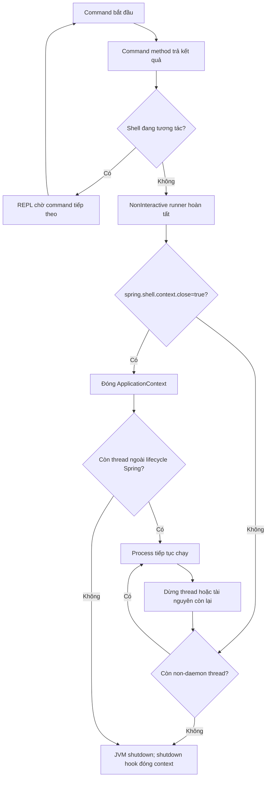

# Phân biệt lệnh kết thúc nhưng ứng dụng vẫn chạy với tiến trình đã dừng

Một command Spring Shell có thể chạy xong và trả kết quả trong khi ứng dụng vẫn tiếp tục hoạt động. Điều này là bình thường khi shell đang ở chế độ tương tác: command method kết thúc, nhưng REPL vẫn chờ người dùng nhập lệnh tiếp theo. Trong chế độ không tương tác, command hoàn tất và runner có thể trả quyền điều khiển cho Spring Boot, nhưng tiến trình JVM vẫn có thể tồn tại nếu còn luồng non-daemon hoặc tài nguyên nền giữ ứng dụng hoạt động.

Bài học thuộc chương **Chế độ thực thi**. Nội dung phân biệt vòng đời command, shell runner, Spring `ApplicationContext` và JVM process; giải thích `quit`/`exit`, cấu hình `spring.shell.context.close`, quản lý luồng nền và cách chẩn đoán ứng dụng không tự kết thúc.

Sau bài học, bạn có thể:

- Phân biệt command completion, shell completion, context shutdown và JVM termination.
- Giải thích vì sao command trả kết quả nhưng prompt vẫn xuất hiện hoặc tiến trình vẫn chạy.
- Dùng `quit`/`exit` đúng với interactive shell.
- Cấu hình đóng `ApplicationContext` sau khi shell hoàn tất.
- Nhận diện scheduler, executor và non-daemon thread có thể giữ JVM sống.
- Quản lý vòng đời tài nguyên Spring và kiểm tra process exit.
- Phân biệt `ExitStatus` của command với mã thoát của tiến trình hệ điều hành.

## Bốn mốc trong vòng đời thực thi

Khi điều tra một ứng dụng CLI chưa dừng, cần xác định chính xác nó đã đi đến mốc nào. Có bốn mốc khác nhau:

| Mốc | Ý nghĩa | Dấu hiệu quan sát |
| --- | --- | --- |
| Command hoàn tất | Method xử lý command đã trả về hoặc ném exception được xử lý. | Kết quả command xuất hiện trên terminal. |
| Shell hoàn tất | REPL kết thúc hoặc non-interactive runner đã xử lý xong input. | Prompt không còn nhận command; runner đã trả về. |
| ApplicationContext đóng | Spring đóng các bean và giải phóng tài nguyên theo lifecycle. | `@PreDestroy`, `DisposableBean.destroy()` hoặc destroy method được gọi. |
| JVM kết thúc | Tiến trình Java dừng và trả mã thoát cho hệ điều hành. | PID biến mất; terminal nhận lại quyền điều khiển. |

Các mốc này có quan hệ nhưng không đồng nhất. Ví dụ, command hoàn tất trong REPL không làm shell hoàn tất. Tương tự, đóng `ApplicationContext` không thể tự dừng một thread non-daemon được tạo thủ công và không được quản lý bởi Spring.



## Command kết thúc nhưng REPL vẫn chạy

Trong interactive mode, shell được thiết kế để thực thi nhiều command trong cùng một tiến trình. Khi method command trả về, Spring Shell hiển thị kết quả và quay lại prompt. Đây không phải lỗi và cũng không phải dấu hiệu ứng dụng bị treo.

Ví dụ:

```text
shell:>report list
Đã tìm thấy 12 báo cáo

shell:>report status
Hệ thống đang hoạt động

shell:>
```

Hai command đã kết thúc, nhưng REPL vẫn hoạt động để nhận lệnh tiếp theo. Nếu muốn rời interactive shell, dùng command tích hợp `quit` hoặc alias `exit`:

```text
shell:>quit
```

Trong Spring Shell 4.0.4, `quit`/`exit` kết thúc interactive shell loop. Tài liệu phiên bản này hướng dẫn dùng `spring.shell.context.close=true` nếu muốn đóng rõ ràng Spring application context sau khi shell execution hoàn tất. Trong tài liệu Spring Shell 3.3.4, `quit` được mô tả là yêu cầu shell thoát và đóng application context một cách graceful. Hãy kiểm tra tài liệu đúng phiên bản khi dựa vào hành vi shutdown cụ thể.

## Command hoàn tất nhưng tiến trình vẫn chạy ở non-interactive mode

Trong non-interactive mode, `NonInteractiveShellRunner` chạy command hoặc script rồi trả về. Khi runner kết thúc, Spring Boot tiếp tục hoàn tất các `ApplicationRunner` khác. Nếu không còn luồng non-daemon nào giữ JVM sống, tiến trình có thể kết thúc và shutdown hook của Spring Boot sẽ đóng application context.

Tuy nhiên, JVM vẫn chạy nếu còn luồng non-daemon, chẳng hạn:

- Scheduler được bật bằng `@EnableScheduling`.
- `ExecutorService` có worker thread vẫn đang chờ hoặc xử lý công việc.
- Thread được tạo trực tiếp bằng `new Thread(...)` và chưa dừng.
- Server, listener hoặc client nền có vòng lặp nhận sự kiện.
- Một thư viện tạo thread riêng mà ứng dụng chưa đóng.

Tài liệu Spring Shell nêu rõ `@EnableScheduling` và các thread không tự kết thúc có thể giữ ứng dụng hoạt động sau khi runner hoàn tất. Vì vậy, khi command đã in kết quả nhưng process không trả prompt, cần kiểm tra thread và vòng đời bean thay vì chỉ kiểm tra method command.

### Ví dụ scheduler giữ tiến trình sống

```java
import org.springframework.context.annotation.Configuration;
import org.springframework.scheduling.annotation.EnableScheduling;
import org.springframework.scheduling.annotation.Scheduled;
import org.springframework.stereotype.Component;

@Configuration
@EnableScheduling
class SchedulingConfiguration {
}

@Component
class BackgroundJobs {

    @Scheduled(fixedDelay = 60_000)
    public void refreshCache() {
        // Làm mới cache định kỳ.
    }
}
```

Giả sử ứng dụng chạy một command `report export` ở chế độ không tương tác. Command có thể kết thúc sau khi xuất file, nhưng scheduler vẫn được cấu hình để chạy định kỳ. Nếu application context tiếp tục mở, scheduler tiếp tục hoạt động và JVM chưa kết thúc.

Nếu ứng dụng chỉ được thiết kế để chạy một command rồi dừng, hãy cân nhắc có cần scheduler trong profile đó hay không. Có thể tách cấu hình bằng Spring profile hoặc tắt tác vụ nền trong profile one-shot.

## Đóng ApplicationContext sau khi shell hoàn tất

Spring Shell cung cấp thuộc tính `spring.shell.context.close`. Khi bật, Spring Shell đăng ký listener cho `ApplicationReadyEvent` và yêu cầu đóng application context sau khi shell hoàn tất execution logic.

Thêm vào `application.yml`:

```yaml
spring:
  shell:
    context:
      close: true
```

Thuộc tính này mặc định không bật. Nó hữu ích khi ứng dụng chạy non-interactive command hoặc script và cần đóng các bean sau khi shell hoàn tất. Khi context đóng, Spring thực hiện lifecycle shutdown cho các bean được quản lý, ví dụ gọi `@PreDestroy`, `DisposableBean.destroy()` hoặc destroy method đã cấu hình.

Với Spring Shell 4.x, để thực sự chạy command từ process arguments rồi hoàn tất shell, cần bảo đảm interactive mode đã tắt:

```yaml
spring:
  shell:
    interactive:
      enabled: false
    context:
      close: true
```

Hoặc truyền system property khi khởi chạy:

```bash
java \
  -Dspring.shell.interactive.enabled=false \
  -Dspring.shell.context.close=true \
  -jar target/report-cli.jar report export --format csv
```

Trong Spring Shell 4.x, interactive mode được bật mặc định kể cả khi có command arguments. Nếu quên tắt interactive mode, runner có thể mở REPL và chờ lệnh tiếp theo; khi đó shell chưa hoàn tất để listener context-close thực hiện công việc của nó.

`spring.shell.context.close=true` yêu cầu Spring đóng context sau khi shell hoàn tất. Nó không phải lệnh buộc JVM dừng bất kể trạng thái thread. Nếu có thread non-daemon không được quản lý hoặc không dừng khi context đóng, tiến trình vẫn có thể tồn tại.

## Quản lý tài nguyên bằng Spring bean lifecycle

Khi một bean tạo executor, client hoặc tài nguyên nền, hãy gắn thao tác giải phóng vào lifecycle của bean. Như vậy, khi application context đóng, Spring có thể gọi thao tác dọn dẹp.

Ví dụ quản lý `ExecutorService`:

```java
import java.util.concurrent.ExecutorService;
import java.util.concurrent.Executors;

import org.springframework.context.annotation.Bean;
import org.springframework.context.annotation.Configuration;

@Configuration
class WorkerConfiguration {

    @Bean(destroyMethod = "shutdown")
    ExecutorService workerExecutor() {
        return Executors.newFixedThreadPool(2);
    }
}
```

Khi context đóng, Spring gọi `shutdown()` trên executor. Lệnh này ngừng nhận task mới và cho phép task đang chạy hoàn tất. Nếu task bị chặn vô thời hạn, executor vẫn có thể chưa dừng; ứng dụng cần thiết kế timeout, hủy task hoặc quy trình shutdown phù hợp.

Với tài nguyên cần logic đóng phức tạp hơn, dùng `@PreDestroy`:

```java
import jakarta.annotation.PreDestroy;
import org.springframework.stereotype.Component;

@Component
class PollingWorker {

    private volatile boolean running = true;

    void runLoop() {
        while (running) {
            // Thực hiện công việc nền và kiểm tra cờ dừng.
        }
    }

    @PreDestroy
    void stop() {
        running = false;
    }
}
```

Đoạn code minh họa ý tưởng dừng worker bằng cờ trạng thái. Trong ứng dụng thực tế, vòng lặp cần có cơ chế chờ có giới hạn hoặc interrupt để không bị mắc kẹt khi shutdown. Nếu thread được tạo thủ công, bean phải giữ tham chiếu đến thread và `join()` hoặc interrupt nó theo một quy trình có timeout.

## Context đóng nhưng JVM vẫn chưa dừng

Đóng Spring context giải phóng các bean mà Spring quản lý. Tuy nhiên, JVM chỉ tự kết thúc khi không còn thread non-daemon đang chạy. Một thread do ứng dụng tự tạo và không đăng ký với bean lifecycle có thể tiếp tục giữ tiến trình sống sau khi context đã đóng.

Ví dụ không nên dùng:

```java
new Thread(() -> {
    while (true) {
        // Vòng lặp vô hạn không có tín hiệu dừng.
    }
}).start();
```

Thread trên mặc định là non-daemon và không có điều kiện kết thúc. Ngay cả khi Spring context đóng, thread vẫn tiếp tục chạy. Hãy quản lý thread bằng `ExecutorService`, lưu tham chiếu, cung cấp tín hiệu dừng và gắn việc shutdown vào lifecycle của bean.

Không nên chuyển thread nền thành daemon chỉ để che giấu lỗi shutdown. Daemon thread không giữ JVM sống, nhưng có thể bị dừng ngay khi JVM kết thúc mà không hoàn thành công việc hoặc giải phóng tài nguyên đúng cách.

## `quit`, `exit`, context close và JVM exit

Các hành động sau có ý nghĩa khác nhau:

| Hành động | Tác dụng | Có bảo đảm JVM kết thúc không? |
| --- | --- | --- |
| Command method trả về | Kết thúc lần gọi command hiện tại. | Không. |
| `quit` hoặc `exit` trong REPL | Kết thúc interactive shell loop. | Không phải cam kết độc lập về JVM termination. |
| `spring.shell.context.close=true` | Yêu cầu Spring đóng context sau khi shell hoàn tất. | Không nếu còn non-daemon thread bên ngoài lifecycle. |
| `ApplicationContext.close()` | Đóng bean và tài nguyên do context quản lý. | Không nếu còn thread hoặc tài nguyên khác giữ JVM. |
| JVM kết thúc tự nhiên | Xảy ra khi không còn non-daemon thread hoạt động. | Có; process dừng và hệ điều hành thu hồi tiến trình. |
| `System.exit(code)` | Yêu cầu JVM bắt đầu shutdown với mã thoát chỉ định. | Có, sau khi shutdown hooks hoàn tất; đây là biện pháp mạnh và cần cân nhắc. |

Trong Spring Shell 4.0.4, tài liệu `quit` nói command này kết thúc interactive loop và hướng dẫn dùng `spring.shell.context.close=true` để đóng application context sau khi shell execution hoàn tất. Trong Spring Shell 3.3.4, tài liệu mô tả `quit`/`exit` là yêu cầu shell thoát và đóng context một cách graceful. Đây là một khác biệt tài liệu theo phiên bản cần lưu ý khi nâng cấp.

Tránh gọi `System.exit()` bên trong command thông thường. Cách này kết thúc toàn bộ JVM, ảnh hưởng mọi tác vụ và thành phần đang chạy, đồng thời có thể làm mất cơ hội xử lý shutdown theo thiết kế ứng dụng. Nếu cần đặt process exit code cho one-shot CLI, hãy cấu hình luồng bootstrap/runner để chuyển kết quả thực thi thành mã thoát ở entry point.

## ExitStatus của command và process exit code

Spring Shell có `ExitStatus` để mô tả kết quả command hoặc lỗi được ánh xạ. Tuy nhiên, command status không đồng nhất với mã thoát của tiến trình JVM. Ví dụ, `ExitStatusExceptionMapper` có thể chuyển exception thành một `ExitStatus` có code riêng, nhưng chỉ cấu hình mapper không tự cấu hình process exit code.

Điều này quan trọng với CI/CD:

- Một command có thể báo lỗi trong output nhưng process vẫn còn chạy nếu shell đang ở REPL.
- Một non-interactive command có thể trả `ExitStatus` không thành công, nhưng entry point cần có cơ chế chuyển kết quả đó thành process exit code mà pipeline đọc được.
- Một process có thể kết thúc với mã `0` nhưng công việc nghiệp vụ vẫn sai nếu ứng dụng không ánh xạ lỗi đúng cách.

Hãy kiểm thử riêng output, command status và process exit code. Không dùng việc terminal đã trả prompt làm bằng chứng duy nhất cho thành công hay thất bại của command.

## Quy trình chẩn đoán khi ứng dụng không tự dừng

Khi command đã in kết quả nhưng tiến trình vẫn tồn tại, kiểm tra theo thứ tự:

1. **Xác nhận mode:** trong Spring Shell 4.x, kiểm tra `spring.shell.interactive.enabled=false` nếu muốn chạy one-shot. Nếu prompt vẫn xuất hiện, shell chưa hoàn tất.
2. **Xác nhận runner đã trả về:** kiểm tra log sau khi command kết thúc và xem còn `ShellRunner` hoặc runner khác đang chờ input hay không.
3. **Kiểm tra context:** xác nhận `spring.shell.context.close=true` nếu ứng dụng cần đóng context ngay sau shell execution.
4. **Kiểm tra bean nền:** tìm `@EnableScheduling`, `@Scheduled`, executor, listener, client hoặc server được khởi động cùng context.
5. **Kiểm tra lifecycle:** xác nhận các bean có `@PreDestroy`, `destroyMethod` hoặc `close()` phù hợp.
6. **Lấy thread dump:** dùng `jcmd <pid> Thread.print` hoặc `jstack <pid>` để xem thread nào còn sống và thread đang chờ ở đâu.
7. **Kiểm tra thread tự tạo:** tìm `new Thread`, executor không được quản lý hoặc thư viện nền chưa có thao tác shutdown.
8. **Kiểm tra process exit code:** sau khi process thực sự kết thúc, đọc mã thoát từ shell hoặc pipeline.

Trên Linux/macOS, có thể quan sát tiến trình bằng:

```bash
ps -ef | grep report-cli
jcmd <pid> Thread.print
```

Trên Windows PowerShell:

```powershell
Get-Process java
jcmd <pid> Thread.print
```

Thay `<pid>` bằng process ID thực tế. Thread dump giúp phân biệt shell đang chờ input, scheduler đang chạy, executor đang chờ task hay một thread do ứng dụng tạo vẫn chưa dừng.

## Ví dụ kiểm thử vòng đời one-shot

Một integration test nên xác nhận cả hành vi command lẫn việc dọn dẹp tài nguyên. Có thể inject một bean theo dõi lifecycle và xác nhận callback shutdown được gọi khi context đóng.

```java
import jakarta.annotation.PreDestroy;
import java.util.concurrent.atomic.AtomicBoolean;

import org.springframework.stereotype.Component;

@Component
class ShutdownProbe {

    private final AtomicBoolean closed = new AtomicBoolean();

    @PreDestroy
    void close() {
        closed.set(true);
    }

    boolean isClosed() {
        return closed.get();
    }
}
```

Test có thể đóng application context rồi xác nhận `isClosed()` trả về `true`. Đối với process integration test, khởi chạy ứng dụng con với timeout, chờ process kết thúc và kiểm tra exit code. Nếu timeout xảy ra, thu thread dump của process con trước khi dừng test để tìm nguyên nhân.

## Lỗi thường gặp

| Hiện tượng | Nguyên nhân | Cách xử lý |
| --- | --- | --- |
| Command trả kết quả nhưng prompt vẫn xuất hiện | Ứng dụng đang chạy REPL. | Dùng `quit`/`exit` để rời interactive shell. |
| Command one-shot hoàn tất nhưng JVM vẫn sống | Còn non-daemon thread hoặc tác vụ nền. | Lấy thread dump và quản lý vòng đời thread. |
| Context không đóng sau shell execution | `spring.shell.context.close` chưa bật hoặc runner chưa hoàn tất. | Kiểm tra mode và đặt `spring.shell.context.close=true` khi phù hợp. |
| Context đã đóng nhưng process vẫn sống | Thread không thuộc lifecycle Spring vẫn chạy. | Quản lý và dừng thread/executor thủ công. |
| Scheduler giữ ứng dụng chạy | `@EnableScheduling` hoặc scheduler bean vẫn hoạt động. | Tắt scheduling trong profile one-shot hoặc đóng context đúng cách. |
| `quit` không có tác dụng trong one-shot | `quit` dùng để thoát interactive shell loop. | Để non-interactive runner hoàn tất và cấu hình context lifecycle phù hợp. |
| CI nhận mã thoát thành công dù command thất bại | Command `ExitStatus` chưa được ánh xạ thành process exit code. | Cấu hình exit code ở runner/entry point và kiểm thử process thật. |
| Shutdown bị treo | Task đang chặn hoặc destroy method không dừng worker. | Dùng timeout, interrupt và quy trình shutdown có giới hạn. |

## Checklist trước khi phát hành CLI

- [ ] Đã xác định command chạy trong REPL hay one-shot mode.
- [ ] Đã phân biệt command completion với shell completion.
- [ ] Đã xác định cách thoát shell bằng `quit`/`exit` theo phiên bản.
- [ ] Đã quyết định có bật `spring.shell.context.close=true` hay không.
- [ ] Các scheduler, executor và listener có vòng đời shutdown rõ ràng.
- [ ] Không có thread non-daemon tự tạo bị bỏ quên.
- [ ] Các bean nền có `@PreDestroy` hoặc destroy method phù hợp.
- [ ] Đã kiểm tra context close và JVM process termination riêng biệt.
- [ ] Process exit code phản ánh kết quả one-shot command theo yêu cầu CI/CD.
- [ ] Có timeout và thread dump khi kiểm thử process bị treo.

## Ghi nhớ

Command kết thúc chỉ có nghĩa lần gọi command đã hoàn tất. Trong REPL, shell tiếp tục chờ lệnh; trong one-shot mode, runner có thể trả về nhưng JVM vẫn chạy nếu còn non-daemon thread. Spring Shell cung cấp `spring.shell.context.close=true` để yêu cầu đóng application context sau khi shell hoàn tất, nhưng context shutdown và JVM termination vẫn là hai việc khác nhau. Hãy quản lý scheduler, executor và thread theo lifecycle của Spring, rồi kiểm tra process exit code riêng với `ExitStatus` của command.

## Tài liệu tham khảo

- [Spring Shell 4.0.4 — Context Close](https://docs.spring.io/spring-shell/reference/customization/contextclose.html): vì sao runner kết thúc nhưng JVM có thể còn sống và cấu hình `spring.shell.context.close`.
- [Spring Shell 4.0.4 — Exit](https://docs.spring.io/spring-shell/reference/commands/builtin/exit.html): hành vi `quit`/`exit` trong interactive shell và context close.
- [Spring Shell 4.0.4 — Execution](https://docs.spring.io/spring-shell/reference/execution.html): interactive và non-interactive runner.
- [Spring Shell 4.0.4 — Exception Handling](https://docs.spring.io/spring-shell/reference/commands/exception-handling.html): phân biệt command `ExitStatus` với JVM process exit code.
- [Spring Shell 3.3.4 — Context Close](https://docs.spring.io/spring-shell/reference/3.3/customization/contextclose.html): cơ chế đóng context sau shell execution và trạng thái mặc định.
- [Spring Shell 3.3.4 — Exit](https://docs.spring.io/spring-shell/reference/3.3/commands/builtin/exit.html): mô tả `quit`/`exit` trong dòng 3.3.x.
