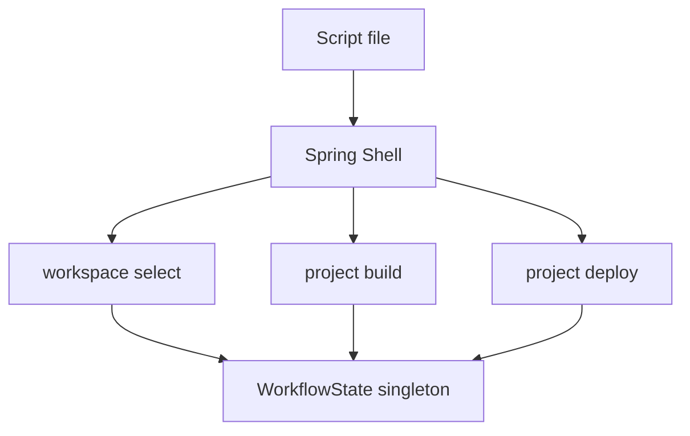

# Trạng thái được chia sẻ giữa các lệnh trong cùng phiên script

Một script Spring Shell thường gồm nhiều command cần dùng kết quả của command trước. Ví dụ, script chọn workspace, build dự án trong workspace đó rồi deploy bản build vừa tạo. Để chuỗi thao tác này hoạt động, các command phải đọc và cập nhật cùng một trạng thái trong lúc script đang chạy.

Spring Shell thực thi các dòng trong script theo thứ tự trong cùng ứng dụng. Nếu các command dùng chung một Spring bean mặc định có scope `singleton`, chúng sẽ truy cập cùng một instance của bean đó trong cùng application context. Đây là nền tảng để chia sẻ dữ liệu giữa các command. Trạng thái trong bộ nhớ chỉ tồn tại trong application context hiện tại; nó không tự được chuyển sang một tiến trình hoặc lần khởi động khác.

## 1. Script là chuỗi command trong cùng ứng dụng

Script Spring Shell là một tệp chứa các command của ứng dụng. Mỗi dòng được phân tích và thực thi như một command; dòng sau có thể sử dụng dữ liệu mà dòng trước đã ghi vào một service dùng chung.

Ví dụ:

```text
workflow reset
workspace select --name storefront
project build
project deploy
workflow status
```

Luồng này có quan hệ phụ thuộc:

1. `workflow reset` xóa state còn sót từ lần chạy trước.
2. `workspace select` lưu workspace hiện tại.
3. `project build` đọc workspace để build đúng dự án và ghi lại mã build.
4. `project deploy` đọc workspace cùng mã build đã lưu để triển khai đúng kết quả.
5. `workflow status` hiển thị state sau khi hoàn tất.

Script không tự tạo một biến Java cho mỗi dòng. Dữ liệu cần truyền giữa các command phải được lưu ở một nơi mà các command cùng truy cập, chẳng hạn Spring bean, database hoặc một kho trạng thái chuyên biệt.

## 2. Phạm vi chia sẻ trong application context

Spring bean mặc định có scope `singleton`: một bean definition tương ứng với một instance trong mỗi Spring IoC container. Khi nhiều command được inject cùng một state holder bean, chúng nhận cùng instance đó.



Điều này có nghĩa:

- Các dòng trong cùng lần thực thi script có thể chia sẻ state qua bean singleton.
- Các command được gọi thủ công trong cùng phiên interactive cũng dùng state holder đó.
- Nếu chạy `script --file ...` từ một phiên interactive, state vẫn còn sau khi script kết thúc, cho đến khi command khác thay đổi hoặc reset nó.
- Nếu khởi chạy một tiến trình mới, tiến trình đó tạo application context mới và state trong bộ nhớ bắt đầu lại theo giá trị khởi tạo.

Ví dụ, hai lần gọi sau là hai tiến trình độc lập:

```bash
java -jar app.jar workspace select --name storefront
java -jar app.jar project build
```

Lệnh thứ hai không thể đọc workspace được chọn trong tiến trình đầu nếu ứng dụng chỉ lưu state trong bean. Nếu muốn chia sẻ qua nhiều tiến trình, phải lưu workspace vào file, database hoặc một dịch vụ bên ngoài.

Không nhầm state holder với `CommandContext`. `CommandContext` cung cấp dữ liệu của command hiện tại như input đã parse, registry và output writer. Nó không phải kho trạng thái dùng chung giữa các lần gọi command.

## 3. Cách chạy script theo phiên bản Spring Shell

### Spring Shell 3.x

Trong Spring Shell 3.x, `ScriptShellRunner` có thể nhận đối số bắt đầu bằng `@` để đọc tệp script khi khởi động:

```bash
java -jar app.jar @deploy.txt
```

Ứng dụng đọc và thực thi script trong tiến trình được khởi động. Built-in command `script` cũng có thể đọc một tệp cục bộ và phát lại các command từng dòng trong shell. Tài liệu 3.4 mô tả rằng nội dung tệp được đọc giống cách nhập trong interactive shell: dòng bắt đầu bằng `//` là comment, còn dòng kết thúc bằng `\` có thể tiếp tục ở dòng kế tiếp.

Ví dụ:

```text
// Build và triển khai storefront
workflow reset
workspace select --name storefront
project build
project deploy
```

Từ Spring Shell 3.3, chỉ `NonInteractiveShellRunner` được bật mặc định. Nếu dùng `@file`, cần bảo đảm script runner được bật theo cấu hình của phiên bản 3.x đang dùng:

```yaml
spring:
  shell:
    script:
      enabled: true
```

### Spring Shell 4.x

Trong Spring Shell 4.x, `NonInteractiveShellRunner` hỗ trợ chạy một command hoặc một script bằng cách thêm tiền tố `@` vào đường dẫn tệp:

```bash
java -jar app.jar @deploy.txt
```

4.x cũng cung cấp built-in command `script` để chạy một tệp từ shell:

```text
script --file /absolute/path/to/deploy.txt
script --file classpath:scripts/deploy.txt
script --file file:/absolute/path/to/deploy.txt
```

Tài liệu 4.0.4 quy định mỗi dòng script chứa một command; các command được chạy theo thứ tự trong tệp và comment bắt đầu bằng `//`. Khi chạy script bằng `script --file` trong interactive shell, application context vẫn tiếp tục tồn tại sau khi script hoàn tất.

Khác biệt về runner giữa 3.x và 4.x không làm thay đổi nguyên tắc chia sẻ state: các command chỉ nhìn thấy cùng state trong phạm vi application context đang thực thi chúng. Trong 4.x, `NonInteractiveShellRunner` xử lý cả command đơn và script; không còn `ScriptShellRunner` riêng như 3.x.

## 4. Lưu state dùng chung trong một Spring bean

Không nên đặt dữ liệu workflow vào field của từng command class nếu nhiều command cần cùng đọc và cập nhật. Hãy tạo một state holder bean có trách nhiệm rõ ràng.

Ví dụ dưới đây dùng Spring Shell 4.x. State holder lưu workspace đang chọn và mã build gần nhất:

```java
import org.springframework.stereotype.Component;

@Component
public class WorkflowState {

    private String activeWorkspace;
    private String lastBuildId;

    public synchronized void selectWorkspace(String workspace) {
        if (workspace == null || workspace.isBlank()) {
            throw new IllegalArgumentException("Workspace không được để trống");
        }
        this.activeWorkspace = workspace;
        this.lastBuildId = null;
    }

    public synchronized String requireWorkspace() {
        if (activeWorkspace == null) {
            throw new IllegalStateException(
                    "Chưa chọn workspace; hãy chạy workspace select trước"
            );
        }
        return activeWorkspace;
    }

    public synchronized void recordBuild(String buildId) {
        if (activeWorkspace == null) {
            throw new IllegalStateException("Chưa chọn workspace");
        }
        this.lastBuildId = buildId;
    }

    public synchronized Snapshot snapshot() {
        return new Snapshot(activeWorkspace, lastBuildId);
    }

    public synchronized void reset() {
        activeWorkspace = null;
        lastBuildId = null;
    }

    public record Snapshot(String workspace, String buildId) {
    }
}
```

`@Component` đăng ký state holder trong application context. Vì scope mặc định là singleton, các command inject `WorkflowState` đều dùng cùng một instance. Các phương thức `synchronized` bảo vệ thao tác đọc/ghi từng phần state khi có nhiều lời gọi đồng thời.

Khi đổi workspace, ví dụ xóa `lastBuildId` là có chủ đích: mã build trước đó thuộc workspace cũ và không được dùng để deploy workspace mới. Hãy xác định quan hệ phụ thuộc giữa các trường state và xóa những dữ liệu đã mất hiệu lực khi một giá trị nền thay đổi.

## 5. Các command đọc và cập nhật cùng state

Command chọn workspace ghi state:

```java
import org.springframework.shell.core.command.annotation.Command;
import org.springframework.shell.core.command.annotation.Option;
import org.springframework.stereotype.Component;

@Component
public class WorkspaceCommands {

    private final WorkflowState state;

    public WorkspaceCommands(WorkflowState state) {
        this.state = state;
    }

    @Command(name = "workspace select", description = "Chọn workspace hiện tại.")
    public String select(
            @Option(longName = "name", required = true) String name) {
        state.selectWorkspace(name);
        return "Đã chọn workspace " + name;
    }

    @Command(name = "workspace show", description = "Hiển thị workspace hiện tại.")
    public String show() {
        WorkflowState.Snapshot snapshot = state.snapshot();
        return snapshot.workspace() == null
                ? "Chưa chọn workspace"
                : "Workspace hiện tại: " + snapshot.workspace();
    }
}
```

Command build đọc workspace và ghi mã build sau khi service hoàn tất:

```java
import org.springframework.shell.core.command.annotation.Command;
import org.springframework.stereotype.Component;

@Component
public class ProjectCommands {

    private final WorkflowState state;
    private final BuildService buildService;
    private final DeploymentService deploymentService;

    public ProjectCommands(
            WorkflowState state,
            BuildService buildService,
            DeploymentService deploymentService) {
        this.state = state;
        this.buildService = buildService;
        this.deploymentService = deploymentService;
    }

    @Command(name = "project build", description = "Build workspace hiện tại.")
    public String build() {
        String workspace = state.requireWorkspace();
        BuildResult result = buildService.build(workspace);
        state.recordBuild(result.id());
        return "Build thành công: " + result.id();
    }

    @Command(name = "project deploy", description = "Deploy bản build gần nhất.")
    public String deploy() {
        WorkflowState.Snapshot snapshot = state.snapshot();
        if (snapshot.workspace() == null || snapshot.buildId() == null) {
            throw new IllegalStateException(
                    "Cần chọn workspace và build thành công trước khi deploy"
            );
        }
        deploymentService.deploy(snapshot.workspace(), snapshot.buildId());
        return "Đã deploy build " + snapshot.buildId()
                + " của " + snapshot.workspace();
    }
}
```

`BuildService`, `DeploymentService` và `BuildResult` đại diện cho các thành phần nghiệp vụ của ứng dụng. Command chỉ điều phối đầu vào và state cần thiết; logic build/deploy vẫn nằm trong service để có thể được tái sử dụng ngoài Spring Shell.

Chỉ gọi `recordBuild` sau khi build thành công. Nếu build thất bại, mã build cũ không nên bị thay bằng một mã thành công giả. Nếu muốn ghi nhận lần build thất bại, hãy lưu riêng `lastBuildFailure` thay vì ghi đè `lastBuildId`.

## 6. Một script hoàn chỉnh sử dụng state chung

Tạo tệp `deploy.txt`:

```text
// Bắt đầu một workflow mới
workflow reset
workspace select --name storefront
workspace show
project build
project deploy
workflow status
```

Khi chạy, các command đọc và cập nhật cùng `WorkflowState`:

| Thứ tự | Command | State sau khi chạy |
| --- | --- | --- |
| 1 | `workflow reset` | `activeWorkspace = null`, `lastBuildId = null` |
| 2 | `workspace select --name storefront` | `activeWorkspace = storefront` |
| 3 | `workspace show` | Đọc và hiển thị `storefront` |
| 4 | `project build` | Đọc `storefront`, build và lưu `lastBuildId` |
| 5 | `project deploy` | Đọc `storefront` cùng `lastBuildId` rồi deploy |
| 6 | `workflow status` | Đọc snapshot state hiện tại |

Để chạy bằng non-interactive runner:

```bash
java -jar app.jar @deploy.txt
```

Hoặc trong Spring Shell 4.x interactive:

```text
script --file deploy.txt
```

Nếu người dùng chạy `project deploy` trước `workspace select` hoặc trước `project build`, state holder từ chối thao tác với thông báo cụ thể. Đây là cách bảo vệ thứ tự phụ thuộc ngay cả khi người dùng chạy command thủ công thay vì chạy cả script.

## 7. Khởi tạo và reset state theo từng lần chạy

State trong singleton bean không tự biết một script mới bắt đầu hoặc script trước đã kết thúc. Nếu một ứng dụng chạy nhiều script trong cùng interactive session, state của lần trước có thể còn nguyên.

Một quy ước đơn giản là:

- Dòng đầu script gọi `workflow reset` để bắt đầu với state sạch.
- Các command tiếp theo tạo và sử dụng state của workflow hiện tại.
- Dòng cuối gọi `workflow status` để xác nhận kết quả; nếu cần xóa state ngay sau khi hoàn tất, gọi thêm `workflow reset`.

Command reset có thể được khai báo như sau:

```java
import org.springframework.shell.core.command.annotation.Command;
import org.springframework.stereotype.Component;

@Component
public class WorkflowCommands {

    private final WorkflowState state;

    public WorkflowCommands(WorkflowState state) {
        this.state = state;
    }

    @Command(name = "workflow reset", description = "Xóa state workflow hiện tại.")
    public String reset() {
        state.reset();
        return "Đã reset workflow state";
    }

    @Command(name = "workflow status", description = "Hiển thị state workflow.")
    public String status() {
        WorkflowState.Snapshot snapshot = state.snapshot();
        return "workspace=" + snapshot.workspace()
                + ", buildId=" + snapshot.buildId();
    }
}
```

Nếu script thất bại trước dòng reset cuối, state có thể còn lại trong interactive session. Dòng `workflow reset` ở đầu lần chạy tiếp theo sẽ loại bỏ dữ liệu cũ. Với quy trình cần dọn dẹp chắc chắn ngay cả khi một command ném exception, hãy điều phối script qua một lớp orchestration có `try/finally`, hoặc lưu state theo mã lần chạy để có thể hết hạn và đối soát.

Không nên xóa state workflow trong `finally` của từng command. Nếu `project build` xóa state ngay khi kết thúc, `project deploy` sẽ không còn mã build để dùng. `finally` phù hợp với tài nguyên tạm của một command; state được chia sẻ giữa nhiều command cần vòng đời riêng của workflow.

## 8. State chia sẻ không phải transaction của cả script

Việc các command dùng cùng state không làm cho toàn bộ script trở thành một transaction. Nếu `workspace select` và `project build` đã hoàn tất, sau đó `project deploy` thất bại, những side effect của hai command trước không tự được rollback.

Hãy thiết kế mỗi bước theo nguyên tắc:

- Chỉ ghi state thành công sau khi thao tác tương ứng hoàn tất.
- Dùng mã định danh hoặc kết quả rõ ràng để command sau biết nó đang dùng dữ liệu nào.
- Nếu thao tác có thể chạy lại, thiết kế idempotent hoặc dùng idempotency key.
- Nếu một bước thất bại, ghi nhận bước lỗi và giữ lại thông tin đủ để tiếp tục hoặc đối soát.
- Không giả định script sẽ tự hoàn tác các command đã chạy trước đó.

Ví dụ, nếu `project build` thành công nhưng `project deploy` thất bại do timeout, không nên xóa `lastBuildId`. Người vận hành có thể kiểm tra trạng thái deploy rồi thử lại đúng bản build đó. Nếu không biết deploy đã thành công ở phía máy chủ hay chưa, cần truy vấn trạng thái trước khi gửi lại để tránh triển khai trùng.

Tài liệu script mô tả thứ tự thực thi các command, nhưng không nên suy diễn rằng mọi phiên bản/cấu hình đều có cùng chính sách dừng hoặc tiếp tục sau lỗi. Hãy kiểm thử hành vi lỗi của runner đang dùng và tự thiết kế checkpoint, retry hoặc bước khôi phục khi workflow yêu cầu.

## 9. Giới hạn khi có nhiều script hoặc nhiều tiến trình

Một singleton state holder chia sẻ dữ liệu cho mọi command dùng nó trong cùng application context. Điều này phù hợp với một phiên CLI đơn người dùng, nhưng cần cân nhắc nếu có nhiều workflow đồng thời:

| Tình huống | State singleton trong bộ nhớ | Thiết kế phù hợp |
| --- | --- | --- |
| Nhiều dòng trong một script chạy tuần tự | Chia sẻ được | Một state holder cho workflow |
| Người dùng chạy command tiếp theo trong cùng interactive shell | Chia sẻ được | Giữ state đến khi reset hoặc kết thúc context |
| Hai script chạy đồng thời trong cùng context | Có thể ghi đè state của nhau | Lưu state theo `runId`/`sessionId` hoặc tuần tự hóa việc chạy |
| Hai tiến trình `java -jar` riêng biệt | Không chia sẻ | Database, file hoặc dịch vụ trạng thái ngoài tiến trình |
| Ứng dụng khởi động lại | State trong bộ nhớ mất | Lưu dữ liệu cần khôi phục vào nơi bền vững |

Các phương thức `synchronized` hoặc `AtomicReference` chỉ bảo vệ truy cập đồng thời vào dữ liệu; chúng không tạo ra state riêng cho từng script. Nếu hai script cùng dùng một singleton, chúng vẫn có thể ghi đè workspace hoặc mã build của nhau dù từng thao tác ghi được đồng bộ.

Với workflow chạy song song, hãy cấp một `runId` riêng cho mỗi lần chạy và dùng nó làm khóa:

```text
workflow start --run-id deploy-2026-11-26-001
workspace select --run-id deploy-2026-11-26-001 --name storefront
project build --run-id deploy-2026-11-26-001
project deploy --run-id deploy-2026-11-26-001
```

State holder khi đó cần lưu `Map<RunId, WorkflowSnapshot>` hoặc truy cập một kho dữ liệu có khóa `runId`. Với nhiều tiến trình hoặc nhiều máy, dùng kho bên ngoài thay vì một `Map` trong bộ nhớ.

## 10. Chọn dữ liệu nào nên đưa vào shared state

Chỉ lưu dữ liệu command sau cần dùng và có vòng đời rõ ràng:

| Dữ liệu | Nên lưu trong state phiên? | Lý do |
| --- | --- | --- |
| Workspace đang chọn | Có | Command sau cần biết ngữ cảnh làm việc |
| Mã build thành công gần nhất | Có | Deploy cần xác định artifact cụ thể |
| Đường dẫn file tạm | Chỉ trong thời gian cần thiết | Phải dọn khi không còn sử dụng |
| Password hoặc access token | Không nên lưu trong state thông thường | Cần credential store hoặc cơ chế bảo mật phù hợp |
| Toàn bộ nội dung file lớn | Không | Giữ reference/path hoặc stream dữ liệu khi cần |
| Kết quả cần tra cứu sau khi JVM thoát | Không chỉ lưu trong bộ nhớ | Ghi vào database hoặc file |
| Cờ đang chạy của một command | Có, nhưng phải dọn đúng vòng đời | Tránh cho thao tác xung đột chạy cùng lúc |

State nên lưu ID hoặc reference thay vì sao chép toàn bộ object nghiệp vụ. Ví dụ lưu `buildId` rồi để service tải lại build từ repository giúp state nhẹ, dễ kiểm tra và không giữ object cũ trong bộ nhớ lâu hơn cần thiết.

## 11. Kiểm thử state giữa các command

Kiểm thử cần chứng minh command sau thực sự nhìn thấy thay đổi do command trước tạo ra.

**Kiểm thử tích hợp trong cùng application context:**

1. Reset state.
2. Gọi `workspace select --name storefront`.
3. Gọi `workspace show` và xác nhận trả về `storefront`.
4. Gọi `project build` và xác nhận mã build được lưu.
5. Gọi `project deploy` và xác nhận service nhận đúng workspace cùng mã build.
6. Reset state, gọi `project deploy` và xác nhận command bị từ chối vì chưa có workspace/build.

**Kiểm thử script:**

- Chạy một script chứa nhiều command phụ thuộc nhau.
- Xác nhận các command được thực thi đúng thứ tự.
- Chạy lại script trong cùng interactive context để kiểm tra reset đầu script.
- Làm một command giữa script thất bại và kiểm tra state còn lại có thể được chẩn đoán hoặc khôi phục.
- Chạy cùng script bằng `@file` trong tiến trình mới và xác nhận state bắt đầu theo giá trị khởi tạo.
- Nếu hỗ trợ chạy song song, kiểm thử hai `runId` không đọc/ghi state của nhau.

Với Spring Shell, có thể dùng công cụ kiểm thử shell của phiên bản tương ứng để thực thi command qua cùng command infrastructure. Ngoài kiểm thử từng command, cần có ít nhất một bài kiểm thử chạy chuỗi lệnh trong cùng context; nếu chỉ tạo state holder mới cho mỗi test, bài test sẽ không phát hiện lỗi do command dùng nhầm instance hoặc state không được chia sẻ.

## 12. Lỗi thường gặp

| Hiện tượng | Nguyên nhân | Cách xử lý |
| --- | --- | --- |
| Command thứ hai không thấy workspace đã chọn | Mỗi command tạo state holder mới hoặc bean bị khai báo nhiều instance | Inject cùng bean singleton từ application context |
| Script chạy được nhưng command sau không có mã build | Chỉ in mã build ra output, không lưu ID vào state | Ghi ID vào state sau khi build thành công |
| Lần chạy script tiếp theo dùng workspace cũ | Không reset state khi bắt đầu workflow mới | Thêm `workflow reset` ở đầu script |
| State mất sau khi chạy lệnh bằng `java -jar` lần tiếp theo | Mỗi lần chạy tạo tiến trình và context mới | Lưu dữ liệu cần dùng giữa tiến trình vào kho bền vững |
| Hai script ghi đè workspace của nhau | Dùng một singleton cho nhiều workflow đồng thời | Tách state theo `runId` hoặc tuần tự hóa |
| State bị xóa trước khi command sau đọc | Dọn shared state trong `finally` của từng command | Chỉ dọn dữ liệu tạm theo command; reset shared state theo vòng đời workflow |
| Deploy thất bại làm mất mã build đã thành công | Gộp trạng thái build và deploy vào một field bị ghi đè | Lưu riêng build ID và trạng thái deploy |
| Script thất bại nhưng không biết đã chạy đến đâu | Không có checkpoint hoặc trạng thái từng bước | Lưu step hiện tại, kết quả và mã lỗi để đối soát |

## 13. Checklist thiết kế shared state cho script

- Xác định dữ liệu nào cần được truyền giữa các command.
- Đặt dữ liệu dùng chung trong Spring bean được inject vào các command liên quan.
- Hiểu rõ singleton chỉ chia sẻ trong một application context.
- Xác nhận script thực thi các dòng trong cùng tiến trình/context và theo đúng thứ tự.
- Reset state ở đầu mỗi workflow nếu có thể chạy nhiều script trong cùng context.
- Chỉ cập nhật kết quả thành công sau khi service hoàn tất.
- Không xóa shared state trong `finally` của từng command.
- Thiết kế bước lỗi, retry, checkpoint và đối soát cho workflow nhiều bước.
- Dùng `runId` hoặc state riêng khi có nhiều workflow đồng thời.
- Lưu vào database/file/dịch vụ ngoài nếu cần chia sẻ qua tiến trình hoặc khởi động lại.
- Không lưu bí mật hoặc object lớn trong state phiên.
- Kiểm thử cả chuỗi command trong cùng context và trường hợp script thất bại.

## Tài liệu tham khảo

- [Spring Shell 3.4 — Script](https://docs.spring.io/spring-shell/reference/3.4/commands/builtin/script.html)
- [Spring Shell 3.4 — ScriptShellRunner API](https://docs.spring.io/spring-shell/reference/3.4/api/java/org/springframework/shell/jline/ScriptShellRunner.html)
- [Spring Shell 4.0.4 — Script](https://docs.spring.io/spring-shell/reference/commands/builtin/script.html)
- [Spring Shell 4.0.4 — NonInteractiveShellRunner API](https://docs.spring.io/spring-shell/reference/api/org/springframework/shell/core/NonInteractiveShellRunner.html)
- [Spring Framework — Bean Scopes and Singleton Scope](https://docs.spring.io/spring-framework/reference/core/beans/factory-scopes.html)
