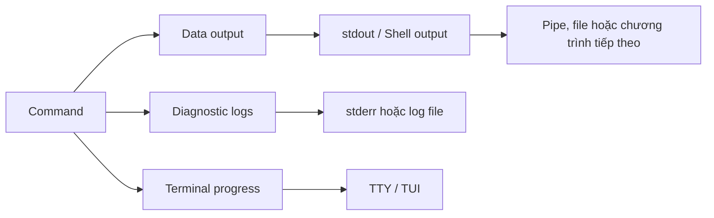

# Tách log, màu sắc và thông báo tiến trình khỏi luồng dữ liệu

Một CLI thường vừa tạo dữ liệu cho chương trình khác xử lý, vừa cần hiển thị thông tin vận hành cho người dùng. Ví dụ, command xuất JSON cần ghi JSON ra `stdout`, trong khi log khởi động, cảnh báo, lỗi và tiến trình tải dữ liệu cần hiển thị riêng. Nếu trộn tất cả vào cùng một luồng, lệnh pipe như `| jq` hoặc chuyển hướng `> report.json` sẽ nhận cả log, màu ANSI và progress spinner, khiến dữ liệu không còn hợp lệ.

Bài học thuộc chương **Script và tự động hóa**. Nội dung tập trung vào cách phân chia `stdout` và `stderr`, sử dụng output writer của Spring Shell, định tuyến logging, kiểm soát ANSI color, hiển thị progress trong terminal và kiểm thử đầu ra khi chạy qua pipe hoặc CI.

Sau bài học, bạn có thể:

- Phân biệt dữ liệu command, log chẩn đoán và thông báo tiến trình.
- Sử dụng `CommandContext.outputWriter()` để ghi output theo cơ chế của Spring Shell.
- Định tuyến log sang `stderr` hoặc file để giữ `stdout` sạch.
- Chuyển hướng và kết hợp luồng bằng cú pháp shell.
- Tắt màu ANSI khi output được chuyển vào file hoặc pipeline.
- Chọn progress indicator phù hợp với terminal và non-interactive mode.
- Kiểm thử riêng dữ liệu đầu ra và thông báo chẩn đoán.

## Ba loại nội dung CLI cần tách biệt

Trước khi chọn API ghi dữ liệu, hãy xác định nội dung nào thuộc từng nhóm:

| Loại nội dung | Ví dụ | Nơi phù hợp |
| --- | --- | --- |
| Dữ liệu kết quả | JSON, CSV, danh sách ID, nội dung file xuất | `stdout` hoặc output writer của command |
| Log chẩn đoán | Bắt đầu kết nối, retry, exception, thời gian xử lý | Logging framework; thường định tuyến sang `stderr` hoặc file |
| Tín hiệu giao diện | Spinner, progress bar, màu sắc, trạng thái đang tải | Terminal/TUI; không đưa vào dữ liệu máy đọc |

Một command xuất JSON nên tạo đúng một tài liệu JSON trên output chính. Log `INFO`, cảnh báo và progress không nên xuất hiện giữa các dấu `{}` hoặc giữa các dòng CSV. Tương tự, ANSI escape sequence dùng để tô màu terminal không phải dữ liệu nghiệp vụ và không nên được ghi vào file JSON/CSV.

Mô hình luồng cơ bản:



## stdout và stderr của tiến trình

JVM cung cấp hai luồng chuẩn thường dùng cho CLI:

- `System.out` là luồng output chuẩn. Shell thường chuyển hướng luồng này vào file hoặc truyền cho command tiếp theo trong pipeline.
- `System.err` là luồng lỗi chuẩn. Luồng này có thể được hiển thị riêng trên terminal hoặc chuyển hướng độc lập với output chuẩn.

Ví dụ với Bash:

```bash
java -jar report-cli.jar report export --format json \
  > report.json \
  2> report.log
```

Trong lệnh trên, `report.json` nhận stdout và `report.log` nhận stderr. Người dùng có thể xử lý file JSON mà không phải loại bỏ các dòng log.

Pipe mặc định truyền stdout sang chương trình tiếp theo:

```bash
java -jar report-cli.jar report export --format json \
  2> report.log \
  | jq '.items[]'
```

`jq` chỉ nhận dữ liệu từ stdout. Log được chuyển vào `report.log`. Nếu muốn xem log trực tiếp trên terminal, bỏ phần `2> report.log`; stderr vẫn được hiển thị riêng khi stdout đi qua pipe.

Có thể chuyển hướng cả hai luồng vào cùng một file bằng `2>&1`:

```bash
java -jar report-cli.jar report export --format json \
  > combined.log 2>&1
```

Đây là cách gom output để chẩn đoán, không phù hợp khi file cần chứa dữ liệu JSON/CSV thuần. Khi dùng `2>&1`, log và dữ liệu cùng đi vào một luồng.

Trên Windows Command Prompt, cú pháp chuyển hướng `>`, `2>` và `2>&1` cũng có ý nghĩa tương tự. Với PowerShell, hành vi chuyển hướng luồng native phụ thuộc phiên bản; khi cần tách stderr của tiến trình native, nên kiểm tra phiên bản PowerShell đang chạy và thử với một command nhỏ trước khi dùng trong pipeline production.

## Ghi output qua CommandContext

Trong Spring Shell 4.x, `CommandContext` cung cấp `PrintWriter` qua `outputWriter()`. Đây là cách được tài liệu Spring Shell khuyến nghị để ghi nội dung vào shell:

```java
import org.springframework.shell.core.command.CommandContext;
import org.springframework.shell.core.command.annotation.Command;

class ReportCommands {

    @Command(name = "report export")
    public void export(CommandContext context) {
        context.outputWriter().println("{\"status\":\"ok\"}");
        context.outputWriter().flush();
    }
}
```

`CommandContext.outputWriter()` ghi qua output abstraction của Spring Shell. Cách này phù hợp với command output và giúp các tiện ích kiểm thử của Spring Shell thu nhận nội dung. Gọi trực tiếp `System.out.println()` sẽ ghi thẳng vào stream của JDK và có thể đi vòng qua output writer mà shell/test client đang quản lý.

Một command cũng có thể trả về giá trị; Spring Shell sẽ in giá trị trả về ra shell output. Với dữ liệu có cấu trúc, hãy tạo output nhất quán, ví dụ một JSON document hoặc một bảng CSV, rồi ghi qua writer hoặc trả về chuỗi đã serialize.

### Command xuất dữ liệu và log chẩn đoán

Ví dụ dưới đây dùng SLF4J cho log và `CommandContext` cho dữ liệu:

```java
import org.slf4j.Logger;
import org.slf4j.LoggerFactory;
import org.springframework.shell.core.command.CommandContext;
import org.springframework.shell.core.command.annotation.Command;

class ReportCommands {

    private static final Logger log =
        LoggerFactory.getLogger(ReportCommands.class);

    private final ReportService reportService;

    ReportCommands(ReportService reportService) {
        this.reportService = reportService;
    }

    @Command(name = "report export")
    public void export(CommandContext context) {
        log.info("Bắt đầu tạo báo cáo");

        String json = reportService.exportJson();
        context.outputWriter().println(json);
        context.outputWriter().flush();

        log.info("Đã tạo báo cáo thành công");
    }
}
```

Trong ví dụ, JSON là dữ liệu chính; hai log message là thông tin vận hành. Cần cấu hình logging để log không làm bẩn stdout khi command được dùng trong pipeline.

`CommandContext` có một `PrintWriter outputWriter()` cho output command, không cung cấp một `errorWriter()` riêng. Vì vậy, hãy dùng logging framework với appender được định tuyến phù hợp cho log chẩn đoán. Với lỗi đơn giản trong một chương trình Java thuần, `System.err` có thể dùng trực tiếp; trong ứng dụng Spring, logger thường dễ quản lý level, format, file và vòng đời hơn.

## Định tuyến log sang stderr

Spring Boot mặc định cấu hình logging ghi ra console. Nếu command output được chuyển vào file hoặc pipeline, log console có thể xuất hiện cùng output dữ liệu tùy cách appender được cấu hình. Một cách tách rõ ràng là định tuyến console appender của Logback sang `System.err`.

Với ứng dụng dùng Logback, tạo file `src/main/resources/logback-spring.xml`:

```xml
<configuration>
    <include resource="org/springframework/boot/logging/logback/defaults.xml"/>

    <appender name="STDERR" class="ch.qos.logback.core.ConsoleAppender">
        <target>System.err</target>
        <encoder>
            <pattern>${CONSOLE_LOG_PATTERN}</pattern>
        </encoder>
    </appender>

    <root level="INFO">
        <appender-ref ref="STDERR"/>
    </root>
</configuration>
```

Appender trên ghi log vào stderr. Khi chạy:

```bash
java -jar report-cli.jar report export --format json \
  > report.json \
  2> report.log
```

`report.json` nhận output command, còn `report.log` nhận log của ứng dụng. Cấu hình này dành cho Logback và Spring Boot; nếu dùng Log4j2 hoặc JDK logging, cần cấu hình appender/handler tương ứng.

### Ghi log vào file

Spring Boot có thể ghi log ra file bằng `logging.file.name` hoặc `logging.file.path`:

```yaml
logging:
  file:
    name: logs/report-cli.log
```

Khi khai báo `logging.file.name`, Spring Boot ghi log ra file đồng thời vẫn có thể giữ console logging. Nếu muốn chỉ ghi log vào file và không ghi console, có thể tắt console logging:

```yaml
logging:
  console:
    enabled: false
  file:
    name: logs/report-cli.log
```

Có thể điều chỉnh mức log theo package hoặc root logger:

```yaml
logging:
  level:
    root: WARN
    com.example.report: INFO
```

Đối với CLI chạy trong CI, log file hữu ích khi cần lưu lịch sử chẩn đoán. Hãy chọn đường dẫn có quyền ghi, chính sách xoay vòng và thời gian lưu phù hợp với môi trường triển khai.

## Tách màu ANSI khỏi dữ liệu

ANSI escape sequence là chuỗi điều khiển terminal dùng để đổi màu chữ, kiểu chữ hoặc vị trí con trỏ. Terminal có thể hiển thị chúng như màu sắc; file văn bản hoặc parser JSON có thể nhận nguyên các byte điều khiển đó.

Spring Shell 4.x có hệ thống theme để định nghĩa style và figure. Theme mặc định tên `default`; theme tích hợp `dump` không dùng styling màu và cố gắng không dùng các figure đặc biệt. Có thể chọn theme bằng:

```yaml
spring:
  shell:
    theme:
      name: dump
```

Điều này hữu ích khi muốn output shell đơn giản, dễ đọc trong log hoặc môi trường terminal hạn chế. Nếu ứng dụng tự in ANSI escape sequence trong command, theme không tự loại bỏ các chuỗi do ứng dụng tự ghi.

Spring Boot có thuộc tính `spring.output.ansi.enabled` với ba giá trị:

| Giá trị | Hành vi |
| --- | --- |
| `DETECT` | Tự phát hiện khả năng hỗ trợ ANSI; đây là mặc định của `AnsiOutput`. |
| `ALWAYS` | Luôn bật ANSI color. |
| `NEVER` | Tắt ANSI color của Spring Boot. |

Ví dụ tắt màu khi chạy trong CI hoặc xuất file:

```yaml
spring:
  output:
    ansi:
      enabled: never
  shell:
    theme:
      name: dump
```

Hai cấu hình trên điều khiển hai lớp khác nhau: `spring.output.ansi.enabled` điều khiển ANSI output của Spring Boot; `spring.shell.theme.name` chọn theme của Spring Shell. Nếu dùng cả logging console và shell styling, hãy kiểm tra cả hai.

Trong cấu hình Logback mặc định của Spring Boot, `%clr` là conversion word dùng để tô màu theo log level hoặc màu/style chỉ định. Nếu tự viết pattern có `%clr`, việc tắt ANSI của Spring Boot giúp loại bỏ mã màu khi môi trường không hỗ trợ hoặc khi cần log thuần.

Không nên tự nối chuỗi ANSI vào JSON hoặc CSV. Nếu muốn đánh dấu trạng thái trong dữ liệu máy đọc, dùng field dữ liệu như `"status":"warning"`; phần giao diện terminal có thể tô màu khi hiển thị field đó.

## Tách progress indicator khỏi stdout

Progress indicator như spinner, thanh phần trăm hoặc dòng cập nhật tại chỗ phù hợp với terminal có khả năng điều khiển con trỏ. Chúng thường ghi đè dòng hiện tại bằng ký tự `\r`, ANSI escape sequence hoặc thao tác terminal. Khi đưa các ký tự đó vào file hay pipeline, kết quả có thể khó đọc hoặc không parse được.

Spring Shell 4.x có TUI `ProgressView` trong module JLine. `ProgressView` hỗ trợ các item tích hợp `text`, `spinner` và `percent`; trạng thái có giá trị bắt đầu, kết thúc, phần trăm và thời điểm cập nhật. API cung cấp `start()`, `stop()`, `setDescription(...)`, `setTickValue(...)` và `tickAdvance(...)` để điều khiển tiến trình.

Ví dụ khởi tạo view theo tài liệu:

```java
import org.springframework.shell.jline.tui.component.view.control.ProgressView;

ProgressView progress = new ProgressView();
progress.setDescription("Đang tải dữ liệu");
progress.start();

try {
    // Thực hiện công việc và cập nhật tiến độ.
    progress.setTickValue(50);
}
finally {
    progress.stop();
}
```

Để sử dụng `ProgressView`, ứng dụng cần các thành phần JLine/TUI tương ứng và phải gắn view vào luồng hiển thị terminal của ứng dụng. Đoạn code trên minh họa vòng đời view; cách bố trí và render cụ thể phụ thuộc TUI container mà ứng dụng sử dụng.

Khi command chạy trong non-interactive mode hoặc stdout được chuyển hướng, nên chọn một trong các cách sau:

- Tắt progress UI và chỉ ghi dữ liệu kết quả.
- Ghi các mốc tiến trình thưa, dễ đọc vào stderr.
- Ghi log tiến trình qua logger để có timestamp và level.
- Dùng một option như `--quiet` hoặc `--no-progress` để người gọi chủ động tắt giao diện.

Không nên cập nhật spinner liên tục qua `CommandContext.outputWriter()` nếu output chính đang được dùng làm JSON/CSV. Việc ghi nhiều dòng trạng thái vào output writer sẽ làm thay đổi dữ liệu command.

## Thiết kế option quiet và no-progress

CLI có thể cung cấp option để người dùng chọn mức hiển thị:

```java
import org.springframework.shell.core.command.annotation.Command;
import org.springframework.shell.core.command.annotation.Option;
import org.springframework.stereotype.Component;

@Component
class ExportCommands {

    @Command(name = "report export")
    public String export(
            @Option(longName = "quiet", defaultValue = "false") boolean quiet,
            @Option(longName = "no-progress", defaultValue = "false") boolean noProgress) {

        if (!quiet) {
            // Ghi log bắt đầu/kết thúc qua logger.
        }

        // Nếu noProgress=false và terminal hỗ trợ TUI, có thể hiển thị progress.
        return "{\"status\":\"ok\"}";
    }
}
```

Trong thiết kế thực tế, `quiet` thường giảm log mức thông tin; lỗi vẫn cần được báo để người gọi biết tác vụ thất bại. `no-progress` chỉ tắt giao diện tiến trình. Hai option này không nên tắt dữ liệu kết quả của command.

Với CLI dùng trong pipeline, một quy ước hữu ích là:

- stdout: chỉ dữ liệu kết quả.
- stderr: cảnh báo, lỗi và thông tin tiến trình.
- file log: lịch sử chẩn đoán chi tiết.
- terminal TUI: spinner hoặc progress bar khi chạy tương tác.

## Ví dụ hoàn chỉnh: xuất JSON và chuyển log riêng

Giả sử command xuất JSON qua output writer và dùng SLF4J để ghi log. Logback được cấu hình để gửi log ra stderr như phần trước.

Chạy command và lưu dữ liệu:

```bash
java -jar report-cli.jar report export --format json \
  > report.json \
  2> report.log
```

Kiểm tra dữ liệu:

```bash
jq . report.json
```

Đọc log:

```bash
tail -f report.log
```

Hoặc truyền dữ liệu trực tiếp cho một chương trình khác:

```bash
java -jar report-cli.jar report export --format json \
  2> report.log \
  | jq -r '.items[].id'
```

Nếu lệnh chạy thành công, `jq` chỉ nhận JSON. Nếu command ghi thêm dòng `INFO: Starting export` vào stdout, JSON sẽ không còn hợp lệ. Đây là lý do cần kiểm tra routing của logging trước khi dùng CLI như một thành phần pipeline.

## Kiểm thử output và log riêng biệt

Nên kiểm tra cả nội dung command và cách tiến trình xuất dữ liệu:

1. Dùng `ShellTestClient` để xác nhận output được ghi qua `CommandContext.outputWriter()`.
2. Dùng integration test với process thật để chuyển hướng stdout và stderr vào hai file riêng.
3. Parse stdout như JSON hoặc CSV để phát hiện log/banner/ANSI bị lẫn vào dữ liệu.
4. Kiểm tra stderr có log chẩn đoán cần thiết.
5. Chạy với `spring.output.ansi.enabled=never` và theme `dump`, sau đó kiểm tra file output không chứa ANSI escape sequence.
6. Chạy trong môi trường không có TTY hoặc khi stdout được pipe để xác nhận progress UI không làm hỏng dữ liệu.
7. Kiểm tra `--quiet` và `--no-progress` nếu ứng dụng cung cấp các option này.

Spring Shell cung cấp `ShellTestClient`, `ShellScreen` và `ShellAssertions` để mô phỏng input, thu output shell và xác nhận nội dung. Với kiểm thử ở cấp tiến trình, hãy dùng process test để xác minh chính xác stdout, stderr và exit code vì shell test screen không thay thế hoàn toàn việc kiểm tra redirection của hệ điều hành.

## Lỗi thường gặp

| Hiện tượng | Nguyên nhân | Cách xử lý |
| --- | --- | --- |
| JSON không parse được | Log hoặc banner xuất cùng stdout. | Chuyển log sang stderr/file và chỉ ghi JSON vào output chính. |
| CSV có dòng lạ ở đầu | Command in thông báo tiến trình vào output writer. | Ghi tiến trình qua logger/stderr hoặc tắt progress khi xuất dữ liệu. |
| File có ký tự `ESC` hoặc mã `\u001b` | ANSI color được ghi vào file hoặc pipeline. | Tắt ANSI và dùng theme `dump`; không tự nối escape sequence vào dữ liệu. |
| `jq` báo lỗi khi pipe | stdout chứa nhiều dòng log hoặc progress. | Kiểm tra log routing và bảo đảm command chạy non-interactive. |
| Log không xuất hiện trong file stderr | Logging appender vẫn ghi vào stdout hoặc file khác. | Kiểm tra `logback-spring.xml`, `target` của ConsoleAppender và logging config thực tế. |
| Test không bắt được output command | Code dùng `System.out` thay vì shell output writer. | Dùng `CommandContext.outputWriter()` cho nội dung command. |
| Progress bar nhấp nháy hoặc phá output | TUI được bật trong môi trường không có terminal thật hoặc output bị pipe. | Tắt progress UI trong non-interactive mode hoặc dùng log mốc trên stderr. |
| Log quá nhiều làm khó đọc terminal | Log level quá thấp hoặc progress cập nhật quá thường xuyên. | Điều chỉnh `logging.level`, throttle progress và cung cấp `--quiet`. |
| Mất log khi tắt console logging | Đã tắt console nhưng chưa cấu hình file appender. | Cấu hình `logging.file.name` hoặc appender file tương ứng. |

## Checklist trước khi phát hành CLI

- [ ] Đã xác định dữ liệu command phải đi ra stdout/output writer.
- [ ] Log chẩn đoán được định tuyến sang stderr hoặc file.
- [ ] Không ghi log hoặc progress vào JSON/CSV.
- [ ] Command dùng `CommandContext.outputWriter()` thay vì tự ghi `System.out` khi cần shell output.
- [ ] ANSI color được tự phát hiện hoặc tắt trong CI/pipeline.
- [ ] Spring Shell dùng theme `dump` khi cần output không styling.
- [ ] Progress UI chỉ bật khi môi trường có terminal phù hợp.
- [ ] Có option `--quiet` hoặc `--no-progress` nếu người dùng cần điều khiển output.
- [ ] Đã kiểm tra redirection `>`, `2>` và `2>&1`.
- [ ] Integration test xác nhận stdout parse được và stderr chứa log mong muốn.

## Ghi nhớ

Hãy dành stdout cho dữ liệu command, stderr hoặc file cho log chẩn đoán, và terminal/TUI cho màu sắc cùng progress. Trong Spring Shell 4.x, dùng `CommandContext.outputWriter()` để ghi output qua shell abstraction. Với Spring Boot/Logback, định tuyến console appender sang `System.err` nếu cần giữ stdout sạch. Dùng `spring.shell.theme.name=dump` và `spring.output.ansi.enabled=never` khi cần output không màu; tắt progress UI khi chạy trong pipeline. Một CLI có luồng output rõ ràng sẽ dễ kết hợp với `jq`, công cụ xử lý CSV, shell script và CI/CD.

## Tài liệu tham khảo

- [Spring Shell 4.0.2 — Writing Output](https://docs.spring.io/spring-shell/reference/commands/writing.html): dùng `CommandContext.outputWriter()` thay cho ghi trực tiếp qua `System.out`.
- [Spring Shell 4.0.3 — Command Context](https://docs.spring.io/spring-shell/reference/commands/context.html): truy cập output writer và input reader trong command.
- [Spring Shell 4.0.3 — Theming](https://docs.spring.io/spring-shell/reference/customization/styling.html): theme `default`, theme `dump`, style, figure và `ThemeResolver`.
- [Spring Shell 4.0.4 — ProgressView](https://docs.spring.io/spring-shell/reference/tui/views/progress.html): progress text, spinner, percent và vòng đời progress view.
- [Spring Boot 4 — Logging](https://docs.spring.io/spring-boot/reference/features/logging.html): console logging, ANSI color, file output, log level và custom logging configuration.
- [Spring Boot 4 API — `AnsiOutput.Enabled`](https://docs.spring.io/spring-boot/api/java/org/springframework/boot/ansi/AnsiOutput.Enabled.html): các chế độ `ALWAYS`, `DETECT` và `NEVER`.
- [Spring Shell 4.0.3 — Testing](https://docs.spring.io/spring-shell/reference/testing.html): `ShellTestClient`, `ShellScreen` và `ShellAssertions` để kiểm thử output.
