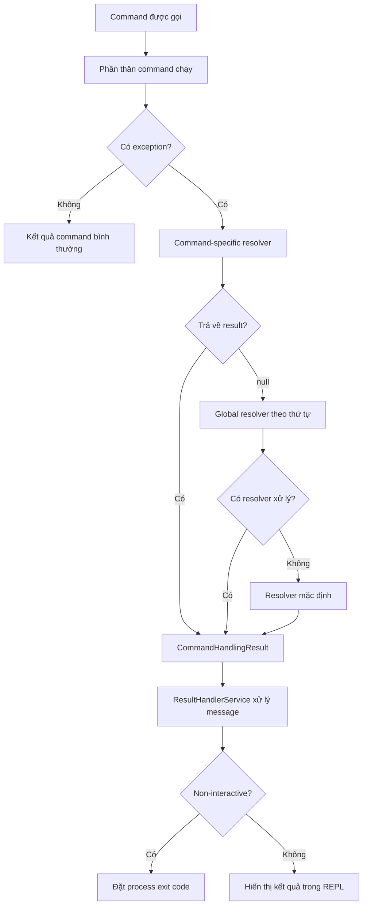

# `CommandExceptionResolver` và `CommandHandlingResult` trong Spring Shell 3.x

Một command có thể thất bại vì dữ liệu đã tồn tại, dịch vụ bên ngoài không phản hồi, quyền truy cập bị từ chối hoặc một lỗi không dự kiến. Nếu chỉ để exception thoát ra ngoài, thông báo có thể quá kỹ thuật và mã thoát có thể không phù hợp với script gọi ứng dụng. Spring Shell 3.x cung cấp `CommandExceptionResolver` để xử lý exception theo một chuỗi resolver và `CommandHandlingResult` để mô tả thông báo cùng exit code cần trả về.

Hai API này phục vụ hai mục tiêu liên quan nhưng khác nhau: resolver quyết định exception nào được xử lý và xử lý bằng cách nào; handling result mang dữ liệu đầu ra của quyết định đó. Khi command chạy non-interactive, exit code giúp CI, shell script hoặc tiến trình gọi phân biệt thành công và thất bại. Trong interactive REPL, thông báo vẫn được hiển thị nhưng exit code không làm shell tự kết thúc.

Bài viết tập trung vào Spring Shell 3.4.x, gồm resolver triển khai bằng interface, resolver khai báo bằng `@ExceptionResolver`, thứ tự xử lý và cách kiểm thử cả thông báo lẫn exit code.

## Luồng xử lý exception

Khi command ném exception, Spring Shell chuyển exception vào cơ chế xử lý kết quả. Một chuỗi `CommandExceptionResolver` có thể nhận exception và trả về `CommandHandlingResult`. Resolver không xử lý exception nên trả `null`, cho phép resolver tiếp theo thử xử lý. Nếu không có resolver tùy chỉnh nào xử lý, các resolver mặc định của Spring Shell tiếp tục xử lý những trường hợp phổ biến như lỗi parser.



Resolver có thể được gắn trực tiếp vào một `CommandRegistration` hoặc đăng ký toàn cục dưới dạng Spring bean. Resolver gắn với command được xử lý trước global resolver. Các resolver mặc định cũng tham gia chuỗi; `@Order` hoặc `Ordered` điều khiển thứ tự của global resolver so với mặc định.

## `CommandHandlingResult` chứa những gì?

`CommandHandlingResult` thuộc package `org.springframework.shell.command`. Đây là interface giữ thông tin xử lý, thường được trả về từ `CommandExceptionResolver`.

| Factory/API | Ý nghĩa |
| --- | --- |
| `CommandHandlingResult.of(message)` | Tạo result có thông báo |
| `CommandHandlingResult.of(message, exitCode)` | Tạo result có thông báo và mã thoát cụ thể |
| `CommandHandlingResult.empty()` | Tạo result rỗng, không có thông báo hoặc mã thoát |
| `message()` | Đọc thông báo; giá trị có thể là `null` |
| `exitCode()` | Đọc mã thoát; kiểu `Integer` có thể là `null` |
| `isPresent()` / `isEmpty()` | Kiểm tra result có nội dung hay không |

Ví dụ:

```java
CommandHandlingResult messageOnly =
        CommandHandlingResult.of("Không thể tìm thấy artifact.");

CommandHandlingResult messageAndCode =
        CommandHandlingResult.of("Artifact đã tồn tại.", 20);
```

`CommandHandlingResult` chỉ mô tả kết quả để framework xử lý. Nó không tự in thông báo tại thời điểm được tạo. `ResultHandlerService` và result handler của shell sẽ hiển thị phần message theo cấu hình.

Một điểm quan trọng: `null` do `CommandExceptionResolver.resolve(...)` trả về có nghĩa là resolver này không xử lý exception và muốn chuyển tiếp trong chuỗi. `CommandHandlingResult.empty()` là một đối tượng result rỗng, không phải cách thay thế cho `null` để yêu cầu resolver tiếp theo chạy.

`exitCode()` chỉ có ý nghĩa trong non-interactive mode. Khi người dùng đang ở REPL, result vẫn có thể hiển thị thông báo lỗi nhưng mã thoát không đóng REPL hoặc thay thế trạng thái tiến trình đang chạy.

## Mặc định exit code trong Spring Shell 3.4.x

Các mã mặc định được tài liệu Spring Shell 3.4.x mô tả:

| Tình huống | Exit code mặc định |
| --- | ---: |
| Command chạy thành công | `0` |
| Lỗi tổng quát khi thực thi | `1` |
| Lỗi parse command option | `2` |

Đây là giá trị mặc định khi không có mapping tùy chỉnh phù hợp. Nếu script cần phân biệt lỗi nghiệp vụ, có thể trả mã riêng qua `CommandHandlingResult` hoặc cấu hình exit code mapping cho command được đăng ký theo kiểu programmatic.

Hãy chọn mã có ý nghĩa ổn định trong ứng dụng. Ví dụ, `20` có thể đại diện cho dữ liệu trùng lặp, `30` cho dịch vụ phụ thuộc không khả dụng và `40` cho lỗi quyền. Ghi lại quy ước này trong tài liệu vận hành để script không phải suy đoán từ chuỗi thông báo.

## Triển khai `CommandExceptionResolver` toàn cục

`CommandExceptionResolver` là interface có phương thức:

```java
CommandHandlingResult resolve(Exception ex);
```

Resolver nhận exception và trả một `CommandHandlingResult` nếu xử lý được. Nếu exception không thuộc phạm vi của resolver, trả `null`.

Ví dụ một resolver xử lý hai lỗi nghiệp vụ:

```java
import org.springframework.core.annotation.Order;
import org.springframework.shell.command.CommandExceptionResolver;
import org.springframework.shell.command.CommandHandlingResult;
import org.springframework.stereotype.Component;

@Component
@Order(CommandExceptionResolver.DEFAULT_PRECEDENCE - 1)
public class DomainCommandExceptionResolver
        implements CommandExceptionResolver {

    @Override
    public CommandHandlingResult resolve(Exception exception) {
        if (exception instanceof ArtifactAlreadyExistsException) {
            return CommandHandlingResult.of(
                    "Artifact đã tồn tại. Hãy chọn tên khác.", 20);
        }

        if (exception instanceof RemoteServiceUnavailableException) {
            return CommandHandlingResult.of(
                    "Dịch vụ từ xa hiện không khả dụng. Hãy thử lại sau.", 30);
        }

        return null;
    }
}
```

`CommandExceptionResolver.DEFAULT_PRECEDENCE` là mốc thứ tự dành cho resolver mặc định. Trong Spring Shell 3.4.x, giá trị này là `-100`; `@Order(DEFAULT_PRECEDENCE - 1)` đặt resolver trên trước resolver có thứ tự mặc định. Nếu muốn để resolver mặc định thử trước, có thể đặt thứ tự lớn hơn mốc đó. Khi dùng thứ tự tùy chỉnh, luôn trả `null` với exception ngoài phạm vi để không che mất xử lý mặc định.

Không nên tạo một resolver toàn cục bắt mọi `Exception` rồi trả cùng một mã cho tất cả. Cách đó có thể làm mất mã `2` vốn dành cho lỗi parse option và che thông báo hữu ích từ resolver mặc định. Hãy chỉ xử lý exception thuộc miền nghiệp vụ của resolver.

## Gắn resolver vào một command cụ thể

Nếu một resolver chỉ phù hợp với một command, có thể gắn nó vào phần error handling của `CommandRegistration.Builder`:

```java
CommandRegistration.Builder builder = CommandRegistration.builder()
        .command("artifact publish");

builder.withErrorHandling()
        .resolver(new ArtifactPublishExceptionResolver())
        .and();

// Tiếp tục cấu hình target/options của command rồi gọi build().
```

Resolver được gắn ở command sẽ được thử trước các resolver toàn cục. Cách này hữu ích khi cùng một loại exception có ý nghĩa khác nhau ở các command khác nhau. Ví dụ, lỗi `ResourceNotFoundException` trong command xem dữ liệu có thể là “không tìm thấy bản ghi”, còn trong command triển khai có thể có nghĩa “môi trường đích chưa được tạo”.

Nếu cùng một quy tắc thông báo và mã thoát được dùng cho nhiều command, global bean thường dễ bảo trì hơn. Tránh đăng ký lặp cùng resolver ở cả cấp command và toàn cục nếu không có lý do về thứ tự xử lý.

## Resolver khai báo bằng `@ExceptionResolver`

Với mô hình annotation legacy của Spring Shell 3.x, lớp `@ShellComponent` có thể khai báo một hoặc nhiều phương thức `@ExceptionResolver`. Những phương thức này xử lý exception phát sinh từ các command method trong component đó.

```java
import org.springframework.shell.command.CommandHandlingResult;
import org.springframework.shell.command.annotation.ExceptionResolver;
import org.springframework.shell.standard.ShellComponent;
import org.springframework.shell.standard.ShellMethod;

@ShellComponent
public class ArtifactCommands {

    private final ArtifactService artifactService;

    public ArtifactCommands(ArtifactService artifactService) {
        this.artifactService = artifactService;
    }

    @ShellMethod(key = "artifact publish", value = "Phát hành artifact")
    public String publish(String name) {
        artifactService.publish(name);
        return "Đã phát hành " + name;
    }

    @ExceptionResolver
    CommandHandlingResult handleDuplicate(
            ArtifactAlreadyExistsException exception) {
        return CommandHandlingResult.of(
                "Artifact đã tồn tại: " + exception.getMessage(), 20);
    }
}
```

Đặt exception type cụ thể làm tham số phương thức giúp Spring Shell xác định loại lỗi cần xử lý. Có thể khai báo các exception type trong thuộc tính của annotation, nhưng dùng tham số có kiểu rõ ràng thường dễ đọc hơn.

`@ExceptionResolver` có thể khớp exception gốc hoặc một cause lồng bên trong wrapper exception. Khi nhiều phương thức cùng khớp, Spring Shell ưu tiên exception gần với exception được ném hơn thông qua `ExceptionDepthComparator`. Vì vậy, nên có handler cụ thể cho exception nghiệp vụ và tránh một handler quá rộng nếu không thực sự cần.

### Các kiểu trả về được hỗ trợ

Phương thức `@ExceptionResolver` trong Spring Shell 3.4.x hỗ trợ ba kiểu trả về:

| Kiểu trả về | Hành vi |
| --- | --- |
| `CommandHandlingResult` | Kiểm soát cả message và exit code |
| `String` | Chuỗi được in ra shell; exit code là `1` |
| `void` | Exception được xem là đã xử lý; exit code mặc định là `0` |

Nếu dùng `String` hoặc `void`, có thể thêm `@ExitCode(code = ...)` để chỉ định mã thoát:

```java
import org.springframework.shell.command.annotation.ExitCode;
import org.springframework.shell.command.annotation.ExceptionResolver;

@ExceptionResolver
@ExitCode(code = 30)
String handleRemoteFailure(RemoteServiceUnavailableException exception) {
    return "Dịch vụ từ xa hiện không khả dụng.";
}
```

Với lỗi cần trả mã khác 0, không nên dùng `void` mà quên `@ExitCode`: phương thức `void` được xem là đã xử lý thành công và mã mặc định là `0`. `CommandHandlingResult` thường rõ ràng hơn vì message và exit code nằm cạnh nhau trong cùng một kết quả.

## Thứ tự resolver và cách giữ xử lý mặc định

Spring Shell có resolver mặc định cho một số exception phổ biến, đặc biệt là lỗi parser. Có thể điều chỉnh thứ tự global resolver bằng `@Order` hoặc `Ordered`.

| Nguồn resolver | Thứ tự xử lý |
| --- | --- |
| Resolver gắn vào `CommandRegistration` | Trước global resolver |
| Global resolver bean | Theo `@Order`/`Ordered` |
| Resolver mặc định của Spring Shell | Dùng `CommandExceptionResolver.DEFAULT_PRECEDENCE` |

Ví dụ, một resolver toàn cục chỉ xử lý exception nghiệp vụ:

```java
@Override
public CommandHandlingResult resolve(Exception exception) {
    if (exception instanceof ArtifactAlreadyExistsException) {
        return CommandHandlingResult.of("Artifact đã tồn tại.", 20);
    }
    return null;
}
```

Khi nhận `CommandParserException`, resolver trả `null`, do đó resolver parser mặc định vẫn có cơ hội trả thông báo cú pháp và exit code `2`. Nếu custom resolver luôn trả `CommandHandlingResult.of("Có lỗi", 1)`, thông tin parse lỗi có thể bị mất.

## Phân biệt exception resolving với exit code mapping

Spring Shell 3.x còn có cơ chế mapping exception sang exit code trong `CommandRegistration`. Cơ chế này chỉ ánh xạ mã thoát; resolver là nơi có thể tạo cả thông báo lẫn mã thoát.

Ví dụ thêm mapping vào builder programmatic đang cấu hình command:

```java
builder.withExitCode()
        .map(ArtifactAlreadyExistsException.class, 20)
        .map(RemoteServiceUnavailableException.class, 30)
        .and();
```

`withExitCode()` hỗ trợ mapping theo exception class hoặc theo một hàm nhận `Throwable` và trả về `Integer`. Tài liệu Spring Shell 3.4.x ghi rõ exit code mapping này không được tùy chỉnh bằng annotation-based configuration.

Chọn cơ chế theo nhu cầu:

| Nhu cầu | Cơ chế phù hợp |
| --- | --- |
| Chỉ cần gán mã thoát theo exception trong command programmatic | `withExitCode().map(...)` |
| Cần thông báo thân thiện và mã thoát | `CommandExceptionResolver` + `CommandHandlingResult` |
| Chỉ một `@ShellComponent` cần xử lý lỗi của command trong lớp đó | `@ExceptionResolver` |
| Một exception có mã thoát riêng theo hợp đồng ứng dụng | Exception triển khai `ExitCodeGenerator`, hoặc resolver trả result rõ ràng |

Không cần cấu hình cả mapping và resolver cho cùng một exception nếu hai cơ chế có thể đưa ra mã khác nhau. Hãy chọn một nơi làm nguồn sự thật cho mã thoát của lỗi đó.

## Sử dụng `ExitCodeGenerator` trong exception

Nếu muốn mã thoát đi cùng kiểu exception, có thể triển khai `org.springframework.boot.ExitCodeGenerator`:

```java
import org.springframework.boot.ExitCodeGenerator;

public class ArtifactAlreadyExistsException
        extends RuntimeException implements ExitCodeGenerator {

    public ArtifactAlreadyExistsException(String name) {
        super("Artifact đã tồn tại: " + name);
    }

    @Override
    public int getExitCode() {
        return 20;
    }
}
```

Spring Shell tích hợp cơ chế exit code của Spring Boot. Cách này có thể phù hợp nếu exception luôn mang cùng một mã thoát bất kể command nào ném nó. Nếu cùng exception cần thông báo hoặc mã khác nhau theo command, resolver cụ thể thường linh hoạt hơn.

## Exit code có ý nghĩa ở non-interactive mode

Exit code là tín hiệu cho tiến trình gọi. Ví dụ:

```bash
java -jar app.jar artifact publish --name duplicate
echo $?
```

Nếu resolver trả `CommandHandlingResult.of("Artifact đã tồn tại.", 20)`, tiến trình non-interactive kết thúc với mã `20`. Trong PowerShell, có thể đọc `$LASTEXITCODE` ngay sau khi chạy tiến trình Java.

Trong REPL:

```text
shell:> artifact publish duplicate
Artifact đã tồn tại.
shell:>
```

Thông báo được hiển thị và người dùng vẫn có thể nhập command tiếp theo. Không dùng exit code như một cơ chế thay thế trạng thái phiên hoặc như cách buộc REPL thoát sau một lỗi thông thường.

Khi viết script, hãy kiểm tra mã thoát thay vì phân tích chuỗi thông báo:

```bash
java -jar app.jar artifact publish --name duplicate
status=$?

if [ "$status" -ne 0 ]; then
    echo "Publish failed with exit code $status" >&2
    exit "$status"
fi
```

Giữ `stdout` cho kết quả có thể được script tiêu thụ và `stderr` cho thông tin chẩn đoán nếu ứng dụng có phân luồng output riêng. Không trả `0` cho lỗi chỉ vì resolver đã in ra thông báo thân thiện.

## Kiểm thử resolver

Nên kiểm thử resolver ở hai mức: unit test cho quy tắc ánh xạ và kiểm thử tích hợp cho cách shell hiển thị thông báo/exit code.

Unit test cho resolver toàn cục:

```java
import static org.assertj.core.api.Assertions.assertThat;

import org.junit.jupiter.api.Test;
import org.springframework.shell.command.CommandHandlingResult;

class DomainCommandExceptionResolverTests {

    private final DomainCommandExceptionResolver resolver =
            new DomainCommandExceptionResolver();

    @Test
    void mapsDuplicateArtifactToExitCode20() {
        CommandHandlingResult result = resolver.resolve(
                new ArtifactAlreadyExistsException("report.zip"));

        assertThat(result.message()).contains("Artifact đã tồn tại");
        assertThat(result.exitCode()).isEqualTo(20);
    }

    @Test
    void returnsNullForExceptionOutsideItsScope() {
        assertThat(resolver.resolve(new IllegalStateException("unexpected")))
                .isNull();
    }
}
```

Các kiểm thử tích hợp nên xác minh:

| Trường hợp | Điều cần xác minh |
| --- | --- |
| Exception nghiệp vụ được nhận diện | Message đúng và exit code đúng |
| Exception ngoài phạm vi | Resolver trả `null` để resolver tiếp theo xử lý |
| Exception được bọc trong cause | Handler đúng được chọn nếu cause thuộc loại được hỗ trợ |
| Nhiều handler cùng khớp | Handler cụ thể/root match được ưu tiên theo quy tắc framework |
| Command-level và global resolver | Resolver command được gọi trước global |
| Parser exception | Resolver mặc định vẫn tạo thông báo và exit code parse `2` |
| Generic exception không có custom handler | Exit code mặc định `1` |
| Command thành công | Exit code `0` |
| `@ExceptionResolver` trả `String` | Exit code mặc định `1` hoặc mã `@ExitCode` |
| `@ExceptionResolver` trả `void` | Exit code mặc định `0`, hoặc mã `@ExitCode` |
| Interactive shell | Message hiển thị và REPL tiếp tục hoạt động |
| Non-interactive process | Process exit code khớp `CommandHandlingResult` |

Để xác minh exit code thật, chạy JAR đã đóng gói như một tiến trình con và đọc process exit value. Chỉ gọi trực tiếp phương thức resolver trong unit test không chứng minh `NonInteractiveShellRunner` đã chuyển mã đó ra tiến trình hệ điều hành.

## Những lỗi thường gặp

| Lỗi | Hệ quả | Cách xử lý |
| --- | --- | --- |
| Resolver trả result cho mọi exception | Che mất lỗi parser và mã mặc định | Chỉ xử lý loại exception thuộc phạm vi; còn lại trả `null` |
| Trả `null` khi muốn xử lý lỗi | Resolver tiếp theo/default handler sẽ tiếp tục | Trả `CommandHandlingResult` khi đã xử lý |
| Dùng `CommandHandlingResult.empty()` thay cho `null` | Result rỗng không có nghĩa “chuyển tiếp resolver” | Dùng `null` cho exception chưa được xử lý |
| Dùng `void` resolver cho lỗi nhưng quên `@ExitCode` | Lỗi có thể kết thúc với exit code `0` | Trả `CommandHandlingResult` hoặc thêm mã khác 0 |
| Dùng `String` và mong mã thoát tùy chỉnh | String-only mặc định dùng code `1` | Thêm `@ExitCode` hoặc trả `CommandHandlingResult` |
| Chỉ test message | Script có thể nhận exit code sai | Assert cả `message()` và `exitCode()`; test process thật |
| Nhầm exit code có tác dụng trong REPL | Mong REPL thoát hoặc đổi trạng thái sau exception | Dùng exit code cho non-interactive; REPL hiển thị thông báo rồi tiếp tục |
| Đặt resolver toàn cục quá ưu tiên và bắt rộng | Có thể chặn resolver parser mặc định | Thu hẹp exception type và giữ `null` cho lỗi không thuộc miền |
| Cấu hình mapping và resolver cho cùng exception nhưng khác code | Kết quả khó dự đoán và khó bảo trì | Chọn một cơ chế làm nguồn mã thoát |
| In stack trace cho mọi lỗi nghiệp vụ | Output khó đọc và có thể lộ chi tiết nội bộ | Trả thông báo ngắn; log chi tiết theo chính sách |

## Quy trình xây dựng exception handling

1. Phân loại exception nghiệp vụ mà command có thể phát sinh.
2. Chọn nơi xử lý: resolver toàn cục, resolver riêng command hoặc `@ExceptionResolver` trong `@ShellComponent`.
3. Với `CommandExceptionResolver`, trả `CommandHandlingResult` cho exception được nhận diện và `null` cho exception ngoài phạm vi.
4. Gán exit code ổn định cho lỗi có ý nghĩa với script/CI.
5. Đặt thứ tự global resolver phù hợp với resolver mặc định.
6. Không làm mất thông báo và exit code parse lỗi mặc định.
7. Kiểm thử message, exit code, resolver chain và hành vi interactive/non-interactive.
8. Kiểm tra process exit code trên JAR hoặc image đã đóng gói.

`CommandExceptionResolver` và `CommandHandlingResult` tách biệt việc nhận diện exception với nội dung phản hồi. Khi resolver chỉ xử lý đúng loại lỗi, trả `null` cho phần còn lại và cung cấp exit code có quy ước, ứng dụng Spring Shell có thông báo nhất quán cho người dùng và tín hiệu đáng tin cậy cho script, CI hoặc hệ thống gọi bên ngoài.

## Tài liệu tham khảo

- [Exception Handling – Spring Shell 3.4.3](https://docs.spring.io/spring-shell/reference/3.4/commands/exceptionhandling/index.html)
- [Exception Resolving – Spring Shell 3.4.3](https://docs.spring.io/spring-shell/reference/3.4/commands/exceptionhandling/resolving.html)
- [@ExceptionResolver – Spring Shell 3.4.3](https://docs.spring.io/spring-shell/reference/3.4/commands/exceptionhandling/annotation.html)
- [Exit Code Mappings – Spring Shell 3.4.2](https://docs.spring.io/spring-shell/reference/3.4/commands/exceptionhandling/mappings.html)
- [CommandExceptionResolver API – Spring Shell 3.4.3](https://docs.spring.io/spring-shell/reference/3.4/api/java/org/springframework/shell/command/CommandExceptionResolver.html)
- [CommandHandlingResult API – Spring Shell 3.4.3](https://docs.spring.io/spring-shell/reference/3.4/api/java/org/springframework/shell/command/CommandHandlingResult.html)
- [CommandRegistration.ErrorHandlingSpec API – Spring Shell 3.4.x](https://docs.spring.io/spring-shell/reference/3.4/api/java/org/springframework/shell/command/CommandRegistration.ErrorHandlingSpec.html)
- [CommandRegistration.ExitCodeSpec API – Spring Shell 3.4.3](https://docs.spring.io/spring-shell/reference/3.4/api/java/org/springframework/shell/command/CommandRegistration.ExitCodeSpec.html)
- [ExitCode annotation API – Spring Shell 3.4.3](https://docs.spring.io/spring-shell/reference/3.4/api/java/org/springframework/shell/command/annotation/ExitCode.html)
- [Spring Boot ExitCodeGenerator API](https://docs.spring.io/spring-boot/api/java/org/springframework/boot/ExitCodeGenerator.html)
