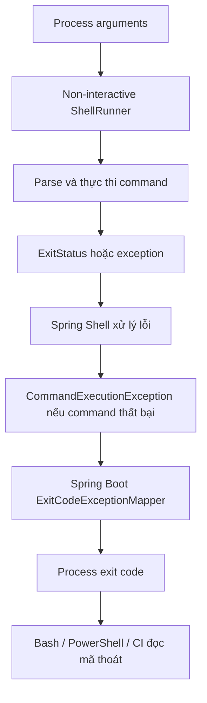

# Kiểm chứng mã thoát ở cấp tiến trình khi chạy không tương tác

Một command có thể in thông báo thành công hoặc thất bại, nhưng chương trình gọi nó vẫn cần biết tác vụ đã thành công hay chưa. Trong môi trường tự động, CI/CD, cron hoặc shell script, tín hiệu đáng tin cậy là mã thoát của tiến trình (process exit code). Giá trị này được hệ điều hành trả về khi tiến trình Java kết thúc và có thể được chương trình gọi kiểm tra.

Spring Shell có `ExitStatus` để mô tả kết quả của một command. Tuy nhiên, trạng thái command và mã thoát của JVM là hai lớp khác nhau. Bài học này giải thích cách kết nối chúng trong chế độ không tương tác, cách kiểm tra bằng Bash/PowerShell và cách phát hiện trường hợp command báo lỗi nhưng tiến trình vẫn trả mã `0`.

Sau bài học, bạn có thể:

- Phân biệt output, `ExitStatus` của command và process exit code.
- Chọn non-interactive mode để kiểm tra mã thoát của một lần chạy CLI.
- Ánh xạ exception thành exit status trong Spring Shell 3.x và 4.x.
- Kết nối `CommandExecutionException` với `ExitCodeExceptionMapper` của Spring Boot 4.
- Kiểm tra mã thoát thật bằng Bash, PowerShell và `ProcessBuilder`.
- Phát hiện lỗi parse hoặc script có thể bị bỏ qua trong một số bản Spring Shell.
- Thiết kế mã thoát ổn định để CI/CD và chương trình khác xử lý.

## Process exit code là gì?

Khi một tiến trình kết thúc, hệ điều hành cung cấp một số nguyên cho tiến trình gọi. Theo quy ước CLI phổ biến:

- `0`: tác vụ hoàn thành thành công.
- Khác `0`: có lỗi hoặc kết quả không thành công.

Mã thoát không phải dòng chữ command in ra terminal. Ví dụ, command có thể in `Export failed` nhưng vẫn trả mã `0`; khi đó pipeline sẽ hiểu lầm rằng tác vụ thành công. Ngược lại, command có thể không in nhiều thông tin nhưng trả mã khác `0`, giúp CI đánh dấu job thất bại.

Ba loại kết quả cần phân biệt:

| Loại | Ý nghĩa | Ví dụ |
| --- | --- | --- |
| Output | Nội dung hiển thị hoặc dữ liệu command ghi ra stdout/stderr. | `Đã xuất báo cáo` |
| Command exit status | Kết quả mà Spring Shell gắn với lần thực thi command. | `ExitStatus(42, "Unsupported format")` |
| Process exit code | Mã tiến trình Java trả cho hệ điều hành khi JVM kết thúc. | `42` |

Trong Spring Shell, mã thoát có ý nghĩa chủ yếu ở non-interactive mode, nơi một lần chạy nhận command hoặc script rồi kết thúc. Trong REPL, mỗi command kết thúc nhưng shell tiếp tục chờ lệnh tiếp theo; không có một process exit code riêng cho từng command.

## Luồng từ command đến hệ điều hành



Đây là luồng điển hình của Spring Shell 4.x chạy cùng Spring Boot. Spring Shell xác định kết quả command; Spring Boot chuyển exception thoát ứng dụng thành mã tiến trình. Khi kiểm thử, cần chạy tiến trình Java thật và đọc mã do hệ điều hành trả về.

## Chọn non-interactive mode

Trong Spring Shell 4.x, interactive mode được bật mặc định. Muốn chạy command từ process arguments rồi kết thúc, đặt:

```yaml
spring:
  shell:
    interactive:
      enabled: false
```

Hoặc truyền system property khi chạy JAR:

```bash
java -Dspring.shell.interactive.enabled=false \
     -jar target/report-cli.jar report export --format csv
```

Đặt `-Dspring.shell.interactive.enabled=false` trước `-jar`. Khi interactive mode bị tắt, Spring Shell dùng `NonInteractiveShellRunner` để thực thi command được truyền qua arguments hoặc script file rồi hoàn tất.

Với Spring Shell 3.3.x, non-interactive runner được bật mặc định. Interactive runner cần được bật riêng bằng `spring.shell.interactive.enabled=true` nếu ứng dụng cần REPL. Hãy kiểm tra cấu hình theo đúng phiên bản trước khi đo process exit code.

## Phân biệt API exit code trong Spring Shell 3.x và 4.x

Hai dòng phiên bản sử dụng mô hình khác nhau:

| Nội dung | Spring Shell 3.3.x | Spring Shell 4.x |
| --- | --- | --- |
| Kết quả command | `CommandHandlingResult` có message và `exitCode`. | `ExitStatus` là record gồm `code` và `description`. |
| Xử lý exception | `CommandExceptionResolver`, `@ExceptionResolver`, `@ExitCode`. | `ExitStatusExceptionMapper`. |
| Programmatic mapping | `CommandRegistration.withExitCode().map(...)`. | `Command.Builder.exitStatusExceptionMapper(...)` hoặc `@Command(exitStatusExceptionMapper=...)`. |
| Cầu nối tới process | Tích hợp cơ chế exit code của Spring Boot; exception có thể triển khai `ExitCodeGenerator`. | Non-interactive runner ném `CommandExecutionException` khi command có exit status khác `OK`; Spring Boot `ExitCodeExceptionMapper` ánh xạ exception này thành mã tiến trình. |

Không nên sao chép trực tiếp `CommandExceptionResolver` hoặc `CommandHandlingResult` từ 3.x sang 4.x. API 4.x đã thay thế chúng bằng `ExitStatus` và `ExitStatusExceptionMapper`.

## Spring Shell 3.3.x: mã mặc định và ánh xạ exception

Trong Spring Shell 3.3.4, mã mặc định được tài liệu mô tả như sau:

| Trường hợp | Mã mặc định |
| --- | ---: |
| Thành công | `0` |
| Lỗi phân tích option | `2` |
| Lỗi chung | `1` |

Spring Shell 3.x dùng `CommandHandlingResult` để mang thông báo và exit code. Một `CommandExceptionResolver` có thể trả về kết quả tùy chỉnh:

```java
import org.springframework.shell.command.CommandExceptionResolver;
import org.springframework.shell.command.CommandHandlingResult;

class ReportExceptionResolver implements CommandExceptionResolver {

    @Override
    public CommandHandlingResult resolve(Exception exception) {
        if (exception instanceof ReportNotFoundException) {
            return CommandHandlingResult.of(
                "Không tìm thấy báo cáo được yêu cầu", 4);
        }
        return null;
    }
}
```

Resolver có thể được đăng ký dưới dạng bean toàn cục hoặc gắn với một `CommandRegistration`. Resolver riêng của command được xử lý trước resolver toàn cục.

### Ánh xạ exception trong CommandRegistration

Với programmatic registration, Spring Shell 3.x hỗ trợ ánh xạ exception sang mã thoát:

```java
CommandRegistration registration = CommandRegistration.builder()
    .command("report export")
    .withExitCode()
        .map(ReportNotFoundException.class, 4)
        .map(UnsupportedFormatException.class, 5)
        .and()
    .build();
```

Đây là cấu hình của mô hình programmatic. Tài liệu 3.3.x lưu ý không thể tùy chỉnh exit code bằng annotation-based configuration theo cùng cách này. Với annotation legacy, có thể dùng `@ExceptionResolver` cùng `@ExitCode` cho method xử lý exception.

### Exception triển khai ExitCodeGenerator

Spring Boot cung cấp `ExitCodeGenerator`. Trong mô hình Spring Shell 3.x, exception nghiệp vụ có thể triển khai interface này để cung cấp mã cho cơ chế exit code của Spring Boot:

```java
import org.springframework.boot.ExitCodeGenerator;

class ReportNotFoundException extends RuntimeException
        implements ExitCodeGenerator {

    ReportNotFoundException(String message) {
        super(message);
    }

    @Override
    public int getExitCode() {
        return 4;
    }
}
```

Hãy kiểm thử từ tiến trình thật. Việc resolver trả về `CommandHandlingResult` có mã không đồng nghĩa với việc một unit test gọi method Java đã kiểm chứng mã của tiến trình.

## Spring Shell 4.x: ExitStatus và hai tầng mapper

Trong Spring Shell 4.x, `ExitStatus` chứa mã và mô tả kết quả command:

```java
import org.springframework.shell.core.command.ExitStatus;

ExitStatus success = ExitStatus.OK;
ExitStatus failure = new ExitStatus(42, "Không thể xuất báo cáo");
```

Spring Shell có `ExitStatusExceptionMapper` để biến exception phát sinh trong command thành `ExitStatus`. Ví dụ:

```java
import org.springframework.context.annotation.Bean;
import org.springframework.context.annotation.Configuration;
import org.springframework.shell.core.command.ExitStatus;
import org.springframework.shell.core.command.exit.ExitStatusExceptionMapper;

@Configuration
class ShellExceptionConfiguration {

    @Bean
    ExitStatusExceptionMapper reportExitStatusMapper() {
        return exception -> {
            if (exception instanceof ReportNotFoundException) {
                return new ExitStatus(4, "Không tìm thấy báo cáo");
            }
            return ExitStatus.EXECUTION_ERROR;
        };
    }
}
```

Gắn mapper vào command annotation bằng tên bean:

```java
import org.springframework.shell.core.command.annotation.Command;
import org.springframework.shell.core.command.annotation.Option;
import org.springframework.stereotype.Component;

class ReportNotFoundException extends RuntimeException {
    ReportNotFoundException(String message) {
        super(message);
    }
}

@Component
class ReportCommands {

    @Command(
        name = "report export",
        exitStatusExceptionMapper = "reportExitStatusMapper")
    public String export(@Option(longName = "format") String format) {
        if (!"csv".equals(format)) {
            throw new ReportNotFoundException("Không hỗ trợ định dạng");
        }
        return "Đã xuất báo cáo";
    }
}
```

`ExitStatusExceptionMapper` điều khiển kết quả ở tầng Spring Shell. Nó không trực tiếp đặt process exit code của JVM. Khi non-interactive runner gặp command status khác `OK`, runner chuyển lỗi thực thi thành `CommandExecutionException` mang mã tương ứng. Spring Boot cần ánh xạ exception đó sang mã tiến trình.

### Cấu hình Spring Boot ExitCodeExceptionMapper

Với ứng dụng Spring Boot 4, khai báo bean `org.springframework.boot.ExitCodeExceptionMapper` để lấy mã từ `CommandExecutionException`:

```java
import org.springframework.boot.ExitCodeExceptionMapper;
import org.springframework.context.annotation.Bean;
import org.springframework.context.annotation.Configuration;
import org.springframework.shell.core.command.CommandExecutionException;

@Configuration
class ProcessExitCodeConfiguration {

    @Bean
    ExitCodeExceptionMapper processExitCodeMapper() {
        return exception -> {
            if (exception instanceof CommandExecutionException commandException) {
                return commandException.getExitCode();
            }
            return 1;
        };
    }
}
```

Đây là mapper ở tầng Spring Boot. Nó nhận exception làm đầu vào và trả về số nguyên mà Spring Boot dùng làm process exit code. Nhánh mặc định trả `1` để lỗi ứng dụng không bị báo thành công.

Có thể khai báo mapper command và mapper process cùng lúc:

- `ExitStatusExceptionMapper`: chọn `ExitStatus` cho exception của command.
- `ExitCodeExceptionMapper`: chọn mã thoát tiến trình từ exception mà Spring Boot nhận được.

Tên hai interface gần giống nhau nhưng chúng phục vụ hai tầng khác nhau. Đừng chỉ cấu hình mapper của Spring Shell rồi kết luận mã tiến trình đã được thiết lập.

### Command programmatic trả về mã khác 0

Với command tự triển khai bằng `AbstractCommand`, có thể trả trực tiếp `ExitStatus` khác `OK`:

```java
import org.springframework.context.annotation.Bean;
import org.springframework.context.annotation.Configuration;
import org.springframework.shell.core.command.AbstractCommand;
import org.springframework.shell.core.command.Command;
import org.springframework.shell.core.command.CommandContext;
import org.springframework.shell.core.command.ExitStatus;

@Configuration
class ProgrammaticCommandConfiguration {

    @Bean
    Command failCommand() {
        return new AbstractCommand("report fail", "Mô phỏng lỗi xuất báo cáo") {

            @Override
            public ExitStatus doExecute(CommandContext context) {
                return new ExitStatus(42, "Không thể xuất báo cáo");
            }
        };
    }
}
```

Trong Spring Shell 4.0.2 trở lên, non-interactive runner chuyển kết quả khác `OK` thành `CommandExecutionException` có mã tương ứng. Bean `ExitCodeExceptionMapper` ở phần trước đọc mã này để trả về cho Spring Boot.

## Chạy JAR thật để kiểm tra mã thoát

Hãy kiểm tra artifact đã đóng gói, ví dụ `target/report-cli.jar`. Việc gọi trực tiếp method command hoặc dùng `ShellTestClient` không chứng minh JVM trả mã nào cho hệ điều hành.

Giả sử:

- `report export --format csv` thành công và trả `0`.
- Một lỗi nghiệp vụ đã được ánh xạ thành `42`.

### Kiểm tra trên Bash

```bash
if java -Dspring.shell.interactive.enabled=false \
    -jar target/report-cli.jar report export --format csv; then
  code=0
else
  code=$?
fi

printf 'Process exit code: %s\n' "$code"
```

Kiểm tra trường hợp lỗi:

```bash
if java -Dspring.shell.interactive.enabled=false \
    -jar target/report-cli.jar report export --format unsupported; then
  code=0
else
  code=$?
fi

printf 'Process exit code: %s\n' "$code"
test "$code" -eq 42
```

`$?` chứa mã thoát của lệnh vừa chạy, vì vậy hãy gán vào biến ngay sau command. Cách dùng `if ...; then ...; else code=$?; fi` cũng tránh việc `set -e` kết thúc script trước khi bạn đọc được mã lỗi.

### Kiểm tra trên PowerShell

```powershell
& java -Dspring.shell.interactive.enabled=false `
    -jar target/report-cli.jar report export --format csv

$code = $LASTEXITCODE
Write-Host "Process exit code: $code"
```

Với trường hợp lỗi:

```powershell
& java -Dspring.shell.interactive.enabled=false `
    -jar target/report-cli.jar report export --format unsupported

$code = $LASTEXITCODE
Write-Host "Process exit code: $code"

if ($code -ne 42) {
    throw "Expected exit code 42 but received $code"
}
```

`$LASTEXITCODE` lưu mã thoát của tiến trình native gần nhất. Hãy đọc nó ngay sau khi gọi `java`, trước khi chạy một lệnh native khác có thể thay đổi giá trị.

### Kiểm tra trên Windows Command Prompt

```bat
java -Dspring.shell.interactive.enabled=false -jar target\report-cli.jar report export --format csv
echo Process exit code: %ERRORLEVEL%
```

`%ERRORLEVEL%` là mã thoát của command native vừa thực thi trong cửa sổ Command Prompt.

## Kiểm tra mã thoát trong pipeline

Khi command được nối với chương trình khác, cần bảo đảm lỗi của Java không bị che bởi mã thành công của command cuối pipeline.

Trong Bash, dùng `pipefail`:

```bash
set -o pipefail

java -Dspring.shell.interactive.enabled=false \
    -jar target/report-cli.jar report export --format json \
    2> report.log \
    | jq '.items[]'

code=$?
printf 'Pipeline exit code: %s\n' "$code"
```

Nếu không bật `pipefail`, `$?` thường là mã của command cuối pipeline (`jq`). Khi Java thất bại nhưng `jq` vẫn nhận input rỗng và kết thúc với mã `0`, script có thể hiểu nhầm cả pipeline thành công.

Khi chạy nhiều lệnh trong script, hãy chủ động dừng hoặc truyền tiếp mã lỗi:

```bash
java -Dspring.shell.interactive.enabled=false \
    -jar target/report-cli.jar report export --format csv
code=$?

if [ "$code" -ne 0 ]; then
  printf 'Export failed with code %s\n' "$code" >&2
  exit "$code"
fi

echo "Export completed"
```

Script bao ngoài cần giữ nguyên mã lỗi nếu muốn CI hoặc scheduler nhận đúng kết quả của chương trình Java.

## Kiểm thử process bằng Java ProcessBuilder

Một integration test có thể khởi chạy JAR như một tiến trình con và kiểm tra mã thoát thật:

```java
import static org.junit.jupiter.api.Assertions.assertEquals;
import static org.junit.jupiter.api.Assertions.assertTrue;

import java.io.File;
import java.util.concurrent.TimeUnit;

import org.junit.jupiter.api.Test;

class ProcessExitCodeTests {

    @Test
    void unsupportedFormatReturns42() throws Exception {
        File logFile = new File("target/process-test.log");

        Process process = new ProcessBuilder(
                "java",
                "-Dspring.shell.interactive.enabled=false",
                "-jar",
                "target/report-cli.jar",
                "report", "export", "--format", "unsupported")
            .redirectErrorStream(true)
            .redirectOutput(logFile)
            .start();

        boolean finished = process.waitFor(30, TimeUnit.SECONDS);
        if (!finished) {
            process.destroyForcibly();
        }
        assertTrue(finished, "CLI process did not terminate within 30 seconds");
        assertEquals(42, process.exitValue());
    }
}
```

Test này kiểm tra tiến trình JAR đã kết thúc trong thời gian cho phép và trả đúng mã `42`. JAR phải được build trước test hoặc test cần phụ thuộc vào task đóng gói. Với test dùng Maven/Gradle để chạy ứng dụng trực tiếp, hãy xác nhận mã trả về là của tiến trình Java chứ không chỉ là mã của build tool.

## Kiểm tra các nhóm lỗi riêng biệt

Không nên chỉ kiểm tra một trường hợp lỗi nghiệp vụ. Hãy lập bảng test cho từng tầng:

| Trường hợp | Tầng phát hiện | Điều cần xác nhận |
| --- | --- | --- |
| Command thành công | Command execution | Process trả `0`. |
| Lỗi nghiệp vụ có mã riêng | Exception mapper/ExitStatus | Process trả đúng mã đã quy ước, ví dụ `42`. |
| Exception không dự kiến | Exception handling | Process trả mã khác `0`, thường là `1`. |
| Option sai kiểu hoặc thiếu option | Parser/binding | Thông báo lỗi và process status không bị hiểu nhầm là thành công. |
| Command không tồn tại | Parser/command lookup | Process trả lỗi theo hành vi của phiên bản đang dùng. |
| Script file không tồn tại | Script runner | Process trả lỗi và không tiếp tục như thể script thành công. |
| Command trong script thất bại | Script runner | Xác nhận script dừng hay tiếp tục theo chính sách đã chọn và process trả mã phù hợp. |

### Lưu ý lỗi parse trong Spring Shell 4.0.4

Spring Shell 4.0.2 đã sửa lỗi khiến command trả `ExitStatus` khác `OK` nhưng non-interactive runner luôn kết thúc với mã `0`. Tuy nhiên, ở Spring Shell 4.0.4 vẫn có báo cáo về một số lỗi parse, file script không mở được hoặc không đọc được chỉ được ghi log rồi runner trả về bình thường. Issue #1391 và pull request #1393 mô tả các trường hợp này; tại thời điểm biên soạn, pull request vẫn chưa được phát hành trong một bản stable.

Vì vậy, hãy kiểm tra riêng command lỗi nghiệp vụ, lỗi parse và lỗi file script trên đúng patch version mà ứng dụng triển khai. Không suy ra rằng mọi lỗi đều đã được ánh xạ chính xác chỉ vì một command trả `ExitStatus(42)` đã hoạt động.

## Quy ước thiết kế mã thoát

Mã thoát là hợp đồng giữa CLI và chương trình gọi. Hãy giữ bảng mã ổn định và ghi vào tài liệu vận hành:

| Mã | Ý nghĩa đề xuất |
| ---: | --- |
| `0` | Thành công. |
| `1` | Lỗi không phân loại hoặc lỗi thực thi chung. |
| `2` | Cú pháp hoặc tham số không hợp lệ. |
| `3` | Không tìm thấy tài nguyên. |
| `4` | Không đủ quyền hoặc xác thực thất bại. |
| `5` | Dịch vụ phụ thuộc không khả dụng. |
| `42` | Mã minh họa cho lỗi nghiệp vụ riêng trong ví dụ. |

Đây là bảng quy ước của ứng dụng, không phải tất cả đều là mã mặc định của Spring Shell. Trên các hệ thống Unix-like, shell thường chỉ giữ 8 bit thấp của process status, do đó nên dùng mã nhỏ trong khoảng `0` đến `255` và tránh các giá trị dành riêng cho lỗi thực thi hoặc tín hiệu.

Không dùng mã thoát để truyền dữ liệu nghiệp vụ phong phú. Hãy ghi chi tiết lỗi vào stderr/log và dành mã thoát cho trạng thái tổng quát mà chương trình gọi có thể xử lý.

## Lỗi thường gặp

| Hiện tượng | Nguyên nhân | Cách xử lý |
| --- | --- | --- |
| Command in thông báo lỗi nhưng process code là `0` | Output text không tự quyết định process exit code. | Ánh xạ exception/ExitStatus và kiểm tra process thật. |
| `ExitStatus` khác `0` nhưng CI không thấy lỗi | Chưa nối command status với Spring Boot process mapper hoặc dùng phiên bản có lỗi. | Cấu hình `ExitCodeExceptionMapper` và kiểm tra patch version. |
| Chỉ cấu hình `ExitStatusExceptionMapper` nhưng process vẫn `0` | Mapper này chỉ trả command status. | Thêm mapper ở tầng Spring Boot hoặc cơ chế process exit tương ứng. |
| `$?` đọc sai giá trị | Đã chạy thêm lệnh khác sau Java. | Lưu `$?` ngay sau lệnh cần kiểm tra. |
| PowerShell hiển thị lỗi nhưng `$LASTEXITCODE` cũ | Lệnh được gọi không phải native process hoặc chưa cập nhật biến. | Gọi `java` trực tiếp và đọc `$LASTEXITCODE` ngay sau đó. |
| Pipeline thành công dù Java thất bại | Bash không bật `pipefail`; mã của command cuối che mã Java. | Dùng `set -o pipefail` hoặc kiểm tra riêng từng process status. |
| Test unit pass nhưng CI vẫn nhận mã `0` | Unit test không khởi chạy JVM process thật. | Thêm process integration test với `ProcessBuilder` hoặc shell script. |
| Lỗi parse trả mã `0` trong 4.0.4 | Một số lỗi parse/script có thể chỉ được log và bỏ qua. | Kiểm thử riêng, theo dõi bản sửa stable và không dựa vào mã của trường hợp lỗi nghiệp vụ để suy rộng. |
| Dùng `System.exit()` trong command method | Kết thúc JVM trực tiếp, bỏ qua luồng xử lý chung và gây khó kiểm thử. | Dùng mapper và để runner/bootstrap quản lý mã thoát. |

## Checklist trước khi đưa CLI vào CI/CD

- [ ] Đã tắt interactive mode khi chạy one-shot trong Spring Shell 4.x.
- [ ] Đã phân biệt command `ExitStatus` với process exit code.
- [ ] Đã cấu hình mapper ở đúng tầng: Spring Shell và Spring Boot.
- [ ] Đã quy ước mã `0` cho thành công và mã khác `0` cho lỗi.
- [ ] Đã kiểm tra ít nhất một trường hợp thành công và một lỗi nghiệp vụ.
- [ ] Đã kiểm tra lỗi parse, command không tồn tại và script file lỗi riêng biệt.
- [ ] Đã đọc `$?`, `$LASTEXITCODE` hoặc `%ERRORLEVEL%` ngay sau tiến trình cần kiểm tra.
- [ ] Pipeline Bash có `pipefail` nếu output đi qua pipe.
- [ ] Integration test khởi chạy JAR thật và xác nhận `Process.exitValue()`.
- [ ] Script bao ngoài giữ và truyền tiếp mã lỗi cho CI/CD.
- [ ] Không dùng `System.exit()` trong command handler thông thường.

## Ghi nhớ

Process exit code là tín hiệu mà hệ điều hành trả về khi JVM kết thúc. Spring Shell 3.x dùng `CommandHandlingResult` và exception resolver; Spring Shell 4.x dùng `ExitStatus` và `ExitStatusExceptionMapper`. Trong ứng dụng Spring Boot 4, `ExitCodeExceptionMapper` là cầu nối để ánh xạ `CommandExecutionException` thành mã tiến trình. Hãy chạy JAR ở non-interactive mode và kiểm tra bằng Bash, PowerShell hoặc `ProcessBuilder`; output trên terminal không thay thế việc xác nhận process exit code. Luôn kiểm tra riêng lỗi parse và script theo patch version đang triển khai.

## Tài liệu tham khảo

- [Spring Shell 3.3.4 — Exception Handling](https://docs.spring.io/spring-shell/reference/3.3/commands/exceptionhandling/index.html): mã thoát chỉ có ý nghĩa chính trong non-interactive shell.
- [Spring Shell 3.3.4 — Exit Code Mappings](https://docs.spring.io/spring-shell/reference/3.3/commands/exceptionhandling/mappings.html): mã mặc định 0/1/2 và cấu hình `CommandRegistration.withExitCode()`.
- [Spring Shell 3.3.4 — Exception Resolving](https://docs.spring.io/spring-shell/reference/3.3/commands/exceptionhandling/resolving.html): `CommandExceptionResolver`, `CommandHandlingResult` và `ExitCodeGenerator`.
- [Spring Shell 4.0.4 — Exception Handling](https://docs.spring.io/spring-shell/reference/commands/exception-handling.html): `ExitStatusExceptionMapper` và sự khác nhau giữa command status với process exit code.
- [Spring Shell 4.0.4 API — `ExitStatus`](https://docs.spring.io/spring-shell/reference/api/org/springframework/shell/core/command/ExitStatus.html): mã và mô tả của command status.
- [Spring Shell 4.0.3 API — `CommandExecutionException`](https://docs.spring.io/spring-shell/reference/api/org/springframework/shell/core/command/CommandExecutionException.html): exception mang mã thoát của command execution.
- [Spring Boot 4 — Application Exit](https://docs.spring.io/spring-boot/4.0/reference/features/spring-application.html): `ExitCodeGenerator`, `ExitCodeExceptionMapper` và `SpringApplication.exit()`.
- [Spring Shell issue #1339](https://github.com/spring-projects/spring-shell/issues/1339): sửa lỗi mã thoát luôn bằng 0 khi command trả `ExitStatus` khác `OK` trong non-interactive runner.
- [Spring Shell issue #1391](https://github.com/spring-projects/spring-shell/issues/1391) và [pull request #1393](https://github.com/spring-projects/spring-shell/pull/1393): các trường hợp lỗi parse/script có thể vẫn kết thúc với mã `0` trong bản chưa có bản sửa.
