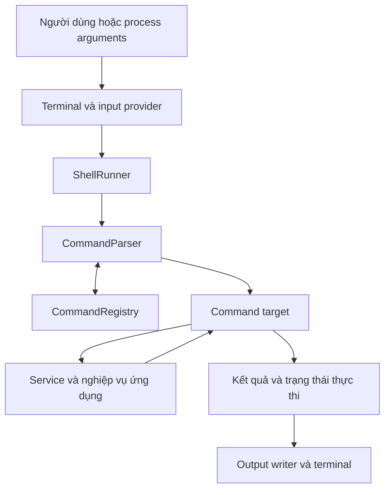

# Các môđun lõi, tích hợp terminal, cấu hình tự động và kiểm thử

Spring Shell bổ sung mô hình ứng dụng dòng lệnh vào hệ sinh thái Spring. Thay vì tự đọc từng dòng từ `System.in`, tách token, chuyển kiểu đối số và quản lý vòng lặp nhập lệnh, ứng dụng có thể khai báo command dưới dạng bean Spring. Framework đảm nhiệm việc đăng ký, phân tích cú pháp, gọi command, nhận dữ liệu từ terminal và ghi kết quả ra màn hình.

Để tổ chức một ứng dụng Spring Shell có thể bảo trì, cần hiểu bốn phần liên kết với nhau: môđun lõi xử lý command, lớp tích hợp terminal, cơ chế tự cấu hình của Spring Boot và bộ công cụ kiểm thử. Các phần này cũng thay đổi đáng kể giữa dòng 3.x và 4.x, vì vậy lựa chọn phiên bản và dependency cần được thực hiện cùng nhau.

## 1. Phiên bản và khả năng tương thích

Spring Shell đi theo các thế hệ Spring Framework và Spring Boot tương ứng. Dòng Spring Shell 4 được xây dựng trên Spring Framework 7 và yêu cầu Spring Boot 4 trở lên khi tích hợp với Spring Boot. Dự án vẫn dùng Spring Boot 3 nên tiếp tục chọn dòng Spring Shell 3.4.x tương thích với phiên bản Boot đang có. Không nên nâng riêng Spring Shell lên 4.x khi ứng dụng vẫn đang ở Boot 3.

Tại thời điểm cập nhật bài học, tài liệu chính thức liệt kê Spring Shell 4.0.4 và 3.4.3 trong các bản ổn định. Trước khi nâng cấp, hãy kiểm tra trang phát hành và ma trận tương thích của phiên bản cụ thể thay vì sao chép số phiên bản từ một dự án khác.

Những thay đổi đáng chú ý khi chuyển từ 3.x sang 4.x:

| Khu vực | Spring Shell 3.x | Spring Shell 4.x |
|---|---|---|
| Tích hợp Spring Boot | Các phần lõi còn gắn với tích hợp Boot | `spring-shell-core` độc lập với Spring Boot; ứng dụng Boot dùng starter hoặc `spring-shell-core-autoconfigure` |
| Terminal | JLine gắn chặt hơn với cách tổ chức môđun cũ | `spring-shell-core` không phụ thuộc JLine; thêm `spring-shell-jline` nếu cần terminal JLine |
| Command annotation | Các annotation mới đã có; nhóm annotation cũ được duy trì trong giai đoạn chuyển tiếp | `@ShellComponent`, `@ShellMethod`, `@ShellOption` và các annotation cũ liên quan đã bị loại bỏ; dùng `@Component`, `@Command`, `@Argument`, `@Option` |
| Môđun lệnh dựng sẵn | Có các môđun riêng như `spring-shell-standard` và `spring-shell-standard-commands` | Các môđun này được hợp nhất vào `spring-shell-core` |
| Bảng và giao diện terminal | Có môđun `spring-shell-table` riêng | Phần bảng được chuyển vào `spring-shell-jline` |
| Auto-configuration | Tên môđun `spring-shell-autoconfigure` | Đổi tên thành `spring-shell-core-autoconfigure` |

Khi nâng cấp, nên đưa ứng dụng lên bản vá mới nhất của dòng 3.4.x trước, xử lý cảnh báo API đã deprecated, sau đó mới chuyển dependency và mã nguồn sang 4.x. Ngoài việc đổi annotation, cần rà soát package import, cấu hình terminal, môđun bảng, test annotation và cách build native image.

## 2. Các môđun chính và trách nhiệm

Spring Shell được chia thành các môđun để ứng dụng chỉ cần kéo vào phần chức năng mà nó sử dụng. Tên môđun dưới đây mô tả cách tổ chức của dòng 4.x.

| Môđun hoặc starter | Trách nhiệm | Khi nào cần |
|---|---|---|
| `spring-shell-core` | Mô hình command, command parser, command registry, context thực thi, trạng thái thoát và các API lõi | Thành phần nền tảng của mọi ứng dụng Spring Shell |
| `spring-shell-jline` | Tích hợp JLine: đọc dòng lệnh, chỉnh sửa dòng, lịch sử, gợi ý hoàn thành, tô sáng và các thành phần giao diện terminal | Khi cần trải nghiệm REPL tương tác phong phú |
| `spring-shell-core-autoconfigure` | Tạo các bean cần thiết cho command registry, shell runner, lệnh chuẩn và cấu hình Spring Shell | Khi tích hợp môđun lõi với Spring Boot mà không dùng starter tiện ích |
| `spring-shell-test` | API kiểm thử như `ShellTestClient`, `ShellScreen`, `ShellAssertions` và `ShellInputProvider` | Khi cần kiểm thử command và tương tác terminal |
| `spring-shell-test-autoconfigure` | Hỗ trợ thiết lập Spring context cho kiểm thử, bao gồm annotation `@ShellTest` | Khi viết kiểm thử Spring Shell theo mô hình Spring Boot |
| `spring-shell-starter` | Starter gom các dependency cơ bản để tạo ứng dụng Spring Shell | Lựa chọn thuận tiện cho ứng dụng Spring Boot |
| `spring-shell-starter-jansi`, `spring-shell-starter-jni`, `spring-shell-starter-jna`, `spring-shell-starter-ffm` | Starter chọn provider terminal JLine tương ứng | Khi cần chọn cách JLine truy cập terminal theo môi trường triển khai |
| `spring-shell-starter-test` | Starter cung cấp các dependency phục vụ kiểm thử | Khi viết test cho ứng dụng dùng Spring Shell starter |

Điểm quan trọng của thiết kế 4.x là `spring-shell-core` không bắt buộc ứng dụng phải dùng Spring Boot hoặc JLine. Ứng dụng có thể dùng API lõi với `java.io.Console`; khi cần Spring Boot thì thêm auto-configuration hoặc starter, còn khi cần trải nghiệm terminal dựa trên JLine thì thêm `spring-shell-jline` hay starter provider phù hợp.

Các starter Spring Shell đã đưa `spring-boot-starter` vào dependency graph. Vì vậy, khi dùng một starter Spring Shell, thường không cần khai báo thêm `spring-boot-starter` chỉ để khởi tạo ứng dụng.

## 3. Kiến trúc xử lý một command

Một phiên shell nhận dữ liệu từ bàn phím hoặc từ đối số tiến trình. `ShellRunner` điều phối chế độ chạy, `CommandParser` phân tích cú pháp và `CommandRegistry` cung cấp danh sách command đã đăng ký. Sau đó framework chuyển giá trị đối số sang kiểu Java, gọi phương thức command hoặc đối tượng `Command`, rồi đưa kết quả về đầu ra terminal.



Các thành phần đảm nhiệm những nhiệm vụ khác nhau:

- **Terminal và input provider** nhận ký tự, dòng lệnh hoặc dữ liệu được cung cấp từ script. Provider quyết định cách chương trình làm việc với terminal của hệ điều hành.
- **`ShellRunner`** chạy vòng lặp tương tác hoặc thực thi command theo chế độ không tương tác. Mỗi application context chỉ có một `ShellRunner` hoạt động.
- **`CommandParser`** tách tên command, subcommand, option và argument; áp dụng quy tắc trích dẫn, chuyển kiểu và chuẩn bị dữ liệu cho command target.
- **`CommandRegistry`** lưu tập command mà ứng dụng có thể gọi. Registry mặc định được tạo từ các command bean trong Spring context và có thể được tùy chỉnh hoặc đăng ký command động.
- **Command target** là phương thức được đánh dấu bằng annotation hoặc một bean triển khai API `Command`. Phần này nên điều phối lời gọi tới service thay vì chứa toàn bộ nghiệp vụ.
- **Output writer và terminal** hiển thị kết quả. Với command annotation, giá trị trả về của phương thức được ghi ra output; với command lập trình trực tiếp, có thể ghi qua `CommandContext.outputWriter()`.

Việc tách lớp này giúp command không phải tự quản lý terminal. Cùng một nghiệp vụ có thể được gọi từ shell tương tác, lệnh chạy một lần trong script hoặc kiểm thử tự động.

### 3.1. Hai cách đăng ký command

Mô hình annotation phù hợp với phần lớn ứng dụng. Đặt các phương thức command trong một bean Spring, sau đó dùng `@Command` để khai báo tên và mô tả. Trong ứng dụng Spring Boot, auto-configuration tự xử lý việc đăng ký các command bean.

```java
import org.springframework.stereotype.Component;
import org.springframework.shell.core.command.annotation.Argument;
import org.springframework.shell.core.command.annotation.Command;
import org.springframework.shell.core.command.annotation.Option;

@Component
class GreetingCommands {

    @Command(name = "greet", description = "Chào một người dùng", group = "Lời chào")
    public String greet(
            @Argument(index = 0, description = "Tên người dùng", defaultValue = "bạn") String name,
            @Option(shortName = 's', longName = "suffix", description = "Hậu tố lời chào", defaultValue = "!") String suffix) {
        return "Xin chào " + name + suffix;
    }
}
```

Người dùng có thể gọi:

```text
shell:> greet
Xin chào bạn!

shell:> greet Lan --suffix=!!!
Xin chào Lan!!!
```

`@Argument` mô tả giá trị theo vị trí, còn `@Option` mô tả giá trị có tên. Có thể đặt option ở dạng `--key=value`, `--key value`, `-k=value` hoặc `-k value`. Khi giá trị chứa khoảng trắng, đặt nó trong dấu nháy đơn hoặc nháy kép. Nên ưu tiên option có tên cho tham số dễ gây nhầm lẫn hoặc có khả năng thay đổi thứ tự.

Với ứng dụng Spring không dùng Spring Boot, cần dùng `@EnableCommand` trên lớp cấu hình để bật đăng ký các lớp chứa phương thức `@Command`. Trong ứng dụng Spring Boot dùng auto-configuration, không cần thêm annotation này.

Mô hình lập trình trực tiếp phù hợp khi command được tạo động, cần logic đăng ký riêng hoặc không phù hợp với phương thức annotation:

```java
@Bean
Command statusCommand() {
    return Command.builder()
            .name("status")
            .execute(context -> {
                context.outputWriter().println("Ứng dụng đang sẵn sàng.");
            });
}
```

Chọn một mô hình theo nhu cầu của từng command. Với command thông thường, annotation giúp mã dễ đọc; với command cần điều khiển cách thực thi ở mức thấp, bean `Command` cho phép tùy biến trực tiếp hơn.

## 4. Tích hợp terminal với JLine

Terminal không chỉ là nơi in văn bản. Một ứng dụng tương tác cần xử lý con trỏ, phím mũi tên, phím xóa, lịch sử lệnh, màu ANSI, kích thước màn hình và tín hiệu từ terminal. Tự triển khai tất cả các hành vi này bằng `System.in` và `System.out` rất dễ phát sinh khác biệt giữa Windows, Linux, macOS, terminal tích hợp IDE và môi trường CI.

JLine cung cấp lớp trừu tượng để Spring Shell làm việc với terminal. Khi JLine được đưa vào classpath, Spring Shell có thể dùng `JLineShellRunner`, `LineReader`, parser, completer và highlighter. Trải nghiệm tương tác có thể bao gồm:

- Chỉnh sửa dòng lệnh bằng các phím điều hướng và phím xóa.
- Lưu và duyệt lịch sử command.
- Hoàn thành tên command, option và giá trị phù hợp khi người dùng nhấn Tab.
- Tô sáng cú pháp hoặc thành phần của dòng lệnh.
- Hiển thị prompt và giao diện terminal tương tác.
- Dùng các thành phần TUI để tạo lựa chọn, biểu mẫu hoặc luồng tương tác nhiều bước.

Spring Shell cung cấp các starter để chọn provider JLine:

| Starter | Provider |
|---|---|
| `spring-shell-starter-jansi` | JLine Jansi |
| `spring-shell-starter-jni` | JLine JNI |
| `spring-shell-starter-jna` | JLine JNA |
| `spring-shell-starter-ffm` | JLine FFM |

Các provider hướng tới cùng mục tiêu nhưng có khác biệt về cách truy cập chức năng native và yêu cầu môi trường. FFM sử dụng Foreign Function and Memory API và yêu cầu JDK 22 trở lên. Khi dùng provider này, có thể cần cấp quyền native access cho JVM bằng tùy chọn `--enable-native-access=ALL-UNNAMED`. Hãy chọn provider dựa trên JDK, hệ điều hành và cách đóng gói thực tế của ứng dụng.

Nếu ứng dụng không có JLine, Spring Shell 4 có thể dùng `SystemShellRunner` với `java.io.Console`. Với starter có JLine, chế độ tương tác sử dụng `JLineShellRunner`. Có thể thay đổi prompt qua `PromptProvider` hoặc tùy chỉnh cấu hình terminal qua `TerminalCustomizer` khi yêu cầu của ứng dụng vượt quá cấu hình mặc định.

## 5. Auto-configuration và cấu hình ứng dụng

Trong ứng dụng Spring Boot, starter giúp Spring Shell tự tạo các bean nền tảng. Khi ứng dụng khởi động, auto-configuration thiết lập command registry, parser, shell runner, các command chuẩn và cấu hình liên quan. Một `ApplicationRunner` có tên `springShellApplicationRunner` gọi shell runner đã được chọn.

Ví dụ dependency Maven cho một ứng dụng dùng Spring Shell 4.0.4:

```xml
<properties>
    <spring-shell.version>4.0.4</spring-shell.version>
</properties>

<dependencies>
    <dependency>
        <groupId>org.springframework.shell</groupId>
        <artifactId>spring-shell-starter</artifactId>
        <version>${spring-shell.version}</version>
    </dependency>

    <dependency>
        <groupId>org.springframework.shell</groupId>
        <artifactId>spring-shell-starter-test</artifactId>
        <version>${spring-shell.version}</version>
        <scope>test</scope>
    </dependency>
</dependencies>
```

Nếu muốn chọn provider JLine cụ thể, dùng starter provider phù hợp với môi trường thay cho starter cơ bản. Giữ các dependency Spring Shell cùng một phiên bản để tránh nạp các API không tương thích.

Lớp khởi động Spring Boot có thể giữ cấu trúc thông thường:

```java
@SpringBootApplication
public class ShellApplication {

    public static void main(String[] args) {
        SpringApplication.run(ShellApplication.class, args);
    }
}
```

Các command bean trong package được component scan sẽ được đăng ký tự động. Những lệnh chuẩn như `help`, `clear`, `version` và `script` cũng được cấu hình qua auto-configuration; có thể bật hoặc tắt từng lệnh bằng property tương ứng.

Ví dụ cấu hình trong `application.yml`:

```yaml
spring:
  shell:
    interactive:
      enabled: true
    debug:
      enabled: false
    command:
      help:
        enabled: true
      clear:
        enabled: true
      version:
        enabled: true
      script:
        enabled: true
```

Một số property thường dùng:

| Property | Tác dụng |
|---|---|
| `spring.shell.interactive.enabled` | Chọn shell tương tác hay không tương tác; mặc định là `true` |
| `spring.shell.debug.enabled` | Bật thông tin debug, bao gồm stack trace khi command lỗi trong chế độ tương tác |
| `spring.shell.command.help.enabled` | Bật hoặc tắt command `help` |
| `spring.shell.command.clear.enabled` | Bật hoặc tắt command `clear` |
| `spring.shell.command.version.enabled` | Bật hoặc tắt command `version` |
| `spring.shell.command.script.enabled` | Bật hoặc tắt command `script` |

Ở chế độ tương tác, người dùng nhập nhiều command liên tiếp cho đến khi thoát. Ở chế độ không tương tác, ứng dụng nhận command từ đối số tiến trình, thực thi rồi kết thúc. Chế độ này phù hợp cho cron, pipeline CI/CD, script triển khai và các tác vụ tự động:

```bash
java -jar catalog-cli.jar --spring.shell.interactive.enabled=false greet Lan
```

Không nên để ứng dụng chờ prompt tương tác trong pipeline tự động. Hãy đặt `spring.shell.interactive.enabled=false` cho cấu hình chạy batch hoặc kiểm thử end-to-end chạy một command từ đối số tiến trình.

## 6. Kiểm thử ứng dụng Spring Shell

Kiểm thử command cần xác minh cả phần xử lý nghiệp vụ lẫn cách người dùng tương tác với shell. Nên chia kiểm thử theo lớp:

1. **Unit test cho service** xác minh quy tắc nghiệp vụ, truy cập dữ liệu và xử lý lỗi mà không khởi động terminal.
2. **Command test** xác minh tên command, phân tích option/argument, chuyển kiểu, thông báo lỗi và output hiển thị.
3. **Interactive test** xác minh prompt, lịch sử, nhập dữ liệu bổ sung, phím điều khiển và cập nhật màn hình.
4. **End-to-end test** khởi động ứng dụng như một tiến trình để kiểm tra cấu hình, dependency và cách command được gọi từ đối số tiến trình.

Spring Shell cung cấp `ShellTestClient` để gửi command và đọc nội dung màn hình. `ShellScreen` đại diện cho phần hiển thị, còn `ShellAssertions` cung cấp assertion cho nội dung đó. `@ShellTest` thiết lập context kiểm thử cho ứng dụng Spring Boot.

Ví dụ kiểm thử command `greet`:

```java
@ShellTest
@ContextConfiguration(classes = ShellApplication.class)
class GreetingCommandsTests {

    @Autowired
    ShellTestClient client;

    @Test
    void greetsTheGivenName() throws Exception {
        ShellScreen screen = client.sendCommand("greet Lan --suffix=?");

        ShellAssertions.assertThat(screen).containsText("Xin chào Lan?");
    }
}
```

`ShellTestClient` cũng giúp kiểm tra command không tồn tại và các trường hợp lỗi đầu vào. Với command cần đọc thêm dữ liệu trong lúc chạy, dùng `ShellInputProvider` để cấp trước nội dung nhập vào thay vì chờ người kiểm thử gõ trực tiếp.

Với kiểm thử tương tác, tạo một interactive session, gửi chuỗi phím hoặc command, rồi đợi màn hình đạt trạng thái mong đợi. Có thể dùng Awaitility để chờ kết quả vì cập nhật màn hình terminal có thể diễn ra bất đồng bộ. Khi kiểm tra, ưu tiên nội dung văn bản mà người dùng nhìn thấy thay vì so sánh toàn bộ chuỗi escape ANSI, bởi định dạng terminal có thể khác nhau theo hệ điều hành và provider.

Kiểm thử end-to-end có thể dùng `@SpringBootTest` và `OutputCaptureExtension` của Spring Boot. Tắt chế độ tương tác để tiến trình không chờ nhập liệu:

```java
@SpringBootTest(
        webEnvironment = SpringBootTest.WebEnvironment.NONE,
        useMainMethod = SpringBootTest.UseMainMethod.ALWAYS,
        classes = ShellApplication.class,
        properties = "spring.shell.interactive.enabled=false",
        args = "greet Lan")
@ExtendWith(OutputCaptureExtension.class)
class ShellApplicationEndToEndTests {

    @Test
    void printsTheCommandOutput(CapturedOutput output) {
        assertThat(output).contains("Xin chào Lan!");
    }
}
```

Không nên dùng end-to-end test cho mọi trường hợp. `ShellTestClient` thuận tiện hơn khi cần kiểm tra nhiều command trong cùng test class; end-to-end test phù hợp để xác minh ứng dụng thực sự khởi động và nhận đúng đối số tiến trình.

## 7. Lỗi thường gặp và cách xử lý

| Hiện tượng | Nguyên nhân thường gặp | Cách kiểm tra hoặc khắc phục |
|---|---|---|
| Command không xuất hiện trong `help` | Lớp command không phải Spring bean, nằm ngoài component scan hoặc bị `excludeFilters` loại bỏ | Kiểm tra `@Component`, package scan và cấu hình đăng ký command |
| Ứng dụng Spring không dùng Boot không nhận command annotation | Chưa bật đăng ký command target | Dùng `@EnableCommand` trên lớp cấu hình |
| Không có lịch sử hoặc hoàn thành lệnh | JLine/provider không có trong classpath hoặc starter chưa phù hợp | Kiểm tra dependency JLine và chọn starter provider phù hợp |
| Kiểm thử bị treo chờ nhập liệu | Shell vẫn chạy ở chế độ tương tác | Đặt `spring.shell.interactive.enabled=false` cho kiểm thử chạy từ process arguments |
| Giá trị có dấu cách bị tách thành nhiều đối số | Giá trị chưa được đặt trong dấu nháy | Dùng dấu nháy đơn hoặc kép quanh giá trị |
| Command hoạt động trên máy phát triển nhưng lỗi ở CI | Khác biệt terminal, quyền native hoặc JDK | Kiểm tra provider, TTY, phiên bản JDK và quyền native access |
| Không biên dịch được sau khi nâng lên 4.x | Còn dùng annotation cũ hoặc import package cũ | Chuyển sang `@Command`, `@Argument`, `@Option` và cập nhật package theo API 4.x |
| Ứng dụng Boot 3 gặp lỗi tương thích khi dùng Shell 4 | Chọn sai dòng phiên bản | Dùng Spring Shell 3.4.x phù hợp với Boot 3 hoặc nâng toàn bộ nền tảng lên Boot 4 trước |

Nếu cần biên dịch thành native image bằng GraalVM, cần kiểm tra giới hạn của phiên bản đang dùng. Theo hướng dẫn di trú 4.x, tại thời điểm phát hành 4.0.0, đăng ký command bằng annotation chưa được hỗ trợ cho native compilation; mô hình đăng ký command bằng API lập trình là lựa chọn được hỗ trợ. Các thư viện terminal native cũng có thể yêu cầu metadata hoặc quyền truy cập riêng.

## 8. Quy trình lựa chọn cấu hình cho một ứng dụng thực tế

Khi bắt đầu một dự án CLI mới, có thể thực hiện theo thứ tự sau:

1. Xác định phiên bản Spring Boot đang dùng, sau đó chọn Spring Shell 3.4.x hoặc 4.0.x theo ma trận tương thích.
2. Thêm starter Spring Shell và starter kiểm thử cùng phiên bản. Chỉ chọn provider JLine cụ thể khi ứng dụng cần các tính năng terminal tương ứng.
3. Đặt command trong các bean Spring theo nhóm chức năng; để command gọi service xử lý nghiệp vụ.
4. Kiểm tra `help`, cách parse argument/option và output trong terminal thực tế.
5. Cấu hình chế độ tương tác cho người dùng và chế độ không tương tác cho script, CI hoặc tác vụ chạy tự động.
6. Viết unit test cho service, test command bằng `ShellTestClient`, sau đó thêm end-to-end test cho cách đóng gói và khởi chạy.
7. Khi nâng cấp phiên bản, rà soát API bị loại bỏ, dependency môđun, provider terminal và test harness trước khi triển khai.

Một ứng dụng Spring Shell tốt có thể chạy trong terminal tương tác lẫn pipeline tự động, giữ nghiệp vụ trong service Spring thông thường và để framework quản lý phần nhập lệnh, phân tích cú pháp, đăng ký command cùng output. Nắm được ranh giới giữa `spring-shell-core`, JLine, auto-configuration và test support giúp lựa chọn dependency chính xác, xử lý lỗi dễ hơn và nâng cấp phiên bản có kiểm soát.

## Tài liệu tham khảo

- [Spring Shell – Building and Starters](https://docs.spring.io/spring-shell/reference/building.html)
- [Spring Shell – Command Registration](https://docs.spring.io/spring-shell/reference/commands/registration.html)
- [Spring Shell – Command Syntax](https://docs.spring.io/spring-shell/reference/commands/syntax.html)
- [Spring Shell – Execution and Shell Runners](https://docs.spring.io/spring-shell/reference/execution.html)
- [Spring Shell – Testing](https://docs.spring.io/spring-shell/reference/testing.html)
- [Spring Shell – Migration Guide from 3.x to 4.x](https://github.com/spring-projects/spring-shell/wiki/v4-migration-guide)
