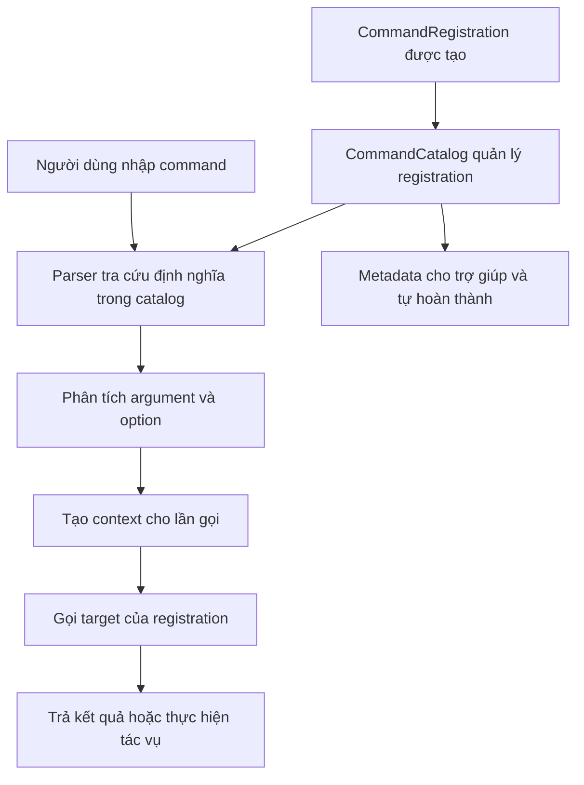

# CommandRegistration và CommandCatalog trong kiến trúc 3.x

Trong Spring Shell 3.x, một lệnh CLI được mô tả bằng metadata và gắn với phần xử lý lệnh. `CommandRegistration` biểu diễn định nghĩa của một lệnh; `CommandCatalog` quản lý tập hợp các định nghĩa đó để những thành phần của shell có thể tra cứu và sử dụng thống nhất. Hai khái niệm này giúp tách việc khai báo lệnh khỏi luồng phân tích và thực thi câu lệnh.

Bài học thuộc chương **Phiên bản và kiến trúc** của Spring Shell. Nội dung tập trung vào cách hai thành phần phối hợp trong kiến trúc 3.x và cách khai báo một lệnh bằng Java.

Sau bài học, bạn có thể:

- Giải thích vai trò của `CommandRegistration` và `CommandCatalog`.
- Nhận biết metadata nào thuộc về một command registration.
- Mô tả đường đi từ định nghĩa lệnh đến lúc handler được gọi.
- Tạo một command registration bằng builder và biết khi nào nên dùng cách khai báo bằng annotation.

## Bối cảnh: lệnh là một định nghĩa có cấu trúc

Một ứng dụng Spring Shell thường có nhiều lệnh, chẳng hạn `user list`, `user create` hoặc `report export`. Mỗi lệnh có tên, mô tả, nhóm, tham số, tùy chọn và phần xử lý tương ứng. Nếu mỗi thành phần của shell tự tìm hiểu các thông tin này theo một cách riêng, việc phân tích input, hiển thị trợ giúp và gợi ý tự hoàn thành có thể không nhất quán.

Spring Shell 3.x cung cấp một mô hình đăng ký lệnh rõ ràng:

- **Định nghĩa một lệnh:** `CommandRegistration` giữ thông tin cần thiết để nhận diện, phân tích và gọi lệnh.
- **Quản lý các định nghĩa:** `CommandCatalog` là nơi tập hợp và cung cấp các command registration cho những thành phần cần dùng.
- **Xử lý input:** parser dựa trên thông tin đã đăng ký để xác định lệnh và diễn giải các đối số, tùy chọn.
- **Thực thi:** target gắn với registration được gọi sau khi input đã được phân tích thành ngữ cảnh thực thi.

Điểm quan trọng là tên lệnh, mô tả và cấu trúc tham số được mô hình hóa thành dữ liệu có cấu trúc. Parser, phần trợ giúp và phần tự hoàn thành có thể dựa vào cùng một định nghĩa thay vì phải duy trì các mô tả riêng.

## CommandRegistration: định nghĩa của một lệnh

`CommandRegistration` đại diện cho một command cụ thể trong ứng dụng. Có thể xem nó như bản mô tả đầy đủ để Spring Shell biết lệnh được gọi bằng tên nào, nhận input ra sao và chuyển quyền xử lý cho thành phần nào.

Tùy nhu cầu của lệnh, registration có thể mô tả các nhóm thông tin sau:

| Nhóm thông tin | Ý nghĩa |
| --- | --- |
| Tên command | Tên người dùng nhập tại shell để gọi lệnh. |
| Mô tả và nhóm | Nội dung giúp phân loại lệnh và trình bày trong phần trợ giúp. |
| Argument và option | Tên, kiểu dữ liệu, mô tả, yêu cầu bắt buộc và các thuộc tính liên quan đến cách nhận input. |
| Target | Hàm hoặc consumer sẽ xử lý lệnh sau khi input được phân tích. |

Trong Spring Shell 3.x, cách thường dùng để tạo đối tượng này là builder `CommandRegistration.builder()`. Builder cho phép mô tả command, khai báo từng option hoặc argument, sau đó gắn target xử lý.

### Ví dụ: đăng ký lệnh `greet`

Ví dụ sau khai báo một lệnh nhận option `--name` và trả về lời chào:

```java
import org.springframework.context.annotation.Bean;
import org.springframework.context.annotation.Configuration;
import org.springframework.shell.command.CommandRegistration;

@Configuration
class GreetingCommands {

    @Bean
    CommandRegistration greetCommand() {
        return CommandRegistration.builder()
            .command("greet")
            .description("Gửi lời chào đến một người")
            .withOption()
                .longNames("name")
                .shortNames('n')
                .description("Tên người nhận lời chào")
                .required()
                .type(String.class)
                .and()
            .withTarget()
                .function(ctx -> "Xin chào " + ctx.getOptionValue("name"))
                .and()
            .build();
    }
}
```

Khi ứng dụng khởi động và registration được đưa vào catalog, người dùng có thể gọi lệnh với option đã khai báo, ví dụ:

```text
shell:> greet --name Lan
Xin chào Lan
```

Trong ví dụ:

1. `.command("greet")` đặt tên command.
2. `.description(...)` cung cấp mô tả cho lệnh.
3. `.withOption()` bắt đầu khai báo một option. `longNames("name")` và `shortNames('n')` xác định hai cách viết của option.
4. `.required()` cho biết option phải có mặt khi gọi lệnh; `.type(String.class)` khai báo kiểu dữ liệu mà option nhận.
5. `.withTarget().function(...)` gắn hàm xử lý. Hàm nhận context đã được Spring Shell chuẩn bị và đọc giá trị option bằng tên đã khai báo.
6. `.build()` hoàn tất việc tạo `CommandRegistration`.

Các lời gọi `and()` kết thúc phần cấu hình option hoặc target hiện tại và quay về builder cấp ngoài để tiếp tục cấu hình registration. Khi thêm nhiều option, mỗi option được khai báo bằng một khối `withOption()` riêng.

Ví dụ tập trung vào một option để làm rõ cấu trúc. Với command thực tế, hãy khai báo đầy đủ mô tả, kiểu dữ liệu, tính bắt buộc và quy tắc nhận giá trị phù hợp với hợp đồng CLI mà người dùng cần sử dụng.

## CommandCatalog: tập hợp các lệnh đã đăng ký

`CommandCatalog` quản lý các command registration của ứng dụng. Nếu `CommandRegistration` trả lời câu hỏi “một lệnh được định nghĩa như thế nào?”, thì `CommandCatalog` trả lời câu hỏi “ứng dụng hiện có những lệnh nào và thành phần khác tra cứu định nghĩa đó ở đâu?”.

Trong ứng dụng Spring Shell, catalog đóng vai trò điểm truy cập tập trung cho các định nghĩa lệnh. Các registration được cung cấp cho catalog thông qua cơ chế cấu hình và đăng ký của Spring Shell. Khi ứng dụng sử dụng command registration dưới dạng Spring bean, framework có thể thu nhận các định nghĩa đó trong quá trình cấu hình ứng dụng.

Catalog có ý nghĩa ở các khía cạnh sau:

- **Tập hợp:** quản lý nhiều command registration trong cùng một ứng dụng.
- **Tra cứu:** cung cấp thông tin lệnh cho thành phần cần xác định command tương ứng với input.
- **Nhất quán metadata:** giữ một nguồn định nghĩa để các chức năng như phân tích command, trợ giúp và tự hoàn thành có thể dựa vào cùng thông tin đã đăng ký.
- **Tách trách nhiệm:** phần xử lý nghiệp vụ của command không cần tự quản lý danh sách toàn bộ lệnh trong ứng dụng.

Catalog không thay thế parser và cũng không trực tiếp chứa toàn bộ logic nghiệp vụ. Catalog quản lý các định nghĩa; parser diễn giải input theo các định nghĩa đó; target thực hiện công việc của lệnh.

## Hai thành phần phối hợp trong luồng thực thi

Luồng tổng quát của một lệnh trong ứng dụng Spring Shell 3.x có thể mô tả như sau:



Có thể đọc luồng này theo từng bước:

1. **Định nghĩa:** ứng dụng tạo `CommandRegistration` bằng builder hoặc thông qua cơ chế khai báo lệnh được Spring Shell hỗ trợ.
2. **Đăng ký:** các định nghĩa được đưa vào `CommandCatalog` trong quá trình cấu hình ứng dụng.
3. **Nhận input:** người dùng nhập tên command cùng argument và option tại shell.
4. **Phân tích:** parser sử dụng catalog để tìm registration phù hợp, rồi diễn giải các token theo metadata của lệnh.
5. **Tạo context:** giá trị input được chuyển thành context để target truy cập theo tên option hoặc argument đã khai báo.
6. **Thực thi:** target gắn với registration được gọi. Kết quả được xử lý theo kiểu target và cấu hình output của ứng dụng.

Phần trợ giúp và tự hoàn thành cũng cần metadata của command. Ví dụ, mô tả lệnh giúp người dùng hiểu mục đích của command; tên và mô tả option giúp họ biết những giá trị có thể truyền. Vì vậy, khai báo metadata chính xác trong registration có tác dụng vượt ra ngoài thời điểm gọi handler.

## Khai báo bằng annotation và bằng CommandRegistration

Spring Shell hỗ trợ cách khai báo command bằng annotation, chẳng hạn `@ShellComponent` và `@ShellMethod`. Cách này phù hợp khi command gắn trực tiếp với các phương thức Java và muốn giữ phần khai báo ngắn gọn.

```java
import org.springframework.shell.standard.ShellComponent;
import org.springframework.shell.standard.ShellMethod;
import org.springframework.shell.standard.ShellOption;

@ShellComponent
class GreetingAnnotationCommands {

    @ShellMethod(key = "greet", value = "Gửi lời chào đến một người")
    String greet(@ShellOption("--name") String name) {
        return "Xin chào " + name;
    }
}
```

Hai cách khai báo giải quyết cùng một nhu cầu ở hai phong cách khác nhau:

| Tiêu chí | Annotation | `CommandRegistration` |
| --- | --- | --- |
| Cách mô tả | Dùng annotation trên component và method. | Dùng builder để tạo đối tượng registration. |
| Cách tổ chức | Định nghĩa command gần method xử lý. | Có thể mô tả command tách khỏi lớp xử lý nghiệp vụ. |
| Mức độ tường minh | Ngắn gọn, dễ đọc với command đơn giản. | Tường minh khi cần cấu hình command và input theo từng bước. |
| Trường hợp phù hợp | Command gắn tự nhiên với method trong Spring bean. | Command cần được cấu hình bằng Java hoặc được tạo theo một cấu trúc registration rõ ràng. |

Không cần chuyển tất cả command sang một phong cách duy nhất. Hãy chọn cách khai báo phù hợp với cách tổ chức ứng dụng và kiểm tra phiên bản Spring Shell đang dùng để bảo đảm API tương thích. Nếu hai cách cùng khai báo một tên command, cần tránh đăng ký trùng vì việc phân giải command sẽ trở nên khó dự đoán.

## Những điểm cần chú ý khi thiết kế registration

**Tên command phải duy nhất trong phạm vi catalog.** Hãy chọn tên phản ánh hành động hoặc miền chức năng, đồng thời giữ cách đặt tên nhất quán giữa các command liên quan.

**Metadata phải khớp với hành vi thực tế.** Nếu option được đánh dấu bắt buộc nhưng handler lại xử lý trường hợp thiếu giá trị, hoặc mô tả ghi một kiểu dữ liệu trong khi registration khai báo kiểu khác, trải nghiệm sử dụng sẽ khó hiểu. Hãy coi tên, mô tả, kiểu và tính bắt buộc là một phần của hợp đồng CLI.

**Để parser xử lý input.** Handler nên đọc giá trị đã được phân tích từ context. Không nên tự tách chuỗi command thô trong target để xử lý lại option và argument, vì điều đó làm trùng trách nhiệm với parser.

**Giữ handler tập trung vào công việc của lệnh.** Có thể chuyển nghiệp vụ sang service Spring thông thường rồi gọi service từ target. Cách này giúp kiểm thử nghiệp vụ độc lập với cơ chế tương tác của shell.

**Không tự tạo một catalog song song khi không cần thiết.** Hãy dùng cơ chế cấu hình và đăng ký mà Spring Shell cung cấp. Việc quản lý thêm một danh sách command riêng dễ khiến danh sách đó lệch với các registration mà parser và những chức năng khác đang sử dụng.

## Lỗi thường gặp và cách kiểm tra

| Hiện tượng | Nguyên nhân cần kiểm tra |
| --- | --- |
| Shell không nhận ra command | Registration chưa được tạo hoặc chưa được framework thu nhận; kiểm tra Spring bean cấu hình và tên command. |
| Option không được nhận diện | Tên option người dùng nhập không khớp `longNames` hoặc `shortNames` đã khai báo. |
| Báo thiếu giá trị bắt buộc | Option được đánh dấu `required()` nhưng lời gọi không truyền option đó. |
| Handler nhận giá trị không như mong đợi | Kiểm tra kiểu dữ liệu khai báo, cách người dùng truyền giá trị và cách đọc giá trị trong context. |
| Trợ giúp hoặc gợi ý không rõ ràng | Bổ sung hoặc chỉnh sửa description của command và option trong registration. |
| Có hành vi khó đoán khi gọi một tên lệnh | Kiểm tra xem có nhiều định nghĩa dùng cùng tên command hay không. |

Khi kiểm tra một command, nên xác minh cả ba lớp: registration đã xuất hiện trong ứng dụng, parser hiểu đúng input và target thực hiện đúng công việc. Chỉ kiểm thử method xử lý là chưa đủ để phát hiện lỗi ở bước đăng ký hoặc phân tích option.

## Kiểm thử command

Có thể chia kiểm thử thành các mức sau:

1. **Kiểm thử nghiệp vụ:** kiểm thử service mà target gọi bằng unit test thông thường. Các test này không cần khởi động shell.
2. **Kiểm thử cấu hình Spring:** khởi tạo application context để xác nhận command registration được tạo và được framework thu nhận.
3. **Kiểm thử tích hợp CLI:** thực thi command với input đại diện, bao gồm trường hợp hợp lệ, thiếu option bắt buộc, option sai và giá trị có khoảng trắng. Kiểm tra cả kết quả và thông báo lỗi.
4. **Kiểm thử khả năng khám phá:** kiểm tra phần trợ giúp và tự hoàn thành phản ánh đúng tên, mô tả, option đã khai báo.

Với ví dụ `greet`, các trường hợp cơ bản gồm `greet --name Lan`, gọi thiếu `--name`, và gọi với tên có khoảng trắng được đặt trong dấu nháy. Các trường hợp này kiểm tra được registration, quá trình phân tích option và cách target đọc context.

## Lưu ý về phiên bản 3.x

Spring Shell 3.x có mô hình command registration và catalog riêng, nhưng chữ ký builder và các khả năng cấu hình cụ thể có thể thay đổi theo phiên bản nhỏ mà dự án sử dụng. Khi áp dụng ví dụ vào dự án, hãy đối chiếu dependency Spring Shell thực tế và tài liệu API đúng phiên bản. Tránh ghép một đoạn cấu hình lấy từ phiên bản khác vào ứng dụng mà chưa kiểm tra tương thích.

Hãy nhớ mối quan hệ cốt lõi: `CommandRegistration` mô tả một lệnh và target của nó; `CommandCatalog` quản lý tập hợp các mô tả đó để parser cùng những chức năng của shell tra cứu. Khi hai thành phần được cấu hình nhất quán, Spring Shell có thể phân tích input, thực thi command và cung cấp trợ giúp dựa trên cùng một mô hình lệnh.
