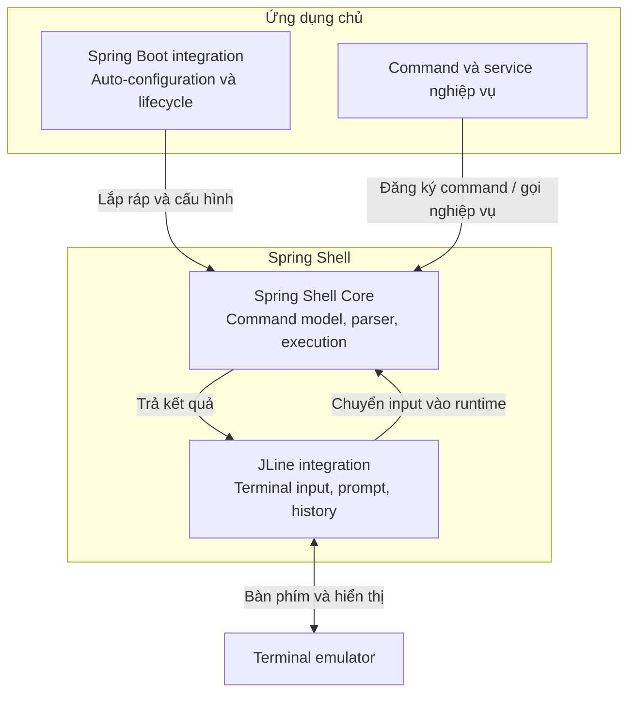

# Tách lõi khỏi Spring Boot và JLine trong Spring Shell 4.x

Spring Shell 4.x tổ chức kiến trúc theo các trách nhiệm tách biệt hơn: phần lõi xử lý mô hình command và luồng thực thi; Spring Boot đảm nhiệm tích hợp ứng dụng và tự cấu hình; JLine cung cấp trải nghiệm làm việc với terminal. Cách phân chia này giúp ứng dụng chọn đúng những thành phần cần dùng, đồng thời làm cho phần xử lý command dễ kiểm thử và có thể tích hợp với môi trường đầu vào khác.

Để hiểu thay đổi này, cần phân biệt ba câu hỏi: ứng dụng được khởi tạo và cấu hình như thế nào, command được phân tích và thực thi ra sao, và người dùng nhập lệnh qua giao diện terminal nào. Ba câu hỏi có liên quan nhưng không nhất thiết phải do cùng một thư viện trả lời.

## Mục tiêu học tập

Sau bài học, bạn có thể:

- Giải thích ý nghĩa của việc tách Spring Shell Core khỏi Spring Boot và JLine trong kiến trúc 4.x.
- Phân biệt trách nhiệm của Core, lớp tích hợp Spring Boot và adapter JLine.
- Mô tả luồng khởi tạo ứng dụng và luồng xử lý một command trong mô hình phân lớp.
- Chọn cách kết hợp các thành phần phù hợp với ứng dụng Boot tương tác, ứng dụng nhúng hoặc môi trường kiểm thử.
- Nhận diện những điểm cần rà soát khi nâng cấp ứng dụng từ kiến trúc Spring Shell trước đó lên 4.x.

## 1. Vì sao cần tách các trách nhiệm?

Một ứng dụng dòng lệnh có ít nhất ba nhóm công việc khác nhau.

**Xử lý command:** ứng dụng cần biết command nào được cung cấp, cú pháp ra sao, đối số và tùy chọn được chuyển thành kiểu dữ liệu nào, khi nào gọi phương thức xử lý và cách biểu diễn kết quả.

**Tích hợp vòng đời ứng dụng:** ứng dụng cần tạo Spring context, phát hiện bean, nạp cấu hình, quản lý dependency và khởi động các thành phần đúng thứ tự. Nếu ứng dụng dùng Spring Boot, một phần lớn công việc này có thể được thực hiện qua auto-configuration và starter.

**Giao tiếp với terminal:** ứng dụng tương tác cần đọc dòng nhập, hiển thị prompt, quản lý lịch sử, xử lý phím điều khiển, hỗ trợ hoàn thành lệnh và làm việc với các khả năng của terminal. JLine là thư viện chuyên về nhóm công việc này.

Nếu mọi trách nhiệm bị gắn chặt vào một đường khởi chạy duy nhất, ứng dụng khó thay đổi môi trường chạy. Ví dụ, một command cần được kiểm thử trong tiến trình không có terminal, nhưng đường khởi tạo lại luôn kéo theo cấu hình terminal tương tác. Hoặc một chương trình muốn dùng lõi xử lý command trong một giao diện riêng nhưng phải phụ thuộc vào những thành phần chỉ cần cho terminal.

Tách lớp giúp mỗi thành phần có một hợp đồng và phạm vi trách nhiệm rõ hơn. Ứng dụng có thể kết hợp chúng theo nhu cầu mà vẫn dùng chung phần xử lý command.

## 2. Ba thành phần chính trong kiến trúc

### 2.1. Spring Shell Core: mô hình và thực thi command

Core là phần trung tâm của Spring Shell. Ở mức kiến trúc, nó tập trung vào những khái niệm và quy trình cần thiết để ứng dụng cung cấp command:

- Mô hình command và thông tin mô tả command.
- Cơ chế đăng ký hoặc khám phá command mà runtime có thể gọi.
- Phân tích cú pháp, phân tách tên command, argument và option.
- Chuyển đổi giá trị đầu vào sang kiểu tham số mà command yêu cầu.
- Điều phối việc gọi command và xử lý kết quả.
- Các điểm mở rộng để tích hợp kiểm tra đầu vào, trợ giúp hoặc cách trình bày kết quả.

Core quan tâm đến ý nghĩa của một command và cách thực thi nó. Nó không cần sở hữu cửa sổ terminal, quản lý tab của terminal emulator hay quyết định người dùng nhấn phím mũi tên lên sẽ xem dòng lịch sử nào.

Việc tách Core khỏi Spring Boot cũng cần được hiểu chính xác: điều đó không có nghĩa Spring Shell trở thành một thư viện hoàn toàn không liên quan đến Spring. Core vẫn có thể sử dụng các abstraction của Spring Framework và mô hình bean để tổ chức ứng dụng. Điểm tách biệt là Core không buộc mọi ứng dụng phải khởi chạy qua Spring Boot hoặc phụ thuộc vào cơ chế auto-configuration của Boot.

### 2.2. Tích hợp Spring Boot: khởi tạo và cấu hình ứng dụng

Spring Boot giải quyết bài toán khởi tạo ứng dụng và kết nối các thành phần. Lớp tích hợp Spring Boot của Spring Shell có thể đảm nhiệm những việc như:

- Tự cấu hình các bean và thành phần runtime cần thiết khi ứng dụng dùng Boot.
- Kết nối cấu hình ứng dụng với các thành phần Spring Shell.
- Tích hợp quá trình khởi động và dừng shell với vòng đời ứng dụng.
- Cung cấp trải nghiệm sử dụng thuận tiện thông qua dependency starter và cấu hình mặc định.

Lớp tích hợp này đóng vai trò lắp ráp. Nó giúp ứng dụng Boot có thể sử dụng Core cùng các adapter phù hợp mà không phải tự nối từng thành phần từ đầu.

Khi không dùng Spring Boot, ứng dụng vẫn có thể tổ chức Spring context và khởi tạo những thành phần cần thiết theo cách riêng nếu API và cấu hình của phiên bản đang dùng hỗ trợ mô hình đó. Khi ấy nhà phát triển chịu trách nhiệm rõ ràng hơn cho việc tạo context, đăng ký bean, khởi tạo runtime và quản lý vòng đời.

### 2.3. JLine: giao tiếp tương tác với terminal

JLine là thư viện chuyên xử lý trải nghiệm dòng lệnh tương tác. Trong một tích hợp Spring Shell dùng JLine, JLine thường đảm nhiệm các khả năng như:

- Đọc một dòng lệnh từ terminal.
- Hiển thị prompt và điều khiển con trỏ.
- Lưu và duyệt lịch sử lệnh.
- Hỗ trợ phím điều khiển, chỉnh sửa dòng nhập và key binding.
- Cung cấp gợi ý hoặc hoàn thành khi người dùng đang nhập.
- Làm việc với các đặc tính của terminal như màu sắc và kích thước hiển thị khi môi trường hỗ trợ.

JLine tập trung vào cách người dùng nhập và nhìn thấy lệnh. Nó không chứa quy tắc nghiệp vụ như tìm khách hàng, tạo báo cáo hay khóa tài khoản. Những hành vi đó thuộc command và service của ứng dụng.

Khi tách JLine khỏi Core, ứng dụng không cần mang theo toàn bộ lớp tương tác terminal nếu không sử dụng chúng. Một môi trường khác có thể cung cấp đầu vào và đầu ra thông qua adapter riêng, miễn là adapter đó kết nối được với các điểm tích hợp mà phiên bản Spring Shell cung cấp.

## 3. Ranh giới trách nhiệm

Bảng sau tóm tắt thành phần nào nên sở hữu loại công việc nào:

| Thành phần | Trách nhiệm chính | Ví dụ công việc |
|---|---|---|
| Spring Shell Core | Mô hình và thực thi command | Đăng ký command, phân tích cú pháp, chuyển đổi argument, gọi command method |
| Spring Boot integration | Khởi tạo và lắp ráp ứng dụng Boot | Auto-configuration, kết nối bean, cấu hình và vòng đời ứng dụng |
| JLine integration | I/O tương tác với terminal | Prompt, đọc dòng, lịch sử, chỉnh sửa dòng và key binding |
| Mã ứng dụng | Quy tắc nghiệp vụ | Tìm khách hàng, tạo báo cáo, kiểm tra quyền, cập nhật dữ liệu |
| Terminal emulator | Hiển thị và nhận thao tác bàn phím | Cửa sổ terminal, font, tab, cuộn và hiển thị ký tự |

Một quy tắc phân lớp hữu ích là: Core quyết định **lệnh có ý nghĩa gì và được thực thi thế nào**; adapter terminal quyết định **dòng lệnh được nhập và hiển thị ra sao**; lớp Boot quyết định **các thành phần được tạo và kết nối với ứng dụng như thế nào**.

## 4. Sơ đồ kiến trúc Spring Shell 4.x

Sơ đồ dưới đây mô tả các lớp theo vai trò. Đây là sơ đồ khái niệm, không phải sơ đồ phụ thuộc đầy đủ của mọi artifact trong từng bản phát hành 4.x.



Trong một ứng dụng Boot chạy tương tác, các thành phần thường được kết hợp để tạo trải nghiệm hoàn chỉnh. Tuy nhiên, mối quan hệ kiến trúc không đồng nghĩa tất cả phải là một khối phụ thuộc bắt buộc. Ứng dụng có thể dùng cơ chế tích hợp Boot để lắp ráp Core, đồng thời chọn JLine khi cần giao diện terminal tương tác.

## 5. Luồng khởi tạo và thực thi command

Để thấy rõ ranh giới, hãy xem một công cụ hỗ trợ vận hành có command `report generate`.

### 5.1. Khi ứng dụng khởi động

Với một ứng dụng Spring Boot sử dụng tích hợp Spring Shell, luồng khái niệm thường gồm:

1. Spring Boot khởi động ứng dụng và tạo Spring context.
2. Lớp tích hợp Spring Shell với Boot cấu hình các bean cần thiết theo dependency và cấu hình hiện có.
3. Các command và service nghiệp vụ được phát hiện hoặc đăng ký trong context.
4. Core sẵn sàng xử lý command đã đăng ký.
5. Nếu ứng dụng sử dụng tích hợp JLine cho phiên tương tác, lớp terminal được khởi tạo và bắt đầu nhận input.

Boot điều phối vòng đời ứng dụng. Core cung cấp khả năng xử lý command. JLine cung cấp giao diện tương tác. Trình tự chi tiết và cách cấu hình có thể khác theo phiên bản minor, cách đóng gói và chế độ chạy.

### 5.2. Khi người dùng nhập một command

Giả sử người dùng nhập:

```text
support:> report generate --period monthly --format csv
```

Luồng xử lý có thể được hiểu theo các bước:

1. JLine nhận dòng văn bản từ terminal và chuyển nó vào runtime.
2. Core phân tích tên command `report generate` cùng các option.
3. Core chuyển các giá trị `monthly` và `csv` sang kiểu dữ liệu mà command yêu cầu.
4. Command được gọi với các tham số đã liên kết.
5. Command gọi service nghiệp vụ để tạo báo cáo.
6. Kết quả được trả về qua luồng xử lý của Core.
7. Lớp tích hợp giao diện hiển thị kết quả trên terminal.

Nếu người dùng chạy một kiểm thử không có terminal, bước nhận input và hiển thị bằng JLine có thể không cần tham gia. Kiểm thử vẫn có thể tập trung vào command, việc chuyển đổi tham số và kết quả thực thi thông qua cách khởi tạo phù hợp với API của phiên bản đang dùng.

## 6. Lựa chọn cách kết hợp thành phần

Việc tách lớp giúp ứng dụng lựa chọn cấu hình theo mục đích sử dụng.

### 6.1. Ứng dụng Spring Boot có prompt tương tác

Đây là kiểu triển khai quen thuộc khi xây dựng một CLI độc lập cho nhân viên vận hành hoặc nhà phát triển. Ứng dụng cần:

- Spring Boot để khởi tạo context và cấu hình.
- Spring Shell Core để đăng ký và thực thi command.
- Tích hợp JLine để cung cấp prompt, lịch sử và thao tác nhập dòng.

Trong trường hợp này, starter hoặc bộ dependency tích hợp phù hợp giúp lắp ráp các lớp. Nhà phát triển chủ yếu tập trung vào command và service nghiệp vụ.

### 6.2. Ứng dụng Boot chạy không tương tác

Một ứng dụng có thể cần chạy trong pipeline hoặc môi trường tự động hóa. Khi đó, prompt, lịch sử và key binding có thể không mang lại giá trị. Ứng dụng cần xác định cách truyền command, nhận input và xuất kết quả cho môi trường tự động.

Tách JLine giúp tránh coi terminal tương tác là điều kiện bắt buộc của phần xử lý command. Tuy nhiên, việc bỏ JLine không tự động tạo ra chế độ script. Ứng dụng vẫn phải cấu hình hoặc triển khai cơ chế nhận lệnh không tương tác, quy tắc dừng khi lỗi và exit code.

### 6.3. Ứng dụng dùng Spring Framework nhưng không dùng Boot

Một hệ thống có thể đã tự quản lý Spring context hoặc được nhúng vào một tiến trình lớn hơn. Trong trường hợp này, lớp tích hợp Boot có thể không cần thiết. Nhà phát triển dùng các thành phần Core phù hợp và tự chịu trách nhiệm khởi tạo, kết nối dependency cùng quản lý vòng đời.

Khả năng sử dụng cụ thể phụ thuộc các API và điểm mở rộng được công bố trong phiên bản Spring Shell 4.x đang triển khai. Không nên suy ra rằng chỉ cần bỏ dependency Boot là toàn bộ ứng dụng sẽ tự khởi động mà không cần cấu hình bổ sung.

### 6.4. Dùng giao diện terminal hoặc giao diện khác

Nếu ứng dụng cần trải nghiệm terminal với lịch sử, chỉnh sửa dòng và hoàn thành lệnh, tích hợp JLine là lựa chọn phù hợp. Nếu ứng dụng có một kênh nhập xuất khác, chẳng hạn một lớp giao tiếp riêng trong tiến trình chủ, có thể xây dựng adapter tương ứng khi Core cung cấp điểm tích hợp cần thiết.

Việc bỏ JLine chỉ loại bỏ một cách giao tiếp terminal. Nó không tự tạo ra giao diện thay thế. Phần giao diện mới vẫn cần đảm nhiệm việc nhận lệnh, chuyển lệnh đến Core và trình bày kết quả.

## 7. Cách suy nghĩ về dependency

Khi lựa chọn dependency, hãy bắt đầu từ môi trường chạy và khả năng tương tác mà sản phẩm cần.

| Nhu cầu | Thành phần cần xem xét | Câu hỏi thiết kế |
|---|---|---|
| Xử lý command | Core | Ứng dụng cần mô hình command và runtime nào? |
| Tự cấu hình theo ứng dụng Boot | Spring Boot integration hoặc starter phù hợp | Ứng dụng có dùng Boot và muốn auto-configuration không? |
| Prompt terminal tương tác | JLine integration | Có cần lịch sử, chỉnh sửa dòng, key binding và completion không? |
| Chạy không tương tác | Cơ chế input/output phù hợp | Lệnh được truyền qua đối số, file hay stdin? |
| Kiểm thử command | Core cùng các thành phần kiểm thử cần thiết | Có thể kiểm tra command mà không khởi tạo terminal không? |

Không nên chọn dependency chỉ dựa trên tên thư viện. Hãy xem dependency graph của starter hoặc module đang dùng để biết thành phần nào được kéo vào gián tiếp. Khi cần bỏ một adapter, cần kiểm tra xem starter hiện tại có đưa adapter đó vào như dependency bắc cầu hay không.

Tên artifact, starter, phiên bản tương thích và cách cấu hình cụ thể cần được xác nhận theo BOM và tài liệu của đúng bản Spring Shell 4.x trong dự án. Bài học này tập trung vào ranh giới kiến trúc; không nên sao chép một danh sách dependency từ một minor version khác mà chưa kiểm tra tính tương thích.

Một cách biểu diễn dependency ở mức vai trò:

```text
Ứng dụng CLI tương tác dùng Boot
    ├── Spring Boot integration
    ├── Spring Shell Core
    └── JLine integration

Ứng dụng dùng Core trong Spring context riêng
    └── Spring Shell Core

Ứng dụng cần terminal tương tác tùy chỉnh
    ├── Spring Shell Core
    └── Adapter giao tiếp phù hợp
```

Đây là sơ đồ lựa chọn thành phần, không phải cú pháp khai báo Maven hoặc Gradle có thể sao chép nguyên trạng.

## 8. Lợi ích của việc tách Core khỏi Boot và JLine

### 8.1. Giảm phụ thuộc không cần thiết

Một thành phần chỉ cần xử lý command không nhất thiết phải kéo theo toàn bộ thư viện phục vụ terminal tương tác. Dependency gọn hơn giúp giảm bề mặt tích hợp và làm rõ ứng dụng đang dùng chức năng nào.

### 8.2. Dễ kiểm thử

Command có thể được kiểm thử với đầu vào và kết quả xác định mà không phải giả lập toàn bộ thao tác bàn phím, prompt và terminal. Các kiểm thử dành cho adapter JLine có thể tập trung riêng vào lịch sử, completion, hiển thị và cách đọc input.

### 8.3. Dễ tích hợp vào môi trường khác

Core không bị ràng buộc trực tiếp với một terminal frontend cụ thể. Điều này mở ra khả năng nhúng khả năng xử lý command vào một ứng dụng chủ hoặc kết nối với một lớp giao tiếp khác, nếu API hỗ trợ.

### 8.4. Ranh giới bảo trì rõ ràng

Lỗi trong parser hoặc điều phối command thuộc vùng Core. Lỗi prompt, phím điều khiển hoặc history thuộc vùng terminal adapter. Lỗi khởi tạo bean hoặc cấu hình ứng dụng thuộc vùng tích hợp Boot hoặc cấu hình Spring. Ranh giới này giúp khoanh vùng nguyên nhân và tổ chức kiểm thử theo trách nhiệm.

### 8.5. Có thể chọn mức tích hợp phù hợp

Một dự án Boot mới có thể dùng trải nghiệm tích hợp sẵn. Một ứng dụng đã có cơ chế khởi tạo riêng có thể chỉ dùng phần lõi phù hợp. Một công cụ cần giao diện terminal phong phú có thể thêm JLine. Việc chọn thành phần theo nhu cầu làm kiến trúc linh hoạt hơn.

## 9. Kiểm thử theo từng lớp

Phân lớp kiến trúc nên được phản ánh trong cách tổ chức kiểm thử.

| Loại kiểm thử | Phạm vi | Điều cần xác nhận |
|---|---|---|
| Unit test nghiệp vụ | Service và domain | Quy tắc nghiệp vụ đúng với đầu vào và dữ liệu giả lập |
| Command test | Command và Core | Argument, option, chuyển đổi, validation và kết quả |
| Boot integration test | Lớp tích hợp Boot | Bean, cấu hình và vòng đời được lắp ráp đúng |
| JLine integration test | Adapter terminal | Input, prompt, history, completion và output hoạt động đúng |
| End-to-end CLI test | Ứng dụng đã đóng gói | Khởi động, nhận lệnh, hiển thị kết quả và trả mã thoát đúng |

Không phải mọi dự án đều cần đầy đủ mọi loại kiểm thử ở cùng mức độ. Chọn lớp kiểm thử dựa trên rủi ro và chức năng thực sự được sử dụng. Ví dụ, một ứng dụng chỉ cung cấp command chạy trong pipeline có thể cần nhiều kiểm thử về input không tương tác, output và exit code hơn kiểm thử key binding của terminal.

## 10. Những điều cần lưu ý khi nâng cấp lên 4.x

Khi chuyển một ứng dụng từ cấu trúc Spring Shell trước đó lên 4.x, hãy rà soát theo từng ranh giới thay vì chỉ thay số phiên bản dependency.

**Thứ nhất, kiểm tra cách ứng dụng khởi tạo.** Xác định dự án có dùng Spring Boot hay tự tạo Spring context. Nếu tiếp tục dùng Boot, chọn lớp tích hợp phù hợp. Nếu không dùng Boot, cần có kế hoạch khởi tạo và quản lý runtime rõ ràng.

**Thứ hai, kiểm tra dependency terminal.** Xác định ứng dụng có thực sự cần JLine hay chỉ cần thực thi command. Nếu dùng JLine, bảo đảm adapter và phiên bản dependency tương thích. Nếu bỏ JLine, xác định cơ chế input/output thay thế.

**Thứ ba, kiểm tra dependency bắc cầu.** Starter có thể đưa nhiều module vào cùng lúc. Xem dependency tree để biết JLine hoặc thành phần Boot đến từ dependency trực tiếp hay gián tiếp, tránh loại bỏ nhầm một module mà cấu hình hiện tại vẫn cần.

**Thứ tư, kiểm tra API và cấu hình.** Rà soát import, API command, annotation, kiểu cấu hình và điểm mở rộng theo tài liệu migration của đúng phiên bản 4.x. Việc tách module không bảo đảm mọi API của phiên bản trước giữ nguyên.

**Thứ năm, chạy lại kiểm thử theo từng lớp.** Kiểm thử command và nghiệp vụ trước, sau đó kiểm thử tích hợp Boot hoặc JLine nếu ứng dụng sử dụng chúng. Cuối cùng xác nhận cách đóng gói và chạy thực tế trong môi trường đích.

Một checklist nâng cấp ngắn:

- [ ] Xác định ứng dụng dùng Boot hay Spring context tự quản lý.
- [ ] Xác định có cần prompt terminal tương tác hay không.
- [ ] Kiểm tra dependency trực tiếp và dependency bắc cầu.
- [ ] Chọn Core, Boot integration và JLine integration theo nhu cầu.
- [ ] Đối chiếu API và cấu hình với tài liệu của bản 4.x cụ thể.
- [ ] Kiểm thử command, khởi tạo ứng dụng, input/output và exit code.

## 11. Những nhầm lẫn thường gặp

### Tách khỏi Spring Boot nghĩa là không còn dùng Spring

Không đúng. Spring Boot là lớp hỗ trợ khởi tạo và cấu hình ứng dụng. Core có thể vẫn dựa trên Spring Framework và mô hình bean. Tách Boot chỉ có nghĩa ứng dụng không bắt buộc dùng Boot để tiếp cận phần lõi.

### Tách JLine nghĩa là Spring Shell không còn hỗ trợ terminal

Không đúng. JLine vẫn có thể được tích hợp để cung cấp trải nghiệm terminal. Việc tách cho phép chọn adapter này khi cần, thay vì buộc mọi cách dùng Core đều phải mang theo nó.

### Chỉ thêm Core là có ngay một prompt tương tác

Không nên giả định như vậy. Core xử lý command; prompt, đọc dòng, lịch sử và thao tác bàn phím cần một lớp giao tiếp tương ứng. Với terminal tương tác, lớp đó thường là tích hợp JLine.

### Bỏ Boot thì ứng dụng tự khởi tạo được

Không đúng. Nếu không dùng Boot integration, ứng dụng vẫn cần tạo và cấu hình Spring context hoặc môi trường thực thi tương ứng, đăng ký các thành phần cần thiết và quản lý vòng đời.

### Không dùng JLine đồng nghĩa đã có chế độ script

Không đúng. Chạy script cần một cơ chế nhận chuỗi lệnh, quy tắc tiếp tục hay dừng khi lỗi, cách xuất kết quả và quy ước exit code. Loại bỏ thư viện terminal chỉ giải quyết phụ thuộc giao diện.

## 12. Tình huống áp dụng

Một nhóm phát triển công cụ `ops-cli` có ba nhu cầu:

1. Nhân viên vận hành mở terminal, gõ nhiều command và cần lịch sử lệnh.
2. Pipeline CI chạy một tác vụ tạo báo cáo mà không cần prompt.
3. Bộ kiểm thử xác minh command có từ chối khoảng thời gian không hợp lệ hay không.

Với kiến trúc phân lớp, nhóm có thể dùng chung command và service nghiệp vụ. Ứng dụng tương tác kết hợp Core với tích hợp Boot và JLine. Luồng CI sử dụng cách khởi chạy không tương tác đã được ứng dụng hỗ trợ. Kiểm thử command tập trung vào Core và logic command, không cần mô phỏng thao tác bàn phím của người dùng.

Điểm quan trọng là ba tình huống chia sẻ cùng ý nghĩa command và nghiệp vụ, trong khi cách khởi tạo và giao tiếp có thể khác nhau. Điều này giảm nguy cơ viết lại nghiệp vụ chỉ vì thay đổi môi trường chạy.

## 13. Tự kiểm tra

**Câu 1.** Spring Shell Core chịu trách nhiệm chính về điều gì?

**Gợi ý trả lời:** Core tập trung vào mô hình command và quá trình thực thi như đăng ký, phân tích đầu vào, chuyển đổi tham số, điều phối command và xử lý kết quả.

**Câu 2.** Vì sao một ứng dụng không dùng Spring Boot vẫn có thể quan tâm đến Spring Shell Core?

**Gợi ý trả lời:** Core được tách khỏi yêu cầu phải khởi chạy bằng Spring Boot. Ứng dụng có thể tích hợp phần lõi trong cách khởi tạo Spring context riêng nếu đáp ứng API và yêu cầu cấu hình của phiên bản.

**Câu 3.** JLine cung cấp những khả năng nào trong một ứng dụng Spring Shell tương tác?

**Gợi ý trả lời:** JLine hỗ trợ giao tiếp terminal như đọc dòng, prompt, lịch sử, chỉnh sửa dòng, phím điều khiển và completion.

**Câu 4.** Nếu bỏ JLine, ứng dụng có tự động chạy được một file chứa nhiều command không?

**Gợi ý trả lời:** Không. Ứng dụng cần cơ chế input không tương tác hoặc nạp lệnh từ file, đồng thời định nghĩa cách xử lý lỗi, output và exit code.

**Câu 5.** Khi một command bị lỗi phân tích option, nên kiểm tra lớp nào trước?

**Gợi ý trả lời:** Kiểm tra cú pháp command, parser, quy tắc chuyển đổi và khai báo tham số trong Core. Nếu chỉ lỗi khi nhập phím hoặc hoàn thành lệnh, kiểm tra thêm tích hợp JLine.

## Kết luận

Kiến trúc Spring Shell 4.x tách rõ phần xử lý command, phần tích hợp vòng đời ứng dụng và phần giao tiếp terminal. Core tập trung vào command và thực thi; Spring Boot integration hỗ trợ khởi tạo, cấu hình và lắp ráp; JLine cung cấp trải nghiệm terminal tương tác.

Nhờ ranh giới này, một dự án có thể chọn mức tích hợp phù hợp với môi trường chạy, kiểm thử command độc lập hơn và khoanh vùng lỗi theo trách nhiệm. Khi nâng cấp hoặc thiết kế ứng dụng mới, hãy xác định nhu cầu về Core, Boot và terminal trước khi chọn dependency, rồi đối chiếu artifact cùng API với đúng bản Spring Shell 4.x đang sử dụng.
