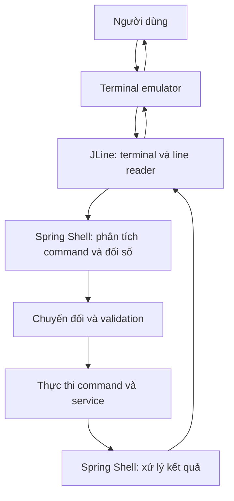

# Console của JDK so với terminal có tính năng JLine

Khi xây dựng ứng dụng dòng lệnh với Spring Shell, cần phân biệt API `Console` có sẵn trong JDK, terminal mà người dùng đang mở và thư viện JLine chạy bên trong ứng dụng. Ba thành phần này làm việc ở các lớp khác nhau. Hiểu đúng vai trò của chúng giúp chọn cách nhận đầu vào, xây dựng trải nghiệm tương tác, hỗ trợ chạy script và kiểm thử CLI ổn định.

## Ba khái niệm cần phân biệt

**JDK Console** là API `java.io.Console` cho phép chương trình Java đọc và ghi dữ liệu với console gắn với tiến trình. Có thể lấy đối tượng này qua `System.console()`. API cung cấp các thao tác cơ bản như đọc một dòng, đọc mật khẩu không hiển thị ký tự, định dạng output và truy cập reader/writer.

**Terminal** là môi trường đầu cuối mà người dùng tương tác, chẳng hạn Windows Terminal, GNOME Terminal hoặc một cửa sổ terminal trong IDE. Terminal emulator hiển thị ký tự, gửi phím bấm và xử lý các chuỗi điều khiển mà ứng dụng hoặc thư viện terminal gửi ra. Terminal không phải là command của Spring Shell và cũng không tự hiểu nghiệp vụ của ứng dụng.

**JLine** là thư viện Java hỗ trợ ứng dụng làm việc với terminal. JLine cung cấp lớp trừu tượng terminal và bộ đọc dòng lệnh có khả năng chỉnh sửa dòng nhập. Tùy cấu hình và khả năng của terminal, ứng dụng có thể cung cấp lịch sử lệnh, di chuyển con trỏ, phím tắt, gợi ý hoàn thành, prompt nhiều thành phần và các hiệu ứng hiển thị.

Vì vậy, JLine không phải một terminal emulator. Người dùng vẫn mở terminal của hệ điều hành; JLine chạy trong tiến trình Java để tận dụng các khả năng tương tác của terminal đó. `Console` là API chuẩn của JDK, còn JLine là thư viện bổ sung có thể được Spring Shell tích hợp.

## Kiến trúc từ bàn phím đến command

Trong một phiên Spring Shell tương tác, luồng xử lý có thể hình dung như sau:



Terminal emulator nhận phím bấm và hiển thị nội dung. JLine quản lý tương tác ở cấp dòng lệnh, ví dụ cho phép người dùng sửa phần văn bản đã nhập trước khi nhấn Enter. Sau khi có một dòng hoàn chỉnh, Spring Shell phân tích tên command, liên kết đối số với tham số, thực hiện chuyển đổi và validation rồi gọi command tương ứng. Kết quả được xử lý và gửi ngược ra terminal.

JLine tập trung vào trải nghiệm nhập liệu và khả năng terminal. Spring Shell quản lý mô hình command của ứng dụng: command nào được đăng ký, tham số nào được chấp nhận, trợ giúp và gợi ý nào phù hợp, cách gọi phương thức xử lý và cách trình bày kết quả. Hai thành phần phối hợp với nhau, nhưng không thay thế trách nhiệm của nhau.

## `java.io.Console` trong JDK

### Lấy Console và đọc dữ liệu

Ứng dụng lấy console hiện tại bằng `System.console()`:

```java
import java.io.Console;
import java.util.Arrays;

public class ConsoleLogin {

    public static void main(String[] args) {
        Console console = System.console();
        if (console == null) {
            System.err.println("Không có console tương tác để đọc thông tin đăng nhập.");
            return;
        }

        String username = console.readLine("Tên đăng nhập: ");
        char[] password = console.readPassword("Mật khẩu: ");

        try {
            // Truyền username và password cho thành phần xác thực của ứng dụng.
            console.printf("Đã nhận thông tin cho tài khoản %s.%n", username);
        } finally {
            if (password != null) {
                Arrays.fill(password, '\0');
            }
        }
    }
}
```

`readLine()` đọc một dòng văn bản. `readPassword()` đọc mật khẩu mà không hiển thị các ký tự được nhập và trả về `char[]`. Sau khi dùng xong, ứng dụng nên xóa nội dung mảng khi có thể. Ví dụ trên chỉ minh họa cách nhận dữ liệu; trong ứng dụng thật, không ghi mật khẩu vào log hoặc output.

### Vì sao `System.console()` có thể trả về `null`?

`System.console()` chỉ trả về một đối tượng khi JVM có console tương tác được kết nối. Kết quả thường là `null` khi ứng dụng chạy trong một số IDE, được khởi chạy như dịch vụ nền, hoặc đầu vào/đầu ra đã được chuyển hướng theo cách không gắn với console. Vì vậy, không nên mặc định rằng `System.console()` luôn tồn tại chỉ vì chương trình đang chạy trên máy có terminal.

Khi không có đối tượng `Console`, chương trình vẫn có thể đọc `System.in` và ghi `System.out`, nhưng không còn các tiện ích của `Console`, đặc biệt là `readPassword()` để tắt hiển thị ký tự khi nhập. Nếu ứng dụng bắt buộc cần console, hãy kiểm tra `null` và thông báo rõ cách chạy. Nếu cần hỗ trợ cả pipeline hoặc môi trường tự động, hãy thiết kế một đường nhận đầu vào phù hợp với chế độ đó.

### Phạm vi của Console

`Console` phù hợp với chương trình nhỏ có nhu cầu nhập và xuất tuần tự. Nó cung cấp API chuẩn, không cần thêm thư viện và có thao tác đọc mật khẩu tiện lợi. Tuy nhiên, nó không phải một bộ biên tập dòng lệnh đầy đủ. API này không cung cấp sẵn trải nghiệm lịch sử lệnh, điều hướng bằng phím mũi tên, hoàn thành command bằng Tab, key binding tùy chỉnh hay tích hợp bộ gợi ý của ứng dụng.

Đây là điểm khác biệt quan trọng khi xây dựng CLI dài hạn. Một chương trình chỉ hỏi tên và mật khẩu có thể không cần JLine. Một shell có nhiều command, tùy chọn và phiên làm việc liên tục thường cần khả năng chỉnh sửa và khám phá lệnh tốt hơn.

## JLine và terminal có tính năng tương tác

### JLine làm gì?

JLine cung cấp các thành phần chính để ứng dụng Java đọc và ghi với terminal. Hai khái niệm thường gặp là:

- `Terminal`: đại diện cho kết nối và các khả năng của terminal mà ứng dụng sử dụng.
- `LineReader`: nhận một dòng nhập và hỗ trợ các thao tác chỉnh sửa dòng trước khi trả dòng đó cho ứng dụng.

JLine có thể hỗ trợ các tính năng sau, tùy cấu hình, phiên bản và khả năng của terminal:

- Chỉnh sửa dòng nhập: di chuyển con trỏ, chèn hoặc xóa ký tự ở giữa dòng, chọn và sửa nội dung đã nhập.
- Lịch sử: xem lại và dùng lại các lệnh trước đó; việc lưu lịch sử qua nhiều lần chạy cần được cấu hình phù hợp.
- Hoàn thành: hiển thị các lựa chọn khi người dùng nhấn phím hoàn thành, thường là Tab.
- Key binding và widget: gắn hành động với tổ hợp phím hoặc mở rộng cách xử lý dòng nhập.
- Điều khiển hiển thị: làm việc với prompt, màu sắc, kích thước terminal và các chuỗi điều khiển được hỗ trợ.
- Xử lý môi trường terminal: cung cấp một lớp trừu tượng để ứng dụng làm việc với nhiều loại terminal và các chế độ tương tác khác nhau.

Các tính năng nâng cao phụ thuộc vào terminal thực tế. Nếu terminal không hỗ trợ màu hoặc một chuỗi điều khiển nhất định, ứng dụng cần có cách hiển thị dự phòng. Chế độ terminal đơn giản (*dumb terminal*) hoặc đầu vào không tương tác cũng có thể làm một số thao tác chỉnh sửa không khả dụng.

### Ví dụ đọc dòng bằng JLine

Đoạn mã sau minh họa cách tạo terminal và đọc một dòng bằng JLine 3:

```java
import org.jline.reader.LineReader;
import org.jline.reader.LineReaderBuilder;
import org.jline.terminal.Terminal;
import org.jline.terminal.TerminalBuilder;

public class JLineExample {

    public static void main(String[] args) throws Exception {
        try (Terminal terminal = TerminalBuilder.builder()
                .system(true)
                .build()) {

            LineReader reader = LineReaderBuilder.builder()
                    .terminal(terminal)
                    .build();

            String name = reader.readLine("Tên của bạn: ");
            terminal.writer().println("Xin chào, " + name + "!");
            terminal.flush();
        }
    }
}
```

`TerminalBuilder` tạo đối tượng terminal dựa trên môi trường hệ thống. `LineReaderBuilder` tạo bộ đọc dòng gắn với terminal đó. Khi gọi `readLine()`, người dùng có thể sử dụng các thao tác chỉnh sửa dòng mà JLine cung cấp. Khối `try` đóng terminal sau khi phiên làm việc kết thúc.

Đây là ví dụ JLine độc lập để giải thích API. Khi dùng Spring Shell, ứng dụng thường để Spring Shell quản lý vòng đời shell và tích hợp JLine theo cấu hình của phiên bản đang sử dụng. Không nên tự tạo một `LineReader` thứ hai trong command của Spring Shell vì hai bộ đọc cùng lấy dữ liệu từ một terminal có thể tranh nhau đầu vào.

### Hoàn thành và lịch sử

JLine cung cấp cơ chế hiển thị và điều hướng các gợi ý hoàn thành. Tuy nhiên, JLine không tự hiểu toàn bộ mô hình command nghiệp vụ của ứng dụng. Trong Spring Shell, thông tin về command, tên tùy chọn và các giá trị có thể gợi ý đến từ cấu hình hoặc các thành phần hoàn thành của Spring Shell; JLine đảm nhiệm phần tương tác dòng lệnh để người dùng xem và chọn gợi ý.

Tương tự, JLine cung cấp cơ chế lịch sử để người dùng quay lại lệnh đã nhập. Ứng dụng cần xác định chính sách lưu lịch sử, chẳng hạn chỉ lưu trong phiên hay lưu vào tệp. Tránh đưa mật khẩu, token hoặc dữ liệu nhạy cảm vào lịch sử vì người khác có thể đọc lại các lệnh đã lưu.

## So sánh Console và JLine

| Tiêu chí | `java.io.Console` | JLine |
|---|---|---|
| Nguồn gốc | API chuẩn của JDK | Thư viện Java bên ngoài |
| Vai trò | Đọc và ghi dữ liệu với console tương tác | Cung cấp lớp terminal và bộ đọc dòng lệnh có khả năng tương tác |
| Điều kiện sử dụng | `System.console()` phải trả về đối tượng | Cần khởi tạo terminal phù hợp; tính năng phụ thuộc môi trường và cấu hình |
| Đọc dòng | Có `readLine()` | Có `LineReader` với khả năng chỉnh sửa dòng |
| Nhập mật khẩu | Có `readPassword()` để không hiển thị ký tự nhập | Có thể xây dựng luồng nhập được che ký tự; cần cấu hình và kiểm tra cách dùng của phiên bản |
| Lịch sử lệnh | Không có sẵn | Có cơ chế history; chính sách lưu cần được cấu hình |
| Hoàn thành bằng Tab | Không có sẵn | Có cơ chế completer; nguồn gợi ý do ứng dụng cung cấp |
| Key binding và chỉnh sửa nâng cao | Không có bộ biên tập dòng tích hợp | Hỗ trợ key binding và nhiều thao tác chỉnh sửa |
| Màu và điều khiển terminal | Phạm vi API cơ bản | Hỗ trợ làm việc với khả năng terminal và chuỗi điều khiển |
| Phụ thuộc | Không cần thư viện ngoài | Cần dependency JLine tương thích |
| Tình huống phù hợp | Nhập/xuất đơn giản trong ứng dụng Java | CLI tương tác có nhiều command và cần trải nghiệm nhập liệu phong phú |

Không nên xem JLine là lựa chọn thay thế trực tiếp cho mọi thao tác của `Console`. Ví dụ, `Console.readPassword()` là API JDK rõ ràng cho việc đọc mật khẩu; JLine giải quyết bài toán terminal và dòng lệnh rộng hơn. Hãy chọn API theo yêu cầu của ứng dụng và kiểm tra kỹ cách xử lý dữ liệu nhạy cảm ở cả hai trường hợp.

## Spring Shell kết hợp với JLine

Spring Shell hướng đến việc xây dựng CLI bằng cách khai báo command, tham số, validation, trợ giúp và hoàn thành. Trong một phiên tương tác, JLine cung cấp lớp tương tác terminal để người dùng nhập lệnh thuận tiện. Spring Shell tiếp nhận dòng lệnh đã hoàn chỉnh và xử lý nó theo mô hình command.

Có thể chia trách nhiệm theo các lớp như sau:

| Lớp | Trách nhiệm |
|---|---|
| Terminal emulator | Nhận phím bấm, hiển thị ký tự và xử lý khả năng terminal của môi trường người dùng |
| JLine | Đọc và chỉnh sửa dòng, prompt, history, key binding và cơ chế tương tác với gợi ý |
| Spring Shell | Đăng ký command, phân tích cú pháp, gắn đối số, cung cấp trợ giúp và kết nối cơ chế hoàn thành |
| Command và service | Thực hiện nghiệp vụ, kiểm tra quy tắc miền và trả kết quả |
| Bộ xử lý output | Chuyển kết quả thành nội dung phù hợp để hiển thị hoặc tiêu thụ |

Việc phân chia này cũng giúp tìm lỗi đúng chỗ. Nếu phím mũi tên không sửa dòng như mong đợi, hãy kiểm tra lớp terminal và cấu hình JLine. Nếu command không nhận ra tùy chọn, hãy xem cách khai báo và phân tích của Spring Shell. Nếu giá trị đúng cú pháp nhưng sai quy tắc nghiệp vụ, hãy kiểm tra validation hoặc service. Nếu kết quả khó đọc, hãy xem cách xử lý output.

### Lưu ý về phiên bản và dependency

Spring Shell có thể quản lý phiên bản JLine thông qua dependency hoặc dependency management của bản phát hành mà dự án đang sử dụng. Vì vậy, không nên tự ý nâng riêng một module JLine lên phiên bản khác mà chưa kiểm tra tương thích. Khi nâng Spring Shell, hãy xem dependency tree để biết phiên bản JLine thực tế được đưa vào và đọc tài liệu đúng phiên bản của cả hai thư viện.

Ví dụ JLine độc lập trong bài dùng API thuộc dòng JLine 3. Cấu hình và chi tiết API có thể thay đổi theo phiên bản. Trong dự án Spring Shell, ưu tiên cấu hình và extension point mà phiên bản Spring Shell đó hỗ trợ, thay vì sao chép nguyên cấu hình terminal độc lập vào ứng dụng.

## Chế độ tương tác và chế độ chạy tự động

JLine phát huy tác dụng rõ nhất khi người dùng trực tiếp làm việc với terminal. Khi chạy script, pipeline hoặc môi trường CI, không phải lúc nào cũng có terminal tương tác. Trong những tình huống đó, ứng dụng cần xử lý đầu vào theo luồng được cung cấp và tránh phụ thuộc vào prompt, phím Tab, phím mũi tên hay câu hỏi chờ người dùng trả lời.

| Tình huống | Cách thiết kế phù hợp |
|---|---|
| Người dùng thao tác trực tiếp | Bật trải nghiệm tương tác, prompt, lịch sử và hoàn thành khi terminal hỗ trợ |
| Đầu vào được chuyển qua pipe hoặc tệp | Đọc dữ liệu từ luồng đầu vào và xác định rõ định dạng mỗi dòng |
| Chạy trong CI hoặc tác vụ nền | Không chờ thao tác bàn phím; trả mã thoát và output có thể xử lý tự động |
| Terminal không hỗ trợ tính năng nâng cao | Giảm màu/chuỗi điều khiển và cung cấp thông báo dạng văn bản đơn giản |
| Chạy từ IDE hoặc môi trường không có console | Không giả định `System.console()` khác `null`; chọn cơ chế đầu vào tương thích |

Không phải cứ có `System.in` là ứng dụng có một console tương tác. Tương tự, việc có JLine trên classpath không bảo đảm mọi tính năng tương tác đều khả dụng trong môi trường chạy. Nên phân biệt rõ ứng dụng đang chạy với terminal tương tác hay đang nhận đầu vào không tương tác, rồi chọn hành vi phù hợp.

## Kiểm thử và bảo mật đầu vào

`System.console()` thường trả về `null` trong môi trường kiểm thử tự động, vì tiến trình test không gắn với console tương tác. Do đó, logic nghiệp vụ không nên phụ thuộc trực tiếp vào một console toàn cục. Hãy tách phần xử lý dữ liệu khỏi phần hỏi đáp ở terminal để có thể kiểm thử logic bằng đầu vào và dependency giả lập.

Với JLine, có thể kiểm thử command và service độc lập, sau đó kiểm thử tích hợp lớp shell bằng cơ chế test hoặc terminal giả lập phù hợp với phiên bản đang dùng. Nên có ca kiểm thử cho đầu vào hợp lệ, đối số thiếu, giá trị sai kiểu, giá trị không qua validation, command không tồn tại và đầu vào kết thúc sớm. Kiểm tra thêm hành vi khi terminal không hỗ trợ màu hoặc tính năng nâng cao nếu ứng dụng phải chạy trong nhiều môi trường.

Đối với thông tin nhạy cảm:

- Không truyền mật khẩu qua đối số dòng lệnh vì chúng có thể xuất hiện trong lịch sử shell, danh sách tiến trình hoặc log của công cụ chạy.
- Dùng cơ chế nhập mật khẩu có che ký tự và xác minh hành vi thực tế của terminal.
- Hạn chế thời gian giữ bí mật trong bộ nhớ; với `char[]` nhận từ `Console.readPassword()`, xóa mảng sau khi hoàn tất khi có thể.
- Không ghi bí mật vào lịch sử JLine, thông báo lỗi, log hoặc output.
- Khi chạy tự động, dùng cơ chế cấp bí mật phù hợp với môi trường triển khai thay vì chờ nhập tương tác.

## Chọn giải pháp nào?

Chọn `java.io.Console` khi chương trình Java chỉ cần hỏi và hiển thị một lượng nhỏ dữ liệu trong console tương tác, muốn giữ dependency ở mức tối thiểu và có thể xử lý trường hợp `System.console()` trả về `null`.

Chọn JLine khi ứng dụng cần trải nghiệm shell liên tục: người dùng sửa lệnh trước khi chạy, xem lại lịch sử, dùng Tab để hoàn thành, thao tác bằng phím tắt hoặc làm việc với prompt và khả năng hiển thị của terminal. Đây là lý do JLine phù hợp với lớp tương tác của một ứng dụng Spring Shell.

Trong cả hai trường hợp, hãy giữ nghiệp vụ trong command/service và tách nó khỏi cách nhập liệu. Nhờ đó, cùng một command có thể được gọi từ phiên tương tác hoặc từ luồng chạy tự động, trong khi ứng dụng vẫn kiểm soát được validation, output và mã thoát theo yêu cầu triển khai.
