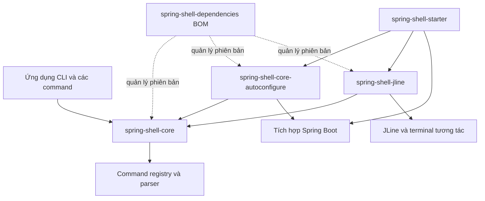

# Phụ thuộc trực tiếp, starter và BOM của hệ sinh thái Spring Shell

Khi thêm Spring Shell vào một dự án Java, bạn cần chọn những thư viện cung cấp API command, tích hợp Spring Boot, xử lý terminal và hỗ trợ kiểm thử. Spring Shell cung cấp các module riêng cho những vai trò này, đồng thời có các starter để ghép sẵn một cấu hình thông dụng. BOM (Bill of Materials) giúp quản lý phiên bản đồng bộ giữa các module Spring Shell.

Trong module `SPRING_SHELL`, việc hiểu cấu trúc phụ thuộc là nền tảng để xây dựng CLI bằng Spring Shell: khai báo command, xử lý đối số, validation, trợ giúp, tự hoàn thành, chạy tương tác hoặc script, quản lý mã thoát, định dạng output, kiểm thử và đóng gói ứng dụng. Chọn đúng dependency ngay từ đầu giúp classpath dễ kiểm soát và giảm lỗi do trộn các phiên bản không tương thích.

## 1. Nhìn cấu trúc phụ thuộc theo vai trò

Một ứng dụng Spring Shell có thể được nhìn thành các lớp chức năng:



Sơ đồ thể hiện cách phân lớp của Spring Shell 4.x. Ở các dòng phiên bản cũ, tên module và ranh giới giữa chúng có thể khác; không nên lấy sơ đồ hoặc dependency của 4.x áp dụng nguyên trạng cho 3.x.

| Thành phần | Vai trò | Khi nào cần khai báo |
| --- | --- | --- |
| `spring-shell-core` | API cốt lõi để định nghĩa, đăng ký, phân tích và thực thi command | Khi ứng dụng sử dụng trực tiếp API lõi hoặc tự lắp ghép shell |
| `spring-shell-core-autoconfigure` | Cấu hình tự động Spring Boot cho các thành phần cốt lõi | Khi dùng Spring Boot nhưng không chọn starter tổng hợp |
| `spring-shell-jline` | Tích hợp Spring Shell với JLine để đọc lệnh và cung cấp trải nghiệm terminal phong phú | Khi cần JLine hoặc sử dụng trực tiếp các API của module này |
| `spring-shell-starter` | Tập hợp các module cơ bản để nhanh chóng tạo ứng dụng Spring Shell | Lựa chọn thông thường cho ứng dụng Spring Boot |
| `spring-shell-starter-test` | Thành phần hỗ trợ kiểm thử ứng dụng Spring Shell | Khi viết kiểm thử command hoặc kiểm thử tương tác shell |
| `spring-shell-dependencies` | BOM quản lý phiên bản các artifact Spring Shell | Khi dự án có nhiều dependency Spring Shell hoặc cần quản lý phiên bản tập trung |

Các dependency này không có cùng chức năng. `core` cung cấp API; module autoconfigure kết nối API với cơ chế cấu hình của Spring Boot; JLine đảm nhiệm lớp terminal; starter đóng gói lựa chọn phổ biến; BOM chỉ quản lý phiên bản.

## 2. Starter là gì?

Trong hệ sinh thái Spring, starter là một dependency có chủ đích tập hợp các thư viện thường đi cùng nhau cho một nhu cầu cụ thể. Thay vì tự tìm và khai báo từng module, bạn thêm starter tương ứng để có một cấu hình hoạt động được với ít khai báo hơn.

Với Spring Shell 4.x, các starter chính gồm:

| Artifact | Mục đích |
| --- | --- |
| `spring-shell-starter` | Các module Spring Shell cơ bản cho ứng dụng |
| `spring-shell-starter-jansi` | Chọn JLine Jansi provider |
| `spring-shell-starter-jni` | Chọn JLine JNI provider |
| `spring-shell-starter-jna` | Chọn JLine JNA provider |
| `spring-shell-starter-ffm` | Chọn JLine FFM provider, yêu cầu JDK 22 trở lên |
| `spring-shell-starter-test` | Hỗ trợ kiểm thử Spring Shell |

Các starter provider phục vụ những môi trường terminal khác nhau. JLine có thể dùng native provider để làm việc với terminal của hệ điều hành. Hãy chọn provider dựa trên JDK, hệ điều hành, cách đóng gói và môi trường chạy thực tế. Không thêm đồng thời nhiều starter provider nếu chưa có lý do cụ thể; việc đó có thể đưa nhiều triển khai terminal vào classpath và làm lựa chọn provider khó dự đoán.

Với một ứng dụng Spring Boot mới, `spring-shell-starter` thường là điểm bắt đầu phù hợp. Nếu ứng dụng cần một provider cụ thể, thay bằng starter provider tương ứng. Khi viết kiểm thử, thêm `spring-shell-starter-test` với scope dành cho test.

Ví dụ cấu hình Maven cho ứng dụng Spring Boot dùng Spring Shell 4.x:

```xml
<dependencies>
    <dependency>
        <groupId>org.springframework.shell</groupId>
        <artifactId>spring-shell-starter</artifactId>
    </dependency>

    <dependency>
        <groupId>org.springframework.shell</groupId>
        <artifactId>spring-shell-starter-test</artifactId>
        <scope>test</scope>
    </dependency>
</dependencies>
```

Từ Spring Shell 4, các starter Spring Shell đã import `spring-boot-starter`; do đó ứng dụng dùng starter Spring Shell không cần khai báo thêm `spring-boot-starter` chỉ để khởi tạo nền tảng Boot. Nếu dự án cần một starter Boot khác, chẳng hạn Web hoặc Actuator, hãy khai báo starter đó theo chức năng ứng dụng.

## 3. Khi nào nên khai báo dependency trực tiếp?

Starter thuận tiện, nhưng không phải mọi ứng dụng đều cần dùng starter. Khai báo module trực tiếp hữu ích khi bạn muốn tự kiểm soát thành phần được đưa vào classpath, tích hợp Spring Shell vào một ứng dụng Spring hiện có hoặc xây dựng shell mà không dùng Spring Boot.

### Spring Shell 4.x tách core khỏi Boot và JLine

Một thay đổi kiến trúc quan trọng ở Spring Shell 4 là `spring-shell-core` không còn phụ thuộc Spring Boot và cũng không còn phụ thuộc JLine. Core sử dụng `java.io.Console` của JDK cho shell cơ bản. Nếu cần tích hợp Spring Boot, hãy thêm `spring-shell-core-autoconfigure` hoặc một starter. Nếu cần console dựa trên JLine với lịch sử lệnh, tự hoàn thành và các khả năng terminal nâng cao, hãy thêm `spring-shell-jline` hoặc chọn starter tương ứng.

| Nhu cầu | Hướng khai báo trong Spring Shell 4.x |
| --- | --- |
| Dùng Spring Boot với cấu hình mặc định | `spring-shell-starter` |
| Dùng Spring Boot nhưng tự chọn module | `spring-shell-core-autoconfigure` và các module cần thiết |
| Dùng API core trong ứng dụng tự quản lý Spring context | `spring-shell-core` |
| Dùng trực tiếp tích hợp JLine | `spring-shell-jline` cùng các thành phần core cần thiết |
| Kiểm thử command và shell | `spring-shell-starter-test` trong test scope |

Ví dụ Maven cho ứng dụng Spring Boot muốn khai báo module tường minh thay vì dùng starter tổng hợp:

```xml
<dependencies>
    <dependency>
        <groupId>org.springframework.boot</groupId>
        <artifactId>spring-boot-starter</artifactId>
    </dependency>

    <dependency>
        <groupId>org.springframework.shell</groupId>
        <artifactId>spring-shell-core</artifactId>
    </dependency>

    <dependency>
        <groupId>org.springframework.shell</groupId>
        <artifactId>spring-shell-core-autoconfigure</artifactId>
    </dependency>

    <dependency>
        <groupId>org.springframework.shell</groupId>
        <artifactId>spring-shell-jline</artifactId>
    </dependency>
</dependencies>
```

Đây là cấu hình để minh họa việc lắp ghép module; dự án thực tế chỉ nên giữ các dependency cần cho cách triển khai của mình. `spring-shell-core-autoconfigure` cung cấp tích hợp Boot, còn `spring-shell-jline` bổ sung console JLine. Nếu ứng dụng không dùng Spring Boot, cần tự tạo Spring context, bật cơ chế đăng ký command và khởi chạy `ShellRunner` theo API của phiên bản đang dùng; chỉ thêm `core` không tự động dựng toàn bộ ứng dụng.

### Tránh phụ thuộc vào chi tiết triển khai một cách vô tình

Maven và Gradle thường đưa các dependency bắc cầu vào classpath. Điều đó không có nghĩa ứng dụng nên dựa vào mọi thư viện bắc cầu như thể chúng là API công khai của mình. Nếu mã nguồn trực tiếp import kiểu từ một module, hãy cân nhắc khai báo module đó trực tiếp để thể hiện rõ phụ thuộc của ứng dụng.

Ngược lại, không cần khai báo lặp `spring-shell-core`, `spring-shell-jline` và các module đã được starter cung cấp chỉ vì chúng xuất hiện trong dependency tree. Hãy xem dependency tree trước khi thêm một artifact để tránh cấu hình dư thừa.

## 4. BOM quản lý phiên bản như thế nào?

BOM là một POM có danh sách phiên bản được quản lý tập trung. Với Spring Shell, BOM có tọa độ:

```text
groupId:    org.springframework.shell
artifactId: spring-shell-dependencies
type:       pom
```

BOM giúp các artifact cùng hệ sinh thái Spring Shell sử dụng những phiên bản đã được dự án kiểm thử và phối hợp. Khi import BOM, bạn thường chỉ cần chỉ định phiên bản tại một nơi, sau đó khai báo dependency Spring Shell mà không lặp lại phiên bản trên từng artifact.

BOM không tự thêm thư viện vào ứng dụng. Nó chỉ cung cấp quy tắc phiên bản cho các dependency được khai báo ở nơi khác. Vì vậy, `spring-shell-dependencies` không thay thế `spring-shell-starter`, `spring-shell-core` hay bất kỳ dependency chạy nào.

Một dự án có thể sử dụng đồng thời nhiều bộ quản lý phiên bản:

- Spring Boot parent hoặc BOM quản lý phiên bản Spring Boot và các thư viện thuộc nền tảng Boot.
- Spring Shell BOM quản lý phiên bản các artifact Spring Shell.
- BOM của thư viện khác có thể quản lý một nhóm dependency riêng.

Các bộ BOM cần tương thích với nhau. Không nên hiểu rằng phiên bản Spring Shell 4.0.x bắt buộc Spring Boot cũng phải có cùng số phiên bản 4.0.x; hai dự án phát hành độc lập. Hãy chọn cặp phiên bản theo yêu cầu tương thích được công bố.

## 5. Cấu hình BOM bằng Maven

Ví dụ dưới đây minh họa cách quản lý phiên bản Spring Shell 4.0.3 tập trung. Đây là phiên bản minh họa cho cú pháp; khi tạo dự án, hãy thay bằng bản phát hành phù hợp với Spring Boot và JDK của dự án.

Đoạn POM sau tập trung vào phần BOM và dependency Spring Shell; dự án Maven thực tế cần có Spring Boot parent hoặc import `spring-boot-dependencies` BOM để quản lý phiên bản các thư viện Spring Boot.

```xml
<properties>
    <spring-shell.version>4.0.3</spring-shell.version>
</properties>

<dependencyManagement>
    <dependencies>
        <dependency>
            <groupId>org.springframework.shell</groupId>
            <artifactId>spring-shell-dependencies</artifactId>
            <version>${spring-shell.version}</version>
            <type>pom</type>
            <scope>import</scope>
        </dependency>
    </dependencies>
</dependencyManagement>

<dependencies>
    <dependency>
        <groupId>org.springframework.shell</groupId>
        <artifactId>spring-shell-starter</artifactId>
    </dependency>
</dependencies>
```

Các chi tiết cần chú ý:

1. `spring-shell.version` là thuộc tính do dự án đặt để chỉ định phiên bản BOM.
2. `type` phải là `pom` vì BOM là một POM.
3. `scope` phải là `import` để Maven nhập các quy tắc quản lý dependency từ BOM.
4. Khai báo `spring-shell-starter` trong `<dependencies>` mới đưa starter vào classpath; phần BOM trong `<dependencyManagement>` không tự làm việc đó.
5. Không cần viết `<version>` cho `spring-shell-starter` khi BOM đã quản lý phiên bản artifact này.

Nếu dự án dùng Spring Boot parent, vẫn có thể import Spring Shell BOM trong `dependencyManagement`. Hãy kiểm tra ma trận tương thích trước khi nâng Spring Shell hoặc Spring Boot, đặc biệt khi thay đổi major version.

## 6. Cấu hình BOM bằng Gradle

Gradle hỗ trợ import BOM thông qua `platform`. Ví dụ với Groovy DSL:

```groovy
def springShellVersion = '4.0.3'

dependencies {
    implementation platform("org.springframework.shell:spring-shell-dependencies:${springShellVersion}")

    implementation 'org.springframework.shell:spring-shell-starter'
    testImplementation 'org.springframework.shell:spring-shell-starter-test'
}
```

`platform(...)` đưa các quy tắc phiên bản trong BOM vào dependency resolution. Các dependency Spring Shell sau đó có thể bỏ phần phiên bản. Với Kotlin DSL, cách viết tương đương là:

```kotlin
val springShellVersion = "4.0.3"

dependencies {
    implementation(platform("org.springframework.shell:spring-shell-dependencies:$springShellVersion"))

    implementation("org.springframework.shell:spring-shell-starter")
    testImplementation("org.springframework.shell:spring-shell-starter-test")
}
```

Một dự án Gradle cũng có thể dùng plugin `io.spring.dependency-management` và khai báo BOM trong khối `dependencyManagement { imports { mavenBom(...) } }`. Chọn một cách quản lý nhất quán trong dự án; tránh cấu hình nhiều cơ chế version alignment chồng chéo nếu không có chủ đích.

## 7. Phối hợp phiên bản Spring Shell và Spring Boot

Spring Shell phụ thuộc vào nền tảng Spring mà nó tích hợp. Khi nâng cấp, cần xem phiên bản Spring Boot, Spring Framework và JDK như một nhóm tương thích thay vì chỉ thay số phiên bản của một artifact.

| Dòng Spring Shell | Nền tảng Spring Boot | Điểm cần lưu ý |
| --- | --- | --- |
| 3.x | Spring Boot 3.x | Dùng hướng dẫn và artifact thuộc đúng minor version 3.x; không áp dụng thay đổi module của 4.x một cách máy móc |
| 4.x | Spring Boot 4.x trở lên | Dựa trên Spring Framework 7; core được tách khỏi Boot và JLine; cần kiểm tra lại module, starter và API command khi nâng cấp |

Spring Shell 4 dựa trên Spring Framework 7 và yêu cầu Spring Boot 4 trở lên khi chạy theo tích hợp Spring Boot. Hướng dẫn nâng cấp chính thức khuyến nghị cập nhật ứng dụng lên bản Spring Shell 3.4.x mới nhất trước khi chuyển sang 4.x. Điều này tạo một bước trung gian để xử lý các thay đổi trong dòng 3.x trước khi tiếp nhận thay đổi lớn của 4.x.

Một số thay đổi đáng chú ý khi chuyển từ 3.x sang 4.x:

- `spring-shell-core` không còn phụ thuộc Spring Boot; ứng dụng Boot cần `spring-shell-core-autoconfigure` hoặc starter.
- `spring-shell-core` không còn phụ thuộc JLine; thêm `spring-shell-jline` nếu cần console JLine.
- `spring-shell-autoconfigure` được đổi tên thành `spring-shell-core-autoconfigure`.
- Các module `spring-shell-standard` và `spring-shell-standard-commands` được gộp vào `spring-shell-core`.
- `spring-shell-table` được gộp vào `spring-shell-jline`.
- Các annotation cũ như `@ShellComponent`, `@ShellMethod` và `@ShellOption` đã bị loại bỏ trong 4.x; dùng API command mới của phiên bản 4.

Vì vậy, khi thấy lỗi `ClassNotFoundException`, `NoSuchMethodError` hoặc lỗi tạo application context sau nâng cấp, hãy kiểm tra cả cây dependency và API trong mã nguồn. Lỗi có thể đến từ việc module đã đổi tên, dependency không còn được kéo bắc cầu hoặc mã nguồn vẫn dùng API cũ.

## 8. Kiểm tra dependency tree

Khi cấu hình đã hoàn tất, hãy kiểm tra dependency thực tế mà công cụ build phân giải. Đây là cách nhanh để phát hiện phiên bản trùng, provider terminal không mong muốn hoặc thư viện bị kéo vào từ dependency khác.

Với Maven:

```bash
mvn dependency:tree -Dincludes=org.springframework.shell
```

Để xem dependency bị xung đột hoặc bị loại trừ, có thể xem toàn bộ cây:

```bash
mvn dependency:tree
```

Với Gradle:

```bash
./gradlew dependencies --configuration runtimeClasspath
```

Hoặc xem riêng một dependency:

```bash
./gradlew dependencyInsight --dependency spring-shell --configuration runtimeClasspath
```

Khi đọc kết quả, kiểm tra các điểm sau:

- Các artifact `org.springframework.shell` có cùng phiên bản dự kiến hay không.
- Có nhiều phiên bản của cùng một module xuất hiện trong cây hay không.
- Starter nào đã kéo `spring-shell-core`, `spring-shell-core-autoconfigure` và `spring-shell-jline` vào classpath.
- Có nhiều JLine provider hoặc phiên bản JLine khác nhau do dependency khác kéo vào hay không.
- Dependency chỉ dùng trong kiểm thử có nằm đúng test scope/configuration hay không.

Không nên giải quyết xung đột bằng cách ép một phiên bản bất kỳ vào classpath khi chưa biết module nào yêu cầu phiên bản đó. Trước tiên xác định dependency nguồn, sau đó điều chỉnh BOM hoặc phiên bản thư viện tích hợp cho phù hợp.

## 9. Những lỗi cấu hình thường gặp

| Hiện tượng | Nguyên nhân có thể có | Cách xử lý |
| --- | --- | --- |
| Maven báo thiếu version cho artifact Spring Shell | Chưa import BOM hoặc BOM không quản lý artifact đang khai báo | Kiểm tra `dependencyManagement`, tọa độ BOM và tên artifact |
| BOM không làm thư viện xuất hiện trong classpath | BOM chỉ quản lý version, không thêm dependency | Khai báo starter hoặc module cần dùng trong `dependencies` |
| `ClassNotFoundException` với API JLine | Chỉ có core nhưng chưa thêm module JLine trong cấu hình tự lắp ghép | Thêm `spring-shell-jline` hoặc dùng starter cung cấp JLine |
| Không có cấu hình Spring Boot cho shell | Chỉ khai báo `spring-shell-core` trong ứng dụng Boot 4 | Thêm `spring-shell-core-autoconfigure` hoặc starter |
| Lỗi tương thích sau khi nâng lên 4.x | Ứng dụng vẫn dùng Boot 3, module cũ hoặc annotation cũ | Chọn Boot 4+ và thực hiện các bước migration của Spring Shell 4 |
| Terminal không hoạt động như mong đợi | Chọn provider không phù hợp JDK hoặc môi trường triển khai | Kiểm tra provider JLine, hệ điều hành, quyền native access và JDK |
| Kiểm thử bị khởi động shell ngoài ý muốn | Cấu hình runner tương tác được bật trong ngữ cảnh test | Dùng test support và cấu hình runner phù hợp với kiểm thử |

Một lưu ý riêng với `spring-shell-starter-ffm`: provider này yêu cầu JDK 22 trở lên. Nếu ứng dụng chạy trên JDK thấp hơn, hãy chọn provider khác tương thích thay vì chỉ đổi dependency mà không thay môi trường chạy.

## 10. Quy trình chọn dependency cho dự án mới

Bạn có thể dùng trình tự sau để tránh thêm thư viện theo cảm tính:

1. **Xác định nền tảng:** dự án dùng Spring Boot 3.x hay 4.x, phiên bản JDK nào và phiên bản Spring Shell nào tương thích.
2. **Chọn cách tích hợp:** ứng dụng Boot thông thường nên bắt đầu bằng `spring-shell-starter`; ứng dụng cần tự kiểm soát classpath có thể chọn các module trực tiếp.
3. **Chọn terminal:** dùng cấu hình mặc định hoặc chọn JLine provider theo hệ điều hành và JDK triển khai.
4. **Quản lý phiên bản:** import `spring-shell-dependencies` BOM để các module Spring Shell đồng bộ.
5. **Thêm dependency kiểm thử:** đặt `spring-shell-starter-test` trong test scope/configuration.
6. **Kiểm tra cây dependency:** xác nhận phiên bản, module và provider thực tế sau khi build tool phân giải.

Checklist trước khi commit cấu hình:

- Phiên bản Spring Shell tương thích với Spring Boot, Spring Framework và JDK.
- BOM Spring Shell được import đúng tọa độ và đúng phiên bản.
- Starter hoặc module runtime thực sự được khai báo trong dependencies.
- Không khai báo lặp các module đã được starter cung cấp nếu không có lý do.
- JLine provider phù hợp với môi trường chạy; `ffm` chỉ dùng khi JDK đáp ứng yêu cầu.
- Dependency kiểm thử nằm trong test scope/configuration.
- Dependency tree không chứa phiên bản Spring Shell xung đột hoặc provider không mong muốn.

## Tài liệu tham khảo

- [Spring Shell 4.x — Building và danh sách starter](https://docs.spring.io/spring-shell/reference/building.html)
- [Spring Shell 3.3 — Getting Started và ví dụ import BOM](https://docs.spring.io/spring-shell/reference/3.3/getting-started.html)
- [Spring Shell — Hướng dẫn migration từ 3.x lên 4.x](https://github.com/spring-projects/spring-shell/wiki/v4-migration-guide)
