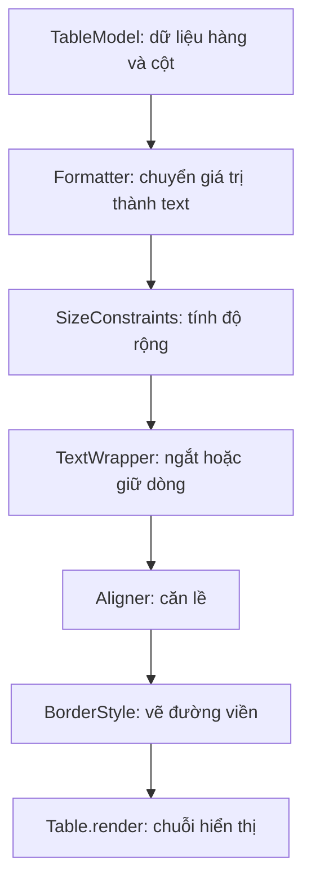

# Tiêu đề cột, căn lề, độ rộng và đường viền

Khi hiển thị danh sách dữ liệu trong terminal, một bảng dễ đọc cần có tiêu đề cột rõ ràng, căn lề nhất quán, độ rộng phù hợp và đường viền vừa đủ. Spring Shell cung cấp `TableModel` để mô tả dữ liệu và `TableBuilder` để định dạng cách dữ liệu xuất hiện trên màn hình. Bạn có thể tùy biến toàn bảng hoặc chỉ một hàng, một cột hay một ô thông qua `CellMatcher`.

Bài học thuộc chương **Bảng và định dạng**. Nội dung tập trung vào cách xây dựng model, xác định hàng tiêu đề, căn trái/giữa/phải, giới hạn độ rộng, ngắt dòng và chọn kiểu đường viền trong Spring Shell 4.x.

Sau bài học, bạn có thể:

- Tạo `TableModel` từ dữ liệu dạng hàng và cột.
- Dùng hàng đầu tiên làm tiêu đề và tạo đường phân cách cho header.
- Căn lề theo hàng, cột hoặc ô bằng `CellMatchers` và `SimpleHorizontalAligner`.
- Điều khiển độ rộng bảng và độ rộng riêng của từng cột.
- Chọn cách ngắt dòng hoặc giữ nguyên dòng dài.
- Chọn border cho toàn bảng, header hoặc các đường phân cách bên trong.
- Chuyển đổi package và dependency bảng khi nâng cấp từ Spring Shell 3.x lên 4.x.

## Mô hình bảng và luồng định dạng

Spring Shell tách dữ liệu bảng khỏi cách trình bày. `TableModel` cung cấp số hàng, số cột và giá trị tại một vị trí. `TableBuilder` nhận model rồi áp dụng các quy tắc định dạng.

Luồng render gồm bốn bước:

1. **Formatter:** chuyển giá trị gốc thành một hoặc nhiều dòng văn bản, ví dụ định dạng số hoặc ngày tháng.
2. **Size constraints:** tính không gian mà ô cần dùng trong bảng.
3. **Text wrapper:** ngắt hoặc cắt văn bản theo chiều rộng của ô.
4. **Aligner:** căn nội dung và thêm khoảng trắng để các ô thẳng hàng.

Các quy tắc này được áp dụng chọn lọc qua `CellMatcher`, vì vậy cột số có thể căn phải, cột mô tả có thể ngắt dòng và hàng tiêu đề có thể căn giữa.



## Lưu ý package và dependency theo phiên bản

Trong Spring Shell 3.x, API bảng nằm trong package `org.springframework.shell.table` và được cung cấp qua module `spring-shell-table`.

Từ Spring Shell 4.x, API bảng được chuyển sang package `org.springframework.shell.jline.tui.table` và module bảng được gộp vào `spring-shell-jline`. Nếu ứng dụng chỉ dùng `spring-shell-core`, cần thêm dependency JLine để sử dụng `Table`, `TableBuilder` và các lớp liên quan.

Ví dụ dependency Maven cho Spring Shell 4.x:

```xml
<dependency>
    <groupId>org.springframework.shell</groupId>
    <artifactId>spring-shell-jline</artifactId>
</dependency>
```

Ví dụ import trong Spring Shell 4.x:

```java
import org.springframework.shell.jline.tui.table.ArrayTableModel;
import org.springframework.shell.jline.tui.table.BorderStyle;
import org.springframework.shell.jline.tui.table.CellMatchers;
import org.springframework.shell.jline.tui.table.SimpleHorizontalAligner;
import org.springframework.shell.jline.tui.table.Table;
import org.springframework.shell.jline.tui.table.TableBuilder;
import org.springframework.shell.jline.tui.table.TableModel;
import org.springframework.shell.jline.tui.table.TableModelBuilder;
```

Không dùng import `org.springframework.shell.table.*` trong mã Spring Shell 4.x. Khi nâng cấp từ 3.x, cần đổi cả package import và dependency tương ứng.

## Tạo TableModel từ dữ liệu

`TableModelBuilder<T>` giúp xây dựng model theo từng hàng. Mỗi lần gọi `addRow()` bắt đầu một hàng mới; các lời gọi `addValue(...)` tiếp theo thêm giá trị vào hàng đó. `build()` trả về `TableModel`.

Ví dụ danh sách báo cáo có ba cột:

```java
import org.springframework.shell.jline.tui.table.TableModel;
import org.springframework.shell.jline.tui.table.TableModelBuilder;

TableModel model = new TableModelBuilder<Object>()
    .addRow()
        .addValue("ID")
        .addValue("Tên báo cáo")
        .addValue("Số bản ghi")
    .addRow()
        .addValue(101)
        .addValue("Doanh thu tháng")
        .addValue(1250)
    .addRow()
        .addValue(102)
        .addValue("Tồn kho")
        .addValue(86)
    .build();
```

Model lưu dữ liệu theo hàng. Hàng đầu tiên có thể được dùng làm header khi áp dụng các border dành cho tiêu đề. `TableModel` không bắt buộc dữ liệu phải là chuỗi; formatter mặc định gọi `toString()` trên từng giá trị.

Nếu dữ liệu đã có sẵn dưới dạng mảng hai chiều, có thể dùng `ArrayTableModel`:

```java
import org.springframework.shell.jline.tui.table.ArrayTableModel;
import org.springframework.shell.jline.tui.table.TableModel;

Object[][] rows = {
    {"ID", "Tên", "Trạng thái"},
    {101, "Báo cáo tháng", "READY"},
    {102, "Báo cáo quý", "RUNNING"}
};

TableModel model = new ArrayTableModel(rows);
```

Chọn `TableModelBuilder` khi muốn thêm dữ liệu theo từng bước; chọn `ArrayTableModel` khi dữ liệu đã có sẵn trong mảng.

## Xác định hàng tiêu đề

Table model không có một thuộc tính header riêng. Theo quy ước của `TableBuilder`, hàng đầu tiên là hàng được dùng bởi các phương thức `addHeaderBorder(...)` và `addHeaderAndVerticalsBorders(...)`.

Ví dụ:

```java
Table table = new TableBuilder(model)
    .addHeaderBorder(BorderStyle.fancy_light)
    .build();
```

`addHeaderBorder` vẽ đường viền bao quanh toàn bảng và đường viền quanh hàng đầu tiên. Cách này tạo ranh giới trực quan giữa tiêu đề và các hàng dữ liệu.

Nếu muốn có đường viền ngoài, đường viền header và các đường dọc ngăn cột, dùng:

```java
Table table = new TableBuilder(model)
    .addHeaderAndVerticalsBorders(BorderStyle.fancy_light)
    .build();
```

Hãy đặt tên cột ngắn và mô tả đúng nội dung. Nếu header quá dài, nó có thể làm tăng độ rộng bảng hoặc bị ngắt dòng như dữ liệu thông thường.

## Căn lề nội dung

`SimpleHorizontalAligner` cung cấp ba chiến lược căn lề:

| Giá trị | Cách hiển thị | Thường dùng cho |
| --- | --- | --- |
| `left` | Căn trái | Tên, mô tả, đường dẫn và văn bản. |
| `center` | Căn giữa | Tiêu đề ngắn, trạng thái hoặc nhãn. |
| `right` | Căn phải | Số lượng, phần trăm, tiền và số liệu. |

`CellMatchers` cung cấp các matcher thường dùng:

| Matcher | Phạm vi áp dụng |
| --- | --- |
| `CellMatchers.table()` | Tất cả ô trong bảng. |
| `CellMatchers.row(0)` | Tất cả ô ở hàng đầu tiên. |
| `CellMatchers.column(2)` | Tất cả ô ở cột thứ ba. |
| `CellMatchers.at(1, 2)` | Một ô tại hàng 1, cột 2. |
| `CellMatchers.ofType(Number.class)` | Các ô chứa giá trị thuộc kiểu `Number`. |

Chỉ số hàng và cột bắt đầu từ `0`. Có thể kết hợp matcher với `TableBuilder.on(...)` để thêm aligner:

```java
import org.springframework.shell.jline.tui.table.CellMatchers;
import org.springframework.shell.jline.tui.table.BorderStyle;
import org.springframework.shell.jline.tui.table.SimpleHorizontalAligner;
import org.springframework.shell.jline.tui.table.Table;
import org.springframework.shell.jline.tui.table.TableBuilder;

Table table = new TableBuilder(model)
    // Căn phải cột số liệu.
    .on(CellMatchers.column(2))
        .addAligner(SimpleHorizontalAligner.right)
        .and()
    .addHeaderBorder(BorderStyle.fancy_light)
    .build();
```

Muốn căn giữa riêng hàng tiêu đề, có thể dùng matcher của hàng đầu:

```java
Table table = new TableBuilder(model)
    .on(CellMatchers.row(0))
        .addAligner(SimpleHorizontalAligner.center)
        .and()
    .addHeaderBorder(BorderStyle.fancy_light)
    .build();
```

Nếu không cấu hình aligner, `TableBuilder` mặc định căn trái nội dung. Với bảng số liệu, căn phải giúp người đọc so sánh các chữ số dễ hơn vì phần cuối của giá trị nằm trên cùng một trục.

### Căn lề theo kiểu dữ liệu

Không nhất thiết phải chọn cột cố định. Có thể áp dụng aligner cho mọi ô chứa số:

```java
Table table = new TableBuilder(model)
    .on(CellMatchers.ofType(Number.class))
        .addAligner(SimpleHorizontalAligner.right)
        .and()
    .addHeaderBorder(BorderStyle.oldschool)
    .build();
```

Matcher theo kiểu dữ liệu hữu ích khi một bảng có nhiều cột số hoặc model được tạo động. Nếu header lưu dưới dạng chuỗi, nó sẽ không bị căn phải bởi matcher `Number.class`.

## Điều khiển độ rộng bảng và cột

Độ rộng có hai cấp:

1. **Độ rộng toàn bảng:** truyền số ký tự khả dụng vào `Table.render(totalAvailableWidth)`.
2. **Độ rộng từng ô/cột:** thêm `SizeConstraints` cho các cell khớp với `CellMatcher`.

Ví dụ render bảng trong vùng rộng 100 ký tự:

```java
String rendered = table.render(100);
```

Tham số `100` là chiều rộng tổng thể được cấp cho bảng, không phải độ rộng của mỗi cột. `TableBuilder` mặc định cố gắng tận dụng không gian có sẵn, đồng thời có thể ngắt văn bản tại khoảng trắng.

### Độ rộng tự động

`AutoSizeConstraints` xác định khoảng rộng tối thiểu và tối đa dựa trên nội dung, có thể chia dòng tại ranh giới từ. Đây là lựa chọn phù hợp cho mô tả văn bản có thể ngắt dòng:

```java
import org.springframework.shell.jline.tui.table.AutoSizeConstraints;
import org.springframework.shell.jline.tui.table.CellMatchers;
import org.springframework.shell.jline.tui.table.Table;
import org.springframework.shell.jline.tui.table.TableBuilder;

Table table = new TableBuilder(model)
    .on(CellMatchers.column(1))
        .addSizer(new AutoSizeConstraints())
        .and()
    .build();
```

### Độ rộng cố định

`AbsoluteWidthSizeConstraints` ép ô có chiều rộng cố định, tính bằng số ký tự:

```java
import org.springframework.shell.jline.tui.table.AbsoluteWidthSizeConstraints;
import org.springframework.shell.jline.tui.table.CellMatchers;
import org.springframework.shell.jline.tui.table.DelimiterTextWrapper;
import org.springframework.shell.jline.tui.table.Table;
import org.springframework.shell.jline.tui.table.TableBuilder;

Table table = new TableBuilder(model)
    .on(CellMatchers.column(1))
        .addSizer(new AbsoluteWidthSizeConstraints(24))
        .addWrapper(new DelimiterTextWrapper())
        .and()
    .build();
```

Ví dụ đặt cột mô tả rộng 24 ký tự và ngắt dòng theo ranh giới từ. Nếu một từ dài hơn chiều rộng cột, wrapper có thể phải xử lý theo quy tắc của nó; hãy kiểm tra nội dung thực tế để tránh chuỗi khó đọc.

### Không ngắt dòng

`NoWrapSizeConstraints` lấy độ dài dòng dài nhất của ô làm yêu cầu chiều rộng. Cách này giữ nguyên dòng nhưng có thể khiến bảng rộng hơn terminal:

```java
import org.springframework.shell.jline.tui.table.NoWrapSizeConstraints;
import org.springframework.shell.jline.tui.table.CellMatchers;
import org.springframework.shell.jline.tui.table.Table;
import org.springframework.shell.jline.tui.table.TableBuilder;

Table table = new TableBuilder(model)
    .on(CellMatchers.column(1))
        .addSizer(new NoWrapSizeConstraints())
        .and()
    .build();
```

Chỉ dùng no-wrap cho nội dung ngắn hoặc khi người dùng chấp nhận cuộn ngang. Với terminal hẹp, ưu tiên giới hạn chiều rộng và ngắt mô tả theo từ.

## Ngắt dòng và cắt nội dung

`TextWrapper` quyết định cách văn bản được ngắt hoặc cắt để vừa ô. `DelimiterTextWrapper` mặc định ngắt theo dấu cách; có thể truyền delimiter khác nếu dữ liệu có quy tắc phân tách riêng.

```java
import org.springframework.shell.jline.tui.table.DelimiterTextWrapper;
import org.springframework.shell.jline.tui.table.AbsoluteWidthSizeConstraints;
import org.springframework.shell.jline.tui.table.CellMatchers;
import org.springframework.shell.jline.tui.table.Table;
import org.springframework.shell.jline.tui.table.TableBuilder;

Table table = new TableBuilder(model)
    .on(CellMatchers.column(1))
        .addSizer(new AbsoluteWidthSizeConstraints(20))
        .addWrapper(new DelimiterTextWrapper('/'))
        .and()
    .build();
```

Ví dụ này hữu ích với dữ liệu đường dẫn hoặc chuỗi có dấu `/`. Wrapper xử lý văn bản sau khi sizing xác định chiều rộng ô.

Không nên đặt độ rộng cố định quá nhỏ cho nội dung quan trọng như mã định danh, URL hoặc thông báo lỗi nếu wrapper có thể cắt mất phần cần thiết. Với dữ liệu cần sao chép nguyên vẹn, hãy cân nhắc hiển thị ở dạng chi tiết riêng thay vì ép vào một cột hẹp.

## Chọn kiểu đường viền

`BorderStyle` cung cấp nhiều kiểu ký tự đường viền:

| Kiểu | Đặc điểm | Khi nên dùng |
| --- | --- | --- |
| `oldschool` | Ký tự ASCII đơn giản như `|` và `-`. | Terminal hạn chế Unicode hoặc môi trường CI. |
| `fancy_light` | Ký tự box-drawing nét mảnh. | Bảng thông thường trong terminal Unicode. |
| `fancy_heavy` | Ký tự box-drawing nét đậm. | Cần nhấn mạnh khung bảng. |
| `fancy_double` | Đường viền kép. | Bảng cần phân cấp thị giác rõ. |
| `air` | Dùng khoảng trắng để tách cột. | Bảng nhẹ, ít đường kẻ. |

Các phương thức cấu hình border phổ biến:

| Phương thức | Kết quả |
| --- | --- |
| `addOutlineBorder(style)` | Chỉ vẽ đường viền ngoài của bảng. |
| `addHeaderBorder(style)` | Viền ngoài và đường phân cách quanh hàng đầu tiên. |
| `addHeaderAndVerticalsBorders(style)` | Viền ngoài, viền header và đường dọc quanh các cột. |
| `addInnerBorder(style)` | Chỉ vẽ các đường ngang/dọc bên trong, không vẽ viền ngoài. |
| `addFullBorder(style)` | Vẽ đường viền quanh từng ô. |

Ví dụ dùng đường viền ASCII dễ tương thích:

```java
Table table = new TableBuilder(model)
    .addHeaderAndVerticalsBorders(BorderStyle.oldschool)
    .build();
```

Ví dụ bảng nhẹ với đường phân cách header:

```java
Table table = new TableBuilder(model)
    .addHeaderBorder(BorderStyle.air)
    .build();
```

Không cần bao mọi ô bằng border nếu bảng chỉ có vài cột. Quá nhiều đường kẻ làm bảng nặng mắt; `addHeaderBorder` thường đủ để phân biệt tiêu đề với dữ liệu.

## Tùy biến theo từng ô

`CellMatcher` có thể chọn một ô, một hàng, một cột, toàn bảng hoặc các ô theo kiểu dữ liệu. Sau đó, `CellMatcherStub` cho phép gắn formatter, sizer, wrapper và aligner:

```java
Table table = new TableBuilder(model)
    .on(CellMatchers.column(0))
        .addAligner(SimpleHorizontalAligner.right)
        .addSizer(new AbsoluteWidthSizeConstraints(8))
        .and()
    .on(CellMatchers.column(1))
        .addSizer(new AbsoluteWidthSizeConstraints(28))
        .addWrapper(new DelimiterTextWrapper())
        .and()
    .on(CellMatchers.row(0))
        .addAligner(SimpleHorizontalAligner.center)
        .and()
    .addHeaderBorder(BorderStyle.fancy_light)
    .build();
```

Đoạn cấu hình trên căn phải cột đầu, giới hạn độ rộng cột mô tả, căn giữa hàng đầu và vẽ border cho header. Các quy tắc được áp dụng trên phạm vi matcher tương ứng.

Nếu nhiều matcher cùng khớp một ô, thứ tự cấu hình và loại strategy có thể ảnh hưởng kết quả cuối. Hãy tránh gắn nhiều aligner hoặc nhiều wrapper mâu thuẫn lên cùng một cell. Nên chọn matcher càng cụ thể càng tốt khi định dạng một vùng nhỏ.

## Render bảng trong command

Sau khi cấu hình `Table`, gọi `render(totalAvailableWidth)` để nhận chuỗi đã định dạng. Trong Spring Shell 4.x, có thể ghi chuỗi này bằng `CommandContext.outputWriter()`:

```java
import org.springframework.shell.core.command.CommandContext;
import org.springframework.shell.core.command.annotation.Command;
import org.springframework.stereotype.Component;
import org.springframework.shell.jline.tui.table.BorderStyle;
import org.springframework.shell.jline.tui.table.CellMatchers;
import org.springframework.shell.jline.tui.table.SimpleHorizontalAligner;
import org.springframework.shell.jline.tui.table.Table;
import org.springframework.shell.jline.tui.table.TableBuilder;
import org.springframework.shell.jline.tui.table.TableModel;
import org.springframework.shell.jline.tui.table.TableModelBuilder;

@Component
class ReportCommands {

    @Command(name = "report list", description = "Liệt kê báo cáo")
    public void list(CommandContext context) {
        TableModel model = new TableModelBuilder<Object>()
            .addRow()
                .addValue("ID")
                .addValue("Tên báo cáo")
                .addValue("Số bản ghi")
            .addRow()
                .addValue(101)
                .addValue("Doanh thu tháng")
                .addValue(1250)
            .addRow()
                .addValue(102)
                .addValue("Tồn kho")
                .addValue(86)
            .build();

        Table table = new TableBuilder(model)
            .on(CellMatchers.column(0))
                .addAligner(SimpleHorizontalAligner.right)
                .and()
            .on(CellMatchers.column(2))
                .addAligner(SimpleHorizontalAligner.right)
                .and()
            .addHeaderBorder(BorderStyle.fancy_light)
            .build();

        context.outputWriter().println(table.render(80));
        context.outputWriter().flush();
    }
}
```

Ví dụ dùng chiều rộng 80 ký tự để render. Trong ứng dụng thực tế, hãy chọn chiều rộng phù hợp với terminal và nội dung. Nếu ứng dụng chạy trong môi trường không có terminal, có thể dùng độ rộng cấu hình hoặc chọn output dạng CSV/JSON thay cho bảng trình bày.

## Ví dụ output

Với model và cấu hình ở trên, bảng có thể hiển thị gần như sau:

```text
┌────┬────────────────────┬─────────────┐
│  ID│ Tên báo cáo        │ Số bản ghi  │
├────┼────────────────────┼─────────────┤
│101 │ Doanh thu tháng    │        1250 │
│102 │ Tồn kho            │          86 │
└────┴────────────────────┴─────────────┘
```

Đây là minh họa bố cục; số lượng khoảng trắng và kích thước cột thực tế do sizing strategy, chiều rộng render và nội dung dữ liệu quyết định.

## Kiểm thử định dạng bảng

Nên kiểm thử cả nội dung lẫn cách bố trí:

1. Xác nhận số hàng và cột trong `TableModel`.
2. Xác nhận header là hàng đầu tiên và có tên cột dễ hiểu.
3. Kiểm tra số liệu được căn phải, mô tả được căn trái hoặc ngắt dòng.
4. Kiểm tra độ rộng khi terminal hẹp và khi nội dung dài.
5. Kiểm tra border `oldschool` trên terminal ASCII và border `fancy_light` trên terminal Unicode.
6. Kiểm tra giá trị `null`, chuỗi rỗng và các hàng không đồng đều nếu dữ liệu nguồn có thể chứa chúng.
7. Kiểm tra command ghi bảng qua `CommandContext.outputWriter()` để test client thu nhận đúng output.

Ví dụ kiểm tra chuỗi render ở mức unit test:

```java
import static org.assertj.core.api.Assertions.assertThat;

import org.junit.jupiter.api.Test;
import org.springframework.shell.jline.tui.table.ArrayTableModel;
import org.springframework.shell.jline.tui.table.BorderStyle;
import org.springframework.shell.jline.tui.table.Table;
import org.springframework.shell.jline.tui.table.TableBuilder;

class ReportTableTests {

    @Test
    void rendersHeaderAndRows() {
        var model = new ArrayTableModel(new Object[][] {
            {"ID", "Name"},
            {1, "Monthly report"}
        });

        Table table = new TableBuilder(model)
            .addHeaderBorder(BorderStyle.oldschool)
            .build();

        String output = table.render(60);

        assertThat(output)
            .contains("ID")
            .contains("Name")
            .contains("Monthly report");
    }
}
```

Unit test này kiểm tra dữ liệu và header có xuất hiện. Với layout cụ thể, có thể thêm assertion cho các dòng border hoặc căn lề, nhưng tránh phụ thuộc quá mức vào khoảng trắng nếu chiều rộng terminal có thể thay đổi.

## Lỗi thường gặp

| Hiện tượng | Nguyên nhân | Cách xử lý |
| --- | --- | --- |
| Import `org.springframework.shell.table` không biên dịch trong 4.x | Package bảng đã chuyển sang `org.springframework.shell.jline.tui.table`. | Đổi import và thêm `spring-shell-jline`. |
| Bảng không có header phân biệt | Chưa thêm hàng tiêu đề hoặc chưa dùng `addHeaderBorder`. | Đặt header ở hàng đầu và cấu hình border header. |
| Số liệu khó so sánh | Các cột số đang căn trái. | Dùng `SimpleHorizontalAligner.right` cho cột số. |
| Bảng rộng vượt terminal | Cột dài không bị giới hạn hoặc dùng no-wrap. | Dùng `AbsoluteWidthSizeConstraints` và wrapper phù hợp. |
| Nội dung bị ngắt giữa từ | Wrapper không dùng delimiter mong muốn. | Dùng `DelimiterTextWrapper` với delimiter phù hợp. |
| Border hiển thị thành ký tự lỗi | Terminal không hỗ trợ box-drawing Unicode hoặc encoding không phù hợp. | Dùng `BorderStyle.oldschool`. |
| Header bị căn giống dữ liệu | Chưa cấu hình matcher cho `row(0)`. | Thêm aligner riêng cho hàng đầu. |
| Cột bị hẹp dù terminal còn chỗ | Sizer cố định quá nhỏ hoặc giới hạn width không phù hợp. | Điều chỉnh constraint và tổng chiều rộng render. |
| Bảng hiển thị sai khi nội dung có nhiều dòng | Formatter/wrapper tạo nhiều dòng hoặc dữ liệu có newline. | Kiểm tra formatter và wrapper trước khi căn chỉnh. |

## Checklist trước khi phát hành

- [ ] Đã dùng đúng package và dependency theo Spring Shell version.
- [ ] Model có cùng số cột cho các hàng dữ liệu.
- [ ] Hàng đầu chứa tiêu đề cột dễ hiểu.
- [ ] Cột số được căn phải; văn bản được căn phù hợp.
- [ ] Chiều rộng tổng thể phù hợp terminal.
- [ ] Cột dài có sizing và wrapping strategy phù hợp.
- [ ] Border giúp phân tách header và dữ liệu mà không làm bảng rối.
- [ ] Đã kiểm tra cả terminal Unicode và môi trường ASCII nếu cần.
- [ ] Output được render qua `CommandContext.outputWriter()`.
- [ ] Đã kiểm thử dữ liệu dài, rỗng và nhiều dòng.

## Ghi nhớ

`TableModel` chứa dữ liệu; `TableBuilder` điều khiển cách trình bày. Hàng đầu tiên được dùng làm header bởi các phương thức border dành cho tiêu đề. Dùng `CellMatchers` để chọn hàng/cột/ô, `SimpleHorizontalAligner` để căn lề, `SizeConstraints` để giới hạn chiều rộng và `BorderStyle` để chọn đường viền. Trong Spring Shell 4.x, API bảng thuộc `org.springframework.shell.jline.tui.table` và module `spring-shell-jline`; khi render, truyền chiều rộng khả dụng cho `Table.render(...)` rồi ghi kết quả qua output writer của command.

## Tài liệu tham khảo

- [Spring Shell 4.0.3 API — Table](https://docs.spring.io/spring-shell/reference/api/org/springframework/shell/jline/tui/table/Table.html): pipeline formatter, sizing, wrapping, alignment và phương thức `render(int)`.
- [Spring Shell 4.0.3 API — TableBuilder](https://docs.spring.io/spring-shell/reference/api/org/springframework/shell/jline/tui/table/TableBuilder.html): cấu hình border và matcher cho bảng.
- [Spring Shell 4.0.3 API — TableModelBuilder](https://docs.spring.io/spring-shell/reference/api/org/springframework/shell/jline/tui/table/TableModelBuilder.html): xây dựng model theo hàng và giá trị.
- [Spring Shell 4.0.3 API — CellMatchers](https://docs.spring.io/spring-shell/reference/api/org/springframework/shell/jline/tui/table/CellMatchers.html): chọn toàn bảng, hàng, cột, ô hoặc kiểu dữ liệu.
- [Spring Shell 4.0.3 API — SimpleHorizontalAligner](https://docs.spring.io/spring-shell/reference/api/org/springframework/shell/jline/tui/table/SimpleHorizontalAligner.html): căn trái, giữa và phải.
- [Spring Shell 4.0.3 API — SizeConstraints](https://docs.spring.io/spring-shell/reference/api/org/springframework/shell/jline/tui/table/SizeConstraints.html): chiến lược tính độ rộng ô.
- [Spring Shell 4.0.3 API — BorderStyle](https://docs.spring.io/spring-shell/reference/api/org/springframework/shell/jline/tui/table/BorderStyle.html): kiểu viền ASCII và Unicode.
- [Spring Shell v4 Migration Guide](https://github.com/spring-projects/spring-shell/wiki/v4-migration-guide): package bảng chuyển sang `org.springframework.shell.jline.tui.table` và module `spring-shell-table` được gộp vào `spring-shell-jline`.
