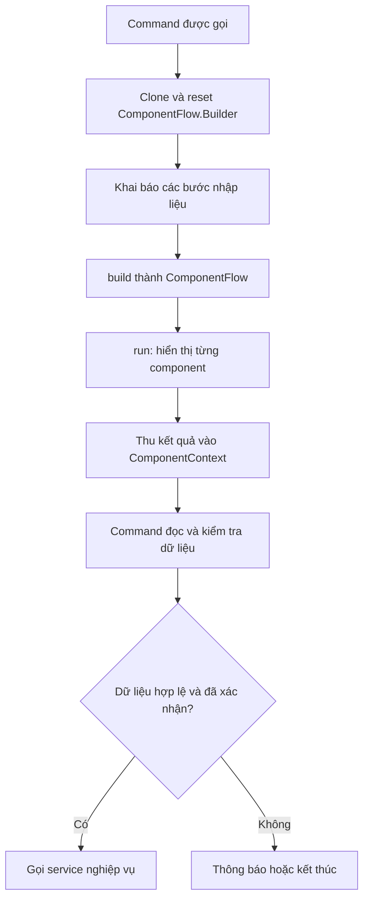

# Khi nào cần ghép nhiều bước nhập liệu thành một luồng

Một command đôi khi cần hỏi người dùng nhiều thông tin có liên quan trước khi thực hiện một thao tác. Ví dụ, để tạo môi trường triển khai, ứng dụng cần tên dự án, môi trường đích, đường dẫn cấu hình và xác nhận cuối cùng. Nếu tự gọi từng component nhập liệu rồi quản lý kết quả bằng nhiều biến riêng, command dễ trở nên dài và khó điều khiển thứ tự. Spring Shell 3.x cung cấp `ComponentFlow` để ghép nhiều component thành một luồng tương tác có kết quả chung.

Bài học thuộc chương **ComponentFlow 3.x**. Nội dung giúp xác định khi nào nên dùng component độc lập, khi nào cần một flow, cách khai báo các bước, lưu kết quả theo ID và điều hướng sang bước tiếp theo dựa trên câu trả lời.

Sau bài học, bạn có thể:

- Nhận biết bài toán cần ghép nhiều bước nhập liệu.
- Phân biệt component đơn lẻ với `ComponentFlow`.
- Xây dựng flow bằng `ComponentFlow.Builder`.
- Kết hợp string input, path input, confirmation, single selector và multi selector.
- Đọc các giá trị đã nhập qua `ComponentFlowResult` và `ComponentContext`.
- Rẽ nhánh bằng hàm `next(...)`.
- Tách thu thập input khỏi xử lý nghiệp vụ và chuẩn bị phương án non-interactive.

## Khi nào một component là đủ?

Nếu command chỉ cần hỏi một giá trị rồi tiếp tục, dùng component tương ứng trực tiếp thường dễ hiểu nhất:

- `StringInput` khi cần một chuỗi.
- `PathInput` khi cần đường dẫn.
- `ConfirmationInput` khi cần câu trả lời có/không.
- `SingleItemSelector` khi chỉ được chọn một mục.
- `MultiItemSelector` khi được chọn nhiều mục.

Ví dụ, command chỉ hỏi một tên file có thể gọi `PathInput` trực tiếp. Tạo một `ComponentFlow` cho một câu hỏi đơn giản sẽ thêm cấu hình mà không mang lại lợi ích đáng kể.

## Khi nào nên ghép thành ComponentFlow?

`ComponentFlow` phù hợp khi một thao tác cần nhiều câu trả lời liên quan, được thu thập theo một trình tự và sau đó được xử lý cùng nhau. Một flow thường có các đặc điểm:

- Có từ hai bước nhập liệu trở lên.
- Các câu trả lời cùng tạo nên một cấu hình hoặc một yêu cầu nghiệp vụ.
- Bước sau có thể phụ thuộc vào câu trả lời ở bước trước.
- Muốn gom kết quả vào một context thay vì tự quản lý nhiều biến tạm.
- Cần một điểm kết thúc chung để kiểm tra dữ liệu và gọi service.

Ví dụ, wizard tạo môi trường triển khai có thể hỏi tên dự án, môi trường đích, file cấu hình và xác nhận trước khi triển khai. Các câu trả lời này có liên hệ với nhau và chỉ có ý nghĩa khi được xem như một yêu cầu hoàn chỉnh.

| Nhu cầu | Cách phù hợp |
| --- | --- |
| Một câu hỏi độc lập | Gọi component trực tiếp. |
| Nhiều câu hỏi luôn chạy theo thứ tự | `ComponentFlow` với thứ tự khai báo mặc định. |
| Bước tiếp theo phụ thuộc câu trả lời | `ComponentFlow` với `next(...)`. |
| Thu thập cấu hình từ nhiều kiểu input | `ComponentFlow` kết hợp nhiều loại component. |
| Chạy tự động, không có terminal để nhập liệu | Dùng option, argument hoặc cấu hình; không mở flow tương tác. |

`ComponentFlow` điều phối giao diện nhập liệu. Nó không thay thế service nghiệp vụ, transaction, validation miền hoặc workflow engine chạy nền.

## Những component có thể ghép trong Spring Shell 3.3.x

Trong API `ComponentFlow.Builder` của Spring Shell 3.3.x, có năm loại bước chính:

| Builder method | Loại input | Ví dụ |
| --- | --- | --- |
| `withStringInput(id)` | Nhập chuỗi | Tên dự án, mô tả. |
| `withPathInput(id)` | Nhập đường dẫn | File cấu hình, thư mục đầu ra. |
| `withConfirmationInput(id)` | Xác nhận Boolean | Có tiếp tục triển khai không? |
| `withSingleItemSelector(id)` | Chọn một mục | Chọn môi trường hoặc profile. |
| `withMultiItemSelector(id)` | Chọn nhiều mục | Chọn các module cần cài đặt. |

Các loại bước được định nghĩa bằng ID duy nhất trong flow. Ví dụ `projectName`, `environment`, `configPath` và `confirm` là các ID có thể dùng để đọc kết quả sau khi flow hoàn tất.

Lưu ý về phiên bản: `withNumberInput(...)` có trong API flow của Spring Shell 4.x, nhưng không có trong danh sách phương thức `ComponentFlow.Builder` của Spring Shell 3.3.0. Bài học này giới hạn ở API 3.x; nếu cần nhập số trong flow 3.3.x, có thể dùng `StringInput` rồi chuyển đổi và kiểm tra giá trị trong tầng nghiệp vụ.

## ComponentFlow được tạo và chạy như thế nào?

Trong Spring Boot, `ComponentFlowAutoConfiguration` cung cấp bean `ComponentFlow.Builder` khi lớp `ComponentFlow` có trên classpath. Có thể inject builder vào command bean, cấu hình các bước rồi gọi `build()` và `run()`.

Luồng tổng quát:



Builder có các phương thức `clone()`, `reset()`, `terminal(...)`, `resourceLoader(...)` và `templateExecutor(...)`. Cách thường dùng trong command là `componentFlowBuilder.clone().reset()` để tạo cấu hình flow mới dựa trên builder được inject, sau đó thêm các bước và gọi `build()`.

## Ví dụ: wizard tạo môi trường triển khai

Giả sử command cần thu thập bốn giá trị: tên dự án, môi trường, file cấu hình và xác nhận cuối. Sau khi flow hoàn tất, command kiểm tra xác nhận rồi mới gọi service.

```java
import org.springframework.shell.component.context.ComponentContext;
import org.springframework.shell.component.flow.ComponentFlow;
import org.springframework.shell.component.flow.ComponentFlow.ComponentFlowResult;
import org.springframework.shell.standard.ShellComponent;
import org.springframework.shell.standard.ShellMethod;

@ShellComponent
public class DeploymentCommands {

    private final ComponentFlow.Builder componentFlowBuilder;
    private final DeploymentService deploymentService;

    public DeploymentCommands(
            ComponentFlow.Builder componentFlowBuilder,
            DeploymentService deploymentService) {
        this.componentFlowBuilder = componentFlowBuilder;
        this.deploymentService = deploymentService;
    }

    @ShellMethod(key = "deploy wizard", value = "Tạo môi trường bằng wizard")
    public String deployWizard() {
        ComponentFlow flow = componentFlowBuilder.clone()
            .reset()
            .withStringInput("projectName")
                .name("Tên dự án")
                .defaultValue("demo")
                .and()
            .withSingleItemSelector("environment")
                .name("Môi trường triển khai")
                .selectItem("Development", "dev")
                .selectItem("Staging", "stage")
                .selectItem("Production", "prod")
                .defaultSelect("Development")
                .and()
            .withPathInput("configPath")
                .name("File cấu hình")
                .defaultValue("application.yml")
                .and()
            .withConfirmationInput("confirm")
                .name("Xác nhận triển khai?")
                .defaultValue(false)
                .and()
            .build();

        ComponentFlowResult result = flow.run();
        ComponentContext<?> context = result.getContext();

        String projectName = context.get("projectName", String.class);
        String environment = context.get("environment", String.class);
        String configPath = context.get("configPath", String.class);
        Boolean confirmed = context.get("confirm", Boolean.class);

        if (!Boolean.TRUE.equals(confirmed)) {
            return "Đã hủy triển khai";
        }

        deploymentService.deploy(projectName, environment, configPath);
        return "Đã gửi yêu cầu triển khai dự án " + projectName;
    }
}
```

Trong ví dụ:

1. `withStringInput("projectName")` thu thập tên dự án và gợi ý `demo` làm giá trị mặc định.
2. `withSingleItemSelector("environment")` cho phép chọn một môi trường; nhãn hiển thị khác với mã được lưu.
3. `withPathInput("configPath")` thu thập đường dẫn file cấu hình.
4. `withConfirmationInput("confirm")` yêu cầu xác nhận trước khi thực hiện.
5. `flow.run()` chạy lần lượt các bước và trả `ComponentFlowResult`.
6. `getContext()` trả context chung; command đọc từng giá trị bằng ID của component.
7. Chỉ khi người dùng xác nhận, command mới gọi `DeploymentService`.

`DeploymentService` là service của ứng dụng, không phải API Spring Shell. Hãy triển khai nó để xác thực dữ liệu, quyền truy cập, sự tồn tại của file và quy tắc triển khai trước khi tạo tài nguyên thực tế.

## Kết quả được lưu trong ComponentContext

Mỗi bước có một ID được truyền vào `with...Input(id)`. Theo mặc định, các spec tự lưu kết quả của component vào `ComponentContext` bằng ID đó. Thuộc tính `storeResult(true)` là mặc định; có thể gọi `storeResult(false)` nếu không muốn lưu kết quả của một bước vào context chung.

`ComponentFlowResult.getContext()` trả về `ComponentContext<?>`. Context hỗ trợ truy cập theo key và kiểu dữ liệu:

```java
ComponentContext<?> context = result.getContext();

String projectName = context.get("projectName", String.class);
String environment = context.get("environment", String.class);
Boolean confirmed = context.get("confirm", Boolean.class);
```

`ComponentContext` là một cấu trúc key/value. Có thể kiểm tra `containsKey(...)` trước khi đọc nếu một nhánh flow không chạy đến bước đó:

```java
if (context.containsKey("configPath")) {
    String configPath = context.get("configPath", String.class);
}
```

Không nên giả định mọi key đều có mặt. Nếu flow có rẽ nhánh, những bước bị bỏ qua sẽ không có kết quả được lưu. Hãy xử lý trường hợp thiếu key theo nhánh mà người dùng đã chọn.

## Thứ tự thực thi mặc định

Các component thông thường chạy theo đúng thứ tự được khai báo trong builder. Ví dụ:

```java
ComponentFlow flow = componentFlowBuilder.clone()
    .reset()
    .withStringInput("name").name("Tên").and()
    .withPathInput("path").name("Đường dẫn").and()
    .withConfirmationInput("confirm").name("Tiếp tục?").and()
    .build();
```

Luồng chạy là `name` → `path` → `confirm`. `BaseInputSpec` cũng cung cấp `order(int)` để đặt thứ tự cụ thể cho một bước khi cần. Nếu không có yêu cầu đặc biệt, thứ tự khai báo giúp flow dễ đọc và dễ bảo trì.

## Rẽ nhánh bằng next(...)

Khi bước tiếp theo phụ thuộc câu trả lời, dùng `next(...)` trên spec của component. Hàm này trả về ID của component kế tiếp. Nếu trả về `null` hoặc ID không tồn tại, flow dừng tại đó.

Ví dụ, người dùng chọn tạo dự án mới hoặc mở dự án có sẵn:

```java
ComponentFlow flow = componentFlowBuilder.clone()
    .reset()
    .withSingleItemSelector("projectAction")
        .name("Bạn muốn làm gì?")
        .selectItem("Tạo dự án mới", "newProject")
        .selectItem("Mở dự án hiện có", "existingProject")
        .next(context -> context.getResultItem()
            .map(item -> item.getItem())
            .orElse(null))
        .and()
    .withStringInput("newProject")
        .name("Tên dự án mới")
        .defaultValue("my-project")
        .next(context -> null)
        .and()
    .withPathInput("existingProject")
        .name("Đường dẫn dự án")
        .next(context -> null)
        .and()
    .build();
```

Hai giá trị item `newProject` và `existingProject` trùng với ID của hai bước tiếp theo. Vì vậy, lựa chọn quyết định bước nào được chạy. Sau khi bước tương ứng hoàn tất, `next(context -> null)` kết thúc flow.

Khi dùng `next(...)`, hãy bảo đảm mọi ID được trả về đều trùng với ID đã khai báo. Nếu có nhiều nhánh, nên đặt tên ID rõ ràng để tránh nhầm lẫn giữa nhãn hiển thị, giá trị nghiệp vụ và ID điều hướng.

## Chọn component độc lập hay ComponentFlow?

Không phải mọi chuỗi câu hỏi đều cần flow. Hãy cân nhắc quy mô và mối liên hệ giữa các câu trả lời:

| Tình huống | Lựa chọn | Vì sao |
| --- | --- | --- |
| Hỏi một câu xác nhận trước khi xóa | `ConfirmationInput` | Chỉ có một giá trị Boolean. |
| Chọn một môi trường rồi trả mã môi trường | `SingleItemSelector` | Một bước độc lập, không cần context chung. |
| Hỏi tên, chọn môi trường, nhập file cấu hình và xác nhận | `ComponentFlow` | Nhiều câu trả lời cùng tạo thành một yêu cầu. |
| Chọn loại thao tác rồi hỏi dữ liệu khác nhau theo lựa chọn | `ComponentFlow` với `next(...)` | Luồng có nhánh phụ thuộc kết quả. |
| Quy trình xử lý nghiệp vụ kéo dài, retry, lưu trạng thái qua nhiều phiên | Workflow/service riêng | `ComponentFlow` chỉ điều phối tương tác terminal. |

## Phân tách thu thập input và nghiệp vụ

Một flow tốt nên tập trung thu thập câu trả lời và điều khiển bước nhập. Sau khi flow trả về, command nên:

1. Đọc các giá trị cần thiết từ `ComponentContext`.
2. Kiểm tra các key bắt buộc có tồn tại.
3. Chuyển đổi hoặc xác thực dữ liệu theo quy tắc nghiệp vụ.
4. Kiểm tra quyền và trạng thái tài nguyên.
5. Chỉ sau đó mới gọi service để tạo, cập nhật hoặc xóa dữ liệu.

Không nên thực hiện side effect lớn trong `preHandler`, `postHandler` hoặc hàm `next(...)`. Các callback này nên phục vụ điều khiển component. Giữ thao tác nghiệp vụ ở service giúp việc kiểm thử và xử lý lỗi rõ ràng hơn.

## Builder, template và tái sử dụng

`ComponentFlow.Builder` có thể nhận:

- `terminal(...)`: terminal dùng để chạy component.
- `resourceLoader(...)`: tải template.
- `templateExecutor(...)`: thực thi template.

Trong ứng dụng Spring Shell đã được auto-configure, builder bean thường đã có các dependency này. Nếu tạo builder hoặc tùy biến ngoài cấu hình mặc định, hãy bảo đảm cung cấp các dependency cần thiết.

Với command gọi flow nhiều lần, dùng `clone().reset()` trước khi khai báo các bước để mỗi lần chạy có cấu hình độc lập. Không lưu các câu trả lời của người dùng trong field singleton của command; kết quả nên nằm trong context của lần chạy hiện tại.

## Terminal tương tác và non-interactive mode

`ComponentFlow` là wizard tương tác, cần terminal để nhận input. Nó phù hợp khi người dùng đang làm việc trực tiếp trong REPL. Với script hoặc CI không có TTY, flow có thể chờ input và khiến job bị treo.

Nếu command cần chạy được cả trong REPL lẫn automation, hãy thiết kế hai đường vào:

- Khi người dùng cung cấp đủ option/argument, dùng trực tiếp các giá trị đó và bỏ qua flow.
- Khi thiếu giá trị và terminal tương tác sẵn sàng, mở flow để thu thập phần còn thiếu.

Ví dụ cách gọi tự động:

```text
deploy create --project demo --environment staging --config application.yml
```

Không nên bắt buộc `ComponentFlow` chạy trong mọi lần gọi command. Hãy để automation truyền dữ liệu tường minh.

## Kiểm thử ComponentFlow

Nên kiểm tra cả cấu hình flow lẫn kết quả:

1. Các component được khai báo với ID duy nhất.
2. Thứ tự chạy mặc định đúng như yêu cầu.
3. Giá trị mặc định được hiển thị và lưu đúng.
4. `ComponentContext` chứa kết quả dưới đúng ID khi `storeResult` bật.
5. `storeResult(false)` không đưa kết quả của bước đó vào context chung.
6. `next(...)` điều hướng đến đúng ID và dừng khi trả `null`.
7. Các nhánh không chạy không bị đọc như thể đã có kết quả.
8. Command chỉ gọi service khi dữ liệu hợp lệ và người dùng xác nhận.
9. Có đường chạy non-interactive để test và sử dụng trong CI.

Spring Shell cung cấp test support cho terminal và shell session. Với flow, nên mô phỏng thao tác nhập/phím theo thứ tự để xác nhận component thực sự chạy đúng và context cuối cùng có đủ giá trị. Ngoài unit test cho service, hãy có integration test command để kiểm tra việc nối flow với nghiệp vụ.

## Lỗi thường gặp

| Hiện tượng | Nguyên nhân | Cách xử lý |
| --- | --- | --- |
| Không inject được `ComponentFlow.Builder` | Auto-configuration của ComponentFlow không được kích hoạt hoặc thiếu class trên classpath. | Kiểm tra Spring Shell starter và `ComponentFlowAutoConfiguration`. |
| Flow chạy các bước theo thứ tự không mong muốn | Thứ tự builder hoặc `order(...)` không như dự kiến. | Kiểm tra thứ tự khai báo và giá trị order. |
| Đọc context nhận `null` | ID đọc không khớp hoặc bước bị bỏ qua trong nhánh. | Dùng đúng ID và kiểm tra `containsKey(...)`. |
| Kết quả không được lưu vào context | Spec đã đặt `storeResult(false)`. | Bật `storeResult(true)` hoặc đọc từ context riêng của component. |
| Flow dừng ngay sau một lựa chọn | Hàm `next(...)` trả `null` hoặc ID không tồn tại. | Kiểm tra giá trị trả về và đối chiếu với ID component. |
| Flow đi sai nhánh | Dùng nhãn hiển thị thay cho item value là ID điều hướng. | Tách label và value, trả đúng component ID trong `next(...)`. |
| Builder giữ cấu hình của lần gọi trước | Tái sử dụng builder mà không clone/reset. | Dùng `clone().reset()` cho mỗi lần tạo flow. |
| CI bị treo ở bước nhập liệu | Command luôn chạy wizard trong môi trường không có TTY. | Cung cấp option/argument để chạy non-interactive. |
| Nghiệp vụ chạy dù người dùng chưa xác nhận | Command không kiểm tra kết quả confirmation. | Chỉ gọi service khi giá trị xác nhận là `true`. |

## Checklist trước khi phát hành wizard

- [ ] Flow có nhiều bước thực sự liên quan với nhau.
- [ ] Mỗi component có ID duy nhất và dễ hiểu.
- [ ] Thứ tự mặc định hoặc các nhánh `next(...)` đã được xác định rõ.
- [ ] Giá trị mặc định phù hợp và an toàn.
- [ ] Kết quả được lưu và đọc theo đúng ID.
- [ ] Các nhánh bỏ qua bước có xử lý key không tồn tại.
- [ ] Command xác thực dữ liệu và quyền trước khi gọi service.
- [ ] Side effect chỉ xảy ra sau khi flow hoàn tất và được xác nhận.
- [ ] Có phương án chạy không tương tác cho script/CI.
- [ ] Đã kiểm thử từng nhánh và context kết quả.

## Ghi nhớ

Dùng component độc lập khi chỉ cần một câu hỏi. Dùng `ComponentFlow` khi nhiều câu trả lời có liên hệ, cần chạy theo thứ tự hoặc cần rẽ nhánh. Trong Spring Shell 3.x, builder hỗ trợ string input, path input, confirmation, single selector và multi selector. `run()` trả `ComponentFlowResult`; `getContext()` cho phép đọc kết quả theo ID vì các spec mặc định lưu kết quả vào context. `next(...)` điều khiển bước tiếp theo; trả `null` hoặc ID không tồn tại sẽ dừng flow. Hãy để flow thu thập input, còn service đảm nhiệm kiểm tra và thực hiện nghiệp vụ.

## Tài liệu tham khảo

- [Spring Shell 3.3.4 — Flow](https://docs.spring.io/spring-shell/reference/3.3/components/flow/index.html): lý do dùng ComponentFlow, thứ tự mặc định, rẽ nhánh và ví dụ ghép component.
- [Spring Shell 3.3.0 API — `ComponentFlow`](https://docs.spring.io/spring-shell/docs/3.3.0/api/org/springframework/shell/component/flow/ComponentFlow.html): tạo builder và chạy wizard.
- [Spring Shell 3.3.0 API — `ComponentFlow.Builder`](https://docs.spring.io/spring-shell/docs/3.3.0/api/org/springframework/shell/component/flow/ComponentFlow.Builder.html): các loại input, terminal, template executor, clone, reset và build.
- [Spring Shell 3.3.0 API — `ComponentFlowResult`](https://docs.spring.io/spring-shell/docs/3.3.0/api/org/springframework/shell/component/flow/ComponentFlow.ComponentFlowResult.html): lấy context sau khi flow chạy.
- [Spring Shell 3.3.0 API — `ComponentContext`](https://docs.spring.io/spring-shell/docs/3.3.0/api/org/springframework/shell/component/context/ComponentContext.html): truy cập giá trị theo key và kiểu dữ liệu.
- [Spring Shell 3.3.0 API — `StringInputSpec`](https://docs.spring.io/spring-shell/docs/3.3.0/api/org/springframework/shell/component/flow/StringInputSpec.html): default value, next, storeResult và handler.
- [Spring Shell 3.3.0 API — `SingleItemSelectorSpec`](https://docs.spring.io/spring-shell/docs/3.3.0/api/org/springframework/shell/component/flow/SingleItemSelectorSpec.html): select items, defaultSelect và điều hướng.
- [Spring Shell 3.3.0 API — `ComponentFlowAutoConfiguration`](https://docs.spring.io/spring-shell/docs/3.3.0/api/org/springframework/shell/boot/ComponentFlowAutoConfiguration.html): auto-configure `ComponentFlow.Builder` bean.
