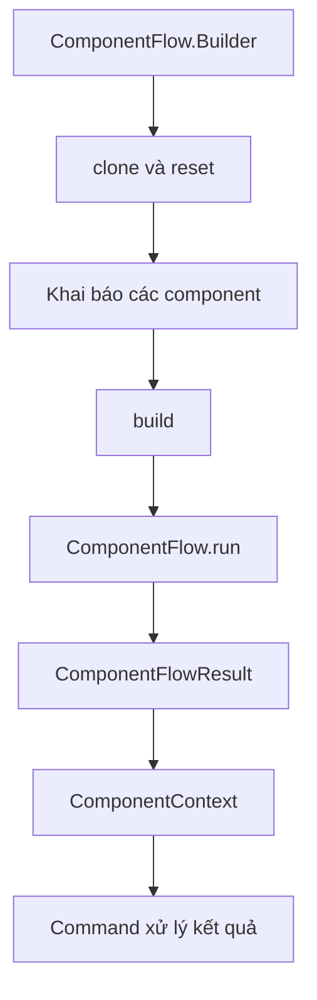

# ComponentFlow.Builder và tạo cấu hình cho từng lần chạy

Khi một command cần hỏi người dùng nhiều thông tin liên tiếp, việc gọi từng component riêng lẻ có thể làm code khó theo dõi. `ComponentFlow` của Spring Shell 3.x gom các bước nhập liệu thành một luồng: khai báo các component bằng builder, tạo flow, chạy flow rồi đọc kết quả tổng hợp.

Điểm cần chú ý là `ComponentFlow.Builder` có trạng thái. Mỗi lần chạy có thể cần danh sách lựa chọn, giá trị mặc định hoặc nhánh xử lý khác nhau. Vì vậy, hãy tạo cấu hình flow riêng cho từng lần gọi bằng cách clone builder đã được Spring cấu hình, reset phần định nghĩa component, sau đó thêm các bước cần thiết cho lần chạy hiện tại.

## 1. ComponentFlow là gì?

`ComponentFlow` kết nối nhiều interactive component thành một wizard. Mỗi component thu thập một loại dữ liệu, ví dụ:

- `withStringInput(...)`: nhập văn bản.
- `withPathInput(...)`: nhập hoặc chọn đường dẫn.
- `withConfirmationInput(...)`: xác nhận có/không.
- `withSingleItemSelector(...)`: chọn một mục.
- `withMultiItemSelector(...)`: chọn nhiều mục.

Thứ tự mặc định của các component giống thứ tự khai báo trong builder. Có thể dùng hàm `next(...)` để chuyển tới component theo điều kiện. Nếu hàm trả về `null` hoặc một ID không tồn tại, flow dừng tại đó.

Flow hữu ích khi tạo project, cấu hình kết nối, triển khai ứng dụng, import dữ liệu hoặc thực hiện một thao tác cần xác nhận trước khi ghi thay đổi. <Link url="https://docs.spring.io/spring-shell/reference/3.4/components/flow/index.html" title="Flow — Spring Shell 3.4.3"/>.

## 2. Vòng đời từ Builder đến kết quả

Một lần chạy thường có năm bước:

1. Lấy builder đã được cấu hình với terminal và các dịch vụ render.
2. Clone builder và reset danh sách component cũ.
3. Khai báo component cùng ID, tên, giá trị mặc định, lựa chọn và nhánh tiếp theo.
4. Gọi `build()` để tạo `ComponentFlow`, sau đó gọi `run()` để bắt đầu tương tác.
5. Đọc `ComponentFlowResult.getContext()` để lấy dữ liệu người dùng đã nhập hoặc chọn.



`build()` chỉ tạo flow; `run()` mới mở giao diện terminal và chờ người dùng tương tác. Tách hai bước giúp có thể tạo cấu hình xong rồi quyết định thời điểm chạy.

## 3. Inject ComponentFlow.Builder trong Spring Shell 3.x

Trong ứng dụng Spring Shell 3.x, có thể inject `ComponentFlow.Builder` vào command component. Builder được Spring cấu hình để sử dụng terminal, `ResourceLoader` và `TemplateExecutor` của ứng dụng.

```java
// Đoạn mã chạy trong một command đã inject componentFlowBuilder.
import org.springframework.shell.component.flow.ComponentFlow;
import org.springframework.shell.standard.ShellComponent;
import org.springframework.shell.standard.ShellMethod;

@ShellComponent
public class ProjectCommands {

    private final ComponentFlow.Builder componentFlowBuilder;

    public ProjectCommands(ComponentFlow.Builder componentFlowBuilder) {
        this.componentFlowBuilder = componentFlowBuilder;
    }

    @ShellMethod(key = "project setup", value = "Thiết lập một dự án mới")
    public String setup() {
        // Tạo và chạy flow ở đây.
        return "Đã hoàn tất thiết lập.";
    }
}
```

Tài liệu Flow của Spring Shell minh họa việc inject builder qua Spring và gọi `clone().reset()` trước khi thêm component. Cách này giữ cấu hình hạ tầng của builder, đồng thời tạo một bản làm việc mới cho lần chạy hiện tại.

## 4. Vì sao cần clone và reset cho từng lần chạy?

Builder là đối tượng có trạng thái: mỗi lời gọi `withStringInput`, `withPathInput` hoặc `withSingleItemSelector` thêm một định nghĩa component vào cấu hình. Nếu dùng chung builder và tiếp tục thêm component sau mỗi lần gọi command, định nghĩa từ lần trước có thể còn trong builder và làm flow sau chứa bước thừa hoặc ID trùng.

Mẫu được tài liệu Spring Shell sử dụng:

```java
ComponentFlow.Builder runBuilder = componentFlowBuilder.clone().reset();
```

- `clone()` tạo một bản sao builder để thao tác.
- `reset()` xóa cấu hình component trên bản sao, chuẩn bị danh sách bước mới.
- Builder gốc tiếp tục giữ cấu hình hạ tầng do Spring cung cấp.

Hãy tạo `runBuilder` bên trong mỗi lần gọi command. Không lưu builder đã thêm các bước của một người dùng vào field dùng chung để tái sử dụng cho người dùng khác. Nếu ứng dụng tự tạo builder bằng `ComponentFlow.builder()`, cần cung cấp `Terminal`, `ResourceLoader` và `TemplateExecutor` phù hợp trước khi build.

## 5. Tạo flow đơn giản bằng StringInput và ConfirmationInput

Ví dụ sau hỏi tên workspace rồi hỏi người dùng có xác nhận tạo workspace hay không:

```java
import org.springframework.shell.component.flow.ComponentFlow;
import org.springframework.shell.component.flow.ComponentFlow.ComponentFlowResult;
import org.springframework.shell.component.context.ComponentContext;

ComponentFlow flow = componentFlowBuilder.clone().reset()
        .withStringInput("workspaceName")
            .name("Tên workspace")
            .defaultValue("my-workspace")
            .and()
        .withConfirmationInput("confirmCreate")
            .name("Tạo workspace này?")
            .and()
        .build();

ComponentFlowResult result = flow.run();
ComponentContext<?> context = result.getContext();

String workspaceName = context.get("workspaceName", String.class);
Boolean confirmed = context.get("confirmCreate", Boolean.class);
```

Mỗi component có một ID duy nhất. Khi `storeResult` được bật (mặc định là `true`), giá trị sau khi người dùng hoàn tất component được lưu trong context dưới key là ID đó. Sau `run()`, command đọc kết quả bằng `getContext()`.

Ví dụ trên chỉ thu thập dữ liệu. Trước khi gọi service tạo workspace, cần kiểm tra người dùng đã xác nhận và tên workspace đáp ứng quy tắc nghiệp vụ.

## 6. Tạo cấu hình động cho từng lần chạy

Các lựa chọn thường phụ thuộc vào dữ liệu hiện tại: danh sách project mà người dùng được phép truy cập, môi trường đang hoạt động hoặc region có sẵn. Hãy truy vấn dữ liệu trong command trước khi xây dựng flow, rồi tạo danh sách `SelectItem` mới cho lần chạy đó.

```java
import java.util.List;
import org.springframework.shell.component.flow.SelectItem;

List<SelectItem> environmentItems = environmentService.findAvailableForCurrentUser()
        .stream()
        .map(environment -> SelectItem.of(
                environment.displayName(), environment.id()))
        .toList();

if (environmentItems.isEmpty()) {
    return "Bạn chưa có môi trường nào khả dụng.";
}

ComponentFlow.Builder runBuilder = componentFlowBuilder.clone().reset();
ComponentFlow flow = runBuilder
        .withSingleItemSelector("environment")
            .name("Chọn môi trường triển khai")
            .selectItems(environmentItems)
            .and()
        .build();
```

Trong `SelectItem.of(name, item)`, `name` là nhãn hiển thị cho người dùng, còn `item` là giá trị được lưu làm kết quả. Nên lưu ID ổn định vào `item`, không lưu nguyên object domain hoặc chỉ dựa vào tên hiển thị có thể thay đổi.

Tạo lại danh sách ở mỗi lần chạy giúp lựa chọn phản ánh trạng thái hiện tại. Service vẫn cần kiểm tra lại quyền và trạng thái môi trường khi command thực hiện thao tác, vì dữ liệu có thể thay đổi sau khi flow kết thúc.

## 7. Đọc kết quả từ ComponentFlowResult và ComponentContext

`ComponentFlow.run()` trả về `ComponentFlowResult`. Gọi `getContext()` để lấy context tổng hợp của flow. `ComponentContext` cung cấp các thao tác key/value:

| API | Công dụng |
| --- | --- |
| `get(key)` | Lấy giá trị theo ID component |
| `get(key, Type.class)` | Lấy giá trị và yêu cầu kiểu mong muốn |
| `containsKey(key)` | Kiểm tra giá trị có tồn tại không |
| `put(key, value)` | Ghi thêm dữ liệu vào context |
| `stream()` | Duyệt các cặp key/value |
| `toTemplateModel()` | Chuyển context thành model cho template |

Ví dụ đọc nhiều giá trị:

```java
ComponentFlow.ComponentFlowResult result = flow.run();
ComponentContext<?> context = result.getContext();

String projectName = context.get("projectName", String.class);
String environmentId = context.get("environment", String.class);
Boolean confirmed = context.get("confirm", Boolean.class);

if (!Boolean.TRUE.equals(confirmed)) {
    return "Đã hủy thao tác.";
}

deploymentService.deploy(projectName, environmentId);
```

`get(key, type)` giúp code thể hiện rõ kiểu kết quả mong đợi. Nếu component có thể bị bỏ qua do nhánh điều kiện, key tương ứng có thể không tồn tại; hãy kiểm tra trước khi sử dụng hoặc xử lý giá trị `null`.

## 8. storeResult và ID của component

`storeResult(boolean)` quyết định component có tự lưu kết quả vào `ComponentContext` hay không. Mặc định là `true`.

```java
runBuilder.withStringInput("projectName")
        .name("Tên dự án")
        .storeResult(true)
        .and();
```

Khi cần xử lý kết quả riêng trong `postHandler` hoặc không muốn đưa giá trị vào context chung, có thể đặt `storeResult(false)`. Nếu tắt lưu tự động, command không nên giả định `context.get("projectName")` có giá trị; hãy tự lưu giá trị ở nơi phù hợp trong handler hoặc dùng kết quả component theo API tương ứng.

ID là khóa của kết quả, vì vậy cần duy nhất trong một flow. Dùng tên dễ hiểu như `projectName`, `environment`, `confirmDeploy`; tránh ID chung chung như `input1` hoặc tái sử dụng một ID cho hai component khác nhau.

## 9. Điều hướng có điều kiện bằng next

Thông thường, flow chạy theo thứ tự component được khai báo. `next(...)` cho phép quyết định component tiếp theo dựa trên kết quả hiện tại. Hàm phải trả về ID của component đích; trả về `null` hoặc ID không tồn tại sẽ dừng flow.

Ví dụ người dùng chọn tạo mới hoặc dùng một project có sẵn:

```java
import java.util.Map;

ComponentFlow flow = componentFlowBuilder.clone().reset()
        .withSingleItemSelector("mode")
            .name("Bạn muốn làm gì?")
            .selectItems(Map.of(
                    "Tạo project mới", "newProject",
                    "Chọn project có sẵn", "existingProject"))
            .next(context -> context.getResultItem().get().getItem())
            .and()
        .withStringInput("newProject")
            .name("Tên project mới")
            .next(context -> "confirm")
            .and()
        .withSingleItemSelector("existingProject")
            .name("Project có sẵn")
            .selectItems(existingProjectItems)
            .next(context -> "confirm")
            .and()
        .withConfirmationInput("confirm")
            .name("Xác nhận tiếp tục?")
            .and()
        .build();
```

Ở đây, giá trị `item` của lựa chọn đầu tiên trùng với ID component đích. Nếu người dùng chọn `newProject`, flow đi tới bước nhập tên; nếu chọn `existingProject`, flow đi tới selector dự án có sẵn. Cả hai nhánh sau đó đi tới bước `confirm`.

Đảm bảo mọi ID được trả về bởi `next(...)` đã được khai báo trong builder. Nếu dùng `getResultItem().get()`, chỉ gọi khi component chắc chắn có kết quả lựa chọn; với luồng có thể hủy hoặc không có lựa chọn, cần kiểm tra `Optional` trước khi lấy item.

## 10. Tạo nhánh dựa trên dữ liệu nghiệp vụ

Không bắt buộc giá trị `item` phải trùng ID component. Có thể viết hàm ánh xạ rõ ràng:

```java
.next(context -> {
    String selectedMode = context.getResultItem()
            .map(item -> item.getItem())
            .orElse(null);

    if ("new".equals(selectedMode)) {
        return "newProjectDetails";
    }
    if ("existing".equals(selectedMode)) {
        return "existingProjectPicker";
    }
    return null;
})
```

Cách này phù hợp khi giá trị nghiệp vụ và ID component có quy ước khác nhau hoặc cần thêm điều kiện. Giữ hàm `next` ngắn và xác định; nếu quyết định điều hướng cần truy vấn dữ liệu phức tạp, hãy chuẩn bị dữ liệu trước khi xây flow thay vì gọi hệ thống bên ngoài trong callback.

## 11. Dùng preHandler và postHandler

Mỗi spec hỗ trợ `preHandler(...)` và `postHandler(...)` để chạy logic quanh một component:

- `preHandler`: chạy trước khi component bắt đầu nhận input; phù hợp để thiết lập message hoặc giá trị mặc định dựa trên context.
- `postHandler`: chạy sau khi component hoàn tất; phù hợp để ghi nhận kết quả hoặc chuẩn bị dữ liệu cho bước tiếp theo.

Ví dụ:

```java
runBuilder.withStringInput("projectName")
        .name("Tên project")
        .preHandler(context -> {
            if (context.getInput() == null) {
                context.setMessage("Nhập tên project mới.");
            }
        })
        .postHandler(context -> auditService.recordInputCompleted(
                "projectName"))
        .and();
```

`preHandler` và `postHandler` nhận context riêng của component, chẳng hạn `StringInputContext` hoặc `SingleItemSelectorContext`. Chỉ dùng API phù hợp với loại context đó. Không đặt thao tác ghi dữ liệu nghiệp vụ cuối cùng trong handler nếu người dùng còn có thể hủy flow ở bước sau.

## 12. Tùy chỉnh component và thứ tự

Mỗi spec cung cấp các thuộc tính phù hợp với loại input:

| Spec | Cấu hình thường dùng |
| --- | --- |
| `StringInputSpec` | `name`, `defaultValue`, `maskCharacter`, `renderer`, `template` |
| `PathInputSpec` | `name`, `defaultValue`, `renderer`, `template` |
| `ConfirmationInputSpec` | `name`, `resultValue`, `renderer`, `template` |
| `SingleItemSelectorSpec` | `selectItems`, `defaultSelect`, `max`, `sort`, `renderer` |
| `MultiItemSelectorSpec` | `selectItems`, `max`, `sort`, `renderer` |

Các spec cũng hỗ trợ `order(...)` thông qua `BaseInputSpec` nếu cần điều chỉnh thứ tự. Trong trường hợp thông thường, nên khai báo đúng thứ tự tự nhiên rồi chỉ dùng `next(...)` cho nhánh điều kiện.

`renderer(...)` nhận function tạo danh sách `AttributedString`; `template(...)` chọn template hiển thị. Hãy ưu tiên cấu hình mặc định trước, chỉ tùy chỉnh renderer/template khi trải nghiệm mặc định không đáp ứng nhu cầu của ứng dụng.

## 13. Cấu hình hạ tầng của builder

`ComponentFlow.Builder` có các phương thức cấu hình hạ tầng:

```java
builder.terminal(terminal)
        .resourceLoader(resourceLoader)
        .templateExecutor(templateExecutor);
```

- `terminal(...)` cung cấp terminal để component đọc input và render.
- `resourceLoader(...)` cung cấp khả năng tải template/resource.
- `templateExecutor(...)` thực thi template dùng cho giao diện component.

Khi inject builder do Spring Shell cấu hình, các dịch vụ này thường đã được gắn. Không cần tạo terminal hoặc template executor mới cho mỗi lần chạy. Khi tự gọi `ComponentFlow.builder()`, phải tự cung cấp các dependency phù hợp trước khi build.

`clone().reset()` giữ lại cấu hình nền của builder được clone và xóa định nghĩa flow đang có trên bản sao. Đây là lý do nên clone builder đã được Spring cấu hình thay vì tạo một builder trống rồi quên gắn các dịch vụ render.

## 14. Xử lý hủy và xác thực kết quả

Flow là giao diện thu thập input, không phải nơi quyết định toàn bộ quy tắc nghiệp vụ. Sau `run()`, command nên kiểm tra các giá trị có thể vắng mặt:

```java
ComponentContext<?> context = flow.run().getContext();

String projectName = context.get("projectName", String.class);
Boolean confirmed = context.get("confirm", Boolean.class);

if (projectName == null || projectName.isBlank()) {
    return "Chưa có tên project hợp lệ.";
}
if (!Boolean.TRUE.equals(confirmed)) {
    return "Thao tác chưa được xác nhận.";
}

projectService.create(projectName);
```

Giá trị mặc định không bảo đảm người dùng đã nhập một giá trị hợp lệ. Hãy kiểm tra chuỗi rỗng và quy tắc định dạng sau khi đọc context, rồi để service xác nhận tên có trùng không, người dùng có quyền tạo project không và trạng thái hệ thống còn phù hợp không.

Không thực hiện thao tác ghi hoặc triển khai trước khi toàn bộ flow kết thúc và người dùng xác nhận. Điều này tránh để lại dữ liệu dở dang khi người dùng thoát ở giữa wizard.

## 15. Tạo flow riêng cho script và non-interactive mode

`ComponentFlow` cần terminal tương tác để hỏi người dùng và chờ lựa chọn. Không nên gọi flow trong script/CI rồi chờ input từ bàn phím.

Với command cần chạy tự động, cung cấp các option/argument tương ứng:

```text
project create --name order-service --environment staging --confirm
```

Command có thể dùng chung service nghiệp vụ với command tương tác. Một command tương tác thu thập input qua ComponentFlow; command non-interactive nhận dữ liệu trực tiếp từ tham số. Cả hai cùng gọi service validation và authorization trước khi ghi dữ liệu.

## 16. Kiểm thử cấu hình và kết quả flow

Nên tách kiểm thử dữ liệu cấu hình khỏi kiểm thử trải nghiệm terminal:

| Trường hợp | Điều cần xác nhận |
| --- | --- |
| Flow đơn giản | Component chạy theo thứ tự builder |
| Clone/reset nhiều lần | Flow sau không chứa component của flow trước |
| ID trùng | Cấu hình bị phát hiện trong quá trình xây dựng hoặc test |
| String input | Giá trị được lưu theo component ID |
| Selector | Context nhận đúng `item`, không nhầm với nhãn hiển thị |
| Multi selector | Kết quả chứa đúng các item được chọn |
| Branching | `next` đi đúng component ID |
| Nhánh dừng | `next` trả `null` hoặc ID không tồn tại làm flow dừng |
| Confirmation | Service chỉ chạy khi kết quả xác nhận là `true` |
| Dynamic options | Danh sách phản ánh dữ liệu hiện tại mỗi lần gọi |
| Cancellation | Command xử lý context thiếu hoặc kết quả chưa hoàn tất |
| Non-interactive | Script dùng tham số trực tiếp, không gọi flow tương tác |

Unit test có thể kiểm tra cách tạo danh sách lựa chọn, hàm `next` và logic xử lý context. Integration test nên chạy flow với terminal giả lập hoặc terminal tương tác để xác nhận phím điều hướng, chọn mục và kết quả được lưu đúng.

## 17. Lỗi thường gặp

| Triệu chứng | Nguyên nhân | Cách xử lý |
| --- | --- | --- |
| Flow lần hai có thêm bước của lần đầu | Dùng chung builder đã bị mutate | Tạo bản sao mới bằng `clone().reset()` |
| Không đọc được kết quả | `storeResult(false)` hoặc dùng sai component ID | Kiểm tra `storeResult` và key trong context |
| Lấy nhầm nhãn thay cho ID | Nhầm `SelectItem.name()` với `item()` | Dùng `item` làm giá trị nghiệp vụ ổn định |
| Flow đi sai nhánh | `next` trả về ID không tồn tại hoặc ID sai chính tả | Đối chiếu target với ID khai báo trong builder |
| Component phía sau không chạy | `next` trả `null` hoặc ID không tồn tại | Kiểm tra điều kiện điều hướng |
| Danh sách lựa chọn cũ | Tạo options một lần lúc khởi tạo bean | Truy vấn dữ liệu và tạo `SelectItem` ở mỗi lần chạy |
| Service được gọi dù người dùng chưa xác nhận | Không kiểm tra kết quả confirmation sau `run()` | Chỉ gọi service khi `Boolean.TRUE.equals(...)` |
| Flow treo trong CI | Gọi interactive flow ở non-interactive mode | Nhận giá trị qua option/argument |
| Template không hiển thị | Builder tự tạo thiếu ResourceLoader hoặc TemplateExecutor | Inject builder được Spring cấu hình hoặc gắn dependency tương ứng |

## 18. Bài thực hành tổng hợp

Tạo wizard triển khai project với lựa chọn động và nhánh có điều kiện:

1. Inject `ComponentFlow.Builder` vào một `@ShellComponent`.
2. Mỗi lần gọi command, truy vấn danh sách project và environment mà người dùng hiện tại được phép sử dụng.
3. Tạo `SelectItem` mới từ dữ liệu truy vấn.
4. Tạo flow bằng `componentFlowBuilder.clone().reset()`.
5. Cho người dùng chọn tạo project mới hoặc chọn project có sẵn.
6. Dùng `next(...)` để chuyển tới đúng component nhập tên hoặc selector project.
7. Hỏi environment và xác nhận trước khi triển khai.
8. Đọc kết quả qua `ComponentFlowResult.getContext()` và các ID component.
9. Nếu người dùng không xác nhận, kết thúc mà không gọi service triển khai.
10. Viết unit test cho branching và integration test cho flow; thêm command nhận option để chạy cùng service trong CI.

Sau bài thực hành, bạn cần giải thích được vì sao builder cần clone/reset, dữ liệu động được tạo ở đâu, cách `storeResult` lưu kết quả và vì sao command chỉ thực hiện nghiệp vụ sau khi flow hoàn tất.

## 19. Tiêu chí hoàn thành

| Năng lực | Tiêu chí |
| --- | --- |
| Builder lifecycle | Tạo builder mới cho mỗi lần chạy bằng `clone().reset()` |
| Component specs | Khai báo string, path, confirmation và selector |
| Dynamic config | Tạo danh sách lựa chọn theo dữ liệu hiện tại |
| Flow execution | Phân biệt `build()` và `run()` |
| Result context | Đọc kết quả qua `ComponentFlowResult` và `ComponentContext` |
| Result storage | Hiểu `storeResult` và ID component |
| Branching | Điều hướng bằng `next` tới đúng component ID |
| Handlers | Dùng pre/post handler đúng phạm vi component |
| Validation | Kiểm tra kết quả và xác nhận trước nghiệp vụ |
| Automation | Cung cấp cách gọi non-interactive bằng option/argument |
| Testing | Kiểm thử clone/reset, kết quả, nhánh và cancellation |

## Tài liệu tham khảo

- [Spring Shell 3.4.3 — Flow](https://docs.spring.io/spring-shell/reference/3.4/components/flow/index.html)
- [Spring Shell 3.4.3 — `ComponentFlow.Builder` API](https://docs.spring.io/spring-shell/reference/3.4/api/java/org/springframework/shell/component/flow/ComponentFlow.Builder.html)
- [Spring Shell 3.4.3 — `ComponentFlow.BaseBuilder` API](https://docs.spring.io/spring-shell/reference/3.4/api/java/org/springframework/shell/component/flow/ComponentFlow.BaseBuilder.html)
- [Spring Shell 3.4.3 — `ComponentContext` API](https://docs.spring.io/spring-shell/reference/3.4/api/java/org/springframework/shell/component/context/ComponentContext.html)
- [Spring Shell 3.4.3 — `SingleItemSelectorSpec` API](https://docs.spring.io/spring-shell/reference/3.4/api/java/org/springframework/shell/component/flow/SingleItemSelectorSpec.html)
- [Spring Shell 3.4.3 — `PathInputSpec` API](https://docs.spring.io/spring-shell/reference/3.4/api/java/org/springframework/shell/component/flow/PathInputSpec.html)
