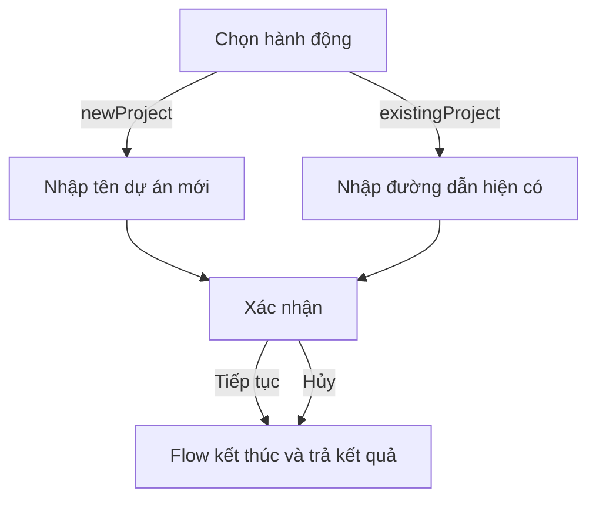

# Định danh bước và truyền kết quả giữa các thành phần

Một wizard trong command line thường gồm nhiều câu hỏi có quan hệ với nhau. Người dùng có thể nhập tên dự án, chọn cách tạo dự án, nhập đường dẫn hoặc xác nhận thao tác. Kết quả của bước trước quyết định bước tiếp theo sẽ xuất hiện, và command cần lấy toàn bộ dữ liệu sau khi wizard kết thúc.

Trong Spring Shell 3.x, `ComponentFlow` kết nối các component tương tác thành một luồng. Mỗi component được gắn một ID khi khai báo bằng `withStringInput(id)`, `withConfirmationInput(id)`, `withSingleItemSelector(id)` hoặc các builder tương ứng. ID vừa định danh bước, vừa là khóa mặc định để lưu kết quả vào `ComponentContext`, đồng thời có thể được dùng làm đích điều hướng của `next(...)`.

Bài viết tập trung vào API Spring Shell 3.4.x thuộc package `org.springframework.shell.component.flow`. Nội dung chính là cách chọn ID ổn định, lưu và đọc kết quả, truyền dữ liệu qua context, điều hướng có điều kiện và lấy kết quả cuối cùng từ `ComponentFlowResult`.

## `ComponentFlow` ghép các component thành một luồng

`ComponentFlow` cung cấp một builder để khai báo các component theo thứ tự. Mỗi component đảm nhiệm một kiểu tương tác, ví dụ:

- `withStringInput(id)`: nhập chuỗi.
- `withPathInput(id)`: nhập đường dẫn.
- `withConfirmationInput(id)`: xác nhận có/không.
- `withSingleItemSelector(id)`: chọn một mục.
- `withMultiItemSelector(id)`: chọn nhiều mục.

Luồng mặc định chạy theo thứ tự các component được thêm vào builder. Có thể thay đổi luồng bằng `next(...)` để chuyển đến một component có ID cụ thể hoặc kết thúc sớm.

```mermaid
flowchart TD
    A[Command tạo ComponentFlow.Builder] --> B[Khai báo component và ID]
    B --> C[build()]
    C --> D[run()]
    D --> E[Người dùng tương tác với từng bước]
    E --> F[Component lưu kết quả vào ComponentContext]
    F --> G{next trả về ID nào?}
    G -->|ID bước kế tiếp| E
    G -->|null hoặc ID không tồn tại| H[Flow kết thúc]
    H --> I[ComponentFlowResult.getContext()]
    I --> J[Command đọc kết quả theo ID]
```

## Khởi tạo builder và định danh từng bước

Spring Shell cung cấp `ComponentFlow.Builder` để tạo wizard. Trong command Spring Shell, có thể inject builder này từ Spring context. Hãy clone và reset builder trước khi khai báo một flow mới:

```java
import org.springframework.shell.component.flow.ComponentFlow;

ComponentFlow flow = componentFlowBuilder.clone()
        .reset()
        .withStringInput("projectName")
            .name("Tên dự án")
            .defaultValue("inventory")
            .and()
        .withStringInput("description")
            .name("Mô tả")
            .and()
        .withConfirmationInput("confirmed")
            .name("Tạo dự án với thông tin trên?")
            .and()
        .build();
```

Tham số truyền vào `withStringInput(...)` hoặc `withConfirmationInput(...)` là ID của component. Các ID nên:

- Duy nhất trong cùng một flow.
- Ngắn gọn và thể hiện dữ liệu hoặc mục đích của bước.
- Dùng nhất quán trong `next(...)`, `ComponentContext` và phần đọc kết quả.
- Không phụ thuộc vào nhãn hiển thị cho người dùng.

Ví dụ, `projectName` là ID ổn định; `Tên dự án` là nhãn hiển thị và có thể đổi theo ngôn ngữ mà không cần thay đổi logic đọc kết quả.

`clone().reset()` tạo builder riêng cho lần khai báo flow hiện tại. Điều này hữu ích khi một Spring bean tạo nhiều wizard khác nhau trong các lần gọi command, tránh cấu hình component từ lần trước còn sót lại.

## ID component đồng thời là khóa lưu kết quả

Các spec của `ComponentFlow` có `storeResult(boolean)`. Mặc định, giá trị là `true`: kết quả của component được lưu vào `ComponentContext` với key là ID đã truyền cho builder.

Ví dụ:

```java
.withStringInput("projectName")
    .name("Tên dự án")
    .and()
.withConfirmationInput("confirmed")
    .name("Xác nhận tạo dự án?")
    .and()
```

Sau khi flow chạy xong, context có thể chứa các giá trị theo key `projectName` và `confirmed`. Có thể tắt việc tự lưu cho một bước nếu ứng dụng chỉ cần dùng kết quả ngay trong handler hoặc callback:

```java
.withStringInput("temporaryNote")
    .name("Ghi chú tạm")
    .storeResult(false)
    .and()
```

Khi `storeResult(false)`, không nên mong chờ key tương ứng xuất hiện trong context kết quả cuối chỉ nhờ cơ chế lưu tự động. Nếu vẫn cần giữ dữ liệu, hãy chủ động dùng `put(...)` trong handler hoặc lưu kết quả ở nơi phù hợp.

## Đọc kết quả sau khi flow kết thúc

`ComponentFlow.run()` trả về `ComponentFlow.ComponentFlowResult`. Interface này cung cấp `getContext()` để lấy `ComponentContext<?>` của flow.

```java
import org.springframework.shell.component.context.ComponentContext;
import org.springframework.shell.component.flow.ComponentFlow;

ComponentFlow.ComponentFlowResult result = flow.run();
ComponentContext<?> context = result.getContext();

String projectName = context.get("projectName", String.class);
Boolean confirmed = context.get("confirmed", Boolean.class);
```

`ComponentContext` là cấu trúc key/value và cung cấp các phương thức thường dùng:

| Phương thức | Công dụng |
| --- | --- |
| `get(key)` | Đọc giá trị theo key |
| `get(key, Type.class)` | Đọc và ép kiểu theo lớp mong đợi |
| `put(key, value)` | Ghi giá trị vào context |
| `containsKey(key)` | Kiểm tra key đã được lưu hay chưa |
| `stream()` | Duyệt các cặp key/value |
| `toTemplateModel()` | Chuyển context thành map để dùng trong template |

Kiểu dữ liệu đọc ra phụ thuộc vào component đã tạo giá trị. Ví dụ, `StringInput` lưu chuỗi; `ConfirmationInput` lưu Boolean. Với selector, hãy kiểm tra kiểu kết quả tương ứng trong API của component và dùng kiểu phù hợp khi đọc.

Không giả định mọi bước đều có kết quả. Khi flow có nhánh, những component không được chạy sẽ không có key tự lưu. Dùng `containsKey(...)` trước khi đọc kết quả của một nhánh tùy chọn.

## Truyền dữ liệu giữa các bước qua `ComponentContext`

Context của các component kế thừa hợp đồng `ComponentContext`, vì vậy handler có thể đọc hoặc ghi các giá trị theo key. Một bước có thể chuẩn hóa dữ liệu và đặt một giá trị dẫn xuất vào context; bước sau đọc giá trị đó để chuẩn bị default hoặc xử lý tiếp.

Ví dụ: bước đầu nhập tên dự án, bước tiếp theo nhận tên đã chuẩn hóa để đề xuất tên repository.

```java
import java.util.Locale;

import org.springframework.shell.component.flow.ComponentFlow;

ComponentFlow flow = componentFlowBuilder.clone()
        .reset()
        .withStringInput("projectName")
            .name("Tên dự án")
            .postHandler(context -> {
                String name = context.getResultValue();
                if (name != null && !name.isBlank()) {
                    String normalized = name.trim();
                    context.setResultValue(normalized);
                    context.put("normalizedProjectName", normalized);
                }
            })
            .and()
        .withStringInput("repositoryName")
            .name("Tên repository")
            .preHandler(context -> {
                String projectName = context.get(
                        "normalizedProjectName", String.class);
                if (projectName != null && !projectName.isBlank()) {
                    context.setDefaultValue(projectName.toLowerCase(Locale.ROOT)
                            .replace(' ', '-'));
                }
            })
            .and()
        .build();
```

Ở đây:

1. `postHandler(...)` chạy sau khi người dùng hoàn tất bước `projectName`.
2. Handler chuẩn hóa tên rồi ghi thêm key `normalizedProjectName` vào context.
3. `preHandler(...)` của `repositoryName` đọc key đó.
4. Bước thứ hai dùng dữ liệu đã chuẩn hóa làm giá trị mặc định, người dùng vẫn có thể chỉnh sửa.

`preHandler` và `postHandler` nhận context của component tương ứng. Chúng phù hợp để chuẩn bị hoặc xử lý dữ liệu ngay quanh vòng nhập của component. Với dữ liệu cần dùng sau khi toàn bộ wizard hoàn tất, có thể đọc trực tiếp từ `ComponentFlowResult.getContext()`.

Không nên dùng context làm kho lưu trạng thái lâu dài của ứng dụng. Context thuộc một lần chạy flow; dữ liệu cần tồn tại sau command phải được chuyển sang service hoặc repository sau khi kiểm tra hợp lệ.

## Điều hướng có điều kiện bằng `next(...)`

Mỗi spec hỗ trợ `next(Function<Context, String>)`. Hàm nhận context của component hiện tại và trả về ID component tiếp theo. Quy tắc:

- Trả về ID hợp lệ: flow chuyển đến component có ID đó.
- Trả về `null`: flow kết thúc tại bước hiện tại.
- Trả về ID không tồn tại: flow cũng kết thúc.
- Không khai báo `next(...)`: flow chạy theo thứ tự builder.

Ví dụ, người dùng chọn tạo dự án mới hoặc nhập một dự án có sẵn:

```java
import java.util.LinkedHashMap;
import java.util.Map;

import org.springframework.shell.component.flow.ComponentFlow;

Map<String, String> actions = new LinkedHashMap<>();
actions.put("Tạo dự án mới", "newProject");
actions.put("Nhập dự án có sẵn", "existingProject");

ComponentFlow flow = componentFlowBuilder.clone()
        .reset()
        .withSingleItemSelector("action")
            .name("Bạn muốn làm gì?")
            .selectItems(actions)
            .next(context -> context.getResultItem().get().getItem())
            .and()
        .withStringInput("newProject")
            .name("Tên dự án mới")
            .next(context -> "review")
            .and()
        .withStringInput("existingProject")
            .name("Đường dẫn dự án có sẵn")
            .next(context -> "review")
            .and()
        .withConfirmationInput("review")
            .name("Tiếp tục với lựa chọn này?")
            .next(context -> null)
            .and()
        .build();
```

Map truyền vào `selectItems(...)` dùng nhãn làm phần hiển thị và giá trị làm ID đích. `getResultItem().get().getItem()` lấy giá trị của mục đã chọn, tức `newProject` hoặc `existingProject`. Hai nhánh đều chuyển đến `review`; bước xác nhận kết thúc flow bằng cách trả `null`.

Đây là mô hình điều hướng theo ID: nhãn có thể dịch hoặc thay đổi, còn ID bước vẫn giữ ổn định. Nếu muốn đổi tên component, hãy cập nhật cả giá trị được trả về từ selector và ID builder tương ứng.

## Đọc kết quả của flow có nhánh

Sau khi người dùng hoàn tất hoặc dừng flow, đọc context và kiểm tra key trước khi sử dụng:

```java
import org.springframework.shell.component.context.ComponentContext;
import org.springframework.shell.component.flow.ComponentFlow;

ComponentFlow.ComponentFlowResult result = flow.run();
ComponentContext<?> context = result.getContext();

Boolean approved = context.get("review", Boolean.class);
if (!Boolean.TRUE.equals(approved)) {
    return "Đã hủy thao tác.";
}

if (context.containsKey("newProject")) {
    String projectName = context.get("newProject", String.class);
    projectService.create(projectName);
}
else if (context.containsKey("existingProject")) {
    String path = context.get("existingProject", String.class);
    projectService.importFrom(path);
}
else {
    return "Không có lựa chọn dự án hợp lệ.";
}

return "Đã hoàn tất wizard.";
```

Trong ví dụ, chỉ một trong hai key `newProject` hoặc `existingProject` được tạo ra vì chỉ một nhánh được thực thi. `containsKey(...)` giúp phân biệt nhánh đã chạy mà không cần suy đoán dựa trên một giá trị mặc định.

Luôn kiểm tra kết quả xác nhận trước khi gọi nghiệp vụ. Người dùng có thể dừng hoặc từ chối ở bước cuối; việc một key đã tồn tại không có nghĩa thao tác đã được phê duyệt.

## `next(...)` và thứ tự khai báo khác nhau thế nào?

Thứ tự khai báo builder quyết định thứ tự chạy mặc định. `next(...)` thay đổi luồng từ component hiện tại sang một ID đích. Điều này cho phép:

- Bỏ qua một số bước không cần thiết.
- Chọn một trong nhiều nhánh.
- Kết thúc sớm khi người dùng không tiếp tục.
- Đưa các nhánh khác nhau quay lại cùng một bước chung.

Ví dụ sơ đồ:



Đích của `next(...)` phải khớp chính xác với ID đã truyền cho một builder như `withStringInput("newProject")`. Trả về tên hiển thị như `"Nhập tên dự án mới"` sẽ không chuyển đến component nếu ID thực tế là `newProject`.

## Các loại component và dữ liệu có thể lưu

ID hoạt động nhất quán giữa các loại component. Kiểu kết quả cụ thể phụ thuộc component:

| Builder | Component context | Ví dụ dữ liệu |
| --- | --- | --- |
| `withStringInput("name")` | `StringInputContext` | Chuỗi tên |
| `withPathInput("source")` | `PathInputContext` | Kết quả đường dẫn theo API component |
| `withConfirmationInput("approved")` | `ConfirmationInputContext` | Boolean xác nhận |
| `withSingleItemSelector("format")` | `SingleItemSelectorContext` | Mục được chọn |
| `withMultiItemSelector("features")` | `MultiItemSelectorContext` | Danh sách mục được chọn |

Các spec tương ứng đều có `storeResult(...)`, `preHandler(...)`, `postHandler(...)` và `next(...)`. Điều đó giúp dùng cùng một mô hình định danh, lưu kết quả và điều hướng cho nhiều kiểu tương tác.

Không ép tất cả kết quả thành `String` nếu component trả về kiểu khác. Khi đọc context, dùng kiểu đúng với component và kiểm thử giá trị được lưu thực tế trên phiên bản Spring Shell đang dùng.

## Tổ chức ID và key context dễ bảo trì

Một flow lớn có thể có nhiều nhánh và nhiều kết quả. Hãy chọn quy ước đặt ID rõ ràng:

| Loại bước | Ví dụ ID |
| --- | --- |
| Thông tin chính | `projectName`, `owner`, `description` |
| Lựa chọn | `creationMode`, `environment`, `format` |
| Nhánh | `createNew`, `importExisting` |
| Xác nhận | `review`, `confirmDelete` |
| Giá trị dẫn xuất | `normalizedName`, `resolvedPath` |

Không dùng cùng một key cho hai loại dữ liệu khác nhau. Nếu có key dẫn xuất do handler tạo, hãy chọn tên khác với ID component để tránh ghi đè kết quả tự lưu. Với wizard có nhiều bước, có thể nhóm các hằng ID trong một lớp riêng để tránh lỗi chính tả giữa builder và phần đọc context.

Ví dụ:

```java
final class ProjectFlowKeys {
    static final String PROJECT_NAME = "projectName";
    static final String NORMALIZED_NAME = "normalizedName";
    static final String REPOSITORY_NAME = "repositoryName";
    static final String CONFIRMED = "confirmed";

    private ProjectFlowKeys() {
    }
}
```

Các hằng này có thể được dùng trong builder và trong phần đọc kết quả. Tuy nhiên, giá trị trả về từ `next(...)` vẫn phải khớp với ID component tương ứng.

## Những lỗi thường gặp

| Lỗi | Hệ quả | Cách xử lý |
| --- | --- | --- |
| Dùng nhãn hiển thị làm ID đích | `next(...)` không tìm thấy component | Trả về ID truyền cho `with...Input(id)` |
| Dùng ID trùng nhau | Key context có thể bị ghi đè và điều hướng mơ hồ | Đặt ID duy nhất trong flow |
| Đổi ID nhưng quên sửa `next(...)` | Nhánh không chạy như dự kiến hoặc flow dừng | Cập nhật ID ở builder, selector và callback cùng lúc |
| Tắt `storeResult` rồi vẫn đọc key cuối | Context không có kết quả tự lưu | Bật lại hoặc chủ động `put(...)` dữ liệu cần giữ |
| Giả định mọi nhánh đều có key | Có thể nhận `null` khi đọc nhánh chưa chạy | Dùng `containsKey(...)` trước khi đọc |
| Đọc kết quả sai kiểu | Có thể phát sinh lỗi ép kiểu | Dùng kiểu tương ứng với component |
| Trả `null` từ `next(...)` vì nhầm là đi tiếp theo builder | Flow kết thúc ngay tại bước đó | Không đặt `next` nếu muốn dùng thứ tự mặc định |
| Trả ID không tồn tại | Flow kết thúc thay vì chuyển bước | Kiểm tra đích điều hướng với danh sách ID đã khai báo |
| Dùng builder chung mà không clone/reset | Cấu hình cũ có thể ảnh hưởng flow mới | Gọi `clone().reset()` cho mỗi lần tạo flow |
| Gọi service trong handler trước khi xác nhận | Dữ liệu có thể bị ghi dù người dùng hủy wizard | Thu thập dữ liệu trước, xác nhận rồi mới gọi nghiệp vụ |

## Kiểm thử flow và truyền kết quả

Kiểm thử nên bao gồm đường đi mặc định, từng nhánh và việc lưu kết quả:

| Trường hợp | Điều cần xác minh |
| --- | --- |
| Flow tuyến tính | Component chạy theo thứ tự builder |
| ID component | ID được dùng đúng trong key context và callback điều hướng |
| `storeResult` mặc định | Kết quả được lưu vào context theo ID |
| `storeResult(false)` | Kết quả không được tự lưu theo ID |
| `postHandler` | Giá trị được chuẩn hóa hoặc key dẫn xuất được ghi đúng |
| `preHandler` | Giá trị đã có được đọc và dùng để chuẩn bị component tiếp theo |
| `next` trả ID hợp lệ | Flow chuyển đến đúng component |
| `next` trả `null` | Flow dừng ở bước hiện tại |
| `next` trả ID không tồn tại | Flow kết thúc theo quy tắc của framework |
| Nhánh selector | Mỗi lựa chọn dẫn đến đúng nhánh |
| Nhánh không chạy | Key của nhánh đó không được giả định là tồn tại |
| Flow result | `getContext()` chứa các kết quả đã lưu |
| Người dùng hủy | Command không gọi thao tác nghiệp vụ cần xác nhận |

Với kiểm thử tích hợp, dùng terminal test support của Spring Shell để chạy flow và cung cấp phím nhập/selection. Unit test riêng cho `next(...)` có thể xác minh logic trả về ID, nhưng không thay thế kiểm thử cả luồng điều hướng và kết quả được lưu trong context.

## Quy trình xây dựng một `ComponentFlow`

1. Liệt kê các bước cần hỏi và chọn loại component phù hợp cho từng bước.
2. Đặt ID duy nhất, ổn định cho mỗi component.
3. Clone và reset `ComponentFlow.Builder`, sau đó khai báo các component theo thứ tự mặc định mong muốn.
4. Giữ `storeResult(true)` nếu command cần đọc kết quả ở cuối; chỉ tắt khi có cách lưu thay thế.
5. Dùng `preHandler` và `postHandler` để chuẩn bị hoặc chuẩn hóa dữ liệu giữa các bước.
6. Dùng `next(...)` để điều hướng tới ID bước tiếp theo; trả `null` khi muốn kết thúc.
7. Chạy flow, lấy `ComponentFlowResult.getContext()` và đọc giá trị bằng key cùng kiểu dữ liệu.
8. Kiểm tra key của nhánh tùy chọn và xác nhận trước khi gọi nghiệp vụ.
9. Kiểm thử từng nhánh, trường hợp hủy và kết quả cuối cùng.

`ComponentFlow` cho phép biến nhiều component nhập liệu thành một quy trình có định danh và có thể điều hướng. Khi dùng ID nhất quán, lưu kết quả vào `ComponentContext` và kiểm tra nhánh trước khi đọc, command có thể truyền dữ liệu giữa các bước mà không cần tự quản lý hàng loạt biến tạm hoặc điều khiển vòng nhập bằng tay.

## Tài liệu tham khảo

- [Flow – Spring Shell 3.4.3](https://docs.spring.io/spring-shell/reference/3.4/components/flow/index.html)
- [ComponentFlow API – Spring Shell 3.4.3](https://docs.spring.io/spring-shell/reference/3.4/api/java/org/springframework/shell/component/flow/ComponentFlow.html)
- [ComponentFlow.Builder API – Spring Shell 3.4.3](https://docs.spring.io/spring-shell/reference/3.4/api/java/org/springframework/shell/component/flow/ComponentFlow.Builder.html)
- [ComponentFlowResult API – Spring Shell 3.4.3](https://docs.spring.io/spring-shell/reference/3.4/api/java/org/springframework/shell/component/flow/ComponentFlow.ComponentFlowResult.html)
- [ComponentContext API – Spring Shell 3.4.3](https://docs.spring.io/spring-shell/reference/3.4/api/java/org/springframework/shell/component/context/ComponentContext.html)
- [StringInputSpec API – Spring Shell 3.4.3](https://docs.spring.io/spring-shell/reference/3.4/api/java/org/springframework/shell/component/flow/StringInputSpec.html)
- [SingleItemSelectorSpec API – Spring Shell 3.4.x](https://docs.spring.io/spring-shell/reference/3.4/api/java/org/springframework/shell/component/flow/SingleItemSelectorSpec.html)
- [ConfirmationInputSpec API – Spring Shell 3.4.x](https://docs.spring.io/spring-shell/reference/3.4/api/java/org/springframework/shell/component/flow/ConfirmationInputSpec.html)
