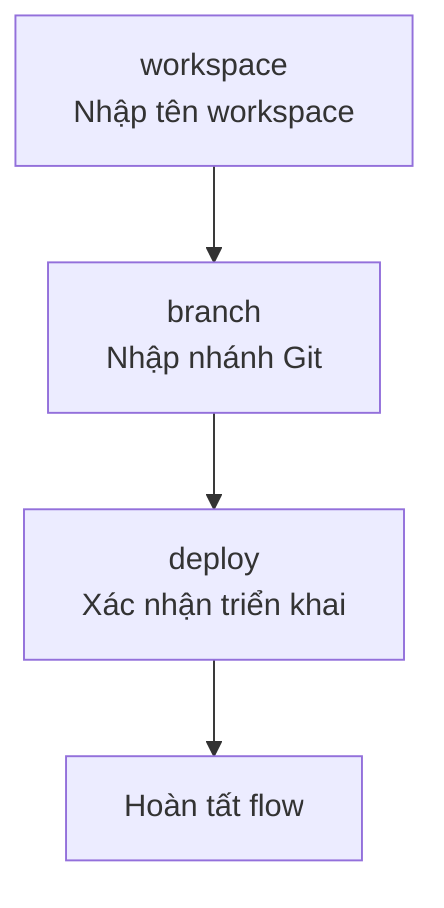
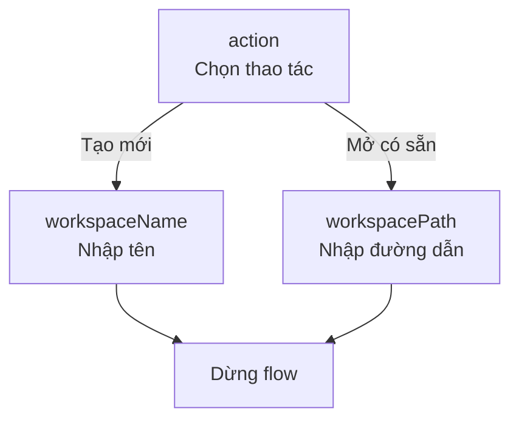

# Thứ tự thực thi mặc định của các bước

Một ComponentFlow thường thu thập nhiều thông tin theo một trình tự: hỏi tên workspace, nhận đường dẫn, chọn môi trường rồi xác nhận thao tác. Trong Spring Shell 3.x, thứ tự mặc định của các component chính là thứ tự bạn khai báo chúng bằng ComponentFlow.Builder. Khi gọi flow.run(), Spring Shell lần lượt chạy các bước theo trình tự đó.

Nếu cần rẽ nhánh, có thể cấu hình next(...) cho từng bước để chọn ID của component tiếp theo. Cơ chế này thay đổi đường đi tại thời điểm chạy; nếu hàm trả về null hoặc ID không tồn tại, flow dừng tại bước đó. Ngoài ra, mỗi spec có order(int) để đặt thứ tự component tường minh. Hiểu rõ ba cơ chế này giúp flow dễ đọc, tránh chạy nhầm bước và dễ kiểm thử.

## 1. Thứ tự mặc định đến từ đâu?

ComponentFlow.Builder nhận các bước theo thứ tự bạn gọi những phương thức như:

- withStringInput(id) để hỏi một chuỗi.
- withPathInput(id) để hỏi đường dẫn.
- withConfirmationInput(id) để hỏi xác nhận.
- withSingleItemSelector(id) để chọn một mục.
- withMultiItemSelector(id) để chọn nhiều mục.

Khi không đặt điều hướng riêng, thứ tự thực thi bình thường giống thứ tự component được khai báo trong builder. Ví dụ, nếu builder thêm workspace, sau đó branch, rồi deploy, flow chạy theo đúng thứ tự đó.



Lưu ý: thứ tự này là thứ tự các component trong một flow. Nó không liên quan đến thứ tự command được đăng ký trong ứng dụng, thứ tự option trên dòng lệnh hoặc thứ tự các mục hiển thị bên trong một selector.

## 2. Ví dụ flow chạy theo thứ tự khai báo

Ví dụ sau yêu cầu người dùng nhập tên workspace, nhập nhánh Git, chọn thư mục nguồn và xác nhận có triển khai hay không:

```java
import org.springframework.shell.component.flow.ComponentFlow;
import org.springframework.shell.component.context.ComponentContext;
import org.springframework.shell.standard.ShellComponent;
import org.springframework.shell.standard.ShellMethod;

@ShellComponent
public class WorkspaceCommands {

    private final ComponentFlow.Builder componentFlowBuilder;

    public WorkspaceCommands(ComponentFlow.Builder componentFlowBuilder) {
        this.componentFlowBuilder = componentFlowBuilder;
    }

    @ShellMethod(key = "workspace setup", value = "Thiết lập workspace theo từng bước.")
    public String setup() {
        ComponentFlow flow = componentFlowBuilder.clone()
                .reset()
                .withStringInput("workspace")
                    .name("Tên workspace")
                    .defaultValue("demo")
                    .and()
                .withStringInput("branch")
                    .name("Nhánh Git")
                    .defaultValue("main")
                    .and()
                .withPathInput("source")
                    .name("Thư mục nguồn")
                    .defaultValue("./")
                    .and()
                .withConfirmationInput("deploy")
                    .name("Triển khai sau khi thiết lập?")
                    .defaultValue(false)
                    .and()
                .build();

        ComponentFlow.ComponentFlowResult result = flow.run();
        ComponentContext<?> context = result.getContext();
        String workspace = context.get("workspace", String.class);
        String branch = context.get("branch", String.class);
        return "Đã thu thập workspace " + workspace + " trên nhánh " + branch;
    }
}
```

Khi chạy workspace setup, các prompt xuất hiện theo trình tự:

| Bước | ID | Component | Dữ liệu cần nhập |
| ---: | --- | --- | --- |
| 1 | workspace | StringInput | Tên workspace |
| 2 | branch | StringInput | Nhánh Git |
| 3 | source | PathInput | Thư mục nguồn |
| 4 | deploy | ConfirmationInput | Có triển khai hay không |

Trong ví dụ, and() đưa cấu hình trở lại ComponentFlow.Builder để khai báo component tiếp theo. Phương thức này chỉ nối chuỗi cấu hình; nó không chạy component ngay tại vị trí gọi. Toàn bộ flow chỉ được thực thi khi gọi flow.run().

clone().reset() tạo một builder riêng đã được làm sạch trước khi thêm các bước. Cách này hữu ích khi builder được inject từ Spring và một command có thể tạo nhiều flow khác nhau.

## 3. ID của component dùng để làm gì?

Mỗi component được khai báo với một ID, ví dụ workspace, branch hoặc deploy. ID có hai vai trò:

1. Nhận diện kết quả của component trong ComponentContext.
2. Là đích điều hướng khi một component trả về ID tiếp theo qua next(...).

Vì vậy, nên đặt ID ngắn, dễ hiểu, duy nhất trong cùng flow và giữ ổn định giữa lúc khai báo với lúc đọc kết quả. Không nên dùng tên hiển thị như Tên workspace làm ID; tên hiển thị có thể thay đổi hoặc được dịch, còn ID là định danh kỹ thuật.

Theo mặc định, spec lưu kết quả vào ComponentContext bằng ID đã khai báo. Sau khi flow chạy xong, có thể đọc kết quả từ context:

```java
import org.springframework.shell.component.context.ComponentContext;

ComponentFlow.ComponentFlowResult result = flow.run();
ComponentContext<?> context = result.getContext();

String workspace = context.get("workspace", String.class);
String branch = context.get("branch", String.class);
String source = context.get("source", String.class);
Boolean deploy = context.get("deploy", Boolean.class);
```

Nếu gọi storeResult(false) trên một spec, kết quả của bước đó sẽ không được tự động lưu vào context theo ID. Hãy chỉ tắt cơ chế lưu khi bạn có cách nhận và sử dụng kết quả khác, chẳng hạn xử lý trong postHandler.

## 4. Phân biệt thứ tự khai báo với order(int)

Ngoài thứ tự mặc định theo builder, BaseInputSpec cung cấp phương thức order(int) để đặt thứ tự của component. Các spec như StringInputSpec, PathInputSpec, ConfirmationInputSpec và selector đều kế thừa khả năng này.

Ví dụ:

```java
ComponentFlow flow = componentFlowBuilder.clone()
        .reset()
        .withStringInput("workspace")
            .name("Tên workspace")
            .order(10)
            .and()
        .withStringInput("branch")
            .name("Nhánh Git")
            .order(20)
            .and()
        .withConfirmationInput("deploy")
            .name("Triển khai?")
            .order(30)
            .and()
        .build();
```

Ở đây, thứ tự được đặt tường minh bằng các giá trị 10, 20 và 30. Khi không gọi order(...), hãy dựa vào thứ tự mặc định theo builder. Khi đã đặt order(...), hãy coi đó là một phần cấu hình thứ tự của flow và kiểm thử lại thứ tự thực tế.

Nên dùng giá trị thứ tự riêng biệt, tăng dần và có khoảng cách, ví dụ 10, 20, 30. Cách này giúp chèn một bước mới vào giữa dễ hơn mà không phải đổi toàn bộ giá trị. Tránh đặt các giá trị trùng nhau nếu không có lý do rõ ràng, vì thứ tự mong muốn sẽ khó đọc và khó duy trì.

Không nên đồng thời dựa vào thứ tự khai báo và các giá trị order(...) rời rạc mà không ghi lại quy ước. Người đọc code cần nhận ra ngay đâu là trình tự dự kiến.

## 5. next(...) thay đổi đường đi khi chạy

Thứ tự mặc định là tuyến tính. Khi cần bỏ qua một bước hoặc chọn một nhánh tùy theo câu trả lời, hãy cấu hình next(...) trên component.

Hàm next(...) nhận context của component vừa chạy và trả về ID của component tiếp theo. Ví dụ:

```java
.withStringInput("environment")
    .name("Môi trường")
    .next(context -> {
        String value = context.getResultValue();
        if ("production".equalsIgnoreCase(value)) {
            return "confirmProduction";
        }
        return "confirmTest";
    })
    .and()
```

Trong ví dụ, flow chọn bước xác nhận dựa trên môi trường được nhập. Các ID confirmProduction và confirmTest phải được khai báo trong cùng flow. Nếu trả về null hoặc ID không tồn tại, flow dừng tại bước hiện tại theo quy tắc của Spring Shell.

### Ví dụ rẽ nhánh bằng selector

Một cách phổ biến là dùng SingleItemSelector để hỏi người dùng muốn tạo workspace mới hay mở workspace có sẵn. Mỗi lựa chọn ánh xạ tới ID của một bước tiếp theo:

```java
import java.util.LinkedHashMap;
import java.util.Map;

Map<String, String> actions = new LinkedHashMap<>();
actions.put("Tạo workspace mới", "workspaceName");
actions.put("Mở workspace có sẵn", "workspacePath");

ComponentFlow flow = componentFlowBuilder.clone()
        .reset()
        .withSingleItemSelector("action")
            .name("Bạn muốn làm gì?")
            .selectItems(actions)
            .next(context -> context.getResultItem()
                    .map(item -> item.getItem())
                    .orElse(null))
            .and()
        .withStringInput("workspaceName")
            .name("Tên workspace mới")
            .next(context -> null)
            .and()
        .withPathInput("workspacePath")
            .name("Đường dẫn workspace")
            .next(context -> null)
            .and()
        .build();
```

Kết quả lựa chọn trả về ID của nhánh cần chạy:



Hai nhánh đều khai báo next(context -> null) để kết thúc sau khi thu thập dữ liệu. Nếu bỏ next(...) ở cuối nhánh, flow sẽ áp dụng quy tắc tiếp theo của nó; khi đó có thể chạy tiếp component kế tiếp theo thứ tự mặc định và vô tình đi vào nhánh còn lại.

## 6. next(...) và thứ tự mặc định phối hợp ra sao?

Hãy xem next(...) là quyết định bước kế tiếp tại thời điểm chạy. Khi một component không khai báo hàm next, flow dùng thứ tự thông thường. Khi có hàm next, kết quả của hàm quyết định chuyển tới component nào hoặc dừng.

| Cấu hình tại component hiện tại | Hành vi |
| --- | --- |
| Không cấu hình next(...) | Tiếp tục theo thứ tự bình thường của flow |
| next(...) trả về ID hợp lệ | Chuyển đến component có ID đó |
| next(...) trả về null | Dừng flow tại bước hiện tại |
| next(...) trả về ID không tồn tại | Dừng flow tại bước hiện tại |

Với flow có nhánh, nên khai báo rõ next(...) ở điểm kết thúc của mỗi nhánh. Cách này ngăn flow đi tiếp vào các component không thuộc nhánh người dùng đã chọn.

Không nên để hàm next(...) trả về ID dựa trên chuỗi hiển thị thiếu kiểm soát. Hãy dùng hằng số để tránh sai chính tả:

```java
private static final String STEP_WORKSPACE_NAME = "workspaceName";
private static final String STEP_WORKSPACE_PATH = "workspacePath";
```

Sau đó dùng các hằng số này trong cả phần khai báo component lẫn phần điều hướng.

## 7. Những thao tác không làm thay đổi thứ tự flow

Một số phương thức cấu hình thường xuất hiện trong builder nhưng không tự thay đổi trình tự thực thi:

| Phương thức | Tác dụng | Có tự thay đổi thứ tự không? |
| --- | --- | --- |
| name(...) | Đặt tên hiển thị của component | Không |
| defaultValue(...) | Đặt giá trị mặc định | Không |
| selectItems(...) | Cung cấp danh sách lựa chọn | Không |
| preHandler(...) | Đăng ký xử lý trước khi component chạy | Không |
| postHandler(...) | Đăng ký xử lý sau khi component chạy | Không |
| and() | Quay lại builder cha để khai báo bước tiếp | Không |
| next(...) | Chọn ID của component tiếp theo tại runtime | Có, thay đổi đường đi |
| order(...) | Đặt thứ tự component tường minh | Có, tham gia cấu hình thứ tự |

Giá trị mặc định không có nghĩa là bỏ qua component. Nó chỉ cung cấp giá trị khởi đầu cho bước nhập; người dùng vẫn đi qua component theo trình tự flow, trừ khi đường đi được thay đổi bởi cấu hình điều hướng.

preHandler và postHandler thích hợp để chuẩn bị context, kiểm tra hoặc xử lý kết quả của một bước. Không dùng chúng để giả lập điều hướng bằng side effect; hãy đặt quy tắc chuyển bước trong next(...) để luồng dễ đọc và kiểm thử.

## 8. Cách thiết kế thứ tự cho flow dễ bảo trì

Với flow tuyến tính, hãy khai báo component theo trình tự nghiệp vụ mà người dùng cần hoàn thành:

1. Thu thập thông tin cần thiết để nhận diện đối tượng.
2. Thu thập các tham số phụ thuộc vào đối tượng đó.
3. Hiển thị lựa chọn hoặc bước xác nhận.
4. Trả kết quả về command để service thực hiện nghiệp vụ.

Ví dụ flow triển khai:

```text
project       Nhập mã dự án
environment   Chọn môi trường
version       Nhập phiên bản
confirm       Xác nhận triển khai
```

Nếu một bước chỉ cần thiết trong một trường hợp, hãy tách thành nhánh thay vì thêm nhiều bước rồi yêu cầu người dùng nhập giá trị không dùng tới. Các nhánh nên có điểm kết thúc rõ ràng.

Một số nguyên tắc giúp giảm lỗi:

- Đặt ID phản ánh dữ liệu hoặc nhiệm vụ của bước, không dùng tên chung như step1, step2.
- Giữ thứ tự builder từ trên xuống dưới theo trình tự mặc định dễ đọc.
- Chỉ dùng order(...) khi cần kiểm soát thứ tự tường minh; ghi chú lý do nếu thứ tự khác vị trí khai báo.
- Chỉ thêm next(...) ở nơi có điều kiện rẽ nhánh hoặc cần kết thúc sớm.
- Bảo đảm mọi ID đích trong next(...) đều được khai báo trong cùng flow.
- Đặt next(context -> null) ở cuối nhánh để tránh đi nhầm sang component kế tiếp.
- Dùng hằng số cho ID khi flow có nhiều nhánh.
- Không đặt logic nghiệp vụ dài trong lambda next; gọi service hoặc tính trước dữ liệu rồi chỉ trả ID đích.

## 9. Kiểm thử thứ tự thực thi

Kiểm thử flow cần xác nhận cả thứ tự mặc định lẫn các đường đi có điều kiện.

**Với flow tuyến tính:**

- Xác nhận component đầu tiên xuất hiện đúng theo vị trí khai báo.
- Xác nhận các component tiếp theo xuất hiện đúng thứ tự.
- Xác nhận kết quả của mỗi bước được lưu theo ID tương ứng.
- Xác nhận flow chỉ trả về kết quả sau khi các bước đã chạy xong.

**Với flow có order(...):**

- Kiểm tra thứ tự khi tất cả bước có giá trị order tường minh.
- Kiểm tra việc thêm một bước mới không làm thay đổi thứ tự ngoài dự kiến.
- Tránh các giá trị order trùng nếu không có quy tắc xử lý rõ ràng.

**Với flow có next(...):**

- Kiểm tra từng nhánh lựa chọn.
- Kiểm tra nhánh trả về ID hợp lệ.
- Kiểm tra nhánh trả về null để dừng.
- Kiểm tra ID không tồn tại để xác nhận flow không tiếp tục sang bước không mong muốn.
- Kiểm tra component cuối nhánh không chạy sang nhánh kế tiếp.

Có thể tách hàm quyết định ID tiếp theo thành hàm Java nhỏ để unit test mà không cần mở terminal. Sau đó dùng kiểm thử shell để xác nhận flow tích hợp hiển thị component theo đúng trình tự. Đối với luồng tương tác, hãy kiểm tra cả trường hợp người dùng chọn mặc định, thay đổi lựa chọn và hủy thao tác.

## 10. Lỗi thường gặp

| Hiện tượng | Nguyên nhân | Cách xử lý |
| --- | --- | --- |
| Component xuất hiện không đúng trình tự mong muốn | Thứ tự gọi with... không phản ánh thứ tự nghiệp vụ | Sắp xếp lại các bước trong builder |
| Flow bỏ qua một component | next(...) trả về ID của bước khác | Kiểm tra giá trị ID được trả về |
| Flow dừng ngay sau một lựa chọn | next(...) trả về null hoặc ID không tồn tại | Trả về ID đã khai báo nếu muốn tiếp tục |
| Flow đi vào nhánh không được chọn | Bước cuối nhánh không có next(null) | Đặt điểm dừng rõ ràng cho nhánh |
| Thêm component làm thay đổi thứ tự | Có cấu hình order(...) hoặc thứ tự builder bị thay đổi | Kiểm tra lại cấu hình order và vị trí khai báo |
| Không đọc được kết quả sau khi flow kết thúc | ID dùng để đọc không khớp hoặc đã đặt storeResult(false) | Dùng đúng ID và kiểm tra cấu hình lưu kết quả |
| Khó hiểu đường đi của flow | ID chung chung và nhiều lambda điều hướng lồng nhau | Dùng ID có nghĩa, hằng số và tách logic quyết định |

## 11. Checklist trước khi hoàn thiện ComponentFlow

- Liệt kê các bước theo trình tự nghiệp vụ.
- Khai báo component theo thứ tự đó để có luồng mặc định dễ đọc.
- Đặt ID duy nhất và có ý nghĩa cho từng bước.
- Dùng order(int) chỉ khi cần đặt thứ tự component tường minh.
- Kiểm tra mọi next(...) trả về ID đã khai báo.
- Trả null khi muốn kết thúc flow.
- Đặt điểm dừng cho từng nhánh để tránh chạy sang bước ngoài nhánh.
- Không nhầm and() với thao tác thực thi component.
- Đọc kết quả qua ComponentFlowResult.getContext() bằng đúng ID.
- Kiểm thử thứ tự mặc định, thứ tự tường minh và từng nhánh điều hướng.

## Tài liệu tham khảo

- [Spring Shell 3.4.3 — Flow](https://docs.spring.io/spring-shell/reference/3.4/components/flow/index.html)
- [Spring Shell 3.4.3 — ComponentFlow API](https://docs.spring.io/spring-shell/reference/3.4/api/java/org/springframework/shell/component/flow/ComponentFlow.html)
- [Spring Shell 3.4.3 — ComponentFlow.BaseBuilder API](https://docs.spring.io/spring-shell/reference/3.4/api/java/org/springframework/shell/component/flow/ComponentFlow.BaseBuilder.html)
- [Spring Shell 3.4.3 — BaseInputSpec API](https://docs.spring.io/spring-shell/reference/3.4/api/java/org/springframework/shell/component/flow/BaseInputSpec.html)
- [Spring Shell 3.4.3 — SingleItemSelectorSpec API](https://docs.spring.io/spring-shell/reference/3.4/api/java/org/springframework/shell/component/flow/SingleItemSelectorSpec.html)
- [Spring Shell 3.4.3 — StringInputSpec API](https://docs.spring.io/spring-shell/reference/3.4/api/java/org/springframework/shell/component/flow/StringInputSpec.html)
