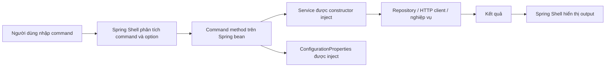

# Tiêm service và cấu hình vào lớp khai báo lệnh

Một command Spring Shell thường là điểm tiếp nhận yêu cầu từ người dùng: đọc option, kiểm tra dữ liệu đầu vào, gọi nghiệp vụ và hiển thị kết quả. Khi ứng dụng phát triển, command cần sử dụng service, client, repository hoặc các giá trị cấu hình như endpoint, số lần retry và môi trường mặc định. Spring quản lý những đối tượng này dưới dạng bean và tự động tiêm chúng vào lớp khai báo command.

Bài học thuộc chương **Tích hợp Spring**. Nội dung giải thích cách Spring Shell đăng ký command class, cách constructor injection hoạt động, cách đưa service và `@ConfigurationProperties` vào command, cách cấu hình theo môi trường và cách kiểm thử wiring của application context.

Sau bài học, bạn có thể:

- Giải thích vì sao command class cần được Spring quản lý như một bean.
- Tiêm service vào command bằng constructor injection.
- Phân biệt tham số command với dependency do Spring inject.
- Đưa cấu hình vào command bằng `@ConfigurationProperties` hoặc `@Value`.
- Đăng ký configuration properties bằng `@ConfigurationPropertiesScan` hoặc `@EnableConfigurationProperties`.
- Nhận biết khác biệt đăng ký command giữa Spring Shell 3.3.x và 4.x.
- Xử lý nhiều implementation bằng `@Qualifier` hoặc `@Primary`.
- Tách command adapter khỏi service nghiệp vụ và kiểm thử cấu hình bean.

## Command class tham gia Spring ApplicationContext

Spring Shell không tự tạo một đối tượng command mới mỗi lần người dùng gõ lệnh. Command được đăng ký từ lớp hoặc bean trong application context. Vì vậy, lớp khai báo command có thể nhận dependency như các Spring bean thông thường.

Luồng xử lý điển hình:



Spring IoC container tạo bean, giải quyết các dependency của constructor rồi mới cung cấp bean đã được khởi tạo cho thành phần khác. Constructor injection giúp các dependency bắt buộc luôn có mặt và làm cho class dễ kiểm thử bằng implementation giả hoặc mock.

## Cách đăng ký command thay đổi theo phiên bản

Spring Shell có nhiều mô hình annotation. Cần dùng đúng cách đăng ký của phiên bản đang chạy:

| Phiên bản/mô hình | Cách khai báo | Cách đăng ký |
| --- | --- | --- |
| Spring Shell 3.3.x, annotation model mới | `@Command` trên method | Dùng `@CommandScan` hoặc `@EnableCommand`. |
| Spring Shell 3.3.x, legacy annotation | `@ShellComponent` trên class và `@ShellMethod` trên method | `@ShellComponent` là stereotype của Spring `@Component`; component scanning phát hiện bean. |
| Spring Shell 4.x, annotation model | `@Component` trên class và `@Command` trên method | Spring Boot auto-configuration đăng ký command; ngoài Spring Boot dùng `@EnableCommand`. |

Trong cả ba trường hợp, dependency được tiêm theo cơ chế Spring. Khác biệt nằm ở cách Spring Shell tìm và đăng ký method thành command.

### Spring Shell 4.x: @Component và @Command

Trong Spring Shell 4.x, lớp chứa command method được khai báo là Spring component:

```java
import org.springframework.shell.core.command.annotation.Command;
import org.springframework.stereotype.Component;

@Component
public class GreetingCommands {

    @Command(name = "greeting hello", description = "Hiển thị lời chào")
    public String hello() {
        return "Xin chào";
    }
}
```

Spring Boot auto-configuration xử lý đăng ký command annotation. Class vẫn phải nằm trong phạm vi component scanning. Nếu `@ComponentScan` loại trừ package chứa command class, command sẽ không xuất hiện trong shell.

### Spring Shell 3.3.x: annotation model mới

Trong Spring Shell 3.3.x, `@Command` trên method cần được đăng ký thông qua `@CommandScan` hoặc `@EnableCommand`:

```java
import org.springframework.boot.autoconfigure.SpringBootApplication;
import org.springframework.boot.context.properties.ConfigurationPropertiesScan;
import org.springframework.shell.command.annotation.CommandScan;

@SpringBootApplication
@CommandScan
@ConfigurationPropertiesScan
public class CliApplication {
}
```

Lớp command dùng annotation `@Command` của Spring Shell:

```java
import org.springframework.shell.command.annotation.Command;

public class GreetingCommands {

    @Command(command = "greeting hello")
    public String hello() {
        return "Xin chào";
    }
}
```

`@CommandScan` quét các command target trong package của lớp ứng dụng và các package con. Nếu chỉ muốn đăng ký một số class cụ thể, có thể dùng `@EnableCommand(YourCommands.class)` trên lớp cấu hình.

### Spring Shell 3.3.x: legacy annotation

Ứng dụng đang dùng legacy annotation có thể tiếp tục dùng `@ShellComponent` và `@ShellMethod`:

```java
import org.springframework.shell.standard.ShellComponent;
import org.springframework.shell.standard.ShellMethod;

@ShellComponent
public class GreetingCommands {

    @ShellMethod(key = "greeting hello", value = "Hiển thị lời chào")
    public String hello() {
        return "Xin chào";
    }
}
```

`@ShellComponent` vừa đánh dấu class chứa shell method, vừa là stereotype được meta-annotate bằng `@Component`. Vì vậy, Spring có thể inject dependency vào constructor của lớp này như một bean bình thường.

## Constructor injection cho service

Giả sử ứng dụng có service triển khai chịu trách nhiệm đọc trạng thái và tạo một bản phát hành:

```java
public interface DeploymentService {

    String getStatus(String environment);

    void deploy(String environment, String version, boolean dryRun);
}
```

Implementation được đăng ký thành bean bằng `@Service`:

```java
import org.springframework.stereotype.Service;

@Service
public class DefaultDeploymentService implements DeploymentService {

    @Override
    public String getStatus(String environment) {
        // Đọc trạng thái từ API hoặc repository.
        return "READY";
    }

    @Override
    public void deploy(String environment, String version, boolean dryRun) {
        // Kiểm tra quyền, tạo yêu cầu và gọi hệ thống triển khai.
    }
}
```

Command class nhận interface `DeploymentService` qua constructor:

```java
import org.springframework.shell.core.command.annotation.Command;
import org.springframework.shell.core.command.annotation.Option;
import org.springframework.stereotype.Component;

@Component
public class DeploymentCommands {

    private final DeploymentService deploymentService;

    public DeploymentCommands(DeploymentService deploymentService) {
        this.deploymentService = deploymentService;
    }

    @Command(name = "deploy status", description = "Xem trạng thái môi trường")
    public String status(
            @Option(longName = "environment", required = true) String environment) {
        return deploymentService.getStatus(environment);
    }

    @Command(name = "deploy start", description = "Bắt đầu triển khai")
    public String deploy(
            @Option(longName = "environment", required = true) String environment,
            @Option(longName = "version", required = true) String version,
            @Option(longName = "dry-run", defaultValue = "false") boolean dryRun) {

        deploymentService.deploy(environment, version, dryRun);
        return dryRun
            ? "Đã kiểm tra kế hoạch triển khai"
            : "Đã gửi yêu cầu triển khai";
    }
}
```

Spring tự tìm bean có kiểu phù hợp với tham số constructor `DeploymentService` rồi inject vào command class. Khi người dùng chạy `deploy start`, Spring Shell phân tích các option thành tham số method; command method gọi service đã được inject.

### Tham số command và dependency của Spring là hai việc khác nhau

Trong ví dụ trên:

- `DeploymentService` là dependency do Spring quản lý và truyền vào constructor.
- `environment`, `version` và `dryRun` là dữ liệu do người dùng cung cấp khi gọi command; Spring Shell phân tích chúng từ dòng lệnh.

Không đặt service làm tham số command method với kỳ vọng Spring tự inject. Các tham số command method thuộc mô hình argument/option binding của Spring Shell. Dependency của ứng dụng nên được khai báo ở constructor hoặc qua một bean factory method.

Ví dụ cách gọi:

```text
shell:>deploy status --environment staging
READY

shell:>deploy start --environment staging --version 2.4.0 --dry-run true
Đã kiểm tra kế hoạch triển khai
```

## Tiêm cấu hình bằng @ConfigurationProperties

Khi command cần nhiều giá trị cấu hình có liên quan, hãy gom chúng vào một kiểu dữ liệu có cấu trúc bằng `@ConfigurationProperties`. Cách này giúp cấu hình có kiểu rõ ràng, hỗ trợ relaxed binding, metadata cho IDE và validation.

Ví dụ cấu hình triển khai:

```yaml
deploy:
  default-environment: staging
  api-endpoint: https://deploy.example.test/api
  max-attempts: 3
```

Khai báo record giữ cấu hình:

```java
import java.net.URI;

import jakarta.validation.constraints.Max;
import jakarta.validation.constraints.Min;
import jakarta.validation.constraints.NotBlank;
import jakarta.validation.constraints.NotNull;

import org.springframework.boot.context.properties.ConfigurationProperties;
import org.springframework.validation.annotation.Validated;

@ConfigurationProperties(prefix = "deploy")
@Validated
public record DeploymentProperties(
        @NotBlank String defaultEnvironment,
        @NotNull URI apiEndpoint,
        @Min(1) @Max(10) int maxAttempts) {
}
```

Record được bind bằng constructor binding. Không cần gắn `@Component` lên class `@ConfigurationProperties` này; hãy đăng ký nó bằng configuration properties scanning hoặc `@EnableConfigurationProperties`.

### Bật configuration properties scanning

Với Spring Boot, thêm `@ConfigurationPropertiesScan` vào lớp ứng dụng:

```java
import org.springframework.boot.autoconfigure.SpringBootApplication;
import org.springframework.boot.context.properties.ConfigurationPropertiesScan;

@SpringBootApplication
@ConfigurationPropertiesScan
public class CliApplication {
}
```

Mặc định, scanning bắt đầu từ package chứa lớp có annotation và quét các package con. Nếu class cấu hình nằm ở package khác, có thể khai báo package cần quét:

```java
@ConfigurationPropertiesScan({
    "com.example.cli.config",
    "com.example.shared.config"
})
```

Một cách khác là đăng ký tường minh bằng `@EnableConfigurationProperties`:

```java
import org.springframework.boot.context.properties.EnableConfigurationProperties;
import org.springframework.context.annotation.Configuration;

@Configuration
@EnableConfigurationProperties(DeploymentProperties.class)
public class DeploymentConfiguration {
}
```

Chọn một cơ chế đăng ký rõ ràng để tránh nhầm lẫn khi tìm bean cấu hình.

### Validation cho cấu hình

`@Validated` kích hoạt validation cho configuration properties. Các annotation như `@NotBlank`, `@NotNull`, `@Min` và `@Max` giúp phát hiện cấu hình thiếu hoặc không hợp lệ khi application context khởi tạo.

Để dùng các constraint Jakarta Validation, ứng dụng cần có implementation validation trên classpath, thường thông qua dependency:

```xml
<dependency>
    <groupId>org.springframework.boot</groupId>
    <artifactId>spring-boot-starter-validation</artifactId>
</dependency>
```

Nếu có object cấu hình lồng nhau và muốn validation đi sâu vào object con, đặt `@Valid` lên field hoặc record component chứa object đó.

### Inject cấu hình vào command

Sau khi `DeploymentProperties` được đăng ký thành bean, command class nhận nó qua constructor cùng service:

```java
@Component
public class DeploymentCommands {

    private final DeploymentService deploymentService;
    private final DeploymentProperties properties;

    public DeploymentCommands(
            DeploymentService deploymentService,
            DeploymentProperties properties) {
        this.deploymentService = deploymentService;
        this.properties = properties;
    }

    @Command(name = "deploy default-status")
    public String defaultStatus() {
        String environment = properties.defaultEnvironment();
        String status = deploymentService.getStatus(environment);
        return environment + ": " + status;
    }
}
```

Command sử dụng môi trường mặc định từ cấu hình. Khi cần, người dùng vẫn có thể truyền một môi trường cụ thể qua option của command. Cấu hình ứng dụng và tham số command là hai nguồn dữ liệu riêng, có thể kết hợp theo quy tắc nghiệp vụ.

## Khi nào dùng @Value?

`@Value` phù hợp khi chỉ cần một giá trị đơn lẻ, ví dụ tên ứng dụng hoặc chuỗi banner:

```java
import org.springframework.beans.factory.annotation.Value;
import org.springframework.stereotype.Component;

@Component
public class AboutCommands {

    private final String cliTitle;

    public AboutCommands(
            @Value("${cli.title:Deployment CLI}") String cliTitle) {
        this.cliTitle = cliTitle;
    }

    @Command(name = "about")
    public String about() {
        return cliTitle;
    }
}
```

Nếu có một nhóm cấu hình như endpoint, timeout, số lần retry và môi trường mặc định, `@ConfigurationProperties` thường phù hợp hơn. Nó cung cấp binding theo kiểu dữ liệu, validation và metadata; `@Value` phù hợp với một vài placeholder đơn giản hoặc khi cần SpEL.

## Cấu hình theo môi trường triển khai

Spring Boot có thể đọc cấu hình từ YAML/properties, file cấu hình bên ngoài, profile, biến môi trường, system property và command-line property. Cấu hình có độ ưu tiên cao hơn có thể ghi đè giá trị trong file mặc định.

Ví dụ tách cấu hình theo profile:

`application.yml`:

```yaml
deploy:
  default-environment: staging
  api-endpoint: https://deploy.example.test/api
  max-attempts: 3
```

`application-prod.yml`:

```yaml
deploy:
  default-environment: production
  api-endpoint: https://deploy.example.test/api
  max-attempts: 5
```

Kích hoạt profile khi chạy:

```bash
java -jar target/deployment-cli.jar --spring.profiles.active=prod
```

Command class vẫn nhận cùng `DeploymentProperties`; Spring Boot chọn nguồn cấu hình theo profile đang hoạt động. Điều này giúp giữ logic command ổn định giữa môi trường phát triển, kiểm thử và production.

Không nên ghi secret như password hoặc access token trực tiếp vào source code hay file cấu hình được commit. Dùng nguồn cấu hình bảo mật phù hợp với môi trường triển khai và chỉ inject giá trị cần thiết vào service.

## Nhiều bean cùng kiểu: dùng @Qualifier hoặc @Primary

Nếu application context có nhiều bean triển khai cùng một interface, Spring cần biết bean nào được inject. Có thể đánh dấu implementation mặc định bằng `@Primary`:

```java
@Service
@Primary
class DefaultDeploymentService implements DeploymentService {
    // ...
}
```

Hoặc chỉ định rõ bean cần dùng bằng `@Qualifier` ở constructor:

```java
public DeploymentCommands(
        @Qualifier("remoteDeploymentService") DeploymentService deploymentService,
        DeploymentProperties properties) {
    this.deploymentService = deploymentService;
    this.properties = properties;
}
```

Tên trong `@Qualifier` phải khớp bean name đã đăng ký. Dùng qualifier khi command cần implementation cụ thể, ví dụ client gọi staging API và client gọi production API.

## Giữ command class mỏng, đặt nghiệp vụ trong service

Command class là adapter giữa dòng lệnh và ứng dụng. Nó nên tập trung vào:

1. Nhận argument/option do người dùng truyền.
2. Kết hợp chúng với cấu hình cần thiết.
3. Gọi service phù hợp.
4. Chuyển kết quả thành thông báo hoặc dữ liệu output.

Service nên đảm nhiệm quy tắc nghiệp vụ, truy cập repository, gọi HTTP client, transaction và xử lý lỗi nghiệp vụ. Ví dụ, nếu thao tác triển khai cần transaction hoặc audit, đặt logic đó trong service thay vì viết trực tiếp trong command method.

Tránh lưu trạng thái riêng của một lần gọi command trong field mutable của command bean. Spring bean thường là singleton; nhiều lần gọi command sẽ sử dụng cùng instance. Dữ liệu tạm của một lần gọi nên nằm trong biến local hoặc request object.

## Programmatic command cũng nhận dependency từ Spring

Nếu không dùng annotation class, Spring Shell 4.x cho phép khai báo command bằng bean `Command`. Tham số của phương thức `@Bean` được Spring inject như các dependency khác:

```java
import org.springframework.context.annotation.Bean;
import org.springframework.context.annotation.Configuration;
import org.springframework.shell.core.command.Command;

@Configuration
class DeploymentCommandConfiguration {

    @Bean
    Command deploymentStatusCommand(
            DeploymentService deploymentService,
            DeploymentProperties properties) {

        return Command.builder()
            .name("deploy status")
            .description("Xem trạng thái môi trường mặc định")
            .execute(context -> {
                String status = deploymentService.getStatus(
                    properties.defaultEnvironment());
                context.outputWriter().println(status);
            });
    }
}
```

Cách này phù hợp khi muốn đăng ký command ở một lớp cấu hình hoặc tạo command từ dependency có sẵn. Với số lượng command lớn, annotation class thường dễ nhóm theo chức năng và dễ đọc hơn.

## Kiểm thử dependency injection

Nên kiểm tra cả wiring của application context và hành vi command:

- **Unit test:** tạo command class với service giả/mock qua constructor; kiểm tra command gọi đúng service và truyền đúng dữ liệu.
- **Context test:** khởi động Spring context và xác nhận command bean, service bean cùng configuration properties đã được đăng ký.
- **Command integration test:** dùng Spring Shell test support để thực thi command và kiểm tra output.
- **Configuration test:** nạp các giá trị YAML/profile khác nhau và xác nhận command nhận đúng cấu hình.
- **Validation test:** cung cấp cấu hình thiếu hoặc sai để xác nhận application context báo lỗi ngay khi khởi tạo.

Ví dụ kiểm tra command bean được tạo trong Spring Boot:

```java
import static org.assertj.core.api.Assertions.assertThat;

import org.junit.jupiter.api.Test;
import org.springframework.beans.factory.annotation.Autowired;
import org.springframework.boot.test.context.SpringBootTest;
import org.springframework.context.ApplicationContext;

@SpringBootTest(properties = "spring.shell.interactive.enabled=false")
class DeploymentWiringTests {

    @Autowired
    ApplicationContext applicationContext;

    @Test
    void commandAndServiceAreRegistered() {
        assertThat(applicationContext.getBean(DeploymentCommands.class))
            .isNotNull();
        assertThat(applicationContext.getBean(DeploymentService.class))
            .isNotNull();
        assertThat(applicationContext.getBean(DeploymentProperties.class))
            .isNotNull();
    }
}
```

Trong ví dụ, interactive runner được tắt để test không mở REPL và chờ input. Nếu dự án dùng Spring Shell 3.x, hãy điều chỉnh property theo cấu hình runner của phiên bản đang sử dụng.

## Lỗi thường gặp

| Hiện tượng | Nguyên nhân | Cách xử lý |
| --- | --- | --- |
| Không tìm thấy bean service khi khởi động | Implementation chưa có `@Service`/`@Component` hoặc nằm ngoài component scan. | Đăng ký bean và kiểm tra package scan. |
| Command không xuất hiện trong `help` | Class không được đăng ký theo annotation model của phiên bản. | Kiểm tra `@Component` ở 4.x, `@CommandScan`/`@EnableCommand` ở 3.3.x hoặc `@ShellComponent` ở legacy model. |
| Constructor báo không có bean phù hợp | Chưa đăng ký service hoặc có nhiều implementation không phân biệt. | Thêm bean, `@Primary` hoặc `@Qualifier`. |
| Giá trị cấu hình là `null` hoặc bằng giá trị mặc định ngoài dự kiến | Configuration properties chưa được scan/enable hoặc key YAML sai. | Kiểm tra prefix, tên key và `@ConfigurationPropertiesScan`. |
| `@ConfigurationProperties` không được inject | Class chỉ có annotation nhưng chưa được đăng ký thành bean. | Dùng `@ConfigurationPropertiesScan` hoặc `@EnableConfigurationProperties`. |
| Constructor-bound properties không khởi tạo | Cố gắng dùng `@Component` cùng constructor binding. | Đăng ký type bằng configuration properties scanning/enable, không dùng component scanning. |
| Cấu hình sai nhưng ứng dụng vẫn khởi động | Chưa bật validation hoặc thiếu validation implementation. | Thêm `@Validated`, constraint và starter validation. |
| Command method không nhận dependency như mong muốn | Nhầm tham số method với constructor dependency. | Dùng constructor injection cho bean; method parameter dành cho argument/option command. |
| Command giữ dữ liệu từ lần chạy trước | Lưu input tạm trong field của singleton command bean. | Dùng biến local hoặc request object cho mỗi lần gọi. |
| Unit test chạy được nhưng application context lỗi | Test tự tạo command bằng `new`, bỏ qua Spring wiring. | Bổ sung context test để xác nhận bean registration và dependency resolution. |

## Checklist trước khi phát hành CLI

- [ ] Command class được đăng ký đúng theo Spring Shell version.
- [ ] Command class và service nằm trong phạm vi component/command scanning.
- [ ] Dependency bắt buộc được inject qua constructor.
- [ ] Tham số method chỉ đại diện argument/option của command.
- [ ] Cấu hình nhóm được gom vào `@ConfigurationProperties`.
- [ ] Configuration properties đã được scan hoặc enable.
- [ ] Validation cấu hình được bật khi có yêu cầu.
- [ ] Bean cùng kiểu đã được phân biệt bằng `@Qualifier` hoặc `@Primary`.
- [ ] Command class không giữ trạng thái tạm giữa các lần gọi.
- [ ] Nghiệp vụ nằm trong service và được kiểm thử độc lập.
- [ ] Có context test xác nhận command, service và properties bean được đăng ký.
- [ ] Test không vô tình mở REPL và chờ input terminal.

## Ghi nhớ

Lớp khai báo command có thể nhận service và cấu hình vì nó được Spring quản lý như một bean. Dùng constructor injection cho dependency bắt buộc; Spring Shell phân tích argument/option từ command method. Với cấu hình có cấu trúc, dùng `@ConfigurationProperties` và đăng ký bằng `@ConfigurationPropertiesScan` hoặc `@EnableConfigurationProperties`; dùng `@Value` cho một vài giá trị đơn lẻ. Spring Shell 3.3.x có `@CommandScan`/`@EnableCommand` cho annotation model mới và `@ShellComponent`/`@ShellMethod` cho legacy model; Spring Shell 4.x dùng `@Component` cùng `@Command` trong annotation model. Giữ command mỏng, đặt nghiệp vụ trong service và kiểm thử cả hành vi lẫn Spring bean wiring.

## Tài liệu tham khảo

- [Spring Shell 4.0.4 — Command Registration](https://docs.spring.io/spring-shell/reference/commands/registration.html): annotation model với `@Component`/`@Command`, programmatic command bean và đăng ký command.
- [Spring Shell 3.3.4 — Annotation](https://docs.spring.io/spring-shell/reference/3.3/commands/registration/annotation.html): `@Command`, `@CommandScan` và `@EnableCommand`.
- [Spring Shell 3.3.4 — Legacy Annotation](https://docs.spring.io/spring-shell/reference/3.3/commands/registration/legacyannotation.html): `@ShellComponent` và `@ShellMethod`.
- [Spring Shell 3.3.4 — Getting Started](https://docs.spring.io/spring-shell/reference/3.3/getting-started.html): starter, tạo project và command annotation.
- [Spring Framework — Dependency Injection](https://docs.spring.io/spring-framework/reference/core/beans/dependencies/factory-collaborators.html): constructor injection, setter injection và cách container giải quyết dependency.
- [Spring Boot — Externalized Configuration](https://docs.spring.io/spring-boot/reference/features/external-config.html): `@Value`, `@ConfigurationProperties`, binding, profiles, property sources và validation.
