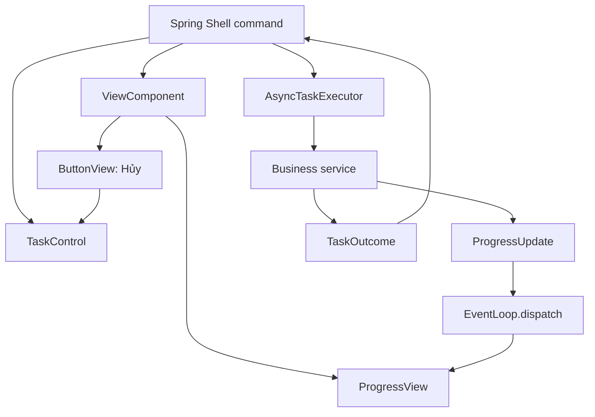

# Xử lý tác vụ dài, tiến độ và yêu cầu hủy

Một command Spring Shell có thể phải xuất hàng nghìn bản ghi, đồng bộ dữ liệu, tạo bản backup hoặc gọi một dịch vụ từ xa. Nếu thực hiện toàn bộ công việc ngay trên luồng xử lý command, terminal có thể không phản hồi trong thời gian dài. Người dùng không biết tác vụ còn chạy hay đã treo, cũng không có cách yêu cầu dừng an toàn.

Khi tích hợp với Spring, hãy tách phần thực thi tác vụ khỏi phần hiển thị CLI. **TaskExecutor** chạy công việc trên worker thread; service báo tiến độ theo các mốc nghiệp vụ; **ProgressView** hiển thị tiến độ trong terminal; một tín hiệu hủy được chuyển tới worker để nó chủ động dừng. Spring Shell 3.4 còn có **ViewComponent** để chạy view bất đồng bộ trong một terminal không toàn màn hình.

Điểm quan trọng là ba vòng đời này độc lập:

1. Tác vụ nghiệp vụ thực hiện export, backup hoặc đồng bộ dữ liệu.
2. View hiển thị spinner, phần trăm, thông báo và nút hủy.
3. Command điều phối, chờ kết quả và trả thông báo cuối cùng.

Đóng view không đồng nghĩa với việc tác vụ nghiệp vụ đã dừng. Tương tự, **Future.cancel(true)** chỉ gửi yêu cầu ngắt; worker phải hợp tác kiểm tra yêu cầu đó và giải phóng tài nguyên.

## 1. Mô hình tích hợp

Một kiến trúc đơn giản có thể tổ chức như sau:



| Thành phần | Trách nhiệm |
| --- | --- |
| Command | Nhận tham số, tạo tác vụ và view, chờ kết quả, trả thông báo cuối |
| AsyncTaskExecutor | Chạy tác vụ trên thread pool do Spring quản lý |
| Business service | Thực hiện nghiệp vụ và báo các mốc tiến độ |
| TaskControl | Giữ cờ yêu cầu hủy và kiểm tra trạng thái ngắt |
| ProgressView | Hiển thị mô tả, spinner và phần trăm |
| EventLoop | Chuyển thông tin tiến độ từ worker sang luồng xử lý giao diện |
| ViewComponent | Chạy view riêng để command vẫn có thể chờ tác vụ |

Không nên để service nghiệp vụ phụ thuộc trực tiếp vào ProgressView. Service chỉ cần một callback hoặc interface báo tiến độ. Nhờ vậy, cùng một service có thể được gọi từ command tương tác, command non-interactive, test hoặc một tác vụ chạy nền.

## 2. Cấu hình executor do Spring quản lý

Spring Framework cung cấp TaskExecutor để giao Runnable cho một bộ thực thi. ThreadPoolTaskExecutor là lựa chọn phổ biến khi cần giới hạn số worker và số tác vụ đang chờ.

Ví dụ cấu hình một executor riêng cho các tác vụ do Spring Shell khởi chạy:

```java
import org.springframework.context.annotation.Bean;
import org.springframework.context.annotation.Configuration;
import org.springframework.scheduling.concurrent.ThreadPoolTaskExecutor;

@Configuration
public class ShellTaskConfiguration {

    @Bean
    ThreadPoolTaskExecutor shellTaskExecutor() {
        ThreadPoolTaskExecutor executor = new ThreadPoolTaskExecutor();
        executor.setCorePoolSize(2);
        executor.setMaxPoolSize(4);
        executor.setQueueCapacity(20);
        executor.setThreadNamePrefix("shell-task-");
        executor.setWaitForTasksToCompleteOnShutdown(true);
        executor.setAwaitTerminationSeconds(10);
        return executor;
    }
}
```

Spring quản lý vòng đời bean và khởi tạo ThreadPoolTaskExecutor; không cần tự gọi initialize() trong phương thức @Bean. Các giá trị trên chỉ là cấu hình minh họa. Hãy chọn số thread và queue capacity theo loại công việc, tài nguyên máy và giới hạn của dịch vụ phụ thuộc.

Một số điểm cần hiểu:

- corePoolSize là số thread nền được giữ trong pool.
- maxPoolSize là giới hạn thread tối đa khi queue đã đầy.
- queueCapacity giới hạn số tác vụ chờ được nhận vào queue.
- threadNamePrefix giúp nhận diện worker khi đọc log hoặc thread dump.
- waitForTasksToCompleteOnShutdown và awaitTerminationSeconds điều khiển cách executor chờ tác vụ khi application context đóng.

Không nên giữ queue không giới hạn cho tác vụ có thể được gửi liên tục. Khi queue đầy hoặc pool không thể nhận thêm công việc, executor có thể từ chối tác vụ bằng TaskRejectedException. Command cần bắt trường hợp này và thông báo rằng hệ thống đang bận.

Có thể inject AsyncTaskExecutor để dùng submit(...) và nhận Future:

```java
import org.springframework.core.task.AsyncTaskExecutor;
import org.springframework.beans.factory.annotation.Qualifier;

public class ExportServiceRunner {

    private final AsyncTaskExecutor taskExecutor;

    public ExportServiceRunner(
            @Qualifier("shellTaskExecutor") AsyncTaskExecutor taskExecutor) {
        this.taskExecutor = taskExecutor;
    }
}
```

TaskExecutor cơ bản có phương thức execute(Runnable). AsyncTaskExecutor mở rộng khả năng submit để nhận Future, phù hợp khi command cần giữ một handle để theo dõi hoặc yêu cầu hủy tác vụ.

## 3. Tách tiến độ khỏi giao diện

Service nên báo tiến độ bằng dữ liệu thuần. Ví dụ, một bản ghi tiến độ có thể chứa số phần tử đã xử lý, tổng số phần tử và mô tả hiện tại:

```java
public record TaskProgressUpdate(
        int percent,
        long completed,
        long total,
        String description) {
}
```

Một callback nhỏ giúp service báo tiến độ mà không biết ai sẽ hiển thị:

```java
import java.util.function.Consumer;

public interface ProgressReporter extends Consumer<TaskProgressUpdate> {
}
```

Service nhận TaskControl và ProgressReporter:

```java
public void export(
        ExportRequest request,
        TaskControl control,
        ProgressReporter reporter) throws Exception {

    List<ExportRecord> records = repository.findRecords(request);
    int total = records.size();
    int completed = 0;

    if (total == 0) {
        reporter.accept(new TaskProgressUpdate(
                100, 0, 0, "Không có bản ghi cần xuất"
        ));
        return;
    }

    for (ExportRecord record : records) {
        control.checkCancellation();
        writer.write(record);
        completed++;

        if (completed % 10 == 0 || completed == total) {
            int percent = total == 0 ? 100 : completed * 100 / total;
            reporter.accept(new TaskProgressUpdate(
                    percent,
                    completed,
                    total,
                    "Đã xuất " + completed + "/" + total + " bản ghi"
            ));
        }
    }
}
```

ExportRequest, ExportRecord, repository và writer đại diện cho model cùng các service nghiệp vụ của ứng dụng. Ví dụ báo tiến độ mỗi mười bản ghi để tránh gửi quá nhiều update. Với tác vụ xử lý rất nhanh, có thể chỉ báo lúc bắt đầu, một vài mốc giữa chừng và khi hoàn tất.

### Tính phần trăm đúng

Chỉ hiển thị phần trăm khi biết tổng công việc:

\[
\text{percent} =
\left\lfloor
\frac{\text{completed}}{\text{total}} \times 100
\right\rfloor
\]

Nếu không biết tổng số phần tử, đừng tự ước lượng một phần trăm giả. Hãy hiển thị spinner cùng mô tả hoặc bộ đếm như Đã xử lý 1.240 mục. Khi tổng bằng 0, xử lý trường hợp đó riêng để tránh chia cho 0.

Tiến độ nên phản ánh công việc đã hoàn tất thật sự. Không tăng phần trăm trước khi thao tác ghi hoặc gọi dịch vụ thành công. Với tác vụ gồm nhiều giai đoạn có chi phí khác nhau, có thể báo tên giai đoạn và phần trăm của giai đoạn thay vì cộng số bước một cách gây hiểu lầm.

## 4. Tạo tín hiệu hủy hợp tác

Java không thể buộc một đoạn code bất kỳ dừng ngay lập tức một cách an toàn. Cách phổ biến là gửi yêu cầu hủy và để worker kiểm tra yêu cầu đó tại các điểm có thể dừng.

```java
import java.util.concurrent.Future;
import java.util.concurrent.atomic.AtomicBoolean;

public final class TaskControl {

    private final AtomicBoolean cancelRequested = new AtomicBoolean();
    private final AtomicBoolean started = new AtomicBoolean();
    private volatile Future<?> future;

    public void attach(Future<?> future) {
        this.future = future;
        if (started.get() && cancelRequested.get()) {
            future.cancel(true);
        }
    }

    public void begin() throws InterruptedException {
        started.set(true);
        checkCancellation();
    }

    public void requestCancel() {
        cancelRequested.set(true);
        Future<?> current = future;
        if (started.get() && current != null) {
            current.cancel(true);
        }
    }

    public boolean isCancellationRequested() {
        return cancelRequested.get();
    }

    public void checkCancellation() throws InterruptedException {
        if (cancelRequested.get() || Thread.currentThread().isInterrupted()) {
            throw new InterruptedException("Task cancellation requested");
        }
    }
}
```

requestCancel() đặt cờ trước, sau đó gửi interrupt nếu worker đã bắt đầu. begin() và checkCancellation() xử lý cả trường hợp người dùng yêu cầu hủy trước khi worker được lấy khỏi queue. attach() xử lý trường hợp worker đã bắt đầu trước khi Future được gắn vào control object.

Worker phải gọi checkCancellation() ở các điểm dừng hợp lý:

```java
for (ExportRecord record : records) {
    control.checkCancellation();
    writer.write(record);
    control.checkCancellation();
    reportProgress(record);
}
```

Với công việc gồm nhiều bước lớn, hãy kiểm tra giữa các bước. Với một vòng lặp có thể chạy lâu, kiểm tra thường xuyên hơn. Không kiểm tra quá dày trong đoạn xử lý cực nhỏ nếu điều đó làm giảm hiệu năng đáng kể.

### Hủy một tác vụ khác với hủy giao diện

Future.cancel(true) yêu cầu thread thực thi nhận interrupt. Worker cần kiểm tra trạng thái interrupt hoặc ném InterruptedException khi thao tác bị ngắt. Nếu thư viện I/O hoặc client HTTP không hỗ trợ interruption, hãy cấu hình timeout hoặc dùng API hủy request của chính thư viện đó.

Không nuốt InterruptedException rồi tiếp tục vòng lặp. Nếu bắt exception để cập nhật trạng thái, hãy khôi phục interrupt flag bằng Thread.currentThread().interrupt() khi phù hợp và thoát khỏi tác vụ.

Future.cancel(true) cũng không tự rollback những thay đổi đã commit vào database hoặc hệ thống từ xa. Nếu thao tác có side effect, cần thiết kế idempotency, transaction hoặc bước bù trừ theo nghiệp vụ.

## 5. Quản lý trạng thái tác vụ

Không nên chỉ có hai trạng thái đang chạy và xong. Khi người dùng bấm hủy, có một khoảng thời gian giữa lúc nhận yêu cầu và lúc worker thực sự dừng:

| Trạng thái | Ý nghĩa |
| --- | --- |
| PENDING | Tác vụ đã được nhận nhưng chưa bắt đầu |
| RUNNING | Worker đang thực hiện công việc |
| CANCEL_REQUESTED | Đã nhận yêu cầu hủy, worker đang dừng tại điểm an toàn |
| CANCELLED | Worker đã thoát và hoàn tất dọn dẹp sau khi hủy |
| SUCCEEDED | Công việc hoàn tất thành công |
| FAILED | Công việc kết thúc do lỗi |

CANCEL_REQUESTED không phải CANCELLED. Nếu worker đang chờ một request từ xa hoặc đang ghi một tệp lớn, nó có thể cần thời gian để phản ứng. Chỉ báo CANCELLED sau khi worker đã dừng và hoàn thành phần dọn dẹp cần thiết.

Nên giữ một completion handle riêng để biết worker đã kết thúc thật sự. Future có thể chuyển sang trạng thái cancelled ngay khi interrupt được gửi, trong khi đoạn finally của worker vẫn đang chạy. Nếu cần chờ dọn dẹp hoàn tất, hãy dùng một CompletableFuture<TaskOutcome> hoặc cơ chế hoàn tất riêng được worker cập nhật trong finally.

## 6. Cập nhật ProgressView trong Spring Shell 3.4

ProgressView là view có sẵn để hiển thị tiến độ. Mặc định view có các mục văn bản, spinner và phần trăm. Nó nhận khoảng tick; ví dụ new ProgressView(0, 100) dùng thang 0 đến 100.

Các phương thức thường dùng:

| Phương thức | Tác dụng |
| --- | --- |
| setDescription(String) | Đặt mô tả tiến độ |
| setTickValue(int) | Đặt giá trị tiến độ; giá trị được giới hạn trong khoảng tick |
| tickAdvance(int) | Tăng hoặc giảm tick hiện tại |
| start() | Bắt đầu runtime logic, ví dụ spinner |
| stop() | Dừng runtime logic |
| getState() | Đọc snapshot trạng thái tiến độ |

Ví dụ:

```java
import org.springframework.shell.component.view.control.ProgressView;

ProgressView progress = new ProgressView(0, 100);
progress.setDescription("Đang chuẩn bị dữ liệu");
progress.start();

progress.setTickValue(25);
progress.setDescription("Đã xử lý 25%");

progress.setTickValue(70);
progress.setDescription("Đã xử lý 70%");

progress.setTickValue(100);
progress.setDescription("Hoàn tất");
progress.stop();
```

ProgressView không có key binding mặc định. Vì vậy, nếu muốn người dùng yêu cầu hủy, hãy thêm một nút hoặc một phím tắt riêng. Không nên giả định rằng nhấn Esc sẽ tự động hủy công việc.

ProgressView phát các event ProgressViewStartEvent, ProgressViewStateChangeEvent và ProgressViewEndEvent. Có thể quan sát chúng để ghi telemetry hoặc đồng bộ các thành phần UI khác. Event tiến độ của view mô tả vòng đời hiển thị; nó không thay thế trạng thái nghiệp vụ của worker.

## 7. Chuyển update từ worker sang EventLoop

Worker chạy ở thread pool, còn view được quản lý bởi event loop. Không nên để worker tự ghi trực tiếp ra terminal hoặc cập nhật nhiều view tùy ý. Hãy gửi một message vào event loop rồi cập nhật view trong subscriber.

EventLoop của Spring Shell 3.x nhận Spring Message. Có thể dùng EventLoop.Type.USER cho dữ liệu ứng dụng:

```java
import org.springframework.messaging.support.MessageBuilder;
import org.springframework.shell.component.message.ShellMessageHeaderAccessor;
import org.springframework.shell.component.view.event.EventLoop;

void dispatchProgress(EventLoop eventLoop, TaskProgressUpdate update) {
    eventLoop.dispatch(
            MessageBuilder.withPayload(update)
                    .setHeader(
                            ShellMessageHeaderAccessor.EVENT_TYPE,
                            EventLoop.Type.USER
                    )
                    .build()
    );
}
```

Ở phía view, đăng ký subscriber cho loại message tương ứng:

```java
import org.springframework.shell.component.view.event.EventLoop;

eventLoop.events(EventLoop.Type.USER, TaskProgressUpdate.class)
        .subscribe(update -> {
            progress.setDescription(update.description());
            if (update.total() > 0) {
                progress.setTickValue(update.percent());
            }
        });
```

Subscriber nhận update trong event loop và thay đổi view theo vòng đời của giao diện. Cách này giúp worker không phụ thuộc vào terminal, đồng thời giảm nguy cơ nhiều thread cùng ghi hoặc vẽ màn hình.

Đừng dispatch một message cho từng byte hoặc từng bản ghi nếu công việc có hàng triệu phần tử. Chỉ gửi update khi phần trăm thay đổi, theo một khoảng thời gian phù hợp hoặc khi một giai đoạn kết thúc. Có thể gộp nhiều thay đổi vào một snapshot mới nhất để tránh dồn message trong event loop.

## 8. Chạy view bất đồng bộ bằng ViewComponent

Trong Spring Shell 3.4, ViewComponent chạy một view ở chế độ không chiếm toàn bộ terminal. ViewComponentBuilder tạo view component từ một root view. runAsync() chạy vòng lặp view bất đồng bộ và trả về ViewComponentRun, cho phép chờ, kiểm tra hoàn tất hoặc hủy vòng lặp view.

Một command dùng AbstractShellComponent có thể lấy builder qua getViewComponentBuilder():

```java
import org.springframework.shell.standard.AbstractShellComponent;
import org.springframework.shell.standard.ShellComponent;

@ShellComponent
public class ExportCommands extends AbstractShellComponent {
    // Spring Shell cung cấp getViewComponentBuilder() cho component kế thừa base class.
}
```

Tạo layout gồm progress và nút hủy:

```java
import org.springframework.shell.component.ViewComponent;
import org.springframework.shell.component.view.control.ButtonView;
import org.springframework.shell.component.view.control.GridView;
import org.springframework.shell.component.view.control.ProgressView;

ProgressView progress = new ProgressView(0, 100);
progress.setDescription("Đang xuất dữ liệu...");

ButtonView cancelButton = new ButtonView(
        "Yêu cầu hủy",
        taskControl::requestCancel
);

GridView root = new GridView();
root.addItem(progress, 0, 0, 1, 2, 0, 0);
root.addItem(cancelButton, 1, 0, 1, 2, 0, 0);

ViewComponent component = getViewComponentBuilder().build(root);
ViewComponent.ViewComponentRun viewRun = component.runAsync();
progress.start();
```

ViewComponentBuilder cấu hình terminal UI và event loop cho view. ViewComponent.runAsync() chạy view ở thread riêng để command có thể tiếp tục điều phối công việc. ButtonView gọi taskControl.requestCancel(); chính worker mới kiểm tra yêu cầu hủy và dừng nghiệp vụ.

Sau khi worker hoàn tất, đóng view:

```java
progress.stop();
component.exit();
viewRun.await();
```

component.exit() yêu cầu vòng lặp view kết thúc. viewRun.await() chờ vòng lặp đó hoàn tất. viewRun.cancel() cũng hủy lần chạy của component view, nhưng nó chỉ điều khiển vòng đời UI; hãy gọi taskControl.requestCancel() để gửi yêu cầu hủy cho công việc nghiệp vụ.

## 9. Ghép command, worker và view

Trình tự phối hợp trong một command có thể là:

1. Tạo TaskControl, CompletableFuture<TaskOutcome> và ProgressView.
2. Tạo ViewComponent, đăng ký subscriber nhận TaskProgressUpdate, rồi chạy view bất đồng bộ.
3. Submit worker vào AsyncTaskExecutor và gắn Future vào TaskControl.
4. Worker gọi service, kiểm tra yêu cầu hủy và dispatch update qua EventLoop.
5. Nút hủy đặt cờ yêu cầu hủy và gửi interrupt nếu worker đã bắt đầu.
6. Command chờ TaskOutcome, sau đó đóng progress view và trả kết quả.

Ví dụ phần worker:

```java
CompletableFuture<TaskOutcome> completion = new CompletableFuture<>();

Future<?> future = taskExecutor.submit(() -> {
    try {
        taskControl.begin();
        exportService.export(
                request,
                taskControl,
                update -> dispatchProgress(eventLoop, update)
        );
        completion.complete(TaskOutcome.succeeded());
    }
    catch (InterruptedException ex) {
        Thread.currentThread().interrupt();
        completion.complete(TaskOutcome.cancelled());
    }
    catch (Exception ex) {
        completion.complete(TaskOutcome.failed(ex));
    }
});

taskControl.attach(future);
```

TaskOutcome là kiểu kết quả do ứng dụng định nghĩa, có thể chứa trạng thái SUCCEEDED, CANCELLED hoặc FAILED cùng exception nếu có. Completion future được worker hoàn tất sau khi đã xử lý kết quả; nó cho command biết worker đã thoát khỏi phần thực thi.

Command có thể chờ completion mà vẫn phản ứng với interrupt của luồng gọi:

```java
private TaskOutcome awaitOutcome(
        CompletableFuture<TaskOutcome> completion,
        TaskControl taskControl) {

    boolean interrupted = false;
    try {
        while (true) {
            try {
                return completion.get();
            }
            catch (InterruptedException ex) {
                interrupted = true;
                taskControl.requestCancel();
            }
            catch (ExecutionException ex) {
                return TaskOutcome.failed(ex.getCause());
            }
        }
    }
    finally {
        if (interrupted) {
            Thread.currentThread().interrupt();
        }
    }
}
```

Vòng chờ này gửi yêu cầu hủy khi luồng command bị ngắt, nhưng vẫn đợi worker hoàn tất phần dọn dẹp trước khi trả kết quả. Trong ứng dụng thực tế, cần bắt TaskRejectedException khi submit thất bại và đóng view trong finally, kể cả khi không thể khởi chạy worker.

Khi TaskOutcome là CANCELLED, trả thông báo rõ rằng tác vụ đã dừng. Khi là FAILED, hiển thị lỗi đã được lọc và giữ chi tiết kỹ thuật trong log. Không trả thông báo thành công chỉ vì command đã đóng progress view.

## 10. Lựa chọn giữa ProgressView, spinner và phần trăm

Không phải tác vụ nào cũng có thể tính phần trăm:

| Đặc điểm công việc | Cách hiển thị |
| --- | --- |
| Biết tổng số phần tử hoặc tổng số bước | Progress bar và phần trăm |
| Không biết thời lượng hoặc tổng công việc | Spinner và mô tả giai đoạn |
| Có thể đếm phần tử nhưng không biết tổng | Bộ đếm đã xử lý, không hiển thị phần trăm giả |
| Có nhiều giai đoạn khác nhau | Tên giai đoạn và tiến độ từng giai đoạn |
| Có các tác vụ con chạy song song | Tiến độ tổng hợp từ kết quả hoàn thành của từng tác vụ con |

Nếu tổng số phần tử thay đổi trong khi chạy, hãy xác định rõ phần trăm dựa trên tổng ban đầu hay tổng mới. Nếu không thể đưa ra một con số ổn định, spinner cùng thông báo mô tả thường trung thực hơn.

Nếu muốn bỏ hẳn mục phần trăm khi tổng không xác định, hãy tạo ProgressView chỉ gồm text và spinner:

```java
import org.springframework.shell.geom.HorizontalAlign;
import org.springframework.shell.component.view.control.ProgressView;

ProgressView progress = new ProgressView(
        ProgressView.ProgressViewItem.ofText(10, HorizontalAlign.LEFT),
        ProgressView.ProgressViewItem.ofSpinner(3, HorizontalAlign.LEFT)
);
progress.setDescription("Đang đồng bộ dữ liệu...");
progress.start();
```

Với công việc nhiều giai đoạn, có thể tính tiến độ theo trọng số:

\[
\text{overall} = \sum_{i=1}^{n} w_i \times p_i
\]

Trong đó w_i là trọng số của giai đoạn, tổng trọng số bằng 1, còn p_i là tỷ lệ hoàn thành của giai đoạn đó từ 0 đến 1. Chỉ dùng cách này khi có ước lượng hợp lý về chi phí từng giai đoạn; nếu không, hãy hiển thị giai đoạn hiện tại và bộ đếm thay vì tạo phần trăm thiếu tin cậy.

## 11. Phân biệt hủy, timeout và lỗi

Ba kết quả này cần có thông báo và cách xử lý riêng:

| Kết quả | Nguyên nhân | Thông báo gợi ý |
| --- | --- | --- |
| Hủy | Người dùng yêu cầu dừng và worker đã dừng | Tác vụ đã được hủy. |
| Timeout | Vượt quá giới hạn thời gian do ứng dụng đặt | Tác vụ vượt quá thời gian cho phép. |
| Lỗi | Service hoặc hệ thống phụ thuộc phát sinh exception | Tác vụ thất bại. Mã tham chiếu: ... |

Timeout có thể kích hoạt cùng cơ chế yêu cầu hủy, nhưng nguyên nhân phải được giữ riêng để người dùng biết vì sao tác vụ dừng. Nếu tác vụ bị hủy bởi người dùng, không ghi log như một lỗi hệ thống không dự kiến.

Không nên chuyển mọi InterruptedException thành lỗi chung. Trong ngữ cảnh worker, exception này thường báo hiệu yêu cầu dừng. Ngược lại, không nên coi mọi exception là hủy; lỗi I/O hoặc lỗi xác thực vẫn là thất bại.

## 12. Tác vụ có thể tiếp tục sau khi command kết thúc

ThreadPoolTaskExecutor chạy trong tiến trình Spring Boot hiện tại. Khi ứng dụng tắt, executor đi qua quy trình shutdown; cấu hình chờ tác vụ không biến worker trong bộ nhớ thành một job bền vững.

Nếu người dùng cần:

- Rời shell nhưng tác vụ vẫn tiếp tục.
- Đóng terminal rồi kết nối lại để xem tiến độ.
- Khởi động lại ứng dụng và tiếp tục từ checkpoint.
- Theo dõi một job từ nhiều phiên CLI.

thì cần một mô hình job bền vững. Có thể lưu jobId, trạng thái, tiến độ, thời điểm bắt đầu, checkpoint và lỗi vào database; hoặc dùng Spring Batch, hàng đợi hay một dịch vụ worker riêng. Command chỉ gửi yêu cầu và trả jobId; command khác đọc trạng thái hoặc yêu cầu hủy job.

Không nên dựa vào một AtomicBoolean, Future hoặc singleton bean nếu trạng thái cần tồn tại qua lần khởi động lại. Những đối tượng đó chỉ có ý nghĩa trong bộ nhớ của tiến trình hiện tại.

## 13. Chạy trong interactive và non-interactive mode

ProgressView và nút hủy yêu cầu terminal có khả năng nhận input tương tác. Với command chạy trong script hoặc CI/CD, nên có đường xử lý không cần bàn phím:

| Chế độ | Tiến độ | Hủy |
| --- | --- | --- |
| Interactive | ProgressView, spinner, phần trăm và thông báo | Nút hủy hoặc phím tắt gửi cancellation token |
| Non-interactive | Log theo mốc hoặc output JSON | Interrupt từ process, timeout hoặc API quản lý job |
| Job chạy tách tiến trình | Trạng thái job lưu bền vững | Command/API hủy theo jobId |

Nếu command chỉ có ý nghĩa khi có terminal tương tác, hãy giới hạn command ở chế độ interactive theo API của Spring Shell 3.x. Với automation, cung cấp option và output có cấu trúc thay vì chờ người dùng bấm nút.

Đối với non-interactive, tránh in spinner liên tục vào stdout vì nó làm hỏng output mà script cần parse. Hãy ghi thông tin tiến độ ra stderr/log hoặc trả snapshot JSON có các trường ổn định như jobId, status, completed, total và message.

## 14. Kiểm thử tác vụ dài và yêu cầu hủy

Không nên chỉ kiểm thử rằng progress bar đã thay đổi. Cần xác nhận worker thực sự dừng, trạng thái cuối đúng và tài nguyên được giải phóng.

**Kiểm thử tiến độ:**

- Tác vụ có tổng số phần tử bằng 0.
- Tác vụ chỉ có một phần tử.
- Tác vụ nhiều phần tử và cập nhật ở các mốc.
- Tổng số phần tử không xác định.
- Progress không vượt ngoài khoảng tick.
- Mô tả tiến độ phản ánh đúng giai đoạn đang chạy.

**Kiểm thử hủy:**

- Hủy trước khi worker bắt đầu.
- Hủy khi worker đang chạy giữa các bước.
- Hủy khi worker đang chờ thao tác I/O có thể interrupt hoặc timeout.
- Worker dừng tại checkpoint và chạy phần cleanup.
- Kết quả cuối là CANCELLED, không phải SUCCEEDED.
- Hủy sau khi tác vụ đã hoàn tất không làm thay đổi kết quả thành công.

**Kiểm thử tích hợp Spring Shell:**

- Nút hủy gọi TaskControl.requestCancel().
- Update từ worker đi qua event loop và được view nhận.
- Đóng ViewComponent không bị coi là đã hủy nghiệp vụ.
- Command đóng subscription, progress runtime và view trong finally.
- TaskRejectedException được hiển thị thành thông báo phù hợp.
- Command non-interactive không chờ input hoặc spinner.

Nên dùng CountDownLatch, CompletableFuture hoặc một service giả có thể điều khiển thời điểm bắt đầu/kết thúc để kiểm thử race condition. Tránh dùng Thread.sleep() dài để đoán thời điểm worker đã chạy.

## 15. Lỗi thường gặp

| Hiện tượng | Nguyên nhân | Cách xử lý |
| --- | --- | --- |
| Terminal không phản hồi | Công việc chạy đồng bộ trên luồng command hoặc event loop | Chạy worker qua AsyncTaskExecutor |
| Progress luôn ở 0% | Service không báo update hoặc update không tới event loop | Kiểm tra callback và message dispatch |
| Phần trăm nhảy tới 100% quá sớm | Tăng tiến độ trước khi bước nghiệp vụ hoàn tất | Chỉ báo sau khi bước thành công |
| Nút hủy đóng view nhưng worker vẫn chạy | Chỉ hủy ViewComponentRun | Gọi TaskControl.requestCancel() cho worker |
| Future.cancel(true) không dừng được công việc | Worker hoặc thư viện đang gọi không phản ứng với interrupt | Kiểm tra cancellation token, timeout và API hủy của client |
| Tác vụ báo hủy nhưng vẫn ghi thêm dữ liệu | Không kiểm tra hủy giữa các bước hoặc side effect đã commit | Đặt checkpoint và thiết kế transaction/idempotency |
| Command báo hủy ngay nhưng worker còn cleanup | Dùng trạng thái Future làm trạng thái hoàn tất nghiệp vụ | Chờ completion handle riêng do worker cập nhật |
| Queue tác vụ tăng liên tục | Queue không giới hạn hoặc không có backpressure | Đặt queue capacity và xử lý task rejection |
| UI bị dồn update | Worker dispatch quá nhiều message | Gộp hoặc giới hạn tần suất update |
| Spinner tiếp tục quay sau khi xong | Không gọi ProgressView.stop() | Dừng progress trong finally |
| Tác vụ mất khi shell đóng | Chỉ lưu trạng thái trong bộ nhớ | Dùng job store hoặc worker bền vững |

## 16. Checklist triển khai

- Đưa nghiệp vụ dài vào service, không đặt trong callback vẽ UI.
- Dùng ThreadPoolTaskExecutor với pool size và queue capacity có giới hạn.
- Giữ Future hoặc task handle để theo dõi công việc.
- Báo tiến độ bằng dữ liệu thuần, không phụ thuộc ProgressView.
- Chỉ hiển thị phần trăm khi biết tổng công việc.
- Chuyển update từ worker qua EventLoop.
- Dùng ProgressView để hiển thị spinner, mô tả và tick value.
- Thêm nút hoặc phím tắt gửi yêu cầu hủy rõ ràng.
- Kiểm tra cancellation token tại các điểm dừng an toàn.
- Xử lý interruption và cleanup đúng cách.
- Phân biệt CANCEL_REQUESTED với CANCELLED.
- Không nhầm hủy ViewComponentRun với hủy tác vụ nghiệp vụ.
- Bắt task rejection, timeout và exception riêng.
- Đóng subscription, progress runtime và view trong finally.
- Dùng job store hoặc worker bên ngoài nếu tác vụ cần tồn tại sau khi tiến trình shell kết thúc.
- Kiểm thử cả interactive, non-interactive và các race condition khi hủy.

## Tài liệu tham khảo

- [Spring Shell 3.4.3 — ProgressView](https://docs.spring.io/spring-shell/reference/3.4/tui/views/progress.html)
- [Spring Shell 3.4.3 — ViewComponent API](https://docs.spring.io/spring-shell/reference/3.4/api/java/org/springframework/shell/component/ViewComponent.html)
- [Spring Shell 3.4.3 — ViewComponentBuilder API](https://docs.spring.io/spring-shell/reference/3.4/api/java/org/springframework/shell/component/ViewComponentBuilder.html)
- [Spring Shell 3.4.3 — ViewComponentExecutor API](https://docs.spring.io/spring-shell/reference/3.4/api/java/org/springframework/shell/component/ViewComponentExecutor.html)
- [Spring Shell 3.4.3 — ViewComponentRun API](https://docs.spring.io/spring-shell/reference/3.4/api/java/org/springframework/shell/component/ViewComponent.ViewComponentRun.html)
- [Spring Shell 3.4.3 — EventLoop API](https://docs.spring.io/spring-shell/reference/3.4/api/java/org/springframework/shell/component/view/event/EventLoop.html)
- [Spring Shell 3.4.3 — ShellMessageHeaderAccessor API](https://docs.spring.io/spring-shell/reference/3.4/api/java/org/springframework/shell/component/message/ShellMessageHeaderAccessor.html)
- [Spring Framework — Task Execution and Scheduling](https://docs.spring.io/spring-framework/reference/integration/scheduling.html)
- [Spring Framework 6.1 — AsyncTaskExecutor API](https://docs.spring.io/spring-framework/docs/6.1.11/javadoc-api/org/springframework/core/task/AsyncTaskExecutor.html)
- [Spring Framework 6.1 — ThreadPoolTaskExecutor API](https://docs.spring.io/spring-framework/docs/6.1.14/javadoc-api/org/springframework/scheduling/concurrent/ThreadPoolTaskExecutor.html)
