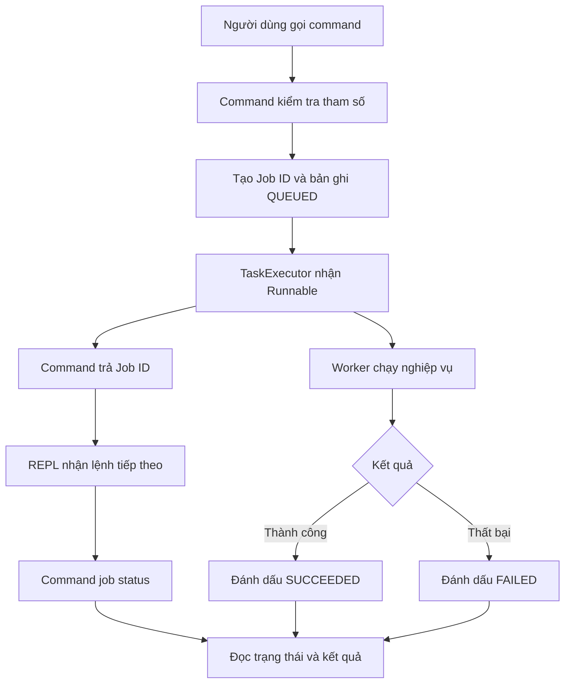

# Phân biệt thực thi đồng bộ với đẩy việc sang tác vụ nền

Một command Spring Shell có thể xử lý dữ liệu ngay trong lúc người dùng chờ, hoặc gửi công việc sang một executor để shell tiếp tục nhận lệnh khác. Lựa chọn này ảnh hưởng đến cách phản hồi, theo dõi lỗi, quản lý trạng thái, xử lý shutdown và cách command hoạt động trong CI.

Spring Shell thực thi phần thân command đồng bộ theo luồng gọi hiện tại. Khi phương thức command trả về, shell mới xử lý kết quả và tiếp tục vòng lặp. Muốn chạy công việc dài ở nền, ứng dụng phải chủ động sử dụng một executor bất đồng bộ như `ThreadPoolTaskExecutor` hoặc `@Async` với executor phù hợp. Bản thân abstraction `TaskExecutor` không bảo đảm luôn chạy trên thread khác: `SyncTaskExecutor` thực thi ngay trên thread gọi. Spring Shell không tự chuyển command sang background chỉ vì công việc mất nhiều thời gian.

Bài viết tập trung vào Spring Shell 3.x và Spring Framework. Phần ví dụ dùng `@ShellComponent`/`@ShellMethod` của Spring Shell 3.4.x, `TaskExecutor` và `ThreadPoolTaskExecutor` để quản lý công việc nền.

## Thực thi đồng bộ trong command

Trong cách chạy đồng bộ, command gọi service và chờ service hoàn thành trước khi trả kết quả:

```java
import org.springframework.shell.standard.ShellComponent;
import org.springframework.shell.standard.ShellMethod;

@ShellComponent
public class ReportCommands {

    private final ReportService reportService;

    public ReportCommands(ReportService reportService) {
        this.reportService = reportService;
    }

    @ShellMethod(key = "report generate", value = "Tạo báo cáo")
    public String generate() {
        ReportResult result = reportService.generate();
        return "Đã tạo báo cáo: " + result.fileName();
    }
}
```

Khi người dùng nhập `report generate`, shell gọi `reportService.generate()` và chờ phương thức này trả về. Trong thời gian đó, command chưa hoàn tất nên REPL chưa hiển thị prompt để người dùng nhập lệnh tiếp theo. Nếu service ném exception, exception đi theo luồng xử lý lỗi của Spring Shell.

Thực thi đồng bộ phù hợp khi:

- Công việc ngắn và có thời gian hoàn thành dễ dự đoán.
- Người dùng cần kết quả ngay để quyết định bước tiếp theo.
- Command chạy một lần trong script hoặc CI và cần exit code phản ánh kết quả cuối.
- Việc chờ kết quả là một phần tự nhiên của thao tác.

Không cần tạo thread riêng cho mọi command. Việc thêm bất đồng bộ vào một thao tác ngắn có thể làm tăng độ phức tạp trong quản lý lỗi và trạng thái mà không đem lại lợi ích đáng kể.

## Đẩy công việc sang tác vụ nền

Với tác vụ kéo dài, command có thể gửi một `Runnable` sang `TaskExecutor`, sau đó trả về ngay một mã định danh. Executor quyết định công việc được chạy trên thread nào, được xếp hàng ra sao và chịu giới hạn đồng thời nào.



Luồng này tách hai việc:

1. Command tiếp nhận yêu cầu, xác thực dữ liệu đầu vào và phản hồi rằng tác vụ đã được xếp hàng.
2. Worker thực hiện nghiệp vụ, cập nhật trạng thái và lưu kết quả hoặc lỗi để command khác có thể đọc.

Command trả về sớm không có nghĩa công việc đã thành công. Nó chỉ xác nhận rằng ứng dụng đã tiếp nhận hoặc xếp hàng yêu cầu. Kết quả cuối phải được kiểm tra qua trạng thái tác vụ.

## Cấu hình `ThreadPoolTaskExecutor`

Spring cung cấp `TaskExecutor` làm abstraction cho việc gửi `Runnable` sang bộ thực thi. `ThreadPoolTaskExecutor` là implementation phổ biến khi ứng dụng cần giới hạn số worker và kích thước hàng đợi.

```java
import org.springframework.context.annotation.Bean;
import org.springframework.context.annotation.Configuration;
import org.springframework.scheduling.concurrent.ThreadPoolTaskExecutor;

@Configuration
public class BackgroundTaskConfiguration {

    @Bean("shellJobExecutor")
    ThreadPoolTaskExecutor shellJobExecutor() {
        ThreadPoolTaskExecutor executor = new ThreadPoolTaskExecutor();
        executor.setCorePoolSize(2);
        executor.setMaxPoolSize(4);
        executor.setQueueCapacity(25);
        executor.setThreadNamePrefix("shell-job-");
        executor.setWaitForTasksToCompleteOnShutdown(true);
        executor.setAwaitTerminationSeconds(30);
        return executor;
    }
}
```

Ý nghĩa các tham số:

| Tham số | Ý nghĩa |
| --- | --- |
| `corePoolSize` | Số worker cốt lõi được duy trì trong pool |
| `maxPoolSize` | Số worker tối đa khi hàng đợi đã đầy |
| `queueCapacity` | Số tác vụ tối đa có thể chờ trong hàng đợi |
| `threadNamePrefix` | Tiền tố tên thread để dễ đọc log và chẩn đoán |
| `waitForTasksToCompleteOnShutdown` | Yêu cầu executor chờ các tác vụ đã nhận khi shutdown |
| `awaitTerminationSeconds` | Thời gian tối đa chờ executor kết thúc trong shutdown |

Hàng đợi có giới hạn giúp ứng dụng không tích lũy vô hạn các tác vụ khi tốc độ gửi nhanh hơn tốc độ xử lý. Khi pool đã dùng hết worker và hàng đợi đầy, executor có thể từ chối tác vụ bằng `TaskRejectedException`. Command cần bắt tình huống này và phản hồi rõ ràng thay vì thông báo đã tiếp nhận thành công.

Chính sách từ chối cũng ảnh hưởng đến thời gian trả về của command. Ví dụ, `CallerRunsPolicy` yêu cầu thread gửi task tự chạy task khi pool quá tải; command vì vậy có thể bị chặn và chạy nghiệp vụ ngay trên thread gọi. Nếu yêu cầu của ứng dụng là command phải trả về nhanh, hãy chọn chính sách từ chối phù hợp và kiểm thử hành vi khi pool đầy.

Spring Boot có thể auto-configure một `AsyncTaskExecutor` cho một số tích hợp. Khi ứng dụng cần một pool chuyên biệt cho các job của CLI, khai báo bean có tên riêng và inject bằng `@Qualifier` giúp tránh vô tình dùng chung executor với tác vụ khác.

## Theo dõi trạng thái của một job

Khi command trả về ngay, người dùng cần cách kiểm tra công việc đã được xếp hàng, đang chạy hay đã kết thúc. Một mô hình nhỏ có thể lưu:

- Job ID duy nhất.
- Trạng thái: `QUEUED`, `RUNNING`, `SUCCEEDED`, `FAILED` hoặc `REJECTED`.
- Thời điểm tiếp nhận, bắt đầu và kết thúc.
- Thông tin kết quả hoặc thông báo lỗi đã được làm sạch.

Ví dụ đặt enum và record trong hai file riêng để các service và command cùng sử dụng:

```java
public enum JobStatus {
    QUEUED,
    RUNNING,
    SUCCEEDED,
    FAILED,
    REJECTED
}
```

```java
import java.time.Instant;
import java.util.UUID;

public record JobSnapshot(
        UUID id,
        JobStatus status,
        Instant submittedAt,
        Instant startedAt,
        Instant finishedAt,
        String detail) {
}
```

`JobSnapshot` là dữ liệu đọc để hiển thị. Trạng thái nội bộ được quản lý bởi một đối tượng có đồng bộ để worker và command có thể truy cập an toàn:

```java
import java.time.Instant;
import java.util.UUID;

final class BackgroundJob {

    private final UUID id;
    private final Instant submittedAt = Instant.now();

    private JobStatus status = JobStatus.QUEUED;
    private Instant startedAt;
    private Instant finishedAt;
    private String detail = "Đang chờ worker.";

    BackgroundJob(UUID id) {
        this.id = id;
    }

    synchronized void markRunning() {
        if (status != JobStatus.QUEUED) {
            return;
        }
        status = JobStatus.RUNNING;
        startedAt = Instant.now();
        detail = "Tác vụ đang chạy.";
    }

    synchronized void markSucceeded(String message) {
        status = JobStatus.SUCCEEDED;
        finishedAt = Instant.now();
        detail = message;
    }

    synchronized void markFailed(String message) {
        status = JobStatus.FAILED;
        finishedAt = Instant.now();
        detail = message;
    }

    synchronized void markRejected() {
        status = JobStatus.REJECTED;
        finishedAt = Instant.now();
        detail = "Hàng đợi đang đầy; tác vụ chưa được tiếp nhận.";
    }

    UUID id() {
        return id;
    }

    synchronized JobSnapshot snapshot() {
        return new JobSnapshot(
                id, status, submittedAt, startedAt, finishedAt, detail);
    }
}
```

Các phương thức cập nhật và tạo snapshot đều được đồng bộ trên cùng đối tượng. Command đọc một snapshot nhất quán, còn worker cập nhật trạng thái mà không cần truy cập trực tiếp terminal.

## Tạo service tiếp nhận và thực thi job

Service dưới đây lưu job trong `ConcurrentHashMap`, đăng ký bản ghi trước khi gửi task sang executor và cập nhật trạng thái trong worker:

```java
import java.nio.file.Path;
import java.util.Optional;
import java.util.UUID;
import java.util.concurrent.ConcurrentHashMap;
import java.util.concurrent.ConcurrentMap;

import org.slf4j.Logger;
import org.slf4j.LoggerFactory;
import org.springframework.beans.factory.annotation.Qualifier;
import org.springframework.core.task.TaskExecutor;
import org.springframework.core.task.TaskRejectedException;
import org.springframework.stereotype.Service;

@Service
public class ImportJobService {

    private static final Logger log =
            LoggerFactory.getLogger(ImportJobService.class);

    private final TaskExecutor taskExecutor;
    private final ImportService importService;
    private final ConcurrentMap<UUID, BackgroundJob> jobs =
            new ConcurrentHashMap<>();

    public ImportJobService(
            @Qualifier("shellJobExecutor") TaskExecutor taskExecutor,
            ImportService importService) {
        this.taskExecutor = taskExecutor;
        this.importService = importService;
    }

    public UUID submit(Path file) {
        UUID id = UUID.randomUUID();
        BackgroundJob job = new BackgroundJob(id);
        jobs.put(id, job);

        try {
            taskExecutor.execute(() -> execute(job, file));
            return id;
        }
        catch (TaskRejectedException exception) {
            job.markRejected();
            log.warn("Import job {} was rejected by the executor", id, exception);
        }
        return id;
    }

    private void execute(BackgroundJob job, Path file) {
        job.markRunning();
        try {
            int imported = importService.importFile(file);
            job.markSucceeded("Đã nhập " + imported + " bản ghi.");
        }
        catch (Exception exception) {
            log.error("Import job {} failed", job.id(), exception);
            job.markFailed(
                    "Tác vụ thất bại. Xem log để biết chi tiết.");
        }
    }

    public Optional<JobSnapshot> find(UUID id) {
        BackgroundJob job = jobs.get(id);
        return job == null ? Optional.empty() : Optional.of(job.snapshot());
    }
}
```

Điểm quan trọng trong service:

1. Tạo ID và lưu bản ghi `QUEUED` trước khi gọi `execute(...)`. Worker có thể bắt đầu ngay sau khi executor nhận task, vì vậy bản ghi phải tồn tại trước thời điểm đó.
2. `TaskExecutor.execute(...)` chỉ nhận task; nó không trả kết quả nghiệp vụ cho command.
3. Worker gọi service nghiệp vụ, sau đó chuyển job sang `SUCCEEDED` hoặc `FAILED`.
4. Lỗi được ghi đầy đủ trong log phía máy chạy; thông báo trong trạng thái không tiết lộ stack trace hoặc dữ liệu nhạy cảm.
5. Nếu executor từ chối task, trạng thái chuyển thành `REJECTED` và command nhận lỗi tiếp nhận.

Ví dụ dùng `ConcurrentHashMap` chỉ lưu trạng thái trong bộ nhớ của tiến trình. Khi ứng dụng khởi động lại, dữ liệu job mất đi. Với job cần theo dõi lâu dài hoặc cần tiếp tục sau khi tiến trình kết thúc, hãy lưu trạng thái vào database hoặc dùng hàng đợi bền vững.

## Command tiếp nhận job và command xem trạng thái

Command Spring Shell không cần chờ worker hoàn thành. Nó chỉ tiếp nhận yêu cầu và trả ID:

```java
import java.nio.file.Path;
import java.util.UUID;

import org.springframework.shell.standard.ShellComponent;
import org.springframework.shell.standard.ShellMethod;
import org.springframework.shell.standard.ShellOption;

@ShellComponent
public class ImportCommands {

    private final ImportJobService jobService;

    public ImportCommands(ImportJobService jobService) {
        this.jobService = jobService;
    }

    @ShellMethod(key = "import start", value = "Xếp hàng nhập dữ liệu")
    public String start(
            @ShellOption(value = "--file") String file) {

        UUID id = jobService.submit(Path.of(file));
        JobSnapshot job = jobService.find(id).orElseThrow();
        if (job.status() == JobStatus.REJECTED) {
            return "Không thể xếp hàng tác vụ. " + job.detail()
                    + " Job ID: " + id;
        }
        return "Đã tiếp nhận tác vụ. Job ID: " + id;
    }

    @ShellMethod(key = "job status", value = "Xem trạng thái tác vụ")
    public String status(
            @ShellOption(value = "--id") String idText) {

        UUID id;
        try {
            id = UUID.fromString(idText);
        }
        catch (IllegalArgumentException exception) {
            return "Job ID không đúng định dạng UUID.";
        }

        return jobService.find(id)
                .map(job -> "Job: " + job.id()
                        + "\nTrạng thái: " + job.status()
                        + "\nTiếp nhận: " + job.submittedAt()
                        + "\nBắt đầu: " + job.startedAt()
                        + "\nKết thúc: " + job.finishedAt()
                        + "\nChi tiết: " + job.detail())
                .orElse("Không tìm thấy job " + id);
    }
}
```

Ví dụ sử dụng:

```text
shell:> import start --file ./data/customers.csv
Đã tiếp nhận tác vụ. Job ID: 6c20a1b4-3e6c-4aab-bd8e-2f9b1a44a4f0

shell:> job status --id 6c20a1b4-3e6c-4aab-bd8e-2f9b1a44a4f0
Job: 6c20a1b4-3e6c-4aab-bd8e-2f9b1a44a4f0
Trạng thái: RUNNING
Chi tiết: Tác vụ đang chạy.

shell:> job status --id 6c20a1b4-3e6c-4aab-bd8e-2f9b1a44a4f0
Trạng thái: SUCCEEDED
Chi tiết: Đã nhập 1200 bản ghi.
```

Các ID và kết quả trên chỉ là dữ liệu minh họa. Trong ứng dụng thực tế, command có thể bổ sung `job list`, `job result` hoặc `job forget` tùy theo chính sách lưu trạng thái. Registry trong ví dụ không có cơ chế dọn dẹp, vì vậy ứng dụng production cần đặt thời hạn lưu và xóa các job đã kết thúc theo chính sách retention để map không tăng vô hạn.

## Dùng `@Async` thay cho gọi `TaskExecutor` trực tiếp

Spring Framework cũng hỗ trợ đánh dấu một phương thức bean bằng `@Async`. Khi được gọi qua Spring proxy, phần thân phương thức được gửi sang `TaskExecutor` và caller nhận lại ngay. Cần bật async support bằng `@EnableAsync`:

```java
import org.springframework.context.annotation.Configuration;
import org.springframework.scheduling.annotation.EnableAsync;

@Configuration
@EnableAsync
public class AsyncConfiguration {
}
```

Ví dụ service trả về `CompletableFuture`:

```java
import java.util.concurrent.CompletableFuture;

import org.springframework.scheduling.annotation.Async;
import org.springframework.stereotype.Service;

@Service
public class ReportAsyncService {

    private final ReportService reportService;

    public ReportAsyncService(ReportService reportService) {
        this.reportService = reportService;
    }

    @Async("shellJobExecutor")
    public CompletableFuture<ReportResult> generateAsync() {
        ReportResult result = reportService.generate();
        return CompletableFuture.completedFuture(result);
    }
}
```

Lời gọi `generateAsync()` trả về một `CompletableFuture`. Caller có thể tiếp tục công việc khác rồi mới gọi `get()` hoặc kết hợp callback để nhận kết quả. Exception trong phương thức được biểu diễn trong future và được quan sát khi caller lấy kết quả hoặc đăng ký xử lý lỗi.

Một số điểm cần nhớ khi dùng `@Async`:

- `@EnableAsync` bật cơ chế xử lý annotation.
- `@Async("shellJobExecutor")` chọn executor theo tên bean.
- Với phương thức trả kết quả, dùng `Future` hoặc `CompletableFuture`.
- Phương thức `void` không chuyển exception về caller; muốn xử lý cần cấu hình `AsyncUncaughtExceptionHandler`.
- Mặc định Spring dùng proxy; lời gọi nội bộ từ một phương thức sang phương thức `@Async` khác trong cùng instance không đi qua proxy và không được chạy bất đồng bộ.
- Đặt phương thức bất đồng bộ trong một service bean riêng và gọi từ command bean giúp tránh lỗi self-invocation.

`@Async` phù hợp khi cần chuyển một lời gọi service sang worker mà không tự quản lý queue và registry. Nếu người dùng cần hỏi trạng thái qua nhiều command, ứng dụng vẫn phải có một nơi lưu Job ID, trạng thái và kết quả. `@Async` không tự tạo màn hình theo dõi job.

## Chọn `TaskExecutor` hay `@Async`?

| Tiêu chí | `TaskExecutor` trực tiếp | `@Async` |
| --- | --- | --- |
| Cách gọi | `execute(...)`; dùng `AsyncTaskExecutor.submit(...)` nếu cần `Future` | Gọi phương thức bean có annotation |
| Cấu hình | Inject executor cụ thể | Cần `@EnableAsync` và executor phù hợp |
| Trạng thái job | Ứng dụng tự quản lý | Ứng dụng vẫn phải tự quản lý nếu cần theo dõi |
| Kết quả | `execute` không trả future; `AsyncTaskExecutor.submit` có thể trả `Future` | Phương thức trả `Future`/`CompletableFuture` |
| Phạm vi xử lý | Chủ động tại điểm gửi task | Khai báo tại phương thức service |
| Lỗi | Tự bắt trong `Runnable` hoặc xử lý qua `Future` | Lỗi trong future hoặc `AsyncUncaughtExceptionHandler` cho `void` |
| Kiểm soát queue | Chọn executor và cấu hình pool trực tiếp | Vẫn dùng executor đã cấu hình |

Nếu command cần tạo Job ID, ghi trạng thái và kiểm soát trường hợp queue từ chối, gọi `TaskExecutor` trực tiếp làm luồng điều khiển rõ ràng. Nếu chỉ cần gọi một service bất đồng bộ và nhận future, `@Async` có thể ngắn gọn hơn.

## Đừng ghi output trực tiếp từ worker vào terminal

Trong REPL, command và worker có thể chạy trên hai thread khác nhau. Nếu worker ghi trực tiếp vào `System.out` hoặc terminal writer trong lúc người dùng đang nhập command khác, output có thể xen vào prompt hoặc làm hỏng dòng nhập.

Nên để worker cập nhật trạng thái trong job registry, sau đó command `job status` đọc và trình bày thông tin. Nếu cần thông báo tự động trong REPL, hãy dùng cơ chế message/event của shell phù hợp với phiên bản và bảo đảm việc cập nhật được điều phối an toàn với terminal. Không chia sẻ `PrintWriter` của command cho worker như một cách thông báo mặc định.

## Dữ liệu, transaction và context giữa các thread

Một tác vụ nền chạy trên thread khác với thread command. Vì vậy, không nên giả định các ngữ cảnh gắn với thread gọi ban đầu sẽ tự động được chuyển sang worker.

- Truyền ID, giá trị bất biến hoặc DTO cần thiết sang worker thay vì truyền entity JPA đang được quản lý trong persistence context của command.
- Mở transaction trong service được worker gọi nếu nghiệp vụ cần transaction. Transaction của thread command không tự lan sang thread nền.
- Không dùng lazy-loaded entity sau khi session hoặc transaction ban đầu đã kết thúc.
- Nếu cần SecurityContext, MDC hoặc thông tin tracing, cấu hình cơ chế truyền context phù hợp, chẳng hạn `TaskDecorator`; đừng giả định ThreadLocal tự chia sẻ giữa các thread.
- Xác thực quyền và dữ liệu ở service thực thi, ngay trước thao tác có tác động. Việc command đã kiểm tra tham số lúc xếp hàng không thay thế kiểm tra quyền tại thời điểm worker chạy.

Các quy tắc này đặc biệt quan trọng nếu tác vụ chạy sau một khoảng thời gian trong lúc người dùng đã thay đổi cấu hình hoặc quyền truy cập.

## Lỗi, hủy và giới hạn tài nguyên

### Không để exception biến mất

Worker cần bắt và ghi log exception, cập nhật job thành `FAILED`, rồi cung cấp thông báo an toàn cho command trạng thái. Không chỉ log rồi để job mãi ở `RUNNING`.

Với `@Async` trả `Future`, exception có thể được quan sát khi đọc future. Với `@Async void`, Spring không thể trả exception cho caller; mặc định exception được log và có thể cấu hình `AsyncUncaughtExceptionHandler`. Với `TaskExecutor.execute`, tự bọc phần thân `Runnable` bằng `try/catch` và cập nhật trạng thái.

### Giới hạn số tác vụ

Pool và queue phải có giới hạn phù hợp với tài nguyên. Khi quá tải:

- Từ chối tác vụ mới và báo người dùng thử lại.
- Giới hạn số job đang chạy theo loại nghiệp vụ.
- Không dùng queue vô hạn nếu tác vụ có thể được gửi liên tục.
- Cân nhắc thời gian timeout và cơ chế retry có giới hạn.
- Lưu lại trạng thái `REJECTED` hoặc thông báo tiếp nhận thất bại.

Không tự động retry mọi exception. Lỗi dữ liệu đầu vào thường không thể giải quyết bằng retry; lỗi tạm thời của dịch vụ phụ thuộc có thể cần retry với backoff và giới hạn số lần.

### Hủy tác vụ

Hủy một job không chỉ là đổi trạng thái thành `CANCELLED`. Worker phải có cách nhận tín hiệu hủy và dừng ở điểm an toàn. Nếu dùng `Future.cancel(true)`, thread có thể nhận interrupt; code nghiệp vụ cần kiểm tra interrupt hoặc dùng cancellation token và dọn tài nguyên trong `finally`. Một tác vụ đang chạy I/O hoặc gọi hệ thống bên ngoài có thể không dừng ngay khi bị interrupt.

Ví dụ kiểm tra interrupt trong vòng lặp:

```java
import java.util.concurrent.CancellationException;

for (ImportRecord record : records) {
    if (Thread.currentThread().isInterrupted()) {
        throw new CancellationException("Import was cancelled");
    }
    importOne(record);
}
```

Không cung cấp lệnh hủy nếu service không có cơ chế dừng thực sự và cập nhật trạng thái nhất quán.

## Shutdown và khác biệt giữa REPL với command chạy một lần

Tác vụ nền trong một shell tương tác thường có thể tiếp tục khi command đã trả về, vì ứng dụng vẫn đang giữ REPL mở. Người dùng có thể gọi `job status` trong cùng tiến trình.

Với một lần chạy non-interactive, runner thực thi command rồi hoàn tất luồng khởi động. Nếu command chỉ gửi job vào executor và trả ID, tiến trình có thể đi vào shutdown trước khi công việc hoàn tất, tùy vòng đời application context và executor. Thread nền có thể giữ JVM sống trong một số cấu hình, nhưng không nên dựa vào chi tiết này để bảo đảm job được thực hiện.

Spring Shell 3.4.x có thuộc tính `spring.shell.context.close` để yêu cầu đóng context sau khi shell hoàn tất logic thực thi. Khi bật thuộc tính này, ứng dụng phải cân nhắc kỹ các worker đang chạy. `ThreadPoolTaskExecutor` có thể được cấu hình chờ tác vụ trong shutdown, nhưng thời gian chờ vẫn hữu hạn và tác vụ có thể chưa hoàn thành khi tiến trình bị dừng.

Với một command chạy một lần trong CI, chọn một trong các cách sau:

- Thực thi đồng bộ để exit code phản ánh kết quả cuối.
- Gửi task và chờ `Future.get()` hoặc cơ chế chờ tương đương trước khi kết thúc command.
- Chuyển công việc sang một worker/queue độc lập có vòng đời dài hơn tiến trình CLI, rồi chỉ trả mã tiếp nhận.

Nếu cần công việc tiếp tục sau khi đóng terminal hoặc khởi động lại ứng dụng, job registry trong bộ nhớ và executor cục bộ không đủ. Dùng database/hàng đợi bền vững và worker độc lập.

## Kiểm thử đồng bộ và bất đồng bộ

Kiểm thử phải xác minh thời điểm command trả về, trạng thái job và lỗi từ worker:

| Trường hợp | Điều cần xác minh |
| --- | --- |
| Command đồng bộ thành công | Command chỉ trả kết quả sau khi service hoàn tất |
| Command đồng bộ thất bại | Exception được xử lý theo quy tắc lỗi của shell |
| Gửi job nền | Command trả Job ID mà không chờ nghiệp vụ hoàn tất |
| Worker nhận job | Trạng thái chuyển từ `QUEUED` sang `RUNNING` |
| Worker thành công | Trạng thái thành `SUCCEEDED` và có kết quả |
| Worker thất bại | Trạng thái thành `FAILED`, log có exception và detail không lộ bí mật |
| Queue đầy | Job bị từ chối và command không báo tiếp nhận thành công |
| Đọc trạng thái | Job ID hợp lệ trả snapshot mới nhất |
| Job không tồn tại | Command trả thông báo dễ hiểu |
| Nhiều command đồng thời | Job registry và cập nhật trạng thái an toàn luồng |
| Shutdown | Worker được xử lý theo chính sách chờ hoặc hủy đã cấu hình |
| Non-interactive | Process không kết thúc trước khi công việc bắt buộc hoàn tất |

Đối với test bất đồng bộ, tránh dùng `Thread.sleep(...)` để đoán khi nào worker hoàn thành. Dùng `CountDownLatch`, `CompletableFuture`, Awaitility hoặc một cơ chế đồng bộ trong test để chờ điều kiện cụ thể. Test nên kiểm tra cả trạng thái cuối lẫn việc command đã trả về đúng thời điểm.

## Những lỗi thường gặp

| Lỗi | Hệ quả | Cách xử lý |
| --- | --- | --- |
| Nghĩ command tự chạy nền | Command vẫn giữ REPL cho đến khi method trả về | Gửi công việc sang `TaskExecutor` hoặc gọi service `@Async` |
| Đánh dấu `@Async` trên method trong cùng class rồi tự gọi | Self-invocation không đi qua proxy, nên vẫn chạy đồng bộ | Gọi qua một Spring bean khác hoặc dùng executor trực tiếp |
| Dùng `@Async void` nhưng không xử lý lỗi | Caller không nhận được exception | Dùng `Future` hoặc cấu hình `AsyncUncaughtExceptionHandler` |
| Trả Job ID trước khi ghi bản ghi trạng thái | Worker có thể chạy trước khi status command tìm thấy job | Lưu job trước khi submit task |
| Không xử lý queue rejection | Người dùng tưởng job đã được tiếp nhận | Bắt `TaskRejectedException` và báo rõ |
| Dùng queue vô hạn | Tác vụ chờ có thể tiêu thụ hết bộ nhớ | Đặt queue capacity và chính sách từ chối |
| Worker ghi trực tiếp vào terminal | Output xen vào prompt hoặc dòng nhập | Worker cập nhật job state; command hiển thị trạng thái |
| Dùng entity JPA từ thread command | Persistence context không còn hợp lệ hoặc lazy loading lỗi | Truyền ID/DTO và mở transaction trong worker service |
| Giả định ThreadLocal tự truyền sang worker | Mất security, tracing hoặc MDC context | Cấu hình `TaskDecorator` hoặc cơ chế context propagation |
| Job registry chỉ ở RAM nhưng cần phục hồi sau restart | Mất trạng thái và kết quả | Lưu bền vững hoặc dùng queue/worker độc lập |
| Fire-and-forget trong non-interactive CLI | Tiến trình có thể shutdown trước khi job hoàn tất | Chờ kết quả hoặc chuyển job sang dịch vụ chạy lâu dài |
| Hủy job chỉ bằng cách đổi trạng thái | Worker vẫn tiếp tục thao tác | Dùng interrupt/cancellation token và điểm dừng an toàn |

## Quy trình chọn mô hình thực thi

1. Đo thời gian xử lý và xác định người dùng có cần chờ kết quả cuối hay không.
2. Nếu tác vụ ngắn hoặc command chạy một lần cần exit code cuối, giữ thực thi đồng bộ.
3. Nếu cần tiếp tục thao tác trong REPL, gửi công việc sang `TaskExecutor` hoặc service `@Async`.
4. Khi command trả sớm, tạo Job ID và lưu trạng thái trước khi submit.
5. Giới hạn pool/queue, xử lý từ chối và quản lý lỗi trong worker.
6. Cung cấp command kiểm tra trạng thái và kết quả; không để worker ghi terminal trực tiếp.
7. Xác định chính sách shutdown, hủy, lưu trạng thái và phục hồi.
8. Kiểm thử cả interactive REPL, non-interactive runner và tình huống queue quá tải.

Thực thi đồng bộ giúp command có kết quả rõ ràng ngay trong một lần gọi. Tác vụ nền giúp REPL tiếp tục nhận lệnh trong lúc worker xử lý công việc dài. Khi chuyển sang bất đồng bộ, ứng dụng phải bổ sung Job ID, trạng thái, xử lý lỗi, giới hạn tài nguyên và chính sách vòng đời; nếu không, việc command trả về sớm chỉ che đi công việc chưa hoàn tất.

## Tài liệu tham khảo

- [Command Execution – Spring Shell 3.4.3](https://docs.spring.io/spring-shell/reference/3.4/appendices/techintro/execution.html)
- [Execution and Shell Runners – Spring Shell 3.4.x](https://docs.spring.io/spring-shell/reference/3.4/execution.html)
- [Context Close – Spring Shell 3.4.3-SNAPSHOT](https://docs.spring.io/spring-shell/reference/3.4-SNAPSHOT/customization/contextclose.html)
- [Task Execution and Scheduling – Spring Framework](https://docs.spring.io/spring-framework/reference/integration/scheduling.html)
- [Task Execution and Scheduling – Spring Boot 3.4](https://docs.spring.io/spring-boot/3.4/reference/features/task-execution-and-scheduling.html)
- [@EnableAsync API – Spring Framework](https://docs.spring.io/spring-framework/docs/current/javadoc-api/org/springframework/scheduling/annotation/EnableAsync.html)
- [@Async API – Spring Framework](https://docs.spring.io/spring-framework/docs/current/javadoc-api/org/springframework/scheduling/annotation/Async.html)
- [ThreadPoolTaskExecutor API – Spring Framework](https://docs.spring.io/spring-framework/docs/current/javadoc-api/org/springframework/scheduling/concurrent/ThreadPoolTaskExecutor.html)
