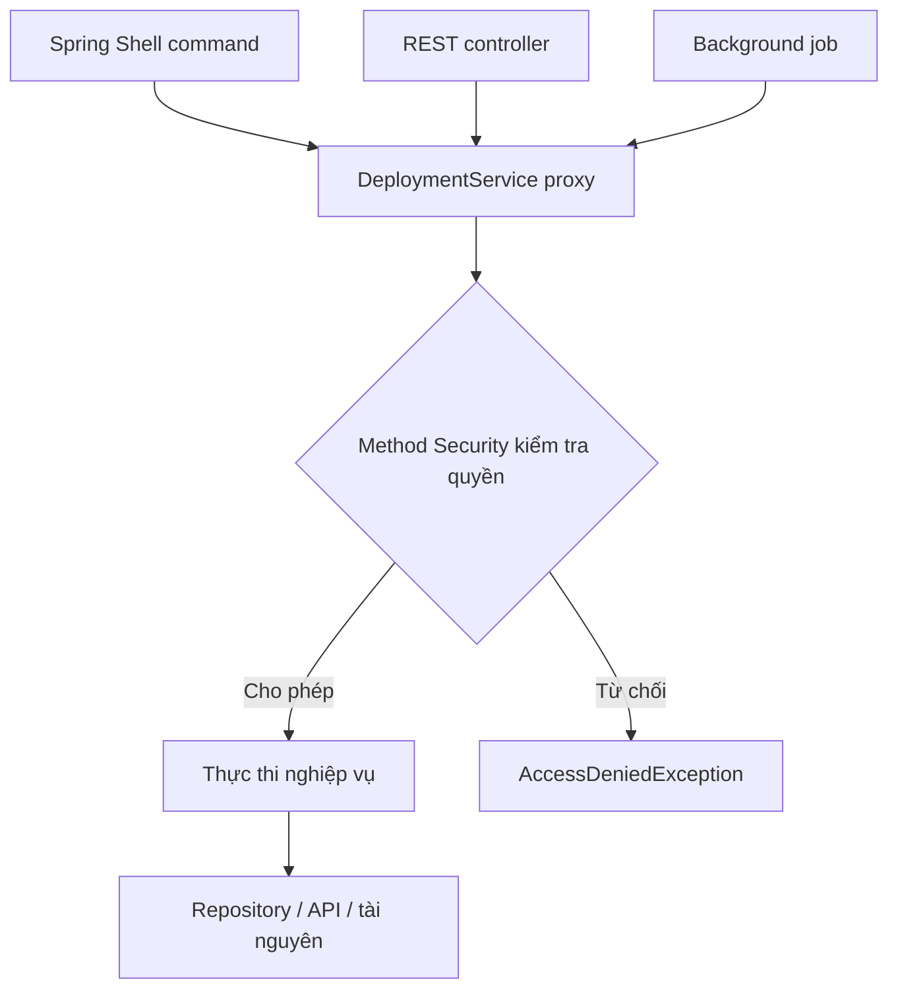

# Kiểm tra phân quyền tại lớp thực thi có thẩm quyền

Một command có thể ẩn lựa chọn, kiểm tra role hoặc từ chối thao tác ngay trên terminal. Tuy nhiên, command chỉ là một điểm tiếp nhận yêu cầu. Cùng một nghiệp vụ có thể được gọi từ command khác, REST API, tác vụ nền hoặc một bean Spring khác. Nếu chỉ kiểm tra quyền trong command, các đường gọi còn lại có thể bỏ qua quy tắc đó.

Với Spring Shell, lớp thực thi có thẩm quyền nên là service hoặc application service thực hiện thao tác được bảo vệ. Spring Security Method Security cho phép đặt quy tắc ngay trên method của Spring bean bằng `@PreAuthorize`. Mỗi lần có thành phần gọi method qua Spring proxy, quy tắc được kiểm tra trước khi phần nghiệp vụ chạy.

Bài học thuộc chương **Bảo mật và an toàn**. Nội dung giải thích cách đặt authorization ở service layer, phân biệt authentication với authorization, kiểm tra quyền theo authority và tài nguyên, bảo đảm method security thực sự được kích hoạt, cùng cách kiểm thử cả đường gọi qua command và gọi service trực tiếp.

Sau bài học, bạn có thể:

- Giải thích vì sao kiểm tra quyền ở command chưa đủ.
- Đặt quy tắc authorization trên service method bằng `@PreAuthorize`.
- Bật Spring Security Method Security bằng `@EnableMethodSecurity`.
- Phân biệt role, authority và quyền trên từng tài nguyên.
- Dùng principal hiện tại thay vì tin username/role do người gọi truyền vào.
- Nhận biết các giới hạn của Spring AOP proxy và self-invocation.
- Xử lý `AccessDeniedException` trong ứng dụng CLI không có HTTP request.
- Kiểm thử người được phép, người bị từ chối và quyền sở hữu tài nguyên.

## Command là điểm vào, service là nơi quyết định quyền

Một ứng dụng CLI có thể có nhiều command và nhiều cách gọi tới cùng nghiệp vụ. Ví dụ, thao tác triển khai có thể được gọi từ:

- Command `deploy start` trong Spring Shell.
- Một command tự động chạy trong script.
- REST API hoặc một adapter tích hợp khác.
- Một tác vụ nội bộ do Spring scheduler gọi.

Nếu quy tắc quyền chỉ nằm trong command, một caller khác có thể gọi service trực tiếp mà không chạy qua đoạn kiểm tra đó. Hãy đặt quy tắc tại method thực hiện thao tác có tác động, ví dụ `DeploymentService.deploy(...)`.



Command vẫn có thể kiểm tra đầu vào hoặc ẩn thao tác mà người dùng không được dùng để cải thiện trải nghiệm. Kiểm tra ở command không thay thế kiểm tra tại service. Mọi đường gọi tới thao tác được bảo vệ phải đi qua bean có áp dụng authorization.

## Phân biệt authentication và authorization

Hai khái niệm này giải quyết hai câu hỏi khác nhau:

| Khái niệm | Câu hỏi | Ví dụ |
| --- | --- | --- |
| Authentication | Người đang thực hiện thao tác là ai? | Người dùng `alice` đã xác thực bằng cơ chế đăng nhập của ứng dụng. |
| Authorization | Người đó được phép thực hiện thao tác nào trên tài nguyên nào? | `alice` có quyền `deployment:execute` và là thành viên dự án `project-42`. |

Spring Security lưu danh tính đã xác thực trong `SecurityContext`, được truy cập qua `SecurityContextHolder`. Đối tượng `Authentication` chứa principal và các `GrantedAuthority` được cấp cho principal đó.

`GrantedAuthority` có thể biểu diễn role hoặc permission. Ví dụ:

- `ROLE_ADMIN`: role quản trị.
- `deployment:execute`: quyền thực hiện triển khai.
- `project:read`: quyền đọc thông tin dự án.

Theo quy ước mặc định, `hasRole('ADMIN')` tìm authority `ROLE_ADMIN`. `hasAuthority('deployment:execute')` kiểm tra chính xác authority được chỉ định và không tự thêm tiền tố `ROLE_`.

Không lấy danh tính hoặc quyền từ option do người gọi tự khai báo, chẳng hạn `--username admin` hoặc `--role ADMIN`, rồi xem đó là bằng chứng xác thực. Các giá trị đó chỉ là input. Quyền phải đến từ `Authentication` được tạo sau một cơ chế xác thực đáng tin cậy.

## Bật Spring Security Method Security

Thêm Spring Security vào ứng dụng, ví dụ dùng Spring Boot starter:

```xml
<dependency>
    <groupId>org.springframework.boot</groupId>
    <artifactId>spring-boot-starter-security</artifactId>
</dependency>
```

Sau đó bật method security trên một lớp cấu hình:

```java
import org.springframework.context.annotation.Configuration;
import org.springframework.security.config.annotation.method.configuration.EnableMethodSecurity;

@Configuration
@EnableMethodSecurity
public class MethodSecurityConfiguration {
}
```

`@EnableMethodSecurity` đăng ký các interceptor cho `@PreAuthorize`, `@PostAuthorize`, `@PreFilter` và `@PostFilter` theo mặc định. Chỉ thêm `spring-boot-starter-security` chưa đủ để bật authorization ở cấp method; ứng dụng phải bật method security rõ ràng.

Method Security không tự động bảo vệ mọi method trong ứng dụng. Các method không có annotation bảo vệ vẫn có thể được gọi bình thường. Hãy rà soát các thao tác nhạy cảm và đặt quy tắc trên từng method hoặc nhóm method phù hợp; không xem việc bật `@EnableMethodSecurity` là chính sách deny-all.

Với ứng dụng cũ sử dụng `@EnableGlobalMethodSecurity`, nên chuyển sang `@EnableMethodSecurity`. Annotation mới dùng `AuthorizationManager` và bật các annotation pre/post authorization mặc định.

## Bảo vệ service method bằng authority

Ví dụ, service chỉ cho phép principal có quyền `deployment:execute` bắt đầu triển khai:

```java
import org.springframework.security.access.prepost.PreAuthorize;
import org.springframework.stereotype.Service;

@Service
public class DeploymentService {

    @PreAuthorize("hasAuthority('deployment:execute')")
    public void deploy(String projectId, String environment) {
        // Kiểm tra trạng thái dự án và thực hiện triển khai.
    }
}
```

Spring Security kiểm tra authority trước khi gọi phần thân method. Nếu người dùng không có quyền, method không được thực thi và Spring Security ném `AccessDeniedException`.

Command Spring Shell 4.x chỉ cần gọi service đã được inject:

```java
import org.springframework.shell.core.command.annotation.Command;
import org.springframework.shell.core.command.annotation.Option;
import org.springframework.stereotype.Component;

@Component
public class DeploymentCommands {

    private final DeploymentService deploymentService;

    public DeploymentCommands(DeploymentService deploymentService) {
        this.deploymentService = deploymentService;
    }

    @Command(name = "deploy start", description = "Bắt đầu triển khai")
    public String deploy(
            @Option(longName = "project-id") String projectId,
            @Option(longName = "environment") String environment) {

        deploymentService.deploy(projectId, environment);
        return "Đã gửi yêu cầu triển khai";
    }
}
```

Command không tự quyết định người gọi có quyền hay không. Khi gọi `deploymentService.deploy(...)`, lời gọi đi qua Spring proxy và quy tắc `@PreAuthorize` trên service được kiểm tra. Nếu một REST controller hoặc job khác gọi cùng service bean, quy tắc vẫn được áp dụng.

## Kiểm tra quyền trên từng tài nguyên

Một authority chung như `deployment:execute` có thể chưa đủ. Người dùng có thể được triển khai một số dự án nhưng không được triển khai dự án của nhóm khác. Khi đó, quyết định cần kết hợp quyền tổng quát với quan hệ giữa principal và tài nguyên.

Spring Security cho phép gọi bean kiểm tra quyền từ biểu thức SpEL của `@PreAuthorize`. Ví dụ:

```java
import org.springframework.security.core.Authentication;
import org.springframework.stereotype.Component;

@Component("deploymentAuthorization")
public class DeploymentAuthorization {

    private final ProjectMembershipRepository memberships;

    public DeploymentAuthorization(ProjectMembershipRepository memberships) {
        this.memberships = memberships;
    }

    public boolean canDeploy(Authentication authentication, String projectId) {
        return memberships.existsByProjectIdAndUsernameAndPermission(
            projectId,
            authentication.getName(),
            "DEPLOY");
    }
}
```

Service sử dụng cả authority và kiểm tra membership:

```java
import org.springframework.security.access.prepost.PreAuthorize;
import org.springframework.security.core.parameters.P;
import org.springframework.stereotype.Service;

@Service
public class DeploymentService {

    @PreAuthorize("hasAuthority('deployment:execute') "
        + "and @deploymentAuthorization.canDeploy(authentication, #projectId)")
    public void deploy(@P("projectId") String projectId, String environment) {
        // Thực hiện triển khai sau khi cả hai điều kiện được đáp ứng.
    }
}
```

Trong ví dụ, cả hai điều kiện phải đúng:

1. Principal có authority `deployment:execute`.
2. Principal hiện tại có permission `DEPLOY` trên đúng `projectId`.

`@P("projectId")` đặt tên rõ ràng cho tham số dùng trong biểu thức `#projectId`. Một cách khác là biên dịch ứng dụng với metadata tên tham số bằng tùy chọn `-parameters` và dùng tên tham số được phát hiện.

`ProjectMembershipRepository` là interface truy cập dữ liệu do ứng dụng định nghĩa. Nó cần truy vấn quan hệ từ nguồn dữ liệu có thẩm quyền, chẳng hạn bảng thành viên dự án hoặc policy store. Không nhận `ownerId`, `tenantId` hay `isAdmin` từ command rồi tự tin vào các giá trị đó; hãy lấy principal từ `Authentication` và kiểm tra quan hệ tài nguyên ở phía server.

Với dữ liệu đa tenant, kiểm tra tenant/resource nên được thực hiện cùng thao tác đọc hoặc ghi trong service. Tránh tải tài nguyên bằng ID do người dùng cung cấp rồi thực hiện side effect trước khi kiểm tra người dùng có quyền trên tài nguyên đó.

## @PreAuthorize và @PostAuthorize

Hai annotation có thời điểm kiểm tra khác nhau:

| Annotation | Thời điểm | Phù hợp với |
| --- | --- | --- |
| `@PreAuthorize` | Trước khi method chạy | Chặn thao tác ghi, triển khai, xóa hoặc đọc tài nguyên cần quyền. |
| `@PostAuthorize` | Sau khi method trả về | Kiểm tra kết quả trả về, ví dụ chủ sở hữu của object. |

Ví dụ `@PostAuthorize`:

```java
@PostAuthorize("returnObject.ownerUsername == authentication.name")
public ProjectDetails getProjectDetails(String projectId) {
    return projectRepository.getDetails(projectId);
}
```

Nếu kết quả không thuộc người dùng hiện tại, Spring Security từ chối trả kết quả cho caller. Tuy nhiên, method đã chạy và có thể đã tạo side effect. Vì vậy, không dùng `@PostAuthorize` làm lớp bảo vệ duy nhất cho thao tác ghi hoặc triển khai. Với những thao tác đó, kiểm tra quyền trước bằng `@PreAuthorize` và kiểm tra domain trong service.

## Lớp command không tự tạo danh tính

Spring Shell là giao diện dòng lệnh. Việc một command được đăng ký hoặc người dùng nhìn thấy command trong `help` không có nghĩa người đó đã được xác thực.

Trong ứng dụng Spring Shell chạy độc lập, cần xác định rõ cách tạo `Authentication`, ví dụ:

- Một command đăng nhập sử dụng `AuthenticationManager` và `AuthenticationProvider` đã cấu hình.
- Token do hệ thống đăng nhập hoặc secret store cung cấp.
- Danh tính service account được xác thực khi chạy tác vụ tự động.
- Một cơ chế xác thực bên ngoài được ứng dụng tích hợp.

Sau khi xác thực thành công, ứng dụng đặt `Authentication` vào `SecurityContextHolder` cho phạm vi thực thi phù hợp. Spring Security sử dụng context này để đánh giá `@PreAuthorize`.

Ví dụ khái quát về việc thiết lập context sau khi đã xác thực:

```java
import org.springframework.security.authentication.AuthenticationManager;
import org.springframework.security.authentication.UsernamePasswordAuthenticationToken;
import org.springframework.security.core.Authentication;
import org.springframework.security.core.context.SecurityContext;
import org.springframework.security.core.context.SecurityContextHolder;

Authentication authenticated = authenticationManager.authenticate(
    UsernamePasswordAuthenticationToken.unauthenticated(username, password));

SecurityContext context = SecurityContextHolder.createEmptyContext();
context.setAuthentication(authenticated);
SecurityContextHolder.setContext(context);

try {
    deploymentService.deploy(projectId, environment);
}
finally {
    SecurityContextHolder.clearContext();
}
```

Đoạn code minh họa một lần chạy non-interactive: chỉ gọi service sau khi `AuthenticationManager` xác thực credential bằng provider thật, rồi xóa context trong `finally`. Không tự tạo `TestingAuthenticationToken` hoặc `UsernamePasswordAuthenticationToken` với authority tùy ý trong luồng production để giả lập người dùng đã đăng nhập.

Với CLI tương tác, không truyền password hoặc token bí mật qua argument dễ xuất hiện trong shell history hoặc danh sách process. Dùng prompt bảo mật hoặc nguồn credential phù hợp. Với command one-shot, xác thực trước khi gọi service và dọn `SecurityContext` sau khi xử lý. Với REPL có đăng nhập theo phiên, cần định nghĩa rõ thời điểm login, logout, hết hạn và xóa context.

Mặc định `SecurityContextHolder` dùng `ThreadLocal`. Context có sẵn trên cùng thread, nhưng không tự động được truyền sang mọi thread nền. Nếu service gửi công việc qua executor hoặc scheduler, cần dùng cơ chế truyền `SecurityContext` phù hợp như `DelegatingSecurityContextExecutor` hoặc thiết kế tác vụ nhận danh tính một cách tường minh. Không chia sẻ context giữa các phiên người dùng.

## Spring AOP proxy phải được đi qua

Method Security hoạt động dựa trên Spring AOP. Spring tạo proxy cho bean và đặt interceptor authorization trên lời gọi method. Vì vậy, cần bảo đảm:

- Service được tạo và quản lý bởi Spring, ví dụ bằng `@Service`.
- Caller inject bean từ Spring container, không tự tạo service bằng `new`.
- Method được bảo vệ được gọi thông qua proxy.
- Method có visibility và hình dạng tương thích với loại proxy đang dùng.

### Tránh self-invocation

Ví dụ sau có thể bỏ qua interceptor của method security:

```java
@Service
public class DeploymentService {

    public void deployForProject(String projectId) {
        this.deploy(projectId);
    }

    @PreAuthorize("hasAuthority('deployment:execute')")
    public void deploy(String projectId) {
        // Thao tác triển khai.
    }
}
```

`this.deploy(...)` là lời gọi nội bộ trên target object, không đi qua proxy. Vì thế, advice của `@PreAuthorize` có thể không chạy. Cách thiết kế rõ ràng hơn là tách method được bảo vệ sang một service bean khác rồi inject bean đó:

```java
@Service
public class DeploymentExecutionService {

    @PreAuthorize("hasAuthority('deployment:execute')")
    public void deploy(String projectId) {
        // Thao tác triển khai.
    }
}

@Service
public class DeploymentWorkflowService {

    private final DeploymentExecutionService executionService;

    public DeploymentWorkflowService(DeploymentExecutionService executionService) {
        this.executionService = executionService;
    }

    public void run(String projectId) {
        executionService.deploy(projectId);
    }
}
```

Lời gọi giữa hai bean đi qua proxy của `DeploymentExecutionService`, do đó method security được áp dụng. Tránh tự gọi proxy qua `AopContext.currentProxy()` trừ khi thật sự cần thiết; cách đó làm class phụ thuộc trực tiếp vào Spring AOP.

Với class-based CGLIB proxy, class `final` không thể được kế thừa để tạo proxy; method `final` hoặc `private` không thể được override để gắn advice. Dùng method public có thể được proxy và gọi thông qua bean Spring. Nếu dùng JDK dynamic proxy, caller nên phụ thuộc vào interface được proxy.

## Xử lý quyền bị từ chối trong CLI

Khi method security từ chối, Spring ném `AccessDeniedException`. Trong HTTP request, Spring Security có filter xử lý exception và chuyển thành phản hồi 403. Nhưng command Spring Shell không chạy trong HTTP request, nên không có `ExceptionTranslationFilter` tự chuyển exception thành trang hoặc status HTTP.

Ứng dụng CLI cần xử lý lỗi ở ranh giới command hoặc exception handler của shell để:

- Hiển thị thông báo ngắn, không tiết lộ chi tiết policy hoặc dữ liệu nội bộ.
- Không thực hiện phần nghiệp vụ tiếp theo sau khi bị từ chối.
- Trả trạng thái thất bại phù hợp cho script/CI nếu command chạy non-interactive.
- Ghi log đủ thông tin kiểm toán, nhưng không ghi password, token hoặc secret.

Không bắt `AccessDeniedException` rồi in “thành công” hoặc tiếp tục tác vụ. Nếu cần thông báo chung, có thể trả câu “Bạn không có quyền thực hiện thao tác này” ở lớp command, đồng thời giữ kết quả thực thi ở trạng thái thất bại.

## Kiểm thử phân quyền tại service layer

Kiểm thử cần gọi service bean lấy từ Spring context để đi qua proxy. Nếu test tự tạo service bằng `new DeploymentService(...)`, interceptor method security sẽ không được áp dụng.

Thêm Spring Security Test vào test scope:

```xml
<dependency>
    <groupId>org.springframework.security</groupId>
    <artifactId>spring-security-test</artifactId>
    <scope>test</scope>
</dependency>
```

Ví dụ kiểm thử authority:

```java
import static org.assertj.core.api.Assertions.assertThatCode;
import static org.assertj.core.api.Assertions.assertThatExceptionOfType;

import org.junit.jupiter.api.Test;
import org.springframework.beans.factory.annotation.Autowired;
import org.springframework.boot.test.context.SpringBootTest;
import org.springframework.security.access.AccessDeniedException;
import org.springframework.security.test.context.support.WithMockUser;

@SpringBootTest
class DeploymentAuthorizationTests {

    @Autowired
    DeploymentService deploymentService;

    @Test
    @WithMockUser(authorities = "deployment:execute")
    void operatorCanInvokeDeployment() {
        assertThatCode(() -> deploymentService.deploy("project-42", "staging"))
            .doesNotThrowAnyException();
    }

    @Test
    @WithMockUser(authorities = "deployment:read")
    void readOnlyUserCannotDeploy() {
        assertThatExceptionOfType(AccessDeniedException.class)
            .isThrownBy(() -> deploymentService.deploy("project-42", "staging"));
    }
}
```

Trong test thực tế, repository và các service phụ thuộc cần được cấu hình hoặc mock để test chỉ tập trung vào authorization. Nếu method có kiểm tra membership theo dự án, bổ sung test cho thành viên được phép, người dùng không thuộc dự án và project ID không tồn tại.

`@WithMockUser(authorities = ...)` tạo `Authentication` giả trong `SecurityContext` cho test. Thuộc tính `roles = "ADMIN"` sẽ tạo authority `ROLE_ADMIN`; thuộc tính `authorities` dùng đúng chuỗi đã truyền. Đây là test support, không phải cách tạo danh tính production.

Các trường hợp nên kiểm thử:

1. Không có authentication: thao tác bị từ chối.
2. Đã xác thực nhưng thiếu authority: thao tác bị từ chối.
3. Có authority nhưng không có quyền trên project/tenant cụ thể: thao tác bị từ chối.
4. Có cả authority và quyền tài nguyên: thao tác được phép.
5. Gọi service trực tiếp qua bean Spring: quy tắc vẫn được áp dụng.
6. Gọi command Spring Shell: command không thể bỏ qua quy tắc service.
7. Gọi từ bean khác hoặc job: quy tắc vẫn được áp dụng qua cùng service proxy.
8. Xác nhận khi bị từ chối, repository không ghi dữ liệu và service không tạo side effect.

## Lỗi thường gặp

| Hiện tượng | Nguyên nhân | Cách xử lý |
| --- | --- | --- |
| `@PreAuthorize` không có tác dụng | Chưa bật `@EnableMethodSecurity`. | Thêm cấu hình method security và kiểm tra application context. |
| Chỉ command kiểm tra quyền, service gọi trực tiếp vẫn chạy | Quy tắc nằm ở entry point thay vì service method. | Đưa authorization vào service/application service có thẩm quyền. |
| Người dùng truyền `--role ADMIN` và được phép | Ứng dụng tin input của caller thay vì `Authentication`. | Lấy principal và authority từ `SecurityContext`. |
| `hasRole('ADMIN')` không khớp authority | Authority thực tế không có tiền tố `ROLE_` hoặc role được đặt sai. | Dùng `hasAuthority(...)` cho permission chính xác hoặc cấp `ROLE_ADMIN`. |
| Method security hoạt động ở controller nhưng không ở CLI | CLI không có HTTP filter hoặc không có authentication context. | Xác thực người dùng cho phiên CLI và bật method security tại service. |
| `AccessDeniedException` xuất hiện thay vì HTTP 403 | Method được gọi ngoài HTTP request. | Xử lý exception tại command/CLI boundary và giữ trạng thái thất bại. |
| Annotation có nhưng không bị chặn khi gọi từ cùng class | Self-invocation qua `this` bỏ qua proxy. | Tách secured method sang bean khác và gọi qua dependency injection. |
| Test không phát hiện quyền bị từ chối | Test tự tạo service bằng `new` hoặc không bật method security. | Dùng Spring context và inject bean proxy; thêm `@WithMockUser`. |
| Người dùng có role nhưng truy cập được dự án không thuộc tenant | Chỉ kiểm tra role tổng quát, không kiểm tra quyền tài nguyên. | Kết hợp authority với ownership/membership/tenant check. |
| Tác vụ nền không thấy principal | `SecurityContextHolder` mặc định dùng ThreadLocal và context không tự truyền sang thread khác. | Dùng cơ chế truyền context cho executor hoặc truyền danh tính rõ ràng. |
| Method được bảo vệ không bị proxy | Bean tự tạo, method private/final hoặc class final khi dùng CGLIB. | Gọi bean Spring qua proxy và dùng method có thể được advise. |

## Checklist trước khi phát hành command có tác động

- [ ] Đã xác định service method thực hiện thao tác có tác động.
- [ ] Method security được bật bằng `@EnableMethodSecurity`.
- [ ] Quy tắc quyền nằm tại service/application layer.
- [ ] Principal và authority lấy từ `Authentication`, không lấy từ option tự khai báo.
- [ ] Đã phân biệt role với permission authority.
- [ ] Đã kiểm tra quyền trên tài nguyên và tenant cụ thể.
- [ ] Secured method được gọi qua Spring proxy, không bị self-invocation bỏ qua.
- [ ] CLI có cơ chế authentication rõ ràng và quản lý vòng đời SecurityContext.
- [ ] Tác vụ async có cơ chế truyền SecurityContext phù hợp.
- [ ] `AccessDeniedException` được xử lý an toàn ngoài HTTP request.
- [ ] Test có trường hợp được phép, thiếu quyền, sai chủ sở hữu và gọi service trực tiếp.
- [ ] Khi bị từ chối, không có side effect và script nhận trạng thái thất bại.

## Ghi nhớ

Command là điểm tiếp nhận input; service method mới là nơi thực thi nghiệp vụ được bảo vệ. Bật `@EnableMethodSecurity` rồi đặt `@PreAuthorize` trên method của Spring bean. Dùng `hasAuthority` cho permission cụ thể và kiểm tra thêm membership/ownership khi tài nguyên thuộc từng người dùng hoặc tenant. Authorization dựa trên `Authentication` trong `SecurityContext`, không dựa trên role hoặc username do caller tự truyền. Vì Method Security dùng Spring AOP proxy, hãy gọi bean qua proxy, tránh self-invocation và kiểm thử bằng service bean trong application context. Với CLI không có HTTP request, ứng dụng phải tự quản lý authentication context và xử lý `AccessDeniedException` ở command boundary.

## Tài liệu tham khảo

- [Spring Security 7.2 — Method Security](https://docs.spring.io/spring-security/reference/servlet/authorization/method-security.html): `@EnableMethodSecurity`, `@PreAuthorize`, `@PostAuthorize`, proxy và service-layer authorization.
- [Spring Security 7.2 — Authorization Architecture](https://docs.spring.io/spring-security/reference/servlet/authorization/architecture.html): `GrantedAuthority`, `AuthorizationManager` và cách đưa ra quyết định truy cập.
- [Spring Security 7.2 — Authentication Architecture](https://docs.spring.io/spring-security/reference/servlet/authentication/architecture.html): `SecurityContextHolder`, `Authentication`, principal và authorities.
- [Spring Security 7.1 — Testing Method Security](https://docs.spring.io/spring-security/reference/7.1/servlet/test/method.html): `@WithMockUser` và kiểm thử method authorization.
- [Spring Framework 7.1 — Proxying Mechanisms](https://docs.spring.io/spring-framework/reference/core/aop/proxying.html): JDK/CGLIB proxy, self-invocation và giới hạn với final/private method.
- [Spring Shell 4.0.4 — Command Registration](https://docs.spring.io/spring-shell/reference/commands/registration.html): command annotation trong `@Component` và programmatic command bean.
