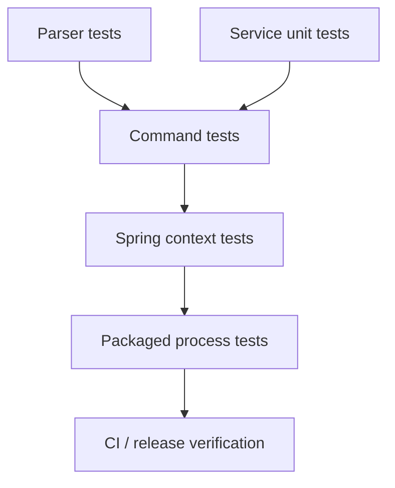

# Phân tầng kiểm thử parser, command, service và tiến trình

Kiểm thử một ứng dụng Spring Shell cần xác nhận nhiều phần khác nhau: cú pháp dòng lệnh được phân tích đúng, tham số được gắn vào command, command gọi đúng service, Spring khởi tạo đủ bean và tiến trình Java trả kết quả đúng cho hệ điều hành. Nếu chỉ kiểm tra method command hoặc chỉ kiểm tra dòng chữ hiển thị, một số lỗi quan trọng vẫn có thể lọt qua, chẳng hạn option sai kiểu, thiếu bean, command không được đăng ký hoặc process luôn trả mã thoát `0`.

Bài học thuộc chương **Kiểm thử**. Nội dung xây dựng chiến lược kiểm thử theo tầng từ parser, command, service, Spring context đến tiến trình đã đóng gói. Mỗi tầng có phạm vi, công cụ và loại lỗi cần phát hiện riêng; các tầng kết hợp tạo thành bộ kiểm thử đủ tin cậy cho terminal, script và CI/CD.

Sau bài học, bạn có thể:

- Chọn đúng tầng kiểm thử cho parser, command, service và process.
- Kiểm tra cú pháp option, argument, quoting và conversion.
- Dùng `@ShellTest`, `ShellTestClient`, `ShellScreen` và `ShellAssertions`.
- Giả lập dữ liệu nhập vào command bằng `ShellInputProvider`.
- Kiểm thử service độc lập với terminal và shell parser.
- Xác nhận command, service và cấu hình được đăng ký trong Spring context.
- Chạy JAR thật bằng `ProcessBuilder` để kiểm tra stdout, stderr và exit code.
- Tổ chức kiểm thử theo tầng trong Maven/Gradle và CI.

## Vì sao cần phân tầng kiểm thử?

Spring Shell kết hợp nhiều thành phần: parser, command registry, argument binding, command method, Spring bean, terminal renderer và runner. Một test duy nhất không thể xác nhận đầy đủ tất cả các thành phần này.

| Tầng | Câu hỏi cần trả lời | Công cụ phù hợp |
| --- | --- | --- |
| Parser | Cú pháp và giá trị được phân tích đúng không? | `CommandParser`, test cú pháp qua shell client. |
| Command | Command có nhận đúng option, gọi đúng service và tạo output đúng không? | `@ShellTest`, `ShellTestClient`. |
| Service | Quy tắc nghiệp vụ có đúng khi được gọi độc lập không? | JUnit, Mockito hoặc fake repository. |
| Spring context | Command, service, configuration và dependency có được wiring đúng không? | `@SpringBootTest`, `@ContextConfiguration`. |
| Process | JAR có khởi động, kết thúc và trả đúng mã cho hệ điều hành không? | `ProcessBuilder`, shell script hoặc CI job. |

Các tầng kiểm thử bổ sung cho nhau. Test parser và service thường chạy nhanh; test command kiểm tra việc ghép các thành phần; process test chạy chậm hơn nhưng xác nhận hành vi thật của artifact được phát hành.



Không cần chạy mọi trường hợp ở tầng process. Hãy kiểm tra nhiều biến thể nghiệp vụ ở unit test và command test, sau đó dùng một số kịch bản đại diện ở cấp tiến trình để xác nhận artifact và cấu hình khởi chạy.

## Dependency kiểm thử

Với Spring Shell 4.x và Spring Boot, các module test thường dùng là:

```xml
<dependencies>
    <dependency>
        <groupId>org.springframework.shell</groupId>
        <artifactId>spring-shell-test</artifactId>
        <scope>test</scope>
    </dependency>
    <dependency>
        <groupId>org.springframework.shell</groupId>
        <artifactId>spring-shell-test-autoconfigure</artifactId>
        <scope>test</scope>
    </dependency>
    <dependency>
        <groupId>org.springframework.boot</groupId>
        <artifactId>spring-boot-starter-test</artifactId>
        <scope>test</scope>
    </dependency>
</dependencies>
```

Quản lý phiên bản Spring Shell bằng dependency BOM hoặc dependency management của dự án để các module test cùng phiên bản với ứng dụng. `spring-shell-test` chứa API kiểm thử cốt lõi; `spring-shell-test-autoconfigure` cung cấp `@ShellTest` và cấu hình test cho ứng dụng Spring Boot.

Nếu service cần mock dependency, `spring-boot-starter-test` cung cấp JUnit Jupiter, AssertJ và Mockito. Chỉ thêm thư viện chuyên biệt khác khi dự án thật sự cần.

## Tầng parser: kiểm tra cú pháp và cách phân tích input

Parser chuyển dòng lệnh dạng text thành tên command, argument và option. Những lỗi cần kiểm tra gồm:

- Option dài và option ngắn.
- Dạng `--key=value` và `--key value`.
- Argument vị trí và thứ tự option.
- Giá trị có khoảng trắng được đặt trong dấu nháy.
- Dấu nháy hoặc escape không hợp lệ.
- Option bắt buộc bị thiếu.
- Giá trị không chuyển đổi được sang kiểu dữ liệu yêu cầu.

Ví dụ các lệnh tương đương về ý nghĩa:

```text
report export --format csv --output report.csv
report export --format=csv --output=report.csv
report export --output report.csv --format csv
```

Nếu command nhận một mô tả có khoảng trắng, kiểm tra cả cú pháp có dấu nháy:

```text
report create --name "Monthly sales report"
```

### Kiểm thử CommandParser trong Spring Shell 4.x

Spring Shell 4.x cung cấp interface `CommandParser` với `parse(String)` trả về `ParsedInput`. Có thể inject parser mặc định từ application context để kiểm tra các cú pháp cơ bản. Ví dụ giả định application context đã đăng ký `ReportCommands` như phần kiểm thử command bên dưới để parser nhận diện các command tương ứng:

```java
import static org.assertj.core.api.Assertions.assertThat;
import static org.assertj.core.api.Assertions.assertThatCode;

import org.junit.jupiter.api.Test;
import org.springframework.beans.factory.annotation.Autowired;
import org.springframework.shell.core.command.CommandParser;
import org.springframework.shell.core.command.ParsedInput;
import org.springframework.shell.test.autoconfigure.ShellTest;
import org.springframework.test.context.ContextConfiguration;

@ShellTest
@ContextConfiguration(classes = {TestShellApplication.class, ReportTestConfiguration.class})
class CommandParserTests {

    @Autowired
    CommandParser commandParser;

    @Test
    void parsesLongOptions() {
        ParsedInput parsed = commandParser.parse(
            "report status --id=42");

        assertThat(parsed).isNotNull();
    }

    @Test
    void acceptsQuotedValue() {
        assertThatCode(() -> commandParser.parse(
            "report note --message \"Monthly sales report\""))
            .doesNotThrowAnyException();
    }

    @Test
    void rejectsUnclosedQuote() {
        assertThatCode(() -> commandParser.parse(
            "report note --message \"Monthly sales report"))
            .isInstanceOf(RuntimeException.class);
    }
}
```

Test này xác nhận parser được wiring trong context và chấp nhận/từ chối các dạng input cơ bản. Nếu ứng dụng cung cấp parser tùy chỉnh, hãy kiểm tra riêng quy tắc đặc thù của parser đó. Với parser mặc định, tránh lặp lại toàn bộ test nội bộ của framework; ưu tiên kiểm tra các cú pháp mà người dùng thực sự được hỗ trợ.

Trong Spring Shell 4.x, `CommandParser.parse(String)` xử lý raw command line. API parser của 3.3.x khác: `org.springframework.shell.command.CommandParser` nhận mảng `String[]` và trả về kết quả parse riêng của dòng 3.x. Không dùng import hoặc assertion dựa trên `ParsedInput` của 4.x trong project 3.3.x.

### Kiểm tra parser qua đường gọi command

Test parser trực tiếp không thay thế command test. Parser có thể tách chuỗi đúng nhưng command vẫn nhận sai kiểu, sai default hoặc gọi nhầm service. Hãy thêm test qua `ShellTestClient` cho các trường hợp quan trọng như thiếu option bắt buộc, giá trị enum không hợp lệ và input có khoảng trắng.

## Tầng service: kiểm thử quy tắc nghiệp vụ độc lập

Service không nên phụ thuộc vào terminal, prompt, ANSI color hoặc cách parser chia token. Unit test service tập trung vào kết quả nghiệp vụ và tương tác với repository/client.

Ví dụ service xuất báo cáo:

```java
import org.springframework.stereotype.Service;

record Report(String id, String status) {
}

class ReportNotFoundException extends RuntimeException {
    ReportNotFoundException(String reportId) {
        super("Report not found: " + reportId);
    }
}

interface ReportRepository {
    Report findById(String id);
}

@Service
class ReportService {

    private final ReportRepository repository;

    public ReportService(ReportRepository repository) {
        this.repository = repository;
    }

    public String status(String reportId) {
        Report report = repository.findById(reportId);
        if (report == null) {
            throw new ReportNotFoundException(reportId);
        }
        return report.status();
    }
}
```

Unit test dùng Mockito để kiểm tra kết quả và các nhánh nghiệp vụ:

```java
import static org.assertj.core.api.Assertions.assertThat;
import static org.assertj.core.api.Assertions.assertThatThrownBy;
import static org.mockito.Mockito.verify;
import static org.mockito.Mockito.when;

import org.junit.jupiter.api.Test;
import org.junit.jupiter.api.extension.ExtendWith;
import org.mockito.InjectMocks;
import org.mockito.Mock;
import org.mockito.junit.jupiter.MockitoExtension;

@ExtendWith(MockitoExtension.class)
class ReportServiceTests {

    @Mock
    ReportRepository repository;

    @InjectMocks
    ReportService service;

    @Test
    void returnsReportStatus() {
        when(repository.findById("42"))
            .thenReturn(new Report("42", "READY"));

        assertThat(service.status("42")).isEqualTo("READY");
        verify(repository).findById("42");
    }

    @Test
    void rejectsUnknownReport() {
        when(repository.findById("missing")).thenReturn(null);

        assertThatThrownBy(() -> service.status("missing"))
            .isInstanceOf(ReportNotFoundException.class);
    }
}
```

`Report`, `ReportNotFoundException` là kiểu dữ liệu và exception do ứng dụng định nghĩa. Test tập trung vào hành vi của service, không khởi động Spring Shell hoặc terminal.

Với service có transaction, security, cache hoặc event, cần thêm test tích hợp phù hợp để xác nhận các proxy và infrastructure đó hoạt động. Unit test dùng `new` hoặc `@InjectMocks` không tự kiểm tra các interceptor do Spring cung cấp.

## Tầng command: kiểm tra binding, gọi service và output

Command test cần chạy qua Spring Shell để kiểm tra cách parser, command registry, argument binding và result handler kết hợp với nhau. Spring Shell 4.x cung cấp:

- `@ShellTest`: tạo test context cho shell components.
- `ShellTestClient`: gửi command hoặc input giả lập.
- `ShellScreen`: biểu diễn nội dung shell hiển thị.
- `ShellAssertions`: assertion chuyên cho shell screen.
- `ShellInputProvider`: cung cấp input hoặc password cho command cần hỏi thêm.

Ví dụ command:

```java
import org.springframework.shell.core.command.annotation.Command;
import org.springframework.shell.core.command.annotation.Option;
import org.springframework.stereotype.Component;

@Component
public class ReportCommands {

    private final ReportService reportService;

    public ReportCommands(ReportService reportService) {
        this.reportService = reportService;
    }

    @Command(name = "report status", description = "Xem trạng thái báo cáo")
    public String status(@Option(longName = "id") String id) {
        return "Report " + id + ": " + reportService.status(id);
    }

    @Command(name = "report note", description = "Ghi chú báo cáo")
    public String note(@Option(longName = "message") String message) {
        return "Note: " + message;
    }
}
```

Tạo một ứng dụng test và bean service giả:

```java
import org.springframework.boot.autoconfigure.SpringBootApplication;

@SpringBootApplication
class TestShellApplication {
}
```

Đặt `TestShellApplication`, `ReportCommands` và các lớp test trong package được component scan của ứng dụng bao phủ để command bean được phát hiện.

```java
import org.springframework.boot.test.context.TestConfiguration;
import org.springframework.context.annotation.Bean;

@TestConfiguration
class ReportTestConfiguration {

    @Bean
    ReportRepository reportRepository() {
        return id -> new Report(id, "READY");
    }
}
```

Kiểm thử command bằng `ShellTestClient`:

```java
import static org.springframework.shell.test.ShellAssertions.assertThat;

import org.junit.jupiter.api.Test;
import org.springframework.beans.factory.annotation.Autowired;
import org.springframework.test.context.ContextConfiguration;
import org.springframework.shell.test.ShellScreen;
import org.springframework.shell.test.ShellTestClient;
import org.springframework.shell.test.autoconfigure.ShellTest;

@ShellTest
@ContextConfiguration(classes = {
    TestShellApplication.class,
    ReportTestConfiguration.class
})
class ReportCommandTests {

    @Autowired
    ShellTestClient client;

    @Test
    void bindsOptionAndDisplaysServiceResult() throws Exception {
        ShellScreen screen = client.sendCommand("report status --id 42");

        assertThat(screen).containsText("Report 42: READY");
    }
}
```

`ShellTestClient.sendCommand(...)` thực thi command như thể người dùng đã nhập nó. Test xác nhận đồng thời tên command, cú pháp option, binding tham số, wiring service và output cuối. Nếu command không tồn tại, `sendCommand(...)` có thể ném `CommandNotFoundException`; hãy kiểm tra trường hợp này khi command registry là một phần quan trọng của cấu hình.

### Giả lập input bổ sung

Command có thể đọc dữ liệu qua `CommandContext.inputReader()` hoặc prompt/component. Trong Spring Shell 4.x, `ShellInputProvider` giúp cung cấp dữ liệu kiểm thử:

```java
import org.springframework.shell.test.ShellInputProvider;
import org.springframework.shell.test.ShellScreen;

ShellInputProvider input = ShellInputProvider
    .providerFor("report annotate")
    .withInput("Đã xác minh")
    .build();

ShellScreen screen = client.sendCommand(input);
```

API cũng hỗ trợ hàng đợi password riêng để kiểm thử prompt bí mật. Không đưa password thật vào test log hoặc fixture được commit. Dùng dữ liệu giả và xác nhận output không làm lộ nội dung password.

### Kiểm tra command lỗi và validation

Command test nên bao gồm:

- Option bắt buộc bị thiếu.
- Option không chuyển đổi được sang kiểu đích.
- Giá trị không qua validation.
- Command không tồn tại hoặc hiện không khả dụng.
- Service ném exception nghiệp vụ.
- Output lỗi có thông báo dễ hiểu và không chứa stack trace/secret ngoài ý muốn.

Không chỉ kiểm tra command thành công. Lỗi parser, lỗi validation và lỗi nghiệp vụ thường đi qua các result handler khác nhau.

## Kiểm thử interactive session trong Spring Shell 3.3.x

API test của Spring Shell 3.3.x khác với API `sendCommand(...)` trong 4.x. Với dòng 3.3.x, `ShellTestClient` cung cấp session tương tác và không tương tác:

```java
import java.util.concurrent.TimeUnit;

import org.junit.jupiter.api.Test;
import org.springframework.beans.factory.annotation.Autowired;
import org.springframework.shell.test.ShellAssertions;
import org.springframework.shell.test.ShellTestClient;
import org.springframework.shell.test.ShellTestClient.InteractiveShellSession;
import org.springframework.shell.test.ShellTestClient.NonInteractiveShellSession;
import org.springframework.shell.test.autoconfigure.ShellTest;
import org.springframework.test.annotation.DirtiesContext;

import static org.awaitility.Awaitility.await;

@ShellTest
@DirtiesContext(classMode = DirtiesContext.ClassMode.AFTER_EACH_TEST_METHOD)
class InteractiveShellTests {

    @Autowired
    ShellTestClient client;

    @Test
    void sendsCommandToInteractiveSession() {
        InteractiveShellSession session = client.interactive().run();

        await().atMost(2, TimeUnit.SECONDS).untilAsserted(() ->
            ShellAssertions.assertThat(session.screen())
                .containsText("shell"));

        session.write(session.writeSequence()
            .text("help")
            .carriageReturn()
            .build());

        await().atMost(2, TimeUnit.SECONDS).untilAsserted(() ->
            ShellAssertions.assertThat(session.screen())
                .containsText("AVAILABLE COMMANDS"));
    }
}
```

Với non-interactive command, API 3.3.x dùng `client.nonInterative(...).run()`; tên method trong API có cách viết `nonInterative` như trên:

```java
NonInteractiveShellSession session = client
    .nonInterative("report", "status", "--id", "42")
    .run();

await().atMost(2, TimeUnit.SECONDS).untilAsserted(() ->
    ShellAssertions.assertThat(session.screen())
        .containsText("Report 42: READY"));
```

Các session có hoạt động terminal bất đồng bộ. Hãy đợi một điều kiện cụ thể bằng Awaitility hoặc cơ chế đồng bộ tương đương; tránh dùng `Thread.sleep(...)` với thời gian cố định. `@DirtiesContext` sau mỗi test hữu ích khi test tạo interactive session có trạng thái terminal riêng.

Không sao chép trực tiếp API session 3.3.x vào test 4.x. Spring Shell 4.x dùng `ShellTestClient.sendCommand(...)` cho lệnh và `ShellInputProvider` cho input bổ sung.

## Tầng Spring context: xác nhận wiring và cấu hình

Unit test có thể tạo service thành công dù Spring application context không khởi động được. Context test kiểm tra các thành phần được đăng ký đúng:

- Command bean được phát hiện và đăng ký.
- Service, repository và client được inject.
- Configuration properties được bind.
- Bean theo profile được chọn đúng.
- Validation cấu hình được kích hoạt.
- Không có bean bị thiếu hoặc nhiều implementation gây xung đột.

Ví dụ:

```java
import static org.assertj.core.api.Assertions.assertThat;

import org.junit.jupiter.api.Test;
import org.springframework.beans.factory.annotation.Autowired;
import org.springframework.boot.test.context.SpringBootTest;
import org.springframework.context.ApplicationContext;

@SpringBootTest(
    classes = {TestShellApplication.class, ReportTestConfiguration.class},
    properties = "spring.shell.interactive.enabled=false")
class ApplicationContextTests {

    @Autowired
    ApplicationContext context;

    @Test
    void registersCommandAndServiceBeans() {
        assertThat(context.getBean(ReportCommands.class)).isNotNull();
        assertThat(context.getBean(ReportService.class)).isNotNull();
    }
}
```

`spring.shell.interactive.enabled=false` tránh mở REPL trong test khởi tạo application. Nếu chỉ kiểm tra shell components, `@ShellTest` thường nhẹ hơn một full `@SpringBootTest`. Nếu cần xác nhận toàn bộ auto-configuration, profile và external configuration, dùng context test đầy đủ.

## Kiểm thử đầu-cuối bằng Spring Boot

Spring Shell có thể được kiểm thử đầu-cuối trong Spring Boot test context bằng `@SpringBootTest` và `OutputCaptureExtension`. Cách này hữu ích khi muốn khởi chạy một command qua application runner và kiểm tra console output.

```java
import static org.assertj.core.api.Assertions.assertThat;

import org.junit.jupiter.api.Test;
import org.springframework.boot.test.context.SpringBootTest;
import org.springframework.boot.test.system.CapturedOutput;
import org.springframework.boot.test.system.OutputCaptureExtension;
import org.junit.jupiter.api.extension.ExtendWith;

@SpringBootTest(
    webEnvironment = SpringBootTest.WebEnvironment.NONE,
    useMainMethod = SpringBootTest.UseMainMethod.ALWAYS,
    classes = MyShellApplication.class,
    properties = "spring.shell.interactive.enabled=false",
    args = {"report", "status", "--id", "42"})
@ExtendWith(OutputCaptureExtension.class)
class ShellStartupTests {

    @Test
    void executesStartupCommand(CapturedOutput output) {
        assertThat(output).contains("Report 42: READY");
    }
}
```

Vì command được truyền trong `args` của `@SpringBootTest`, cách này không thuận tiện khi cần chạy nhiều command khác nhau trong cùng test class. Dùng `ShellTestClient` cho nhiều command; dùng `@SpringBootTest` với `OutputCaptureExtension` cho một kịch bản startup đại diện.

## Tầng process: kiểm tra JAR và mã thoát thật

Shell test client chạy command trong test context. Nó không thay thế kiểm tra tiến trình Java độc lập. Process test xác nhận artifact đã đóng gói có thể chạy trong môi trường gần với người dùng:

- JAR khởi động được với JVM và cấu hình triển khai.
- Runner chọn đúng interactive hoặc non-interactive mode.
- Command thực thi qua process arguments.
- stdout chứa dữ liệu kết quả và stderr chứa log/lỗi theo thiết kế.
- Process kết thúc trong thời gian cho phép.
- Exit code phản ánh thành công hoặc thất bại.

Ví dụ kiểm tra JAR bằng `ProcessBuilder`:

```java
import static org.assertj.core.api.Assertions.assertThat;

import java.nio.file.Files;
import java.nio.file.Path;
import java.util.concurrent.TimeUnit;

import org.junit.jupiter.api.Test;
import org.junit.jupiter.api.io.TempDir;

class ReportCliProcessTests {

    @Test
    void runsStatusCommandAndReturnsSuccess(@TempDir Path tempDir) throws Exception {
        Path stdout = tempDir.resolve("report-cli.out");
        Path stderr = tempDir.resolve("report-cli.err");
        String javaExecutable = Path.of(
            System.getProperty("java.home"),
            "bin",
            System.getProperty("os.name").startsWith("Windows") ? "java.exe" : "java")
            .toString();

        Process process = new ProcessBuilder(
                javaExecutable,
                "-Dspring.shell.interactive.enabled=false",
                "-jar", "target/report-cli.jar",
                "report", "status", "--id", "42")
            .redirectOutput(stdout.toFile())
            .redirectError(stderr.toFile())
            .start();

        boolean finished = process.waitFor(30, TimeUnit.SECONDS);
        if (!finished) {
            process.destroyForcibly();
            process.waitFor();
        }

        assertThat(finished).isTrue();
        assertThat(process.exitValue()).isZero();
        assertThat(Files.readString(stdout)).contains("Report 42: READY");
    }
}
```

Đặt system property trước `-jar` để JVM nhận được nó. Các token command đặt sau tên JAR là application arguments. `ProcessBuilder` nhận từng token riêng nên không cần tự thêm dấu nháy kiểu Bash hoặc PowerShell cho mỗi argument. Nếu một giá trị có khoảng trắng, truyền nó thành một phần tử chuỗi duy nhất trong danh sách arguments.

Trong test thực tế, hãy lấy đường dẫn JAR từ build output hoặc system property thay vì phụ thuộc một working directory cố định. Dọn file tạm bằng `@TempDir` hoặc `Files.deleteIfExists(...)` sau test.

### Kiểm tra trường hợp lỗi

Thêm một test chạy command với dữ liệu không hợp lệ hoặc tài nguyên không tồn tại. Xác nhận process trả đúng mã khác `0`, stderr có thông báo phù hợp và không có file đầu ra thành công bị tạo nhầm. Nếu ứng dụng dùng exit code tùy chỉnh, test phải xác nhận đúng mã đã quy ước.

Không chỉ kiểm tra output text. Một command có thể in thông báo lỗi nhưng process vẫn trả `0`; pipeline sẽ xem đó là thành công. Tương tự, không suy ra process exit code từ `ExitStatus` của command nếu chưa kiểm tra cầu nối runner/exception mapper trong ứng dụng.

### Chạy process test sau khi đóng gói

Process test cần JAR đã được tạo. Với Maven, có thể đặt test này vào integration-test phase bằng Maven Failsafe và chạy `mvn verify`. Với Gradle, có thể tạo source set/task `integrationTest` phụ thuộc vào `bootJar` hoặc `jar` rồi đưa task đó vào `check` khi CI cần.

Không chạy process test phụ thuộc JAR trong pha unit test trước khi artifact được đóng gói, trừ khi build đã có bước chuẩn bị JAR tương ứng.

## Kiểm tra terminal output và input bất đồng bộ

Terminal khác với một chuỗi text thông thường. Nội dung nhìn thấy có thể đi kèm ANSI escape, điều khiển con trỏ, cập nhật dòng tại chỗ và thay đổi kích thước terminal. Vì vậy:

- Ưu tiên assertion theo nội dung có ý nghĩa thay vì so sánh toàn bộ chuỗi có ANSI.
- Kiểm tra bảng hoặc TUI ở một số kích thước terminal đại diện.
- Chờ điều kiện screen cập nhật thay vì giả định thao tác ghi input đồng bộ.
- Kiểm tra Unicode, line ending và nội dung dài trên hệ điều hành mục tiêu.
- Dùng terminal giả lập cho test tự động; vẫn chạy smoke test trên terminal thật khi phát hành.

Spring Shell test auto-configuration cho phép thay đổi kích thước terminal giả lập qua `spring.shell.test.terminal-width` và `spring.shell.test.terminal-height` trong các bản 3.x. Ví dụ:

```java
@ShellTest(properties = {
    "spring.shell.test.terminal-width=120",
    "spring.shell.test.terminal-height=40"
})
class WideTerminalTests {
}
```

Các property terminal test này thuộc test auto-configuration của dòng 3.x. Hãy xác nhận API annotation và property của đúng phiên bản đang dùng trước khi tái sử dụng cấu hình này trong project 4.x.

## Ma trận kiểm thử đề xuất

| Khu vực | Trường hợp thành công | Trường hợp lỗi |
| --- | --- | --- |
| Parser | Option hợp lệ, quoting hợp lệ, thứ tự option khác nhau. | Thiếu option, sai kiểu, dấu nháy không đóng. |
| Command | Binding đúng, gọi service đúng, output đúng. | Command không tồn tại, unavailable, exception được xử lý. |
| Service | Kết quả nghiệp vụ đúng, dependency được gọi đúng. | Không tìm thấy dữ liệu, vi phạm quy tắc, dependency lỗi. |
| Context | Bean và profile được đăng ký đúng. | Thiếu bean, cấu hình sai, validation thất bại. |
| Process | JAR khởi động, stdout đúng, exit code `0`. | Timeout, stderr có lỗi, exit code khác `0`. |
| Terminal | Prompt, bảng, selector và TUI hiển thị đúng. | Terminal hẹp, input không hợp lệ, không có TTY. |

Không cần kiểm thử mọi tổ hợp ở mọi tầng. Hãy đặt phần lớn biến thể dữ liệu và quy tắc trong service unit test; kiểm tra các đường kết nối chính trong command/context test; chỉ chọn các kịch bản đại diện để chạy process test.

## Tổ chức kiểm thử trong CI

Một pipeline thường chia thành các bước:

1. **Unit tests:** parser tùy chỉnh, service, mapper và validator chạy nhanh.
2. **Shell component tests:** command binding, output, prompt và input provider.
3. **Context tests:** Spring wiring, configuration properties, profile và security.
4. **Package:** tạo JAR/ứng dụng phân phối.
5. **Process integration tests:** chạy artifact với command thành công và thất bại; xác nhận stdout, stderr, timeout và exit code.
6. **Cross-platform smoke tests:** chạy một tập lệnh nhỏ trên Linux và Windows nếu CLI hỗ trợ cả hai.

Khi test phụ thuộc môi trường, dùng profile hoặc test configuration riêng. Không gọi API production, không dùng credential thật và không phụ thuộc dữ liệu bên ngoài có thể thay đổi theo thời gian. Nếu cần kiểm tra HTTP client, dùng mock server hoặc stub có dữ liệu cố định.

## Lỗi thường gặp

| Hiện tượng | Nguyên nhân | Cách xử lý |
| --- | --- | --- |
| Test context bị treo ở prompt | Interactive runner được bật và test không gửi lệnh thoát. | Dùng `@ShellTest` hoặc tắt interactive mode cho context test. |
| Test command không phát hiện lỗi option | Chỉ gọi method Java trực tiếp, bỏ qua parser và argument binding. | Gọi command bằng `ShellTestClient`. |
| Test service cần khởi động terminal | Service đang phụ thuộc command/UI. | Tách nghiệp vụ vào service độc lập và mock repository/client. |
| Test interactive chập chờn | Screen cập nhật bất đồng bộ. | Dùng Awaitility hoặc điều kiện chờ có timeout, không dùng sleep cố định. |
| Assertion output thất bại do mã màu | Test so sánh ANSI escape hoặc khoảng trắng terminal. | Assert nội dung có ý nghĩa và kiểm soát theme/terminal khi cần. |
| `@ShellTest` không tìm thấy bean | Thiếu test auto-configuration hoặc class cấu hình chưa được import. | Thêm đúng test module và `@ContextConfiguration`/`@Import`. |
| Process test luôn trả mã `0` | Test chỉ đọc output hoặc chưa cấu hình ánh xạ lỗi thành process exit code. | Kiểm tra `Process.exitValue()` và test cả đường lỗi. |
| Process test timeout | Runner đang chờ input, thread nền giữ JVM hoặc command bị chặn. | Tắt interactive mode, thêm timeout và thu log/thread dump khi cần. |
| JAR không tồn tại trong test | Process test chạy trước pha package. | Chuyển sang integration-test/verify hoặc task phụ thuộc bootJar. |
| Test pass trên Linux nhưng fail trên Windows | Quoting, line ending, path, Unicode hoặc shell redirection khác nhau. | Dùng `ProcessBuilder` với token riêng, `Path` API và CI đa nền tảng. |
| Test 3.3.x không biên dịch với API 4.x | Test client/parser đã thay đổi giữa hai dòng phiên bản. | Dùng API theo đúng Spring Shell dependency của project. |

## Checklist trước khi phát hành

- [ ] Parser được kiểm tra với option, argument, quoting và conversion quan trọng.
- [ ] Command được gọi qua `ShellTestClient`, không chỉ gọi method trực tiếp.
- [ ] Input bổ sung và password prompt được giả lập bằng test data.
- [ ] Service có unit test cho cả nhánh thành công và lỗi nghiệp vụ.
- [ ] Spring context test xác nhận command, service và configuration được wiring.
- [ ] Interactive test có timeout và đồng bộ với screen update.
- [ ] Terminal output được kiểm tra ở kích thước phù hợp.
- [ ] Process test chạy JAR đã đóng gói và xác nhận exit code thật.
- [ ] stdout và stderr được kiểm tra riêng nếu CLI có phân luồng output.
- [ ] Process test có timeout và dọn process nếu không kết thúc.
- [ ] CI kiểm tra ít nhất một kịch bản thành công và một kịch bản thất bại ở cấp process.
- [ ] API test được chọn đúng phiên bản Spring Shell 3.3.x hoặc 4.x.

## Ghi nhớ

Phân tầng kiểm thử giúp tìm lỗi đúng nơi: parser kiểm tra cú pháp; command test kiểm tra binding, service call và output; service test kiểm tra quy tắc nghiệp vụ; context test kiểm tra Spring wiring; process test kiểm tra JAR, stdout/stderr và exit code thật. Trong Spring Shell 4.x, dùng `@ShellTest`, `ShellTestClient.sendCommand(...)`, `ShellScreen`, `ShellAssertions` và `ShellInputProvider`. Trong 3.3.x, `ShellTestClient` dùng các interactive/non-interactive session. Luôn kiểm tra artifact đã đóng gói ở cấp process trước khi đưa CLI vào CI/CD.

## Tài liệu tham khảo

- [Spring Shell 4.0.3 — Testing](https://docs.spring.io/spring-shell/reference/testing.html): `@ShellTest`, `ShellTestClient`, `ShellScreen`, `ShellAssertions`, `ShellInputProvider` và end-to-end test.
- [Spring Shell 4.0.3 API — `ShellTestClient`](https://docs.spring.io/spring-shell/reference/api/org/springframework/shell/test/ShellTestClient.html): gửi command và input provider vào shell.
- [Spring Shell 4.0.3 API — `ShellInputProvider`](https://docs.spring.io/spring-shell/reference/api/org/springframework/shell/test/ShellInputProvider.html): giả lập input và password cho command.
- [Spring Shell 4.0.3 API — `CommandParser`](https://docs.spring.io/spring-shell/reference/api/org/springframework/shell/core/command/CommandParser.html): parse raw input thành `ParsedInput`.
- [Spring Shell 4.0.3 — Command Syntax](https://docs.spring.io/spring-shell/reference/commands/syntax.html): option, argument, quoting và escape.
- [Spring Shell 3.3.4 — Execution](https://docs.spring.io/spring-shell/reference/3.3/execution.html): interactive và non-interactive runner của dòng 3.3.x.
- [Spring Shell 3.3.0 API — `ShellTestClient`](https://docs.spring.io/spring-shell/docs/3.3.0/api/org/springframework/shell/test/ShellTestClient.html): interactive và non-interactive session API của dòng 3.x.
- [Spring Shell 3.3.0 API — `ShellAssertions`](https://docs.spring.io/spring-shell/docs/3.3.0/api/org/springframework/shell/test/ShellAssertions.html): assertion cho nội dung `ShellScreen`.
- [Spring Shell 3.3.0 API — `@ShellTest`](https://docs.spring.io/spring-shell/docs/3.3.0/api/org/springframework/shell/test/autoconfigure/ShellTest.html): bootstrap test context và cấu hình terminal test.
- [Spring Shell 4.0.4 Release](https://spring.io/blog/2026/11/19/spring-shell-4-0-4-available-now/): bản phát hành 4.0.4 và trạng thái bảo trì của dòng 4.x.
