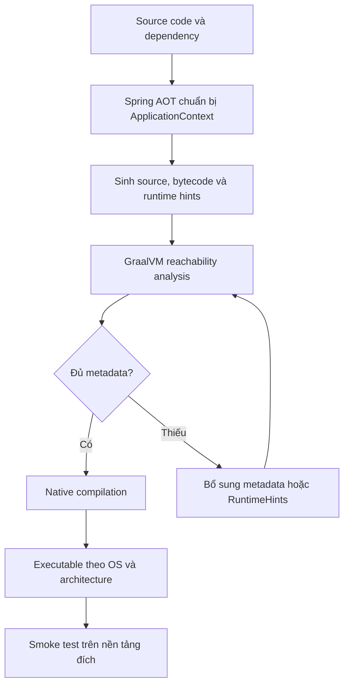

# GraalVM native image và giới hạn của nhánh Spring Shell mục tiêu

GraalVM Native Image cho phép đóng gói ứng dụng Spring Shell thành một executable độc lập, không cần cài JVM trên máy chạy. Native executable thường khởi động nhanh và có thể dùng ít bộ nhớ hơn ứng dụng chạy trên JVM. Đổi lại, việc biên dịch dựa trên phân tích tĩnh và Spring Ahead-of-Time (AOT), vì vậy một số khả năng nạp lớp, tạo bean hoặc truy cập tài nguyên động ở runtime bị giới hạn.

Bài học thuộc chương **Đóng gói và phân phối**. Nội dung tập trung vào cách Spring Shell sử dụng AOT và GraalVM hints, sự khác nhau giữa tài liệu hỗ trợ của nhánh 3.3.x và mức tương thích được ghi nhận cho nhánh 4.x, cách bật Native Build Tools, cách bổ sung runtime hints và cách kiểm thử executable trên nền tảng đích.

Sau bài học, bạn có thể:

- Giải thích khác biệt giữa JAR chạy trên JVM và GraalVM Native Image.
- Mô tả vai trò của Spring AOT, reachability analysis và runtime hints.
- Đánh giá tín hiệu hỗ trợ native image theo phiên bản Spring Shell.
- Cấu hình GraalVM Reachability Metadata Repository cho Gradle hoặc Maven.
- Bổ sung hints cho reflection, resource, serialization và proxy khi cần.
- Nhận biết giới hạn của closed-world, classpath cố định và cấu hình bean tại build time.
- Kiểm tra JLine/terminal provider và native toolchain của hệ điều hành đích.
- Xây dựng quy trình kiểm thử JVM, AOT và native executable trước khi phát hành.

## JAR trên JVM và native executable

Với cách đóng gói JVM thông thường, ứng dụng được biên dịch thành bytecode trong JAR. Khi khởi chạy, JVM nạp class, tạo Spring ApplicationContext, xử lý cấu hình và thực thi chương trình.

Với GraalVM Native Image, `native-image` phân tích điểm vào ứng dụng cùng các đường thực thi có thể truy cập, sau đó biên dịch mã và tài nguyên cần thiết thành executable cho một nền tảng cụ thể.

| Đặc điểm | JAR trên JVM | GraalVM Native Image |
| --- | --- | --- |
| Artifact | JAR và JVM tương thích | Executable theo OS/architecture đích |
| Khởi động | JVM khởi tạo rồi nạp ứng dụng | Khởi chạy trực tiếp executable |
| Phân tích code | Nhiều quyết định được thực hiện lúc runtime | Reachability được phân tích lúc build |
| Classpath | Có thể cấu hình khi chạy JVM | Cố định trong executable |
| Reflection/resource động | JVM có thể truy cập theo classpath và reflection thông thường | Cần được nhận diện tĩnh hoặc khai báo hints |
| Spring bean graph | Có thể phụ thuộc cấu hình và điều kiện runtime | Được chuẩn bị bởi AOT tại build time |
| Chi phí build | Thường thấp hơn | Cao hơn; native compilation có thể tốn thời gian và tài nguyên |

Native Image phù hợp khi thời gian khởi động, bộ nhớ hoặc việc phân phối executable là yêu cầu quan trọng. JAR trên JVM vẫn là lựa chọn tốt khi ứng dụng phụ thuộc nhiều vào plugin động, classpath thay đổi khi chạy hoặc cần thời gian build ngắn.

## Mức hỗ trợ theo nhánh Spring Shell

Không nên gộp mọi phiên bản Spring Shell vào một kết luận chung. Tài liệu và tín hiệu tương thích của từng nhánh có mức độ khác nhau.

| Nhánh | Bằng chứng hỗ trợ native image | Cách hiểu phù hợp |
| --- | --- | --- |
| Spring Shell 3.3.4 | Trang Building 3.3.4 có mục Native Support, mô tả Spring Boot/Framework AOT, GraalVM configuration của Spring Shell và Reachability Metadata Repository. | Có hướng dẫn biên dịch native. Cần tự kiểm tra toàn bộ dependency của ứng dụng và artifact trên nền tảng đích. |
| Spring Shell 4.0.2 trở lên | Bảng GraalVM Libraries and Frameworks liệt kê `spring-shell-core` và `spring-shell-core-autoconfigure` từ 4.0.2 với mức `★`. | Có tín hiệu community-tested thông qua Reachability Metadata Repository; đây không phải bảo đảm mọi tổ hợp dependency đều chạy được. |
| Spring Shell 4.0.4 | Bản stable phát hành ngày 19-11-2026; tài liệu Building 4.0.x mô tả Native Support và cách bật metadata repository. | Dùng patch release tương thích mới nhất của dự án và vẫn phải build, kiểm thử chính ứng dụng. |

Ký hiệu `★` của GraalVM nghĩa là thư viện được cộng đồng kiểm thử liên tục trong Reachability Metadata Repository hoặc một dự án cộng đồng tương đương. Ký hiệu này khác với `★★`, là mức kiểm thử liên tục do chính maintainer thực hiện. Bảng tương thích hiện liệt kê hai artifact Spring Shell từ 4.0.2; không thấy artifact 3.3.x trong mục đó. Điều này không chứng minh 3.3.x không thể biên dịch native, vì tài liệu 3.3.4 vẫn có hướng dẫn riêng. Nó cho thấy mức xác nhận cộng đồng trong bảng hiện tại dành cho 4.0.2+ rõ ràng hơn.

Khi dự án đang dùng Spring Shell 3.3.x, hãy giữ Spring Boot 3.x và dependency management tương ứng, bật native build theo tài liệu của đúng dòng đó, rồi kiểm thử thực tế. Không nâng riêng Spring Shell hoặc Spring Boot chỉ để đạt native image nếu chưa đánh giá tương thích API và dependency của ứng dụng.

### Các mốc native image cần biết trong nhánh 4.0.x

Release notes của Spring Shell 4.x ghi nhận một số vấn đề native image đã được sửa qua các patch release:

| Phiên bản | Ghi nhận trong release notes | Ý nghĩa khi chọn phiên bản |
| --- | --- | --- |
| 4.0.1 | Migration guide ghi rõ GraalVM chưa hỗ trợ annotated commands. | Không dùng 4.0.1 làm baseline cho ứng dụng native dựa trên command annotation. |
| 4.0.2 | Sửa lỗi annotated commands không được đăng ký trong GraalVM native binary (`#1229`). | Đây là mốc có bản sửa cho command annotation; vẫn phải kiểm thử command registry trong binary. |
| 4.0.3 | Sửa thiếu runtime hints cho tài nguyên `stg` của JLine khi native compilation (`#1358`). | Có bản sửa cho một nhóm tài nguyên terminal; cần kiểm tra lại provider và resource thực tế của ứng dụng. |
| 4.0.4 | Phát hành ngày 19-11-2026, cập nhật Spring Framework, Spring Boot, JLine và các bản sửa lỗi. | Ưu tiên patch tương thích mới nhất; xác nhận dependency tree và chạy native smoke tests sau nâng cấp. |

Các mốc trên cho thấy trạng thái native image có thể thay đổi giữa các patch release. Một bản build thành công ở 4.0.2 không thay thế việc kiểm tra lại sau khi nâng cấp JLine, Spring Boot hoặc Spring Shell. Khi gặp lỗi command không xuất hiện hoặc thiếu resource trong executable, kiểm tra release notes trước khi tự thêm reflection/resource hints trùng với phần framework đã sửa.

## Spring AOT và GraalVM hints

Spring Boot và Spring Framework thực hiện phần lớn công việc AOT. Spring Shell bổ sung GraalVM configuration cho các thành phần riêng của framework. Các thư viện bên thứ ba có thể cần metadata bổ sung.

Quy trình khái quát:



Spring AOT phân tích bean definitions tại build time và tạo code khởi tạo context. GraalVM sử dụng thông tin reachability để loại bỏ phần không thể truy cập và giữ lại những phần cần thiết. Các hints có thể mô tả:

- Reflection: class, constructor, method hoặc field được truy cập qua reflection.
- Resources: file trong classpath cần được đóng gói và đọc lúc chạy.
- Serialization: kiểu dữ liệu cần serialize/deserialize theo cơ chế yêu cầu reflection.
- Proxy: JDK proxy hoặc proxy cần được tạo trước khi native executable chạy.
- JNI: thành phần gọi native interface.

Spring AOT tự sinh nhiều hints cho các mẫu mà framework nhận diện được. Spring Shell cũng cung cấp GraalVM configuration riêng. Chỉ bổ sung custom hints khi log build hoặc kiểm thử runtime chỉ ra metadata còn thiếu.

## Closed-world và các giới hạn cần hiểu

Native Image dùng giả định closed-world: những lớp, tài nguyên và hành vi cần có phải được xác định trong quá trình build. Spring AOT cũng chuẩn bị bean graph tại build time. Điều này tạo ra một số giới hạn thực tế.

### Bean graph được xác định tại build time

Các bean trong ứng dụng không thể tùy ý thay đổi theo môi trường runtime. Profile và điều kiện tạo bean được đánh giá trong quá trình AOT. Ví dụ, `@Profile`, `@ConditionalOnProperty` hoặc thuộc tính `.enabled` có ảnh hưởng tới việc tạo bean cần được cấu hình phù hợp khi build.

Nếu một command chỉ được đăng ký khi profile `production` hoạt động, native executable được build với cấu hình AOT của profile đó sẽ chứa bean graph tương ứng. Không nên kỳ vọng bật profile khác khi chạy executable sẽ tái tạo một bean graph mới như ứng dụng JVM thông thường.

Hãy xác định rõ môi trường build, profile AOT và cấu hình cần có trong executable. Nếu cần thay đổi một giá trị khi chạy, ưu tiên thiết kế bean đã tồn tại và đọc giá trị cấu hình runtime; đừng dựa vào việc tạo hoặc loại bỏ bean sau khi native image đã được build.

### Classpath cố định

Native executable không thể nhận thêm JAR tùy ý vào classpath sau khi build. Các tính năng plugin yêu cầu quét thư mục plugin rồi nạp class mới bằng `URLClassLoader` hoặc tên class lấy từ cấu hình runtime không phù hợp với giả định này.

Với Spring Shell, hãy đăng ký command, converter, completion provider và component cần thiết trong application context ở thời điểm AOT. Nếu ứng dụng có plugin, cân nhắc biên dịch các extension vào executable hoặc giữ cách phân phối JVM cho bản hỗ trợ plugin động.

### Reflection và resource phải được nhận diện

GraalVM không tự biết mọi thao tác reflection, resource scanning, serialization hoặc proxy sẽ xảy ra ở runtime. Một ứng dụng có thể biên dịch thành công nhưng lỗi khi người dùng chạy command đi vào một nhánh chưa được kiểm thử.

Các trường hợp cần chú ý:

- Đọc template hoặc banner bằng tên resource được ghép từ chuỗi runtime.
- Nạp class bằng `Class.forName(...)` hoặc reflection dựa trên tên trong YAML.
- Serialize/deserialize kiểu dữ liệu không được Spring AOT suy ra từ call path.
- Tạo JDK proxy hoặc proxy động cho interface được xác định ở runtime.
- Dùng thư viện bên thứ ba có cơ chế introspection hoặc service discovery riêng.

Không bật reflection cho toàn bộ package chỉ để làm build hết lỗi. Hãy khai báo đúng class, member, resource và proxy cần dùng; hints quá rộng làm executable lớn hơn và che khuất dependency động chưa được thiết kế rõ.

### Tài nguyên và cấu hình thay đổi theo runtime

Các tài nguyên nằm ngoài executable vẫn có thể được đọc từ filesystem nếu ứng dụng chủ động dùng đường dẫn filesystem. Giới hạn chủ yếu nằm ở classpath resources và những gì phải được đóng gói trong native image.

Phân biệt hai trường hợp:

- `Files.readString(Path.of("./config/app.yml"))`: đọc file bên ngoài theo filesystem; đường dẫn và quyền truy cập vẫn cần kiểm tra khi chạy.
- `ClassPathResource("templates/report.txt")`: đọc resource trong classpath; resource phải được đưa vào native image bằng hint nếu AOT không tự nhận diện.

Không giả định file được thêm cạnh executable tự động trở thành classpath resource.

## Spring Shell cung cấp native support ở đâu?

Tài liệu Building của Spring Shell mô tả ba phần phối hợp:

1. Spring Framework và Spring Boot cung cấp AOT engine.
2. Spring Shell cung cấp GraalVM configuration/hints cho framework.
3. GraalVM Reachability Metadata Repository bổ sung metadata còn thiếu cho thư viện bên thứ ba.

Vì vậy, một Spring Shell command đơn giản có thể biên dịch native với ít cấu hình riêng, trong khi ứng dụng có nhiều thư viện tích hợp vẫn cần kiểm tra reachability metadata. Việc Spring Shell có hints không có nghĩa mọi dependency mà command sử dụng đều đã tương thích native.

GraalVM hiện cũng liệt kê một số module JLine như `jline`, `jline-reader`, `jline-terminal`, `jline-terminal-jna` và `jline-terminal-jni` trong bảng community-tested. Đây là tín hiệu hữu ích cho phần terminal, nhưng ứng dụng vẫn cần xác nhận provider thực tế được chọn, native library có sẵn và terminal hoạt động đúng trên hệ điều hành phát hành.

## Chuẩn bị môi trường build

Để biên dịch native, máy build cần GraalVM distribution có Native Image và toolchain native của hệ điều hành. `JAVA_HOME` phải trỏ tới JDK/GraalVM phù hợp với phiên bản Spring Boot và Native Build Tools của dự án.

Kiểm tra môi trường:

```bash
java -version
native-image --version
```

Native Image cần compiler/linker và thư viện hệ thống:

| Nền tảng build | Thành phần cần chuẩn bị |
| --- | --- |
| Linux | GCC, header C library, `glibc-devel`, `zlib-devel`; một số distro cần `libstdc++-static`. |
| macOS | Xcode Command Line Tools. |
| Windows | Visual Studio Build Tools hoặc Visual Studio, MSVC và Windows SDK tương thích. |

Build native thường tiêu tốn nhiều CPU, RAM và thời gian hơn build JAR. Nên dùng CI runner đủ tài nguyên và cache dependency phù hợp. Executable được tạo cho OS/architecture của môi trường build; nếu phát hành Linux x64, Windows x64 và macOS ARM64, cần tạo và kiểm thử artifact cho từng target tương ứng.

## Cấu hình Gradle Native Build Tools

Thêm plugin GraalVM Native Build Tools với phiên bản tương thích với Spring Boot và Gradle đang dùng. Không sao chép máy móc phiên bản plugin cũ từ ví dụ của một nhánh Spring Shell cũ.

```groovy
plugins {
    id 'org.springframework.boot' version '<spring-boot-version>'
    id 'org.graalvm.buildtools.native' version '<native-build-tools-version>'
}

graalvmNative {
    metadataRepository {
        enabled = true
    }
}
```

`metadataRepository.enabled = true` cho phép Native Build Tools lấy reachability metadata của thư viện bên thứ ba. Sau khi cấu hình GraalVM/JAVA_HOME và toolchain, chạy:

```bash
./gradlew nativeCompile
```

Executable thường nằm dưới `build/native/nativeCompile/`. Kiểm tra đường dẫn và tên artifact theo cấu hình build thực tế.

## Cấu hình Maven Native Build Tools

Nếu dự án dùng `spring-boot-starter-parent`, Spring Boot cung cấp profile `native` để kết nối process AOT và Native Build Tools. Module ứng dụng cần khai báo Spring Boot Maven Plugin và GraalVM Native Maven Plugin.

Ví dụ cấu hình metadata repository trong plugin:

```xml
<build>
    <plugins>
        <plugin>
            <groupId>org.springframework.boot</groupId>
            <artifactId>spring-boot-maven-plugin</artifactId>
        </plugin>
        <plugin>
            <groupId>org.graalvm.buildtools</groupId>
            <artifactId>native-maven-plugin</artifactId>
            <configuration>
                <metadataRepository>
                    <enabled>true</enabled>
                </metadataRepository>
            </configuration>
        </plugin>
    </plugins>
</build>
```

Giữ version plugin theo dependency management của Spring Boot parent hoặc cấu hình tương thích đã được dự án kiểm tra. Sau đó chạy:

```bash
./mvnw -Pnative native:compile
```

Với multi-module Maven, profile native cần được áp dụng cho module chứa Spring Boot application và khai báo đúng plugin ở module đó. Không nhất thiết mọi module thư viện trong reactor đều phải tạo native executable.

## Bổ sung RuntimeHints khi thư viện cần metadata riêng

Nếu ứng dụng tự dùng reflection hoặc đọc classpath resource theo tên động, có thể đăng ký hints bằng `RuntimeHintsRegistrar`.

```java
import org.springframework.aot.hint.RuntimeHints;
import org.springframework.aot.hint.RuntimeHintsRegistrar;

record Report(String id, String status) {
}

interface ReportFormatter {
    String format(Report report);
}

class CliRuntimeHints implements RuntimeHintsRegistrar {

    @Override
    public void registerHints(RuntimeHints hints, ClassLoader classLoader) {
        hints.resources().registerPattern("templates/*.txt");
        hints.proxies().registerJdkProxy(ReportFormatter.class);
    }
}
```

Kích hoạt registrar bằng `@ImportRuntimeHints` trên configuration:

```java
import org.springframework.aot.hint.annotation.ImportRuntimeHints;
import org.springframework.context.annotation.Configuration;

@Configuration(proxyBeanMethods = false)
@ImportRuntimeHints(CliRuntimeHints.class)
public class NativeImageConfiguration {
}
```

Ví dụ trên minh họa resource và JDK proxy. Chỉ đăng ký proxy nếu ứng dụng thực sự tạo proxy theo cách mà AOT không thể suy ra. Nếu cần reflection cho một method cụ thể, có thể đăng ký method đó với `hints.reflection().registerMethod(...)` và `ExecutableMode` phù hợp.

Với kiểu dữ liệu cần reflection binding, Spring cung cấp `@RegisterReflectionForBinding` ở những trường hợp thích hợp. Nếu thư viện bên thứ ba đã có reachability metadata, hãy ưu tiên dùng metadata đó thay vì viết lại hints trùng lặp.

### Kiểm thử custom hints

Không nên chờ đến khi native compilation thất bại mới phát hiện registrar thiếu resource. Spring cung cấp `RuntimeHintsPredicates` để kiểm tra hints bằng unit test:

```java
import static org.assertj.core.api.Assertions.assertThat;

import org.junit.jupiter.api.Test;
import org.springframework.aot.hint.RuntimeHints;
import org.springframework.aot.hint.predicate.RuntimeHintsPredicates;

class CliRuntimeHintsTests {

    @Test
    void registersTemplateResources() {
        RuntimeHints hints = new RuntimeHints();
        new CliRuntimeHints().registerHints(hints, getClass().getClassLoader());

        assertThat(RuntimeHintsPredicates.resource()
            .forResource("templates/report.txt"))
            .accepts(hints);
    }
}
```

Đường dẫn test phải khớp với pattern đã đăng ký. Test này xác nhận metadata được tạo; nó không thay thế việc chạy executable để kiểm tra resource thật có trong image và được đọc thành công.

## Dùng tracing agent khi thiếu hints

GraalVM tracing agent có thể ghi nhận reflection, resource hoặc proxy được sử dụng khi chạy ứng dụng trên JVM. Có thể chạy các command đại diện hoặc test để thu thập dữ liệu, sau đó rà soát metadata sinh ra.

Không đưa nguyên xi toàn bộ hints sinh từ test suite vào production. Test infrastructure có thể dùng nhiều class và resource không cần thiết khi chạy thật. Hãy lọc, rà soát và giữ lại metadata cần cho đường thực thi của ứng dụng.

Quy trình xử lý lỗi metadata:

1. Đọc lỗi native-image để xác định class/member/resource/proxy còn thiếu.
2. Xác nhận nhánh code đó thực sự cần chạy trong executable.
3. Kiểm tra thư viện đã cung cấp reachability metadata hay chưa.
4. Nếu thiếu, thêm RuntimeHints hoặc metadata cấu hình chính xác.
5. Viết test cho custom hints.
6. Build lại và chạy command đi qua nhánh bị ảnh hưởng.

## Terminal provider và giới hạn của JLine

Spring Shell sử dụng JLine để làm việc với terminal. Các starter của Spring Shell có thể chọn provider như Jansi, JNI hoặc JNA; các dòng mới còn có provider FFM. Provider terminal và GraalVM Native Image là hai lớp tích hợp liên quan nhưng không đồng nhất.

Khi đóng gói native:

- Chọn provider phù hợp với OS/architecture cần phát hành.
- Kiểm tra native library đi kèm và reachability metadata của JLine.
- Kiểm tra cả terminal tương tác lẫn stdin/stdout được pipe trong script.
- Xác nhận màu ANSI, Unicode, resize, prompt password và thao tác bàn phím.
- Kiểm tra hành vi khi không có TTY; không để command tự mở interactive prompt trong CI.

Tài liệu Spring Shell 4.0.3 ghi nhận FFM terminal provider được hỗ trợ từ 3.4.x và yêu cầu JDK 22 trở lên. Đây là yêu cầu của provider FFM trên JDK; không nên nhầm nó với việc mọi native image đều cần thêm `--enable-native-access=ALL-UNNAMED`. Nếu chọn FFM, hãy theo đúng yêu cầu JDK/provider của phiên bản đang dùng và kiểm thử riêng trên target platform.

## Kiểm thử native executable

Không nên chuyển toàn bộ test suite sang native image. Spring Boot khuyến nghị tiếp tục chạy phần lớn unit/integration test trên JVM để giữ vòng lặp phát triển nhanh; sau đó tập trung native testing vào những khác biệt của AOT và GraalVM.

Một quy trình thực tế gồm bốn lớp:

1. **JVM tests:** kiểm tra nghiệp vụ, parser, command, service và Spring context.
2. **AOT processing:** chạy `process-aot` hoặc native build để xác nhận application context có thể được xử lý tại build time.
3. **Native executable smoke tests:** chạy binary, `help`, một command thành công, một command lỗi và command đọc/ghi file.
4. **Target-platform tests:** chạy trên OS/architecture thực tế, có terminal và trong môi trường non-interactive.

Ví dụ kiểm tra executable:

```bash
./deployment-cli --help
./deployment-cli deploy status --environment staging
./deployment-cli report export --format csv --output ./report.csv
```

Trong CI, xác nhận:

- Executable khởi động được và kết thúc trong timeout.
- Exit code thành công và thất bại đúng quy ước.
- stdout và stderr đúng mục đích.
- Resource trong executable được đọc thành công.
- File bên ngoài được mở theo đúng working directory và permission.
- Prompt không chặn job khi stdin không phải TTY.
- Command cần terminal hoạt động đúng trên terminal thật hoặc emulator.
- Profile/build-time conditions đúng với artifact được phát hành.

Nếu có thể, thêm một bước chạy AOT-processed application trên JVM. Bước này giúp phát hiện một số vấn đề do AOT trước khi tốn thời gian biên dịch native. Native executable smoke test vẫn bắt buộc nếu sản phẩm thực sự phân phối binary.

## Chọn JVM hay Native Image cho CLI

| Đặc điểm ứng dụng | Khuyến nghị |
| --- | --- |
| Command ít, service ổn định, startup nhanh là yêu cầu chính | Đánh giá Native Image. |
| Command tải plugin/JAR mới khi chạy | Ưu tiên JVM hoặc thay đổi kiến trúc plugin. |
| Cấu hình profile làm thay đổi bean graph theo môi trường chạy | Dùng JVM hoặc tạo native artifact riêng cho từng cấu hình AOT. |
| Phụ thuộc thư viện không có reachability metadata | Xác minh có thể bổ sung hints; nếu chi phí cao, giữ JVM. |
| Phân phối trên nhiều OS/architecture | Lập pipeline build riêng và kiểm thử từng artifact. |
| Cần thời gian build ngắn, môi trường dev thay đổi liên tục | JAR trên JVM thường đơn giản hơn. |

Không nên chọn Native Image chỉ vì executable nhỏ hoặc startup nhanh trong một phép đo đơn lẻ. Hãy đo startup, memory, kích thước artifact, thời gian build và chi phí bảo trì hints bằng workload gần với người dùng thực tế.

## Lỗi thường gặp

| Hiện tượng | Nguyên nhân | Cách xử lý |
| --- | --- | --- |
| Native build báo thiếu reflection metadata | Có lời gọi reflection không được phân tích tĩnh. | Kiểm tra reachability metadata; thêm RuntimeHints chính xác nếu cần. |
| Build thành công nhưng command lỗi khi chạy | Nhánh code hoặc resource chưa được đưa vào image. | Chạy native smoke test cho từng command và resource quan trọng. |
| Command hoặc bean biến mất ở môi trường khác | Bean graph đã được xác định theo profile/condition lúc AOT. | Build artifact riêng với cấu hình AOT cần thiết hoặc thiết kế bean graph ổn định. |
| Plugin không được nạp trong native executable | Classpath cố định, không thể thêm JAR tùy ý sau build. | Đưa plugin vào lúc build hoặc giữ JVM distribution. |
| File template không tìm thấy | Classpath resource chưa được đăng ký. | Dùng resource hint và test bằng RuntimeHintsPredicates. |
| Native build không tìm thấy compiler/linker | Thiếu toolchain native của OS. | Cài GCC/glibc/zlib, Xcode hoặc MSVC/Windows SDK phù hợp. |
| Binary chạy trên máy build nhưng không chạy trên máy khác | Khác OS, architecture, libc hoặc native library. | Build và kiểm thử theo target platform, đóng gói dependency hệ thống cần thiết. |
| Terminal bị lỗi hoặc mất màu | Provider JLine/native library không phù hợp với môi trường. | Chọn provider rõ ràng và kiểm thử interactive/non-interactive. |
| Build có metadata lỗi dù thư viện đã hỗ trợ | Phiên bản dependency hoặc metadata repository không khớp. | Kiểm tra dependency tree, BOM và bật metadata repository. |
| Native build mất quá nhiều thời gian | Compile native tốn tài nguyên và có thể build lại toàn bộ image. | Tách unit test JVM khỏi native job; cache dependency và chỉ build native theo pipeline phù hợp. |
| Runtime property không đổi được bean | AOT đã đánh giá condition khi build. | Chuyển giá trị thành runtime configuration của bean đã có hoặc tạo artifact theo profile. |

## Checklist trước khi phát hành

- [ ] Đã xác định rõ phiên bản Spring Shell, Spring Boot và GraalVM Native Build Tools.
- [ ] Đã đối chiếu tài liệu native support của đúng nhánh Spring Shell.
- [ ] Với 3.3.x, đã kiểm thử native executable thay vì suy ra tương thích từ tài liệu chung.
- [ ] Với 4.0.2+, đã hiểu mức `community-tested` của GraalVM compatibility table.
- [ ] Spring AOT chạy thành công với profile và điều kiện build dự kiến.
- [ ] Reachability Metadata Repository được bật.
- [ ] Custom RuntimeHints chỉ khai báo các reflection/resource/proxy thật sự cần.
- [ ] RuntimeHints có unit test.
- [ ] Không phụ thuộc việc thêm JAR hoặc tạo bean động sau khi build.
- [ ] JLine terminal provider phù hợp với OS/architecture đích.
- [ ] Native toolchain và `JAVA_HOME` được cấu hình trong build environment.
- [ ] Có executable riêng cho từng target OS/architecture cần hỗ trợ.
- [ ] Native smoke test kiểm tra help, command thành công, command lỗi và exit code.
- [ ] Đã kiểm thử stdin/stdout pipe, TTY, Unicode, resource và file access.
- [ ] CI giữ phần lớn test trên JVM và chạy native tests cho các kịch bản đại diện.

## Ghi nhớ

Spring Shell native image dựa trên Spring Boot/Framework AOT và GraalVM reachability analysis. Spring Shell 3.3.4 có hướng dẫn Native Support, nhưng bảng GraalVM hiện ghi nhận `spring-shell-core` và `spring-shell-core-autoconfigure` từ 4.0.2 ở mức community-tested. Native executable dùng closed-world: classpath và bean graph được xác định khi build; reflection, resource, serialization và proxy động cần hints khi AOT không tự nhận diện. Bật Reachability Metadata Repository, bổ sung `RuntimeHints` khi thật sự cần và kiểm thử executable trên từng nền tảng đích. Nếu ứng dụng cần plugin hoặc classpath động, JAR trên JVM có thể là cách phân phối phù hợp hơn.

## Tài liệu tham khảo

- [Spring Shell 3.3.4 — Building / Native Support](https://docs.spring.io/spring-shell/reference/3.3/building.html): hướng dẫn native support cho nhánh 3.3.x, AOT và Reachability Metadata Repository.
- [Spring Shell 4.0.3 — Building / Native Support](https://docs.spring.io/spring-shell/reference/building.html): native support, Gradle/Maven Native Build Tools và terminal providers.
- [Spring Shell — Releases](https://github.com/spring-projects/spring-shell/releases): lịch sử sửa lỗi GraalVM native image cho annotated commands và JLine resources từ 4.0.1 đến 4.0.4.
- [Spring Shell 4.0.4 — Release announcement](https://spring.io/blog/2026/11/19/spring-shell-4-0-4-available-now/): ngày phát hành và thông tin nâng cấp của patch 4.0.4.
- [GraalVM — Libraries and Frameworks Ready for Native Image](https://www.graalvm.org/native-image/libraries-and-frameworks/): mức kiểm thử của Spring Shell core, auto-configuration và JLine dependencies.
- [Spring Boot — Introducing GraalVM Native Images](https://docs.spring.io/spring-boot/reference/packaging/native-image/introducing-graalvm-native-images.html): static analysis, closed-world, classpath cố định và các giới hạn AOT.
- [Spring Boot Maven Plugin — Ahead-of-Time Processing](https://docs.spring.io/spring-boot/maven-plugin/aot.html): `process-aot`, native profile và metadata repository.
- [Spring Boot — Advanced Native Image Topics](https://docs.spring.io/spring-boot/reference/packaging/native-image/advanced-topics.html): tracing agent, RuntimeHintsRegistrar, custom hints và kiểm thử hints.
- [Spring Boot — Testing GraalVM Native Images](https://docs.spring.io/spring-boot/how-to/native-image/testing-native-applications.html): chiến lược kiểm thử trên JVM, AOT và native executable.
- [GraalVM — Native Image Prerequisites](https://www.graalvm.org/dev/reference-manual/native-image/): toolchain cần thiết trên Linux, macOS và Windows.
