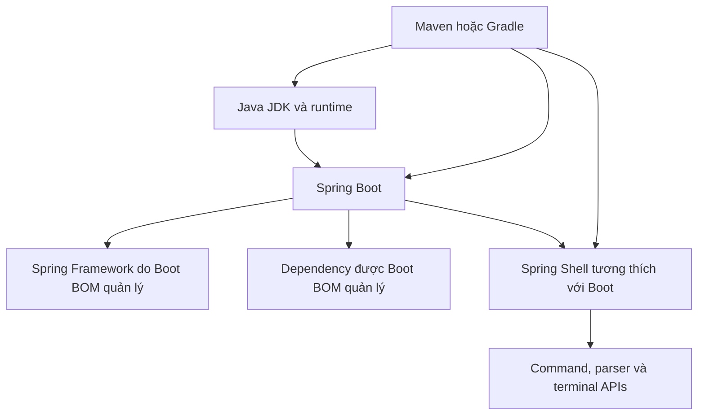

# Nâng phụ thuộc Spring Framework, Spring Boot và Java đồng bộ

Khi nâng cấp một ứng dụng Spring Shell, không nên xem phiên bản Spring Framework, Spring Boot và Java là ba con số độc lập. Spring Boot được phát hành cùng một phiên bản nền của Spring Framework và một bộ dependency đã được kiểm thử. Spring Shell cũng có ma trận tương thích với Spring Boot. Java, Maven hoặc Gradle phải đáp ứng yêu cầu của phiên bản Boot được chọn. Nếu chỉ thay một dependency trong khi các thành phần còn lại giữ ở thế hệ cũ, ứng dụng có thể biên dịch được nhưng lỗi khi khởi động, chạy command hoặc đóng gói.

Cách nâng cấp an toàn là chọn một bộ phiên bản tương thích trước, để Spring Boot BOM quản lý Spring Framework và phần lớn thư viện Spring, khai báo phiên bản Spring Shell theo ma trận chính thức, rồi đặt Java toolchain và runtime trong phạm vi hỗ trợ. Sau đó nâng cấp theo từng bước, kiểm tra dependency tree và chạy kiểm thử trên artifact thực tế.

Bài viết tập trung vào Spring Shell 3.4.x/4.0.x, Spring Boot 3.4.x/3.5.x/4.0.x, Spring Framework 6.2.x/7.0.x và Java 17 trở lên. Các phiên bản cụ thể trong ví dụ là mốc tham khảo theo tài liệu phát hành hiện hành; khi bắt đầu dự án mới, hãy kiểm tra maintenance release và ma trận hỗ trợ mới nhất.

## Hiểu quan hệ giữa các phiên bản

Ba thành phần có vai trò khác nhau:

- **Java** cung cấp compiler, bytecode và runtime mà ứng dụng cần chạy. JDK dùng để build và JRE/JDK trong môi trường triển khai đều phải tương thích.
- **Spring Framework** cung cấp container, dependency injection, transaction, event, resource và các API nền.
- **Spring Boot** tích hợp Framework cùng các thư viện khác, cung cấp auto-configuration, starters, plugin và một bộ dependency đã được quản lý.
- **Spring Shell** xây dựng mô hình command, parser, terminal, component và runner trên nền Spring; phiên bản của nó phải tương thích với dòng Spring Boot được hỗ trợ.

Quan hệ phụ thuộc có thể hình dung như sau:



Spring Boot BOM là điểm quản lý trung tâm của phần lớn dependency. Spring Shell có phiên bản phát hành riêng, nên cần chọn theo ma trận tương thích rồi khai báo rõ. Java và build tool được chọn theo yêu cầu hệ thống của dòng Boot.

## Ma trận tương thích tham khảo

Ma trận Spring Shell công bố các dòng Spring Boot được hỗ trợ như sau:

| Spring Shell | Spring Boot tương thích được công bố | Spring Framework nền | Java theo yêu cầu Spring Boot |
| --- | --- | --- | --- |
| 3.4.x | 3.4.x và 3.5.x | 6.2.x | Boot 3.4: Java 17–24; Boot 3.5: Java 17–25 |
| 4.0.x | 4.0.x | 7.0.x | Java 17–27 |

Các yêu cầu patch hiện hành minh họa sự khác biệt giữa các dòng:

| Spring Boot patch | Spring Framework tối thiểu theo system requirements | Java được hỗ trợ |
| --- | --- | --- |
| 3.4.13 | 6.2.15 trở lên | 17 đến 24 |
| 3.5.16 | 6.2.19 trở lên | 17 đến 25 |
| 4.0.10 | 7.0.11 trở lên | 17 đến 27 |

Boot BOM sẽ chọn patch Framework cụ thể đã được quản lý cho release đó. Cột “tối thiểu” trong tài liệu system requirements không phải lời khuyên để tự thêm một phiên bản Framework khác vào build.

Tại thời điểm biên soạn, tài liệu Spring Boot cũng liệt kê Boot 4.2.0 với Spring Framework 7.1.0 trở lên và Java 17–27. Tuy nhiên, ma trận tương thích Spring Shell được công bố ở trên chỉ liệt kê cặp Boot 4.0.x với Shell 4.0.x, chưa nêu rõ Boot 4.1.x hoặc 4.2.x. Nếu muốn dùng các dòng Boot mới hơn, hãy xác nhận ma trận Spring Shell mới nhất hoặc release notes tương ứng trước khi ghép phiên bản; không suy ra tương thích chỉ vì cả hai cùng có major version 4.

Java 17 là mức tối thiểu trong các dòng Boot nêu trên. Java 21 hoặc 25 có thể là lựa chọn phù hợp nếu tất cả thư viện, plugin, agent và môi trường triển khai hỗ trợ. Nếu dự án còn phải chạy trên Boot 3.4.x, không dùng JDK 25 vì dòng này chỉ công bố hỗ trợ đến Java 24.

## Vì sao không nên tự pin Spring Framework?

Mỗi release Spring Boot được gắn với một phiên bản nền của Spring Framework. `spring-boot-dependencies` BOM quản lý phiên bản của các module như `spring-core`, `spring-context`, `spring-beans`, `spring-aop` và các thư viện liên quan. Khi nâng Boot, BOM cập nhật chúng theo một bộ đã được kiểm thử.

Ví dụ, tránh khai báo phiên bản Framework riêng như sau:

```xml
<dependency>
    <groupId>org.springframework</groupId>
    <artifactId>spring-context</artifactId>
    <version>7.0.11</version>
</dependency>
```

Nếu ứng dụng vẫn dùng Spring Boot 3.5.x, khai báo này có thể đưa một module Framework 7 vào cùng bộ dependency dựa trên Framework 6.2. Kết quả có thể là `NoSuchMethodError`, `ClassNotFoundException`, lỗi auto-configuration hoặc lỗi chỉ xuất hiện trong một đường chạy cụ thể.

Khi dùng Spring Boot, khai báo dependency Spring mà không ghi version để BOM chọn phiên bản:

```xml
<dependency>
    <groupId>org.springframework</groupId>
    <artifactId>spring-context</artifactId>
</dependency>
```

Chỉ override phiên bản Framework khi có lý do kỹ thuật cụ thể, đã xác minh tương thích và có kiểm thử đầy đủ. Với ứng dụng thông thường, hãy nâng Spring Boot patch/minor phù hợp để nhận bộ Framework đã được quản lý.

## Chọn một bộ phiên bản trước khi sửa build

Trước khi cập nhật `pom.xml` hoặc `build.gradle`, lập một bảng mục tiêu:

| Thành phần | Giá trị cần xác định |
| --- | --- |
| Spring Shell | Dòng tương thích với Boot, ví dụ 3.4.x hoặc 4.0.x |
| Spring Boot | Một maintenance release thuộc dòng được hỗ trợ |
| Spring Framework | Để Boot BOM chọn, không đặt riêng trong build |
| Java | JDK dùng để compile/test và runtime triển khai |
| Maven/Gradle | Wrapper đạt yêu cầu của Boot mục tiêu |
| Spring Cloud hoặc portfolio khác | Release train tương thích với Boot mục tiêu |
| Database driver, logging, test library | Phiên bản hỗ trợ Java và Boot mục tiêu |

Ví dụ hai bộ mục tiêu:

| Mục tiêu | Spring Shell | Spring Boot | Framework do BOM quản lý | Java mẫu |
| --- | --- | --- | --- | --- |
| Duy trì thế hệ 3 | 3.4.3 | 3.5.16 | 6.2.x | 21 |
| Nâng lên thế hệ 4 | 4.0.4 | 4.0.10 | 7.0.x | 21 hoặc 25 |

Các phiên bản patch minh họa cần được kiểm tra lại với compatibility matrix và release notes khi áp dụng. Không trộn Spring Shell 4 với Boot 3.x hoặc Spring Shell 3.4 với Boot 4.x chỉ vì build có thể resolve dependency.

## Quản lý phiên bản bằng Maven

### Dùng `spring-boot-starter-parent`

Với Spring Boot 3.5.x và Spring Shell 3.4.x, một POM tối giản có thể khai báo:

```xml
<parent>
    <groupId>org.springframework.boot</groupId>
    <artifactId>spring-boot-starter-parent</artifactId>
    <version>3.5.16</version>
    <relativePath/>
</parent>

<properties>
    <java.version>21</java.version>
    <spring-shell.version>3.4.3</spring-shell.version>
</properties>

<dependencyManagement>
    <dependencies>
        <dependency>
            <groupId>org.springframework.shell</groupId>
            <artifactId>spring-shell-dependencies</artifactId>
            <version>${spring-shell.version}</version>
            <type>pom</type>
            <scope>import</scope>
        </dependency>
    </dependencies>
</dependencyManagement>

<dependencies>
    <dependency>
        <groupId>org.springframework.shell</groupId>
        <artifactId>spring-shell-starter</artifactId>
    </dependency>

    <dependency>
        <groupId>org.springframework.boot</groupId>
        <artifactId>spring-boot-starter-test</artifactId>
        <scope>test</scope>
    </dependency>
</dependencies>
```

Parent của Spring Boot cung cấp dependency management từ `spring-boot-dependencies`, mặc định cấu hình Java compiler và các thiết lập Maven phù hợp. Phiên bản Spring Shell được khai báo riêng vì nó không phải một module được quản lý tự động bởi Spring Boot BOM.

Khi chuyển sang Spring Boot 4.0.x và Spring Shell 4.0.x, thay hai version mục tiêu, giữ Java ở một phiên bản được cả môi trường build và runtime hỗ trợ:

```xml
<parent>
    <groupId>org.springframework.boot</groupId>
    <artifactId>spring-boot-starter-parent</artifactId>
    <version>4.0.10</version>
    <relativePath/>
</parent>

<properties>
    <java.version>21</java.version>
    <spring-shell.version>4.0.4</spring-shell.version>
</properties>

<dependencyManagement>
    <dependencies>
        <dependency>
            <groupId>org.springframework.shell</groupId>
            <artifactId>spring-shell-dependencies</artifactId>
            <version>${spring-shell.version}</version>
            <type>pom</type>
            <scope>import</scope>
        </dependency>
    </dependencies>
</dependencyManagement>
```

Các dependency Spring Framework vẫn không cần version riêng. Hãy kiểm tra lại tên starter và module theo migration guide của Spring Shell 4 nếu dự án trước đó khai báo `spring-shell-standard`, `spring-shell-autoconfigure` hoặc JLine trực tiếp.

### Dùng BOM khi không kế thừa Boot parent

Nếu dự án đã có parent POM riêng, có thể import Spring Boot BOM trong `dependencyManagement`:

```xml
<dependencyManagement>
    <dependencies>
        <dependency>
            <groupId>org.springframework.boot</groupId>
            <artifactId>spring-boot-dependencies</artifactId>
            <version>3.5.16</version>
            <type>pom</type>
            <scope>import</scope>
        </dependency>
    </dependencies>
</dependencyManagement>
```

Sau đó dependency Spring Boot và Spring Framework được quản lý theo BOM. Nếu cần khai báo version Spring Shell, dùng property riêng hoặc version trực tiếp trên dependency Shell.

Trong multi-module Maven, đặt BOM ở parent/root POM để các module con nhận cùng dependency management. Không khai báo các phiên bản `spring-core` hoặc `spring-context` khác nhau ở từng module con.

## Quản lý phiên bản bằng Gradle

Gradle có thể sử dụng plugin `io.spring.dependency-management` hoặc native BOM support. Ví dụ với native BOM:

```groovy
plugins {
    id 'java'
    id 'org.springframework.boot' version '3.5.16'
}

group = 'com.example'
version = '1.0.0'

java {
    toolchain {
        languageVersion = JavaLanguageVersion.of(21)
    }
}

dependencies {
    implementation platform('org.springframework.boot:spring-boot-dependencies:3.5.16')
    implementation platform('org.springframework.shell:spring-shell-dependencies:3.4.3')
    implementation 'org.springframework.shell:spring-shell-starter'

    testImplementation 'org.springframework.boot:spring-boot-starter-test'
}
```

Khi chuyển sang thế hệ 4, cập nhật đồng bộ Boot plugin, BOM và Spring Shell:

```groovy
plugins {
    id 'java'
    id 'org.springframework.boot' version '4.0.10'
}

java {
    toolchain {
        languageVersion = JavaLanguageVersion.of(21)
    }
}

dependencies {
    implementation platform('org.springframework.boot:spring-boot-dependencies:4.0.10')
    implementation platform('org.springframework.shell:spring-shell-dependencies:4.0.4')
    implementation 'org.springframework.shell:spring-shell-starter'

    testImplementation 'org.springframework.boot:spring-boot-starter-test'
}
```

Không khai báo một version `spring-context` khác để “sửa” lỗi resolve. Hãy kiểm tra dependency insight để biết module nào đang kéo phiên bản xung đột.

Nếu dùng plugin `io.spring.dependency-management`, plugin Spring Boot có thể tự import BOM tương ứng. Trong trường hợp đó, không cần import cùng BOM lần thứ hai. Chọn một cách quản lý và giữ cấu hình nhất quán giữa các module.

## Đồng bộ Java ở compile, test và runtime

Chỉ đổi `JAVA_HOME` trên máy phát triển là chưa đủ. Một dự án có thể compile bằng JDK mới nhưng tạo bytecode cho Java cũ; test có thể chạy bằng JDK khác; Docker image lại chứa JRE thấp hơn. Cần xác định rõ:

- JDK mà IDE và Maven/Gradle wrapper sử dụng.
- Java toolchain mà compiler và test task sử dụng.
- `--release` hoặc `java.version` quyết định API/bytecode mục tiêu.
- JRE/JDK trên máy chủ hoặc base image triển khai.
- Java version của agent CI và môi trường đóng gói native image nếu có.

Với Maven dùng Spring Boot parent, đặt:

```xml
<properties>
    <java.version>21</java.version>
</properties>
```

Với Gradle, dùng toolchain:

```groovy
java {
    toolchain {
        languageVersion = JavaLanguageVersion.of(21)
    }
}

tasks.withType(JavaCompile).configureEach {
    options.release = 21
}
```

Toolchain giúp build chọn JDK đúng. `options.release` giới hạn API và bytecode theo release đã chọn. Khi triển khai, runtime phải hỗ trợ class file và API mà ứng dụng sử dụng. Ví dụ build target Java 21 thì không thể chạy trên Java 17.

Nên dùng Maven Wrapper hoặc Gradle Wrapper và commit cấu hình wrapper. Nhờ vậy CI và máy phát triển dùng cùng phiên bản build tool, thay vì phụ thuộc Maven/Gradle cài toàn cục.

## Chọn Maven và Gradle phù hợp với Boot mục tiêu

System requirements của các dòng Boot cũng giới hạn build tool:

| Spring Boot | Maven | Gradle |
| --- | --- | --- |
| 3.4.x / 3.5.x | 3.6.3 trở lên | 7.x (7.6.4 trở lên) hoặc 8.x (8.4 trở lên) |
| 4.0.x | 3.6.3 trở lên | 8.x (8.14 trở lên) hoặc 9.x |

Nếu nâng lên Boot 4.0, hãy cập nhật Gradle Wrapper trước khi chạy build trên CI. Một máy phát triển có Gradle mới hơn nhưng CI dùng wrapper cũ vẫn có thể thất bại ở bước cấu hình plugin trước khi biên dịch Java.

Không chỉ cập nhật `distributionUrl`; hãy kiểm tra plugin Gradle, Maven plugin, annotation processor, test plugin, code formatter, static analysis và plugin đóng gói có hỗ trợ Java/Boot mục tiêu hay không.

## Nâng cấp theo từng thế hệ

### Trường hợp đang dùng Spring Shell 3.4.x và Boot 3.4.x

Một lộ trình ít rủi ro là nâng cấp patch trong thế hệ 3 trước:

1. Nâng Boot 3.4.x lên maintenance release mới nhất còn phù hợp với hệ thống.
2. Nâng Shell lên maintenance release 3.4.x tương ứng.
3. Để BOM chọn Spring Framework 6.2.x.
4. Giữ Java trong phạm vi hỗ trợ của Boot 3.4; tài liệu 3.4.13 hỗ trợ đến Java 24.
5. Cập nhật test, plugin và driver, sau đó chạy toàn bộ smoke test.

Nếu mục tiêu là chuẩn bị cho Boot 4, chuyển tiếp qua Boot 3.5.x trước. Spring Boot khuyến nghị nâng ứng dụng lên bản 3.5.x mới nhất, xử lý deprecated API và kiểm tra dependency bên ngoài trước khi sang 4.0. Spring Shell cũng khuyến nghị nâng lên bản 3.4.x mới nhất trước khi chuyển Shell 4.

### Trường hợp đang dùng Spring Boot 3.5.x

Boot 3.5.x và Spring Shell 3.4.x là cặp tương thích được công bố. Boot BOM quản lý Spring Framework 6.2.x. Dòng Boot 3.5 hỗ trợ Java 17–25 theo system requirements hiện hành.

Đây là điểm dừng phù hợp nếu ứng dụng chưa thể chuyển major version do thư viện bên thứ ba, Spring Cloud, môi trường triển khai hoặc mã nguồn còn phụ thuộc API cũ.

### Trường hợp chuyển sang Spring Boot 4.0.x

Spring Shell 4 dựa trên Spring Framework 7 và yêu cầu Spring Boot 4 trở lên khi tích hợp với Boot. Với ma trận tương thích hiện hành, cặp được liệt kê là Spring Shell 4.0.x với Spring Boot 4.0.x.

Trước khi nâng:

- Nâng ứng dụng lên Boot 3.5.x mới nhất và Shell 3.4.x mới nhất.
- Xóa hoặc thay thế các API đã deprecated trong Boot 3.x.
- Kiểm tra thư viện ngoài BOM như Spring Cloud, SDK, database driver và plugin.
- Xác nhận JDK, Maven/Gradle và runtime image đáp ứng yêu cầu Boot 4.
- Đọc migration guide Boot 4 và Spring Shell 4, vì đây là hai thay đổi major độc lập.

Sau đó cập nhật Boot BOM/plugin lên 4.0.x, Shell lên 4.0.x, và để BOM chọn Spring Framework 7.0.x.

## Những thay đổi cần rà soát khi nâng Spring Shell 3 lên 4

Nâng dependency không chỉ là thay version trong POM. Spring Shell 4 có các thay đổi lớn:

| Khu vực | Spring Shell 3.x | Spring Shell 4.x |
| --- | --- | --- |
| Programming model | `@ShellComponent`, `@ShellMethod`, `@ShellOption` | `@Command`, `@Option`, `@Argument` |
| Command scanning trong Spring Boot | Thường dùng `@EnableCommand`/`@CommandScan` | Tự động scan command trong Boot; `@CommandScan` bị loại bỏ |
| `spring-shell-core` | Phụ thuộc Spring Boot và JLine theo cấu hình module | Không còn phụ thuộc Boot/JLine |
| Auto-configuration module | `spring-shell-autoconfigure` | Đổi tên `spring-shell-core-autoconfigure` |
| JLine | Có trong starter/một số dependency mặc định | Thêm `spring-shell-jline` khi cần JLine |
| Standard command modules | Có `spring-shell-standard` và `spring-shell-standard-commands` | Đã hợp nhất vào core |
| API package | `org.springframework.shell` và `org.springframework.shell.standard` | Nhiều API chuyển dưới `org.springframework.shell.core` |
| Test infrastructure | API test của 3.x | Test utilities được thiết kế lại |

Ví dụ một command legacy:

```java
@ShellComponent
public class GreetingCommands {

    @ShellMethod(key = "hello")
    public String hello(@ShellOption("--name") String name) {
        return "Hello " + name;
    }
}
```

Trong Spring Shell 4, chuyển sang mô hình command mới theo migration guide:

```java
import org.springframework.stereotype.Component;
import org.springframework.shell.core.command.annotation.Command;
import org.springframework.shell.core.command.annotation.Option;

@Component
public class GreetingCommands {

    @Command(name = "hello", description = "Chào một người dùng")
    public String hello(@Option(longName = "name") String name) {
        return "Hello " + name;
    }
}
```

Đây là thay đổi source code cần xử lý cùng lúc với dependency. Hãy rà soát import, command registration, availability, exception mapping, completion provider, runner, test client và TUI module. Nếu ứng dụng cần JLine history, line editing hoặc terminal UI, kiểm tra dependency `spring-shell-jline` thay vì giả định core đã kéo JLine vào.

## Kiểm tra dependency tree sau khi nâng

Sau khi cập nhật build, xác minh phiên bản thực tế được resolve.

Với Maven:

```bash
./mvnw dependency:tree -Dincludes=org.springframework,org.springframework.boot,org.springframework.shell
```

Để xem POM hiệu lực và dependency management:

```bash
./mvnw help:effective-pom
```

Với Gradle:

```bash
./gradlew dependencies --configuration runtimeClasspath
./gradlew dependencyInsight --dependency spring-core --configuration runtimeClasspath
./gradlew dependencyInsight --dependency spring-context --configuration runtimeClasspath
./gradlew dependencyInsight --dependency spring-shell --configuration runtimeClasspath
```

Kiểm tra các điểm sau:

- Chỉ có một dòng Spring Framework tương thích với Boot mục tiêu.
- Các module `spring-core`, `spring-context`, `spring-beans` và `spring-aop` cùng dòng Framework.
- Các module `spring-boot` và starter cùng dòng Boot.
- Spring Shell thuộc dòng tương thích trong matrix.
- Không có dependency cũ kéo ngược Framework hoặc Boot version ngoài BOM.
- Không có thư viện test hoặc plugin build yêu cầu Java cao hơn runtime đã chọn.

Nếu dependency tree cho thấy một module bị chọn version khác BOM, tìm dependency cha đã kéo nó vào. Dùng `dependencyManagement`/constraints có chủ đích hoặc nâng thư viện cha; không thêm một version override khác mà không biết nguyên nhân.

## Kiểm tra Spring Cloud và các thư viện ngoài BOM

Spring Boot BOM quản lý nhiều thư viện, nhưng không phải mọi dự án Spring đều được quản lý bởi cùng BOM. Spring Cloud có release train riêng; SDK bên thứ ba, database driver, native image plugin và công cụ quan sát cũng có lịch phát hành riêng.

Khi nâng Boot:

- Tra compatibility matrix của Spring Cloud với dòng Boot mục tiêu.
- Chọn Spring Cloud BOM phù hợp nếu ứng dụng dùng Spring Cloud.
- Kiểm tra release notes của Spring Data, Spring Security, Spring Integration, Spring Batch và các module đang dùng nếu có thay đổi major.
- Kiểm tra các thư viện tự pin version trong `dependencyManagement`, Gradle constraints hoặc version catalog.
- Kiểm tra plugin compile/test/packaging và image build có hỗ trợ JDK mới.

Không giả định một thư viện tương thích chỉ vì nó resolve thành công. Resolver kiểm tra được sự tồn tại của artifact và ràng buộc version, nhưng không chứng minh binary compatibility hoặc hành vi runtime.

## Kiểm thử sau khi nâng cấp

Nâng cấp nên được xác minh qua nhiều tầng:

| Tầng kiểm thử | Điều cần xác minh |
| --- | --- |
| Compile | Source/API tương thích với Java và Framework mục tiêu |
| Unit test | Service, parser, converter và validation hoạt động |
| Spring context test | Auto-configuration, bean wiring và command registration đúng |
| Shell test | `help`, option, availability, exception resolver và output đúng |
| Interactive test | REPL, prompt, completion, history và TUI nếu có |
| Non-interactive test | Exit code, stdout/stderr và script/batch runner đúng |
| Integration test | Database, HTTP client, security và transaction hoạt động |
| Package test | Executable JAR hoặc container chạy bằng runtime JDK mục tiêu |

Một lệnh kiểm tra cơ bản:

```bash
./mvnw clean verify
```

Hoặc:

```bash
./gradlew clean check bootJar
```

Sau khi test pass, chạy artifact đã đóng gói:

```bash
java -jar target/application.jar version
java -jar target/application.jar help
```

Điều chỉnh tên file JAR và command theo ứng dụng. Nếu ứng dụng hỗ trợ interactive shell, chạy thêm một phiên terminal thật hoặc test harness để xác minh prompt và input; một command non-interactive thành công không chứng minh REPL hoạt động.

## Phát hiện và xử lý lỗi tương thích

| Triệu chứng | Nguyên nhân thường gặp | Hướng xử lý |
| --- | --- | --- |
| `UnsupportedClassVersionError` | Runtime Java thấp hơn bytecode được build | Đồng bộ JDK runtime với toolchain/release |
| `NoSuchMethodError` trong Spring | Các module Framework bị trộn version hoặc dependency override | Kiểm tra BOM và dependency tree |
| `ClassNotFoundException` cho API Spring Shell | Module/package đã đổi hoặc module cần thiết không còn được kéo tự động | Đọc migration guide và thêm starter/module đúng |
| Không tìm thấy command sau khi nâng Shell 4 | Còn dùng annotation legacy hoặc command scan cũ | Chuyển sang `@Command` và quy tắc registration 4.x |
| Không có JLine history/terminal editing | Core 4 không kéo JLine mặc định | Thêm starter hoặc `spring-shell-jline` |
| Maven/Gradle không cấu hình được plugin | Wrapper hoặc plugin chưa đạt yêu cầu của Boot mục tiêu | Nâng wrapper và plugin tương ứng |
| Test fail sau khi nâng Boot 4 | Test framework hoặc API đã thay đổi | Cập nhật test dependencies và migration code |
| Spring Cloud không tương thích | Release train không khớp Boot | Chọn Cloud BOM theo compatibility matrix |
| Build pass nhưng production lỗi | Runtime JDK, env config hoặc dependency khác CI | Chạy smoke test trên image/JAR phát hành |

Khi có `NoSuchMethodError` hoặc `ClassNotFoundException`, ghi lại class và method bị lỗi, xem dependency tree để tìm JAR thực sự cung cấp class đó, rồi xác định dependency nào kéo phiên bản sai. Không chữa bằng cách thêm ngẫu nhiên một JAR mới vào classpath.

## Chiến lược triển khai và rollback

Với một major upgrade, hãy tạo một nhánh migration riêng và giữ commit nâng cấp có thể đảo ngược. Trước khi phát hành:

1. Ghi lại bộ phiên bản hiện tại và kết quả build/test baseline.
2. Cập nhật JDK và build tool trong CI, rồi xác minh build cũ vẫn chạy trên JDK mục tiêu nếu có thể.
3. Nâng Boot patch/minor trong dòng hiện tại và xử lý deprecated API.
4. Nâng Spring Shell trong dòng tương thích.
5. Chạy test và triển khai staging để xác minh hành vi.
6. Khi sẵn sàng, nâng Boot/Shell major cùng các thay đổi Framework và source code cần thiết.
7. Chạy smoke test trên artifact mới và lưu dependency tree làm bằng chứng phát hành.
8. Giữ artifact, cấu hình và image trước nâng cấp để có thể rollback.

Nếu schema database hoặc định dạng dữ liệu bị thay đổi, rollback binary đơn thuần có thể không đủ. Thiết kế migration dữ liệu theo hướng tương thích ngược hoặc có kế hoạch phục hồi riêng trước khi triển khai.

## Checklist nâng cấp đồng bộ

- [ ] Xác định chính xác Spring Shell, Spring Boot, Spring Framework, Java và build tool hiện tại.
- [ ] Chọn tuple phiên bản theo compatibility matrix Spring Shell/Boot.
- [ ] Để Spring Boot BOM quản lý Spring Framework và các dependency Spring.
- [ ] Khai báo phiên bản Spring Shell theo dòng được hỗ trợ.
- [ ] Đặt Java toolchain, compiler release và runtime trong cùng phạm vi hỗ trợ.
- [ ] Nâng Maven/Gradle Wrapper đạt yêu cầu của Boot mục tiêu.
- [ ] Kiểm tra Spring Cloud và dependency ngoài BOM.
- [ ] Xử lý deprecated API trước khi chuyển Boot major.
- [ ] Rà soát breaking changes của Spring Shell, Framework và Boot.
- [ ] Chạy dependency tree/insight để tìm version conflict.
- [ ] Chạy clean verify/check và test interactive/non-interactive.
- [ ] Chạy smoke test trên JAR hoặc container đã đóng gói.
- [ ] Lưu artifact cũ, dependency report và phương án rollback.

Nâng Spring Framework, Spring Boot và Java đồng bộ bắt đầu bằng việc chọn một bộ phiên bản tương thích. Boot BOM quản lý Framework; Spring Shell được chọn theo compatibility matrix; Java và build tool phải đáp ứng system requirements của Boot. Khi đi từ Spring Shell 3.4/Boot 3.5 sang Shell 4/Boot 4, hãy nâng trên từng thế hệ, xử lý breaking changes và xác minh dependency tree cùng artifact cuối trước khi phát hành.

## Tài liệu tham khảo

- [Spring Shell – Spring Boot compatibility matrix](https://github.com/spring-projects/spring-shell/wiki/Spring-Boot-compatibility)
- [Spring Shell v4 migration guide](https://github.com/spring-projects/spring-shell/wiki/v4-migration-guide)
- [Spring Shell releases](https://github.com/spring-projects/spring-shell/releases)
- [Spring Shell starters and build dependencies](https://docs.spring.io/spring-shell/reference/building.html)
- [Spring Boot 3.4 system requirements](https://docs.spring.io/spring-boot/3.4/system-requirements.html)
- [Spring Boot 3.5 system requirements](https://docs.spring.io/spring-boot/3.5/system-requirements.html)
- [Spring Boot 4.0 system requirements](https://docs.spring.io/spring-boot/4.0/system-requirements.html)
- [Spring Boot 4.2 system requirements](https://docs.spring.io/spring-boot/system-requirements.html)
- [Spring Boot dependency management and build systems](https://docs.spring.io/spring-boot/reference/using/build-systems.html)
- [Spring Boot Maven plugin and parent](https://docs.spring.io/spring-boot/maven-plugin/using.html)
- [Spring Boot Gradle dependency management](https://docs.spring.io/spring-boot/gradle-plugin/managing-dependencies.html)
- [Spring Boot 4.0 migration guide](https://github.com/spring-projects/spring-boot/wiki/Spring-Boot-4.0-Migration-Guide)
- [Spring Boot 4.0 release notes](https://github.com/spring-projects/spring-boot/wiki/Spring-Boot-4.0-Release-Notes)
- [Spring Framework reference documentation](https://docs.spring.io/spring-framework/reference/)
