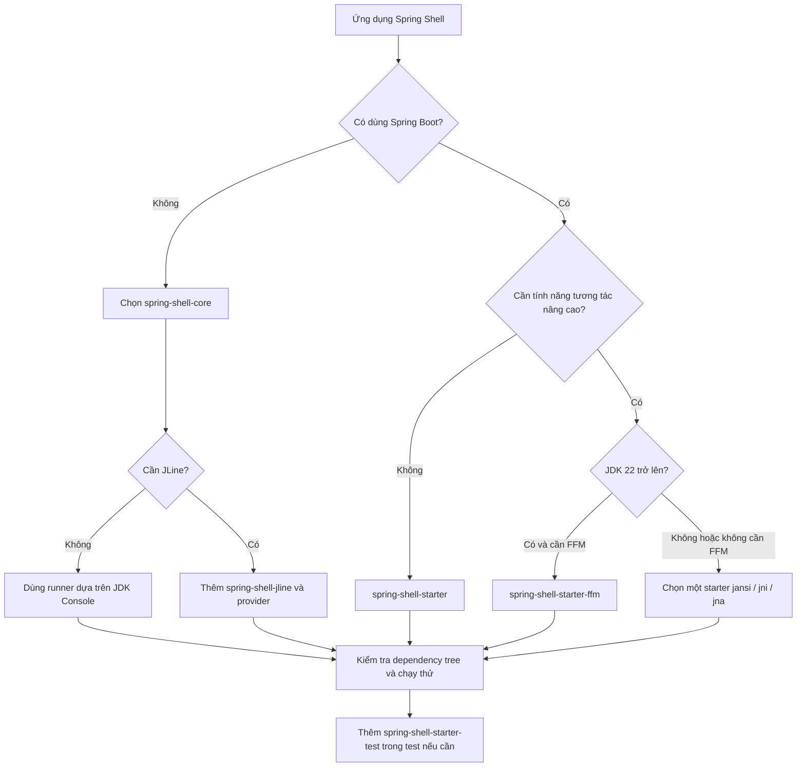

# Chọn starter và môđun terminal theo nhu cầu thực tế

Spring Shell cung cấp các môđun và starter để xây dựng ứng dụng dòng lệnh theo mô hình Spring. Starter giúp thêm nhanh những thành phần thường dùng; các môđun riêng cho phép chọn cách tích hợp Spring Boot, cách đọc lệnh từ terminal và các tính năng tương tác. Chọn đúng dependency ngay từ đầu giúp ứng dụng có đủ chức năng cần thiết mà không kéo theo các thư viện native hoặc thành phần terminal không dùng đến.

Một ứng dụng CLI có thể chỉ cần nhận một lệnh, xử lý dữ liệu rồi trả mã thoát để script gọi tiếp. Ứng dụng khác cần prompt tương tác, lịch sử lệnh, tự hoàn thành khi nhấn Tab, màu sắc, bảng và giao diện terminal. Hai trường hợp này có yêu cầu runtime khác nhau. Vì vậy, khi chọn starter, trước hết hãy xác định ứng dụng chạy trong môi trường nào và người dùng tương tác với nó ra sao.

## 1. Phân biệt starter, môđun và terminal provider

Ba khái niệm này liên quan với nhau nhưng giải quyết các vấn đề khác nhau:

- **Starter** là dependency tập hợp các môđun và cấu hình thường dùng để bắt đầu nhanh một kiểu ứng dụng. Trong dự án Spring Boot, starter còn đưa vào phần tích hợp tự động.
- **Môđun** chứa một nhóm API hoặc chức năng cụ thể. Có thể thêm trực tiếp môđun khi cần tự cấu hình hoặc không dùng Spring Boot.
- **Terminal provider** là phần triển khai mà JLine sử dụng để giao tiếp với terminal của hệ điều hành. Provider ảnh hưởng đến cách truy cập terminal và thư viện native cần có ở runtime.

Starter không phải là một loại terminal. Ví dụ, `spring-shell-starter-jansi` vừa đưa vào starter Spring Shell cơ bản, vừa bổ sung tích hợp JLine và provider Jansi. Khi chọn dependency, hãy xem cả chức năng mà starter cung cấp lẫn những thư viện nó kéo theo.

## 2. Các starter Spring Shell

Reference Documentation của Spring Shell liệt kê các starter sau:

| Artifact | Vai trò | Khi nên chọn |
|---|---|---|
| `spring-shell-starter` | Các môđun Spring Shell cơ bản | Ứng dụng Spring Boot cần command và shell cơ bản, dùng console chuẩn của JDK |
| `spring-shell-starter-jansi` | Starter cơ bản cùng JLine Jansi provider | Cần shell dựa trên JLine và provider Jansi |
| `spring-shell-starter-jni` | Starter cơ bản cùng JLine JNI provider | Môi trường triển khai đã chọn provider JNI và đáp ứng yêu cầu native của nó |
| `spring-shell-starter-jna` | Starter cơ bản cùng JLine JNA provider | Môi trường triển khai đã chọn provider JNA |
| `spring-shell-starter-ffm` | Starter cơ bản cùng JLine FFM provider | Muốn dùng Foreign Function and Memory API và có JDK 22 trở lên |
| `spring-shell-starter-test` | Hỗ trợ kiểm thử ứng dụng Spring Shell | Dùng trong phạm vi test để kiểm thử command và tương tác shell |

Các starter Spring Shell tích hợp `spring-boot-starter`; khi đã dùng một starter Spring Shell thì không cần khai báo thêm `spring-boot-starter` chỉ để có nền tảng Spring Boot cơ bản. Hãy kiểm tra dependency tree để biết starter đang đưa vào những artifact nào.

### Starter cơ bản

Với một ứng dụng Spring Boot chỉ cần nhận command và xử lý nghiệp vụ, có thể bắt đầu bằng `spring-shell-starter`:

```xml
<dependency>
    <groupId>org.springframework.shell</groupId>
    <artifactId>spring-shell-starter</artifactId>
</dependency>
```

Trong Spring Shell 4, môđun core không còn phụ thuộc Spring Boot hoặc JLine. Core cung cấp API và runtime của Spring Shell; `spring-shell-core-autoconfigure` đảm nhiệm tích hợp tự động với Spring Boot. Starter cơ bản đưa các phần cần thiết cho ứng dụng Boot vào classpath.

Nếu shell chỉ cần nhập lệnh, nhận kết quả văn bản và không cần lịch sử lệnh, completion hay định dạng rich text, console chuẩn của JDK có thể đã đủ. Cách này cũng giảm số dependency liên quan đến terminal native.

### Starter có JLine

Khi ứng dụng cần trải nghiệm tương tác phong phú hơn, hãy chọn một starter gắn với provider JLine, ví dụ:

```xml
<dependency>
    <groupId>org.springframework.shell</groupId>
    <artifactId>spring-shell-starter-jansi</artifactId>
</dependency>
```

Các starter `jansi`, `jni`, `jna` và `ffm` bổ sung provider tương ứng cho JLine. Chọn một provider phù hợp với JDK, hệ điều hành và cách đóng gói ứng dụng. Không thêm nhiều starter provider cùng lúc nếu không có chủ đích rõ ràng; JLine phát hiện các provider có trên classpath và chọn cách triển khai terminal để sử dụng.

JLine hữu ích khi CLI cần lịch sử lệnh, tự hoàn thành, điều khiển con trỏ, màu sắc, hiển thị bảng hoặc các thành phần terminal tương tác. Nếu cần giao diện terminal nâng cao, hãy kiểm tra cả môđun `spring-shell-jline` và các API TUI mà phiên bản Spring Shell đang dùng cung cấp.

### Starter kiểm thử

Thêm `spring-shell-starter-test` trong phạm vi test để có các thành phần hỗ trợ kiểm thử Spring Shell:

```xml
<dependency>
    <groupId>org.springframework.shell</groupId>
    <artifactId>spring-shell-starter-test</artifactId>
    <scope>test</scope>
</dependency>
```

Dependency này phục vụ kiểm thử, không phải terminal provider cho ứng dụng production. Dùng nó để kiểm tra command, đầu vào, kết quả và các tương tác cần thiết trong test tự động.

## 3. Hiểu các môđun chính

Khi dùng starter, Maven hoặc Gradle tự kéo các môđun liên quan. Khi không dùng Spring Boot hoặc cần kiểm soát dependency chi tiết, có thể khai báo môđun trực tiếp.

| Môđun | Trách nhiệm chính | Lưu ý khi chọn |
|---|---|---|
| `spring-shell-core` | API lõi, command model và runtime shell | Không tự mang theo Spring Boot hoặc JLine trong dòng 4 |
| `spring-shell-core-autoconfigure` | Cấu hình tự động để tích hợp Spring Shell với Spring Boot | Cần cho ứng dụng Boot khi tự ghép môđun thay vì dùng starter |
| `spring-shell-jline` | Tích hợp JLine, runner dựa trên JLine và các thành phần terminal liên quan | Thêm khi cần trải nghiệm JLine; không cần chỉ vì ứng dụng có command |
| `spring-shell-test` và các môđun test liên quan | Hỗ trợ kiểm thử command và ứng dụng shell | Chỉ dùng ở test classpath khi có nhu cầu kiểm thử tương ứng |

Sơ đồ khái quát cho một ứng dụng Spring Boot:

```text
                    Ứng dụng Spring Boot
                             |
               +-------------+-------------+
               |                           |
      spring-shell-starter       starter JLine provider
               |                           |
       core-autoconfigure        spring-shell-starter
               |                           |
         spring-shell-core        spring-shell-jline
                                           |
                                 JLine terminal provider
```

Sơ đồ mô tả quan hệ chức năng; dependency tree của từng phiên bản mới là căn cứ để xác định chính xác các artifact được resolve.

### Thay đổi cấu trúc môđun ở Spring Shell 4

Khi nâng từ Spring Shell 3 lên 4, không nên sao chép nguyên danh sách môđun cũ. Migration Guide mô tả các thay đổi sau:

| Cấu trúc ở dòng 3 | Cấu trúc ở dòng 4 |
|---|---|
| `spring-shell-autoconfigure` | Đổi tên thành `spring-shell-core-autoconfigure` |
| `spring-shell-standard` và `spring-shell-standard-commands` | Đã nhập vào `spring-shell-core` |
| `spring-shell-table` | Đã nhập vào `spring-shell-jline` |
| `spring-shell-core` phụ thuộc JLine | Core không còn phụ thuộc JLine; thêm `spring-shell-jline` nếu cần JLine |

Spring Shell 4 dựa trên Spring Framework 7; hỗ trợ Spring Boot yêu cầu Spring Boot 4 trở lên. Hãy kiểm tra tương thích của Spring Boot, Spring Framework và JDK trước khi nâng cấp. Nếu ứng dụng còn ở Spring Shell 3, hãy dùng tài liệu và BOM của đúng nhánh 3 thay vì áp dụng trực tiếp cấu trúc dependency của dòng 4.

## 4. Chọn terminal runner trước khi chọn provider

Terminal provider và shell runner là hai lớp khác nhau. Runner quyết định cách Spring Shell đọc và thực thi phiên làm việc; provider là phần JLine dùng để giao tiếp với terminal.

Spring Shell 4 có ba runner chính:

| Runner | Cách hoạt động | Trường hợp sử dụng |
|---|---|---|
| `SystemShellRunner` | Shell tương tác dựa trên `java.io.Console` của JDK | CLI đơn giản, không cần tính năng nâng cao của JLine |
| `JLineShellRunner` | Shell tương tác dựa trên JLine | Cần history, completion, rich text hoặc UI terminal |
| `NonInteractiveShellRunner` | Chạy command rồi kết thúc, không mở phiên nhập lệnh tương tác | Script, automation, pipeline và tác vụ chạy theo lịch |

`SystemShellRunner` có thể chạy mà không cần dependency terminal bổ sung, nhưng không cung cấp các tính năng nâng cao như lịch sử lệnh, tự hoàn thành bằng Tab và rich text formatting. `JLineShellRunner` cần `spring-shell-jline`. Với Spring Boot, starter JLine provider phù hợp có thể cấu hình runner cho ứng dụng. Nếu tự dựng application context hoặc không dùng Boot, bạn cần cấu hình runner tương ứng.

Spring Shell 4 mặc định chạy ở chế độ interactive. Để chuyển sang chế độ không tương tác, có thể đặt:

```properties
spring.shell.interactive.enabled=false
```

Trong chế độ này, ứng dụng thực thi command được truyền vào khi khởi động rồi thoát. Hãy thiết kế command cho script theo nguyên tắc nhận đủ dữ liệu qua argument/option, ghi output có cấu trúc nếu cần và trả exit code phù hợp. Không nên yêu cầu người gọi nhập thêm dữ liệu qua prompt trong một tác vụ tự động.

## 5. Chọn JLine terminal provider

JLine có thể dùng mã native để truy cập và hiểu môi trường terminal đang chạy. Các provider truyền thống `jansi`, `jni` và `jna` hướng tới cùng nhóm chức năng terminal; starter của Spring Shell cho phép chọn provider cụ thể.

| Provider | Starter | Điều cần cân nhắc |
|---|---|---|
| Jansi | `spring-shell-starter-jansi` | Một lựa chọn provider JLine được Spring Shell hỗ trợ; xác minh hành vi trên terminal và hệ điều hành mục tiêu |
| JNI | `spring-shell-starter-jni` | Cần kiểm tra thư viện native và khả năng nạp thư viện trong môi trường triển khai |
| JNA | `spring-shell-starter-jna` | Cần kiểm tra thư viện native và cách đóng gói trên hệ điều hành mục tiêu |
| FFM | `spring-shell-starter-ffm` | Yêu cầu JDK 22 trở lên và cấu hình quyền truy cập native |

Không có một provider tối ưu cho mọi hệ điều hành và mọi kiểu đóng gói. Hãy quyết định dựa trên JDK ở production, hệ điều hành đích, cách phân phối artifact, yêu cầu bảo mật của runtime và kết quả thử trên terminal thật. Những thư viện native có thể hoạt động khác nhau giữa máy phát triển và máy triển khai.

### Lưu ý riêng với FFM

Foreign Function and Memory API (FFM) là API của JDK cho phép tương tác với mã native. Spring Shell cung cấp starter `spring-shell-starter-ffm`, nhưng provider này yêu cầu JDK 22 trở lên. Khi chạy, JLine có thể yêu cầu bật native access:

```bash
java --enable-native-access=ALL-UNNAMED -jar target/cli-app.jar
```

Có thể đặt thuộc tính tương ứng trong manifest của executable JAR:

```text
Enable-Native-Access: ALL-UNNAMED
```

Đừng chọn FFM chỉ vì tên gọi mới hơn. Hãy kiểm tra phiên bản JDK trên tất cả máy chạy ứng dụng, chính sách native access, cảnh báo JVM và cách đóng gói. Nếu môi trường vẫn dùng JDK thấp hơn 22, starter FFM không phù hợp.

## 6. Ví dụ cấu hình theo nhu cầu

### Ứng dụng Spring Boot với shell cơ bản

Khai báo starter cơ bản khi ứng dụng chỉ cần command và console chuẩn:

```xml
<dependency>
    <groupId>org.springframework.shell</groupId>
    <artifactId>spring-shell-starter</artifactId>
</dependency>
```

### Ứng dụng tương tác có JLine

Thay starter cơ bản bằng một starter provider. Ví dụ sau dùng Jansi:

```xml
<dependency>
    <groupId>org.springframework.shell</groupId>
    <artifactId>spring-shell-starter-jansi</artifactId>
</dependency>
```

Nếu chuyển sang JNI, JNA hoặc FFM, thay artifact starter bằng provider tương ứng và kiểm tra điều kiện runtime của provider đó. Không khai báo đồng thời cả starter cơ bản lẫn starter provider chỉ để lấy hai bản của cùng dependency; starter provider đã bao gồm starter cơ bản.

### Ứng dụng không dùng Spring Boot

Với ứng dụng tự tạo Spring context, có thể khai báo `spring-shell-core` và cấu hình command discovery bằng `@EnableCommand`. Nếu cần runner dựa trên JLine, thêm `spring-shell-jline` cùng provider JLine phù hợp rồi cấu hình `JLineShellRunner`. Cách ghép môđun này đòi hỏi bạn tự chịu trách nhiệm wiring các bean và phiên bản tương thích.

### Dự án Maven dùng BOM

Nên quản lý đồng bộ phiên bản các môđun Spring Shell bằng BOM. Ví dụ dưới đây dùng phiên bản `4.0.4` đã phát hành tại thời điểm biên soạn; hãy cập nhật theo bản ổn định và ma trận tương thích mà dự án lựa chọn:

```xml
<properties>
    <spring-shell.version>4.0.4</spring-shell.version>
</properties>

<dependencyManagement>
    <dependencies>
        <dependency>
            <groupId>org.springframework.shell</groupId>
            <artifactId>spring-shell-dependencies</artifactId>
            <version>${spring-shell.version}</version>
            <type>pom</type>
            <scope>import</scope>
        </dependency>
    </dependencies>
</dependencyManagement>

<dependencies>
    <dependency>
        <groupId>org.springframework.shell</groupId>
        <artifactId>spring-shell-starter-jansi</artifactId>
    </dependency>

    <dependency>
        <groupId>org.springframework.shell</groupId>
        <artifactId>spring-shell-starter-test</artifactId>
        <scope>test</scope>
    </dependency>
</dependencies>
```

Ví dụ này giả định dự án đã quản lý phiên bản Spring Boot tương thích qua parent hoặc BOM của Spring Boot. Các starter Spring Shell đã import `spring-boot-starter`, vì vậy không cần thêm dependency đó lần nữa chỉ để có auto-configuration cơ bản.

### Dự án Gradle dùng BOM

```groovy
dependencies {
    implementation(platform("org.springframework.shell:spring-shell-dependencies:4.0.4"))
    implementation("org.springframework.shell:spring-shell-starter-jansi")

    testImplementation("org.springframework.shell:spring-shell-starter-test")
}
```

Nếu dùng Spring Dependency Management plugin hoặc Spring Boot plugin để quản lý BOM, hãy bảo đảm chỉ có một nguồn quản lý phiên bản rõ ràng. Tránh khai báo version riêng cho từng môđun Spring Shell vì có thể tạo ra một classpath gồm các artifact khác phiên bản.

## 7. Kiểm tra dependency đã được chọn

File build thể hiện dependency được yêu cầu; cây dependency cho biết những artifact và phiên bản thực tế có trên classpath. Sau khi thêm starter, kiểm tra cả Spring Shell lẫn JLine.

Với Maven:

```bash
./mvnw dependency:tree -Dincludes=org.springframework.shell,org.jline
```

Với Gradle:

```bash
./gradlew dependencies --configuration runtimeClasspath
./gradlew dependencyInsight --dependency spring-shell-jline --configuration runtimeClasspath
```

Đối chiếu kết quả với nhu cầu:

- Dùng `spring-shell-starter` và không cần JLine: kiểm tra không có JLine provider bị thêm ngoài dự kiến.
- Dùng starter `jansi`, `jni`, `jna` hoặc `ffm`: xác nhận `spring-shell-jline` và provider tương ứng có trong runtime classpath.
- Dùng `spring-shell-starter-test`: xác nhận dependency test không bị đưa vào artifact production.
- Dùng nhiều starter: tìm dependency trùng hoặc xung đột và chỉ giữ lựa chọn có chủ đích.

## 8. Kiểm thử trong môi trường gần production

Một ứng dụng CLI có thể hoạt động khác khi chạy trong IDE, terminal thật, container hoặc pipeline. Sau khi build thành công, hãy kiểm tra các tình huống sau:

1. **Khởi động tương tác:** chạy JAR trong terminal đích, nhập command, kiểm tra prompt và khả năng thoát.
2. **Lịch sử và completion:** nếu dùng JLine, chạy nhiều lệnh, nhấn phím mũi tên và Tab để xác minh history/completion.
3. **Output terminal:** kiểm tra màu sắc, bảng, ký tự Unicode và căn chỉnh cột trong terminal mục tiêu.
4. **Chế độ script:** tắt interactive mode, truyền command qua tham số khởi động và xác nhận chương trình kết thúc đúng lúc.
5. **Exit code:** chạy command thành công và command lỗi từ shell script hoặc CI để xác nhận mã thoát mà tiến trình trả về.
6. **Đóng gói:** kiểm tra JAR hoặc image thực tế có provider và thư viện native cần thiết; không chỉ kiểm tra classpath của IDE.
7. **Kiểm thử tự động:** dùng `spring-shell-starter-test` để xác minh hành vi command mà không phụ thuộc vào thao tác bàn phím thủ công.

Đặc biệt, nếu dùng provider native, cần thử trên hệ điều hành và kiến trúc CPU mà ứng dụng sẽ được phân phối tới. Kiểm thử thành công trên máy phát triển không đảm bảo thư viện native có thể nạp ở container hoặc máy người dùng cuối.

## 9. Quy trình lựa chọn nhanh



Quy trình này là điểm bắt đầu. Nếu ứng dụng cần chạy cả tương tác lẫn tự động hóa, hãy chọn chế độ tại thời điểm khởi động và thiết kế command để hoạt động đúng trong chế độ tương ứng. Không cần JLine chỉ vì ứng dụng hỗ trợ chạy script.

## 10. Bài tập thực hành

Bạn cần xây dựng hai ứng dụng dựa trên Spring Shell 4:

- **Ứng dụng A:** công cụ nội bộ chạy trong terminal của nhân viên. Người dùng nhập nhiều lệnh, cần lịch sử, completion bằng Tab, màu sắc và bảng kết quả.
- **Ứng dụng B:** CLI chạy trong CI. Pipeline truyền command và tham số khi khởi động, đọc output, kiểm tra exit code rồi tiếp tục bước kế tiếp. Môi trường CI dùng JDK 17.

Hãy thực hiện:

1. Chọn starter và môđun cho ứng dụng A. Giải thích vì sao console chuẩn của JDK chưa đáp ứng đầy đủ yêu cầu.
2. Chọn starter và runner cho ứng dụng B. Xác định cách tắt chế độ interactive và cách truyền command.
3. Nêu lý do không chọn `spring-shell-starter-ffm` cho ứng dụng B với JDK 17.
4. Thêm `spring-shell-starter-test` vào test classpath của cả hai ứng dụng và viết một kiểm thử command thành công cùng một kiểm thử command thất bại.
5. Chạy dependency tree, lưu lại các artifact Spring Shell và JLine đã resolve.
6. Chạy thử JAR của ứng dụng A trong terminal mục tiêu; chạy ứng dụng B trong một script và xác nhận exit code.

**Kết quả cần nộp:** bảng quyết định dependency cho hai ứng dụng, file build đã cấu hình, cây dependency, kết quả kiểm thử và giải thích những giới hạn runtime đã cân nhắc.

## 11. Checklist trước khi đóng gói

- [ ] Đã xác định ứng dụng có dùng Spring Boot hay tự tạo Spring context.
- [ ] Đã chọn runner theo nhu cầu: console chuẩn, JLine hay non-interactive.
- [ ] Nếu dùng JLine, đã chọn một provider phù hợp với JDK và hệ điều hành mục tiêu.
- [ ] Nếu dùng FFM, runtime là JDK 22+ và đã cấu hình native access.
- [ ] Đã kiểm tra cấu trúc môđun đúng với phiên bản Spring Shell đang dùng.
- [ ] Các artifact Spring Shell được quản lý phiên bản đồng bộ qua BOM hoặc dependency management.
- [ ] `spring-shell-starter-test` chỉ nằm trong test classpath.
- [ ] Dependency tree không có provider hoặc môđun ngoài dự kiến.
- [ ] Đã thử interactive, script, output, completion và exit code theo yêu cầu sản phẩm.
- [ ] Đã kiểm tra JAR/container trên môi trường gần production.

## Tài liệu tham khảo

- [Spring Shell Reference Documentation — Building](https://docs.spring.io/spring-shell/reference/building.html)
- [Spring Shell Reference Documentation — Getting Started](https://docs.spring.io/spring-shell/reference/getting-started.html)
- [Spring Shell v4 Migration Guide](https://github.com/spring-projects/spring-shell/wiki/v4-migration-guide)
- [Spring Shell Releases](https://github.com/spring-projects/spring-shell/releases)
- [Spring Shell trên Maven Central](https://central.sonatype.com/namespace/org.springframework.shell)
