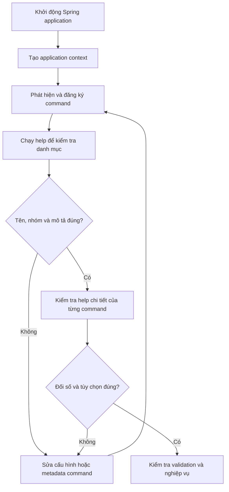

# Kiểm tra lệnh trong trợ giúp trước khi kiểm tra nghiệp vụ

Khi khởi động một ứng dụng Spring Shell, việc thấy dấu nhắc terminal chưa đủ để kết luận ứng dụng đã sẵn sàng. Spring có thể tạo application context thành công nhưng một lớp chứa lệnh chưa được quét, một phương thức chưa được đăng ký hoặc tên lệnh hiển thị không đúng như thiết kế. Người dùng khi đó không thể khám phá hoặc gọi đúng thao tác.

Vì vậy, sau khi ứng dụng khởi động, hãy kiểm tra lệnh `help` trước. Danh sách trợ giúp cho biết Spring Shell đã nhận diện những lệnh nào và mô tả ngắn của chúng. Trợ giúp chi tiết cho từng lệnh cho biết cú pháp, đối số, tùy chọn, kiểu dữ liệu và thông tin bắt buộc. Đây là bước smoke test giao diện CLI: xác nhận lớp lệnh đã được khởi tạo và công bố đúng trước khi kiểm tra dữ liệu hay quy tắc nghiệp vụ.

Spring Shell hỗ trợ xây dựng ứng dụng dòng lệnh thông qua khai báo command, xử lý đối số, validation, trợ giúp và tự hoàn thành. Bài này tập trung vào một bước trong quá trình khởi tạo: đọc và kiểm tra trợ giúp để xác nhận hợp đồng giao tiếp mà ứng dụng công bố cho người dùng.

Sau bài này, bạn có thể:

- Dùng `help` để kiểm tra danh mục lệnh sau khi ứng dụng khởi động.
- Dùng trợ giúp chi tiết để kiểm tra cú pháp và metadata của một lệnh.
- Phát hiện lệnh chưa được đăng ký, tên hoặc mô tả sai, tùy chọn thiếu thông tin và lệnh chưa khả dụng.
- Tách kiểm tra đăng ký lệnh khỏi kiểm tra validation và nghiệp vụ.
- Đưa kiểm tra trợ giúp vào quy trình khởi động thử và kiểm thử tích hợp.

> Các ví dụ chính dùng API annotation `org.springframework.shell.standard` với `@ShellComponent`, `@ShellMethod` và `@ShellOption`, tương thích với các ứng dụng Spring Shell sử dụng mô hình annotation này. Spring Shell cũng có mô hình `@Command` và `@Option`; tên thuộc tính metadata có thể khác. Luôn đối chiếu API với phiên bản dependency của dự án.

## 1. Vì sao phải kiểm tra trợ giúp trước?

Một ứng dụng CLI có ít nhất ba lớp cần hoạt động đúng:

1. **Khởi tạo ứng dụng:** Spring tạo application context, cấu hình Spring Shell và các bean phụ thuộc.
2. **Đăng ký lệnh:** Spring Shell tìm thấy các command, đọc tên, nhóm, mô tả, tham số và đăng ký chúng vào command catalog.
3. **Thực thi:** khi người dùng gọi lệnh, ứng dụng chuyển đổi đầu vào, validation rồi chạy logic nghiệp vụ và trả kết quả.

Nếu bước đăng ký lệnh lỗi, kiểm tra nghiệp vụ chưa có ý nghĩa. Ví dụ, phương thức `createCustomer()` có thể viết đúng và service có thể hoạt động, nhưng nếu lớp command không được component scan phát hiện thì người dùng không thể gọi `customer create`.



Trợ giúp đóng vai trò như một bản mô tả giao diện mà người dùng và script có thể dựa vào. Nếu danh mục lệnh sai, hãy sửa vấn đề đăng ký hoặc khai báo trước khi chạy các ca kiểm thử tạo, sửa, xóa dữ liệu.

## 2. Kiểm tra danh mục lệnh bằng `help`

Chạy ứng dụng theo cách thông thường của dự án. Khi shell hiển thị dấu nhắc, nhập:

```text
help
```

Lệnh tích hợp `help` liệt kê các lệnh mà shell nhận diện, kèm mô tả ngắn. Danh sách thường được chia theo nhóm, chẳng hạn nhóm lệnh tích hợp và nhóm lệnh nghiệp vụ:

```text
my-shell:> help

AVAILABLE COMMANDS

Built-In Commands
    help: Display help about available commands
    clear: Clear the terminal screen
    quit, exit: Exit the shell
    version: Show version info

Khách hàng
    customer create: Tạo khách hàng mới.
    customer find: Tìm khách hàng theo mã.
    customer list: Liệt kê khách hàng.
```

Đây là ví dụ minh họa; tên nhóm, thứ tự, căn lề và các lệnh tích hợp phụ thuộc phiên bản, cấu hình và template trợ giúp của ứng dụng.

Khi đọc danh sách, hãy kiểm tra các điểm sau:

- **Lệnh nghiệp vụ xuất hiện đầy đủ.** Mỗi thao tác mà ứng dụng dự kiến công bố đều có tên trong danh mục.
- **Tên lệnh chính xác.** Tên có đúng tiền tố, dấu cách, dấu gạch nối và cách viết đã thiết kế không?
- **Nhóm có ý nghĩa.** Các lệnh liên quan được đặt trong nhóm phù hợp để người dùng dễ tìm không?
- **Mô tả ngắn có ích.** Mỗi lệnh có mô tả cho biết nó làm gì không? Tránh để mô tả trống hoặc chỉ lặp lại tên lệnh.
- **Lệnh tích hợp vẫn hoạt động.** Các lệnh như `help`, `clear`, `version`, `history`, `script` hoặc `exit` có thể xuất hiện tùy cấu hình và dependency được dùng.
- **Lệnh chưa khả dụng được hiểu đúng.** Một lệnh có thể đã đăng ký nhưng tạm thời không khả dụng do trạng thái ứng dụng. Spring Shell 3.x vẫn đưa các lệnh này vào danh sách trợ giúp; một số phiên bản hoặc template có thể đánh dấu riêng trạng thái đó.

Không kết luận ứng dụng thiếu lệnh chỉ vì thứ tự hoặc cách trình bày khác ví dụ. Hãy so sánh tên, nhóm và nội dung mô tả với thiết kế của dự án.

### Lệnh không xuất hiện trong danh sách

Nếu một lệnh không có trong `help`, kiểm tra lần lượt:

1. Lớp khai báo lệnh có được Spring quét không? Với mô hình annotation cũ, lớp thường được đánh dấu `@ShellComponent` và nằm trong phạm vi component scan.
2. Phương thức có annotation đăng ký lệnh như `@ShellMethod` không?
3. Tên khai báo có đúng không? Kiểm tra `key` hoặc tên command và các bí danh.
4. Ứng dụng có nạp đúng module hoặc cấu hình chứa command không?
5. Lệnh có bị cấu hình ẩn hoặc bị tắt trong command catalog không?
6. Lệnh tích hợp `help` có bị vô hiệu hóa hoặc thay thế không?

Một lệnh bị đánh dấu chưa khả dụng vẫn có thể xuất hiện trong `help`. Vì thế, cần phân biệt **không được đăng ký** với **đã đăng ký nhưng chưa thể thực thi**. Hai trường hợp có nguyên nhân và cách xử lý khác nhau.

## 3. Kiểm tra chi tiết một lệnh

Sau khi xác nhận danh mục, yêu cầu trợ giúp chi tiết cho từng lệnh quan trọng:

```text
help customer find
```

Với lệnh có nhiều từ, có thể truyền tên đầy đủ qua tùy chọn `--command`:

```text
help --command "customer find"
```

Trợ giúp chi tiết thường có các phần:

- `NAME`: tên lệnh và mô tả.
- `SYNOPSIS`: cách viết lệnh tổng quát.
- `OPTIONS`: tên tùy chọn, bí danh, kiểu dữ liệu, mô tả và thông tin bắt buộc hoặc tùy chọn.

Ví dụ minh họa:

```text
NAME
    customer find - Tìm khách hàng theo mã.

SYNOPSIS
    customer find --id String

OPTIONS
    -i or --id String
        Mã khách hàng cần tìm.
        [Mandatory]
```

Đối chiếu trợ giúp với chữ ký phương thức command. Nếu phương thức yêu cầu `id` nhưng trợ giúp thể hiện tùy chọn không bắt buộc, hoặc mô tả `--id` không đúng mục đích, người dùng có thể gọi sai lệnh dù code vẫn biên dịch.

### Ví dụ khai báo command có metadata rõ ràng

```java
import org.springframework.shell.standard.ShellCommandGroup;
import org.springframework.shell.standard.ShellComponent;
import org.springframework.shell.standard.ShellMethod;
import org.springframework.shell.standard.ShellOption;

@ShellComponent
@ShellCommandGroup("Khách hàng")
public class CustomerCommands {

    @ShellMethod(
            key = "customer find",
            value = "Tìm khách hàng theo mã.")
    public String find(
            @ShellOption(
                    value = {"-i", "--id"},
                    help = "Mã khách hàng cần tìm.") String id) {
        return "Đang tra cứu khách hàng " + id;
    }

    @ShellMethod(
            key = "customer list",
            value = "Liệt kê khách hàng theo giới hạn kết quả.")
    public String list(
            @ShellOption(
                    value = {"-l", "--limit"},
                    defaultValue = "20",
                    help = "Số khách hàng tối đa cần hiển thị.") int limit) {
        return "Giới hạn danh sách: " + limit;
    }
}
```

Trong ví dụ:

- `@ShellComponent` giúp Spring phát hiện lớp chứa lệnh.
- `@ShellCommandGroup` gom lệnh vào nhóm `Khách hàng` trong trợ giúp.
- `@ShellMethod.key` công bố tên lệnh; `value` cung cấp mô tả ngắn.
- `@ShellOption.value` đặt tên dài và bí danh ngắn cho tham số.
- `@ShellOption.help` mô tả ý nghĩa tham số trong trợ giúp chi tiết.
- `defaultValue` cho biết người dùng có thể bỏ qua `--limit` và nhận giá trị mặc định `20`.

Khi chạy `help`, cần thấy `customer find` và `customer list` trong nhóm `Khách hàng`. Khi chạy `help customer find`, cần thấy `--id` là đầu vào bắt buộc và có bí danh `-i`. Với `help customer list`, cần thấy tùy chọn giới hạn cùng giá trị mặc định. Nội dung hiển thị cụ thể có thể khác theo phiên bản và template.

### Bí danh và tên lệnh nhiều từ

Nếu một phương thức có nhiều tên gọi, hãy xác nhận bí danh được công bố hoặc có thể tra cứu bằng trợ giúp theo cách phiên bản đang dùng hỗ trợ:

```java
@ShellMethod(
        key = {"customer find", "customer get"},
        value = "Tìm khách hàng theo mã.")
public String find(
        @ShellOption(value = {"-i", "--id"}) String id) {
    return "Đang tra cứu khách hàng " + id;
}
```

Hai tên `customer find` và `customer get` cùng gọi một phương thức. Hãy giữ một tên chính dễ nhớ, chỉ thêm bí danh khi có nhu cầu tương thích hoặc rút gọn rõ ràng. Với tên command nhiều từ, dùng dấu nháy khi truyền toàn bộ tên vào `--command` để parser nhận đúng một giá trị.

## 4. Kiểm tra `--help` và `-h`

Ngoài lệnh `help`, Spring Shell 3.x có thể tự bổ sung tùy chọn trợ giúp `--help` và `-h` cho các command được đăng ký. Khi được bật, các tùy chọn này chuyển sang hiển thị trợ giúp và không thực thi phần xử lý command.

Thử với command mẫu:

```text
customer find --help
customer find -h
```

Kết quả cần là phần hướng dẫn của `customer find`. Không được phát sinh thao tác tra cứu khách hàng chỉ vì người dùng yêu cầu trợ giúp. Nếu dự án tắt hoặc tùy biến help options, dùng lệnh `help` tích hợp làm cách kiểm tra chuẩn và xác nhận cấu hình tương ứng.

Đừng nhầm `--help` với một tùy chọn nghiệp vụ do chính phương thức khai báo. Tùy chọn trợ giúp được framework xử lý trước khi gọi logic command. Với API và cấu hình khác nhau, khả năng tự bổ sung tùy chọn trợ giúp có thể thay đổi; hãy kiểm tra tài liệu của đúng phiên bản Spring Shell.

## 5. Kiểm tra trạng thái khả dụng trong danh sách trợ giúp

Một số lệnh chỉ chạy được sau khi ứng dụng đạt một trạng thái nhất định. Ví dụ, `report export` chỉ khả dụng sau khi cấu hình nguồn dữ liệu. Spring Shell cho phép liên kết command với một availability provider.

```java
import org.springframework.shell.Availability;
import org.springframework.shell.standard.ShellComponent;
import org.springframework.shell.standard.ShellMethod;
import org.springframework.shell.standard.ShellMethodAvailability;

@ShellComponent
public class ReportCommands {

    private boolean dataSourceReady;

    @ShellMethod(key = "report connect", value = "Kết nối nguồn dữ liệu báo cáo.")
    public String connect() {
        // Thay bằng thao tác kết nối thực tế.
        dataSourceReady = true;
        return "Nguồn dữ liệu đã sẵn sàng.";
    }

    @ShellMethod(key = "report export", value = "Xuất báo cáo.")
    @ShellMethodAvailability("exportAvailability")
    public String export() {
        return "Đang xuất báo cáo.";
    }

    public Availability exportAvailability() {
        return dataSourceReady
                ? Availability.available()
                : Availability.unavailable("chưa kết nối nguồn dữ liệu");
    }
}
```

Khi vừa khởi động, `report export` đã được đăng ký nhưng chưa khả dụng. Danh mục trợ giúp của Spring Shell 3.x vẫn liệt kê command này; tùy phiên bản hoặc template, trạng thái chưa khả dụng có thể được đánh dấu. Sau khi chạy `report connect`, command trở nên khả dụng.

Kiểm tra hai tình huống riêng:

1. **Trước khi kết nối:** command có xuất hiện trong trợ giúp không, và lý do chưa khả dụng có rõ ràng không?
2. **Sau khi kết nối:** trạng thái khả dụng có được cập nhật và command có thể chạy không?

Không dùng việc command xuất hiện trong `help` làm bằng chứng rằng điều kiện nghiệp vụ đã thỏa mãn. Trợ giúp mô tả command catalog; availability phản ánh khả năng gọi tại thời điểm hiện tại; logic nghiệp vụ vẫn cần được kiểm tra bằng ca thực thi.

## 6. Quy trình smoke test sau khi khởi động

Thực hiện kiểm tra theo thứ tự dưới đây trên môi trường phát triển hoặc môi trường CI có thể chạy ứng dụng:

| Bước | Thao tác | Điều cần xác nhận |
|---|---|---|
| 1 | Khởi động ứng dụng | Application context và Spring Shell khởi tạo thành công; dấu nhắc xuất hiện ở chế độ tương tác. |
| 2 | Chạy `help` | Danh mục command tích hợp và command nghiệp vụ được hiển thị. |
| 3 | Đọc tên và nhóm | Không thiếu lệnh, sai tên, sai nhóm hoặc có mô tả trống ngoài dự kiến. |
| 4 | Chạy `help --command "customer find"` | Tên, cú pháp và mô tả của command chính xác. |
| 5 | Kiểm tra `--help` hoặc `-h` | Trợ giúp hiển thị và phần xử lý nghiệp vụ không bị gọi. |
| 6 | Kiểm tra command có điều kiện | Trạng thái khả dụng và lý do chưa khả dụng phù hợp với trạng thái ban đầu. |
| 7 | Chạy ca đầu vào hợp lệ và không hợp lệ | Kiểm tra chuyển đổi kiểu, validation, lỗi và kết quả nghiệp vụ. |

Ví dụ một phiên kiểm tra ngắn:

```text
my-shell:> help
my-shell:> help --command "customer find"
my-shell:> help --command "customer list"
my-shell:> customer find --help
my-shell:> customer list --help
```

Ở bước cuối, chỉ tiếp tục gọi lệnh thật với dữ liệu thử phù hợp sau khi phần trợ giúp đã khớp thiết kế. Nếu lệnh tạo hoặc xóa dữ liệu, dùng môi trường và dữ liệu kiểm thử dành riêng cho thao tác đó.

## 7. Đưa kiểm tra trợ giúp vào kiểm thử tự động

Kiểm tra thủ công hữu ích khi phát triển command mới, nhưng không nên là cách duy nhất để phát hiện lỗi đăng ký lệnh. Có thể xây dựng smoke test tích hợp để khởi tạo cùng cấu hình Spring của ứng dụng và thực thi lệnh trợ giúp bằng test client hoặc cơ chế kiểm thử shell được phiên bản Spring Shell đang dùng hỗ trợ.

Một bộ kiểm tra có thể chia thành các nhóm:

| Nhóm kiểm tra | Điều cần xác nhận | Lỗi được phát hiện |
|---|---|---|
| Command catalog | Tập tên command mong đợi xuất hiện trong `help` | Lớp không được quét, thiếu annotation, sai tên hoặc command bị ẩn. |
| Command description | Mỗi command có mô tả ngắn đúng mục đích | Metadata thiếu hoặc lỗi thời. |
| Detailed help | Các tham số, alias, kiểu, default và mô tả khớp thiết kế | Sai tên option, sai giá trị mặc định hoặc khai báo required không đúng. |
| Availability | Command phụ thuộc trạng thái được đánh dấu đúng ở các trạng thái đầu vào | Điều kiện khả dụng bị đảo hoặc không cập nhật. |
| Help options | `--help` và `-h` hiển thị trợ giúp mà không chạy nghiệp vụ | Help option bị tắt hoặc xử lý nhầm như đầu vào nghiệp vụ. |

Khi kiểm tra kết quả `help`, ưu tiên xác nhận sự hiện diện của tên lệnh và metadata cần thiết. Tránh phụ thuộc quá mức vào khoảng trắng, căn lề hoặc thứ tự dòng nếu ứng dụng không cam kết các chi tiết trình bày đó. Nếu nhóm phát triển chủ động coi toàn bộ output trợ giúp là giao diện ổn định, có thể dùng snapshot test nhưng cần cập nhật snapshot có chủ đích khi đổi template.

Một test tốt nên chứng minh hai điều độc lập:

- Spring Shell đã công bố đúng giao diện lệnh.
- Khi gọi command với dữ liệu cụ thể, ứng dụng xử lý đúng và trả kết quả mong đợi.

Không nên suy ra điều thứ hai từ kết quả của điều thứ nhất. `help` không xác nhận database kết nối thành công, quyền truy cập hợp lệ, validation đúng hoặc giao dịch được commit.

## 8. Chẩn đoán khi trợ giúp không đúng

| Hiện tượng | Nguyên nhân có thể | Hướng xử lý |
|---|---|---|
| Không chạy được `help` | Built-in command không được nạp, bị tắt hoặc bị thay thế | Kiểm tra dependency và cấu hình command tích hợp của Spring Shell. |
| `help` không liệt kê command nghiệp vụ | Lớp command ngoài phạm vi component scan hoặc thiếu annotation | Kiểm tra package scan, `@ShellComponent` và `@ShellMethod`. |
| Command xuất hiện nhưng tên khác dự kiến | `key` hoặc tên khai báo chưa chính xác | Chuẩn hóa tên command và alias theo giao diện đã thiết kế. |
| Mô tả command trống hoặc khó hiểu | Thiếu `value` hoặc `description` | Viết mô tả ngắn, dùng động từ và nêu rõ đối tượng thao tác. |
| Option thiếu mô tả | Không khai báo help/description cho tham số | Bổ sung metadata cho từng option quan trọng. |
| Option hiển thị là tùy chọn dù nghiệp vụ yêu cầu | Thiếu cấu hình bắt buộc hoặc khai báo default ngoài ý muốn | Kiểm tra `defaultValue`, required và chữ ký phương thức. |
| `--help` chạy vào phương thức command | Help options không được bật hoặc khác hành vi phiên bản | Dùng built-in `help` và kiểm tra cấu hình help options. |
| Command luôn unavailable | Availability provider đang đọc sai trạng thái hoặc không cập nhật | Kiểm tra vòng đời bean và điều kiện availability. |
| Trợ giúp không hiển thị nhóm như mong đợi | Cấu hình group hoặc grouping mode của template | Kiểm tra `@ShellCommandGroup` và cấu hình template trợ giúp. |

Khi điều tra, thay đổi một yếu tố đăng ký hoặc metadata tại một thời điểm rồi chạy lại `help`. Điều này giúp xác định lỗi đến từ component scan, khai báo command, cấu hình hay template.

## 9. Tiêu chí hoàn thành bước kiểm tra trợ giúp

Có thể coi bước smoke test trợ giúp đạt yêu cầu khi:

- Ứng dụng khởi động và shell nhận lệnh.
- `help` chạy được và liệt kê đầy đủ command dự kiến.
- Tên command, alias, nhóm và mô tả ngắn chính xác.
- Trợ giúp chi tiết thể hiện đúng tham số, kiểu dữ liệu, tính bắt buộc, giá trị mặc định và mô tả option.
- Các command có điều kiện thể hiện trạng thái khả dụng phù hợp.
- Tùy chọn trợ giúp hiển thị đúng và không gọi logic nghiệp vụ.
- Smoke test có thể lặp lại trên môi trường kiểm thử.

Sau bước này, tiếp tục kiểm tra validation, tự hoàn thành, chế độ tương tác và chạy script, kết quả output, mã thoát, kiểm thử nghiệp vụ và đóng gói phân phối. Những phần đó xác nhận hành vi thực thi của CLI; trợ giúp là cổng kiểm tra đầu tiên để bảo đảm người dùng có thể tìm thấy và hiểu đúng các lệnh.

## Tài liệu tham khảo

- [Spring Shell 3.3 – Built-in Help Command](https://docs.spring.io/spring-shell/reference/3.3/commands/builtin/help.html): danh sách lệnh, trợ giúp chi tiết và cấu hình template.
- [Spring Shell 3.3 – Help Options](https://docs.spring.io/spring-shell/reference/3.3/commands/helpoptions.html): tùy chọn `--help` và `-h`.
- [Spring Shell 3.3 – Getting Started](https://docs.spring.io/spring-shell/reference/3.3/getting-started.html): đăng ký command bằng `@ShellComponent`, `@ShellMethod` và cách command xuất hiện trong trợ giúp.
- [Spring Shell `@ShellOption` API](https://docs.spring.io/spring-shell/docs/current/api/org/springframework/shell/standard/ShellOption.html): tên option, arity, giá trị mặc định và mô tả tham số.
