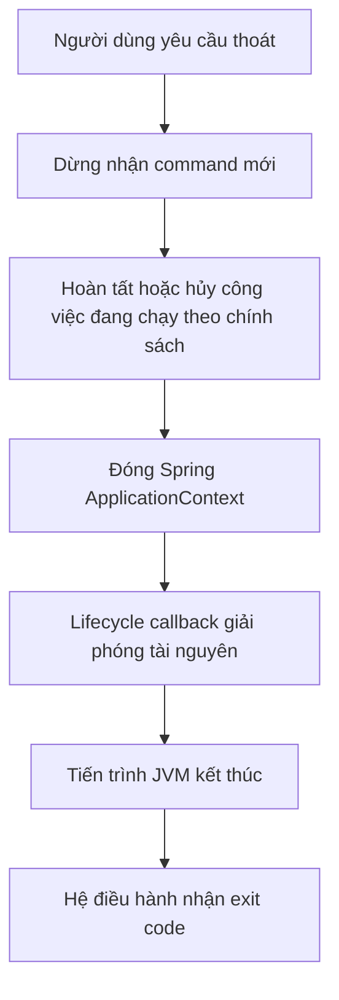

# Dừng ứng dụng và xác nhận tài nguyên được giải phóng

Một ứng dụng Spring Shell không hoàn tất vòng đời chỉ vì người dùng đã nhập xong command cuối cùng. Khi phiên làm việc kết thúc, ứng dụng cần dừng các tác vụ nền, đóng kết nối, giải phóng file và socket, rồi đóng Spring context để tiến trình có thể kết thúc sạch sẽ.

Điều này đặc biệt quan trọng với CLI chạy lâu trong môi trường vận hành. Một command có thể mở kết nối cơ sở dữ liệu, tạo executor, khởi động scheduler hoặc ghi dữ liệu tạm. Nếu các tài nguyên đó không được đóng đúng cách, ứng dụng có thể giữ tiến trình sống, làm thất thoát kết nối hoặc để lại file và tác vụ chạy dở.

## Mục tiêu học tập

Sau bài học, bạn có thể:

- Phân biệt kết thúc một phiên shell, đóng Spring ApplicationContext và kết thúc tiến trình JVM.
- Giải thích vai trò của shutdown hook và lifecycle callback trong Spring.
- Chọn `@PreDestroy`, `@Bean(destroyMethod = ...)` hoặc `SmartLifecycle` cho từng kiểu tài nguyên.
- Thiết kế quy trình dừng có thời gian chờ, xử lý lỗi và khôi phục interrupt phù hợp.
- Kiểm thử và xác nhận tài nguyên thực sự được giải phóng khi ứng dụng dừng.

## 1. Dừng ứng dụng là một quy trình có nhiều lớp

Khi sử dụng Spring Shell trong terminal, có ít nhất ba sự kiện cần phân biệt:

1. **Kết thúc phiên shell:** vòng lặp nhận command dừng và ứng dụng không tiếp tục chờ người dùng nhập lệnh.
2. **Đóng Spring ApplicationContext:** container dừng các bean có vòng đời, gọi các callback hủy và giải phóng những tài nguyên do bean quản lý.
3. **Kết thúc tiến trình JVM:** tiến trình Java dừng và trả mã thoát cho hệ điều hành.

Ba sự kiện thường diễn ra nối tiếp nhau trong một lần thoát bình thường, nhưng chúng không phải cùng một thao tác. Một prompt biến mất chưa chứng minh JVM đã kết thúc. Tương tự, một command trả về kết quả thành công không chứng minh các kết nối hoặc executor đã được đóng.

Với một ứng dụng Spring Shell chạy như CLI độc lập, luồng dừng mong muốn thường là:



Tên lệnh thoát và cách điều khiển vòng lặp phụ thuộc cấu hình, phiên bản Spring Shell và cách ứng dụng được khởi chạy. Điều quan trọng là đường thoát phải dẫn đến việc đóng context hoặc một cơ chế quản lý vòng đời tương đương.

## 2. Những tài nguyên cần được giải phóng

Trong CLI, tài nguyên không chỉ là file đang mở. Các loại thường gặp gồm:

| Tài nguyên | Rủi ro nếu không giải phóng | Cách đóng thường dùng |
|---|---|---|
| JDBC connection hoặc connection pool | Giữ kết nối tới cơ sở dữ liệu, làm cạn pool | Đóng connection hoặc pool do bean sở hữu |
| HTTP client và socket | Giữ socket, thread hoặc connection manager | Gọi `close()` hoặc phương thức shutdown tương ứng |
| Executor và scheduler | Thread nền tiếp tục chạy, JVM không thoát | Ngừng nhận việc, chờ tác vụ và shutdown executor |
| File, stream và writer | Giữ file handle, dữ liệu chưa flush | Đóng stream/writer sau khi hoàn tất ghi |
| Watcher và listener | Tiếp tục nhận sự kiện sau khi ứng dụng dừng | Hủy đăng ký listener và đóng watcher |
| Tài nguyên tạm | Để lại file, thư mục hoặc lock | Xóa hoặc giải phóng theo chính sách sở hữu |

Hãy xác định rõ ai sở hữu từng tài nguyên. Nếu một bean tự tạo executor hoặc client, bean đó thường phải chịu trách nhiệm đóng nó. Nếu tài nguyên được một bean khác quản lý, không nên tự ý đóng tài nguyên dùng chung từ command vì có thể làm hỏng các thao tác còn lại.

Với tài nguyên chỉ tồn tại trong một thao tác ngắn, ưu tiên cấu trúc `try-with-resources` để đóng ngay khi thao tác kết thúc. Lifecycle của Spring phù hợp hơn với tài nguyên có tuổi thọ gắn với bean hoặc toàn bộ ứng dụng.

## 3. Spring quản lý vòng đời bean như thế nào?

Spring container quản lý vòng đời của các bean mà nó tạo và quản lý. Khi `ApplicationContext` được đóng một cách bình thường, container dừng các bean có hỗ trợ lifecycle rồi thực hiện các callback hủy dành cho bean singleton.

Một số cơ chế phổ biến:

- `@PreDestroy`: đánh dấu phương thức cần chạy trước khi bean bị hủy.
- `DisposableBean.destroy()`: callback hủy thông qua interface của Spring.
- `@Bean(destroyMethod = "...")`: chỉ rõ phương thức đóng tài nguyên do bean trả về sở hữu.
- `AutoCloseable.close()` hoặc `close()` được cấu hình làm destroy method: giải phóng đối tượng có khả năng tự đóng.
- `Lifecycle` và `SmartLifecycle`: quản lý thành phần cần được start/stop theo vòng đời ứng dụng, có thể phối hợp thứ tự và thời gian dừng.

Không cần triển khai tất cả cơ chế cho cùng một bean. Chọn một cách rõ ràng, phù hợp với API tài nguyên và tránh đóng cùng một đối tượng nhiều lần nếu thao tác đóng không idempotent.

Các callback này chỉ áp dụng cho đối tượng do Spring container quản lý. Bean `prototype` được container tạo rồi giao cho bên gọi, nhưng container không theo dõi để tự động gọi destroy callback khi bên gọi dùng xong. Đối tượng được tạo bằng `new` bên ngoài container cũng không tự động nhận lifecycle callback. Với các trường hợp đó, bên tạo hoặc bên nhận quyền sở hữu phải đóng tài nguyên một cách tường minh.

### 3.1. Dùng `@PreDestroy` cho tài nguyên do bean sở hữu

Ví dụ một bean tạo scheduler để chạy tác vụ nền:

```java
import jakarta.annotation.PreDestroy;
import org.springframework.stereotype.Component;

import java.util.concurrent.Executors;
import java.util.concurrent.ScheduledExecutorService;
import java.util.concurrent.TimeUnit;

@Component
public class ReportScheduler {

    private final ScheduledExecutorService executor =
            Executors.newSingleThreadScheduledExecutor();

    public void schedule(Runnable task, long delay, TimeUnit unit) {
        executor.schedule(task, delay, unit);
    }

    @PreDestroy
    public void stop() {
        executor.shutdown();
        try {
            if (!executor.awaitTermination(5, TimeUnit.SECONDS)) {
                executor.shutdownNow();
            }
        } catch (InterruptedException ex) {
            executor.shutdownNow();
            Thread.currentThread().interrupt();
        }
    }
}
```

Khi context đóng, Spring gọi `stop()` trong giai đoạn hủy bean. Phương thức trước hết ngừng nhận tác vụ mới, chờ tác vụ đang chạy tối đa năm giây, sau đó yêu cầu hủy các tác vụ còn lại. Nếu thread dừng bị interrupt, mã yêu cầu shutdown ngay và khôi phục trạng thái interrupt để tầng gọi phía trên có thể nhận biết.

Thời gian chờ năm giây chỉ là ví dụ. Ứng dụng cần chọn timeout dựa trên thời gian xử lý thực tế và ngân sách shutdown của môi trường triển khai. `shutdownNow()` chỉ gửi yêu cầu interrupt tới tác vụ; tác vụ phải hợp tác xử lý interrupt thì mới dừng được.

### 3.2. Khai báo destroy method cho bean tạo từ cấu hình

Khi một phương thức `@Bean` tạo ra đối tượng có `close()`, có thể khai báo rõ phương thức hủy:

```java
import org.springframework.context.annotation.Bean;
import org.springframework.context.annotation.Configuration;

@Configuration
public class ClientConfiguration {

    @Bean(destroyMethod = "close")
    ManagedReportClient reportClient() {
        return new ManagedReportClient();
    }
}
```

Trong ví dụ, `ManagedReportClient` là lớp giả định có phương thức `close()`. Khi context đóng, Spring gọi phương thức này để giải phóng tài nguyên mà client sở hữu.

Khai báo `destroyMethod` làm rõ hợp đồng sở hữu tài nguyên ngay tại nơi tạo bean. Cách này hữu ích với thư viện bên ngoài mà ta không thể thêm `@PreDestroy` vào lớp của họ.

### 3.3. Dùng `SmartLifecycle` cho thành phần cần dừng có phối hợp

Một số thành phần cần được dừng theo trình tự hoặc cần thông báo khi quá trình dừng bất đồng bộ đã hoàn tất. Ví dụ, một worker phải ngừng nhận message mới, xử lý xong message đang chạy rồi mới đóng client kết nối.

Trong trường hợp này, `SmartLifecycle` có thể phù hợp hơn một callback đóng đơn giản. Interface cung cấp cơ chế start/stop và callback cho thao tác dừng bất đồng bộ. Khi triển khai `stop(Runnable callback)`, thành phần phải gọi callback khi đã dừng xong; nếu quên gọi, quá trình đóng context có thể phải chờ đến timeout.

`SmartLifecycle` cũng có khái niệm phase để điều phối thứ tự khởi động và dừng giữa các thành phần. Thành phần cần hoạt động trước có thể được khởi động ở phase thấp hơn; khi dừng, thứ tự được đảo ngược. Chỉ dùng phase khi có quan hệ phụ thuộc thực sự, và ghi rõ lý do để người bảo trì hiểu thứ tự đó.

## 4. Đóng ApplicationContext

Các callback hủy chỉ được gọi khi container thực sự đi qua quy trình đóng phù hợp. Với `ConfigurableApplicationContext`, ứng dụng có thể gọi `close()` khi cần kết thúc context một cách tường minh.

Ví dụ minh họa với context được tạo trực tiếp:

```java
import org.springframework.context.annotation.AnnotationConfigApplicationContext;

public class StandaloneRunner {

    public static void main(String[] args) {
        try (var context = new AnnotationConfigApplicationContext(AppConfig.class)) {
            // Khởi tạo hoặc điều phối công việc của ứng dụng.
        }
        // Context đã được đóng khi rời khỏi khối try.
    }
}
```

`AnnotationConfigApplicationContext` có thể đóng qua `close()`, vì vậy khối `try-with-resources` giúp bảo đảm thao tác đóng được gọi cả khi phần thân kết thúc bình thường hoặc ném exception. Ví dụ này minh họa quản lý context; một ứng dụng Spring Shell thực tế cần để runtime shell tham gia vào luồng nhận command và kết thúc phiên trước khi context đóng.

Với ứng dụng Spring Boot, `SpringApplication` thường quản lý context và đăng ký shutdown hook để đóng context khi JVM đi qua quá trình shutdown bình thường. Nếu ứng dụng thay đổi cấu hình shutdown hook hoặc tự quản lý context, cần xác minh rõ thành phần nào chịu trách nhiệm gọi `close()`.

Không nên tạo thêm nhiều shutdown hook riêng cho từng bean Spring nếu cùng một công việc đã có thể biểu diễn bằng lifecycle callback. Các hook của JVM không có thứ tự thực thi được bảo đảm giữa chúng; nhiều hook cùng đóng tài nguyên có thể tạo ra race condition.

## 5. Các cách ứng dụng có thể kết thúc

Một CLI cần xác định những đường thoát mà sản phẩm hỗ trợ và bảo đảm chúng đi qua quy trình cleanup phù hợp.

### 5.1. Người dùng yêu cầu thoát bình thường

Người dùng nhập lệnh thoát mà ứng dụng cung cấp hoặc chọn hành động kết thúc phiên. Runtime dừng nhận command mới, điều phối việc kết thúc phiên và để ứng dụng đóng context. Đây là đường thoát cần được kiểm thử thường xuyên nhất.

Không nên mặc định rằng mọi command có tên `exit` hoặc `quit` ở mọi phiên bản và cấu hình đều có cùng hành vi. Hãy xác nhận command thực tế đang dùng kết thúc phiên shell, đóng context hay chỉ trả quyền điều khiển về một lớp gọi bên ngoài.

### 5.2. JVM nhận yêu cầu shutdown bình thường

Khi JVM nhận một yêu cầu shutdown bình thường, các shutdown hook đã đăng ký được chạy. Trong cấu hình Spring Boot thông thường, hook do framework đăng ký sẽ yêu cầu đóng context, từ đó kích hoạt quy trình hủy bean.

Ví dụ, người dùng nhấn `Ctrl+C` trong terminal thường tạo tín hiệu kết thúc có thể được JVM xử lý bằng shutdown sequence. Hành vi chi tiết phụ thuộc hệ điều hành, cách tiến trình được khởi chạy và tín hiệu nhận được.

### 5.3. Tiến trình bị kết thúc cưỡng bức

Nếu tiến trình bị kết thúc bằng thao tác cưỡng bức như `kill -9`, `Runtime.halt()` hoặc máy bị mất điện, JVM không có cơ hội chạy shutdown hook. Vì vậy không thể dựa vào `@PreDestroy` để bảo đảm cleanup trong mọi sự cố.

Những tài nguyên quan trọng cần có cơ chế an toàn bổ sung: transaction phải có ranh giới commit/rollback phù hợp, file tạm có quy tắc dọn dẹp khi khởi động lần sau, lock có timeout hoặc lease, và thao tác bên ngoài nên có khả năng retry/idempotent khi cần.

## 6. Thiết kế một quy trình graceful shutdown

Graceful shutdown là quá trình dừng có kiểm soát, cho các thành phần cơ hội hoàn tất hoặc hủy công việc an toàn trước khi tiến trình kết thúc.

Một quy trình thực tế có thể gồm:

1. Chuyển ứng dụng sang trạng thái đang dừng và từ chối command mới.
2. Ngừng nhận công việc mới từ scheduler, queue hoặc listener.
3. Chờ các command và tác vụ đang chạy hoàn tất trong thời hạn được cấu hình.
4. Hủy hoặc đánh dấu thất bại các công việc quá thời hạn theo chính sách nghiệp vụ.
5. Đóng client, connection pool, file, watcher và executor do ứng dụng sở hữu.
6. Ghi nhận kết quả shutdown và để tiến trình kết thúc với exit code thích hợp.

Không phải ứng dụng nào cũng cần một bộ điều phối riêng cho toàn bộ các bước. Spring lifecycle có thể điều phối nhiều thành phần. Nhiệm vụ của nhà phát triển là xác định công việc nào cần dừng trước, công việc nào phụ thuộc vào tài nguyên khác và thời gian chờ tối đa cho từng bước.

### 6.1. Dừng nhận việc trước khi đóng tài nguyên

Giả sử `ReportScheduler` vẫn tạo tác vụ trong lúc connection pool đang đóng. Tác vụ mới có thể thất bại hoặc giữ tiến trình sống. Vì vậy scheduler và listener cần dừng nhận việc trước; sau đó chờ công việc đang chạy; cuối cùng mới đóng các client mà công việc đó sử dụng.

Nếu nhiều bean phụ thuộc lẫn nhau, hãy thể hiện quan hệ đó bằng lifecycle phase hoặc cấu trúc sở hữu rõ ràng. Không nên dựa vào thứ tự tình cờ của log để suy luận rằng thứ tự hủy luôn đúng.

### 6.2. Đặt timeout và xử lý tác vụ bị treo

Mỗi bước chờ cần có giới hạn thời gian. Nếu không, một worker bị treo có thể khiến CLI không bao giờ thoát. Khi hết thời gian, ứng dụng cần quyết định có gửi interrupt, hủy tác vụ, đóng kết nối hay ghi lại trạng thái công việc dở dang.

Interrupt là tín hiệu hợp tác, không phải cơ chế cưỡng bức dừng an toàn cho mọi đoạn mã. Code chạy nền nên kiểm tra interrupt, dùng API có hỗ trợ interrupt và luôn giải phóng tài nguyên trong `finally` hoặc `try-with-resources`.

### 6.3. Ghi log vừa đủ để điều tra

Log shutdown nên cho biết ứng dụng bắt đầu dừng, thành phần nào đã dừng, thành phần nào timeout hoặc lỗi, và thời điểm context đóng xong. Tránh chỉ ghi một dòng `Shutdown complete` trước khi callback cleanup thực sự hoàn tất.

Không ghi password, token, chuỗi kết nối chứa bí mật hoặc dữ liệu nhạy cảm vào log cleanup. Có thể ghi tên pool, số tác vụ còn chờ và thời lượng đóng mà không tiết lộ thông tin xác thực.

## 7. Exit code và trạng thái cleanup

Exit code là kết quả mà tiến trình trả cho hệ điều hành. Nó giúp script hoặc pipeline biết ứng dụng hoàn thành thành công hay thất bại. Exit code không tự chứng minh rằng mọi tài nguyên đã được giải phóng.

Ứng dụng cần thống nhất cách ánh xạ kết quả:

| Kết quả | Cách diễn giải gợi ý |
|---|---|
| Công việc thành công và cleanup hoàn tất | Exit code thành công |
| Công việc thất bại nhưng cleanup hoàn tất | Exit code phản ánh lỗi công việc |
| Cleanup gặp lỗi quan trọng | Exit code phản ánh lỗi shutdown theo chính sách ứng dụng |
| Một tác vụ vượt timeout nhưng ứng dụng vẫn thoát | Ghi rõ tác vụ chưa dừng và trả mã theo mức độ ảnh hưởng |

Trong ứng dụng Spring Boot, có thể sử dụng cơ chế exit code của Boot, chẳng hạn `ExitCodeGenerator` và `SpringApplication.exit(...)`, theo đúng API của phiên bản đang dùng. Hãy xác định thời điểm tính exit code sao cho nó phản ánh được cả kết quả command và kết quả shutdown mà ứng dụng muốn công bố.

Tránh gọi `System.exit()` ngay bên trong command method hoặc bean nghiệp vụ. Lệnh này tác động tới toàn bộ JVM, làm khó kiểm soát luồng đóng context và gây khó khăn khi kiểm thử. Nếu launcher cần gọi `System.exit(code)`, hãy để việc đó ở lớp ngoài cùng sau khi quy trình đóng context đã được thực hiện và mã thoát đã được xác định.

## 8. Kiểm chứng tài nguyên đã được giải phóng

Một thông báo log cho biết callback đã chạy là tín hiệu hữu ích, nhưng chưa đủ để chứng minh tài nguyên bên ngoài đã được giải phóng. Nên kết hợp kiểm thử lifecycle với quan sát trạng thái thực tế.

### 8.1. Kiểm thử callback khi đóng context

Ví dụ đơn giản dùng cờ để xác nhận destroy method đã được gọi:

```java
import java.util.concurrent.atomic.AtomicBoolean;

public class CloseProbe implements AutoCloseable {

    private final AtomicBoolean closed;

    public CloseProbe(AtomicBoolean closed) {
        this.closed = closed;
    }

    @Override
    public void close() {
        closed.set(true);
    }
}
```

Trong kiểm thử, đăng ký `CloseProbe` thành bean với `@Bean(destroyMethod = "close")`, tạo context, xác nhận cờ đang là `false`, đóng context rồi xác nhận cờ chuyển thành `true`.

```java
@Test
void closesManagedResourceWhenContextCloses() {
    AtomicBoolean closed = new AtomicBoolean(false);

    try (var context = new AnnotationConfigApplicationContext()) {
        context.registerBean("probe", CloseProbe.class,
                () -> new CloseProbe(closed));
        context.refresh();
        assertFalse(closed.get());
    }

    assertTrue(closed.get());
}
```

Đây là kiểm thử minh họa cho callback của Spring context. Nó chưa chứng minh một socket, database connection hay file thật đã được đóng; những loại tài nguyên đó cần kiểm thử tích hợp phù hợp.

### 8.2. Kiểm thử tích hợp với tài nguyên thật

Tùy ứng dụng, có thể xác nhận:

- Kết nối cơ sở dữ liệu hoặc connection pool không còn giữ connection sau khi context đóng.
- Cổng TCP mà ứng dụng mở đã ngừng lắng nghe.
- File handle được giải phóng và file tạm được xử lý theo chính sách.
- Thread thuộc executor đã kết thúc sau thời hạn chờ.
- Listener hoặc consumer đã ngừng nhận message.
- Process CLI đã kết thúc và mã thoát đúng như hợp đồng.

Đối với file, chỉ kiểm tra file có tồn tại hay không có thể không đủ: ứng dụng có thể được thiết kế để giữ file kết quả sau khi thoát. Cần xác định tài nguyên nào phải được xóa, tài nguyên nào phải được giữ lại và ai là chủ sở hữu.

### 8.3. Kiểm thử đường thoát của cả tiến trình

Một bài kiểm thử end-to-end có thể khởi chạy JAR như tiến trình con, gửi command, gửi lệnh thoát theo giao thức của ứng dụng, chờ tiến trình kết thúc trong timeout rồi xác nhận exit code và các dấu hiệu cleanup.

Nên có ít nhất các tình huống:

1. Thoát bình thường sau khi command thành công.
2. Thoát sau khi command ném exception.
3. Thoát khi có tác vụ nền đang chạy.
4. Shutdown vượt timeout.
5. Nhận tín hiệu kết thúc bình thường từ môi trường chạy.

Không dùng thao tác kết thúc cưỡng bức làm tiêu chí chứng minh cleanup. Có thể kiểm tra riêng hành vi phục hồi sau sự cố cưỡng bức, nhưng đó là một bài toán khác vì shutdown hook không được bảo đảm chạy.

## 9. Các lỗi thiết kế thường gặp

### Chỉ dừng prompt mà không đóng context

Phiên shell đã kết thúc nhưng bean vẫn giữ executor hoặc connection. Cần kiểm tra xem đường thoát có thực sự đóng `ApplicationContext` hay chỉ dừng vòng lặp nhận lệnh.

### Đóng tài nguyên quá sớm

Command đang chạy vẫn cần connection pool nhưng một callback hoặc command khác đã đóng pool. Hãy dừng nhận công việc mới, chờ công việc hiện tại và sau đó mới đóng dependency.

### Chờ vô hạn khi shutdown

Một tác vụ không kết thúc làm JVM tiếp tục sống. Đặt timeout, xử lý interrupt và ghi lại trạng thái công việc chưa hoàn tất.

### Dùng shutdown hook riêng cho từng bean

Các hook có thể chạy đồng thời và không có thứ tự xác định. Ưu tiên để Spring quản lý tài nguyên thông qua lifecycle callback.

### Cho rằng `@PreDestroy` chạy trong mọi trường hợp

Callback chỉ chạy khi container có cơ hội thực hiện quy trình hủy. `kill -9`, `Runtime.halt()` hoặc mất điện không bảo đảm callback được gọi.

### Chỉ kiểm tra log

Log có thể ghi trước khi socket hoặc thread thật sự kết thúc. Bổ sung kiểm thử trạng thái tài nguyên và tiến trình ở mức tích hợp.

## 10. Checklist trước khi phát hành CLI

- [ ] Mọi đường thoát bình thường đều dẫn đến kết thúc phiên và đóng context.
- [ ] Mỗi tài nguyên dài hạn có một bean hoặc thành phần chịu trách nhiệm sở hữu và đóng.
- [ ] Executor và scheduler ngừng nhận việc mới trước khi chờ tác vụ đang chạy.
- [ ] Các bước chờ có timeout và xử lý interrupt đúng cách.
- [ ] Các callback cleanup không gọi lệnh kết thúc JVM từ bên trong bean.
- [ ] Log ghi nhận thời điểm bắt đầu, kết quả và lỗi shutdown mà không lộ bí mật.
- [ ] Kiểm thử xác nhận callback hủy được gọi khi context đóng.
- [ ] Kiểm thử tích hợp xác nhận tài nguyên quan trọng thực sự được giải phóng.
- [ ] Kiểm thử tiến trình xác nhận exit code và thời gian kết thúc.
- [ ] Có phương án phục hồi cho dữ liệu tạm hoặc công việc dở dang sau sự cố cưỡng bức.

## 11. Tự kiểm tra

**Câu 1.** Vì sao kết thúc prompt Spring Shell chưa đủ để kết luận ứng dụng đã dừng sạch?

**Gợi ý trả lời:** Prompt chỉ là giao diện tương tác. Cần xác nhận vòng lặp shell đã kết thúc, Spring context đã đóng, callback cleanup đã chạy và JVM đã thoát.

**Câu 2.** Khi nào nên dùng `@PreDestroy` và khi nào nên dùng `@Bean(destroyMethod = "close")`?

**Gợi ý trả lời:** `@PreDestroy` phù hợp với callback trên bean do ta kiểm soát. `destroyMethod` hữu ích khi khai báo bean từ một lớp bên ngoài có phương thức đóng như `close()`.

**Câu 3.** Vì sao executor cần ngừng nhận tác vụ mới trước khi connection pool bị đóng?

**Gợi ý trả lời:** Tác vụ mới có thể vẫn cần connection. Dừng nhận việc và chờ công việc đang chạy giúp tránh sử dụng tài nguyên sau khi tài nguyên đó đã bị đóng.

**Câu 4.** `@PreDestroy` có được bảo đảm chạy khi tiến trình bị `kill -9` không?

**Gợi ý trả lời:** Không. Kết thúc cưỡng bức không chạy shutdown hook của JVM nên Spring không có cơ hội đóng context và gọi callback.

**Câu 5.** Làm thế nào để xác nhận một socket hoặc executor đã được giải phóng?

**Gợi ý trả lời:** Dùng kiểm thử tích hợp hoặc kiểm tra trạng thái thực tế: cổng không còn lắng nghe, thread đã kết thúc, pool không còn connection hoạt động và tiến trình kết thúc trong timeout.

## Kết luận

Dừng một ứng dụng Spring Shell sạch sẽ cần phối hợp giữa việc kết thúc phiên shell, đóng Spring ApplicationContext và kết thúc tiến trình JVM. Spring cung cấp các lifecycle callback như `@PreDestroy`, destroy method và `SmartLifecycle` để bean giải phóng tài nguyên theo đúng vòng đời.

Hãy xác định quyền sở hữu tài nguyên, dừng nhận công việc mới, chờ tác vụ đang chạy trong thời hạn hợp lý, đóng context và kiểm chứng trạng thái bên ngoài. Một quy trình shutdown được thiết kế và kiểm thử rõ ràng giúp CLI kết thúc ổn định, tránh giữ thread hoặc kết nối ngoài ý muốn và cung cấp exit code đáng tin cậy cho script vận hành.
