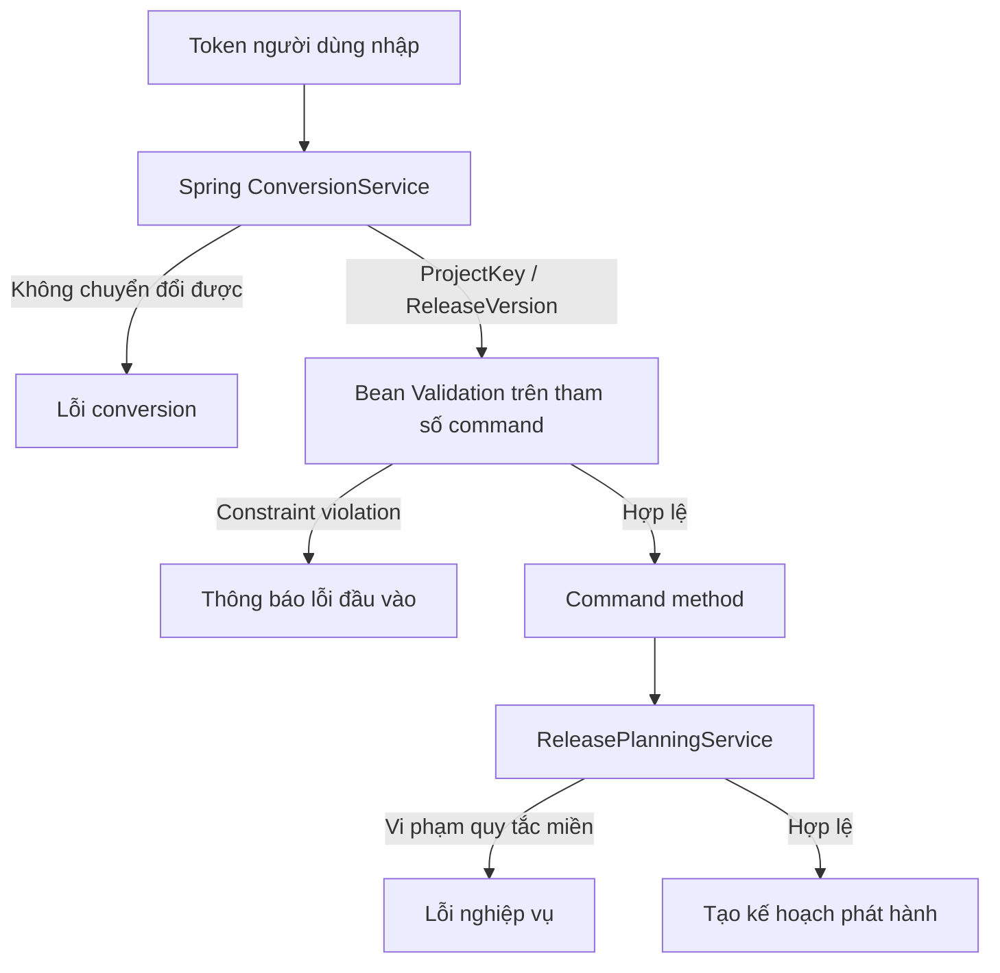

# Bổ sung converter và validation cho kiểu dữ liệu miền

Một command Spring Shell thường nhận dữ liệu dưới dạng chuỗi, nhưng nghiệp vụ không nên phải xử lý mọi thứ bằng `String`. Mã dự án, phiên bản phát hành, mã khách hàng hoặc khoảng thời gian đều có quy tắc biểu diễn riêng. Chuyển các chuỗi đầu vào thành kiểu dữ liệu miền giúp chữ ký command rõ ràng hơn, giảm lỗi truyền nhầm giá trị và gom quy tắc định dạng vào một nơi.

Trong bài thực hành này, ta xây dựng command lập kế hoạch phát hành. Người dùng nhập mã dự án như `PRJ-0042` và phiên bản như `2.4.1`. Spring Shell chuyển hai chuỗi này thành `ProjectKey` và `ReleaseVersion` bằng custom converter. Bean Validation kiểm tra thêm các điều kiện đầu vào ở command boundary, còn service bảo vệ quy tắc nghiệp vụ cần đúng với mọi caller.

Bài học thuộc chương **Thực hành tổng hợp**. Nội dung kết hợp command annotation, Spring ConversionService, domain value object, Jakarta Bean Validation, service layer và kiểm thử. Ví dụ chính dùng Spring Shell 4.0.4; phần cuối chỉ ra khác biệt quan trọng của các bản 4.0.2 và 4.0.3.

Sau bài học, bạn có thể:

- Thiết kế value object có invariant rõ ràng cho dữ liệu miền.
- Viết `Converter<String, T>` để chuyển token của command thành kiểu miền.
- Đăng ký converter bean trong Spring context và dùng với command annotation.
- Phân biệt lỗi cú pháp chuyển đổi với lỗi validation.
- Dùng Bean Validation trên tham số command bằng `@NotNull`, `@NotBlank`, `@Size` và custom constraint.
- Đặt quy tắc nghiệp vụ ở service để mọi đường gọi đều được bảo vệ.
- Kiểm thử converter, validation, command binding và service.
- Nhận biết lỗi custom converter trong Spring Shell 4.0.2 và bản sửa 4.0.3.

## Bài toán thực hành

Ta cần command sau:

```text
release plan --project prj-0042 --version 2.4.1 --target staging --summary "Chuẩn bị bản phát hành tháng 4"
```

Command phải:

1. Chuẩn hóa mã dự án thành chữ hoa và kiểm tra cú pháp `PRJ-` theo sau bởi bốn chữ số.
2. Chuyển chuỗi phiên bản thành ba thành phần major, minor và patch.
3. Từ chối mã dự án dành riêng `PRJ-0000`.
4. Yêu cầu `target` là `staging` hoặc `production`.
5. Yêu cầu summary không rỗng và không dài quá 80 ký tự.
6. Không cho phép phát hành phiên bản major `0` lên production.

Các quy tắc này thuộc nhiều lớp khác nhau. Chuyển đổi xử lý cú pháp và biểu diễn. Bean Validation kiểm tra đầu vào của command. Service kiểm tra điều kiện nghiệp vụ trước khi tạo kế hoạch phát hành.

## Phân biệt conversion và validation

Conversion và validation thường diễn ra gần nhau nhưng giải quyết hai câu hỏi khác nhau:

| Giai đoạn | Câu hỏi | Ví dụ | Kết quả khi thất bại |
| --- | --- | --- | --- |
| Parsing/conversion | Chuỗi có thể biểu diễn thành kiểu dữ liệu đích không? | `prj-0042` có chuyển thành `ProjectKey` được không? | Converter ném `IllegalArgumentException`, Spring báo lỗi chuyển đổi. |
| Command validation | Giá trị đã chuyển đổi có thỏa điều kiện đầu vào của command không? | `PRJ-0000` có phải mã dự án được phép dùng không? | Bean Validation báo constraint violation trước khi command chạy. |
| Domain/business validation | Thao tác có hợp lệ theo trạng thái nghiệp vụ không? | Phiên bản major `0` có được phát hành lên production không? | Service từ chối thao tác bằng lỗi nghiệp vụ. |

Ví dụ, `PRJ-ABCD` sai cú pháp mã dự án nên converter từ chối. `PRJ-0000` đúng cú pháp nên chuyển đổi thành công, nhưng custom constraint từ chối vì đây là mã dành riêng. Mã `PRJ-0042` và phiên bản `0.8.0` có thể qua conversion và command validation, nhưng service vẫn từ chối nếu target là production.



Không nên đưa truy vấn database hoặc kiểm tra quyền truy cập vào converter. Converter nên chuyển đổi một cách xác định từ chuỗi sang giá trị. Kiểm tra dữ liệu tồn tại, trạng thái dự án, quyền người dùng hoặc điều kiện liên quan nhiều aggregate thuộc service/domain layer.

## Dependency cần có

Ứng dụng Spring Boot 4.x dùng Spring Shell 4.x và cần Bean Validation. Thêm validation starter vào module ứng dụng:

```xml
<dependency>
    <groupId>org.springframework.boot</groupId>
    <artifactId>spring-boot-starter-validation</artifactId>
</dependency>
```

Dependency management của Spring Boot quản lý version. Với Spring Shell 3.3.x trên Spring Boot 3.x, starter có cùng artifact ID; hãy để BOM của Spring Boot 3.x quản lý phiên bản tương thích.

Validation starter cung cấp Bean Validation API và Hibernate Validator. Spring Shell tích hợp Bean Validation để thực hiện constraint trên tham số command trước khi gọi method.

## Bước 1: Tạo domain value object

`ProjectKey` là mã định danh dự án. Ta muốn mã luôn có dạng chuẩn `PRJ-1234`, không phân biệt chữ hoa/thường ở đầu vào nhưng lưu nội bộ bằng chữ hoa.

```java
import java.util.Locale;
import java.util.Objects;
import java.util.regex.Pattern;

public record ProjectKey(String value) {

    private static final Pattern FORMAT = Pattern.compile("PRJ-[0-9]{4}");

    public ProjectKey {
        Objects.requireNonNull(value, "Project key must not be null");
        if (!FORMAT.matcher(value).matches()) {
            throw new IllegalArgumentException(
                "Mã dự án phải có dạng PRJ-1234");
        }
    }

    public static ProjectKey parse(String source) {
        String normalized = source.trim().toUpperCase(Locale.ROOT);
        return new ProjectKey(normalized);
    }

    @Override
    public String toString() {
        return value;
    }
}
```

Constructor của record bảo vệ invariant nên code khác không thể tạo `ProjectKey` sai định dạng bằng cách gọi `new ProjectKey(...)`. Factory `parse` chuẩn hóa đầu vào trước khi tạo object. `toString()` trả về biểu diễn chuẩn để log và thông báo lỗi dễ đọc.

`ReleaseVersion` biểu diễn phiên bản gồm ba số nguyên không âm:

```java
import java.util.regex.Matcher;
import java.util.regex.Pattern;

public record ReleaseVersion(int major, int minor, int patch) {

    private static final Pattern FORMAT =
        Pattern.compile("(0|[1-9][0-9]*)\\.(0|[1-9][0-9]*)\\.(0|[1-9][0-9]*)");

    public ReleaseVersion {
        if (major < 0 || minor < 0 || patch < 0) {
            throw new IllegalArgumentException(
                "Các thành phần phiên bản phải không âm");
        }
    }

    public static ReleaseVersion parse(String source) {
        Matcher matcher = FORMAT.matcher(source.trim());
        if (!matcher.matches()) {
            throw new IllegalArgumentException(
                "Phiên bản phải có dạng major.minor.patch, ví dụ 2.4.1");
        }

        try {
            return new ReleaseVersion(
                Integer.parseInt(matcher.group(1)),
                Integer.parseInt(matcher.group(2)),
                Integer.parseInt(matcher.group(3)));
        }
        catch (NumberFormatException ex) {
            throw new IllegalArgumentException(
                "Thành phần phiên bản vượt phạm vi số nguyên", ex);
        }
    }

    @Override
    public String toString() {
        return major + "." + minor + "." + patch;
    }
}
```

Ở đây ta cố ý chỉ hỗ trợ phiên bản dạng `major.minor.patch`. Nếu sản phẩm cần prerelease như `2.4.1-rc.1` hoặc build metadata như `2.4.1+build.7`, hãy mở rộng parser theo quy ước version mà hệ thống thực sự sử dụng. Không âm thầm chấp nhận một chuỗi rộng hơn quy tắc miền.

Value object tự bảo vệ invariant cơ bản. Vì vậy, kể cả object được tạo từ REST API, batch job hoặc test mà không đi qua Spring Shell, nó vẫn không thể chứa giá trị sai định dạng.

## Bước 2: Viết custom converter

Spring Framework cung cấp `Converter<S, T>` cho chuyển đổi kiểu có kiểu nguồn và đích rõ ràng. Với `ProjectKey`, nguồn là `String`, đích là `ProjectKey`:

```java
import org.springframework.core.convert.converter.Converter;
import org.springframework.stereotype.Component;

@Component
public class StringToProjectKeyConverter
        implements Converter<String, ProjectKey> {

    @Override
    public ProjectKey convert(String source) {
        return ProjectKey.parse(source);
    }
}
```

Converter cho `ReleaseVersion` tương tự:

```java
import org.springframework.core.convert.converter.Converter;
import org.springframework.stereotype.Component;

@Component
public class StringToReleaseVersionConverter
        implements Converter<String, ReleaseVersion> {

    @Override
    public ReleaseVersion convert(String source) {
        return ReleaseVersion.parse(source);
    }
}
```

Spring Shell dùng Spring ConversionService để chuyển token thành kiểu tham số command. Với Spring Shell 4.0.3 trở lên, các converter bean trong application context được thu thập khi framework tạo conversion service mặc định cho command annotation. Vì vậy, một bean `Converter<String, ProjectKey>` như ví dụ trên có thể được dùng trực tiếp bởi `@Command`.

Hãy giữ converter stateless và thread-safe. Spring Framework bảo đảm source truyền vào `Converter.convert` không null; nếu giá trị không hợp lệ, ném `IllegalArgumentException` với thông báo cụ thể. Không trả về `null` để biểu thị chuỗi sai định dạng, vì điều đó làm lỗi khó chẩn đoán và có thể biến thành lỗi null ở lớp sau.

### Khi nào dùng Converter, ConverterFactory hoặc GenericConverter?

| SPI | Trường hợp phù hợp | Ví dụ |
| --- | --- | --- |
| `Converter<S, T>` | Một cặp kiểu nguồn/đích cụ thể. | `String` thành `ProjectKey`. |
| `ConverterFactory<S, R>` | Nhiều kiểu đích trong cùng một hierarchy. | `String` thành các subtype của một loại domain identifier. |
| `GenericConverter` | Một converter hỗ trợ nhiều cặp kiểu hoặc cần đọc `TypeDescriptor`. | Chuyển đổi phụ thuộc generic collection hoặc metadata annotation. |

Ưu tiên `Converter` cho các value object đơn giản. `GenericConverter` linh hoạt hơn nhưng có nhiều trách nhiệm hơn; chỉ dùng khi `Converter` hoặc `ConverterFactory` không đủ.

### Lưu ý quan trọng về Spring Shell 4.0.2 và 4.0.3

Spring Shell 4.0.2 có lỗi khiến custom `Converter` bean không được đăng ký đúng khi command được tạo từ `@Command` annotation. Command đăng ký programmatically không gặp cùng vấn đề. Lỗi này được sửa trong 4.0.3 qua issue #1352/#1353.

Trong 4.0.3+, khi không có `ConfigurableConversionService` bean riêng, `CommandFactoryBean` tạo `DefaultConversionService` và thu thập các bean kiểu `Converter`, `GenericConverter` và `ConverterFactory` từ application context. Với converter lambda được khai báo qua `@Bean`, framework lấy generic source/target từ merged bean definition để đăng ký converter có kiểu cụ thể.

Nếu ứng dụng đang ở 4.0.2 và command annotation báo `ConverterNotFoundException`, hãy kiểm tra version trước khi viết workaround. Ưu tiên nâng lên 4.0.3 hoặc patch mới hơn. Trên dòng 4.0.4, vẫn nên có command integration test để xác nhận converter thực sự được dùng.

Nếu tự khai báo một `ConfigurableConversionService` riêng, bạn phải đăng ký các converter cần thiết vào service đó. Tránh thay thế conversion service mặc định chỉ để thêm một converter đơn lẻ. Việc dùng bean tên `conversionService` còn có thể ảnh hưởng đến Spring Boot configuration-properties binding; nếu có lý do phải tạo service riêng cho shell, hãy tách tên bean và kiểm thử cả khởi tạo context lẫn command binding.

## Bước 3: Tạo custom Bean Validation constraint

Converter đã bảo đảm cú pháp mã dự án. Ta còn có một quy tắc khác: `PRJ-0000` là mã dành riêng, không được dùng để lập kế hoạch phát hành. Đây là validation policy, không phải cú pháp chuyển đổi.

Khai báo constraint `@ValidProjectKey`:

```java
import jakarta.validation.Constraint;
import jakarta.validation.Payload;

import java.lang.annotation.Documented;
import java.lang.annotation.ElementType;
import java.lang.annotation.Retention;
import java.lang.annotation.RetentionPolicy;
import java.lang.annotation.Target;

@Documented
@Constraint(validatedBy = ProjectKeyValidator.class)
@Target({ElementType.PARAMETER, ElementType.FIELD, ElementType.ANNOTATION_TYPE})
@Retention(RetentionPolicy.RUNTIME)
public @interface ValidProjectKey {

    String message() default "Mã dự án này được dành riêng và không thể phát hành";

    Class<?>[] groups() default {};

    Class<? extends Payload>[] payload() default {};
}
```

Viết validator:

```java
import jakarta.validation.ConstraintValidator;
import jakarta.validation.ConstraintValidatorContext;

public class ProjectKeyValidator
        implements ConstraintValidator<ValidProjectKey, ProjectKey> {

    @Override
    public boolean isValid(
            ProjectKey value,
            ConstraintValidatorContext context) {
        // @NotNull xử lý trường hợp null riêng.
        return value == null || !value.value().equals("PRJ-0000");
    }
}
```

Validator này là stateless và chỉ kiểm tra quy tắc xác định từ chính giá trị. `null` được xem là hợp lệ ở constraint này để có thể kết hợp `@NotNull`; mỗi constraint chịu trách nhiệm cho một điều kiện rõ ràng.

Không nên dùng custom constraint này để truy vấn trạng thái dự án trong database nếu việc đó có thể thay đổi theo thời gian hoặc phụ thuộc transaction. Với quy tắc như “dự án đang hoạt động”, “người dùng có quyền triển khai” hoặc “chưa có release đang chạy”, service cần truy vấn nguồn dữ liệu có thẩm quyền và từ chối thao tác khi điều kiện không thỏa.

## Bước 4: Đặt validation trên tham số command

Spring Shell tích hợp Bean Validation. Constraint đặt trực tiếp trên tham số command được kiểm tra trước khi method thực thi.

```java
import jakarta.validation.constraints.NotBlank;
import jakarta.validation.constraints.NotNull;
import jakarta.validation.constraints.Pattern;
import jakarta.validation.constraints.Size;

import org.springframework.shell.core.command.annotation.Command;
import org.springframework.shell.core.command.annotation.Option;
import org.springframework.stereotype.Component;

@Component
public class ReleaseCommands {

    private final ReleasePlanningService releasePlanningService;

    public ReleaseCommands(ReleasePlanningService releasePlanningService) {
        this.releasePlanningService = releasePlanningService;
    }

    @Command(name = "release plan", description = "Lập kế hoạch phát hành")
    public String plan(
            @Option(longName = "project", required = true)
            @NotNull
            @ValidProjectKey
            ProjectKey project,

            @Option(longName = "version", required = true)
            @NotNull
            ReleaseVersion version,

            @Option(longName = "target", required = true)
            @NotBlank
            @Pattern(regexp = "staging|production")
            String target,

            @Option(longName = "summary", required = true)
            @NotBlank
            @Size(max = 80)
            String summary) {

        return releasePlanningService.plan(project, version, target, summary);
    }
}
```

Các lớp annotation có vai trò riêng:

- `required = true` làm option bắt buộc trong command syntax.
- `@NotNull` kiểm tra giá trị sau binding không null.
- `@ValidProjectKey` kiểm tra mã dự án không thuộc nhóm reserved.
- `@Pattern` giới hạn target vào hai giá trị được hỗ trợ.
- `@NotBlank` từ chối chuỗi rỗng hoặc chỉ có khoảng trắng.
- `@Size(max = 80)` giới hạn độ dài summary.

Spring Shell hiển thị constraint violation trước khi gọi command method. Ví dụ nếu summary dài hơn 80 ký tự, command không gọi `ReleasePlanningService`. Nếu token `--project` sai cú pháp, conversion thất bại trước khi Bean Validation có thể kiểm tra `ProjectKey`.

### Phân biệt required và @NotNull

`required = true` thuộc command parser: người dùng phải cung cấp option. `@NotNull` thuộc Bean Validation: giá trị được bind phải không null. Dùng cả hai có thể giúp tài liệu help và validation rõ ràng hơn, nhưng không thay thế nhau trong mọi kiểu command registration.

## Bước 5: Giữ quy tắc nghiệp vụ trong service

Một command CLI không phải caller duy nhất của service. REST adapter, batch job hoặc test có thể gọi cùng nghiệp vụ. Vì vậy, điều kiện phát hành lên production phải nằm trong service/domain layer.

```java
import org.springframework.stereotype.Service;

@Service
public class ReleasePlanningService {

    public String plan(
            ProjectKey project,
            ReleaseVersion version,
            String target,
            String summary) {

        if ("production".equals(target) && version.major() == 0) {
            throw new IllegalArgumentException(
                "Không thể phát hành phiên bản major 0 lên production");
        }

        // Ở ứng dụng thật, lưu ReleasePlan qua repository sau các kiểm tra miền.
        return "Đã lập kế hoạch " + project
            + " phiên bản " + version
            + " cho " + target
            + ": " + summary;
    }
}
```

Đây là quy tắc nghiệp vụ. Nếu chỉ kiểm tra trong command, một caller khác có thể bỏ qua nó. Service cũng nên thực hiện các kiểm tra phụ thuộc trạng thái như dự án tồn tại, đang hoạt động, người dùng có quyền và chưa có kế hoạch phát hành xung đột.

Nếu service được gọi từ nhiều adapter, có thể tách policy thành domain service hoặc validator chuyên biệt. Dù đặt ở đâu, quy tắc phải được thực thi ở đường nghiệp vụ có thẩm quyền, không chỉ trong giao diện terminal.

## Bước 6: Kiểm thử converter và value object

Converter là đơn vị nhỏ, có thể kiểm thử mà không cần khởi động Spring Shell:

```java
import static org.assertj.core.api.Assertions.assertThat;
import static org.assertj.core.api.Assertions.assertThatThrownBy;

import org.junit.jupiter.api.Test;

class DomainConverterTests {

    private final StringToProjectKeyConverter projectKeyConverter =
        new StringToProjectKeyConverter();

    private final StringToReleaseVersionConverter versionConverter =
        new StringToReleaseVersionConverter();

    @Test
    void normalizesProjectKey() {
        assertThat(projectKeyConverter.convert(" prj-0042 "))
            .isEqualTo(new ProjectKey("PRJ-0042"));
    }

    @Test
    void rejectsMalformedProjectKey() {
        assertThatThrownBy(() -> projectKeyConverter.convert("PRJ-ABCD"))
            .isInstanceOf(IllegalArgumentException.class)
            .hasMessageContaining("PRJ-1234");
    }

    @Test
    void parsesReleaseVersion() {
        assertThat(versionConverter.convert("2.4.1"))
            .isEqualTo(new ReleaseVersion(2, 4, 1));
    }

    @Test
    void rejectsIncompleteReleaseVersion() {
        assertThatThrownBy(() -> versionConverter.convert("2.4"))
            .isInstanceOf(IllegalArgumentException.class)
            .hasMessageContaining("major.minor.patch");
    }
}
```

Các test này xác nhận chuẩn hóa và cú pháp của value object. Không cần mock `ConversionService` vì converter được gọi trực tiếp.

## Bước 7: Kiểm thử validation và service

Kiểm thử validator cho reserved key:

```java
import static org.assertj.core.api.Assertions.assertThat;

import org.junit.jupiter.api.Test;

class ProjectKeyValidatorTests {

    private final ProjectKeyValidator validator = new ProjectKeyValidator();

    @Test
    void rejectsReservedProjectKey() {
        assertThat(validator.isValid(new ProjectKey("PRJ-0000"), null))
            .isFalse();
    }

    @Test
    void acceptsRegularProjectKey() {
        assertThat(validator.isValid(new ProjectKey("PRJ-0042"), null))
            .isTrue();
    }
}
```

Kiểm thử service bảo đảm quy tắc nghiệp vụ vẫn được áp dụng khi gọi trực tiếp:

```java
import static org.assertj.core.api.Assertions.assertThatThrownBy;

import org.junit.jupiter.api.Test;

class ReleasePlanningServiceTests {

    private final ReleasePlanningService service = new ReleasePlanningService();

    @Test
    void rejectsMajorZeroForProduction() {
        assertThatThrownBy(() -> service.plan(
                new ProjectKey("PRJ-0042"),
                new ReleaseVersion(0, 8, 0),
                "production",
                "Initial release"))
            .isInstanceOf(IllegalArgumentException.class)
            .hasMessageContaining("major 0");
    }
}
```

Test service không khởi tạo terminal và không phụ thuộc parser. Đây là nơi kiểm tra quy tắc nghiệp vụ cần đúng với mọi caller.

## Bước 8: Kiểm thử tích hợp qua ShellTestClient

Unit test không chứng minh Spring Shell đã thu thập converter bean. Cần một command test chạy qua command registry và parser.

Với Spring Shell 4.0.4, dùng `@ShellTest` và `ShellTestClient`:

```java
import static org.springframework.shell.test.ShellAssertions.assertThat;

import org.junit.jupiter.api.Test;
import org.springframework.beans.factory.annotation.Autowired;
import org.springframework.shell.test.ShellScreen;
import org.springframework.shell.test.ShellTestClient;
import org.springframework.shell.test.autoconfigure.ShellTest;
import org.springframework.test.context.ContextConfiguration;

@ShellTest
@ContextConfiguration(classes = ReleaseCliApplication.class)
class ReleaseCommandTests {

    @Autowired
    ShellTestClient client;

    @Test
    void convertsDomainTypesAndRunsCommand() throws Exception {
        ShellScreen screen = client.sendCommand(
            "release plan --project prj-0042 --version 2.4.1 "
                + "--target staging --summary \"April release\"");

        assertThat(screen).containsText(
            "Đã lập kế hoạch PRJ-0042 phiên bản 2.4.1 cho staging: April release");
    }

    @Test
    void rejectsReservedProjectKeyBeforeExecutingCommand() throws Exception {
        ShellScreen screen = client.sendCommand(
            "release plan --project PRJ-0000 --version 2.4.1 "
                + "--target staging --summary \"April release\"");

        assertThat(screen).containsText(
            "Mã dự án này được dành riêng và không thể phát hành");
    }
}
```

`ReleaseCliApplication` là Spring Boot application class có component scan bao phủ `ReleaseCommands`, hai converter, validator và service. Nếu package của test không nằm dưới package gốc của ứng dụng, hãy chỉ định cấu hình test phù hợp bằng `@ContextConfiguration` hoặc `@Import`.

Test đầu tiên chứng minh chuỗi `prj-0042` và `2.4.1` được chuyển thành domain types và command gọi service thành công. Test thứ hai chứng minh converter chấp nhận cú pháp `PRJ-0000`, nhưng Bean Validation chặn giá trị reserved trước khi command method chạy.

Với token sai cú pháp như `PRJ-ABCD`, thêm test converter trực tiếp để xác nhận lỗi chuyển đổi. Nếu cần xác nhận thông báo parser ở cấp shell, có thể thêm một command test riêng; không nên phụ thuộc vào toàn bộ chuỗi exception nội bộ vì result handler có thể thay đổi cách hiển thị giữa các patch release.

## Bước 9: Kiểm tra cấu hình validator và command validation

Nếu Spring Shell không báo constraint violation, kiểm tra:

1. `spring-boot-starter-validation` có trong runtime classpath.
2. Có Bean Validation provider, chẳng hạn Hibernate Validator.
3. Constraint được đặt trên đúng tham số command method.
4. Command đang chạy qua Spring Shell command adapter, không phải gọi method Java trực tiếp.
5. Command test khởi tạo đúng Spring context và command registry.

Spring Framework cung cấp `LocalValidatorFactoryBean` để tạo Spring-managed `Validator`. Với custom `ConstraintValidator` cần inject bean Spring, dùng validator factory tích hợp Spring thay vì tự tạo `Validation.buildDefaultValidatorFactory()` độc lập. Trong bài thực hành này, validator chỉ kiểm tra dữ liệu thuần nên không cần dependency injection.

Nếu validation cần đọc database hoặc gọi service ngoài, cân nhắc chuyển quy tắc đó vào service nghiệp vụ. Custom constraint có thể dùng Spring dependency khi được tạo bởi Spring-aware validator factory, nhưng không nên biến mọi kiểm tra trạng thái thành một constraint chạy ngầm trước command.

## Phân biệt validation tham số command và method validation của service

Spring Shell có cơ chế validation riêng cho tham số command: constraint được đặt trực tiếp trên tham số command và được kiểm tra trước khi command chạy.

Spring Framework method validation là cơ chế khác. Với service, cần provider Bean Validation và `@Validated` trên class; lời gọi method phải đi qua Spring AOP proxy. Ví dụ:

```java
import jakarta.validation.constraints.NotNull;
import org.springframework.stereotype.Service;
import org.springframework.validation.annotation.Validated;

@Service
@Validated
public class ProjectLookupService {

    public String describe(@NotNull ProjectKey projectKey) {
        return "Project " + projectKey;
    }
}
```

Không nhầm hai cơ chế: annotation trên command parameter được Spring Shell xử lý ở command adapter; annotation trên service method được Spring method validation xử lý khi service được gọi qua proxy. Nếu service là ranh giới nghiệp vụ được nhiều adapter dùng chung, method validation hoặc kiểm tra domain tường minh giúp bảo vệ đường gọi ngoài Spring Shell.

## Lỗi thường gặp

| Hiện tượng | Nguyên nhân | Cách xử lý |
| --- | --- | --- |
| `ConverterNotFoundException` cho custom type | Converter chưa được đăng ký hoặc đang dùng Spring Shell 4.0.2 với lỗi #1352. | Kiểm tra component scan và nâng lên 4.0.3+; thêm command integration test. |
| Converter chạy trong unit test nhưng không chạy qua `@Command` | Test chỉ gọi converter trực tiếp, không kiểm tra command conversion service. | Dùng `ShellTestClient` để kiểm tra binding thực tế. |
| Token sai cú pháp tạo `NullPointerException` ở service | Converter trả `null` thay vì báo lỗi conversion. | Ném `IllegalArgumentException` với thông báo rõ ràng. |
| Chuỗi hợp lệ về cú pháp nhưng vẫn không được phép | Converter chỉ kiểm tra định dạng, chưa kiểm tra policy. | Dùng Bean Validation hoặc service/domain rule cho điều kiện đó. |
| `@Pattern` không áp dụng được lên value object | Constraint `@Pattern` chỉ dành cho `CharSequence`. | Dùng custom constraint tương thích kiểu miền hoặc kiểm tra chuỗi trước conversion. |
| Validation không chạy | Thiếu validation provider hoặc constraint không đặt trên tham số command. | Thêm validation starter và kiểm tra command test context. |
| Command method vẫn chạy khi tham số sai | Chỉ validate trong thân method sau khi đã có side effect. | Đặt constraint ở command boundary và giữ invariant trong service/domain. |
| Service bị gọi từ API khác bỏ qua quy tắc | Quy tắc chỉ nằm trong command. | Chuyển điều kiện nghiệp vụ vào service/domain layer. |
| Custom validator không inject được repository | Validator factory không được tích hợp Spring hoặc validator đang tự tạo thủ công. | Dùng Spring-managed Validator; với kiểm tra trạng thái phức tạp, ưu tiên service. |
| Custom `ConversionService` làm mất converter mặc định | Service tự tạo không đăng ký các converter cần thiết. | Dùng service mặc định hoặc đăng ký đầy đủ default/custom converters. |
| Bean `conversionService` gây vòng phụ thuộc | Spring Boot dùng bean tên này cho configuration-properties binding; converter lại phụ thuộc bean khởi tạo muộn. | Tránh override nếu không cần; nếu cần shell-specific service, dùng tên riêng và kiểm tra dependency graph. |
| Help không mô tả được kiểu miền | Option không có `description` hoặc biểu diễn kiểu không rõ. | Viết mô tả format cụ thể, ví dụ `PRJ-1234` và `major.minor.patch`. |

## Checklist trước khi hoàn thành

- [ ] Value object có constructor/factory bảo vệ invariant.
- [ ] `toString()` trả biểu diễn miền ngắn gọn và dễ đọc.
- [ ] Converter stateless, thread-safe và báo lỗi bằng `IllegalArgumentException`.
- [ ] Converter được đăng ký thành Spring bean.
- [ ] Spring Shell version đã được kiểm tra; dùng 4.0.3+ nếu dùng custom converter với `@Command`.
- [ ] Command test xác nhận converter thực sự được sử dụng.
- [ ] Conversion chỉ kiểm tra cú pháp và chuẩn hóa dữ liệu.
- [ ] Bean Validation kiểm tra required, blank, size, pattern và custom policy.
- [ ] Validation starter/provider có trong runtime classpath.
- [ ] Quy tắc nghiệp vụ được giữ trong service/domain layer.
- [ ] Có test cho conversion hợp lệ và không hợp lệ.
- [ ] Có test cho constraint hợp lệ và vi phạm.
- [ ] Có test service độc lập với Spring Shell.
- [ ] Có integration test qua `ShellTestClient`.
- [ ] Không đưa truy vấn database hoặc side effect vào converter.

## Ghi nhớ

Custom converter biến token thành domain value object; Bean Validation kiểm tra constraint của tham số command; service/domain layer bảo vệ quy tắc nghiệp vụ. Giữ ba trách nhiệm này tách biệt để command dễ đọc và nghiệp vụ vẫn an toàn khi được gọi từ nơi khác. Với Spring Shell 4.x, đăng ký converter như Spring bean và kiểm thử qua `ShellTestClient`; lỗi khiến converter bean không hoạt động với `@Command` trong 4.0.2 đã được sửa từ 4.0.3. Dùng `spring-boot-starter-validation` để cung cấp Bean Validation provider, đặt constraint trực tiếp trên tham số command và giữ các quy tắc phụ thuộc trạng thái trong service.

## Tài liệu tham khảo

- [Spring Shell 4.0.4 — Option Validation](https://docs.spring.io/spring-shell/reference/commands/validation.html): Bean Validation trên tham số command và thời điểm validation.
- [Spring Shell 4.0.4 — Command Syntax](https://docs.spring.io/spring-shell/reference/commands/syntax.html): option, argument và kiểu dữ liệu command.
- [Spring Shell 4.0.4 — Testing](https://docs.spring.io/spring-shell/reference/testing.html): `@ShellTest`, `ShellTestClient` và kiểm thử command.
- [Spring Shell issue #1352](https://github.com/spring-projects/spring-shell/issues/1352): custom converter không được dùng với command annotation trong 4.0.2 và cách xử lý.
- [Spring Shell releases](https://github.com/spring-projects/spring-shell/releases): bản sửa converter #1353 trong 4.0.3.
- [Spring Framework 7.1 — Spring Type Conversion](https://docs.spring.io/spring-framework/reference/core/validation/convert.html): `Converter`, `ConverterFactory`, `GenericConverter` và `ConversionService`.
- [Spring Framework 7.1 — Java Bean Validation](https://docs.spring.io/spring-framework/reference/core/validation/beanvalidation.html): `Validator`, `LocalValidatorFactoryBean`, custom constraint và method validation.
- [Spring Boot — Validation](https://docs.spring.io/spring-boot/reference/io/validation.html): cấu hình validation provider và method validation với `@Validated`.
- [Spring Boot 4.0.4 — Validation Starter](https://central.sonatype.com/artifact/org.springframework.boot/spring-boot-starter-validation/4.0.4): dependency cung cấp Hibernate Validator cho Spring Boot 4.0.4.
